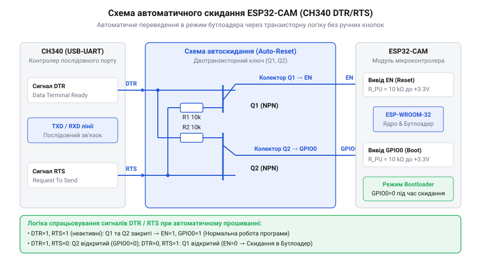

# Налаштування середовища розробки та автоматичне прошивання ESP32-CAM через Type-C адаптер

<preknowlist>
- [USB-UART адаптер CP2102 (Micro-USB)](root:cat-hw-boards/cp2102-usb-uart) — Принцип роботи послідовного інтерфейсу UART, узгодження ліній RX/TX та особливості ручного переведення мікроконтролера в режим прошивки.
- [Адаптер живлення й підключення ESP-01](root:cat-hw-boards/esp-01-adapter) — Вимоги до стабільності живлення Wi-Fi модулів та підходи до створення спеціалізованих плат розширення для програмування.
</preknowlist>

## Складнощі прошивання ESP32-CAM без автозавантаження

Спроба завантажити нову прошивку в модуль @@en|ESP32-CAM@@ через стандартний @@en|USB-UART@@ перетворювач часто перетворюється на виснажливий процес із постійними помилками з'єднання. На відміну від більшості сучасних налагоджувальних плат, цей модуль не має вбудованої схеми автоматичного скидання. Для переведення мікроконтролера в режим завантаження вихідний контакт @@en|GPIO@@ (англ. *general-purpose input/output* — входи/виходи загального призначення) з номером 0 потрібно вручну з'єднати з лінією @@en|GND@@ (англ. *ground*, корінь *ground* — земля) за допомогою джампера, після чого короткочасно подати низький рівень на вхід @@en|RESET@@ (англ. *reset*, від *re-* — знову, *set* — ставити). Якщо порушити цю послідовність або не зняти перемичку після завершення запису, внутрішній @@en|бутлоадер@@ (англ. *bootloader*, від *boot* — завантажувати, *loader* — завантажувач) або знову заблокує запуск системи, або циклічно перезапускатиме старий код.

Друга критична перешкода полягає у вимогах до джерела живлення. Під час ініціалізації відеосенсора OV2640 та калібрування радіочастотного тракту @@en|Wi-Fi@@ споживання струму платою стрибає до 300–500 мА. Прості програматори, як-от стандартний [адаптер CP2102](root:cat-hw-boards/cp2102-usb-uart), живляться від шини USB через слабкі вбудовані регулятори, які не здатні компенсувати такі імпульсні навантаження. Для захисту мікроконтролера всередині чипа @@en|ESP32@@ працює апаратний детектор просідання живлення, який через вбудований аналоговий @@en|компаратор@@ (англ. *comparator*, від *compare* — порівнювати) безперервно вимірює напругу на шині `3.3V`. Якщо напруга падає нижче встановленого апаратного порога — який у базі регулюється в межах від `2.43V` до `2.80V` із типовим замовчуваним значенням `2.43V` — логічні осередки процесора та пам'яті починають працювати нестабільно. Щоб запобігти викривленню даних і неконтрольованому виконанню команд, компаратор миттєво генерує апаратне скидання. Таке спрацьвування захисту — просідання живлення або @@en|браунаут@@ (англ. *brownout*, від *brown* — тьмяний, *out* — вихід) — призводить до нескінченного циклу перезавантажень модуля саме в момент старту камери: після скидання споживання струму зменшується, напруга відновлюється, але під час нової спроби ініціалізації відеосенсора вона знову просідає нижче `2.43V` і викликає повторний перезапуск. Вирішення цих проблем вимагає використання спеціалізованого адаптера з роз'ємом @@en|Type-C@@, який поєднує потужний стабілізатор напруги та вузол автоматичного керування виводами @@en|RESET@@ і @@en|GPIO@@0.

Такий підхід докорінно змінює процес розробки: замість громіздкого макетування з купою джамперів, зовнішніх блоків живлення та ручного перемикання режимів розробник отримує компактну плату-материнку. За аналогією з тим, як спеціалізований [адаптер живлення ESP-01](root:cat-hw-boards/esp-01-adapter) спрощує роботу з компактними бездротовими модулями, цей програматор дає змогу просто встановити @@en|ESP32-CAM@@ у сокетні роз'єми та підключити один кабель @@en|Type-C@@. Усі операції зі скидання живлення, переведення мікроконтролера в режим завантаження та забезпечення необхідного струму відбуваються прозоро для користувача, перетворюючи прошивання на процедуру в один клік у середовищі розробки.

## Схемотехніка автоматичного скидання та живлення

Автоматизація процесів скидання та вибору режиму завантаження базується на узгодженій роботі двох допоміжних сигналів послідовного порту. Інтерфейсний [перетворювач CH340](root:cat-hw-boards/ch340-usb-uart-bridge) формує керуючі лінії @@en|DTR@@ (англ. *Data Terminal Ready*, від *data* — дані, *terminal* — термінал, *ready* — готовий) та @@en|RTS@@ (англ. *Request to Send*, від *request* — запит, *send* — надсилати). Вони підключені до бази двох NPN-типу @@en|транзисторів@@ (англ. *transistor*, від *transfer* — передавати, *resistor* — резистор), колектор одного з яких керує виводом @@en|RESET@@, а іншого — лінією @@en|GPIO@@0. Така перехресна схема гарантує, що коли обидва сигнали @@en|DTR@@ і @@en|RTS@@ знаходяться в однаковому логічному стані (одночасно високий або низький), обидва @@en|транзистори@@ закриті, а мікроконтролер працює у звичайному робочому режимі.

*Принципова схема автозавантаження та живлення модуля ESP32-CAM через адаптер Type-C на базі CH340*

Коли середовище розробки починає прошивання, воно реалізує чітку часову послідовність зміни сигналів @@en|DTR@@ та @@en|RTS@@ для керування завантаженням. На першому кроці середовище встановлює @@en|DTR@@ у низький рівень, а @@en|RTS@@ — у високий, що відкриває перший @@en|транзистор@@ і притягує вивід @@en|GPIO@@0 до лінії @@en|GND@@, розряджаючи його потенціал практично до нуля. На другому кроці комбінація сигналів змінюється на протилежну (@@en|DTR@@ у високий рівень, а @@en|RTS@@ у низький), що відкриває другий @@en|транзистор@@, який миттєво скидає на землю залишкову напругу лінії @@en|RESET@@ і формує короткий імпульс скидання ядра. Після цього обидва сигнали повертаються в однакові рівні, закриваючи обидва @@en|транзистори@@; при цьому підтягувальний резистор починає поступово заряджати фільтрувальну ємність виводу @@en|RESET@@, забезпечуючи плавний підйом напруги від 0 В до 3.3 В. Ключова стабілізація полягає у дотриманні часового затримного вікна: в момент, коли зростаюча напруга на @@en|RESET@@ перетинає внутрішній апаратний поріг логічної одиниці, внутрішній @@en|бутлоадер@@ виконує зчитування стану @@en|GPIO@@0. Завдяки тому, що лінія @@en|GPIO@@0 вже стабілізована у низькому стані й утримується низькою під час підйому напруги @@en|RESET@@, ядро надійно фіксує режим приймача даних через @@en|UART@@. Для забезпечення стабільності цього процесу спеціалізований програматор містить вбудований @@en|LDO@@ (англ. *Low Dropout*, від *low* — низький, *drop* — падіння) стабілізатор на 3.3 В, розрахований на струм до 800 мА, та згладжувальний @@en|конденсатор@@ (лат. *condensator*, від *condenso* — згущую). Подібно до того, як спеціалізовані [плати живлення ESP-01](root:cat-hw-boards/esp-01-adapter) усувають нестабільність бездротового модуля, цей вузол повністю компенсує сплески струму під час передачі даних.

## Конфігурація середовища та параметрів плати

Для успішного збирання проєкту в середовищах розробки @@en|Arduino IDE@@ або @@en|PlatformIO@@ необхідно правильно вибрати конфігураційний профіль апаратного забезпечення `AI Thinker ESP32-CAM`. Стандартний розподіл пам'яті мікроконтролера не розрахований на одночасне розміщення мережевого стека @@en|Wi-Fi@@, драйверів камери та відеосервера. Тому у параметрах плати слід обов'язково встановити схему партицій `@@en|Huge APP@@ (3MB No OTA/1MB SPIFFS)`. Це виділяє 3 Мегабайти простіру у флеш-пам'яті під бінарний код програми за рахунок відмови від бездротового оновлення прошивки.

Критичним параметром для роботи з відеопотоком є активація зовнішньої оперативної пам'яті @@en|PSRAM@@ (англ. *Pseudo Static Random Access Memory*, від *pseudo* — несправжній, *static* — статичний). Модуль @@en|ESP32-CAM@@ оснащено 4 Мегабайтами такої розширеної пам'яті, з'єднаної через високошвидкісну шину. Якщо @@en|PSRAM@@ вимкнено в налаштуваннях середовища, драйвер змушений виділяти буфери кадрів у внутрішній пам'яті @@en|DRAM@@ (англ. *Dynamic Random Access Memory*, від *dynamic* — динамічний), що обмежує роздільну здатність камери рівнем SVGA (800x600) та дозволяє зберігати лише один кадр. Увімкнення @@en|PSRAM@@ дозволяє використовувати подвійну буферизацію та формувати зображення високої чіткості UXGA (1600x1200).

:::tabs
@tab C++ (Arduino)
:::code proj-esp32-cam-flashing-setup/cpp/camera_pins.h

@tab C (ESP-IDF)
:::code proj-esp32-cam-flashing-setup/c/camera_pins.h

@tab C++ (ESP-IDF)
:::code proj-esp32-cam-flashing-setup/c/cpp/camera_pins.hpp
:::

## Прошивання скетчу та запуск веб-сервера

Після завершення конфігурації профілю плати та підключення Type-C адаптера процес завантаження прошивки виконується в один клік без необхідності вручну встановлювати перемички чи натискати кнопки. Середовище розробки автоматично узгоджує швидкість передачі даних через послідовний порт, виконує очищення та запис потрібних секторів флеш-пам'яті. По завершенні завантаження програматор відпускає лінії @@en|DTR@@ та @@en|RTS@@, і мікроконтролер автоматично виконує перезапуск у звичайному робочому режимі.

Для контролю запуску системи необхідно відкрити Монітор послідовного порту, встановивши швидкість обміну 115200 бод. Під час старту мікроконтролер виводить налагоджувальні логи ініціалізації драйвера камери, статус підключення до локальної мережі @@en|Wi-Fi@@ та виділену мережеву @@en|IP-адресу@@ (англ. *Internet Protocol address*, від *protocol* — протокол, *address* — адреса). Перейшовши за цією адресою у звичайному веб-браузері, користувач відкриває веб-інтерфейс, який запитує неперервний відеопотік з ендпоінта `/stream`. У цьому режимі сервер відправляє кадр за кадром у форматі @@en|MJPEG@@ (англ. *Motion JPEG*, від *motion* — рух), реалізуючи потокову відеотрансляцію в реальному часі. У складних проєктах збереження окремих кадрів або міток часу можна додатково розширити, підключивши зовнішній [microSD-модуль](root:cat-hw-boards/microsd-card) або автономний [RTC-модуль DS1302](root:cat-hw-boards/ds1302-rtc).

:::tabs
@tab C++ (Arduino)
:::code proj-esp32-cam-flashing-setup/cpp/main.cpp

@tab C (ESP-IDF)
:::code proj-esp32-cam-flashing-setup/c/main.c

@tab C++ RAII (ESP-IDF)
:::code proj-esp32-cam-flashing-setup/c/cpp/camera_manager.hpp
:::code proj-esp32-cam-flashing-setup/c/cpp/camera_manager.cpp
:::code proj-esp32-cam-flashing-setup/c/cpp/main.cpp
:::
