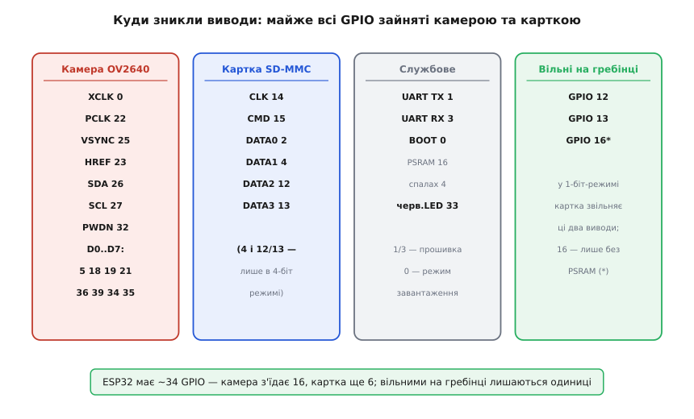
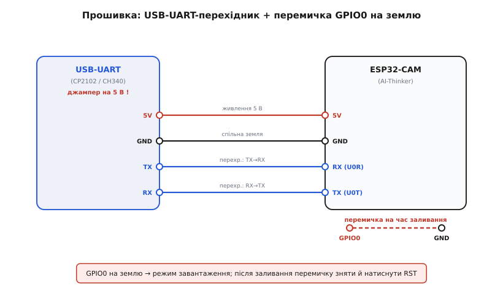

# ESP32-CAM (OV2640 + microSD)

## Дешева мережева камера з компромісами

Створення власної бездротової камери з окремих компонентів — складна і дорога задача. Плата ESP32-CAM розв'язує цю проблему, пропонуючи готовий і вкрай дешевий модуль, у якому об'єднано двоядерний процесор @@en|Xtensa LX6@@ із частотою 240 МГц, 4 МБ пам'яті @@en|Flash@@, 4 МБ зовнішньої пам'яті @@en|PSRAM@@ та 2-мегапіксельний сенсор @@en|OV2640@@. Проте низька ціна досягається за рахунок жорстких апаратних компромісів. Щоб скористатися пристроєм, доведеться власноруч боротися зі стрибками живлення, дефіцитом вільних виводів та відсутністю звичного роз'єму для прошивки.

## Головні компоненти та роль PSRAM

Основою плати є мікроконтролер, сенсор камери (зазвичай OV2640 із вбудованим апаратним стисненням @@en|JPEG@@) та кардрідер для збереження відзнятого. Головна проблема полягає в тому, що обсягу внутрішньої оперативної пам'яті процесора бракує для збереження навіть одного сирого кадру високої роздільної здатності. Тому на платі встановлена додаткова мікросхема зовнішньої оперативної пам'яті @@en|PSRAM@@ (Pseudostatic Random-Access Memory). Вона слугує обов'язковим буфером для тимчасового зберігання зображень перед їхньою передачею по Wi-Fi або записом на карту пам'яті. Без PSRAM нормальна робота камери неможлива.

## Дефіцит виводів і пастка спалаху

Складна периферія плати має свою ціну.

*Розподіл ліній вводу-виводу: сенсор і кардрідер забирають практично всі доступні контакти мікроконтролера.*

Широка паралельна шина камери та слот microSD забирають практично всі доступні контакти (@@en|GPIO@@, General-Purpose Input/Output). Через це виникає відома пастка: яскравий світлодіод спалаху підключений до виводу GPIO4, який одночасно використовується як одна з ліній даних швидкісного 4-бітного інтерфейсу SD-карти. Щоразу, коли мікроконтролер звертається до картки, спалах починає яскраво моргати. Щоб прибрати це небажане явище і звільнити додаткові контакти для власних потреб, SD-картку доводиться програмно перемикати в повільніший однобітний режим.

## Прошивка зовнішнім перехідником без USB

Заради здешевлення на платі немає ані вбудованого USB-роз'єму, ані мікросхеми перехідника для зв'язку з комп'ютером. Для завантаження програми необхідний зовнішній модуль @@en|UART@@ (Universal Asynchronous Receiver-Transmitter).

*Підключення програматора: лінії TX та RX з'єднуються перехресно, а перехід у режим прошивки потребує ручного керування виводом GPIO0.*

При підключенні діє обов'язкове правило перехрещення: лінія передачі (TX) перехідника з'єднується з лінією прийому (RX) мікроконтролера, і навпаки. Оскільки автоматичного скидання теж немає, переведення процесора в режим завантаження відбувається вручну: перед подачею живлення або натисканням кнопки скидання (Reset) вивід GPIO0 потрібно з'єднати з землею (GND).

## Слабке живлення і нескінченні перезавантаження

Найбільша слабкість ESP32-CAM криється в живленні. Одночасна робота сенсора камери та передача важкого відеопотоку по Wi-Fi створюють дуже різкі та сильні стрибки споживання струму. Слабке джерело живлення, наприклад, звичайний комп'ютерний USB-порт або тонкі з'єднувальні дроти, не здатні швидко віддати такий струм. Напруга різко просідає, і спрацьовує вбудований захист мікроконтролера від зниження напруги — плата перезавантажується (виникає так званий @@en|brownout crash@@). Це повторюється нескінченно. Єдине надійне рішення цієї проблеми: використовувати потужний 5-вольтовий блок живлення, підключати його короткими й товстими дротами і за потреби додавати електролітичний конденсатор безпосередньо на контакти живлення плати.
