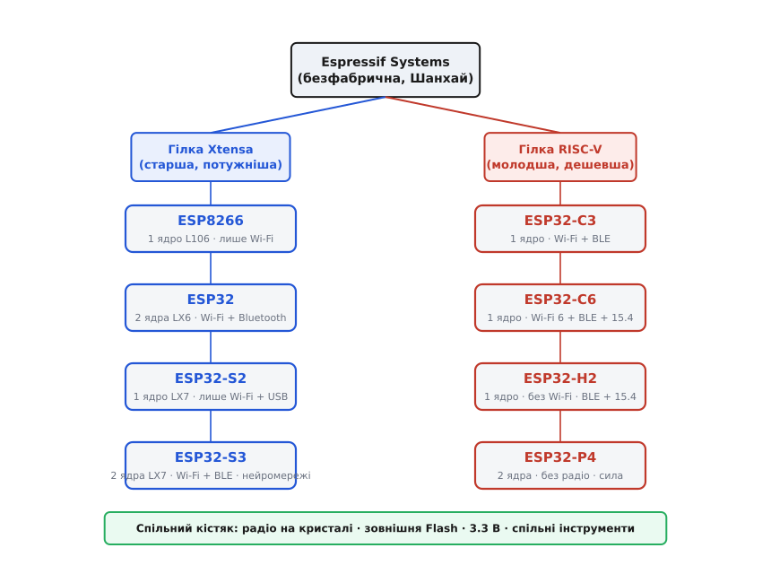
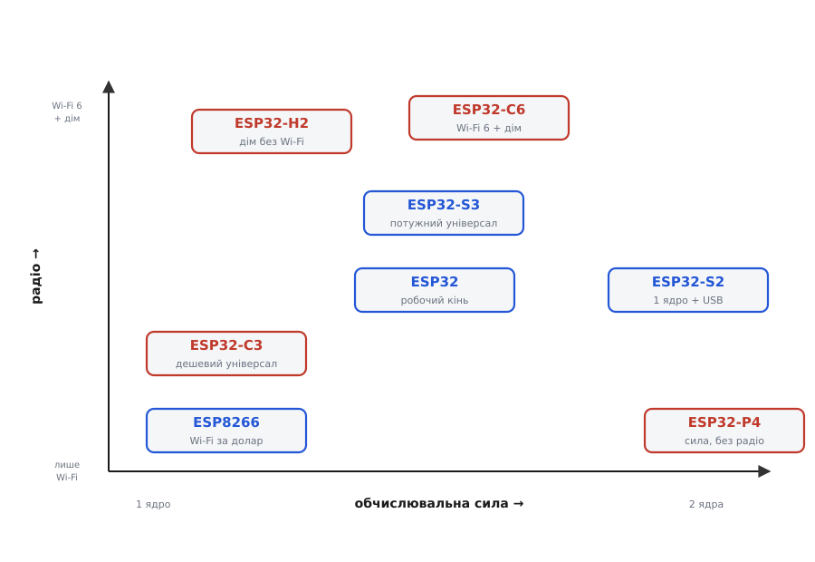

# Родина ESP32/ESP8266 (Espressif)

<preknowlist>
- [Родина Arduino](root:cat-hw-boards/arduino-family) — базове розуміння фреймворків розробки та принципу роботи плати-обв'язки.
</preknowlist>

## Чип, модуль та плата розробника

Щоб будувати пристрої з бездротовим зв'язком, інженери беруть компоненти від Espressif. У цій родині існують три різні формати, які часто плутають. Найменша одиниця — це сам мікроконтролерний чип, або @@en|SoC@@. Це чорний квадрат із виводами, який містить обчислювальне ядро та радіопередавач, але для роботи йому потрібні антена і зовнішня пам'ять. Їх не вбудовують у сам кристал чипа через несумісність технологій: процес виготовлення швидкої цифрової логіки та аналогового радіо відрізняється від процесу для щільної @@en|Flash@@-пам'яті, а об'єднання їх на одному кристалі суттєво здорожчує його через збільшення площі. Антена ж потребує точного узгодження хвильового опору та вільного простору для випромінювання, що неможливо забезпечити всередині мікроскопічного шматка кремнію. Щоб не розводити це вручну, використовують екранований модуль: металеву коробочку, у якій чип, @@en|Flash@@-пам'ять та антена вже спаяні разом. Модуль сертифікований і готовий до встановлення на вашу плату. А для прототипування найзручніше взяти плату розробника, або @@en|devboard@@, — готову плату з роз'ємом USB, перетворювачем напруги та пінами. Вона дозволяє підключити модуль до комп'ютера і відразу писати код, подібно до того, як це роблять у [родині Arduino](root:cat-hw-boards/arduino-family).

## Спільні риси родини ESP

Хоча мікроконтролери цієї лінійки різні, вони мають спільну апаратну філософію. Усі вони побудовані на 32-бітних ядрах, що дає значну обчислювальну потужність. Кожен чип має вбудоване радіо для Wi-Fi та часто Bluetooth. Вони не зберігають програму всередині, а виконують її з окремої зовнішньої Flash-пам'яті, що дозволяє вибирати її об'єм під задачу. Уся родина працює з напругою 3.3 В, тому логічні рівні суворо 3.3-вольтові. Радіопередавач під час передачі даних має високе імпульсне споживання струму, що є критичною відмінністю від простіших мікроконтролерів.

## Гілки Xtensa та RISC-V

Родина поділяється на дві великі гілки з різними архітектурами. Старша гілка працює на ядрах Xtensa — це перевірені часом потужні чипи, такі як класичний ESP32 та серія S, створені для важкої обробки даних і графіки. Новіша гілка базується на відкритій архітектурі RISC-V. Сюди входять економічні чипи серій C (для заміни старого ESP8266) та H, оптимізовані для простих задач розумного дому, таких як датчики чи Wi-Fi кнопки. Також існують серії P для продуктивних рішень.

*Дерево родини показує, як архітектури Xtensa та RISC-V ділять чипи на спеціалізовані лінійки.*

## Пастки підключення та життєві правила

Перше правило — це стабільне живлення. Оскільки Wi-Fi передавач споживає струм короткими потужними імпульсами, слабкий блок живлення чи тонкі дроти викличуть просадку напруги, і мікроконтролер постійно перезавантажуватиметься. Друга пастка — узгодження рівнів. Логіка чипів працює від 3.3 В, і подача 5 В на вхід відразу спалить піни. Підключаючи їх до 5-вольтових пристроїв, слід ставити перетворювачі рівнів. Третя особливість стосується старту. Деякі виводи, які називають стрепінг-пінами (@@en|strapping pins@@), під час увімкнення зчитуються контролером, щоб визначити режим завантаження: робочий чи прошивочний. Якщо зовнішня схема випадково змінить стан такого піну під час старту, пристрій просто не завантажиться.

*Схема допоможе обрати серію чипа залежно від вимог до потужності, зв'язку та енергоспоживання.*
