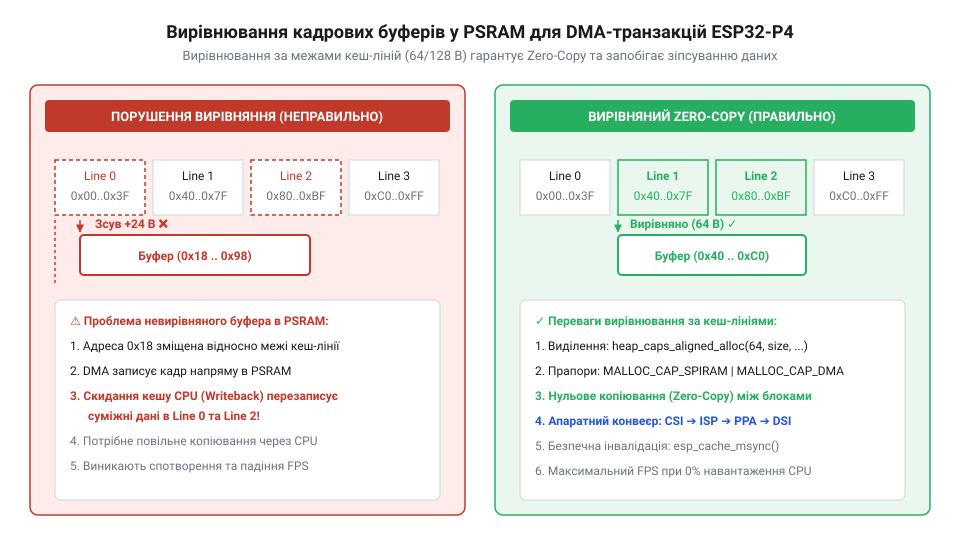
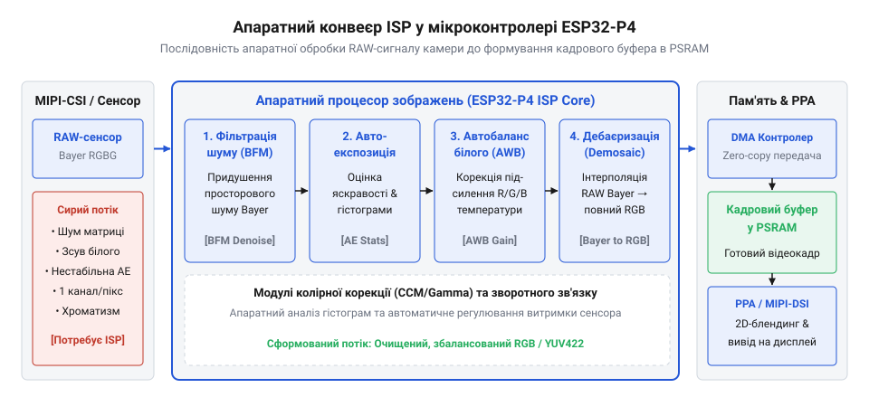
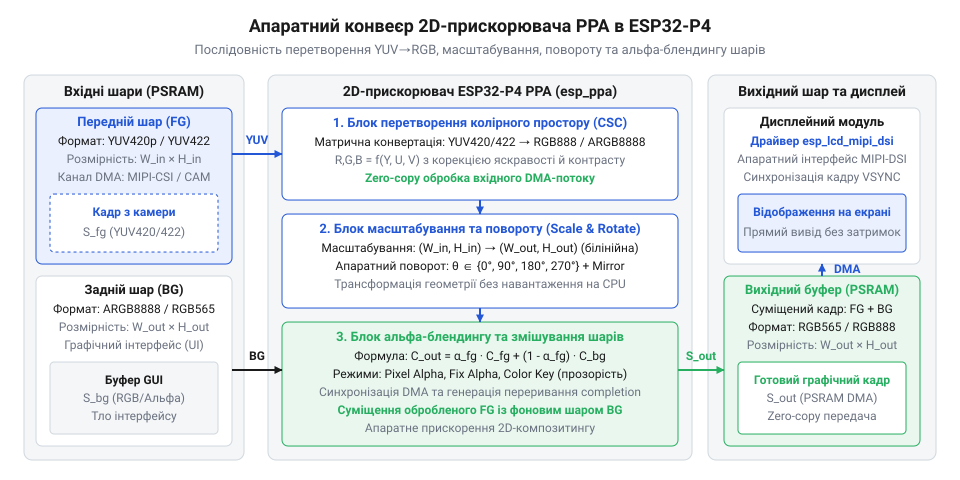
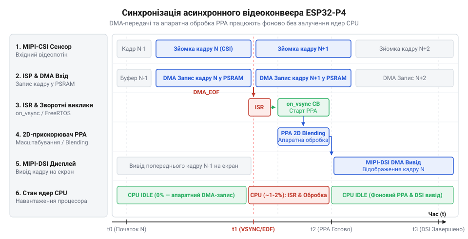

# Програмний інтерфейс драйверів MIPI-CSI/DSI, 2D PPA та ISP в ESP-IDF

<preknowlist>
- [Модуль ESP32-CAM: огляд архітектури, периферії та сімейства плат](root:cat-hw-boards/esp32-cam-camera-module-family) — базові принципи захоплення зображень із сенсорів камери та організацію буферизації кадрів у мікроконтролерах Espressif
- [Плати відеозахоплення нового покоління на базі ESP32-S3](root:cat-hw-boards/esp32-s3-cam-boards-overview) — еволюцію мультимедійної периферії та принципи роботи з відеосенсорами через послідовні інтерфейси
- [Схемотехніка та розпіновка шин Octal SPI Flash та PSRAM в ESP32-S3](root:cat-hw-boards/esp32-s3-octal-spi-bus-layout) — апаратну організацію зовнішньої оперативної пам'яті PSRAM та специфіку її шинного підключення для DMA-обміну
</preknowlist>

## Проблема софтверної обробки відеопотоку ESP32-P4

Розробка мультимедійних систем на мікроконтролерах часто починається зі звичної програмної моделі: процесор зчитує масив пікселів із камери, у циклі виконує перетворення кольорів чи масштабування, після чого побайтово копіює готовий кадр у пам'ять дисплея. У системах минулого покоління, де застосовувалися [камерні модулі ESP32-CAM](root:cat-hw-boards/esp32-cam-camera-module-family) або перші [плати відеозахоплення ESP32-S3](root:cat-hw-boards/esp32-s3-cam-boards-overview), роздільна здатність обмежувалася стандартами QVGA або VGA (320×240 або 640×480 пікселів). При таких обсягах програмна обробка кадрів у звичайних циклах C/C++ ще дозволяла отримати прийнятну частоту оновлення. Однак при переході до високопродуктивних обчислень на базі ESP32-P4 та обробці відеопотоків високої чіткості (720p або 1080p) ця софтверна схема миттєво стає головним вузьким місцем усієї архітектури.

Розглянемо фізику процесу обробки відеопотоку. Один кадр із роздільною здатністю 1280×720 пікселів у форматі RGB888 займає у пам'яті 2 764 800 байтів (приблизно 2,63 МБ). Якщо система має забезпечувати плавну трансляцію з частотою 30 кадрів на секунду, підсумкова швидкість передачі даних між периферією та оперативною пам'яттю перевищує 82,9 МБ/с. Спроба виконати програмне перетворення колірного простору або копіювання такого обсягу даних за допомогою стандартних рішень на кшталт `memcpy()` змушує процесорні ядра RISC-V виконувати сотні мільйонів інструкцій читання та запису щосекунди.

Головна проблема програмного підходу полягає у суцільному блокуванні обчислювальних ресурсів. Коли обробка пікселів покладається на процесорні ядра, виникають три критичні негативні наслідки:

1. **Повне завантаження CPU**: Обидва високопродуктивні ядра HP CPU мікроконтролера ESP32-P4 працюють на межі граничної частоти (до 400 МГц), виконуючи рутинні цикли перетворення байтів. У процесора не залишається вільних тактових циклів для виконання задач користувацького інтерфейсу, мережевого стека чи алгоритмів аналізу даних. 2. **Деградація кешу та шини пам'яті**: Побайтове копіювання мільйонів пікселів процесором безперервно витісняє виконавальний код і системні дані з L1/L2 кешу. Це спричиняє постійні проформи кешу (@@en|cache miss@@) та критично знижує пропускну здатність шини внутрішньої оперативної пам'яті. 3. **Часовий джитер і пропуск кадрів**: Тривалі софтверні цикли обробки масивів неминуче затримують обробку високорівневих переривань FreeRTOS. Це призводить до нерівномірних інтервалів між кадрами, десинхронізації виводу та регулярного падіння частоти кадрів (@@en|frame drop@@).

Для вирішення цієї проблеми мікроконтролер ESP32-P4 містить повністю апаратний мультимедійний комплекс. Захоплення відеопотоку з високою швидкістю покладається на послідовний камерний інтерфейс @@en|MIPI-CSI@@ (англ. *mobile industry processor interface camera serial interface*; послідовний камерний інтерфейс специфікації MIPI). Початкова фільтрація, дебаєризація та автоналаштування кадру виконуються апаратним сигнальним процесором @@en|ISP@@ (англ. *image signal processor*, від *image* — зображення, *signal* — сигнал, *processor* — процесор; апаратний сигнальний процесор зображень). Для швидкого 2D-масштабування, повертання та об'єднання графічних шарів призначено піксельний прискорювач @@en|PPA@@ (англ. *pixel processing accelerator*, від *pixel* — піксель, *processing* — обробка, *accelerator* — прискорювач; 2D-прискорювач обробки пікселів). Нарешті, вивід обробленого кадру на дисплей здійснює інтерфейс @@en|MIPI-DSI@@ (англ. *mobile industry processor interface display serial interface*; послідовний дисплейний інтерфейс специфікації MIPI).

Ключовим принципом взаємодії цих периферійних блоків є використання контролерів @@en|DMA@@ (англ. *direct memory access*, від *direct* — прямий, *memory* — пам'ять, *access* — доступ; прямий доступ до пам'яті). Вони передають кадрові дані між периферією та оперативною пам'яттю повністю автономно, без участі процесора. Така організація конвеєра реалізує концепцію @@en|zero-copy@@ (англ. *zero-copy*, від *zero* — нуль, *copy* — копіювання; передача даних без проміжного копіювання): кадр захоплюється @@en|MIPI-CSI@@, обробляється @@en|ISP@@ та @@en|PPA@@ і передається на @@en|MIPI-DSI@@ через спільні буфери в оперативній пам'яті без жодного централізованого копіювання процесором. Роль CPU зводиться лише до початкової конфігурації драйверів та реакції на події завершення кадру через зворотні виклики. Щоб побудувати такий конвеєр, перш за все необхідно навчитися правильно виділяти та вирівнювати кадрові буфери в оперативній пам'яті.

## Виділення й вирівнювання кадрових буферів PSRAM

Реалізація конвеєра @@en|zero-copy@@ вимагає зберігання відеокадрів високої роздільної здатності у зовнішній пам'яті @@en|PSRAM@@ (англ. *pseudo-static random-access memory*, від *pseudo* — несправжній, *static* — статичний; псевдостатична оперативна пам'ять), оскільки внутрішньої статичної пам'яті SRAM мікроконтролера недостатньо для розміщення кількох повнорозмірних буферів. Використання зовнішньої пам'яті для апаратного обміну через @@en|DMA@@ накладає жорсткі вимоги до організації пам'яті, недотримання яких призводить до апаратних збоїв та спотворення графіки.

Головна складність полягає у взаємодії контролера @@en|DMA@@ із системами кешування процесора ESP32-P4. Доступ процесора до зовнішньої пам'яті @@en|PSRAM@@ здійснюється через двопериферійний L2-кеш. Коли периферійний модуль (наприклад, @@en|MIPI-CSI@@ або @@en|PPA@@) записує нові піксельні дані безпосередньо в @@en|PSRAM@@ через @@en|DMA@@, кеш-пам'ять процесора не дізнається про цю зміну автоматично. Якщо процесор спробує прочитати цю область, він отримає застарілі дані з кешу. Навпаки, якщо процесор вивантажить (@@en|flush@@) модифікований рядок кешу в @@en|PSRAM@@ у момент, коли туди записує @@en|DMA@@, апаратні дані буде незворотно перезаписано застарілими значеннями. Це явище називається некогерентністю кешу. Для поглибленого вивчення апаратних механізмів вивантаження й інвалідації кеш-ліній під час прямого доступу до пам'яті перегляньте матеріал про [когерентність кешу та DMA-транзакції у мікроконтролерах ESP32](root:hw-arch/esp32-p4-dma-cache-coherency).

Щоб уникнути некогерентності та забезпечити коректність @@en|DMA@@-транзакцій у пам'яті @@en|PSRAM@@, кожен кадровий буфер (@@en|framebuffer@@, англ. *framebuffer*, від *frame* — кадр, *buffer* — буфер; кадровий буфер) повинен відповідати двом критеріям вирівнювання:

1. **Вирівнювання початкової адреси**: Початкова адреса кадрового буфера у пам'яті має бути чітко кратною розміру лінії кешу (@@en|cache line@@, англ. *cache line*, від *cache* — хованка/кеш, *line* — рядок; лінія кешу). Для архітектури ESP32-P4 розмір лінії кешу визначається макросом `SOC_CACHE_LINE_SIZE` і становить 64 байти. 2. **Вирівнювання підсумкового розміру**: Загальний розмір виділеного блоку пам'яті у байтах повинен бути вирівняний убік збільшення до величини, кратної 64 байтам. Це гарантує, що операції скидання або інвалідації кешу для кадрового буфера не зачеплять сусідні системні змінні, розташовані поруч у купі (@@en|heap@@).

Зрозуміти фізичну схему вирівнювання та розподілу блоків пам'яті в @@en|PSRAM@@ за межами кєш-ліній допомагає графічне представлення апаратних меж.


*Схема виділення й вирівнювання кадрових буферів у PSRAM за межами кєш-ліній для апаратних DMA-транзакцій.*

Ми дістаємо підсумковий розмір необхідного кадрового буфера у байтах `S_align` з ширини кадру `W`, висоти кадру `H`, кількості байтів на один піксель `B` та розміру лінії кешу `L_cache`.

```
S_raw
= W × H × B                            [обчислення вихідного обсягу пікселів]
S_align
= (S_raw + L_cache - 1) & ~(L_cache - 1) [вирівнювання розміру до межі лінії кешу]
```

Отриманий вираз гарантує, що підсумковий розмір кадрового буфера `S_align` є кратним довжині лінії кешу `L_cache`, що запобігає пошкодженню сусідніх системних змінних у купі під час операцій інвалідації чи скидання кешу.

Для виділення вирівняної пам'яті в операційній системі ESP-IDF стандартна функція `malloc()` не підходить, оскільки вона гарантує лише 8-байтне вирівнювання. Замість неї застосовують спеціалізовану функцію `heap_caps_aligned_alloc()`, якій передають вимоги до вирівнювання та прапори типів пам'яті `MALLOC_CAP_SPIRAM | MALLOC_CAP_DMA`. Детальний аналіз фізичної [схемотехніки шин PSRAM](root:cat-hw-boards/esp32-s3-octal-spi-bus-layout) показує, що саме прапор `MALLOC_CAP_DMA` гарантує доступність виділеного регіону для апаратних периферійних контролерів.

Для забезпечення плавної зміни кадрів без розриву зображення (@@en|tearing@@) у високошвидкісних системах використовують стратегію подвійної або потрійної буферизації. Поки модуль @@en|MIPI-CSI@@ заповнює через @@en|DMA@@ перший буфер, прискорювач @@en|PPA@@ виконує обробку другого буфера, а контролер @@en|MIPI-DSI@@ зчитує третій буфер для відображення під час події вертикальної синхронізації @@en|VSYNC@@ (англ. *vertical synchronization*, від *vertical* — вертикальний, *synchronization* — синхронізація; вертикальна синхронізація).

Нижче наведено практичну реалізацію безпечного виділення вирівняного кадрового буфера в пам'яті @@en|PSRAM@@ для ESP32-P4 мовами C та C++.

:::tabs
:::code api-esp32-p4-mipi-driver-and-isp-hal/c/esp-idf/allocate-frame-buffer.c
:::code api-esp32-p4-mipi-driver-and-isp-hal/cpp/esp-idf/framebuffer.cpp
:::

## Налаштування драйверів MIPI-DSI та MIPI-CSI

Після виділення вирівняних буферів пам'яті виникає задача передачі відеоданих між зовнішніми пристроями та мікроконтролером. Традиційні паралельні інтерфейси виводу зображення вимагають десятків фізичних виводів GPIO, а на високих частотах стикаються з фазовим зсувом сигналів та електромагнітними завадами. У сучасних мультимедійних системах на базі ESP32-P4 цю проблему вирішує високошвидкісна послідовна шина специфікації @@en|MIPI@@ (англ. *mobile industry processor interface*; мобільний промисловий процесорний інтерфейс). Передача даних здійснюється через фізичний шар @@en|D-PHY@@ (англ. *D-PHY*, від римського числа *D* — 500, *physical layer* — фізичний рівень; фізичний шар диференційної передачі даних), який використовує низькоамплітудні диференційні лінії. На відміну від застарілих інтерфейсів, які застосовувалися в [камерних модулях ESP32-CAM](root:cat-hw-boards/esp32-cam-camera-module-family), шина D-PHY перемикається між режимом низького енергоспоживання (1,2 В) для команд та високошвидкісним диференційним режимом (200 мВ) для передачі відеопотоку зі швидкістю до 1,5 Гбіт/с на одну лінію.

Функціонування шини відображення покладається на драйвер @@en|MIPI-DSI@@, який у середовищі ESP-IDF реалізовано через компонент `esp_lcd_mipi_dsi`. Конфігурація починається з вибору кількості швидкісних ліній даних (одна або дві) та налаштування тактової частоти шини (@@en|lane bit rate@@, англ. *lane bit rate*, від *lane* — лінія, *bit* — біт, *rate* — швидкість; бітова швидкість лінії передачі). Програміст має чітко розрахувати необхідну пропускну здатність шини залежно від роздільної здатності та частоти оновлення екрана.

Ми обчислюємо мінімальну необхідну бітову швидкість однієї лінії D-PHY `R_bit` у мегабітах на секунду з повної ширини кадру з урахуванням гасіння `W_total`, повної висоти `H_total`, частоти оновлення `f_frame`, глибини кольору в бітах `B_pixel` та кількості активних ліній `N_lanes`.

```
R_bit
= W_total × H_total × f_frame × B_pixel ÷ N_lanes [розрахунок пропускної здатності лінії D-PHY]
```

Отримане значення `R_bit` визначає тактову частоту D-PHY, яку заносять у поле `lane_bit_rate_mbps` структури `esp_lcd_dsi_bus_config_t`. Заниження цього значення призведе до переповнення внутрішнього FIFO-буфера драйвера та втрати кадрів, а надмірне завищення — до нестабільності сигналу через фізичні завади.

Для підключення дисплейної панелі поверх шини DSI налаштовують паралельний піксельний інтерфейс @@en|DPI@@ (англ. *display pixel interface*, від *display* — дисплей, *pixel* — піксель, *interface* — інтерфейс; паралельний інтерфейс пікселів дисплея). У структурі `esp_lcd_dpi_panel_config_t` задають часові інтервали гасіння (@@en|blanking@@, англ. *blanking*, від *blank* — порожній/гасіння; інтервал гасіння сигналу синхронізації): горизонтальну синхронізацію рядка @@en|HSYNC@@ (англ. *horizontal synchronization*, від *horizontal* — горизонтальний, *synchronization* — синхронізація; горизонтальна синхронізація рядка) та вертикальну синхронізацію кадру @@en|VSYNC@@. Ці таймінги визначають паузи між рядками та кадрами, необхідні контролеру панелі для перезапуску сканування екрана. Приклад побудови компактних дисплейних систем можна побачити на [платі Waveshare ESP32-S3 Touch LCD 1.28](root:cat-hw-boards/waveshare-esp32-s3-touch-lcd-1-28), проте в ESP32-P4 замість повільних шин SPI застосовується апаратний драйвер DSI.

Паралельно з відображенням налаштовується драйвер прийому відео з камери @@en|MIPI-CSI@@ через модуль `esp_cam_ctlr_mipi_csi`. Він приймає потік сирих пікселів у форматах RAW8 або RAW10 та через контролер @@en|DMA@@ прямо записує їх у вирівняні буфери @@en|PSRAM@@ за схемою @@en|zero-copy@@.

Загальну схему з'єднання периферійних контролерів, ліній D-PHY та кадрових буферів у пам'яті наведено нижче.


*Блок-схема апаратних інтерфейсів MIPI-CSI камери та MIPI-DSI дисплея з позначенням ліній D-PHY, DMA-каналiв та конфігураційних структур ESP-IDF.*

Нижче наведено приклад ініціалізації шини MIPI-DSI та DPI-панелі в ESP-IDF мовами C та C++.

:::tabs
:::code api-esp32-p4-mipi-driver-and-isp-hal/c/esp-idf/init-mipi-dsi-display.c
:::code api-esp32-p4-mipi-driver-and-isp-hal/cpp/esp-idf/mipidsidisplay.cpp
:::

## Конфігурація апаратного конвеєра зображень ISP

Захоплений через шину @@en|MIPI-CSI@@ кадр потрапляє в буфер пам'яті у сирому мозаїчному вигляді. Фізичні світлочутливі сенсори камер, такі як у модулях [ESP32-CAM з камерою OV3640](root:cat-hw-boards/esp32-cam-ov3640), вкриті сіткою колірних світлофільтрів. Найпоширенішим є шаблон Байєра (@@en|Bayer pattern@@, англ. *Bayer pattern*, від прізвища винахідника *Bryce Bayer*; колірна сітка масиву фільтрів Байєра), де кожен окремий піксель реєструє інтенсивність лише одного з трьох кольорів: червоного, зеленого або синього. Якщо відобразити такий RAW-кадр без попередньої обробки, зображення буде монохромним з характерною зеленою мозаїкою, низьким контрастом та вираженим цифровим шумом.

Програмне відновлення повноколірного кадру на процесорі вимагає виконання складних математичних алгоритмів інтерполяції для кожного пікселя. Для усунення цього навантаження мікроконтролер ESP32-P4 оснащено апаратним сигнальним процесором @@en|ISP@@. Він обробляє потік пікселів безпосередньо у процесі їхньої передачі через контролер @@en|DMA@@ в оперативну пам'яті @@en|PSRAM@@.

Апаратний конвеєр ISP в ESP-IDF керується через модуль `esp_isp` і складається з послідовності спеціалізованих обчислювальних блоків:

1. **Дебаєризація (@@en|demosaicing@@)**: Відновлює повноколірні значення RGB888 для кожного пікселя шляхом аналізу значень сусідніх осередків сітки Байєра. 2. **Автоматичний баланс білого (@@en|AWB@@)**: Аналізує розподіл кольорів по зонах кадру та корегує підсилення червоного й синього каналів для збереження природних відтінків при зміні освітлення. 3. **Автоматична експозиція (@@en|AE@@)**: Розраховує гістограму яскравості та апаратно керує витримкою і підсиленням сенсора камери. 4. **Двостороннє пригнічення шуму (@@en|BF@@)**: Використовує двовимірну фільтрацію для усунення високочастотного шуму сенсора в однорідних областях без розмиття чітких меж об'єктів. 5. **Гама-корекція та колірна матриця (@@en|CCM@@)**: Виконує нелінійне перетворення яскравості (@@en|gamma correction@@) для відповідності людському сприйняттю та усуває викривлення передачі кольору сенсором.

Послідовність проходження відеосигналу крізь внутрішні модулі апаратного прискорювача ISP наведено на діаграмі.


*Діаграма внутрішнього конвеєра ISP, що показує послідовність блоків дебаєризації, автобалансу білого, автоекспозиції та фільтрації шуму.*

Програмна конфігурація конвеєра передбачає створення головного контролера `esp_isp_processor_cfg_t` із зазначенням джерела даних `ISP_INPUT_DATA_SOURCE_CSI` та форматів входження й виходу. Після цього до процесора підключають додаткові суб-контролери (AWB, BF) та запускають обробку викликом `esp_isp_start()`. Уся обробка виконується повністю апаратно без згенерованих переривань для кожного пікселя, що гарантує стабільну частоту 30 кадрів на секунду при 720p.

Нижче наведено приклад створення та налаштування конвеєра ISP у середовищі ESP-IDF мовами C та C++.

:::tabs
:::code api-esp32-p4-mipi-driver-and-isp-hal/c/esp-idf/setup-isp-pipeline.c
:::code api-esp32-p4-mipi-driver-and-isp-hal/cpp/esp-idf/isppipelinemanager.cpp
:::

## Масштабування та блендинг у прискорювачі PPA

Після первинної обробки відеопотоку модулем ISP сирі піксельні дані з камери потрапляють у буфер оперативної пам'яті @@en|PSRAM@@. Однак роздільна здатність захопленого кадру чи його колірний простір рідко збігаються з вимогами дисплейної панелі або графічного інтерфейсу користувача. У традиційних системах, таких як [модулі ESP32-CAM](root:cat-hw-boards/esp32-cam-camera-module-family), операції змішування графічних шарів чи зміни розміру виконувалися програмно, що повністю завантажувало процесорні ядра. В мікроконтролері ESP32-P4 цю задачу перебрав на себе апаратний 2D-прискорювач @@en|PPA@@, доступний через драйвер `esp_ppa`.

Головне призначення @@en|PPA@@ — виконання швидкісних геометричних та колірних трансформацій кадрових буферів у режимі @@en|zero-copy@@ без задіяння CPU. Апаратний двигун прискорювача підтримує три основні режими роботи, кожен із яких реалізовано у вигляді окремої підсистеми:

1. **Модуль колірного перетворення CSC**: Здійснює @@en|color space conversion@@ (англ. *color space conversion*, від *color* — колір, *space* — простір, *conversion* — перетворення; математичне перетворення колірного простору) з формату YUV420 або YUV422, отриманого від камери, у формат RGB565 або RGB888, необхідний для дисплея. 2. **Модуль масштабування та повертання SRM**: Забезпечує @@en|scaling@@ (англ. *scaling*, від *scale* — масштаб; апаратне масштабування зображення) кадру до необхідних геометричних розмірів дисплея, а також поворот зображення на кути 0°, 90°, 180° або 270° та дзеркальне відображення. 3. **Модуль апаратного блендингу Blend**: Виконує @@en|alpha blending@@ (англ. *alpha blending*, від *alpha* — альфа-канал, *blending* — змішування; накладання графічних шарів з урахуванням прозорості) між двома незалежними кадровими шарами — наприклад, фоновим відео з камери та напівпрозорим інтерфейсом користувача (UI).

Обробка здійснюється асинхронно через контролери @@en|DMA@@. Програміст формує структури конфігурації транзакції, передає їх у драйвер `esp_ppa` та запускає операцію викликом відповідної функції (наприклад, `esp_ppa_do_srm()` або `esp_ppa_do_blend()`). Після цього процесор може виконувати інші задачі, а по завершенні передачі контролер викликає зареєстрований зворотний виклик (@@en|callback@@, англ. *callback*, від *call* — викликати, *back* — назад; зворотний виклик).

Структуру функціонування апаратного прискорювача PPA та послідовність обробки кадрових шарів наведено на схемі нижче.


*Схема функціонування 2D-прискорювача PPA під час операцій масштабування, повертання, перетворення колірного простору YUV-to-RGB та альфа-блендингу.*

У порівнянні з попередніми поколіннями [мікроконтролерів ESP32-S3](root:cat-hw-boards/esp32s3-microcontroller), використання PPA дозволяє досягти частоти оновлення 60 кадрів/с при роздільній здатності 800×480 пікселів із близьким до нуля навантаженням на ядра RISC-V.

Нижче наведено приклад ініціалізації клієнта PPA та виконання асинхронної операції масштабування й блендингу кадрових буферів у пам'яті @@en|PSRAM@@ мовами C та C++.

:::tabs
:::code api-esp32-p4-mipi-driver-and-isp-hal/c/esp-idf/ppa-trans-done-cb.c
:::code api-esp32-p4-mipi-driver-and-isp-hal/cpp/esp-idf/ppaprocessor.cpp
:::

## Синхронізація мультимедійного конвеєра та обробка помилок

Об'єднання окремих апаратних блоків (MIPI-CSI, ISP, PPA та MIPI-DSI) у цілісний сквозний конвеєр вимагає чіткої асинхронної синхронізації та обробки виняткових ситуацій. Оскільки всі обміни даними між периферією та оперативною пам'яттю @@en|PSRAM@@ відбуваються через контролери @@en|DMA@@, центральний процесор не бере участі в копіюванні пікселів. Його функція полягає в арбітражі подій реального часу за допомогою операційної системи @@en|FreeRTOS@@ (англ. *FreeRTOS*, від *free* — вільний, *real-time operating system* — операційна система реального часу; операційна система реального часу).

Синхронізація конвеєра будується на обробці трьох основних апаратних переривань:
1. **Подія завершення кадру камери EOF**: Генерація переривання @@en|EOF@@ (англ. *end of frame*, від *end* — кінець, *frame* — кадр; переривання завершення захоплення кадру) контролером MIPI-CSI свідчить про те, що новий сирий кадр повністю записано в буфер @@en|PSRAM@@. Зворотний виклик переривання віддає бінарний @@en|semaphore@@ (англ. *semaphore*, від грецьк. *sema* — знак, *phoros* — той, що носить; механізм синхронізації задач) для розблокування обробної задачі. 2. **Завершення транзакції PPA**: Драйвер `esp_ppa` генерує переривання після закінчення колірного перетворення та масштабування. Це сигналізує про готовність готового кадру в форматі RGB для відображення. 3. **Подія VSYNC дисплея**: Сигнал вертикальної синхронізації @@en|VSYNC@@ контролера MIPI-DSI повідомляє про завершення сканування поточного кадру на панелі. Переключення покажчиків кадрів (буферний своп) має відбуватися чітко під час кадрового гасіння VSYNC, що полностью усуває ефект розриву зображення.

Ми обчислюємо часовий запас обробки кадру в конвеєрі `T_avail` у мілісекундах із періоду кадрів `T_frame`, часу захоплення камери `T_csi`, часу апаратної обробки PPA `T_ppa` та тривалості виводу на дисплей `T_dsi`.

```
T_frame
= 1000 ÷ f_fps                         [тривалість кадру при заданій частоті FPS]
T_pipeline
= T_csi + T_ppa + T_dsi                [сумарний час апаратної обробки в DMA]
T_avail
= T_frame - T_pipeline                 [запас часу до наступного VSYNC]
```

Значення `T_avail` мусить бути строго більшим за 0. Якщо сумарний час апаратної обробки перевищує `T_frame`, виникає затримка конвеєра, що призводить до втрати кадрів.

Часову послідовність проходження подій та спрацьовування зворотних викликів наведено на діаграмі нижче.


*Часова діаграма синхронізації асинхронного відеоконвеєра з подіями VSYNC/EOF, DMA-перериваннями та спрацьовуванням зворотних викликів FreeRTOS.*

Під час роботи з високошвидкісними відеопотоками можуть виникати апаратні та програмні помилки, які вимагають обробки в коді:
- `ESP_ERR_INVALID_STATE`: Виникає при спробі повторного запуску DMA-транзакції PPA або CSI до завершення попередньої. - `ESP_ERR_NO_MEM`: Вказує на нестачу пам'яті @@en|PSRAM@@ або відсутність вирівнювання за межами кеш-ліній (64 байти). - `ESP_ERR_TIMEOUT`: Сигналізує про зависання шини D-PHY або відсутність тактування від сенсора камери. - **Помилки underrun / overrun**: При вичерпанні буфера (@@en|underrun@@, англ. *underrun*, від *under* — під-, *run* — виконання; вичерпання буфера даних) або його переповненні (@@en|overrun@@, англ. *overrun*, від *over* — понад-, *run* — виконання; переповнення буфера даних) драйвер має виконати м'який скид DMA-каналу та інвалідацію кешу.

Правильна інтеграція драйверів дозволяє будувати надійні відеосистеми реального часу, за принципами, схожими на організацію [плат відеозахоплення на ESP32-S3](root:cat-hw-boards/esp32-s3-cam-boards-overview), але з кардинально вищою продуктивністю.

Нижче наведено кодову реалізацію синхронізованого мультимедійного конвеєра з обробкою помилок мовами C та C++.

:::tabs
:::code api-esp32-p4-mipi-driver-and-isp-hal/c/esp-idf/video-pipeline-task.c
:::code api-esp32-p4-mipi-driver-and-isp-hal/cpp/esp-idf/multimediapipeline.cpp
:::