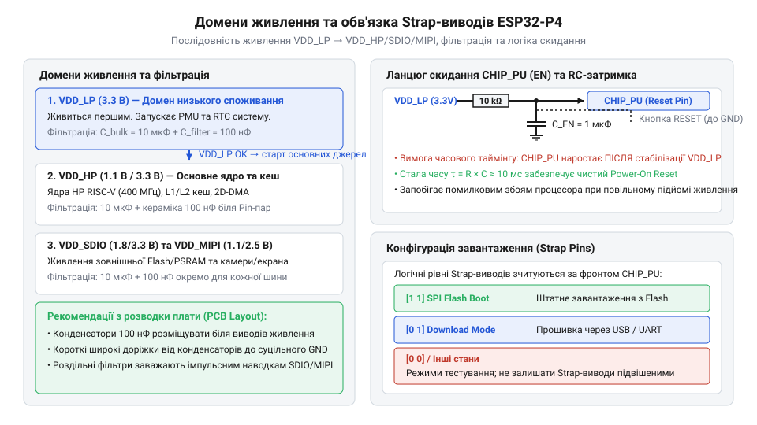
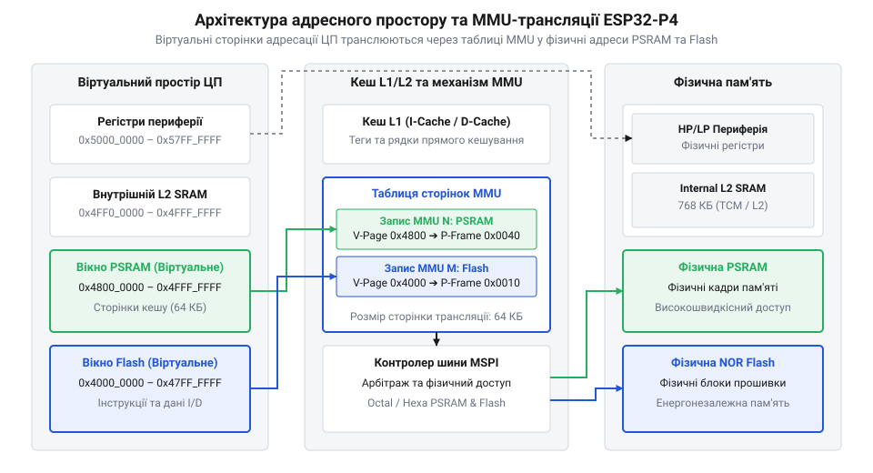

# Апаратний довідник ESP32-P4: цокольовка, домени живлення та карта регістрів пам'яті

<preknowlist>
- [Мікроконтролер ESP32-S3](root:cat-hw-boards/esp32s3-microcontroller) — архітектуру побудови шин, організацію кешу та відмінності базової периферії серії ESP32
- [Схемотехніка та розпіновка шин Octal SPI Flash та PSRAM в ESP32-S3](root:cat-hw-boards/esp32-s3-octal-spi-bus-layout) — принципи організації швидкісних шин обміну із зовнішньою пам’яттю та підключення Flash/PSRAM
- [Конфігурація eFuse та апаратне завантаження ESP32-S3](root:cat-hw-boards/esp32-s3-efuse-and-boot-configuration) — логіку вибору режимів завантаження за допомогою виводів Strap pins та налаштування блоків eFuse
</preknowlist>

## Апаратні збої при запуску ESP32-P4

Спроєктувавши друковану плату на базі новітнього високопродуктивного мікроконтролера, інженер часто стикається з неприємною ситуацією: після подачі живлення 3.3 В та зняття сигналу скидання пристрій залишається повністю непрацездатним. У результаті таких збоїв мікроконтролер не починає виконання першої інструкції з первинного завантажувача (від англ. @@en|ROM bootloader@@ — первинний завантажувач у ПЗУ), споживає нетипово високий струм або потрапляє в безперервний цикл апаратних перезавантажень. Помилкова спроба усунути проблему шляхом програмного перепрошивки не дає жодного результату, оскільки причина збою криється у фізичних порушеннях схемотехніки доменів живлення та сигнальних рівнів завантажувальних виводів.

Архітектура ESP32-P4 суттєво відрізняється від попередніх поколінь, таких як [мікроконтролер ESP32-S3](root:cat-hw-boards/esp32s3-microcontroller), оскільки містить гетерогенну систему живлення з кількома повністю ізольованими шинами. При подачі напруги внутрішні регулятори зі зниженим падінням напруги (від англ. @@en|Low-Dropout Regulator@@, @@en|LDO@@ — лінійний регулятор напруги) та цифровий шинний контролер повинні стабілізувати внутрішні потенціали ядра за суворими часовими діаграмами. Якщо швидкість наростання напруги (від англ. @@en|slew rate@@ — швидкість наростання) на живильних виводах є занадто низькою, система первинного апаратного скидання при включенні (від англ. @@en|Power-On Reset@@, @@en|POR@@ — скидання за рівнем живлення, від @@en|power@@ — живлення) спрацьовує некоректно. В результаті тригери внутрішніх регістрів опиняються у невизначеному стані, що блокує запуск шини зв'язку з кеш-пам'яттю.

Другим джерелом фатальних збоїв є неправильна конфігурація виводів завантаження (від англ. @@en|strap pin@@ — вивід конфігурації завантаження, від @@en|to strap@@ — прив'язувати). У момент підйому напруги на лінії скидання `CHIP_PU` вище порогової напруги високого рівня (від англ. @@en|input high voltage@@, `V_IH`) апаратна логіка SoC зчитує та фіксує дискретні рівні на спеціалізованих виводах @@en|GPIO@@. Подібно до того, як влаштована [конфігурація eFuse та апаратне завантаження ESP32-S3](root:cat-hw-boards/esp32-s3-efuse-and-boot-configuration), ці значення визначають джерело завантажувального коду (внутрішнє ПЗУ, зовнішня Flash-пам'ять або послідовний порт @@en|UART@@/@@en|USB@@). Якщо зовнішнє периферійне обладнання чи неправильно підібрані підтягувальні резистори викривляють напругу на Strap-виводах під час скидання, мікроконтролер переходить у непідтримуваний режим завантаження і зупиняє процесор.

Для запобігання апаратним збоям на етапі запуску необхідно чітко розмежовувати живильні домени, дотримуватися вимог щодо встановлення декуплюючих фільтрів та забезпечити узгоджену тривалість імпульсу скидання відносно перехідних процесів у джерелі живлення.

## Розподіл доменів живлення та Strap-виводи

Для забезпечення високої обчислювальної потужності та низького енергоспоживання в режимах очікування кристал ESP32-P4 розділено на чотири основні незалежні домени живлення. Основний високопродуктивний домен `VDD_HP` (від англ. @@en|High-Performance domain@@ — високопродуктивний домен) живить двоядерний процесор @@en|RISC-V@@, математичний векторний прискорювач та швидкісну системну шину напругою 1.1 В, яка формується зовнішнім DC-DC перетворювачем або зовнішнім джерелом. Низькопотужний домен `VDD_LP` (від англ. @@en|Low-Power domain@@ — низькопотужний домен) живить сопроцесор очікування, годинник реального часу @@en|RTC@@ та блоки контролю периферії від напруги 3.3 В, зберігаючи працездатність у глибокому сні. Для поглибленого вивчення системної організації електричних доменів та конфігурації фізичних виводів кристала перегляньте матеріал про [загальну архітектуру живлення та розпіновки ESP32-P4](root:cat-hw-boards/esp32-p4-power-architecture).

Швидкісна шина обміну із зовнішньою пам'яттю виділена в окремий домен `VDD_SDIO` (або `VDD_SPI`), напруга якого конфігурується на рівні 1.8 В або 3.3 В залежно від типу застосованих мікросхем пам'яті. Організація цих ліній тісно пов'язана з тим, як розведена [схемотехніка шин Octal SPI Flash та PSRAM](root:cat-hw-boards/esp32-s3-octal-spi-bus-layout), оскільки для досягнення частот понад 170 МГц потрібна стабільна напруга 1.8 В із мінімальним рівнем завад. Четвертий домен `VDD_MIPI` призначений для аналогових та цифрових каскадів прийомопередавачів @@en|MIPI-CSI@@ (камера) та @@en|MIPI-DSI@@ (дисплей), вимагаючи напруги 2.5 В.


*Структура живильних шин ESP32-P4 з розміщенням фільтрів та зовнішніми підтяжками виводів конфігурації завантаження.*

Кожен живильний домен вимагає обов'язкового встановлення керамічних декуплюючих конденсаторів (від англ. @@en|decoupling capacitor@@ — розв'язувальний конденсатор) безпосередньо біля виводів мікросхеми. Для придушення високочастотних імпульсних завад використовують конденсатори дискового або багатошарового типу з низьким еквівалентним послідовним опором (від англ. @@en|Equivalent Series Resistance@@, @@en|ESR@@ — еквівалентний послідовний опір) ємністю 0.1 мкФ. Паралельно їм для компенсації просідань напруги при сплесках струму встановлюють накопичувальні ємності: 10 мкФ для `VDD_HP`, 2.2 мкФ для `VDD_SDIO` та 1 мкФ для `VDD_LP`.

Алгоритм визначення режиму завантаження базується на фіксації станів Strap-виводів (`GPIO35`, `GPIO36`, `GPIO37`, `GPIO38`) під час позитивного фронту на лінії `CHIP_PU`. Внутрішні підтягувальні резистори мікроконтролера (від англ. @@en|internal pull-up/pull-down@@ — внутрішня підтяжка) мають високий опір близько 45 кОм, що робить їх чутливими до наводок. Тому на платі встановлюють зовнішні підтягувальні резистори $R_{ext} \le 10 \text{ кОм}$. Час затримки скидання визначається RC-колом на лінії `CHIP_PU`:

```
T_rc
= R_pu × C_pu      [постійна часу RC-кола скидання]
```

**Обчислення затримки скидання при $R_{pu} = 10 \text{ кОм}$ та $C_{pu} = 1 \text{ мкФ}$**

```
R_pu = 10000 Ohm, C_pu = 0.000001 F
T_rc = 10000 × 0.000001 = 0.010 s [10 ms]
```

Отримане значення затримки 10 мс гарантує, що всі внутрішні LDO та джерела опорної напруги повністю стабілізуються до того, як процесор розпочне зчитування Strap-виводів.

## Мультиплексування сигналів через GPIO Matrix

Після успішного завершення етапу апаратного запуску та ініціалізації ядра процесор починає взаємодію з периферійними блоками. У мікроконтролері ESP32-P4 зв'язок між внутрішніми периферійними контролерами (@@en|UART@@, @@en|I2C@@, @@en|SPI@@, @@en|PWM@@, @@en|I2S@@) та фізичними виводами кришталю реалізовано через двохрівневу систему мультиплексування: мультиплексор виводів (від англ. @@en|IO MUX@@ — мультиплексор входів-виходів) та матрицю @@en|GPIO Matrix@@ (від англ. @@en|GPIO matrix@@ — матриця загального призначення).

Матриця @@en|GPIO Matrix@@ працює як комбінаційний комутаційний затор, який дозволяє спрямувати будь-який вхідний або вихідний цифровий сигнал периферійного блоку на довільний фізичний вивід загального призначення. Це знімає жорсткі обмеження трасування друкованої плати, дозволяючи оптимізувати розміщення провідників та уникати перетинів сигнальних ліній. Однак проходження сигналу через логіку матриці додає затримку розповсюдження (від англ. @@en|propagation delay@@ — затримка розповсюдження) $t_{pd} \approx 2\text{--}5 \text{ нс}$.

Для низькочастотних та середньочастотних інтерфейсів ця затримка є некритичною, але для високошвидкісних протоколів вона створює неприпустимий зсув фази сигналів. З цієї причини високошвидкісні блоки — такі як @@en|USB 2.0 High-Speed@@ (480 Мбіт/с), інтерфейс камери @@en|MIPI-CSI@@, контролер дисплея @@en|MIPI-DSI@@ та шина пам'яті @@en|MSPI@@ — підключаються напряму через прямо зв'язані виводи @@en|IO MUX@@, оминаючи матрицю @@en|GPIO Matrix@@.

Конфігурація мультиплексування виконується на рівні регістрів або за допомогою системного фреймворку @@en|ESP-IDF@@:

```c|esp-idf
#include "driver/gpio.h"
#include "hal/gpio_hal.h"

void configure_uart_matrix(void) {
    // Призначення сигналу UART1 TX на GPIO12 та RX на GPIO13 через GPIO Matrix
    gpio_set_direction(GPIO_NUM_12, GPIO_MODE_OUTPUT);
    esp_rom_gpio_connect_out_signal(GPIO_NUM_12, UART_NUM_1_TX_IDX, false, false);

    gpio_set_direction(GPIO_NUM_13, GPIO_MODE_INPUT);
    esp_rom_gpio_connect_in_signal(GPIO_NUM_13, UART_NUM_1_RX_IDX, false);
}
```

Такий підхід дозволяє зберегти гнучкість призначення виводів для повільної периферії, забезпечуючи граничну швидкість для критичних до затримок шин даних.

## Адресний простір периферії та MMU

Обробка даних високої швидкості вимагає впорядкованої структури адресації пам'яті та мінімізації затримок при зверненні до зовнішніх накопичувачів. Вся фізична та віртуальна пам'ять ESP32-P4 організована у єдиний 32-бітний плоский адресний простір обсягом 4 ГБ. Усі периферійні регістри керування (@@en|GPIO@@, @@en|DMA@@, @@en|Timers@@, @@en|USB@@) закріплені в діапазонах адрес `0x30000000`–`0x50000000`, що забезпечує атомарний доступ до конфігураційних бітів через шину @@en|AHB@@/@@en|AXI@@.

Для прискорення обміну використано багаторівневу кеш-архітектуру: кожен високопродуктивний процесор має власний L1-кеш інструкцій та даних (16 КБ та 64 КБ відповідно), а також спільний уніфікований L2-кеш обсягом до 512 КБ в системній пам'яті @@en|SRAM@@. Звернення до зовнішньої Flash-пам'яті та оперативної пам'яті @@en|PSRAM@@ здійснюється через блок управління пам'яттю (від англ. @@en|Memory Management Unit@@, @@en|MMU@@ — блок управління пам'яттю).


*Організація адресації ESP32-P4 з механізмом трансляції віртуальних адрес MMU у фізичні блоки Flash та PSRAM.*

Блок MMU розділяє віртуальний адресний простір процесора на табличні сторінки (від англ. @@en|page entry@@ — сторінковий запис) розміром 64 КБ. Під час звернення процесора за віртуальною адресою `ADDR_virt` апаратний транслятор MMU обчислює фізичну адресу `ADDR_phys` на зовнішній шині @@en|MSPI@@:

```
ADDR_phys
= ADDR_base + (INDEX_page × SIZE_page) + OFFSET_in_page      [адресна трансляція MMU]
```

Якщо запитані дані відсутні в L1/L2 кеші (від англ. @@en|cache miss@@ — промах кешу), контролер шини автоматично призупиняє конвеєр процесора та ініціює пакетне зчитування (від англ. @@en|burst read@@ — пакетне зчитування) блоку даних із зовнішньої PSRAM. Це робить прозорим використання великих обсягів зовнішньої пам'яті для програмного забезпечення.

## Електричні межі та завадостійкість КМОН-виводів

Останнім критичним аспектом надійності пристрою є дотримання електричних меж КМОН-каскадів (від англ. @@en|Complementary Metal-Oxide-Semiconductor@@, @@en|CMOS@@ — комплементарна структура метал-оксид-напівпровідник). Вхідні та вихідні буфери ESP32-P4 розраховані на роботу з логічними рівнями 3.3 В або 1.8 В залежно від живлення домену `VDD_IO`. Поріг розпізнавання логічного нуля становить $V_{IL, max} = 0.25 \times V_{DD\_IO}$, а логічної одиниці — $V_{IH, min} = 0.75 \times V_{DD\_IO}$.

Вихідні драйвери виводів мають програмовану нагрузочну здатність (від англ. @@en|drive strength@@ — потужність драйвера), яку можна налаштовувати на рівні 5 мА, 10 мА, 20 мА або 40 мА. Встановлення максимального струму виходу на високочастотних лініях призводить до надто крутих фронтів сигналів ($t_r < 1 \text{ нс}$), що викликає явище дзвону (від англ. @@en|ringing@@ — високочастотні коливання) та кидків потенціалу землі (від англ. @@en|ground bounce@@ — зсув рівня землі) через індуктивність провідників $L_{trace}$.

Для забезпечення цілісності сигналів (від англ. @@en|signal integrity@@ — цілісність сигналів) вихідний опір драйвера $R_{out}$ узгоджують із хвильовим опором лінії $Z_0 \approx 50 \text{ Ом}$ шляхом встановлення послідовного резистора демпфування (від англ. @@en|series termination resistor@@ — демпфувальний резистор) $R_{series} \approx 22\text{--}33 \text{ Ом}$ поблизу передавального виводу.

При поданні на вхід напруги, що перевищує $V_{DD\_IO} + 0.3 \text{ В}$, починають проводити внутрішні захисні діоди від електростатичного розряду (від англ. @@en|Electrostatic Discharge@@, @@en|ESD@@ — електростатичний розряд). Тривалий струм через ці діоди понад 10 мА викликає ефект тиристорного защіпання (від англ. @@en|latch-up@@ — защіпання КМОН-структури), що призводить до короткого замикання в кристалі та незворотного виходу мікроконтролера з ладу. Для зовнішніх роз'ємів є обов'язковим застосування захисних супресорних діодів @@en|TVS@@ (від англ. @@en|Transient Voltage Suppressor@@ — обмежувач стрибків напруги).