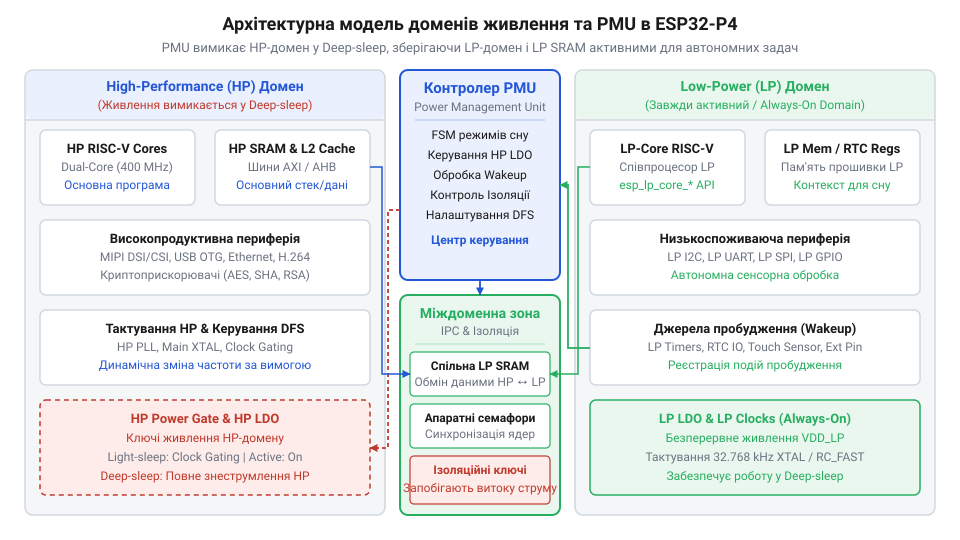
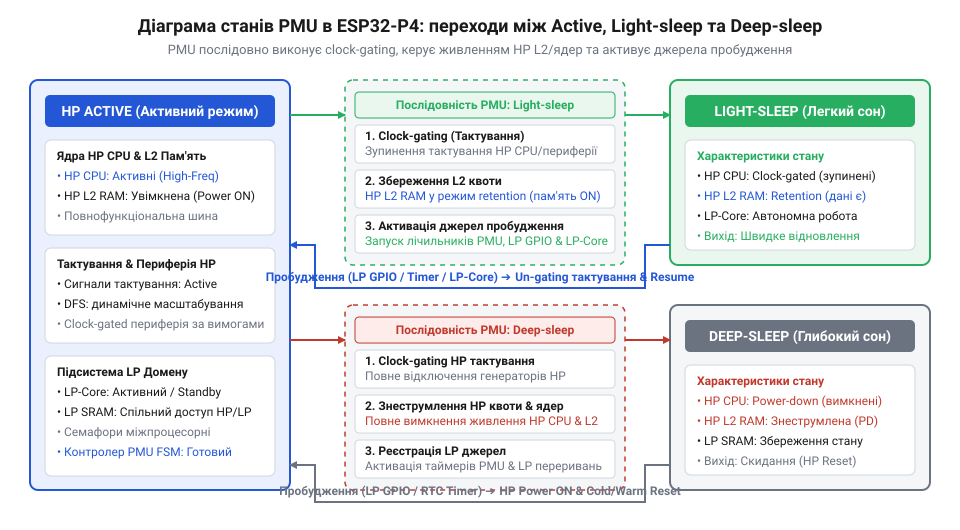
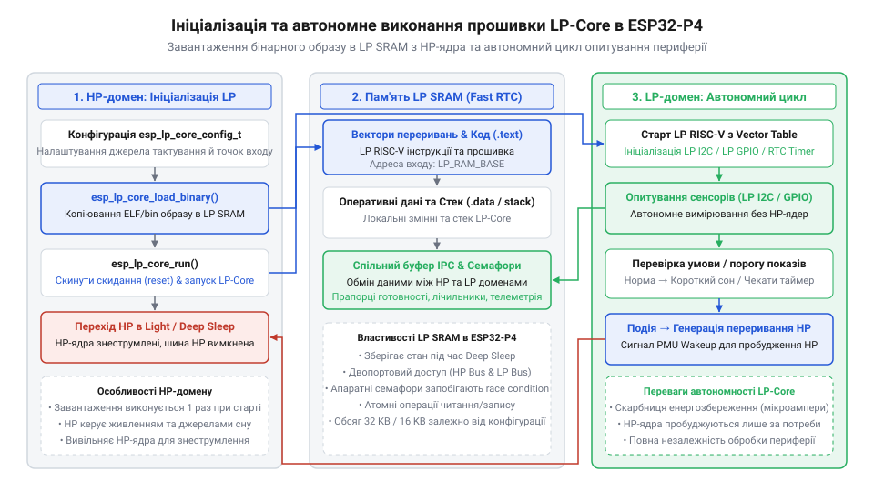
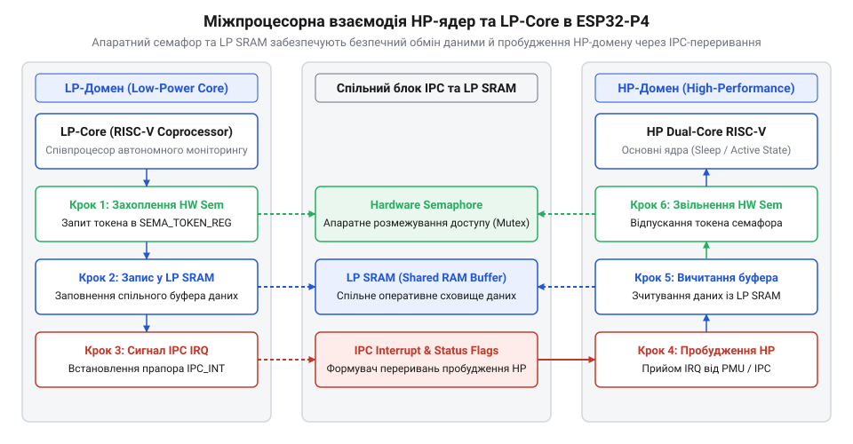
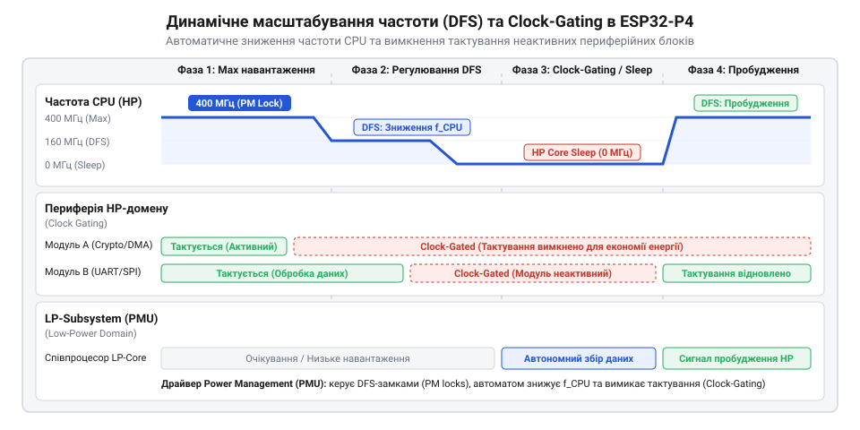

# Програмний інтерфейс керування доменами живлення, LP-Core та PMU

<preknowlist>
- [Мікроконтролер ESP32-S3](root:cat-hw-boards/esp32s3-microcontroller) — базову організацію процесорних ядер, концепцію системних периферійних шин та основи функціонування контролерів переривань в ESP-IDF
- [Waveshare ESP32-C6-Zero](root:cat-hw-boards/esp32-c6-zero) — архітектурні особливості малопотужних співпроцесорів RISC-V та загальні принципи управління доменам живлення в мікроконтролерах Espressif
- [Конфігурація eFuse та апаратне завантаження ESP32-S3](root:cat-hw-boards/esp32-s3-efuse-and-boot-configuration) — механізми вибору режимів старту системи та налаштування первинного завантажувача чипа
</preknowlist>

## Проблема високого енергоспоживання HP-домену ESP32-P4

Розробка автономного інтелектуального пристрою на базі флагманського мікроконтролера ESP32-P4 ставить розробника перед жорстким апаратним компромісом. З одного боку, двоядерний обчислювальний комплекс архітектури @@en|RISC-V@@ із тактовою частотою до 400 МГц, квотою кеш-пам'яті L2, SIMD-розширеннями та апаратними прискорювачами обробки відео й графіки надає високу продуктивність. З іншого боку, якщо цей потужний High-Performance (від англ. *high* — високий, *performance* — продуктивність; @@en|High-Performance@@, HP) домен залишатиметься постійно активним, струм споживання системи досягатиме 150–250 мА при робочій напрузі 3.3 В. При літій-полімерному акумуляторі ємністю 1000 мА·год такий пристрій повністю розрядиться лише за 4–6 годин роботи, що робить його непридатним для батарейних застосувань.

Головна причина швидкого виснаження батареї полягає у тому, що більшість засобів периферійного моніторингу — опитування датчиків температури, відстеження орієнтації за акселерометром чи очікування натискання кнопки — вимагають активних обчислень лише мікросекунди на секунду або й хвилину. Решту 99.9% часу основні обчислювальні ядра знаходяться в циклі очікування. Проте навіть під час виконання порожніх циклів `while(1)` у звичайному робочому режимі апаратна шина HP, дерево тактування, фазове автопідлаштування частоти (від англ. *phase-locked loop*; @@en|Phase-Locked Loop@@, PLL) та кеш-пам'ять залишаються під напругою, безперервно витрачаючи енергію на динамічний перемикальний струм та статичні витоки в напівпровідниковій структурі чипа. На відміну від класичних 8-бітних чи малопотужних 32-бітних рішень, де споживання в режимі очікування становить одиниці міліампер, у складній двоядерній системі з розгалуженою шинною матрицею стаційні витоки кремнію стають суттєвим фактором втрат.

Щоб подолати цю проблему, в ESP32-P4 реалізовано фізичне розділення мікроконтролера на два ізольовані енергетичні острівці з власною шинною інфраструктурою та окремими регуляторами живлення:
- @@en|High-Performance@@ (HP) домен: охоплює два високошвидкісні ядра RISC-V, кєш L2, векторизовані DSP-інструкції, контролери Ethernet, USB 2.0 HS, MIPI-CSI/DSI та матрицю шин високої пропускної здатності. - Low-Power (від англ. *low* — низький, *power* — живлення; @@en|Low-Power@@, LP) домен: автономна низькочастотна підсистема, що включає одноядерний співпроцесор LP RISC-V (20–40 МГц), оперативну пам'ять @@en|LP SRAM@@ обсягом 32 КБ, таймери та виділену низькоспоживаючу периферію (LP I2C, LP SPI, LP UART, LP GPIO, ADC).

Загальні принципи управління доменам живлення в малопотужних чипах, подібних до [малопотужних співпроцесорів RISC-V](root:cat-hw-boards/esp32-c6-zero), базуються на жорсткій ізоляції сигналів між блоками. Коли HP-домен не виконує активної обробки даних, його живлення можна повністю знеструмити за допомогою ключів @@en|power-gating@@ (від англ. *power* — живлення, *gating* — перекриття), а тактування вимкнути через @@en|clock-gating@@ (від англ. *clock* — тактування, *gating* — стробування). На відміну від попередніх архітектурних рішень, де застосовувався [мікроконтролер ESP32-S3](root:cat-hw-boards/esp32s3-microcontroller), в ESP32-P4 розділення між HP та LP доменами виконано на рівні кремнієвої топології: LP-домен продовжує функціонувати від власного низьковольтного регулятора, коли HP-домен знаходиться під напругою 0 В.

*Архітектурне розділення ESP32-P4 на високопродуктивну зону HP та автономний низькоспоживаючий острівець LP під керуванням центрального контролера PMU.*

Розподіл задач між доменами здійснюється за критерієм обчислювальної складності та необхідної швидкодії. Задачі первинного перцептивного моніторингу — зчитування показників сенсорів по шині I2C, фільтрація шумів, перевірка виходу величини за заданий поріг — делегуються співпроцесору LP-Core або апаратним таймерам. HP-домен пробуджується лише тоді, коли виявлено подію, що вимагає інтенсивної обробки даних (наприклад, стиснення кадру з камери чи передача пакета по мережі). Такий підхід дає змогу знизити середнє споживання струму з 200 мА до 10–20 мкА, продовжуючи час автономної роботи пристрою з кількох годин до кількох років.

## Апаратна підсистема PMU та режими сну

Ключовим апаратним арбітром, який відповідає за керування станами живлення, перехід між доменами та синхронізацію часових затримок в ESP32-P4, є підсистема Power Management Unit (від англ. *power* — живлення, *management* — керування, *unit* — вузол/блок; @@en|Power Management Unit@@, PMU). Це автономний кінцевий автомат (від англ. *finite state machine*; @@en|Finite State Machine@@, FSM), розташований усередині LP-домену. PMU живиться від безперервно активного регулятора VDD_LP та тактується від низькочастотного генератора 32.768 кГц або внутрішнього RC-кола 150 кГц. Всі переходи між режимами енергозбереження виконуються апаратно за чіткими часовими діаграмами, що запобігає виникненню невизначених станів на логічних шинах.

Підсистема PMU підтримує три основні режими функціонування мікроконтролера:
1. Режим Active: HP-домен і LP-домен повністю увімкнені. Основні RISC-V ядра працюють на максимальній частоті до 400 МГц, шинна матриця передає дані без затримок, доступна вся периферія та оперативна пам'ять. 2. Режим Light-sleep (від англ. *light* — легкий, *sleep* — сон; @@en|Light-sleep@@): тактування HP-процесорів та кеш-пам'яті припиняється шляхом @@en|clock-gating@@, однак живлення оперативної пам'яті HP SRAM та периферійних регістрів зберігається. Струм споживання знижується до 100–300 мкА. Перевагою режиму є миттєве відновлення виконання коду (менше ніж 10 мкс) без втрати контексту та без необхідності повторного завантаження прошивки. 3. Режим Deep-sleep (від англ. *deep* — глибокий, *sleep* — сон; @@en|Deep-sleep@@): HP-домен повністю знеструмлюється за допомогою ключів @@en|power-gating@@. Напруга на HP-ядрах та периферії падає до 0 В. Всі дані у стандартній HP SRAM втрачаються, за винятком спеціальних блоків оперативної пам'яті @@en|retention RAM@@, збереження стану яких запрограмовано розробником. Активним залишається лише LP-домен та контролер PMU, а споживання струму зменшується до 5–10 мкА. Для поглибленого вивчення розподілу секцій пам'яті та механізмів збереження стану процесів перегляньте матеріал про [організацію retention RAM та збереження контексту в Deep-sleep в ESP32-P4](root:hw-arch/esp32p4-retention-ram).

*Послідовність зміни енергетичних станів чипа під керуванням PMU із відображенням етапів таккового стробування, знеструмлення HP-домену та обробки джерел пробудження.*

Для збереження стабільності системи під час знеструмлення HP-домену PMU керує послідовністю фіксації сигналів на межі доменів (англ. *isolation latches*). Перш ніж відключити живлення VDD_HP, контролер PMU виставляє сигнали ізоляції, які блокують плаваючі логічні рівні на виходах знеструмлених блоків, запобігаючи паразитному витоку струму через вхідні каскади LP-периферії. Конфігурація часових затримок у регістрах PMU регулює тривалість подачі напруги та стабілізації генераторів тактування перед зняттям скидання (англ. *reset release*) при пробудженні.

В операційному середовищі ESP-IDF розробник не працює з регістрами PMU напряму, а використовує високорівневий драйвер управління живленням. Перед переведенням чипа в режим сну здійснюється реєстрація джерел пробудження (від англ. *wakeup source*; @@en|wakeup source@@): таймера реального часу, зовнішніх сигналів GPIO (RTC GPIO або ext0/ext1), аналогових компараторів чи сигналів переривання від співпроцесора LP-Core.

Налаштування завантаження та [первинного завантажувача чипа](root:cat-hw-boards/esp32-s3-efuse-and-boot-configuration) визначає вектори початкового старту, однак при пробудженні з Deep-sleep контролер PMU передає керування за адресою пробудження (англ. *wake stub*), оминаючи тривалу повну ініціалізацію обладнання.

Нижче наведено приклад коду мовою C для середовища ESP-IDF, що демонструє конфігурацію джерел пробудження за таймером і сигналом GPIO, а також перехід чипа у режими Light-sleep та Deep-sleep:

:::code api-esp32-p4-power-management-and-lp-core/c/esp-idf/app-main.c

Під час виконання функції `esp_deep_sleep_start()` контролер PMU послідовно зупиняє шинні мости, активує схеми ізоляції, вимикає тактування PLL, знижує напругу регулятора VDD_HP до нуля та переводить LDO LP-домену у низькоспоживаючий режим. Чип залишається у цьому стані до настання зареєстрованої події пробудження, після чого PMU виконує зворотну апаратну послідовність подачі живлення та тактування.

## Конфігурація та запуск співпроцесора LP-Core

Переведення високопродуктивного HP-домену в режим @@en|Deep-sleep@@ дозволяє кардинально знизити енергоспоживання, проте у більшості автономних систем пристрій не повинен ставати повністю «сліпим» до навколишнього середовища. Опитування цифрових сенсорів по шині I2C, зчитування аналогових рівнів чи відстеження стану тривожних ліній GPIO вимагає регулярних обчислень. Якщо для кожної такої операції пробуджувати двоядерний комплекс HP, що працює на частотах до 400 МГц, постійні транзитні переходи та перезапуск дерева тактування нівелюють усю економію енергії. Для розв'язання цієї проблеми в мікроконтролері ESP32-P4 передбачено співпроцесор @@en|LP-Core@@ (від англ. *low* — низький, *power* — живлення, *core* — ядро; @@en|LP-Core@@) — автономний 32-бітний обчислювальний модуль архітектури @@en|RISC-V@@, розташований усередині низькоспоживаючого домену.

На відміну від попередніх поколінь чипів, де порівняно з [базовою організацією процесорних ядер](root:cat-hw-boards/esp32s3-microcontroller) застосовувалися обмежені мікроконтролери ULP з вузьким набором асемблерних інструкцій, співпроцесор LP-Core в ESP32-P4 є повноцінним 32-бітним процесором RV32IMAC. Він підтримує виконання стандартного коду мовою C, має власне поле оперативності у спільній пам'яті @@en|LP SRAM@@ обсягом 32 КБ та виділену системну шину. З огляду на [архітектурні особливості малопотужних співпроцесорів](root:cat-hw-boards/esp32-c6-zero), LP-Core може тактуватися від внутрішнього високошвидкісного джерела LP FAST CLK (20 або 40 МГц) або низькочастотного генератора 32.768 кГц. Це забезпечує мінімальний струм споживання (в межах десятків мікроампер) при виконанні циклів контролю периферії, коли HP-домен повністю знеструмлений.

Життєвий цикл прошивки LP-Core керується основними HP-ядрами на етапі ініціалізації системи через програмний інтерфейс драйвера `esp_lp_core`. Бінарний образ співпроцесора компілюється окремим інструментарієм як автономний компонент прошивки та компонується для виконання в адресному просторі @@en|LP SRAM@@. Процес конфігурації та старту охоплює три послідовні кроки:
1. Завантаження бінарного образу: функція `esp_lp_core_load_binary()` копіює зкомпільований код та ініціалізовані дані з Flash-пам'яті у виділений сектор оперативної пам'яті @@en|LP SRAM@@. 2. Конфігурація векторів і тактування: структура `esp_lp_core_config_t` задає джерело пробудження співпроцесора (наприклад, початковий запуск від HP CPU або циклічний запуск від апаратного LP-таймера), джерело тактової частоти та вектор точки входу. 3. Ініціалізація виконання: функція `esp_lp_core_run()` знімає сигнал скидання з ядра LP-Core, після чого співпроцесор починає автономне виконання інструкцій за адресою початкової точки входу.

*Блок-схема послідовності завантаження бінарного образу в LP SRAM, ініціалізації вектора скидання та автономного виконання коду співпроцесором LP-Core.*

Співпроцесор LP-Core має прямий доступ до автономного комплексу периферійних модулів LP-домену: LP I2C, LP SPI, LP UART, LP GPIO та LP ADC. Ці блоки працюють незалежно від системної матриці шин HP-домену та продовжують функціонувати навіть при відключеній напрузі VDD_HP. Завдяки цьому LP-Core може автономно виконувати періодичні вимірювання (наприклад, опитування сенсора тиску по LP I2C), усреднювати значення за допомогою простих цифрових фільтрів та порівнювати їх із критичними порогами. Якщо виміряні параметри знаходяться в межах норми, LP-Core переводить себе в стан очікування переривання через інструкцію `wfi` (від англ. *wait for interrupt*), залишаючи HP-домен у режимі @@en|Deep-sleep@@.

Нижче наведено приклад коду мовою C для середовища ESP-IDF, що демонструє завантаження та запуск прошивки співпроцесора LP-Core з боку HP-ядер:

:::code api-esp32-p4-power-management-and-lp-core/c/esp-idf/app-main-2.c

## Міжпроцесорна взаємодія та спільна пам'ять

Запуск автономної прошивки на співпроцесорі LP-Core вирішує задачу фонового збору даних, однак створення цілісної системи вимагає організації надійного каналу зв'язку між LP-доменом та основними HP-ядрами. Зібрані співпроцесором масиви показань сенсорів мають передаватися в HP-домен при його пробудженні, а HP-ядра повинні мати можливість оновлювати порогові конфігураційні параметри для LP-Core без перезапуску всієї системи.

Основою міжпроцесорного обміну в ESP32-P4 є спільна оперативно-пам'ятна область @@en|LP SRAM@@ обсягом 32 КБ. Цей блок пам'яті фізично розташований у LP-домені та залишається під напругою навіть під час глибокого сну HP-систем. Завдяки подвійному мапуванню адресної шини, до пам'яті @@en|LP SRAM@@ мають безпосередній доступ як співпроцесор LP-Core через локальну шину LP, так і основні ядра HP через системну матрицю шин. Змінні та буфери структур даних, призначені для міжпроцесорної взаємодії, розміщуються у цій пам'яті за допомогою макросів розміщення секцій (наприклад, `RTC_DATA_ATTR` або `LP_MEM_ATTR`), що запобігає їх ініціалізації за замовчуванням при холодному перезавантаженні HP-домену.

Коли HP-домен перебуває в активному стані, обидва обчислювальні комплекси можуть звертатися до спільного буфера в @@en|LP SRAM@@ одночасно. Паралельний запис або зчитування даних без відповідного узгодження неминуче призводить до виникнення стану гонитви (від англ. *race* — гонитва, *condition* — стан; @@en|race condition@@), коли HP-ядро зчитує частково оновлений буфер або обидва процесори перезаписують комірки пам'яті в довільному порядку.

Для вирішення проблеми конкурентного доступу в апаратне забезпечення ESP32-P4 інтегровано контролер апаратних семафорів (від грец. *sema* — знак, *phoros* — той, що носить; @@en|Hardware Semaphore@@). На відміну від програмних атрибутів мутексів, які вимагають активної операційної системи, апаратні семафори реалізовані у вигляді незалежних регістрів атомарної перевірки та встановлення (англ. *atomic read-and-set*). Процес захоплення апаратного семафора відбувається на рівні шинного шифратора:
1. Процесор (HP або LP-Core) виконує читання з відповідного регістру семафора. 2. Якщо семафор був вільний, апаратна логіка атомарно повертає `1` і відразу блокує семафор для інших шинних майстрів. 3. Якщо семафор вже був захоплений іншим ядром, читання повертає `0`. Ядро, що отримало `0`, очікує у циклі спин-блокування (англ. *spinlock*) або виконує інші задачі. 4. Після завершення роботи з критичною секцією у пам'яті @@en|LP SRAM@@ ядро-власник записує `1` у регістр семафора, звільняючи його для використання.

*Архітектура спільного буфера в LP SRAM та механізм виключного доступу за допомогою апаратних семафорів і переривань IPC.*

Окрім синхронізації доступу до пам'яті, системна архітектура забезпечує механізми асинхронного сповіщення через міжпроцесорні переривання (від англ. *inter-processor communication* — міжпроцесорна взаємодія; @@en|IPC Interrupt@@, IPC). Якщо LP-Core під час автономного моніторингу виявляє вихід показників датчика за безпечні межі, він записує тривожні дані у спільну пам'ять, захоплює апаратний семафор для захисту структури і викликає апаратний сигнал пробудження. Цей сигнал надходить до підсистеми @@en|PMU@@, яка ініціює відновлення живлення VDD_HP, скасовує фіксацію логічних рівнів та передає керування HP-процесору.

На відміну від [апаратного старту первинного завантажувача](root:cat-hw-boards/esp32-s3-efuse-and-boot-configuration), HP-ядра пробуджуються через збережений контекст та зчитують причину пробудження `ESP_SLEEP_WAKEUP_ULP`. Після цього HP-процесор захоплює апаратний семафор, зчитує оновлену структуру даних із буфера @@en|LP SRAM@@, обробляє сповіщення і звільняє ресурс.

Нижче наведено приклад коду мовою C, який демонструє організацію спільного буфера в @@en|LP SRAM@@ та безпечний обмін даними з використанням апаратного семафора:

:::code api-esp32-p4-power-management-and-lp-core/c/esp-idf/acquire-hw-semaphore.c

## Динамічне масштабування частоти та тактування

Налагодження автономного збору даних у малопотужному режимі вирішує задачу енергозбереження під час сну, однак у реальних застосуваннях високопродуктивний домен @@en|High-Performance@@ (від англ. *high* — високий, *performance* — продуктивність; @@en|High-Performance@@, HP) значну частину часу залишається в активному стані (англ. *Active mode*). Під час виконання задач обробки користувацького інтерфейсу, мережевого обміну чи аналізу відеопотоку двоядерний обчислювальний комплекс очікує на завершення операцій введення-виведення або надходження чергових пакетів даних. Якщо процесорні ядра безперервно працюватимуть на граничній частоті 400 МГц із тактуванням усіх периферійних блоків від фазового автопідлаштування частоти (від англ. *phase-locked loop*; @@en|Phase-Locked Loop@@, PLL), динамічна потужність виснажуватиме джерело живлення навіть при відсутності обчислювального навантаження.

Для мінімізації споживання струму в робочому режимі в архітектурі ESP32-P4 застосовується апаратний механізм динамічного масштабування частоти (від англ. *dynamic frequency scaling*; @@en|Dynamic Frequency Scaling@@, DFS). Ідея DFS полягає в гнучкій зміні тактової частоти ядер @@en|CPU@@ та периферійної шини @@en|APB@@ залежно від поточних потреб системи. Оскільки динамічна потужність напівпровідникових схем прямо пропорційна тактовій частоті, переведення процесора з 400 МГц на частоту опорного кварцового резонатора (40 МГц) під час пауз між обчисленнями зменшує споживання струму HP-домену майже в 8–10 разів без зупинки виконання фонових задач операційної системи. На відміну від стаційного вибору частоти, подібного до налаштування у [мікроконтролерах ESP32-S3](root:cat-hw-boards/esp32s3-microcontroller), підсистема живлення ESP32-P4 здійснює динамічну перекомутацію джерел тактування (PLL та XTAL) на льоту за кілька мікросекунд.

Поряд із масштабуванням частоти важливу роль відіграє автоматичне стробування тактування (від англ. *clock-gating*; @@en|clock-gating@@) та знеструмлення (від англ. *power-gating*; @@en|power-gating@@) неактивних периферійних модулів. Якщо графічний прискорювач, криптографічний співпроцесор чи контролер камери не беруть участі у поточному обчислювальному циклі, драйвери системного рівня припиняють подачу тактового сигналу на їхні логічні вентилі. Це повністю блокує динамічне перемикання транзисторів. При тривалих простоях апаратна підсистема Power Management (від англ. *power* — живлення, *management* — керування; @@en|Power Management@@) знеструмлює окремі периферійні блоки HP-домену, усуваючи струми статичного витоку кремнію.

*Графік динамічної зміни частоти CPU та стробування тактування периферійних блоків залежно від обчислювального навантаження та активних обмежувачів PM lock.*

В операційному середовищі ESP-IDF керування адаптивною продуктивністю реалізовано через системний драйвер Power Management. Щоб запобігти збоям часових інтервалів у периферійних інтерфейсах (наприклад, зміні швидкості UART чи SPI під час зниження частоти bus), розробники та драйвери периферії використовують обмежувачі частоти — об'єкти типу @@en|PM lock@@ (від англ. *power management lock*; @@en|PM lock@@). В ESP-IDF визначено три типи обмежувачів:
1. `ESP_PM_CPU_FREQ_MAX`: фіксує частоту процесора на максимально дозволеному рівні (наприклад, 400 МГц) на час виконання критичних математичних чи векторизованих розрахунків. 2. `ESP_PM_APB_FREQ_MAX`: заповнює вимогу максимальної частоти шини @@en|APB@@, що необхідно для стабільної роботи швидкісних периферійних шин і DMA-трансферів. 3. `ESP_PM_NO_LIGHT_SLEEP`: забороняє автоматичний перехід системи у режим легкого сну (англ. *Automatic Light Sleep*) під час простою задач операційної системи @@en|FreeRTOS@@.

Коли всі обмежувачі типу `ESP_PM_CPU_FREQ_MAX` звільнені, драйвер Power Management автоматично знижує частоту CPU до мінімального встановленого значення. Якщо ж у системі відсутні активні задачі та ввімкнено механізм @@en|tickless idle@@ (від англ. *tickless* — безтактовий, *idle* — простій; @@en|tickless idle@@), планувальник @@en|FreeRTOS@@ прораховує час до наступного таймерного переривання та ініціює перехід HP-домену у режим @@en|Light-sleep@@. З огляду на досвід [розробки малопотужних пристроїв](root:cat-hw-boards/esp32-c6-zero), поєднання DFS, стробування тактування та автоматичного Light-sleep дозволяє мінімізувати енергоспоживання у широкому діапазоні навантажень без ускладнення прикладного коду.

Нижче наведено приклад коду мовою C для середовища ESP-IDF, що демонструє конфігурацію драйвера Power Management, створення та використання обмежувача частоти `ESP_PM_CPU_FREQ_MAX` під час виконання інтенсивних розрахунків:

:::code api-esp32-p4-power-management-and-lp-core/c/esp-idf/setup-power-management.c