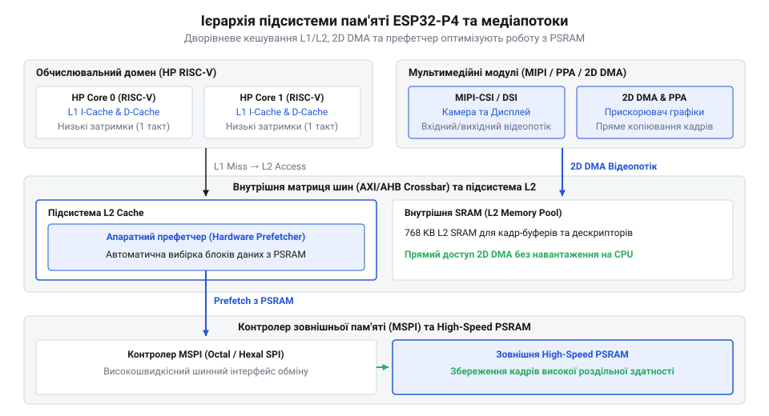
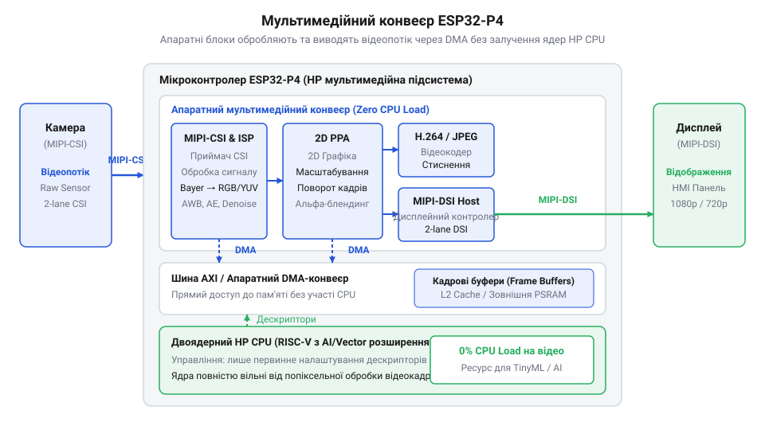
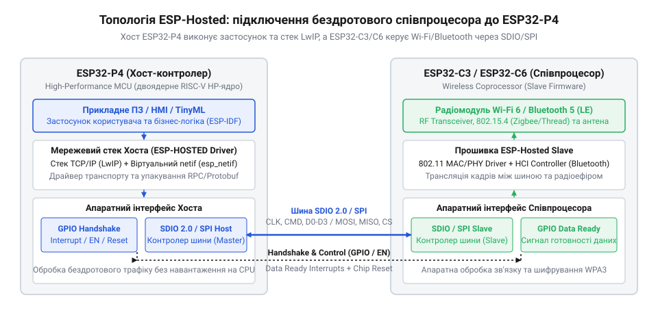
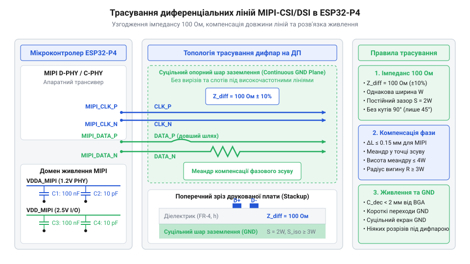

# Мікроконтролер ESP32-P4

<preknowlist>
- [Мікроконтролер ESP32-S3](root:cat-hw-boards/esp32s3-microcontroller) — розуміти двоядерну обчислювальну архітектуру, роботу з векторизованими інструкціями та принципи функціонування периферійних інтерфейсів ESP32-S3
- [Плати відеозахоплення нового покоління на базі ESP32-S3](root:cat-hw-boards/esp32-s3-cam-boards-overview) — орієнтуватися у конструктивних обмеженнях паралельних DVP-інтерфейсів відеозахоплення та методах буферизації кадрів у PSRAM
- [Схемотехніка та розпіновка шин Octal SPI Flash та PSRAM в ESP32-S3](root:cat-hw-boards/esp32-s3-octal-spi-bus-layout) — мати уявлення про організацію високошвидкісних шин пам'яті, часові затримки та вимоги до підключення зовнішньої PSRAM
</preknowlist>

## Обмеження класичних SoC у медіазадачах

Спроба побудувати сучасний інтелектуальний пристрій із графічним дисплеєм високої роздільності, потоковим відеозахопленням із камери та інтегрованими алгоритмами розпізнавання об'єктів на базі класичних мікроконтролерів неминуче впирається в апаратні бар'єри внутрішньої архітектури. Коли розробник намагається використати [мікроконтролер ESP32-S3](root:cat-hw-boards/esp32s3-microcontroller) або орієнтовані на загальний ужиток чипи серії @@en|STM32@@ для одночасного виводу плавної анімації інтерфейсу @@en|HMI@@ (від @@en|Human-Machine Interface@@, англ. @@en|Human-Machine Interface@@ — людина-машина інтерфейс), обробки кадрів камери та виконання нейронних мереж @@en|TinyML@@ (від @@en|Tiny Machine Learning@@, англ. @@en|Tiny Machine Learning@@ — компактне машинне навчання), система швидко втрачає стабільність. Дисплей починає пропускати кадри, інтерфейс реагує з відчутною затримкою, а обчислювальні ядра повністю занепадають під тінню нескінченних переривань від шин введення-виведення.

Першим вузьким місцем виступає паралельний інтерфейс відеозахоплення @@en|DVP@@ (від @@en|Digital Video Port@@, англ. @@en|Digital Video Port@@ — цифровий відеопорт). Класичні [плати відеозахоплення](root:cat-hw-boards/esp32-s3-cam-boards-overview) приймають потік даних через 8- або 16-бітну паралельну шину з тактовим сигналом @@en|PCLK@@, сигналом кадрової синхронізації @@en|VSYNC@@ та сигналом рядка @@en|HREF@@. При зчитуванні кадру роздільністю @@en|VGA@@ (640 × 480 пікселів) або @@en|HD@@ (1280 × 720 пікселів) зі швидкістю 30 кадрів на секунду у форматі @@en|RGB565@@ (2 байти на піксель) обсяг необроблених даних створює колосальне навантаження на систему контролера прямого доступу до пам'яті @@en|DMA@@ (від @@en|Direct Memory Access@@, англ. @@en|Direct Memory Access@@ — прямий доступ до пам'яті). Кожен байт має бути захоплений із шини та записаний у внутрішню пам'ять @@en|SRAM@@ або зовнішню псевдостатичну оперативну пам'ять @@en|PSRAM@@ (від @@en|Pseudo-Static RAM@@, англ. @@en|Pseudo-Static RAM@@ — псевдостатична оперативна пам'ять). Паралельна шина DVP вимагає до 16 фізичних виводів @@en|GPIO@@, генерує значний рівень електромагнітних завад @@en|EMI@@ та створює постійне навантаження на процесор для обробки рядкових буферів і колірної конверсії.

Друга суттєва перешкода полягає у конфлікті за пропускну здатність зовнішньої шини пам'яті. У класичних системи на чипі @@en|SoC@@ (від @@en|System on Chip@@, англ. @@en|System on Chip@@ — система на чипі) зовнішня флеш-пам'ять і оперативна пам'ять підключаються через послідовні шини Quad @@en|SPI@@ або Octal @@en|SPI@@. Спільна [шина Octal SPI](root:cat-hw-boards/esp32-s3-octal-spi-bus-layout) мусить одночасно обслуговувати три інтенсивні потоки: запис вхідних кадрів із камери через DMA, зчитування фреймбуфера для оновлення дисплея через інтерфейс @@en|RGB@@ або @@en|SPI@@, а також вибірку інструкцій процесора й збереження вагових коефіцієнтів нейромережі.

Розрахуємо підсумкову потребу в пропускній здатності для системи з показом кадру 800 × 480 пікселів при 60 кадр/с і захватом відео 1280 × 720 пікселів при 30 кадр/с у колірному просторі @@en|RGB565@@:

```
Data_Rate_Camera  = 1280 × 720 × 2 × 30
                  = 55.296 MB/s          [потік даних відеозахоплення]
Data_Rate_Display = 800 × 480 × 2 × 60
                  = 46.080 MB/s          [потік даних виводу на екран]
Total_Bus_Demand  = 55.296 + 46.080
                  = 101.376 MB/s         [сумарна необхідна шинна пропускна здатність]
```

Гранична теоретична пропускна здатність Octal SPI шини при тактовій частоті 80 МГц у режимі одиничної швидкості передачі @@en|SDR@@ становить:

```
Bandwidth_OSPI_80MHz = 80 × 10⁶ × 8 ÷ 8
                     = 80.000 MB/s       [пропускна здатність шини Octal SPI SDR]
```

Оскільки сумарний запит `Total_Bus_Demand` (101.376 MB/s) перевищує реальну спроможність шини `Bandwidth_OSPI_80MHz` (80.000 MB/s), виникає арбітражне голодування. Контролер пам'яті змушений затримувати вибірку рядків кадру або блокувати читання дисплея. На практиці це призводить до ефекту розриву зображення @@en|screen tearing@@ (англ. @@en|screen tearing@@ — горизонтальний зсув частин кадру через неузгодженість частоти оновлення дисплея та зчитування фреймбуфера), зниження частоти оновлення екрана до 10–15 кадрів на секунду та заморожування анімації.

Третім фактором є відсутність спеціалізованих апаратних обробників графіки та відеопотоку. У класичних SoC центральний процесор виконує програмну дебайєризацію (відновлення повноколірного пікселя з матриці Байєра), корекцію гами, масштабування кадру та поворот зображення для екранного буфера. Виконання цих операцій вимагає мільйонів базових циклів CPU на кожен кадр. Коли поверх цього накладається завдання виконання операцій множення з накопиченням @@en|MAC@@ (від @@en|Multiply-Accumulate@@, англ. @@en|Multiply-Accumulate@@ — множення з накопиченням) для згорткових шарів нейромережі TinyML, ядра процесора виявляються повністю завантаженими на 100%. Будь-яка фонова задача — від розбору мережевих пакетів до опитування сенсорів — спричиняє затримки в обробці кадрів.

Четвертою проблемою виступає високе енергоспоживання у режимі очікування. Класичні мікроконтролери не мають чіткого фізичного розділення між обчислювальними ядрами високої частоти та підсистемою моніторингу периферії. Щоб постійно відстежувати стан зовнішніх датчиків або чекати на натискання сенсорної кнопки, SoC змушений утримувати активним основне процесорне ядро та високочастотні тактові генератори, споживаючи десятки міліампер струму, що є неприпустимим для автономних пристроїв із живленням від акумулятора.

Подолання цих системних обмежень вимагає принципово нового архітектурного підходу, втіленого у мікроконтролері @@en|ESP32-P4@@. Цей SoC відмовляється від паралельних відеошин на користь високошвидкісних диференціальних інтерфейсів @@en|MIPI-CSI@@ (від @@en|Mobile Industry Processor Interface Camera Serial Interface@@, англ. @@en|Mobile Industry Processor Interface Camera Serial Interface@@ — послідовний інтерфейс камери) та @@en|MIPI-DSI@@ (від @@en|Mobile Industry Processor Interface Display Serial Interface@@, англ. @@en|Mobile Industry Processor Interface Display Serial Interface@@ — послідовний інтерфейс дисплея), впроваджує двоуровневий кеш L1/L2 для зовнішньої high-speed PSRAM, інтегрує [апаратний прискорювач 2D-графіки](root:hw-arch/esp32-p4-ppa-2d-graphics-accelerator) та розподіляє обчислення між High-Performance (HP) та Low-Power (LP) доменами живлення. Історичні передумови та етапи цього переходу детально описує [еволюція архітектури ESP32](root:cat-hw-boards/esp32-p4-microcontroller/hist-esp32-p4-architecture-evolution.md), показуючи трансформацію чипів Espressif від бездротових контролерів до повноцінних обчислювальних медіа-SoC.

## Архітектура двоядерного RISC-V та LP-домену

Центральним елементом обчислювальної потужності мікроконтролера ESP32-P4 є двоядерний високопродуктивний процесорний комплекс High-Performance (HP) на базі відкритої архітектури наборів інструкцій @@en|RISC-V@@ (від @@en|Reduced Instruction Set Computer@@, англ. @@en|Reduced Instruction Set Computer@@ — комп'ютер зі скороченим набором інструкцій). Обидва ядра працюють на тактовій частоті до 400 МГц і мають 5-ступінчастий конвеєр з конфігурацією здатності сумісного виконання двох інструкцій за один такт (@@en|dual-issue in-order pipeline@@). Архітектура HP-ядер оптимізована для паралельного виконання графічних стеків, протокольних мережевих задач та математично містких алгоритмів машинного зору.

Головною відмінністю процесорних ядер ESP32-P4 від попередніх поколінь є впровадження кастомних розширень інструкцій для векторної обробки даних та цифрової обробки сигналів @@en|DSP@@ (від @@en|Digital Signal Processor@@, англ. @@en|Digital Signal Processor@@ — цифровий сигнал-процесор). Векторний блок підтримує концепцію @@en|SIMD@@ (від @@en|Single Instruction Multiple Data@@, англ. @@en|Single Instruction Multiple Data@@ — одна інструкція для багатьох даних) та працює з 128-бітними векторними регістрами. Завдяки цьому процесор здатний за один тактовий цикл здійснювати одночасну обробку 16 цілочисельних елементів розмірністю 8 біт (INT8) або 8 елементів розмірністю 16 біт (INT16).

При виконанні нейромережевих згорткових операцій у задачах TinyML векторний блок паралельно розраховує кілька операцій множення з накопиченням MAC. Для оцінки теоретичної продуктивності підсистеми використаємо спрощену формулу розрахунку кількості MAC-операцій за секунду для одного HP-ядра на граничній частоті 400 МГц із 128-бітним SIMD-блоком для 8-бітних тензорних даних:

```
Ops_Per_Clock = 128 ÷ 8
              = 16               [кількість паралельних INT8 елементів у векторі]
MAC_Per_Clock = Ops_Per_Clock ÷ 2
              = 8                [кількість паралельних MAC-операцій за такт]
Peak_MAC_Rate = 8 × 400 × 10⁶
              = 3.200 × 10⁹ MAC/s [пікова продуктивність MAC на одне ядро]
```

При роботі обох HP-ядер на тактовій частоті 400 МГц сумарна обчислювальна спроможність досягає 6.4 мільярдів операцій MAC на секунду. Це дозволяє здійснювати локальне виконання нейронних мереж (наприклад, MobileNet-V2 або custom CNN) для ідентифікації об'єктів у реальному часі без застосування дискретних прискорювачів NPU. Фізичні та математичні засади функціонування цих векторних блоків розкривають [векторні та DSP](root:hw-arch/esp32-p4-riscv-vector-extension-dsp) розширення архітектури, а конкретний розрахунок продуктивності нейромереж надає [математична модель оцінки](root:cat-hw-boards/esp32-p4-microcontroller/math-esp32-p4-riscv-vector-tinyml-throughput.md) для матричних обчислень.

Разом із високопродуктивним HP-доменом SoC ESP32-P4 містить повністю ізольований малопотужний домен Low-Power (LP), серцем якого є окреме одноядерне 32-бітне процесорне ядро RISC-V із тактовою частотою 40 МГц. LP-домен функціонує в окремому домені живлення і має власний обсяг оперативної пам'яті LP SRAM, ПЗУ LP ROM, а також набір власної периферії: контролери LP-I2C, LP-SPI, LP-UART, аналогово-цифрові перетворювачі та сенсори торкання.

Головне призначення LP-ядра — автономний моніторинг зовнішнього середовища у режимі глибокого сну (@@en|Deep Sleep@@). Коли пристрій переходить у стан очікування, блок керування живленням @@en|PMU@@ (від @@en|Power Management Unit@@, англ. @@en|Power Management Unit@@ — блок керування живленням) повністю знеструмлює HP-домен: вимикаються обидва 400 МГц RISC-V ядра, шинна матриця AXI, мультимедійні прискорювачі та контролери зовнішньої PSRAM. LP-ядро продовжує працювати від малопотужного внутрішнього генератора, зчитуючи дані з датчиків через LP-I2C із мінімальним споживанням струму (одиниці мікроампер).


*Структурна схема системи на чипі ESP32-P4, що показує High-Performance (HP) двоядерний процесор RISC-V з векторними розширеннями, Low-Power (LP) ядро, внутрішню шинну матрицю та домени живлення.*

Як видно зі структурної схеми, взаємодія між HP- та LP-доменами здійснюється через внутрішньосховищний двопортовий шар пам'яті та апаратні міжпроцесорні поштові скриньки (@@en|hardware IPC mailboxes@@) з підтримкою між'ядерних семафорів. Коли LP-ядро виявляє подію, що вимагає втручання основного обчислювального комплексу (наприклад, перевищення порогу температури або виявлення руху), воно записує тригерні дані у спільний регістр і подає апаратний сигнал пробудження на PMU. Контролер PMU подає живлення на HP-домен, стабілізує тактову частоту фазового автопідстроювання частоти @@en|PLL@@ (від @@en|Phase-Locked Loop@@, англ. @@en|Phase-Locked Loop@@ — фазове автопідстроювання частоти) та ініціалізує повернення HP-ядер до роботи за лічені мікросекунди.

Організація взаємодії програмного стека на базі операційної системи реального часу @@en|FreeRTOS@@ для HP-ядер та автономної прошивки LP-ядра підпорядковується чіткому розподілу ролей:

1. **HP Core 0**: виділяється для керування стеком графічного інтерфейсу (наприклад, @@en|LVGL@@), обробки подій введення від сенсорного екрана та операцій зчитування/запису файлових систем або зовнішніх накопичувачів. 2. **HP Core 1**: виділяється під задачний конвеєр обробки відеопотоку з камери, виклики інструкцій векторного прискорювача для нейромережі TinyML та координацію апаратного кодера H.264. 3. **LP Core**: виконує виключно циклічні фонові алгоритми у режимі глибокого сну, опитування периферійних сенсорів та підтримання таймерів пробудження.

Програмну конфігурацію режимів живлення, налаштування тактів та завантаження бінарного коду в LP SRAM розкриває [програмний інтерфейс керування](root:cat-hw-boards/esp32-p4-microcontroller/api-esp32-p4-power-management-and-lp-core.md) доменам живлення в середовищі ESP-IDF. Апаратні шляхи передачі даних між ядрами та швидкісною внутрішньою пам'яттю координує підсистема шин AXI/AHB, яку підтримує [підсистема багаторівневого кешування](root:hw-arch/esp32-p4-l1-l2-cache-subsystem) L1/L2, усуваючи будь-які затримки при зверненні HP-ядер до зовнішніх ресурсів.

## Багаторівнева пам'ять L1/L2 та High-Speed PSRAM

Високочастотні обчислювальні ядра, що працюють на питомій частоті 400 МГц, неминуче стикаються з проблемою голодування конвеєра інструкцій (@@en|pipeline stall@@, англ. @@en|pipeline stall@@ — зупинка конвеєра), якщо підсистема пам'яті не здатна забезпечити відповідну пропускну здатність із низькими затримками. У мультимедійних задачах побудови сучасних графічних інтерфейсів @@en|HMI@@ та систем потокового відеозахоплення обсяг внутрішньої статичної оперативної пам'яті @@en|SRAM@@ (від @@en|Static RAM@@, англ. @@en|Static RAM@@ — статична оперативна пам'ять), який у High-Performance домені (@@en|HP@@, від @@en|High-Performance@@, англ. @@en|High-Performance@@ — високопродуктивний) мікроконтролера @@en|ESP32-P4@@ становить 768 КБ, виявляється занадто малим. Один фреймбуфер для панелі високої роздільності 1280 × 720 пікселів у колірному просторі @@en|RGB565@@ вимагає понад 1.84 МБ пам'яті (а для подвійної буферизації — понад 3.68 МБ). З цієї причини фреймбуфери, вагові коефіцієнти нейронних мереж @@en|TinyML@@ та ресурси графічних бібліотек виносяться у зовнішню псевдостатичну оперативну пам'ять @@en|PSRAM@@. Проте безпосередній доступ обчислювальних ядер або контролерів прямого доступу до пам'яті @@en|DMA@@ до зовнішніх чипів супроводжується затримками у десятки тактових циклів. Коли процесор, контролер дисплея, відеокамера та графічний прискорювач одночасно звертаються до зовнішньої шини, виникає арбітражний конфлікт і голодування шини (@@en|bus starvation@@, англ. @@en|bus starvation@@ — голодування шини).

Для подолання цього системного вузького місця в архітектурі ESP32-P4 впроваджено високопродуктивну багаторівневу підсистему кешування та внутрішню шинну матрицю @@en|AXI@@ (від @@en|Advanced eXtensible Interface@@, англ. @@en|Advanced eXtensible Interface@@ — розширюваний передовий інтерфейс) і @@en|AHB@@ (від @@en|Advanced High-performance Bus@@, англ. @@en|Advanced High-performance Bus@@ — розширювана високопродуктивна шина). Кожне з двох 400 МГц ядер @@en|RISC-V@@ має власну виділену кеш-пам'ять першого рівня @@en|L1@@ (від @@en|Level 1 Cache@@, англ. @@en|Level 1 Cache@@ — кеш першого рівня): 32 КБ для інструкцій (@@en|I-Cache@@) та 32 КБ для даних (@@en|D-Cache@@), що працюють на частоті ядра з нульовою затримкою. На наступному щаблі розташовано спільний об'єднаний кеш другого рівня @@en|L2@@ (від @@en|Level 2 Cache@@, англ. @@en|Level 2 Cache@@ — кеш второго рівня) обсягом 256 КБ, який обслуговує запити обох ядер HP-комплексу та виступає апаратним буфером для транзакцій до зовнішньої флеш-пам'яті й PSRAM. Внутрішня 32-бітна шинна матриця AXI має кілька незалежних паралельних портів читання та запису. Це дозволяє контролерам DMA (для камери й дисплея) та процесорним ядрам здійснювати одночасний обмін даними з внутрішньою пам'яттю 768 КБ SRAM і кешем L2 без взаємного міжадресного блокування.

При виконанні послідовних операцій зчитування (наприклад, прокачуванні рядків фреймбуфера або лінійному зчитуванні матриць у згорткових нейромережах) критичну роль відіграє апаратний префетчер @@en|hardware prefetcher@@ (від @@en|hardware prefetcher@@, англ. @@en|hardware prefetcher@@ — апаратний засіб попередньої вибірки), інтегрований у блок керування пам'яттю @@en|MMU@@ (від @@en|Memory Management Unit@@, англ. @@en|Memory Management Unit@@ — блок керування пам'яттю) та контролер кешу L2. Префетчер здійснює безперервний аналіз просторового кроку (@@en|stride@@) адресації у запитах процесора. Виявивши послідовний шаблон вибірки, він випереджально надсилає командні транзакції до контролера High-Speed PSRAM, завантажуючи наступні рядки кешу L2 ще до того, як ядро CPU або модуль DMA надішлють явний запит. Для запобігання пошкодженню даних при паралельній обробці підсистема кешу підтримує когерентність: при записі даних периферійним блоком DMA у зовнішнє середовище виконується автоматична інвалідація відповідних рядків (@@en|cache line invalidation@@) або їхній примусовий скид (@@en|write-back/flush@@), що повністю гарантує цілісність пам'яті.

Проілюструємо обчислювальний баланс пропускної здатності шини пам'яті для системи, яка одночасно здійснює вивід зображення 1280 × 720 пікселів при 60 кадр/с у колірному форматі @@en|RGB565@@ (2 байти на піксель), прийом відеокадрів 1280 × 720 пікселів при 30 кадр/с та зчитування вагових коефіцієнтів нейромережі зі швидкістю 100 МБ/с:

```
Data_Rate_Display = 1280 × 720 × 2 × 60
                  = 110.592 MB/s         [потік зчитування фреймбуфера для виводу на дисплей]
Data_Rate_Camera  = 1280 × 720 × 2 × 30
                  = 55.296 MB/s          [потік запису вхідних кадрів із камери через DMA]
Data_Rate_Tensor  = 100.000 MB/s         [потік зчитування вагових коефіцієнтів нейромережі]
Total_Bus_Load    = 110.592 + 55.296 + 100.000
                  = 265.888 MB/s         [сумарне навантаження на підсистему пам'яті]
```

Зовнішній інтерфейс High-Speed PSRAM у мікроконтролері ESP32-P4 підтримує режим подвійної швидкості передачі даних @@en|DDR@@ (від @@en|Double Data Rate@@, англ. @@en|Double Data Rate@@ — подвійна швидкість передачі даних) на тактовій частоті до 200 МГц по 16-бітній шині, забезпечуючи граничну теоретичну пропускну здатність:

```
Peak_PSRAM_Bandwidth = 200 × 10⁶ × 2 × 16 ÷ 8
                     = 800.000 MB/s      [пікова пропускна здатність 16-бітної PSRAM DDR 200 МГц]
```

Оскільки реальне сумарне навантаження `Total_Bus_Load` (265.888 MB/s) становить лише 33% від граничної спроможності `Peak_PSRAM_Bandwidth` (800.000 MB/s), а показник влучань у кеш L1/L2 (@@en|cache hit rate@@) перевищує 95% для виконання інструкцій, підсистема пам'яті функціонує без жодних блокувань. На відміну від обмеженої [шини Octal SPI](root:cat-hw-boards/esp32-s3-octal-spi-bus-layout), математичний розрахунок затримок розгортає [математика пропускної здатності](root:cat-hw-boards/esp32-p4-microcontroller/math-esp32-p4-memory-bandwidth-and-frame-buffer.md) шин пам'яті, а програмне керування кеш-пам'яттю опікує [підсистеми багаторівневого кешування](root:hw-arch/esp32-p4-l1-l2-cache-subsystem) L1/L2.


*Діаграма ієрархії підсистеми пам'яті ESP32-P4, яка зображує зв'язок кеш-пам'яті L1/L2, контролера DMA, апаратного префетчера та High-Speed PSRAM.*

## Мультимедійний комплекс MIPI, ISP та PPA

Побудова високопродуктивних медійних систем із чітким виводом графіки та обробкою відеопотоків високої роздільності вимагає кардинальної зміни підходу до обробки піксельних даних. Спроба виконати програмну обробку кадрів камери та графічних елементів інтерфейсу безпосередньо на центральному процесорі призводить до повного вичерпання його тактового ресурсу. Обчислювальні ядра вимушені витрачати мільйони циклів на відновлення кольорів із матриці сенсора, перетворення форматів кадру, двовимірне масштабування та альфа-змішування шарів. В результаті процесор не має часу на виконання алгоритмів прийняття рішень, протоколів зв'язку або нейромережевих моделей.

Мікроконтролер ESP32-P4 повністю долає це обмеження завдяки інтеграції високошвидкісних фізичних інтерфейсів та dedicated апаратних медіаприскорювачів. На зміну застарілим паралельним шинам @@en|DVP@@, які вимагали до 16 фізичних виводів і створювали високий рівень електромагнітних завад, прийшли диференційні послідовні інтерфейси @@en|MIPI-CSI@@ та @@en|MIPI-DSI@@. Фізичний рівень @@en|D-PHY@@ використовує низьковольтну диференційну сигналізацію @@en|LVDS@@ (від @@en|Low-Voltage Differential Signaling@@, англ. @@en|Low-Voltage Differential Signaling@@ — низьковольтна диференційна сигналізація) зі швидкістю передачі до 1.5 Гбіт/с на одну смугу (до 3.0 Гбіт/с для двосмугової конфігурації). Приймач MIPI-CSI підключається до сучасних матриць камери (наприклад, OV5640) і транслює відеопотік 1080p при 30 кадр/с або 720p при 60 кадр/с, а передавач MIPI-DSI виводить сформований фреймбуфер на LCD/OLED дисплеї високої роздільності без спотворень і розривів зображення (@@en|screen tearing@@).

Для первинної апаратної обробки сирого потоку даних із камери в ESP32-P4 інтегровано процесор обробки сигналів зображення @@en|ISP@@ (від @@en|Image Signal Processor@@, англ. @@en|Image Signal Processor@@ — процесор обробки сигналів зображення). Модуль ISP підключається безпосередньо до приймача MIPI-CSI та виконує низку конвеєрних операцій у реальному часі на частоті піксельного потоку:

1. **Дебайєризація (Demosaicing)**: перетворення вихідного колірного масиву @@en|Bayer@@ у повноцінні піксельні структури RGB. 2. **Автоматична адаптація**: підтримка алгоритмів автоматичного балансу білого @@en|AWB@@ (від @@en|Auto White Balance@@, англ. @@en|Auto White Balance@@ — автоматичний баланс білого), автоекспозиції @@en|AEC@@ (від @@en|Auto Exposure Control@@, англ. @@en|Auto Exposure Control@@ — автоматичне керування експозицією) та автофокусу (@@en|AF@@). 3. **Поліпшення якості**: двовимірне придушення шумів, корекція затінення об'єктива (@@en|LSC@@), корекція колірної матриці @@en|CCM@@ (від @@en|Color Correction Matrix@@, англ. @@en|Color Correction Matrix@@ — матриця колірної корекції) та гама-перетворення.

Очищені відеокадри у колірних форматах @@en|RGB888@@, @@en|RGB565@@ або @@en|YUV420@@ автоматично записуються через контролер DMA у PSRAM без жодного втручання процесорних ядер.

Другим стовпом мультимедійного комплексу є апаратний прискорювач піксельної обробки @@en|PPA@@ (від @@en|Pixel Processing Accelerator@@, англ. @@en|Pixel Processing Accelerator@@ — прискорювач піксельної обробки) та апаратний кодувальник відео стандарту @@en|H.264@@. Модуль PPA звільняє процесор від операцій рендерингу графічного інтерфейсу (наприклад, фреймворку @@en|LVGL@@), виконуючи апаратні операції над прямокутними блоками пікселів:
- Билинейне масштабування зображень та віджетів із довільним коефіцієнтом. - Перетворення колірних просторів @@en|CSC@@ (від @@en|Color Space Conversion@@, англ. @@en|Color Space Conversion@@ — перетворення колірного простору) між форматами RGB565, RGB888 та YUV420. - Альфа-змішування (накладання напівпрозорих елементів UI поверх відео з камери). - Апаратний поворот буферів на 90°, 180° та 270°. - Високошвидкісна передача блоків бітів @@en|BitBLT@@ (від @@en|Bit Block Transfer@@, англ. @@en|Bit Block Transfer@@ — передача блоків бітів).

Поруч із PPA функціонує апаратний відеокодер H.264 (Baseline Profile), який стискає відеопотік високої роздільності 1080p при 30 кадр/с у компактні H.264-кадри для збереження на SD-карту або передачі через мережеві протоколи @@en|RTSP@@.

Розрахуємо апаратну економію обчислювальних ресурсів процесора при обробці відеокадру роздільністю 1280 × 720 пікселів із частотою 30 кадр/с. Програмне виконання дебайєризації, колірного перетворення та масштабування вимагає щонайменше 25 базових інструкцій CPU на один піксель:

```
Pixels_Per_Frame  = 1280 × 720
                  = 921.600 pixels       [кількість пікселів у одному відеокадрі]
Total_Pixels_Sec  = 921.600 × 30
                  = 27.648 × 10⁶ pixels/s [кількість оброблюваних пікселів за секунду]
SW_Ops_Per_Pixel  = 25                   [середня кількість програмних інструкцій на піксель]
SW_CPU_Cycles     = 27.648 × 10⁶ × 25
                  = 691.200 × 10⁶ cycles/s [необхідна обчислювальна потужність CPU для програмної обробки]
SW_CPU_Load_Ratio = (691.200 × 10⁶ ÷ 400 × 10⁶) × 100
                  = 172.80%              [програмна обробка вимагає 1.72 процесорних ядер]
```

Отримане значення `SW_CPU_Load_Ratio` (172.80%) свідчить про те, що програмна обробка перевищує можливості одного 400 МГц ядра RISC-V на 72% і повністю заблокувала б виконання програми. Перенесення операцій на апаратний комплекс ISP та PPA зводить це навантаження на CPU до 0%, даючи змогу виконувати алгоритми TinyML у реальному часі. Практичне застосування комплексу охоплюють розробка [графічного HMI-інтерфейсу](root:cat-hw-boards/esp32-p4-microcontroller/proj-esp32-p4-hmi-mipi-dsi-gui.md) та побудова системи [крайового машинного зору](root:cat-hw-boards/esp32-p4-microcontroller/proj-esp32-p4-tinyml-mipi-csi-vision.md), апаратну будову описують [прискорювач 2D-графіки](root:hw-arch/esp32-p4-ppa-2d-graphics-accelerator) та [кодувальник відео H.264](root:hw-arch/esp32-p4-h264-hardware-video-encoder), а програмну взаємодію з ESP-IDF надає [програмний інтерфейс драйверів](root:cat-hw-boards/esp32-p4-microcontroller/api-esp32-p4-mipi-driver-and-isp-hal.md).


*Схема мультимедійного конвеєра ESP32-P4, яка ілюструє потік даних від камери через MIPI-CSI та ISP до 2D PPA прискорювача, H.264 кодера та виводу через MIPI-DSI.*

## Інтеграція зовнішніх бездротових співпроцесорів ESP-HOSTED

Першою архітектурною особливістю, яка привертає увагу при ознайомленні з мікроконтролером @@en|ESP32-P4@@, є повна відсутність вбудованих трансиверів @@en|Wi-Fi@@ та @@en|Bluetooth@@ на самому кристалі чипа. Усі попередні покоління мікросхем Espressif розроблялися насамперед як бездротові мережеві контролери, де обчислювальне ядро слугувало доповненням до радіотракту. Проте створення флагманського медіа-@@en|SoC@@ із двома 400 МГц ядрами @@en|RISC-V@@, 128-бітними векторними розширеннями, кешем L1/L2, високошвидкісними фізичними інтерфейсами @@en|MIPI D-PHY@@ та апаратними прискорювачами обробки графіки й відео висунуло принципово інші вимоги до кремнієвого кристала. Розміщення високочастотних цифрових блоків і високочутливих аналогових підсилювачів потужності @@en|PA@@ (від @@en|Power Amplifier@@, англ. @@en|Power Amplifier@@ — підсилювач потужності) й малошумних підсилювачів @@en|LNA@@ (від @@en|Low-Noise Amplifier@@, англ. @@en|Low-Noise Amplifier@@ — малошумний підсилювач) на одному напівпровідниковому субстраті спричинило б високий рівень електромагнітних завад @@en|EMI@@ (від @@en|Electromagnetic Interference@@, англ. @@en|Electromagnetic Interference@@ — електромагнітні завади) та паразитні наводки на цифрові шини. Винесення бездротових функцій на окремий співпроцесор дозволило повністю зберегти обчислювальні ресурси ESP32-P4 для обробки відеопотоків, локального рендерингу графічних інтерфейсів @@en|HMI@@ та виконання моделей @@en|TinyML@@.

Для забезпечення мережевого підключення системна архітектура на базі ESP32-P4 спирається на підключення зовнішнього радіомодуля, у ролі якого зазвичай виступають малопотужні чипи серій ESP32-C3 або ESP32-C6. Розробник може використати [безпровідниковий модуль ESP32-C6-Zero](root:cat-hw-boards/esp32-c6-zero) або [плату розширення ESP32-C6-Mini](root:cat-hw-boards/esp32-c6-mini), які беруть на себе повне виконання фізичного (PHY) та канального (MAC) рівнів протоколів Wi-Fi 6 (802.11ax) та Bluetooth 5 (LE). Фізичне сполучення між головним мікроконтролером ESP32-P4 (@@en|Host@@) та бездротовим співпроцесором (@@en|Slave@@) здійснюється через високошвидкісні шинні інтерфейси: 4-бітну шину @@en|SDIO@@ (від @@en|Secure Digital Input Output@@, англ. @@en|Secure Digital Input Output@@ — безпечне цифрове введення-виведення) 2.0 або послідовну шину @@en|SPI@@ (від @@en|Serial Peripheral Interface@@, англ. @@en|Serial Peripheral Interface@@ — послідовний периферійний інтерфейс).

Проілюструємо математичний баланс пропускної здатності 4-бітної шини SDIO 2.0 на тактовій частоті 50 МГц для передачі мережевих даних між співпроцесором та ESP32-P4:

```
Clock_Freq_SDIO = 50 × 10⁶ Hz        [тактова частота шини SDIO 2.0]
Bus_Width_SDIO  = 4 bits            [ширина шини даних SDIO]
Throughput_SDIO = 50 × 10⁶ × 4 ÷ 8
                = 25.000 MB/s       [пропускна здатність шини SDIO у бабайтах за секунду]
Throughput_Mbps = 25.000 × 8
                = 200.000 Mbps      [пропускна здатність шини SDIO у мегабітах за секунду]
```

Оскільки розраховане значення `Throughput_Mbps` (200.000 Mbps) суттєво перевищує реальну швидкість передачі даних у мережах Wi-Fi 6 для пристроїв IoT (типово 50–80 Мбіт/с), шина SDIO забезпечує роботу без утворення заторів. Шинний контролер SDIO підтримує апаратний арбітраж, позасмугові сигнали переривань @@en|OOB interrupt@@ (від @@en|Out-Of-Band interrupt@@, англ. @@en|Out-Of-Band interrupt@@ — позасмугове переривання) та прямий доступ до пам'яті @@en|DMA@@, що дозволяє передавати мережеві пакети безпосередньо у внутрішню оперативну пам'ять @@en|SRAM@@ головного чипа.

Програмна інтеграція мережевого стека реалізується за допомогою спеціалізованого фреймворку @@en|ESP-HOSTED@@ (від @@en|ESP Host-Slave Framework@@, англ. @@en|ESP Host-Slave Framework@@ — фреймворк взаємодії хоста і веденого чипа Espressif). У цій архітектурі на ESP32-P4 під керуванням операційної системи реального часу @@en|FreeRTOS@@ виконується драйвер хоста, який реєструє в системі стандартні віртуальні мережеві інтерфейси `esp_netif` та контролер @@en|HCI@@ (від @@en|Host Controller Interface@@, англ. @@en|Host Controller Interface@@ — інтерфейс хост-контролера) для Bluetooth. Коли прикладний код на ESP32-P4 надсилає сокетні дані або виконує шифрування @@en|TLS@@ (від @@en|Transport Layer Security@@, англ. @@en|Transport Layer Security@@ — безпека транспортного рівня), драйвер упаковує мережеві кадри у компактний транзитний протокол і передає їх через SDIO на співпроцесор. Прошивка веденого чипа самостійно виконує шифрування @@en|WPA3@@, обробку сигнатурних пакетів @@en|beacon@@, підтримку з'єднання та стек @@en|TCP/IP@@, повністю звільняючи ядра ESP32-P4 від мережевих накладних витрат. Організаційні засади висвітлює [архітектура фреймворку ESP-HOSTED](root:sys-fw/esp-hosted), а конкретні кроки налаштування дає [інтеграція бездротового співпроцесора](root:cat-hw-boards/esp32-p4-microcontroller/proj-esp32-p4-hosted-wireless-coprocessor.md) через SDIO/SPI.


*Схема підключення бездротового співпроцесора ESP32-C3/C6 до ESP32-P4 через шину SDIO/SPI під керуванням програмного стека ESP-HOSTED.*

## Апаратна інтеграція та трасування диференціальних ліній

Практична реалізація друкованих плат @@en|PCB@@ (від @@en|Printed Circuit Board@@, англ. @@en|Printed Circuit Board@@ — друкована плата) на базі мікроконтролера ESP32-P4 вимагає суворого дотримання правил високочастотного розведення та розподілу доменів живлення. Робота високопродуктивних процесорних ядер на частоті 400 МГц, обмін даними із зовнішньою оперативною пам'яттю PSRAM DDR та трансляція відеопотоків через диференційні інтерфейси @@en|MIPI-CSI@@ і @@en|MIPI-DSI@@ зі швидкістю до 1.5 Гбіт/с на смугу означають, що будь-яка помилка в топології плати призведе до падіння цілісності сигналів, появи цифрових завад на відеозображенні або спонтанних перезавантажень системного контролера @@en|MCU@@ (від @@en|Microcontroller Unit@@, англ. @@en|Microcontroller Unit@@ — мікроконтролерний блок).

Першим критичним етапом розробки є грамотна організація та розв'язка доменів живлення. Кристал ESP32-P4 містить кілька незалежних шин живлення: основну цифрову шину 3.3 В (`VDD3V3`), шину живлення ядра 1.2 В (`VDD1V2`), домен живлення периферії `VDD_SDIO` та ізольовані аналогові входи `VDD_ANA`. Найбільш чутливими до високочастотних пульсацій є виводи живлення аналогових блоків фазового автопідстроювання частоти @@en|PLL@@, приймача MIPI-CSI та передавача MIPI-DSI (`VDD_MIPI` та `VDD_ISP`). Для запобігання проникненню високочастотних шумів із цифрового домену в аналогові лінії живлення застосовують феритові намистини @@en|ferrite bead@@ (англ. @@en|ferrite bead@@ — феритова намистина) у поєднанні з фільтрами @@en|LC filter@@ (від @@en|Inductor-Capacitor Filter@@, англ. @@en|Inductor-Capacitor Filter@@ — індуктивно-ємнісний фільтр). Розв'язувальні керамічні конденсатори з низьким еквівалентним послідовним опором @@en|ESR@@ (від @@en|Equivalent Series Resistance@@, англ. @@en|Equivalent Series Resistance@@ — еквівалентний послідовний опір) ємністю 100 нФ, 1 мкФ та 10 мкФ мають розміщуватися на мінімальній відстані (не більше 2 мм) безпосередньо біля виводів живлення мікросхеми.

Другим важливим завданням є трасування диференціальних пар ліній фізичного рівня @@en|D-PHY@@ інтерфейсів MIPI. Розрахуємо максимально припустимий фазовий зсув тривалості бітового інтервалу для диференційної лінії, що працює на швидкості 1.5 Гбіт/с у матеріалі @@en|FR-4@@:

```
Bit_Period_DPHY = 1 ÷ (1.5 × 10⁹)
                = 6.667 × 10⁻¹⁰ s    [тривалість бітового інтервалу 666.7 пс]
Max_Skew_Time   = Bit_Period_DPHY × 0.10
                = 6.667 × 10⁻¹¹ s    [максимально припустимий фазовий зсув 66.67 пс]
Prop_Velocity   = 1.5 × 10⁸ m/s      [швидкість поширення сигналу у текстоліті FR-4]
Max_Len_Diff    = (6.667 × 10⁻¹¹) × (1.5 × 10⁸) × 10³
                = 10.000 mm          [теоретична межа розсуву, практично обмежена ΔL < 0.15 мм]
```

Отриманий розрахунок показує, що для забезпечення надійної десерилізації даних без виникнення бітових помилок трасування диференційних провідників має підпорядковуватися суворим геометричним обмеженням. Диференційний імпеданс сигнальної пари $Z_{\text{diff}}$ повинен витримуватися на рівні $100\,\Omega \pm 10\%$ (при одиночному імпедансі провідника $Z_0 = 50\,\Omega$). Внутрішньопарний фазовий зсув @@en|intra-pair skew@@ (англ. @@en|intra-pair skew@@ — внутрішньопарний фазовий зсув) між прямою ($D+$) та інверсною ($D-$) лініями не повинен перевищувати $\Delta L_{\text{intra}} < 0.15\,\text{мм}$ (що відповідає затримці менше $1\,\text{пс}$). Будь-яка розбіжність довжин усередині пари має компенсуватися введенням компенсаційних меандрів @@en|meander@@ (англ. @@en|meander@@ — меандр, змійка для вирівнювання довжини провідників) безпосередньо у місці виникнення асиметрії (наприклад, біля вигину траси). Міжпарний розсув @@en|inter-pair skew@@ (англ. @@en|inter-pair skew@@ — міжпарний фазовий зсув) між парою тактового сигналу ($CLK$) та парами даних ($DATA0$, $DATA1$) не повинен перевищувати $0.5\,\text{мм}$.

Третім фактором є забезпечення суцільної площини заземлення. Диференційні пари MIPI повинні проходити строго над неперервним шаром заземлення (GND) без будь-яких розрізів, вирізів чи перетинів із силовими провідниками. При зміні шару трасування поруч із сигнальними перехідними отворами обов'язково встановлюються міжшарові перехідні отвори заземлення @@en|stitching via@@ (англ. @@en|stitching via@@ — міжшаровий перехід заземлення) для збереження безперервного шляху зворотного струму. Для запобігання перехресним завадам @@en|crosstalk@@ (англ. @@en|crosstalk@@ — перехресні завади) відстань від диференційного провідника до сусідніх високочастотних шин повинна складати не менше трьох ширин провідника ($3W$). Повний розподіл виводів та вимоги розводки містить [апаратний довідник ESP32-P4](root:cat-hw-boards/esp32-p4-microcontroller/api-esp32-p4-pinout-and-hardware-interface.md), а режими керування доменами живлення деталізує [програмний інтерфейс керування](root:cat-hw-boards/esp32-p4-microcontroller/api-esp32-p4-power-management-and-lp-core.md).


*Топологія трасування високочастотних диференціальних ліній MIPI на друкованій платі з позначенням узгодження імпедансу 100 Ом та компенсації фазового зсуву.*