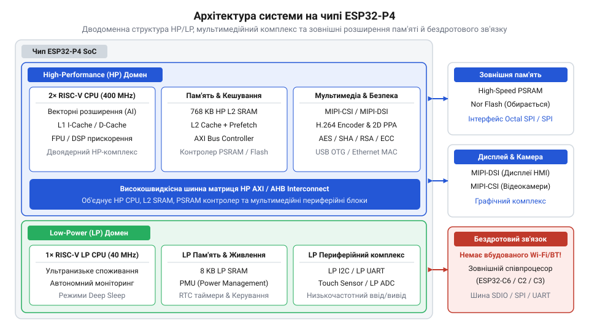
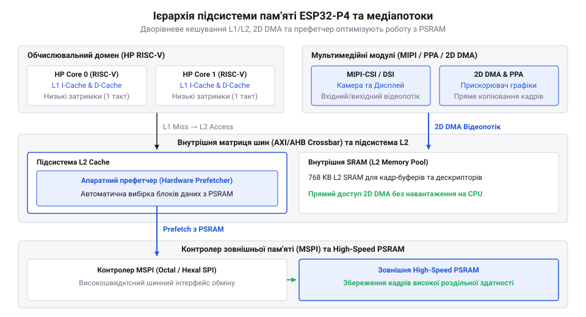
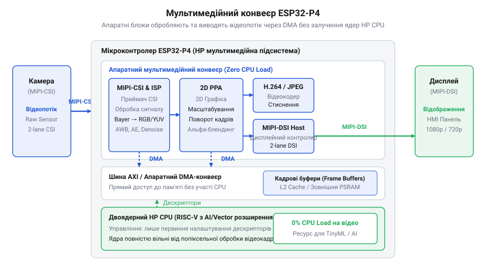
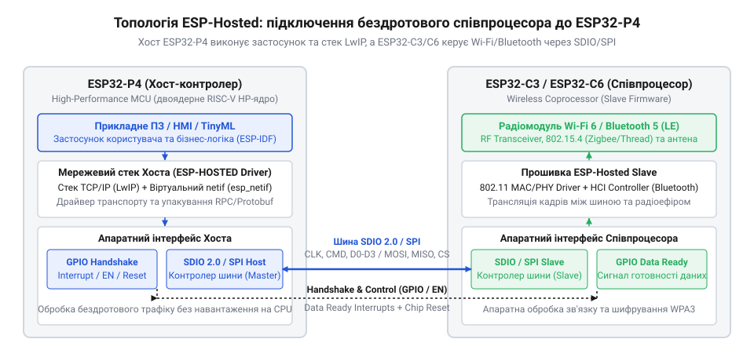
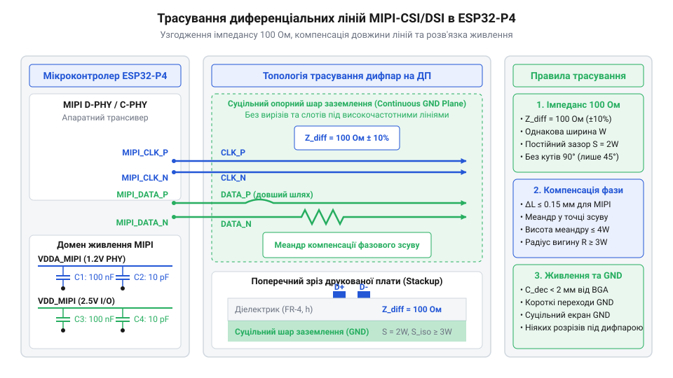

# Мікроконтролер ESP32-P4

<preknowlist>
- [Мікроконтролер ESP32-S3](root:cat-hw-boards/esp32s3-microcontroller) — розуміти двоядерну обчислювальну архітектуру, роботу з векторизованими інструкціями та принципи функціонування периферійних інтерфейсів ESP32-S3
- [Плати відеозахоплення нового покоління на базі ESP32-S3](root:cat-hw-boards/esp32-s3-cam-boards-overview) — орієнтуватися у конструктивних обмеженнях паралельних DVP-інтерфейсів відеозахоплення та методах буферизації кадрів у PSRAM
- [Схемотехніка та розпіновка шин Octal SPI Flash та PSRAM в ESP32-S3](root:cat-hw-boards/esp32-s3-octal-spi-bus-layout) — мати уявлення про організацію високошвидкісних шин пам'яті, часові затримки та вимоги до підключення зовнішньої PSRAM
</preknowlist>

## Обмеження класичних SoC у медіазадачах

При виводі графіки з одночасним зчитуванням відеопотоку класичний [мікроконтролер ESP32-S3](root:cat-hw-boards/esp32s3-microcontroller) швидко вичерпує ресурси. Архітектура пристроїв @@en|SoC@@ (від англ. *System on Chip* — система на кристалі) змушена передавати кожен піксель через процесорні ядра або загальні шини. При використанні паралельного інтерфейсу @@en|DVP@@ (від англ. *Digital Video Port* — цифровий відеопорт) та шини екрана @@en|SPI@@ (від англ. *Serial Peripheral Interface* — послідовний периферійний інтерфейс) процесор копіює фреймбуфери вручну. Це спричиняє падіння частоти кадрів, розриви зображення @@en|screen tearing@@ (від англ. *tear* — розривати — розрив екрана) та перевантаження шини.

Відсутність ізоляції задач у режимі очікування змушує пробуджувати ядра для опитування сенсорів. Подолання цього у задачах @@en|TinyML@@ (від англ. *Tiny Machine Learning* — компактне машинне навчання) та інтерфейсах @@en|HMI@@ (від англ. *Human-Machine Interface* — людино-машинний інтерфейс) вимагає спеціалізованого медіа-SoC із диференційними інтерфейсами та розділеними доменами живлення.

## Архітектура двоядерного RISC-V та LP-домену

@@en|SoC@@ ESP32-P4 використовує дводоменну архітектуру. Основний комплекс @@en|HP@@ (від англ. *High-Performance* — високопродуктивний) містить двоядерний процесор @@en|RISC-V@@ (від англ. *Reduced Instruction Set Computer* — скорочений набір інструкцій) 400 МГц. Векторні 128-бітні та @@en|DSP@@-розширення (від англ. *Digital Signal Processing* — цифрова обробка сигналів) прискорюють @@en|TinyML@@ та цифрову обробку сигналів.

*Ізоляція важких обчислень від моніторингу.*

Домен @@en|LP@@ (від англ. *Low-Power* — малопотужний) з ядром @@en|RISC-V@@ 40 МГц моніторить сенсори, поки ядра @@en|HP@@ сплять, і пробуджує основний комплекс за потреби.

## Багаторівнева пам'ять L1/L2 та High-Speed PSRAM

Для запобігання голодуванню процесора в ESP32-P4 реалізовано кеш @@en|L1@@ (від англ. *Level 1* — перший рівень) біля кожного ядра @@en|HP@@ та спільний кеш @@en|L2@@ (від англ. *Level 2* — другий рівень). Апаратний префетчер @@en|prefetcher@@ (від англ. *prefetch* — попереднє вибірання) заздалегідь завантажує дані з пам'яті.

*Багаторівнева пам'ять ESP32-P4 усуває вузькі місця при обробці важких відеокадрів.*

Зовнішня оперативна пам'ять @@en|PSRAM@@ (від англ. *Pseudo Static RAM* — псевдостатична оперативна пам'ять) підключається через шину @@en|DDR@@ (від англ. *Double Data Rate* — подвійна швидкість передачі даних). На відміну від [шини Octal SPI в ESP32-S3](root:cat-hw-boards/esp32-s3-octal-spi-bus-layout), шина працює на частотах до 200 МГц із передачею по двох фронтах сигналу.

## Мультимедійний комплекс MIPI, ISP та PPA

Захоплення та вивід відео здійснюються через диференційні інтерфейси @@en|MIPI-CSI@@ (від англ. *Camera Serial Interface* — послідовний інтерфейс камери) та @@en|MIPI-DSI@@ (від англ. *Display Serial Interface* — послідовний інтерфейс дисплея). На відміну від [плат відеозахоплення на ESP32-S3](root:cat-hw-boards/esp32-s3-cam-boards-overview), @@en|MIPI@@ передає потік високої роздільності диференційними парами.

*Апаратний конвеєр ESP32-P4 обробляє та виводить відеопотік без навантаження на процесор.*

Сирий потік із камери надходить у процесор сигналів зображення @@en|ISP@@, який виконує відновлення кольорів @@en|Debayering@@. Прискорювач @@en|PPA@@ здійснює масштабування та змішування шарів @@en|HMI@@, а кодер апаратно стискає відео у @@en|H.264@@ та @@en|JPEG@@.

## Інтеграція зовнішніх бездротових співпроцесорів ESP-HOSTED

ESP32-P4 позбавлений вбудованого @@en|Wi-Fi@@ та @@en|Bluetooth@@. Зв'язок реалізують через зовнішній співпроцесор, як-от [Waveshare ESP32-C6-Zero](root:cat-hw-boards/esp32-c6-zero).

*Стек ESP-HOSTED виносить мережеві протоколи на співпроцесор.*

Шина @@en|SDIO@@ (від англ. *Secure Digital Input Output* — захищене цифрове введення-виведення) або @@en|SPI@@ та стек @@en|ESP-HOSTED@@ виносять @@en|TCP/IP@@ і @@en|Wi-Fi 6@@ на співпроцесор, зберігаючи ресурси ядер @@en|HP@@.

## Апаратна інтеграція та трасування диференціальних ліній

Трасування диференційних пар @@en|MIPI-CSI@@ та @@en|MIPI-DSI@@ передбачає узгодження хвильового імпедансу 100 Ом та вирівнювання довжин ліній у парі над суцільним полігоном заземлення @@en|GND@@ (від англ. *Ground* — земля).

*Узгодження імпедансу та довжин ліній MIPI гарантує цілісність високочастотних сигналів.*

Аналогові домени живлення блоків @@en|ISP@@ та @@en|MIPI@@ фільтруються феритовими елементами, а цифрові домени ядер @@en|HP@@ та @@en|LP@@ ізолюються для запобігання завадам, за аналогією з вимогами до [конфігурації eFuse та завантаження](root:cat-hw-boards/esp32-s3-efuse-and-boot-configuration).