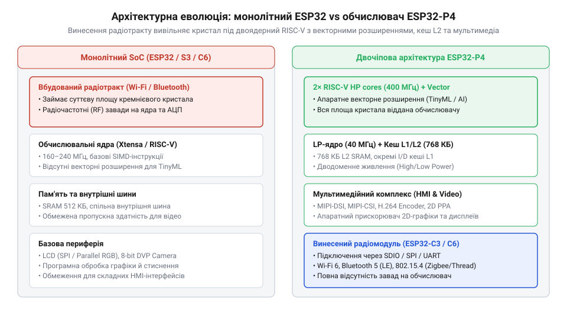
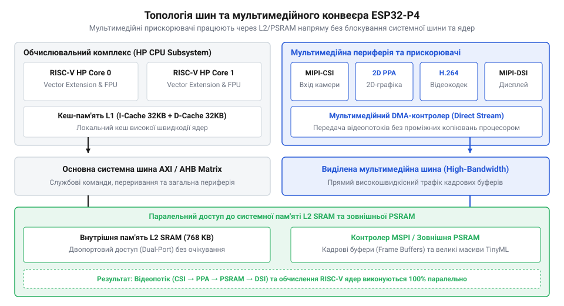

# Еволюція архітектури ESP32: від бездротових сокетів до високопродуктивних SoC ESP32-P4

<preknowlist>
- [Мікроконтролер ESP32-S3](root:cat-hw-boards/esp32s3-microcontroller) — Базова архітектура Xtensa LX7, наявність векторного розширення, вбудований Wi-Fi/BT радіотракт та обмеження монолітної шини при високому обчислювальному навантаженні.
- [Модуль ESP32-CAM: огляд архітектури, периферії та сімейства плат](root:cat-hw-boards/esp32-cam-camera-module-family) — Принципи роботи паралельного інтерфейсу камери DVP та обмеження пропускної здатності шини при обробці відеопотоку.
- [Схемотехніка та розпіновка шин Octal SPI Flash та PSRAM в ESP32-S3](root:cat-hw-boards/esp32-s3-octal-spi-bus-layout) — Організація роботи із зовнішньою пам'яттю PSRAM через шину Octal SPI та її затримки при роботі з кадровими буферами.
</preknowlist>

## Обчислювальний тупик монолітних бездротових SoC

Спроба побудувати високороздільний графічний @@en|HMI@@ (від англ. *Human-Machine Interface* — людино-машинний інтерфейс) або обробляти відеопотік на класичних бездротових мікроконтролерах впирається в апаратні обмеження. Одночасний рендеринг анімації та передача даних через @@en|Wi-Fi@@ на [базовому ESP32-S3](root:cat-hw-boards/esp32s3-microcontroller) спричиняє пропуски кадрів і затримки, а на [модулі ESP32-CAM](root:cat-hw-boards/esp32-cam-camera-module-family) паралельний цифровий відеопорт @@en|DVP@@ (від англ. *Digital Video Port* — цифровий відеопорт) повністю перевантажує процесор.

Причина такого тупика криється в концепції монолітного @@en|SoC@@ (від англ. *System on Chip* — система на кристалі), де процесорні ядра й аналоговий трансивер @@en|Wi-Fi@@ / @@en|Bluetooth@@ ділять єдиний кристал. Високочастотні аналогові блоки займають цінну площу кремнію, витісняючи внутрішню кеш-пам'ять @@en|L1/L2@@ та векторні обчислювальні вузли.

Другою проблемою є взаємні електромагнітні завади. Вихідний каскад @@en|Wi-Fi@@ створює імпульсні наведення на шини живлення, а швидкісні перемикання цифрових транзисторів генерують шум, що погіршує співвідношення сигнал/шум @@en|SNR@@ (від англ. *Signal-to-Noise Ratio* — співвідношення сигнал/шум) приймача й провокує затримки на шинах пам'яті.

Третє вузьке місце — шинна топологія. Оскільки внутрішньої оперативної пам'яті @@en|SRAM@@ недостатньо для кадрових буферів, їх виносять у зовнішню пам'ять @@en|PSRAM@@ через [шину Octal SPI](root:cat-hw-boards/esp32-s3-octal-spi-bus-layout). Мережевий обмін через контролер прямого доступу до пам'яті @@en|DMA@@ (від англ. *Direct Memory Access* — прямий доступ до пам'яті) ініціює тривалі транзакції, змушуючи процесор та рендерер простоювати.

*Порівняння монолітного бездротового кристала ESP32 та високопродуктивного чиплета ESP32-P4 із відокремленим бездротовим співпроцесором.*

Ці обмеження сформували потребу в створенні чисто обчислювального мікроконтролера без вбудованого бездротового трансивера.

## Перехід на RISC-V та народження ESP32-P4

Усвідомлення компромісів монолітних пристроїв побудило компанію @@en|Espressif@@ здійснити радикальний крок: відокремити бездротову периферію від процесорного ядра й переставити архітектурні пріоритети на максимальну обчислювальну потужність. Одночасно відбувся стратегічний перехід від пропрієтарної архітектури @@en|Xtensa@@ до відкритого стандарту @@en|RISC-V@@, успішно випробуваного на компактних рішеннях на кшталт [Waveshare ESP32-C6-Zero](root:cat-hw-boards/esp32-c6-zero). Результатом цього переосмислення стало створення флагманського обчислювального кристала @@en|ESP32-P4@@.

Повна відмова від розміщення @@en|Wi-Fi@@ та @@en|Bluetooth@@ трансиверів на одному дискові кремнію вивільнила значну площу кристала. Звільнений кремнієвий простір було перерозподілено на побудову двокластерної процесорної системи з апаратно відокремленими доменами живлення та обчислень:
- Високопродуктивний кластер @@en|HP@@ (від англ. *High-Performance* — висока продуктивність) містить двоядерний 32-розрядний процесор @@en|RISC-V@@ із тактовою частотою до 400 МГц. Ядра оснащено векторними розширеннями (англ. *Vector Extensions* / @@en|SIMD@@), які апаратно прискорюють операції матричного множення, цифрової обробки сигналів та виконання нейромережевих моделей у задачах локального штучного інтелекту @@en|TinyML@@ (від англ. *Tiny Machine Learning* — компактне машинне навчання). - Низькоспоживаючий кластер @@en|LP@@ (від англ. *Low-Power* — низьке енергоспоживання) функціонує на базі одноядерного процесора @@en|RISC-V@@ із частотою 40 МГц. Цей домен працює незалежно від основного ядра, виконуючи моніторинг датчиків та обробку переривань у режимі глибокого сну (англ. *Deep-Sleep*) із мінімальним струмом споживання.

Замість монолітної інтеграції розробники перейшли до двочіпової системної архітектури (англ. *Two-Chip Architecture*). Якщо кінцевому пристрою необхідний мережевий зв'язок, @@en|ESP32-P4@@ виступає в ролі центрального обчислювального хоста, а бездротові протоколи @@en|Wi-Fi 6@@, @@en|Bluetooth 5 (LE)@@ та @@en|Zigbee/Thread@@ делегуються зовнішньому копроцесору, наприклад [WeAct ESP32-C6-Mini](root:cat-hw-boards/esp32-c6-mini). Обмін даними між чіпами здійснюється через високошвидкісні шини @@en|SDIO@@, @@en|SPI@@ або @@en|UART@@. Це повністю ізолює обчислювальне ядро від радіочастотних завад і знімає обмеження пропускної здатності.

Навколо @@en|ESP32-P4@@ виникло декілька поширених міфів, які важливо спростувати:
1. **Міф про «неповноцінність» через відсутність радіо:** Відсутність @@en|Wi-Fi@@ не є недоліком чи спрощенням. Це свідомий архітектурний вибір для досягнення детермінованої швидкодії, нижчої ціни кремнію під обчислення та відсутності завад у графічних застосунках. 2. **Міф про аналог прикладних Linux-процесорів:** Попри високу частоту 400 МГц та векторні розширення, @@en|ESP32-P4@@ не містить блоку керування пам'яттю @@en|MMU@@ (від англ. *Memory Management Unit* — блок керування пам'яттю), необхідного для віртуальної пам'яті повноцінного ядра @@en|Linux@@. Пристрій розроблено як мікроконтролер реального часу для роботи під управлінням операційних систем реального часу @@en|FreeRTOS@@ чи @@en|NuttX@@, що забезпечує миттєвий запуск та мінімальні затримки реакції.

## Ієрархія пам'яті та мультимедійна периферія

Концентрація площі кремнію на обчислювальних ресурсах дозволила радикально модернізувати внутрішню шинну систему та ієрархію пам'яті @@en|ESP32-P4@@, усунувши вузькі місця попередніх поколінь. Для забезпечення безперебійного живлення даних двоядерного процесора @@en|RISC-V@@ кристал оснащено багаторівневою системою кешування та внутрішньої оперативної пам'яті:
- Перший рівень кешу @@en|L1@@ містить окремі кеші інструкцій @@en|I-Cache@@ (32 КБ) та даних @@en|D-Cache@@ (32 КБ) для кожного обчислювального ядра, що забезпечує вибірку команд за один тактовий цикл. - Другий рівень пам'яті @@en|L2@@ представлено високошвидкісним об'єднаним масивом внутрішньої пам'яті @@en|SRAM@@ обсягом 768 КБ. Цей блок виконує роль спільного кешу другого рівня та прямо адресованої оперативної пам'яті з низькими затримками. - Зовнішня пам'ять @@en|PSRAM@@ та @@en|Flash@@ підключаються через високопродуктивний апаратний контролер шини @@en|Octal SPI@@ / @@en|Hexal SPI@@ з підтримкою апаратного префетчера (англ. *Prefetcher*) та кешування, що мінімізує затримки при роботі з великими масивами даних.

Для автономного опрацювання мультимедійного потоку без залучення процесорних ядер у @@en|ESP32-P4@@ інтегровано спеціалізований апаратний конвеєр. Замість повільного паралельного інтерфейсу, що застосовувався на платах із [камерою OV2640](root:cat-hw-boards/esp32-cam-ov2640), пристрій отримав двосмуговий послідовний інтерфейс камери @@en|MIPI-CSI@@ (від англ. *Camera Serial Interface* — послідовний інтерфейс камери), здатний приймати відеопотік високої чіткості @@en|Full HD@@. Для виведення зображення замість повільних @@en|SPI@@-дисплеїв застосовано послідовний інтерфейс дисплея @@en|MIPI-DSI@@ (від англ. *Display Serial Interface* — послідовний інтерфейс дисплея) з підтримкою роздільної здатності до 720p та 1080p при частоті оновлення 60 кадрів на секунду, що активно використовується на нових [платах із дисплеями](root:cat-hw-boards/waveshare-esp32-s3-touch-lcd-1-28). Для поглибленого вивчення фізичного підключення та конфігурації ліній даних дивіться матеріал про [високошвидкісні дисплейні та камерні інтерфейси MIPI в ESP32-P4](root:hw-arch/esp32-p4-mipi-dsi-csi-interfaces).

Серцем мультимедійного розвантаження є два апаратні прискорювачі:
1. **Апаратний кодек @@en|H.264@@:** Забезпечує кодування відеопотоку у форматі @@en|H.264@@ з роздільною здатністю 1080p при 30 кадрах на секунду в реальному часі. Це звільняє процесор від важких математичних розрахунків стиснення, які раніше виконувалися програмно у форматі @@en|JPEG@@ на [платах відеозахоплення](root:cat-hw-boards/esp32-s3-cam-boards-overview). 2. **2D-прискорювач @@en|PPA@@ (від англ. *Pixel Processing Accelerator* — прискорювач обробки пікселів):** Виконує апаратні операції над піксельними буферами в оперативній пам'яті через @@en|DMA@@: масштабування зображень (англ. *Scaling*), обертання на кути 90°/180°/270°, конвертацію колірних просторів (наприклад, з @@en|RGB565@@ у @@en|YUV420@@) та альфа-змішування (англ. *Alpha Blending*) для прозорих вікон інтерфейсу користувача. Докладніше про структуру регістрів та програмний API прискорювача читайте у статті про [апаратний 2D-прискорювач PPA в мікроконтролері ESP32-P4](root:hw-arch/esp32-p4-ppa-2d-graphics-accelerator).

Взаємодію цих вузлів та ієрархію шин ілюструє топологічна схема.

*Схема мультимедійного конвеєра та багаторівневої пам'яті ESP32-P4, що показує апаратне розвантаження обробки відеопотоків.*

Завдяки такій організації відеодані від @@en|MIPI-CSI@@ обробляються прискорювачем @@en|PPA@@ і передаються на @@en|MIPI-DSI@@ або кодуються в @@en|H.264@@ практично без участі процесорних ядер @@en|HP RISC-V@@. Це залишає обчислювальну потужність процесора повністю доступною для алгоритмів штучного інтелекту @@en|TinyML@@ та бізнес-логіки додатка. Детальний аналіз налаштувань кодека та конфігурації параметрів кодування наведено в матеріалі про [апаратне кодування відео H.264 у мікроконтролері ESP32-P4](root:hw-arch/esp32-p4-h264-hardware-video-encoder).

## Спростування міфів про архітектуру ESP32-P4

Анонс @@en|ESP32-P4@@ від @@en|Espressif@@ викликав два хибних уявлення: відсутність @@en|Wi-Fi@@ та @@en|Bluetooth@@ визнали спрощенням, а двоядерний процесор @@en|RISC-V@@ (400 МГц) із векторними розширеннями @@en|SIMD@@, інтерфейсами @@en|MIPI-DSI@@/@@en|MIPI-CSI@@ та кодеком @@en|H.264@@ — заміною прикладних процесорів під @@en|Linux@@.

Вилучення радіомодуля — свідомий компроміс. Аналоговий трансивер вимагає окремого техпроцесу, а поруч із цифровою логікою на 400 МГц створює шуми, погіршуючи співвідношення сигнал/шум @@en|SNR@@ і затримуючи шини. Без RF-тракту кристал перевели на високощільний техпроцес, підвищивши частоту до 400 МГц проти 240 МГц у [базових мікроконтролерах ESP32-S3](root:cat-hw-boards/esp32s3-microcontroller), збільшивши кеш @@en|L1/L2@@ @@en|SRAM@@ та додавши 2D-прискорювач @@en|PPA@@. Відсутність переривань мережевого стека й запитів @@en|DMA@@ забезпечила детерміноване виконання команд.

@@en|ESP32-P4@@ не є аналогом прикладних @@en|SoC@@ для одноплатників на кшталт @@en|Raspberry Pi@@ під @@en|Ubuntu@@ чи @@en|Debian@@. Кристал не має блоку керування пам'яттю @@en|MMU@@ для трансляції віртуальних адрес і захисту сторінок у системах стандарту @@en|POSIX@@. Замість нього встановлено блок захисту пам'яті @@en|MPU@@ (від англ. *Memory Protection Unit* — блок захисту пам'яті). Це мікроконтролер @@en|MCU@@ (від англ. *Microcontroller Unit* — мікроконтролерний блок) для операційних систем реального часу @@en|RTOS@@ (від англ. *Real-Time Operating System* — операційна система реального часу), таких як @@en|FreeRTOS@@ чи @@en|NuttX@@. Він стартує за мілісекунди, забезпечує наносекундний відгук на переривання та низьке споживання завдяки ядру @@en|LP RISC-V@@ при виконанні задач @@en|TinyML@@. Для розбору принципів розмежування доступу до пам'яті та ізоляції задач у FreeRTOS перегляньте матеріал про [блок захисту пам'яті MPU та організацію RTOS у мікроконтролері ESP32-P4](root:hw-arch/esp32-p4-mpu-rtos-memory-protection).

## Проектування двочіпових рішень та HMI-систем

Розуміння реальної архітектурної ніші @@en|ESP32-P4@@ визначає практичні підходи до проектування кінцевих пристроїв. Оскільки чип позбавлений вбудованого радіотракту, створення мережевих продуктів вимагає переходу до двочіпової системної топології (англ. *Two-Chip Architecture*). У такій системі @@en|ESP32-P4@@ бере на себе роль головного обчислювального хоста, а бездротові функції делегуються зовнішньому співпроцесору.

В якості мережевого співпроцесора найчастіше виступають енергоефективні одноядерні розширювачі, такі як [плата WeAct ESP32-C6-Mini](root:cat-hw-boards/esp32-c6-mini) або [Waveshare ESP32-C6-Zero](root:cat-hw-boards/esp32-c6-zero). Вони беруть на себе підтримку протоколів @@en|Wi-Fi 6@@, @@en|Bluetooth 5 (LE)@@ та @@en|Thread@@/@@en|Matter@@. Обмін даними між головним процесором і співпроцесором реалізується через високошвидкісні послідовні шини @@en|SDIO@@ (від англ. *Secure Digital Input Output* — безпечне цифрове введення-виведення) або @@en|SPI@@ із використанням програмних стеків на кшталт @@en|ESP-Hosted@@. Для вивчення практичних схем з'єднання та налаштування програмного стека ESP-Hosted зверніться до керівництва про [проектування двочіпових бездротових систем на базі ESP32-P4](root:sys-fw/esp-hosted).

Така двочіпова компоновка надає важливі технічні переваги:
- **Спрощення сертифікації:** Радіочастотний тракт локалізовано всередині зовнішнього модуля, де можна використати [готові модулі ESP32-S3-WROOM-1](root:cat-hw-boards/esp32-s3-wroom-modules-family) з уже пройденою сертифікацією @@en|FCC@@ (від англ. *Federal Communications Commission* — Федеральна комісія зі зв'язку США) та @@en|CE@@ (від фр. *Conformité Européenne* — європейська відповідність). Розробник друкованої плати @@en|PCB@@ (від англ. *Printed Circuit Board* — друкована плата) для @@en|ESP32-P4@@ отримує можливість проектитувати 4-шарову плату без ризику порушити норми радіовипромінювання. - **Апаратно виділений сон:** Головний хост @@en|ESP32-P4@@ може переходити в режим глибокого сну під час очікування подій, поки співпроцесор підтримує з'єднання з бездротовою мережею та буферизує пакети даних.

Вибір @@en|ESP32-P4@@ для конкретного проекту обґрунтовується за чіткими критеріями:
1. **Насичені HMI-інтерфейси:** Створення складних графічних панелей керування @@en|HMI@@ на базі графічної бібліотеки @@en|LVGL@@ (від англ. *Light and Versatile Graphics Library* — легка та універсальна графічна бібліотека). Інтерфейс @@en|MIPI-DSI@@ забезпечує виведення відеопотоку 720p/1080p із частотою 60 кадрів/с, а 2D-прискорювач @@en|PPA@@ виконує апаратне альфа-змішування й масштабування вікон без навантаження на процесор. 2. **Крайова відеоаналітика та TinyML:** Застосування в системах розпізнавання облич, зчитування @@en|QR-кодів@@ або класифікації об'єктів. Камера підключається через @@en|MIPI-CSI@@, кодек @@en|H.264@@ стискає потік для передачі на диск чи в мережу, а векторне розширення @@en|SIMD@@ прискорює виконання нейронних мереж. 3. **Детерміноване керування реального часу:** Поєднання графічного інтерфейсу з одночасною обробкою високочастотних сигналів датчиків, шин @@en|CAN@@ (від англ. *Controller Area Network* — мережа контролерів) або цифровою обробкою звуку @@en|DSP@@ (від англ. *Digital Signal Processing* — цифрова обробка сигналів).

Якщо ж проект передбачає лише виведення простої графіки на малий дисплей або збір даних із датчиків через бездротову мережу, використання @@en|ESP32-P4@@ є надлишковим. У таких задачах краще обрати одночіпові рішення, побудовані на [компактних SiP-модулях ESP32-S3-MINI-1](root:cat-hw-boards/esp32-s3-mini-sip-modules), які спрощують схемотехніку та знижують собівартість пристрою.