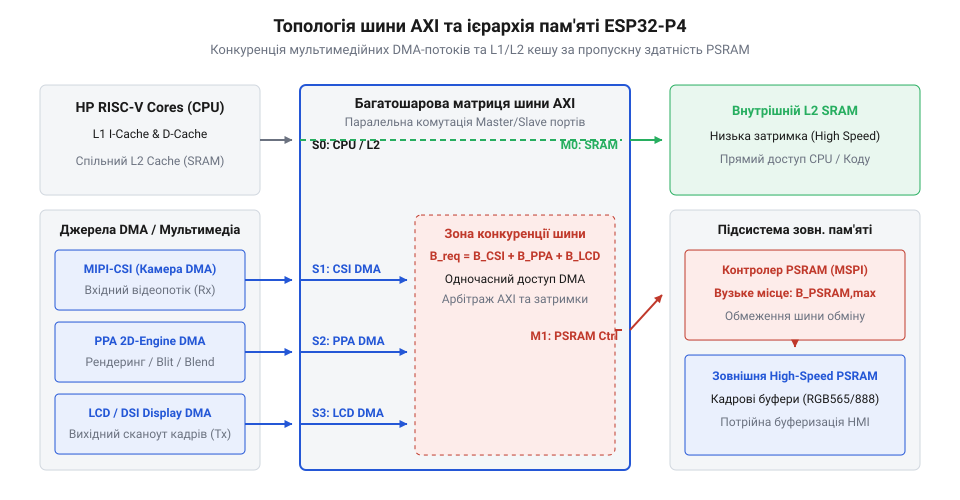
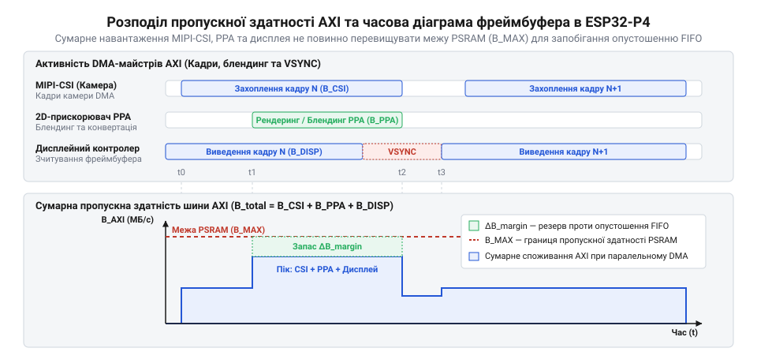

# Математика пропускної здатності шин пам'яті та розрахунок фреймбуферів HMI

<preknowlist>
- [Мікроконтролер ESP32-S3](root:cat-hw-boards/esp32s3-microcontroller) — базові принципи організації системи шин, периферійного DMA та зовнішньої PSRAM у попередньому поколінні мікроконтролерів Espressif
- [Плата Waveshare ESP32-S3 Touch LCD 1.28](root:cat-hw-boards/waveshare-esp32-s3-touch-lcd-1-28) — архітектурні обмеження виведення графіки через SPI/RGB інтерфейси та потреба у подвійній буферизації фреймбуфера
- [Схемотехніка та розпіновка шин Octal SPI Flash та PSRAM в ESP32-S3](root:cat-hw-boards/esp32-s3-octal-spi-bus-layout) — фізичні принципи функціонування високошвидкісних паралельних та послідовних шин пам'яті PSRAM
- [Плати відеозахоплення нового покоління на базі ESP32-S3](root:cat-hw-boards/esp32-s3-cam-boards-overview) — особливості організації подвійних буферів кадрів під час одночасної обробки відеопотоку та виведення на дисплей
</preknowlist>

## Чому HMI-інтерфейс ESP32-P4 втрачає кадри

Розробник створює мультимедійний пристрій на базі топового мікроконтролера ESP32-P4, розраховуючи виводити плавний графічний інтерфейс користувача @@en|HMI@@ (від @@en|Human-Machine Interface@@) із роздільною здатністю 800×480 пікселів та одночасно відображати потокове відео з камери високої чіткості @@en|MIPI-CSI@@ (від @@en|Mobile Industry Processor Interface Camera Serial Interface@@). Проте під час практичного запуску система починає поводитися нестабільно: анімація меню сіпається, на екрані з'являються горизонтальні смуги розриву кадру @@en|frame tearing@@, а відеопотік періодично завмирає чи втрачає цілі блоки пікселів. На перший погляд здається, що чипу з тактовою частотою ядер 400 МГц та обсягом зовнішньої @@en|PSRAM@@ (від @@en|Pseudo-Static Random-Access Memory@@) у 16 чи 32 МБ має вистачити із величезним запасом. Проблема виникає через те, що розробник сприймає пам'ять як єдиний бездонний резервуар, до якого будь-яка периферія може звертатися миттєво й без перешкод.

Насправді в системі працює кілька активних периферійних модулів із прямим доступом до пам'яті @@en|DMA@@ (від @@en|Direct Memory Access@@). Дисплейний контролер вимагає безперервного зчитування даних із буфера кадру @@en|frame buffer@@ з частотою 60 Гц, щоб уникнути мерехтіння екрана. Одночасно модуль камери @@en|MIPI-CSI@@ із високою швидкістю записує у пам'ять нові вхідні кадри відеопотоку. Якщо в цей же момент графічний 2D-прискорювач @@en|PPA@@ (від @@en|Pixel Processing Accelerator@@) виконує операції компонування шарів меню @@en|alpha blending@@, зчитуючи текстури та записуючи готовий результат назад у пам'ять, утворюється гострий дефіцит пропускної здатності. На відміну від [попереднього покоління мікроконтролерів](root:cat-hw-boards/esp32s3-microcontroller), де обсяг та роздільна здатність кадрів були суттєво меншими, у системі ESP32-P4 швидкість потоків даних зростає в рази.

Центральним вузлом, де перетинаються всі ці потоки даних, є високошвидкісна внутрішня шина @@en|AXI@@ (від @@en|Advanced eXtensible Interface@@). Кожен модуль @@en|DMA@@ генерує транзакції до пам'яті, змагаючись за пріоритет у шинному арбітрі @@en|bus arbitration@@. Коли сумарний запит усіх периферійних джерел перевищує фізичну пропускну здатність шини або зовнішнього контролера @@en|PSRAM@@, виникає шинний затор @@en|bus contention@@. У цей момент затримка доступу @@en|latency@@ стрибає вгору, і внутрішні FIFO-буфери @@en|DMA@@ дисплейного контролера не встигають вчасно поповнюватися новим рядами пікселів. Відбувається голодування буфера @@en|starvation@@, що призводить до пропуску кадрів та візуальних артефактів. Без побудови чіткої математичної моделі розподілу шинного трафіку та пропускної здатності підсистеми пам'яті неможливо збалансувати роботу @@en|HMI@@ навіть на найпотужнішому мікроконтролері.

## Аналіз шинної архітектури AXI та кешу

Щоб виявити вузькі місця у передачі даних, необхідно розібрати фізичну топологію зв'язку між процесорними ядрами, периферійними @@en|DMA@@-майстрами та підсистемою пам'яті ESP32-P4. В основі архітектури чипа лежить 128-бітна перехресна матриця @@en|AXI Crossbar Interconnect@@, яка працює на тактовій частоті шини `f_AXI = 200` МГц. Вона з'єднує чотири основні групи джерел даних: двоядерний процесор @@en|HP CPU@@ (з власною системою @@en|L1-кеш@@ для інструкцій та даних), прискорювач @@en|PPA@@, контролер камери @@en|MIPI-CSI@@ та дисплейний контролер @@en|LCD DMA@@.


*Схема апаратної топології матриці шини AXI, кеш-пам'яті та периферійних DMA-майстрів мікроконтролера ESP32-P4.*

З другого боку матриці @@en|AXI@@ розташовані виконавчі пристрої пам'яті: високошвидкісна внутрішня @@en|SRAM@@ (від @@en|Static Random-Access Memory@@), загальний кеш другого рівня @@en|L2-кеш@@ обсягом 512 КБ та контролер зовнішньої пам'яті @@en|PSRAM@@. Максимальну теоретичну пропускну здатність внутрішньої шини @@en|AXI@@ обчислюють як добуток її розрядності на тактову частоту:

```
BW_AXI = f_AXI × W_AXI
       = 200 × 10⁶ × 16      [128-бітна шина AXI відповідає 16 байтам за такт]
       = 3.2 × 10⁹ B/s       [теоретична межа матриці AXI становить 3.2 ГБ/с]
```

Проте реальним вузьким місцем підсистеми є інтерфейс зв'язку із зовнішньою @@en|PSRAM@@. Зовнішня пам'ять підключається через послідовну шину @@en|Octal SPI@@ або @@en|Hexal SPI@@, що працює у режимі подвійної передачі даних за такт @@en|DDR@@ (від @@en|Double Data Rate@@) на частоті `f_PSRAM = 200` МГц. Для 8-бітної шини @@en|Octal SPI@@ граничну швидкість обміну розраховують наступним чином:

```
BW_PSRAM = f_PSRAM × 2 × W_PSRAM
         = 200 × 10⁶ × 2 × 1 [2 передачі за такт на 1-байтній розрядності шини]
         = 400 × 10⁶ B/s     [максимальна пропускна здатність PSRAM становить 400 МБ/с]
```

Внутрішня @@en|L2-кеш@@ пам'ять має значно вищу швидкість access та працює на частоті процесорного ядра 400 МГц із пропускною здатністю `BW_L2 = 400 × 10⁶ × 16 = 6.4` ГБ/с. Порівняння величин показує, що пропускна спроможність зовнішньої @@en|PSRAM@@ (400 МБ/с) є у 8 разів меншою за швидкість шини @@en|AXI@@ (3.2 ГБ/с). Отже, саме шина пам'яті @@en|PSRAM@@ стає головним обмежувальним бар'єром під час паралельної обробки кадру з камери та оновлення екрана, на відміну від конфігурацій із [паралельними шинами пам'яті](root:cat-hw-boards/esp32-s3-octal-spi-bus-layout), де співвідношення частот вимагало іншого арбітражу.

## Математика розрахунку обсягу фреймбуферів HMI

Для визначення навантаження на підсистему пам'яті спочатку слід математично розрахувати точно необхідний обсяг @@en|frame buffer@@. Базовий розмір одного кадру залежить від ширини дисплея `W` у пікселях, висоти `H` та колірної глибини @@en|BPP@@ (від @@en|Bytes Per Pixel@@). Однак апаратні @@en|DMA@@-контролери шини @@en|AXI@@ вимагають строгого вирівнювання адрес та довжини рядків у пам'яті для виконання пакетних транзакцій @@en|burst@@. Крок вирівнювання @@en|pitch@@ (або @@en|stride@@) визначає реальну довжину рядка в байтах з урахуванням вирівнювання по межі `Align` (зазвичай 64 байти):

```
Pitch = ceil(W × BPP / Align) × Align
V_single = Pitch × H
```

Проілюструємо обчислення для стандартного дисплея з роздільною здатністю 800×480 пікселів при використанні колірних форматів @@en|RGB565@@ (2 байти на піксель) та @@en|RGB888@@ (3 байти на піксель) із вирівнюванням `Align = 64` байти.

**Розрахунок обсягу одного кадру для RGB565:**

```
Raw_Width = 800 × 2 = 1600               [ширина рядка в байтах без вирівнювання]
Pitch     = ceil(1600 / 64) × 64 = 1600  [1600 кратно 64, вирівнювання не додає байтів]
V_single  = 1600 × 480
          = 768000                       [обсяг одного кадру RGB565 становить 768 000 байтів (~750 КБ)]
```

**Розрахунок обсягу одного кадру для RGB888:**

```
Raw_Width = 800 × 3 = 2400               [ширина рядка в байтах без вирівнювання]
Pitch     = ceil(2400 / 64) × 64
          = ceil(37.5) × 64 = 38 × 64 = 2432 [вирівнювання додає 32 байти на кожен рядок]
V_single  = 2432 × 480
          = 1167360                      [обсяг одного кадру RGB888 становить 1 167 360 байтів (~1.113 МБ)]
```

Загальний обсяг пам'яті під графічний інтерфейс залежить від обраної схеми буферизації `V_total = N_buffers × V_single`:

1. Режим @@en|Single Buffering@@ (`N = 1`): Потребує мінімум пам'яті (750 КБ для @@en|RGB565@@), але спричиняє постійний @@en|frame tearing@@, оскільки @@en|DMA@@ читає буфер прямо під час малювання нового кадру. 2. Режим @@en|Double Buffering@@ (`N = 2`): Потрібно 1.5 МБ для @@en|RGB565@@ чи 2.226 МБ для @@en|RGB888@@. Одне поле зчитується контролером дисплея, поки прискорювач @@en|PPA@@ малює у другому. Переключення відбувається за сигналом вертикальної синхронізації @@en|VSYNC@@. 3. Режим @@en|Triple Buffering@@ (`N = 3`): Вимагає 2.25 МБ для @@en|RGB565@@ чи 3.34 МБ для @@en|RGB888@@. Усуває будь-які затримки рендерингу процесора, проте споживає левову частку пропускної здатності @@en|PSRAM@@.

Як детально описується в оглядах [сучасних плат відеозахоплення](root:cat-hw-boards/esp32-s3-cam-boards-overview) та розбору [компактних графічних модулях](root:cat-hw-boards/waveshare-esp32-s3-touch-lcd-1-28), розрахований обсяг фреймбуфера безпосередньо задає обсяг даних, який периферійні @@en|DMA@@-канали повинні прокачувати через шину @@en|AXI@@ кожного кадру.

## Оцінка накладних витрат DMA та PPA

Під час проектування високошвидкісних графічних систем розробники часто припускаються помилки, розглядаючи периферійний прямий доступ до пам'яті @@en|DMA@@ як ідеальне миттєве передавання даних, яке абсолютно не навантажує внутрішню шину та процесор. Спираючись на розраховані [обсяги фреймбуферів](root:cat-hw-boards/waveshare-esp32-s3-touch-lcd-1-28), реальний потік даних складається не лише з корисного піксельного вмісту. Фізичний транзит даних через 128-бітну шину @@en|AXI@@ супроводжується значними шинними накладними витратами @@en|overhead@@, які виникають на рівні обробки службових дескрипторів @@en|descriptors@@, тактових інтервалів арбітражу @@en|arbitration@@ та чекання готовності зовнішньої пам'яті @@en|PSRAM@@.

Кожен периферійний модуль @@en|DMA@@ в ESP32-P4 здійснює передачу даних не суцільним масивом, а окремими пакетними транзакціями @@en|burst@@ через зв'язані списки службових структур — дескрипторів `dma_descriptor_t`. Для кожного фрагмента буфера довжиною `L_desc` (зазвичай 4096 байтів) контролер @@en|DMA@@ змушений зчитати із пам'яті 16 байтів дескриптора, а після завершення передачі — оновити прапорці статусу. Кількість необхідних дескрипторів `N_desc` для одного кадру обсягом `V_frame` та сумарний обсяг службового трафіку `BW_desc` обчислюють за формулами:

```
N_desc = ceil(V_frame / L_desc)
BW_desc = N_desc × Size_desc × FPS
```

Для кадру роздільною здатністю 800×480 пікселів у форматі @@en|RGB565@@ (`V_frame = 768000` байтів) при довжині блоку `L_desc = 4096` байтів кількість дескрипторів становить `N_desc = ceil(768000 / 4096) = 188`. При частоті оновлення 60 Гц це додає `188 × 16 × 60 = 180.48` КБ/с службового трафіку.


*Часова діаграма розподілу шинного трафіку AXI та завантаження пам'яті PSRAM периферійними DMA-модулями.*

Однак головне навантаження створюють паралельні потоки піксельних даних. Розглянемо три основні джерела трафіку в реальному мультимедійному застосунку:

1. **Контролер дисплея LCD DMA:** Безперервно зчитує готовий фреймбуфер для виведення на екран з частотою `f_LCD = 60` Гц. Для @@en|RGB565@@ реальний потік становить:

```
BW_LCD = V_frame × f_LCD
       = 768000 × 60
       = 46.08 × 10⁶ B/s      [зчитування фреймбуфера дисплеєм вимагає 46.08 МБ/с]
```

Для формату @@en|RGB888@@ (`V_frame = 1167360` байтів) цей потік зростає до `1167360 × 60 = 70.04` МБ/с.

2. **Захоплення відеопотоку камери MIPI-CSI DMA:** Вхідний відеопотік із [модуля камери](root:cat-hw-boards/esp32-cam) записується у транзитний буфер @@en|PSRAM@@. При роздільній здатності 800×480 @@en|RGB565@@ та частоті кадру `f_CSI = 30` Гц трафік запису становить:

```
BW_CSI = V_frame × f_CSI
       = 768000 × 30
       = 23.04 × 10⁶ B/s      [запис відео з камери вимагає 23.04 МБ/с]
```

3. **2D-прискорювач PPA:** Виконує апаратне компонування шарів графічного інтерфейсу @@en|alpha blending@@. Для цього модуль @@en|PPA@@ одночасно зчитує фонову текстуру та шар іконки, виконує обчислення і записує результат у підготовлюваний фреймбуфер. У разі повноекранного оновлення зі швидкістю 60 Гц трафік прискорювача складається з одного зчитування джерела та одного запису результату:

```
BW_PPA_read  = 768000 × 60 = 46.08 × 10⁶ B/s [зчитування фону та елементів UI]
BW_PPA_write = 768000 × 60 = 46.08 × 10⁶ B/s [запис згенерованого кадру]
BW_PPA_total = BW_PPA_read + BW_PPA_write
             = 92.16 × 10⁶ B/s              [сумарний потік прискорювача PPA становить 92.16 МБ/с]
```

Підсумовуючи обчислені потоки периферійних модулів, ми дістаємо чистий піксельний трафік `BW_pix = 46.08 + 23.04 + 92.16 = 161.28` МБ/с. Додавання службового трафіку дескрипторів та затримок шинного арбітражу формує вхідні дані для розрахунку загальної утилізації шини пам'яті.

## Розрахунок утилізації шини пам'яті AXI

Отримавши окремі швидкості передачі даних для всіх активних периферійних модулів, слід звести їх у єдину балансову модель пропускної здатності шини @@en|AXI@@ та зовнішньої пам'яті @@en|PSRAM@@. Помилково вважати, що якщо сума чистих периферійних потоків менша за граничну швидкість @@en|PSRAM@@ (400 МБ/с), система працюватиме без збоїв. Реальний шинний трафік враховує накладні витрати на арбітраж транзакцій `α_arbitration`, затримки перемикання між читанням та записом у @@en|PSRAM@@ (команди `t_RCD`, `t_RP` в інтерфейсі @@en|Octal SPI@@), а також фонові звернення процесорних ядер @@en|HP CPU@@ через промахи кешу другого рівня @@en|L2-кеш@@.

Загальне балансове рівняння необхідної пропускної здатності пам'яті `BW_req` формулюється наступним чином:

```
BW_total = BW_LCD + BW_CSI + BW_PPA_total + BW_CPU
BW_req   = BW_total × α_arbitration
```

Де `BW_CPU` — потік промахів кешу процесора до @@en|PSRAM@@ (зазвичай `10...20` МБ/с при виконанні графічного коду), а `α_arbitration` — коефіцієнт шинних втрат, який для матриці @@en|AXI@@ під навантаженням становить `1.15...1.25` (15–25% додаткових затримок).

Коефіцієнт утилізації шини пам'яті `K_util` визначається як відношення необхідної пропускної здатності до фізичного максимуму зовнішньої пам'яті `BW_PSRAM = 400` МБ/с:

```
K_util = BW_req / BW_PSRAM
```

Математичний критерій відсутності голодування буферів @@en|starvation@@ та забезпечення плавного виведення без втрати кадрів полягає в тому, що коефіцієнт утилізації не повинен перевищувати критичний поріг `K_crit`:

```
K_util ≤ K_crit              [де K_crit ≈ 0.80 (80% граничного завантаження)]
```

Перевищення порогу 80% призводить до переповнення або опустіння внутрішніх @@en|FIFO@@-буферів (від @@en|First In, First Out@@) контролерів камери та дисплея через виникнення шинних заторів @@en|bus contention@@.

**Розрахунок утилізації шини для конфігурації RGB565 (800×480):**

Підставимо значення для системи з дисплеєм 60 Гц, камерою 30 Гц, single-layer блендингом @@en|PPA@@ 60 Гц та `BW_CPU = 15` МБ/с при `α_arbitration = 1.20`:

```
BW_total = 46.08 + 23.04 + 92.16 + 15.00
         = 176.28 × 10⁶ B/s      [сумарний чистий потік становить 176.28 МБ/с]
BW_req   = 176.28 × 1.20
         = 211.54 × 10⁶ B/s      [необхідна швидкість з урахуванням арбітражу дорівнює 211.54 МБ/с]
K_util   = 211.54 / 400.00
         = 0.5288                [коефіцієнт утилізації шини становить 52.88%]
```

Оскільки `52.88% < 80%`, дана конфігурація працює абсолютно стабільно без ризику пропуску кадрів.

**Розрахунок утилізації шини для конфігурації RGB888 з двошаровим блендингом PPA:**

Розглянемо випадок переходу на колірну глибину @@en|RGB888@@ (3 байти/піксель) із двошаровим малюванням @@en|PPA@@ (зчитування 2 шарів + запис 1 кадру = `3 × 70.04 = 210.12` МБ/с) та камерою @@en|RGB888@@ 30 Гц (`35.02` МБ/с):

```
BW_LCD   = 70.04 × 10⁶ B/s
BW_CSI   = 35.02 × 10⁶ B/s
BW_PPA   = 210.12 × 10⁶ B/s
BW_CPU   = 20.00 × 10⁶ B/s
BW_total = 70.04 + 35.02 + 210.12 + 20.00
         = 335.18 × 10⁶ B/s      [чистий потік даних становить 335.18 МБ/с]
BW_req   = 335.18 × 1.20
         = 402.22 × 10⁶ B/s      [необхідна пропускна здатність перевищує 402 МБ/с]
K_util   = 402.22 / 400.00
         = 1.0055                [коефіцієнт утилізації становить 100.55%]
```

Отриманий коефіцієнт `100.55%` свідчить про критичний дефіцит пропускної здатності пам'яті @@en|PSRAM@@. Шинний арбітр @@en|AXI@@ змушений буде відкладати транзакції, що призведе до опустіння @@en|FIFO@@-буфера дисплея, появи вертикальних смуг розриву та масової втрати кадрів. Збалансоване рівняння показує, що для стабілізації такої системи необхідно зменшувати роздільну здатність або оптимізувати частоту оновлення.

## Обчислення граничної частоти кадрів FPS

Для розрахунку максимально можливої швидкодії графічного інтерфейсу @@en|FPS@@ (від @@en|Frames Per Second@@) необхідно вивести залежність граничної частоти кадрів від доступного шинного резерву пам'яті. Базуючись на балансовому рівнянні, розробник може визначити максимальну частоту `FPS_max`, за якої коефіцієнт утилізації дорівнює критичній межі `K_crit`:

```
BW_req_max = BW_PSRAM × K_crit
```

Виразивши сумарний потік через суму статичного трафіку `BW_static` (камера та процесор) і динамічного трафіку, пропорційного частоті кадрів `f_frame` з коефіцієнтом покадрових звернень `N_access`, отримуємо:

```
BW_req = (V_single × N_access × f_frame + BW_static) × α_arbitration
```

Вивівши `FPS_max` з нерівності `BW_req ≤ BW_PSRAM × K_crit`, отримуємо підсумкову алгебраїчну формулу граничної частоти кадрів:

```
FPS_max = (BW_PSRAM × K_crit / α_arbitration - BW_static) / (V_single × N_access)
```

Де `N_access` — кількість повних прочитань/записів фреймбуфера за один кадр графічним прискорювачем @@en|PPA@@ та дисплейним контролером (наприклад, для single-layer рендерингу `N_access = 1` зчитування LCD + `1` зчитування PPA + `1` запис PPA = `3`).

**Обчислення FPS_max для формату RGB565 (800×480):**

Визначимо граничний @@en|FPS@@ при `K_crit = 0.80`, `α_arbitration = 1.20`, `BW_static = BW_CSI + BW_CPU = 23.04 + 15.00 = 38.04` МБ/с та `V_single = 768000` байтів:

```
BW_avail = 400 × 0.80 / 1.20 - 38.04
         = 266.67 - 38.04
         = 228.63 × 10⁶ B/s      [доступний динамічний резерв становить 228.63 МБ/с]
Pass_byte = 768000 × 3
          = 2304000 B             [обсяг даних на один кадр при N_access=3 становить 2.304 МБ]
FPS_max   = 228.63 × 10⁶ / 2304000
          = 99.23                 [гранична частота рендерингу становить ~99 FPS]
```

Оскільки `99.23 FPS` значно перевищує стандартну частоту оновлення екрана 60 Гц, конфігурація @@en|RGB565@@ забезпечує гарантований запас швидкодії та плавність анімації.

**Обчислення FPS_max для формату RGB888 (800×480):**

Проведемо аналогічний розрахунок для @@en|RGB888@@ (`V_single = 1167360` байтів), де двошаровий блендинг @@en|PPA@@ дає `N_access = 4` (1 зчитування LCD + 2 зчитування PPA + 1 запис PPA), а `BW_static = 35.02 + 20.00 = 55.02` МБ/с:

```
BW_avail = 400 × 0.80 / 1.20 - 55.02
         = 266.67 - 55.02
         = 211.65 × 10⁶ B/s      [доступний резерв становить 211.65 МБ/с]
Pass_byte = 1167360 × 4
          = 4669440 B             [обсяг даних на один кадр при N_access=4 становить 4.669 МБ]
FPS_max   = 211.65 × 10⁶ / 4669440
          = 45.33                 [гранична частота становить лише ~45 FPS]
```

Результат `45.33 FPS` показує, що спроба запустити дисплей на частоті 60 Гц у режимі @@en|RGB888@@ призведе до пропуску кожного третього кадру.

**Оптимальний режим буферизації та безпечні параметри HMI:**

На основі розрахованої математичної моделі виводяться інженерні рекомендації щодо вибору параметрів графічної підсистеми ESP32-P4:

1. **Вибір колірного формату:** Для роздільної здатності 800×480 рекомендовано використовувати формат @@en|RGB565@@. Це знижує навантаження на шину @@en|PSRAM@@ на 34% порівняно з @@en|RGB888@@, вивільняючи смугу для роботи камери та [іншої високошвидкісної периферії](root:cat-hw-boards/esp32-s3-octal-spi-bus-layout). 2. **Схема буферизації:** Оптимальним є режим @@en|Double Buffering@@ із перемиканням за сигналом @@en|VSYNC@@. Режим @@en|Triple Buffering@@ збільшує споживання пам'яті до 2.25 МБ і додає додатковий потік зчитування, підвищуючи `K_util` без візуального виграшу у плавності при помірних частотах оновлення. 3. **Оптимізація PPA:** Замість повноекранного перемалювання щокадру необхідно застосовувати локальне кадрування @@en|dirty rectangles clipping@@. Малювання лише змінених ділянок зменшує коефіцієнт `N_access` пропорційно площі оновлення, гарантуючи стійкі 60 @@en|FPS@@ навіть у складних графічних сценаріях HMI.