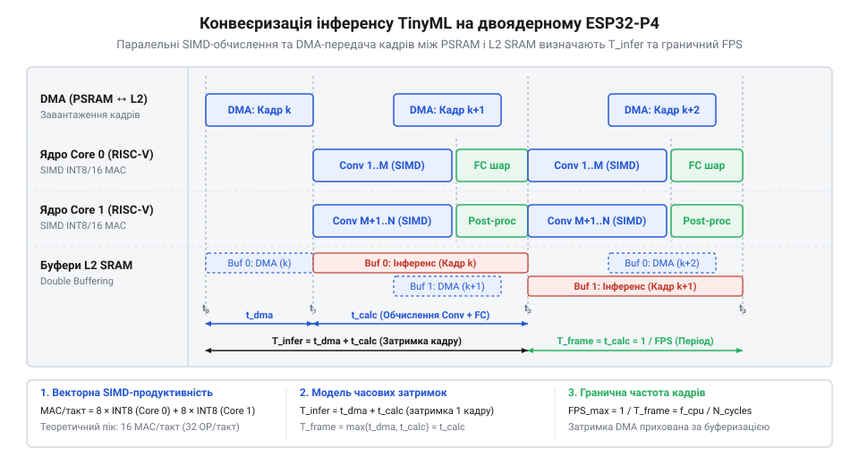

# Обрахунок продуктивності векторних RISC-V інструкцій та операцій MAC у задачах TinyML

<preknowlist>
- [Мікроконтролер ESP32-S3](root:cat-hw-boards/esp32s3-microcontroller) — Базові принципи векторної обробки в мікроконтролерах Espressif та відмінності SIMD-інструкцій від послідовного конвеєра CPU.
- [Схемотехніка та розпіновка шин Octal SPI Flash та PSRAM в ESP32-S3](root:cat-hw-boards/esp32-s3-octal-spi-bus-layout) — Принципи організації шини PSRAM та вплив пропускної здатності шини пам'яті на швидкість зчитування вагових коефіцієнтів.
- [Плати відеозахоплення нового покоління на базі ESP32-S3](root:cat-hw-boards/esp32-s3-cam-boards-overview) — Конвеєр обробки зображень у пам'яті контролера та вимоги до систем машинного зору реального часу.
</preknowlist>

## Деградація затримки TinyML без обчислювальної моделі

При розгортанні нейромереж на крайніх пристроях розробники часто стикаються з падінням швидкості інференсу. Розраховуючи час виконання моделі на мікроконтролері @@en|ESP32-P4@@ лише за тактовою частотою ядра, на практиці замість 100 кадрів за секунду отримують лише 12 через невизначену деградацію затримки.

Першопричина помилки — спрощена оцінка продуктивності за показником @@en|FLOPs@@ (від англ. *Floating-Point Operations Per Second* — кількість операцій із плаваючою крапкою за секунду). У системах @@en|TinyML@@ (від англ. *Tiny Machine Learning* — компактне машинне навчання на мікроконтролерах) квантовані моделі працюють із цілочисельними операндами, тому обчислення з плаваючою крапкою не відображають реального навантаження. Крім того, множення вагових коефіцієнтів та додавання зсуву виконуються як єдина апаратна операція @@en|MAC@@ (від англ. *Multiply-Accumulate* — суміщена операція множення з накопиченням). Традиційний підрахунок розглядає їх окремо, що штучно подвоює обсяг обчислень.

Спрощена модель обчислює затримку інференсу як відношення кількості арифметичних дій до тактової частоти ядра:

N_FLOPs
= 2 × N_MAC                              [переведення MAC у кількість окремих операцій множення та додавання]

T_naive
= N_FLOPs / (2 × f_CPU)                  [розрахунок часу за умови виконання двох FLOPs за такт]
= N_MAC / f_CPU                          [скорочення коефіцієнта суміщених дій]

Отриманий вираз `T_naive` передбачає однаковий час виконання незалежно від типу даних та організації пам'яті.

Процесорне ядро @@en|ESP32-P4@@ використовує розширення @@en|SIMD@@ (від англ. *Single Instruction, Multiple Data* — одна інструкція для обробки багатьох елементів даних), обробляючи декілька пакованих операндів за такт. Через це реальна затримка шару враховує швидкість шини та накладні витрати:

T_real
= T_compute + T_memory + T_overhead      [структура реальної затримки обробки]
= (N_MAC / N_SIMD) / f_CPU + V_bytes / B_bus + T_overhead [розгортання складових затримки через параметри шини та ядра]

У цьому рівнянні символ `N_SIMD` визначає кількість паралельних @@en|MAC-операцій@@ за такт, `V_bytes` — обсяг пересланих даних, `B_bus` — пропускну здатність шини в байтах за такт, а `T_overhead` — накладні витрати на конвеєр.

Ігнорування апаратних параметрів конвеєра призводить до насичення шини. Під час роботи з [платами відеозахоплення](root:cat-hw-boards/esp32-s3-cam-boards-overview) буфери кадрів переповнюються, викликаючи пропуск кадрів, який неможливо усунути без корекції обчислювальної моделі.

## Теоретичний пік продуктивності векторного ядра

Для оцінки межі швидкодії моделей TinyML без затримок пам'яті визначають теоретичний пік процесора. Двоядерний мікроконтролер @@en|ESP32-P4@@ має два ядра @@en|HP Core@@ (від англійського *High-Performance Core* — високопродуктивне процесорне ядро) архітектури @@en|RISC-V@@ (від англійського *Reduced Instruction Set Computer V* — п'ята версія відкритої архітектури зі скороченим набором інструкцій) із частотою `f_CPU = 400` @@en|МГц@@ та 128-бітними векторними й @@en|DSP-регістрами@@.

У регістрі шириною `W_reg = 128` біт пакуються операнди @@en|INT8@@ (від англійського *8-bit Integer* — 8-бітне ціле число зі знаком) розрядністю `W_INT8 = 8` біт або @@en|INT16@@ (від англійського *16-bit Integer* — 16-бітне ціле число зі знаком) розрядністю `W_INT16 = 16` біт. Кількість каналів `N_SIMD` визначається відношенням ширини регістра до розміру операнда:

N_SIMD_INT8
= W_reg / W_INT8                          [ширина регістра до розрядності INT8]
= 128 / 8                                 [підстановка 128 біт і 8 біт]
= 16                                      [кількість каналів INT8]

N_SIMD_INT16
= W_reg / W_INT16                         [ширина регістра до розрядності INT16]
= 128 / 16                                [підстановка 128 біт і 16 біт]
= 8                                       [кількість каналів INT16]

Векторний блок ядра виконує `N_SIMD_INT8 = 16` @@en|MAC-операцій@@ за такт для @@en|INT8@@ або `N_SIMD_INT16 = 8` @@en|MAC-операцій@@ для @@en|INT16@@.

Теоретичний пік ядра `P_core` та двох ядер `N_cores = 2` обчислюють у @@en|GMAC/s@@ (від англійського *Giga MAC operations per second* — мільярд операцій множення з накопиченням за секунду):

P_core_INT8
= N_SIMD_INT8 × f_CPU                    [продуктивність ядра за секунду]
= 16 × 400 · 10⁶                         [підстановка 16 MAC/такт і частоти 400 МГц]
= 6.4 GMAC/s                             [продуктивність ядра для INT8]

P_peak_INT8
= N_cores × P_core_INT8                  [пік двоядерного процесора]
= 2 × 6.4 GMAC/s                         [множення на 2 ядра]
= 12.8 GMAC/s                            [підсумковий пік для INT8]

P_core_INT16
= N_SIMD_INT16 × f_CPU                   [продуктивність ядра за секунду]
= 8 × 400 · 10⁶                          [підстановка 8 MAC/такт і частоти 400 МГц]
= 3.2 GMAC/s                             [продуктивність ядра для INT16]

P_peak_INT16
= N_cores × P_core_INT16                 [пік двоядерного процесора]
= 2 × 3.2 GMAC/s                         [множення на 2 ядра]
= 6.4 GMAC/s                             [підсумковий пік для INT16]

Перехід від @@en|INT16@@ до @@en|INT8@@ подвоює обчислювальну стелю без зміни частоти. Порівняно з [базовою архітектурою ESP32-S3](root:cat-hw-boards/esp32s3-microcontroller), [векторні інструкції RISC-V](root:cat-hw-boards/esp32-p4-vector-isa) процесора @@en|ESP32-P4@@ дають теоретичний пік 12.8 @@en|GMAC/s@@ за відсутності простоїв пам'яті.

## Обмеження продуктивності шиною та інтенсивністю

Теоретичний пік обчислень передбачає безперервну подачу операндів, але реальна швидкість нейромереж на мікроконтролері @@en|ESP32-P4@@ обмежена затримками шини пам'яті. Ядра процесора з'єднані з внутрішньою пам'яттю @@en|L2 SRAM@@ та зовнішньою @@en|PSRAM@@.

Внутрішня @@en|L2 SRAM@@ працює на частоті ядра через шину із пропускною здатністю `B_L2 = 32` байти за такт (12.8 @@en|ГБ/с@@ при 400 @@en|МГц@@). Зовнішня @@en|PSRAM@@ підключена через шину Octal SPI DDR, де, як показує [схемотехніка шин PSRAM](root:cat-hw-boards/esp32-s3-octal-spi-bus-layout), пропускна здатність становить `B_PSRAM = 2` байти за такт (800 @@en|МБ/с@@).

Для оцінки вузького місця обчислень використовується @@en|арифметична інтенсивність@@ (від англійського *arithmetic intensity* — відношення кількості виконаних математичних операцій до обсягу зчитаних та записаних байтів пам'яті) `I` у @@en|MAC/байт@@:

I = N_MAC / V_bytes                        [означення арифметичної інтенсивності]

Зв'язок між інтенсивністю `I`, пропускною здатністю шини `B_bus` та реальною продуктивністю визначає @@en|Roofline model@@ (від англійського *Roofline Model* — математична модель межі продуктивності у формі профілю даху):

P_real
= min(P_peak, I × B_bus)                  [математичне вираження моделі Roofline]

Точка перелому описує критичну інтенсивність `I_roof`, при якій досягається теоретичний пік `P_peak_core`.

Критична інтенсивність для внутрішньої @@en|L2 SRAM@@ при `P_peak_core = 16` MAC/такт та `B_L2 = 32` байти/такт:

I_roof_L2
= P_peak_core / B_L2                      [формула критичної інтенсивності для внутрішньої шини]
= 16 / 32                                 [підстановка 16 MAC/такт та 32 байт/такт]
= 0.5 MAC/байт                            [значення критичної інтенсивності для L2 SRAM]

Для зовнішньої @@en|PSRAM@@ при `B_PSRAM = 2` байти/такт:

I_roof_PSRAM
= P_peak_core / B_PSRAM                   [формула критичної інтенсивності для зовнішньої шини]
= 16 / 2                                  [підстановка 16 MAC/такт та 2 байт/такт]
= 8.0 MAC/байт                            [значення критичної інтенсивності для PSRAM]

Модель Roofline ділить операції на два режими:

1. Режим @@en|memory-bound@@ (від англійського *memory-bound* — режим обмеження пропускною здатністю пам'яті): при `I < I_roof` продуктивність обмежена шиною (`P_real = I × B_bus`), векторні конвеєри застоюються, а підвищення частоти ядра не дає приросту. 2. Режим @@en|compute-bound@@ (від англійського *compute-bound* — режим обмеження обчислювальною потужністю процесора): при `I ≥ I_roof` продуктивність виходить на плато `P_real = P_peak`, оскільки шина забезпечує повне насичення обчислювача.

*Залежність продуктивності обчислень від арифметичної інтенсивності за моделлю Roofline: точка перетину похилої лінії з плато визначає критичну інтенсивність переходу від обмеження пам'яттю до піку векторного ядра.*

Повнозв'язані шари мають низьку інтенсивність (`I ≈ 1.0` @@en|MAC/байт@@ для @@en|INT8@@), оскільки кожна вага зчитується лише один раз. У зовнішній @@en|PSRAM@@ такий шар потрапляє в режим @@en|memory-bound@@, забезпечуючи лише `1.0 × 2 = 2` @@en|MAC/такт@@ замість 16 @@en|MAC/такт@@. Згорткові шари завдяки повторному використанню вагових коефіцієнтів досягають `I = 16...32` @@en|MAC/байт@@ і переходять у режим @@en|compute-bound@@ навіть у @@en|L2 SRAM@@. Розрахунок інтенсивності дозволяє виявити вузькі місця у [модулях пам'яті ESP32-S3](root:cat-hw-boards/esp32-s3-wroom-modules-family) та @@en|ESP32-P4@@ для оптимального кешування вагових коефіцієнтів.

## Математична складність згорткових і повнозв'язаних шарів

Оцінка затримки моделей @@en|TinyML@@ вимагає розрахунку трьох типів шарів: стандартних та глибинно-розділювальних згорткових і повнозв'язаних. Вони різняться співвідношенням арифметичного навантаження та пересилання даних шиною пам'яті.

У стандартному згортковому шарі (@@en|Conv2D@@) фільтр `K_h × K_w` пересувається вхідною картою `H_in × W_in` із `C_in` каналами, формуючи вихідний тензор `H_out × W_out` із `C_out` каналами. Кількість @@en|MAC-операцій@@ обчислюють як добуток розмірів виходу, каналів та площі ядра:

N_MAC_conv
= H_out × W_out × C_out × C_in × K_h × K_w [обчислення кількості MAC для згортки]

Для операндів @@en|INT8@@ обсяг даних `V_bytes_conv` дорівнює сумі байтів ваг `V_weights_conv` та активацій:

V_weights_conv
= C_out × C_in × K_h × K_w                 [обсяг вагових коефіцієнтів у байтах для INT8]

V_bytes_conv
= V_weights_conv + (H_in × W_in × C_in) + (H_out × W_out × C_out) [загальний обсяг пересланих даних шару]

Повторне використання ваг забезпечує високу арифметичну інтенсивність `I_conv = N_MAC_conv / V_bytes_conv`. У внутрішній пам'яті @@en|L2 SRAM@@ шар досягає режиму @@en|compute-bound@@, виходячи на пік векторного ядра.

Глибинно-розділювальна згортка (@@en|Depthwise Separable Convolution@@, від англійського *Depthwise Separable Convolution* — згортка з розділенням по глибині та простору) розділяє процес на просторову фільтрацію каналів (@@en|Depthwise Convolution@@) та міжканальне об'єднання згорткою 1×1 (@@en|Pointwise Convolution@@). Сумарні операції `N_MAC_dw_sep` дорівнюють сумі двох етапів:

N_MAC_dw
= H_out × W_out × C_in × K_h × K_w         [кількість MAC для просторової фільтрації]

N_MAC_pw
= H_out × W_out × C_out × C_in              [кількість MAC для міжканального поєднання]

N_MAC_dw_sep
= N_MAC_dw + N_MAC_pw                       [сумарна кількість операцій розділеної згортки]

Відносне скорочення обчислень `R_MAC` порівняно зі стандартною згорткою визначає відношення:

R_MAC
= N_MAC_dw_sep / N_MAC_conv                 [формула відносного скорочення обчислень]
= (1 / C_out) + (1 / (K_h × K_w))           [спрощення відношення для ядра K×K]

Зменшення ваг знижує арифметичну інтенсивність, через що шар @@en|Depthwise Convolution@@ стає @@en|memory-bound@@, вимагаючи високої пропускної здатності [схемотехніки шин PSRAM](root:cat-hw-boards/esp32-s3-octal-spi-bus-layout).

Повнозв'язаний шар (@@en|Fully Connected@@, від англійського *Fully Connected* — повнозв'язаний шар нейромережі) зв'язує `N_in` вхідних нейронів із `N_out` вихідними. Операції `N_MAC_fc`, обсяг даних `V_bytes_fc` та інтенсивність `I_fc` визначають формули:

N_MAC_fc
= N_in × N_out                             [кількість MAC для повнозв'язаного шару]

V_bytes_fc
= (N_in × N_out) + N_in + N_out            [обсяг ваг та активацій у байтах для INT8]

I_fc
= N_MAC_fc / V_bytes_fc                     [розрахунок арифметичної інтенсивності]
≈ 1.0 MAC/байт                              [гранична інтенсивність для INT8]

Через одноразове зчитування кожної ваги `I_fc ≈ 1.0`. У зовнішній пам'яті шар завжди працює в режимі @@en|memory-bound@@.

Підсумковий час виконання шару `T_layer` на ядрі @@en|ESP32-P4@@ обчислюють порівнянням часу рахунку `T_compute` та пересилання `T_memory` з урахуванням коефіцієнта пакування каналів `α_pack ≥ 1.0` у [векторних інструкціях RISC-V](root:cat-hw-boards/esp32-p4-vector-isa):

N_SIMD_eff
= N_SIMD_INT8 / α_pack                     [ефективна кількість MAC за такт з урахуванням пакування]

T_compute
= N_MAC / (N_SIMD_eff × f_CPU)             [час обчислення на векторному ядрі]

T_memory
= V_bytes / B_bus                          [час передачі даних через шину пам'яті]

T_layer
= max(T_compute, T_memory) + T_overhead    [підсумковий час виконання одного шару]

Значення `T_layer` визначає найбільший із двох часів плюс накладні витрати `T_overhead`.

## Аналітичний розрахунок затримки інференсу TinyML

Затримка виконання нейромережі на двох ядрах @@en|HP Core@@ процесора @@en|ESP32-P4@@ визначається суміщенням обчислень і передачі даних. Послідовне додавання затримок `T_seq = ∑ T_layer_i` дає песимістичну оцінку. Для максимізації пропускної здатності конвеєр використовує подвійну буферизацію (@@en|double buffering@@, від англ. *double* — подвійний, *buffer* — проміжне сховище) у @@en|L2 SRAM@@ та апаратний модуль прямого доступу до пам'яті (@@en|DMA@@, від англ. *Direct Memory Access* — прямий доступ до пам'яті). Поки ядра обробляють поточний шар, @@en|DMA@@ у фоновому режимі зчитує ваги наступного шару із зовнішньої @@en|PSRAM@@.

*Суміщення фонового @@en|DMA@@-передавання вагових коефіцієнтів із PSRAM та обчислень у L2 SRAM дозволяє приховати затримку шини пам'яті.*

Підсумкова затримка `T_total` враховує коефіцієнт паралелізації `η_par ≈ 0.85...0.95` та міжядерну синхронізацію `T_sync`:

T_total
= (T_compute_total / (N_cores × η_par)) + T_dma_uncovered + T_sync [загальна затримка інференсу]

Гранична частота обробки кадрів у @@en|FPS@@ (від англ. *Frames Per Second* — кількість кадрів за секунду) становить:

FPS_max
= 1.0 / T_total                            [гранична частота обробки кадрів]

**Умова: Розрахунок затримки інференсу нейромережі з 10 млн INT8 MAC-операцій та 500 КБ ваг на ESP32-P4 при частоті 400 МГц.**

N_MAC_total
= 10 · 10⁶ MAC                            [загальна кількість операцій INT8]

C_cycles_ideal
= N_MAC_total / (N_cores × N_SIMD_INT8)   [ідеальні такти для двох ядер]
= 10 · 10⁶ / (2 × 16)                     [підстановка 2 ядер по 16 MAC/такт]
= 312 500 тактів                          [ідеальна кількість тактів]

C_cycles_real
= C_cycles_ideal × α_pack / η_par         [накладні витрати й паралелізація]
= 312 500 × 1.15 / 0.90                   [підстановка α_pack = 1.15, η_par = 0.90]
= 399 306 тактів                           [реальні такти обчислень]

T_compute_net
= C_cycles_real / f_CPU                   [обчислювальна затримка при 400 МГц]
= 399 306 / (400 · 10⁶)                    [ділення тактів на частоту]
= 0.000998 с                              [час обчислень 0.998 мс]

V_weights_total
= 500 · 10³ байтів                        [загальний обсяг ваг у PSRAM]

T_memory_dma
= V_weights_total / B_PSRAM_sec           [час передачі ваг через PSRAM]
= 500 · 10³ / (800 · 10⁶)                 [пропускна здатність шини 800 МБ/с]
= 0.000625 с                              [затримка DMA 0.625 мс]

T_total_net
= max(T_compute_net, T_memory_dma) + T_sync [суміщення DMA та обчислень]
= max(0.000998, 0.000625) + 0.000050      [підстановка затримок та T_sync = 0.05 мс]
= 0.001048 с                              [підсумкова затримка 1.048 мс]

FPS_max
= 1.0 / T_total_net                       [гранична частота кадрів]
= 1.0 / 0.001048                          [ділення секунди на затримку]
= 954 кадри/с                             [підсумкова частота обробки]

Оскільки `0.625 мс < 0.998 мс` (`T_memory_dma < T_compute_net`), затримка зовнішньої шини повністю приховується. Якщо обсяг ваг перевищує місткість @@en|L2 SRAM@@, обчислення стають обмеженими пам'яттю (@@en|memory-bound@@). Побудова такої моделі дозволяє оцінити часові параметри мережі до розробки коду для [модулів ESP32-CAM](root:cat-hw-boards/esp32-cam-camera-module-family) та [плат відеозахоплення](root:cat-hw-boards/esp32-s3-cam-boards-overview).