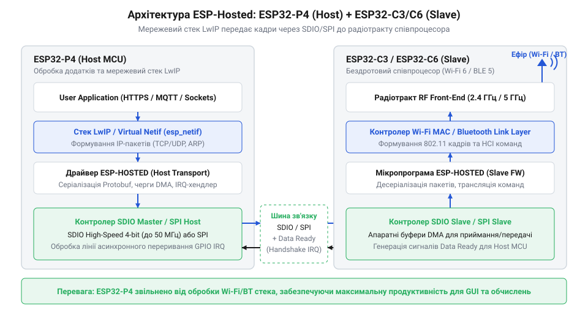
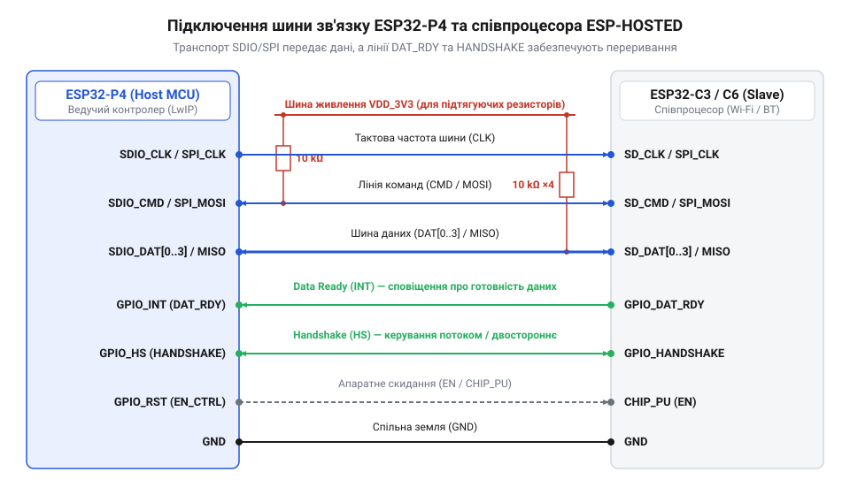

# Інтеграція зовнішнього Wi-Fi/Bluetooth співпроцесора через SPI/SDIO під керуванням ESP-HOSTED

<preknowlist>
- [Waveshare ESP32-C6-Zero](root:cat-hw-boards/esp32-c6-zero) — апаратна архітектура та розпіновка модулів ESP32-C6 для використання пристрою як бездротового співпроцесора
- [WeAct ESP32-C6-Mini](root:cat-hw-boards/esp32-c6-mini) — особливості виводів периферії та живлення компактних плат при шинному розширенні
</preknowlist>

## Проблема бездротового зв'язку в ESP32-P4

Флагманський мікроконтролер @@en|ESP32-P4@@ розроблявся як потужна обчислювальна платформа для мультимедійних систем, графічних інтерфейсів та обробки відео у реальному часі. Використання двох високопродуктивних ядер @@en|RISC-V@@ (@@en|HP Core@@) із частотою до 400 МГц, апаратних акселераторів відеокодування @@en|H.264@@, декодування @@en|JPEG@@, контролера графічної обробки @@en|PPA@@ та високошвидкісних інтерфейсів @@en|MIPI DSI@@ і @@en|MIPI CSI@@ робить цей чіп ідеальним серцем для складних пристроїв. Проте розробники, які переходять на @@en|ESP32-P4@@ із систем попередніх поколінь, стикаються із несподіваним апаратним фактом: на кристалі цього мікроконтролера повністю відсутній вбудований бездротовий @@uk|трансивер@@ (від @@en|transceiver@@) @@en|Wi-Fi@@ та @@en|Bluetooth@@.

Відсутність радіотракту безпосередньо на кристалі є свідомим апаратним рішенням інженерів. Процесорний кристал @@en|ESP32-P4@@ виготовляється за глибоким субмікронним технологічним процесом (28 нм), який оптимізовано для досягнення максимальної щільності цифрових транзисторів, високих тактових частот та низького енергоспоживання цифрової логіки. Натомість високочастотні @@en|RF-каскади@@ (від @@en|Radio Frequency@@) — підсилювачі потужності (@@en|PA@@), малошумні підсилювачі (@@en|LNA@@), змішувачі та коливальні @@en|LC-контури@@ — вимагають спеціалізованих аналогових кремнієвих техпроцесів (40 нм або 55 нм @@en|RF-CMOS@@) із товстими верхніми металізаційними шарами. Спроба розмістити аналоговий радіопередавач діапазону 2.4 ГГц на єдиному кристалі поряд із високочастотними процесорними ядрами призвела б до паразитного наведення цифрових завад на вхідний тракт прийому, нестабільності високочастотного гетеродину через теплове розсіювання обчислювальних ядер та катастрофічного здорожчення площі кристалоносія.

Намагання вирішити проблему шляхом програмного керування "сирим" радіомодулем безпосередньо з обчислювальних ядер хоста призводить до критичної конструктивної кризи. Протоколи @@en|Wi-Fi@@ (802.11 b/g/n/ax) та @@en|Bluetooth LE@@ мають суворі жорсткі часові обмеження на рівні канального (@@en|MAC@@, від @@en|Media Access Control@@) та фізичного (@@en|PHY@@, від @@en|Physical Layer@@) рівнів. Обробка кадрів @@en|Wi-Fi@@ вимагає дотримання часових вікон @@en|SIFS@@ (близько 10–16 мкс), генерації підтверджень @@en|ACK@@, апаратного шифрування за алгоритмами @@en|AES-CCMP@@ або @@en|WPA3@@ та обробки підтверджень у часових квантах мікросекундного діапазону.

Якщо покласти задачу обробки низькорівневих переривань радіотракту та розбору сигнальних кадрів на основні ядра @@en|ESP32-P4@@, операційна система @@en|FreeRTOS@@ змушена регулярно зупиняти виконання прикладного коду. Тисячі високопріоритетних апаратних переривань на секунду викличуть @@uk|голодування процесів@@ (@@en|thread starvation@@), деградацію продуктивності графічного інтерфейсу, зрив таймінгів обробки відеопотоків та втрату часових квантів реального часу. Єдиним системним виходом із цього тупика є повне винесення протокольних стеків @@en|Wi-Fi@@ та @@en|Bluetooth@@ на окремий ведений @@uk|співпроцесор@@ (від @@en|coprocessor@@) — спеціалізований чип серії @@en|ESP32-C3@@ або @@en|ESP32-C6@@. Такий розподіл вимагає створення прозорого шинного транспорту та спеціалізованого керуючого стека для узгодженої роботи двоих мікроконтролерів.

## Архітектура та стек протоколів ESP-HOSTED

Винесення бездротових функцій на окремий співпроцесор вимагає організації взаємодії між двома кристалами таким чином, щоб для прикладного програмного забезпечення на ведучому чипі зовнішній мережевий адаптер виглядав прозорим системним інтерфейсом. Цю задачу вирішує апаратно-програмний стек @@en|ESP-HOSTED@@. Він реалізує розподілену архітектуру, в якій обчислювальний хост @@en|ESP32-P4@@ та ведений співпроцесор чітко розділяють між собою рівні мережевої моделі @@en|OSI@@. Детальніше про внутрішню будову та налаштування цієї взаємодії читайте в огляді [стека протоколів ESP-HOSTED](root:sf-devices/esp-hosted-framework).

На ведучому мікроконтролері @@en|ESP32-P4@@ розгортається хост-драйвер @@en|ESP-HOSTED@@, який інтегрується безпосередньо в мережевий стек @@en|LwIP@@ (@@en|Lightweight IP@@) середовища @@en|ESP-IDF@@ через системний шар `@@en|esp_netif@@`. Хост виконує прикладну логіку, керує операційною системою @@en|FreeRTOS@@, створює мережеві сокети (@@en|TCP@@, @@en|UDP@@), обробляє високорівневі протоколи (@@en|HTTP@@, @@en|MQTT@@, @@en|TLS@@) та формує стандартизовані мережеві кадри. Для роботи з @@en|Bluetooth@@ на хості функціонує верхній стек @@en|Host@@ (наприклад, @@en|NimBLE@@ або @@en|Bluedroid@@), який генерує стандартні команди @@en|HCI@@ (@@en|Host Controller Interface@@).

*Архітектура стека ESP-HOSTED із розподілом функцій мережевого адаптера між хостом ESP32-P4 та веденим співпроцесором.*

Ведений співпроцесор — наприклад, надійну [плату Waveshare ESP32-C6-Zero](root:cat-hw-boards/esp32-c6-zero) або компактний [модуль WeAct ESP32-C6-Mini](root:cat-hw-boards/esp32-c6-mini) — прошивають спеціалізованою веденою прошивкою (@@en|ESP-Hosted Slave Firmware@@). Співпроцесор перебирає на себе весь комплекс задач фізичного та канального рівнів. Він контролює роботу радіотракту @@en|RF@@, виконує фазове підстроювання частоти, формує пакети 802.11 @@en|MAC@@/@@en|PHY@@, здійснює апаратне шифрування кадрів @@en|WPA2@@/@@en|WPA3@@ та реалізує нижній контролер @@en|Bluetooth Controller@@ (відповідальний за канальний шар @@en|Link Layer@@ та таймінги рекламних пакетів). Співпроцесор не обробляє сокети й не запускає стек @@en|LwIP@@, що звільняє його оперативну пам'ять для буферизації радіопакетів.

Механізм трансляції даних між пристроями працює за принципом інкапсуляції. Коли прикладний код на @@en|ESP32-P4@@ надсилає пакет у мережевий сокет, стек @@en|LwIP@@ передає канонічний @@en|Ethernet-кадр@@ драйверу @@en|ESP-HOSTED@@. Драйвер загортає цей кадр у транспортний контейнер @@en|ESP-HOSTED@@, додаючи службовий заголовок із вказуванням типу інтерфейсу (@@en|Wi-Fi Station@@, @@en|SoftAP@@ або @@en|HCI Bluetooth@@), довжини корисного навантаження та контрольної суми. Цей контейнер передається через прямий доступ до пам'яті (@@en|DMA@@, від @@en|Direct Memory Access@@) апаратному транспорту шини. На веденому чипі шинний периферійний вузол приймає пакет по @@en|DMA@@, вилучає службовий заголовок і спрямовує чистого @@en|Ethernet-провайдера@@ безпосередньо у випромінювач @@en|Wi-Fi MAC@@ для передачі в ефір. Зворотний потік даних від антени до сокетів хоста відбувається за аналогічною схемою у зворотному напрямку.

## Схемотехнічне підключення шин SPI та SDIO

Для забезпечення високої швидкості передачі даних між хостом @@en|ESP32-P4@@ та веденим співпроцесором застосовують один із двох апаратних шинних інтерфейсів: @@en|SPI@@ (від @@en|Serial Peripheral Interface@@) або 4-бітовий @@en|SDIO@@ (від @@en|Secure Digital Input Output@@) версії 2.0. Вибір конкретної шини визначається вимогами проєкту до пропускної здатності та кількістю вільних виводів @@en|GPIO@@.

Шина @@en|SDIO 2.0@@ є пріоритетним вибором для мультимедійних систем. Шина @@en|SDIO@@ працює на тактових частотах до 50 МГц і використовує 4-бітову паралельну шину даних (`DAT0`–`DAT3`), лінію команд (`CMD`) та лінію тактування (`CLK`). Теоретична межа фізичної пропускної здатності шини сягає 200 Мбіт/с (25 МБ/с), що забезпечує реальну швидкість передачі мережевого трафіку @@en|Wi-Fi@@ на рівні 30–50 Мбіт/с. Шинний інтерфейс @@en|SPI@@ використовує класичну 4-провідну топологію (лінії `MOSI`, `MISO`, `SCLK`, `CS`) із частотою тактування 10–40 МГц. Застосування @@en|SPI@@ спрощує розводку друкованої плати та економить виводи мікроконтролера, проте реальна мережева швидкість обмежується 8–15 Мбіт/с через послідовну передачу бітів та службові накладні витрати протоколу.

*Принципова схема підключення сигнальних ліній SDIO/SPI та асинхронних ліній апаратного синхронізування між хост-контролером та співпроцесором.*

Оскільки шини @@en|SPI@@ та @@en|SDIO@@ функціонують за схемою @@en|Master-Slave@@, де тактовий сигнал генерується виключно ведучим контролером @@en|ESP32-P4@@, передача асинхронних мережевих пакетів вимагає введення додаткових позадіапазонних ліній переривань. У протоколі @@en|ESP-HOSTED@@ для цього виділено дві обов'язкові сигнальні лінії:

- **Лінія готовності даних (@@en|Data Ready@@ / `DATA_READY`):** Формується веденим співпроцесором. Оскільки пакети @@en|Wi-Fi@@ надходять з ефіру асинхронно, співпроцесор буферизує їх у пам'яті @@en|DMA@@ і виставляє високий логічний рівень на лінії `DATA_READY`. Це генерує апаратне переривання по фронту на виводі @@en|GPIO@@ хоста @@en|ESP32-P4@@, сповіщаючи його про необхідність ініціювати сесію читання шини. Без цієї лінії хост був би змушений постійно опитувати співпроцесор у циклі (@@en|polling@@), марнуючи ресурси процесора та шини. - **Лінія рукостискання (@@en|Handshake@@ / `HANDSHAKE`):** Використовується під час передачі даних від хоста до співпроцесора. Перед відправкою кадру хост @@en|ESP32-P4@@ опитує стан лінії `HANDSHAKE`. Співпроцесор підтверджує готовність прийому (виставляє високий рівень) лише тоді, коли його внутрішні ring-буфери @@en|DMA@@ звільнені й готові прийняти новий транш даних. Це унеможливлює переповнення буферів веденого пристрою та втрату пакетів при високому навантаженні.

Збереження цілісності сигналів на високочастотних шинах вимагає дотримання суворих схемотехнічних правил. Стандарт @@en|SDIO@@ вимагає встановлення зовнішніх підтягуючих резисторів (@@en|pull-up@@) номіналом 10 кОм на лінії `CMD` та `DAT0`–`DAT3`. Вони утримують шину у стабільному високому стані під час скидання або в моменти, коли виводи переходять у високоімпедансний стан (Z-стан). Для ліній тактування `CLK` та `SCLK` рекомендується встановлення послідовних демпфуючих резисторів номіналом 22–33 Ом безпосередньо біля виводів джерела сигналу для пригнічення зворотних відбитків та дзвону. Особливу увагу слід приділити живленню співпроцесора: імпульсне споживання радіопередавача під час передачі кадрів досягає 500 мА. Недостатнє фільтрування лінії 3.3 В керамічними конденсаторами (поєднання 10 мкФ та 100 нФ біля виводів живлення) призводить до просідання напруги, розсинхронізації шини @@en|SDIO@@ та збоїв апаратного контролера.

## Конфігурація та прошивання веденого співпроцесора

Після завершення схемотехнічного розведення сигнальних ліній шини зв'язку ведений мікроконтролер потребує спеціального програмного забезпечення. Чистий кристал не здатний самостійно інтерпретувати транзакції шини або обробляти винесені мережеві пакети. Для перетворення пристрою на виділений бездротовий вузол на нього завантажують спеціалізовану прошивку веденого пристрою (@@en|ESP-Hosted Slave Firmware@@).

Процес збірки прошивки відбувається у середовищі @@en|ESP-IDF@@ для вибраної платформи співпроцесора — наприклад, для сумісної плати на кшталт [модуль WeAct ESP32-C6-Mini](root:cat-hw-boards/esp32-c6-mini) або [плату Waveshare ESP32-C6-Zero](root:cat-hw-boards/esp32-c6-zero). Головним етапом підготовки є первинна конфігурація проекту через систему конфігурації (@@en|Kconfig@@) у графічному меню `idf.py menuconfig`. Розробник визначає три ключові параметри взаємодії:

- **Тип шинного транспорту:** Вибір між режимами 4-бітового @@en|SDIO 2.0@@ (`CONFIG_ESP_HOSTED_TRANSPORT_SDIO`) та послідовного @@en|SPI@@ Slave (`CONFIG_ESP_HOSTED_TRANSPORT_SPI`). - **Прив'язка виводів (@@en|GPIO Assignment@@):** Призначення конкретних номерів ніжок мікроконтролера під лінії шини (`CLK`, `CMD`, `DAT0`–`DAT3` або `MOSI`, `MISO`, `SCLK`, `CS`), а також під сигнальні лінії переривань `DATA_READY` та `HANDSHAKE` відповідно до розпіновки плати. - **Тактова частота та ресурси:** Задання граничної частоти шини (до 50 МГц для @@en|SDIO@@ та до 40 МГц для @@en|SPI@@) і розподіл буферного фонду.

Особливе значення має конфігурування оперативної пам'яті (@@en|RAM@@, від @@en|Random Access Memory@@) веденого пристрою. Оскільки співпроцесор не виконує прикладного коду і не розгортає власний IP-стек, майже вся його статична пам'ять присвячується для створення кільцевих буферів (від @@en|ring buffer@@) та дискрипторів прямого доступу до пам'яті (@@en|DMA@@). Під час високошвидкісного прийому пакетів з ефіру @@en|Wi-Fi MAC@@-контролер повинен миттєво записувати вхідні кадри у буфери пам'яті без затримок. Недостатній розмір виділеного пулу буферів призводить до переповнення апаратної черги веденого чипа, втрати кадрів на фізичному рівні та деградації зв'язку.

Збір проекту здійснюється стандартною командою збірки `idf.py build`. Отриманий бінарний образ прошивається в внутрішню флеш-пам'ять співпроцесора за допомогою утиліти завантаження (@@en|esptool@@) через послідовний порт @@en|UART@@ або @@en|USB-JTAG@@. Після перезавантаження прошитий співпроцесор ініціалізує свій радіотракт, переводить периферійний контролер шини у режим веденого пристрою (@@en|Slave@@), переводить лінію `DATA_READY` у низький логічний рівень та переходить у стан очікування команд ініціалізації від ведучого хоста @@en|ESP32-P4@@.

## Інтеграція хост-драйвера та оптимізація пропускності

Коли ведений співпроцесор перебуває у стані готовності на шині, на ведучому мікроконтролері @@en|ESP32-P4@@ розгортають хост-драйвер @@en|ESP-HOSTED@@. Без цього програмного шару операційна система (@@en|FreeRTOS@@) та мережевий стек (@@en|LwIP@@) хоста не зможуть надсилати кадри через фізичний транзит.

Драйвер додається до проекту хоста як компонент середовища @@en|ESP-IDF@@. Під час старту системи хост ініціалізує шинний контролер (@@en|SDMMC Host@@ або @@en|SPI Master@@) та реєструє обробник переривання (@@en|ISR@@, від @@en|Interrupt Service Routine@@) для лінії `DATA_READY`. Після проходження вхідного рукостискання драйвер реєструє в системі віртуальний мережевий адаптер (@@en|virtual netif@@) через шар `@@en|esp_netif@@`.

Для прикладного коду на @@en|ESP32-P4@@ зовнішній співпроцесор стає повністю прозорим. Стандартні виклики функцій започаткування мережі `esp_wifi_init()` та створення сокету (від @@en|socket@@) у стеку @@en|LwIP@@ перенаправляють кадри у транспортний контейнер драйвера, який по @@en|DMA@@ транслюється на ведений чип. Аналогічно для @@en|Bluetooth LE@@ створюється віртуальний порт інтерфейсу контролера (@@en|HCI@@), через який високорівневі стеки (наприклад, @@en|NimBLE@@) надсилають команди безпосередньо у канальний шар співпроцесора.

Нижче наведено приклад ініціалізації хост-драйвера @@en|ESP-HOSTED@@ у середовищі @@en|ESP-IDF@@ для ведучого контролера @@en|ESP32-P4@@:

:::tabs
:::code proj-esp32-p4-hosted-wireless-coprocessor/c/esp-idf/init-esp-hosted-host.c
:::code proj-esp32-p4-hosted-wireless-coprocessor/cpp/esp-idf/hostedhostcontroller.cpp
:::

Досягнення максимальної пропускної здатності каналу зв'язку вимагає оптимізації системних параметрів на боці хоста:

- **Пріоритети задач операційної системи:** Задачі обслуговування переривань шини та системна задача @@en|TCP/IP@@ стека @@en|LwIP@@ повинні мати високий пріоритет у @@en|FreeRTOS@@ (значення 18–20). Це гарантує, що при надходженні сигналу `DATA_READY` хост негайно вичистить буфери шини, запобігаючи виникненню затримок. - **Розмір DMA-буферів:** Налаштування розміру транзитних буферів до 1600 байт та збільшення кількості дескрипторів передачі дозволяє вичищати пакети суцільними блоками без проміжних зупинок процесора. - **Агрегація кадрів (@@en|AMPDU@@):** Включення механізму агрегації кадрів (@@en|AMPDU@@, від @@en|Aggregated MAC Protocol Data Unit@@) об'єднує кілька мережевих пакетів в один великий кадр для передачі по шині. Це суттєво зменшує накладні витрати на обробку заголовків та налаштування шинних сесій. - **Якість обслуговування (@@en|QoS@@):** Налаштування черг пріоритезації трафіку (@@en|QoS@@, від @@en|Quality of Service@@) розділяє критичні службові пакети управління та потоковий трафік, підтримуючи стабільну швидкість до 30–50 Мбіт/с у режимі @@en|SDIO@@.

Завдяки такій оптимізації обчислювальні ядра (@@en|HP Core@@) мікроконтролера @@en|ESP32-P4@@ повністю звільняються від низькорівневої обробки бездротових протоколів, залишаючи весь свій ресурс для виконання складних обчислювальних, графічних або мультимедійних задач.