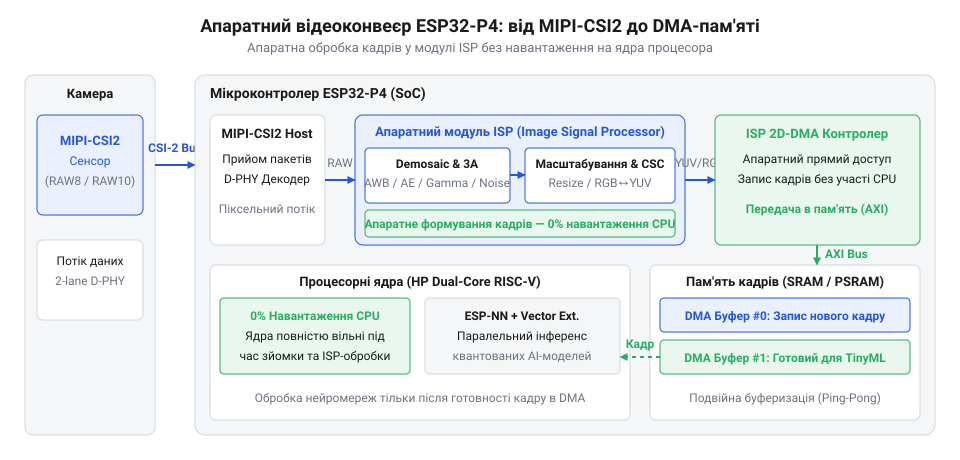
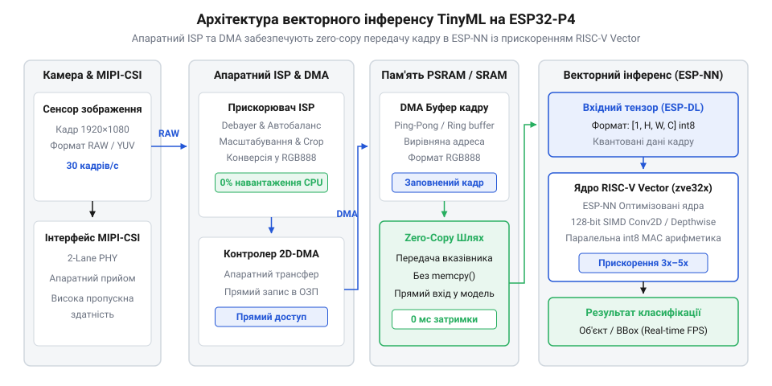

# Система крайового машинного зору TinyML з обробкою потоку MIPI-CSI та векторним прискоренням

<preknowlist>
- [Модуль ESP32-CAM: огляд архітектури, периферії та сімейства плат](root:cat-hw-boards/esp32-cam-camera-module-family) — базові принципи організації систем відеозахоплення на мікроконтролерах, обмеження паралельного інтерфейсу DVP та засади побудови кадрових буферів у пам'яті
- [Плати відеозахоплення нового покоління на базі ESP32-S3](root:cat-hw-boards/esp32-s3-cam-boards-overview) — архітектуру підключення відеосенсорів до SoC Espressif попередніх поколінь та еволюцію методів прискорення передачі відеокадрів
- [Схемотехніка та розпіновка шин Octal SPI Flash та PSRAM в ESP32-S3](root:cat-hw-boards/esp32-s3-octal-spi-bus-layout) — принципи високоефективної взаємодії з зовнішньою оперативною пам'яттю PSRAM для розміщення великообсягових фреймбуферів і ваг моделей TinyML
</preknowlist>

## Проблема затримок обробки відео у TinyML

Розробка автономних інтелектуальних пристроїв у концепції @@en|TinyML@@ (від англ. *Tiny Machine Learning* — надмале машинне навчання) висуває жорсткі вимоги до обробки відеопотоку в реальному часі. У традиційних системах машинного зору на мікроконтролерах відеосенсор підключають через паралельний цифровий порт @@en|DVP@@ (від англ. *Digital Video Port* — цифровий паралельний відеопорт), як це реалізовано у класичних [модулях ESP32-CAM](root:cat-hw-boards/esp32-cam-camera-module-family) або [відеозахопленні на ESP32-S3](root:cat-hw-boards/esp32-s3-cam-boards-overview). При такому підході передача кожного кадру вимагає синхронного перемикання десятка ліній введення-виведення на тактовій частоті шини від 10 до 20 МГц. Фізичні обмеження паралельної шини викликають перешкоди та обмежують пропускну здатність, проте головне обчислювальне вузьке місце виникає не на етапі фізичного зчитування байтів, а під час підготовки зображення до подачі в нейронну мережу.

Вхідний тензор квантованої моделі глибокого навчання вимагає чітко визначеної роздільної здатності (наприклад, `96×96` або `224×224` пікселів) у фіксованій колірній моделі RGB888 або Grayscale. Водночас вихідний відеопотік із матриці камери надходить у сирому форматі @@en|Bayer-фільтра@@ (від прізвища інженера *Bryce Bayer*, мозаїчний масив колірних фільтрів RGGB) або RGB565. Коли мікроконтролер позбавлений спеціалізованих апаратних співпроцесорів відеообробки, центральний процесор змушений виконувати програмний @@en|дезаїчинг@@ (від англ. *demosaicing* — відновлення повноколірних пікселів із мозаїки), нормалізацію яскравості та дволінійне масштабування сітки пікселів за допомогою циклів на ядрах загального призначення.

Оцінимо кількість обчислювальних тактів, яку витрачає чип без апаратних прискорювачів на обробку одного відеокадру роздільною здатністю `640×480` пікселів для приведення його до вхідного тензора моделі розміром `96×96` пікселів:

N_src = 640 × 480 = 307200 пікселів          [загальна кількість пікселів вихідного кадру]
N_dst = 96 × 96 = 9216 пікселів              [кількість пікселів цільового тензора]
T_demosaic = N_src × 8 = 2457600 тактів      [програмний дезаїчинг Bayer-матриці]
T_scale = N_dst × 16 = 147456 тактів         [дволінійне масштабування колірних каналів]
T_total = T_demosaic + T_scale = 2605056 тактів [загальні затрати ЦПУ на препроцесинг кадру]

На тактовій частоті ядра `240 МГц`, яка є стандартною для пристроїв на [мікроконтролері ESP32-S3](root:cat-hw-boards/esp32s3-microcontroller), лише програмна конверсія одного кадру триває приблизно `10.8 мс`. Якщо сам інференс компактної нейронної мережі потребує ще `25 мс`, то сумарна затримка обробки досягає `35.8 мс`, що знижує граничну частоту кадрів @@en|FPS@@ (від англ. *Frames Per Second* — кількість кадрів за секунду) нижче за поріг 28 кадрів/с. При цьому обчислювальні ядра повністю завантажені рутинними операціями перевпорядкування масивів і позбавлені можливості виконувати паралельні задачі керування або мережевої взаємодії.

Усунути це фундаментальне обмеження дозволяє принципово інша архітектура, втілена в мікроконтролері @@en|ESP32-P4@@. Вона поєднує високошвидкісний диференційний послідовний інтерфейс @@en|MIPI-CSI@@ (від англ. *Mobile Industry Processor Interface Camera Serial Interface* — послідовний інтерфейс камери) на базі фізичного рівня @@en|D-PHY@@ (від римської цифри D = 500, диференційний фізичний рівень) та апаратний процесор обробки сигналів зображення @@en|ISP@@ (від англ. *Image Signal Processor* — апаратний відеопроцесор). Відеопотік приймається на швидкості до `1.5 Гбіт/с` на лінію та трансформується модулем ISP у готовий колірний тензор безпосередньо під час передачі даних у пам'ять через контролер @@en|DMA@@ (від англ. *Direct Memory Access* — прямий доступ до пам'яті), повністю звільняючи процесорні ядра для обчислень штучного інтелекту.

## Архітектура апаратного відеоконвеєра MIPI-CSI та ISP

Апаратна відеопериферія мікроконтролера @@en|ESP32-P4@@ забезпечує наскрізне перетворення сирого фотоелектричного сигналу з матриці камери у готовий масив пікселів без проміжної участі центрального процесора. Фізичний прийом даних здійснюється дволінійним контролером @@en|MIPI-CSI2@@, який підтримує апаратне декодування пакетів протоколу, перевірку циклічним надлишковим кодом та виділення віртуальних каналів. Вихідний потік байтів у форматах RAW8 або RAW10 передається безпосередньо на вхідний конвеєр апаратного модуля @@en|ISP@@.

Конвеєр ISP складається з послідовності спеціалізованих функціональних блоків, кожен з яких виконує ділянку обробки зображення в режимі реального часу синхронно з піксельною частотою шини:

1. **Модуль дезаїчингу (CFA Interpolation):** перетворює вхідну матрицю кольорів @@en|CFA@@ (від англ. *Color Filter Array* — масив колірних фільтрів) RGGB у повноцінні колірні компоненти R, G, B для кожного пікселя за допомогою просторових адаптивних фільтрів. 2. **Блоки автокорекції (AEC / AWB):** модуль апаратного аналізу гістограми розраховує статистику розподілу яскравості для автоматичного керування експозицією @@en|AEC@@ (від англ. *Auto Exposure Control* — автоматичний контроль експозиції) та визначає колірну температуру кадру для балансу білого @@en|AWB@@ (від англ. *Auto White Balance* — автоматичний баланс білого). 3. **Гамма-корекція та LUT-перетворення:** таблиці підстановки @@en|LUT@@ (від англ. *Look-Up Table* — таблиця підстановки) здійснюють нелінійне кодування яскравості та корекцію колірного охоплення згідно з характеристиками конкретної оптики. 4. **Блок апаратного масштабування (Scaler):** двовимірний апаратний ресайзер стискає повнорозмірне зображення до габаритів вхідного матричного масиву моделі машинного зору без втрати пропорцій об'єктів.

*Апаратний конвеєр обробки зображень ESP32-P4 повністю звільняє обчислювальні ядра від програмного препроцесингу завдяки прямому потоку даних через ISP у DMA-буфери.*

Після проходження конвеєра ISP сформований кадр записується в оперативну пам'яті за допомогою багатоканального контролера DMA. Для забезпечення роботи системи реального часу в пам'яті організують технологію нуль-копіювання @@en|zero-copy@@ (від англ. *zero-copy* — передача даних без повторного дублювання в пам'яті) за схемою двобуферної адресації. При такому підході створюється двоелементний @@en|ping-pong-буфер@@ (від англ. *ping-pong buffer* — подвійний буфер із чергуванням запису та зчитування).

Для досягнення максимальної швидкодії буфери розміщують у швидкій внутрішній пам'яті @@en|SRAM@@ (від англ. *Static Random Access Memory* — статична оперативна пам'ять) з вирівнюванням адрес по межі шини кешу. Якщо роздільна здатність кадрів вимагає значного обсягу пам'яті, кадрові масиви виділяють у високошвидкісній [зовнішньою пам'яттю PSRAM](root:cat-hw-boards/esp32-s3-octal-spi-bus-layout), підключеній через багаторозрядну шину. Поки контролер DMA наповнює перший буфер поточним відеокадром від ISP, нейронна мережа зчитує попередній кадр із другого буфера. По завершенні зчитування покажчики апаратно міняються місцями, що усуває будь-які затримки на очікування та блокування пам'яті.

## Векторне прискорення обчислень фреймворком ESP-NN

Сформований апаратним конвеєром ISP кадр передається на інференс нейронної мережі, де ключовим фактором швидкості стає математичне обчислення операцій згортки та матричного множення. У мікроконтролері @@en|ESP32-P4@@ застосовано двоядерну 32-бітну архітектуру @@en|RISC-V@@ (від англ. *Reduced Instruction Set Computer V* — відкрита архітектура команд зі скороченим набором інструкцій), доповнену фірмовими векторними розширеннями @@en|SIMD@@ (від англ. *Single Instruction, Multiple Data* — одна інструкція, множинні дані). Вони дозволяють обробляти декілька елементів даних за один такт процесора.

Для максимальної ефективності використання векторних реєстрів вагові коефіцієнти моделей піддають процедурі квантування. Механізм @@en|квантування@@ (від лат. *quantus* — скільки) переводить дробові 32-бітні числа IEEE-754 у 8-бітні цілі числа формату @@en|INT8@@ (8-бітний цілочисельний тип даних із знаком) зі збереженням значень масштабу `S` та зсуву `Z`. Фреймворк @@en|ESP-NN@@ (низькорівнева бібліотека оптимізованих математичних ядер від Espressif) використовує спеціальні інструкції паралельного множення із накопиченням @@en|MAC@@ (від англ. *Multiply-Accumulate* — операція множення з накопиченням) для одночасної обробки 16 восьмибітних значень у 128-бітному векторному регістрі.

Обчислимо теоретичний коефіцієнт прискорення виконання операцій скалярного добутку векторів при переході від послідовного виклику скалярних інструкцій C до векторних команд `ESP-NN`:

N = 16                                       [кількість елементів 8-бітного вектора]
T_scalar = N × 4 = 64 тактів                 [завантаження, віднімання зсуву, множення, накопичення для 16 елементів]
T_vector = 2 тактів                          [паралельне векторне завантаження та виконання vdot.v]
S_simd = T_scalar / T_vector                 [формула коефіцієнта прискорення]
= 64 / 2                                     [підстановка розрахованих тактів]
= 32 ×                                       [граничне теоретичне прискорення SIMD для INT8]

На практиці реальне прискорення шар за шаром у фреймворку @@en|ESP-DL@@ (високорівнева бібліотека Deep Learning для ESP-IDF) становить від 4 до 8 разів порівняно зі скалярним кодом через витрати на пропускну здатність шини пам'яті та вирівнювання адрес.

*Передача даних з DMA-буфера безпосередньо у вхідний тензор ESP-NN забезпечує максимальну швидкість інференсу завдяки пакуванню даних під 128-бітні SIMD-інструкції RISC-V.*

Оптимізація обчислювального конвеєра також вимагає грамотного розподілу пам'яті під вхідний @@en|тензор@@ (від лат. *tensus* — натягнутий) та вагові коефіцієнти шарів. Внутрішня пам'ять @@en|SRAM@@ володіє нульовою затримкою доступу і призначена для розміщення активних тензорів поточного шару та проміжних результатів. Великообсягові масиви вагових коефіцієнтів моделей (розміром від кількох мегабайтів) зберігаються у зовнішній @@en|PSRAM@@. Для запобігання простою векторних обчислювальних блоків фреймворк організує фонову підкачку ваг наступного шару нейромережі через контролер DMA безпосередньо під час розрахунку поточного шару, забезпечуючи безперервний потік інференсу.

## Інтеграція квантованої моделі глибокого навчання

Пряме перенесення навчених обчислювальних графів з ПК на мікроконтролери розбивається об асиметрію ресурсів: математичні операції з плаваючою крапкою потребують високих енергетичних витрат і значного обсягу пам'яті під вагові коефіцієнти. Рішенням стає переведення чисел з 32-бітного формату в 8-бітний цілочисельний @@en|INT8@@. Початкові неперервні значення ваг та активацій r відображаються у дискретній сітці q за лінійною формулою квантування (від латинського *quantitas* — кількість): Детальніше про механізми переведення ваг та активацій математичних моделей у 8-бітний цілочисельний формат читайте у матеріалі про [квантування моделей TensorFlow Lite в INT8](root:sys-fw/tflite-int8-quantization).

q = round(r / S) + Z

де S — масштабний коефіцієнт @@en|scale factor@@ (від латинського *scala* — сходи та *factor* — той, що робить), який визначає крок дискретизації, а Z — нульова точка @@en|zero point@@, що відповідає дійсній величині 0 у квантованому діапазоні від -128 до 127. Перемноження квантованих чисел дозволяє замінити високовартісні апаратні блоки обробки чисел із плаваючою крапкою на векторні інструкції @@en|RISC-V@@ @@en|SIMD@@. Векторні розширення ядра @@en|ESP32-P4@@ дозволяють завантажувати 128-бітні регістри та виконувати до 16 операцій @@en|MAC@@ (від англійського *multiply-accumulate* — помножити з накопиченням) за один такт процесора.

Головне вузьке місце традиційного обчислювального конвеєра полягає у зайвих копіюваннях відеокадрів між периферією та оперативно протилежними зонами пам'яті. У порівнянні з [традиційною архітектурою](root:cat-hw-boards/esp32-cam-camera-module-family) систем відеозахоплення, де кадр спочатку завантажується в оперативну пам'ять, а потім програмно масштабується й нормалізується на ЦПУ, чип @@en|ESP32-P4@@ реалізує прямий зв'язок периферійного модуля @@en|ISP@@ із ареною тензорів @@en|tensor arena@@ (від латинського *tensus* — натягнутий, та *arena* — піщаний майданчик). Апаратний блок @@en|ISP@@ виконує масштабування до необхідної роздільної здатності моделі (наприклад, 224×224 пікселів) і конвертує колірний простір у потрібний формат @@en|RGB888@@ безпосередньо у виділений @@en|DMA@@-буфер, розташований за фіксованою адресою вхідного тензора.

Для виділення цієї області пам'яті використовується функціонал системного розподілювача ESP-IDF з вимогами вирівнювання за межами кеш-ліній процесора (32 байти), що необхідно для коректного функціонування векторних команд:

:::tabs
@tab C
:::code proj-esp32-p4-tinyml-mipi-csi-vision/c/esp-idf/allocate-tensor-arena.c
@tab C++
:::code proj-esp32-p4-tinyml-mipi-csi-vision/cpp/esp-idf/tensormemorymanager.cpp
:::

Розподіл обчислювальних ресурсів у пам'яті будується за ієрархічним принципом: сталі ваги квантованої моделі зберігаються у зчитуваній частині флеш-пам'яті або зовнішньої пам'яті, тоді як динамічні активації шарів згортки (від латинського *convolutio* — згортання) розміщуються суворо у внутрішній @@en|SRAM@@. Бібліотека @@en|ESP-DL@@ ініціалізує граф обчислень, прив'язує фізичну адресу вихідного кадру @@en|ISP@@ до вхідного тензора та передає математичні операції до фреймворку @@en|ESP-NN@@. Завдяки цьому інференс @@en|inference@@ здійснюється без жодної проміжної трансляції даних. На завершальному етапі вихідні цілочисельні логіти деквантуються у значення ймовірностей класифікації чи координати обмежувальних рамок за зворотним співвідношенням r = S × (q - Z). Детальніше про принципи побудови графа обчислень нейронних мереж на мікроконтролерах дізнайтеся зі статті про [архітектуру та бібліотеки фреймворку ESP-DL](root:sys-fw/esp-dl-framework-architecture).

## Профілювання затримок та оптимізація відеопотоку

Отримання стабільної частоти кадрів у системах крайового машинного зору вимагає усунення часових диспропорцій між захопленням зображення та його аналізом. Загальна затримка відеоконвеєра від моменту потрапляння фотонів на фотоматрицю до формування керуючого рішення складається з трьох послідовних компонентів:

T_total = T_isp + T_dma + T_inference

де T_isp — час формування кадру апаратним блоком, T_dma — тривалість транзиту даних у пам'ять, а T_inference — тривалість обчислення результату нейромережею. Якщо швидкість захоплення перевищує швидкість інференсу, виникає переповнення кадрових буферів або пропуск інформації.

Для точного вимірювання затримок застосовують системний інструмент профілювання @@en|profiling@@ (від італійського *profilo* — обрис), заснований на апаратних таймерах високої роздільної здатності `esp_timer_get_time()` або трасуванні задач через @@en|SEGGER SystemView@@. Вимірювання показують, що при розміщенні фреймбуферів у зовнішній пам'яті основними чинниками затримок стають конфлікти на шині @@en|AXI@@ під час одночасного звернення модулів @@en|DMA@@ та ядра процесора. Для запобігання читанню застарілих даних з кешу перед початком обчислень обов'язково виконується інвалідація кеш-ліній через `esp_cache_msync()`.

Завдяки конфігурації [високошвидкісної пам'яті PSRAM](root:cat-hw-boards/esp32-s3-octal-spi-bus-layout) та використанню двох високопродуктивних ядер @@en|ESP32-P4@@ оптимальною стратегією оптимізації стає розділення обов'язків за принципом прив'язки до ядер @@en|core affinity@@. Перше ядро (Core 0) повністю виділяється під обробку переривань від шини @@en|MIPI-CSI@@ та керування периферією @@en|ISP@@. Друге ядро (Core 1) функціонує виключно як обчислювальний прискорювач моделей @@en|ESP-DL@@. Для усунення очікувань використовується схема подвійної буферизації @@en|ping-pong buffer@@:

:::tabs
@tab C
:::code proj-esp32-p4-tinyml-mipi-csi-vision/c/esp-idf/isp-finish-callback.c
@tab C++
:::code proj-esp32-p4-tinyml-mipi-csi-vision/cpp/esp-idf/cameraframe.cpp
:::

У цій конфігурації модуль @@en|ISP@@ здійснює запис кадру N+1 у перший буфер, доки ядро Core 1 аналізує кадр N з другого буфера. Синхронізація досягається через чергу безблокуючого обміну вказівниками без застосування важких м'ютексів. Більш ніж 80% затримки зміщується в сторону апаратного прискорювача, що дає змогу стабілізувати частоту кадрів @@en|framerate@@ і мінімізувати час реакції автономної системи.