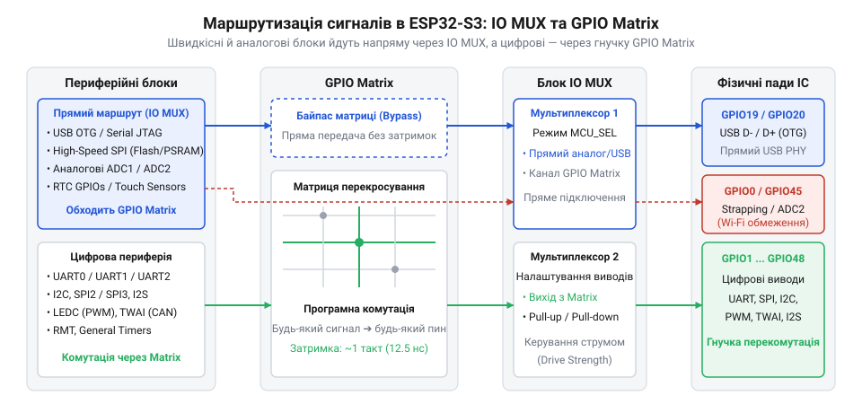
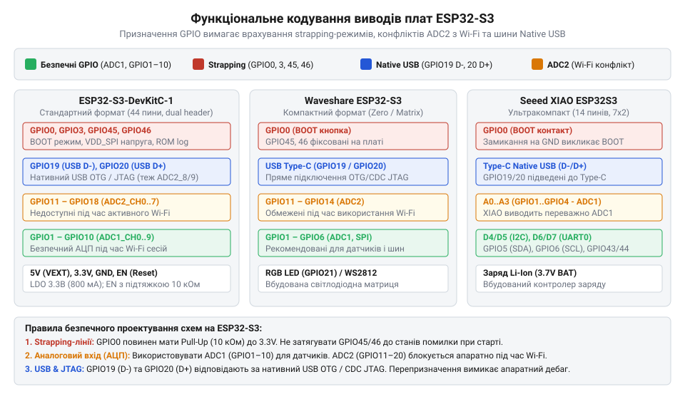
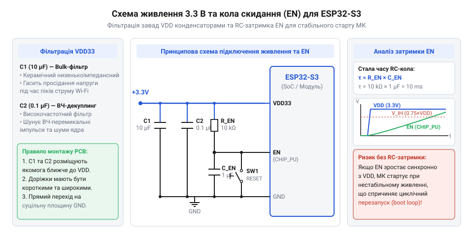

# Апаратний інтерфейс, розпіновка, strapping-піни та схемотехніка плат і модулів ESP32-S3

<preknowlist>
- [Мікроконтролер ESP32-S3](root:cat-hw-boards/esp32s3-microcontroller) — знання загальної архітектури SoC ESP32-S3, базових можливостей периферії та апаратних характеристик ядра Xtensa LX7
- [Модулі ESP32-S3-WROOM-1 та WROOM-2](root:cat-hw-boards/esp32-s3-wroom-modules-family) — розуміння конструкції модулів WROOM, внутрішньої схемотехніки підключення Flash/PSRAM пам'яті та їхнього впливу на доступні GPIO
- [Компактні SiP-модулі ESP32-S3-MINI-1](root:cat-hw-boards/esp32-s3-mini-sip-modules) — особливості інтегрованого SiP-упакування та обмеження виводів живлення й периферії у мікромодулях
</preknowlist>

## Непередбачувані збої завантаження та живлення ESP32-S3

Апаратура зібрана, код написаний і зкомпільований, але під час подачі живлення розробник стикається з типовою апаратною проблемою: мікроконтролер @@en|ESP32-S3@@ потрапляє у безкінечний цикл перезавантажень (англ. @@en|bootloop@@, від @@en|boot@@ — завантаження та @@en|loop@@ — петля), світлодіоди на платі хаотично спалахують, а в послідовному порту з'являються повідомлення про апаратний збій. В інших випадках плата взагалі відмовляється завантажуватися доти, доки від неї не від'єднають зовнішній сенсор чи дисплейний модуль.

Подібна поведінка виникає через те, що виводи загального призначення (англ. @@en|General Purpose Input/Output@@, скорочено @@en|GPIO@@, від @@en|general@@ — загальний, @@en|purpose@@ — призначений, @@en|input@@ — вхід та @@en|output@@ — вихід) не є абсолютно однаковими цифровими контактами. Вивчаючи [архітектуру мікроконтролера ESP32-S3](root:cat-hw-boards/esp32s3-microcontroller), важливо враховувати, що кожен вивід кристала має жорстко визначені апаратні прив'язки та початкові стани при включенні.

Перша поширена причина збоїв полягає у використанні так званих @@en|strapping-виводів@@ (від англ. @@en|bootstrap@@ — самозавантаження), стан яких у момент подачі живлення чи скидання визначає режим роботи внутрішнього @@en|ROM-завантажувача@@. Якщо зовнішня схема чи сенсор підтягують такий вивід до землі або до лінії 3.3 В під час старту, чип замість запуску робочої прошивки переходить у режим завантаження через послідовний порт або встановлює невірну напругу живлення внутрішньої флеш-пам'яті.

Друга причина — пікові струми споживання при ввімкненні бездротового трансивера @@en|Wi-Fi@@. У момент калібрування високочастотного тракту споживання струму мікроконтролером зростає до 450–500 мА за лічені мікросекунди. Якщо джерело живлення або стабілізатор напруги не здатні компенсувати цей імпульс, напруга живлення 3.3 В просідає нижче межі спрацьовування схеми виявлення зниження напруги (англ. @@en|Brownout Detector@@, від @@en|brownout@@ — просідання напруги), що викликає негайний апаратний перезапуск ядра. Без розуміння внутрішнього мультиплексування сигналів та схемотехніки живлення усунути такі апаратні конфлікти неможливо.

## Архітектура мультиплексування IO MUX та GPIO Matrix

Щоб безпечно призначати виводи периферії та уникати конфліктів, необхідно розуміти внутрішню двостадійну систему комутації цифрових сигналів ESP32-S3, яка складається з первинного мультиплексора @@en|IO MUX@@ (англ. @@en|Input/Output Multiplexer@@, від @@en|multiplex@@ — мультиплексувати) та гнучкої матриці сигналів @@en|GPIO Matrix@@.


*На схемі показано структурну комутацію між периферійними блоками, матрицею GPIO Matrix та блоком IO MUX до фізичних падів мікроконтролера.*

Блок @@en|IO MUX@@ забезпечує прямий зв'язок між фізичним контактом кристала та конкретним внутрішнім периферійним модулем. Пряме підключення через @@en|IO MUX@@ забезпечує найменшу апаратну затримку (англ. @@en|latency@@) та підтримує максимальну тактову частоту сигналів — до 80 МГц. Це критично важливо для швидкісних шин обміну даними з зовнішньою пам'яттю @@en|Flash@@ та @@en|PSRAM@@ (інтерфейси @@en|SPI0/SPI1@@), а також для швидкісних паралельних дисплейних панелей, шин @@en|SPI2/SPI3@@ або @@en|I2S@@.

У свою чергу, матриця @@en|GPIO Matrix@@ працює як цифровий комутатор, який дозволяє перенаправити майже будь-який внутрішній цифровий сигнал (@@en|UART@@, @@en|I2C@@, @@en|PWM@@, @@en|SPI@@) на будь-який із вільних виводів від @@en|GPIO0@@ до @@en|GPIO48@@. Це значно спрощує трасування друкованих плат, оскільки розробник не прив'язаний до фіксованої розпіновки. Проте проходження сигналу через @@en|GPIO Matrix@@ додає затримку в 1–2 тактові імпульси системного генератора та обмежує граничну частоту передачі (зазвичай до 40 МГц).

:::tabs
```c|esp-idf
// Конфігурація швидкісної шини SPI2 через прямі лінії IO MUX в ESP-IDF
spi_bus_config_t buscfg = {
    .mosi_io_num = 11, // Прямий вивід IO MUX для SPI2 MOSI
    .miso_io_num = 13, // Прямий вивід IO MUX для SPI2 MISO
    .sclk_io_num = 12, // Прямий вивід IO MUX для SPI2 CLK
    .quadwp_io_num = -1,
    .quadhd_io_num = -1,
    .max_transfer_sz = 4092
};
spi_bus_initialize(SPI2_HOST, &buscfg, SPI_DMA_CH_AUTO);
```
```cpp|arduino
// Конфігурація шини SPI з довільним перепризначенням виводів через GPIO Matrix в Arduino ESP32
#include <SPI.h>

#define VSPI_MISO 2
#define VSPI_MOSI 3
#define VSPI_SCLK 4
#define VSPI_SS   5

SPIClass SPI2(FSPI);

void setup() {
  // Перенаправлення ліній SPI2 на будь-які доступні виводи GPIO
  SPI2.begin(VSPI_SCLK, VSPI_MISO, VSPI_MOSI, VSPI_SS);
}
```
:::

Усі високонавантажені швидкісні інтерфейси слід трасувати через прямі виводи @@en|IO MUX@@, тоді як повільні серійні шини (наприклад, @@en|I2C@@ або @@en|UART@@) доцільно перенаправляти через @@en|GPIO Matrix@@.

## Специфіка strapping-виводів, каналів ADC2 та USB

Особливе місце в архітектурі ESP32-S3 посідають виводи зі спеціальними апаратними обмеженнями, нехтування якими призводить до відмови систем у реальних умовах.

Під час подачі живлення або при появі позитивного фронту на лінії скидання @@en|EN@@ (англ. @@en|Enable@@ — увімкнення), внутрішній завантажувач @@en|ROM@@ зчитує логічний стан ключових ліній. Ці виводи називаються @@en|strapping-виводами@@ (від англ. @@en|strap@@ — фіксувати, ремінь). В ESP32-S3 основними strapping-лініями є @@en|GPIO0@@, @@en|GPIO3@@, @@en|GPIO45@@ та @@en|GPIO46@@:

- @@en|GPIO0@@: визначає режим завантаження кристала. Якщо під час скидання на @@en|GPIO0@@ присутній низький рівень (0 В), мікроконтролер переходить у режим завантаження прошивки через послідовний порт (англ. @@en|Joint Download Boot@@). Якщо підтяжка висока (3.3 В), відбувається нормальний старт із флеш-пам'яті (англ. @@en|SPI Flash Boot@@).
- @@en|GPIO45@@: регулює напругу живлення флеш-пам'яті та @@en|PSRAM@@ (лінія @@en|VDD_SPI@@). Логічна одиниця на @@en|GPIO45@@ під час скидання змушує внутрішній регулятор подавати 1.8 В, тоді як логічний нуль встановлює напругу 3.3 В. Невірна зовнішня підтяжка на цій лінії під час використання 3.3V-пам'яті викликає помилку зчитання коду (`flash read err`).
- @@en|GPIO46@@: у комбінації з @@en|GPIO0@@ визначає вивід друку діагностичних повідомлень завантажувача (англ. @@en|ROM log@@) та джерело завантажувального коду.

Інша апаратна особливість стосується аналогово-цифрових перетворювачів (англ. @@en|Analog-to-Digital Converter@@, скорочено @@en|ADC@@). Аналогові канали розділені на дві групи: @@en|ADC1@@ (виводи @@en|GPIO1@@..@@en|GPIO10@@) та @@en|ADC2@@ (виводи @@en|GPIO11@@..@@en|GPIO20@@). Блок @@en|ADC2@@ апаратно з'єднаний із контролером радіочастотного тракту @@en|Wi-Fi@@ та @@en|Bluetooth@@. Коли бездротовий модуль активний і передає дані, арбітр ресурсів блокує доступ ядра до @@en|ADC2@@. Будь-які спроби зчитати аналоговий сигнал з виводів @@en|ADC2@@ під час Wi-Fi-сесії повертають помилку або спотворені дані. Для аналогових сенсорів слід застосовувати виключно канали @@en|ADC1@@.

Мікроконтролер ESP32-S3 також має нативний (англ. @@en|native@@, від латинського @@la|nativus@@ — уроджений, природний) модуль @@en|Native USB OTG@@ (англ. @@en|On-The-Go@@) на виводах @@en|GPIO19@@ (сигнал @@en|D-@@) та @@en|GPIO20@@ (сигнал @@en|D+@@), а також вбудований контролер @@en|USB Serial/JTAG@@. Вони дозволяють прошивати чип та налагоджувати код без зовнішніх мікросхем-конвертерів. Проте підключення зовнішніх підтягувальних резисторів чи важкого навантаження до виводів @@en|GPIO19/20@@ руйнує цілісність диференціальної пари @@en|USB@@ і блокує зв'язок із комп'ютером.

## Порівняльна розпіновка плат DevKitC-1, Waveshare і XIAO

Різні виробники плат розводять периферійні виводи мікроконтролера з урахуванням призначення та форм-фактора пристрою.


*На діаграмі зображено порівняльну розпіновку плат DevKitC-1, Waveshare та XIAO з кольоровим кодуванням функцій виводів.*

На платах еталонного дизайну **Espressif ESP32-S3-DevKitC-1** розведено дві 22-контактні гребінки. Більшість виводів мікроконтролера доступні для користувача. Проте на платах із [модулями ESP32-S3-WROOM-1 та WROOM-2](root:cat-hw-boards/esp32-s3-wroom-modules-family), оснащених 8-бітною пам'яттю @@en|Octal SPI Flash/PSRAM@@ (конфігурації типу N16R8), виводи @@en|GPIO33..GPIO37@@ та @@en|GPIO12..GPIO14@@ задіяні для високошвидкісної шини пам'яті. Використання цих виводів у зовнішніх схемах призводить до миттєвого завісання системи. Вбудований адресований світлодіод @@en|RGB LED@@ (чип @@en|WS2812B@@) на платі DevKitC-1 зазвичай підключений до виводу @@en|GPIO38@@. Докладніше про апаратне підключення пам'яті та обмеження щодо виводів GPIO читайте у матеріалі про [схемотехніку та розпіновку шин Octal SPI Flash та PSRAM в ESP32-S3](root:cat-hw-boards/esp32-s3-octal-spi-bus-layout).

Плати виробництва Waveshare — такі як [формату Waveshare ESP32-S3-Pico](root:cat-hw-boards/esp32-s3-pico) або компактні [плати ESP32-S3-Zero](root:cat-hw-boards/esp32-s3-zero) — орієнтовані на мініатюрні пристрої та щільний монтаж. Виробники часто застосовують [компактні SiP-модулі ESP32-S3-MINI-1](root:cat-hw-boards/esp32-s3-mini-sip-modules), де частина виводів перерозподілена всередині корпусу. Наприклад, у спеціалізованій [дисплейній платі Touch LCD 1.28](root:cat-hw-boards/waveshare-esp32-s3-touch-lcd-1-28) виводи @@en|GPIO1..GPIO12@@ жорстко задіяні для шини контролера дисплея та сенсорного екрана, що вимагає уважного вивчення документації перед підключенням додаткової периферії.

Ультракомпактна плата **Seeed Studio XIAO ESP32S3** має всього 14 контактних майданчиків (11 доступних ліній @@en|GPIO@@). Виводи @@en|GPIO1..GPIO4@@ призначені для аналогових входів @@en|ADC1@@, лінії @@en|GPIO5@@ та @@en|GPIO6@@ відведені під апаратну шину @@en|I2C@@ (сигнали @@en|SCL@@ та @@en|SDA@@), а @@en|GPIO43/GPIO44@@ — під @@en|UART0@@. При розробці пристроїв на XIAO слід суворо контролювати призначення виводів і не використовувати вивід @@en|GPIO0@@ (з'єднаний із кнопкою @@en|BOOT@@) для активних вихідних сигналів. Схожі обмеження має й конструкція [компактного модуля SuperMini](root:cat-hw-boards/esp32-s3-supermini), детально описана в [огляді плат Zero та SuperMini](root:cat-hw-boards/esp32-s3-zero-supermini-boards).

## Схемотехніка живлення, фільтрації та підтягувальних кіл

Для забезпечення довговічної та стабільної роботи систем на базі ESP32-S3 необхідно дотримуватися суворих правил проектування кіл живлення та узгодження сигнальних ліній.

Живлення ядра та периферії мікроконтролера здійснюється напругою 3.3 В з відхиленням не більше ±10%.

- **Лінійні стабілізатори (LDO)**: При використанні лінійного стабілізатора (англ. @@en|Low Dropout Regulator@@, скорочено @@en|LDO@@, від @@en|low@@ — низький, @@en|dropout@@ — перепад напруги) необхідно вибирати мікросхеми з номінальним вихідним струмом не менше 500 мА (наприклад, @@en|AP2112K-3.3@@ або @@en|ME6211@@). Популярні стабілізатори @@en|AMS1117-3.3V@@ мають занадто великий мінімальний перепад напруги (до 1.1 В) і при живленні від @@en|USB@@ (4.75–5.25 В) можуть перегріватися й виходити з ладу під час пікових навантажень @@en|Wi-Fi@@.
- **Імпульсні DC-DC перетворювачі**: У портативних пристроях із акумуляторним живленням слід застосовувати понижувальні імпульсні перетворювачі (англ. @@en|Buck Converter@@, @@en|DC-DC@@). Вони забезпечують високий ККД (понад 90%) та мінімальне тепловиділення під час сплесків споживання.

Критично важливим елементом є фільтрація живлення. Безпосередньо біля виводів живлення модуля (контакти @@en|VDD33@@) необхідно паралельно встановлювати два конденсатори: керамічний конденсатор ємністю 0.1 мкФ (100 нФ) для придушення високочастотних перехідних процесів та накопичувальний керамічний або танталовий конденсатор ємністю 10..22 мкФ з низьким еквівалентним послідовним опором (англ. @@en|Equivalent Series Resistance@@, скорочено @@en|ESR@@) для компенсації імпульсних просідань.

Для надійного старту мікроконтролера вивід скидання @@en|EN@@ підтягують до шини 3.3 В через резистор 10 кОм і з'єднують із землею через конденсатор ємністю 1 мкФ. Цей @@en|RC-ланцюг@@ створює затримку наростання напруги на виводі @@en|EN@@ тривалістю понад 50 мкс після стабілізації шини 3.3 В, що повністю виключає зависання завантажувача.


*Принципова схема кола живлення 3.3 В та скидання ілюструє розміщення блокувальних конденсаторів біля виводів VDD33 і параметри RC-ланцюга, що забезпечує необхідну затримку сигналу EN при ввімкненні.*

Зовнішні підтягувальні резистори (англ. @@en|pull-up@@) для шини @@en|I2C@@ повинні мати опір 2.2–4.7 кОм. Внутрішні підтяжки ESP32-S3 є надто слабкими (близько 45 кОм) і не забезпечують необхідної швидкості наростання фронтів цифрових сигналів.

## Покрокова діагностика та усунення апаратних конфліктів

Якщо пристрій на базі ESP32-S3 демонструє нестабільну роботу або потрапляє в цикл перезавантажень, усунення несправностей здійснюють за чітким алгоритмом.

1. **Контроль логів ROM-завантажувача**: Підключіть апаратний порт @@en|UART0@@ (виводи @@en|GPIO43/TXD0@@ та @@en|GPIO44/RXD0@@) до конвертера послідовного інтерфейсу та відкрийте термінал на швидкості 115200 бод. Під час скидання завантажувач виводить статус завантаження: `rst:0x1 (POWERON),boot:0x13 (SPI_FAST_FLASH_BOOT)`. Якщо у логу вказано `boot:0x3 (DOWNLOAD_BOOT)`, це означає, що вивід @@en|GPIO0@@ примусово заземлений зовнішньою схемою.
2. **Осцилографічний вимірювання шини 3.3 В**: Підключіть осцилограф до лінії 3.3 В у режимі поодинокого запуску (англ. @@en|Single Trigger@@) та ініціюйте передачу даних через @@en|Wi-Fi@@. Якщо в момент включення передавача напруга просідає нижче 2.8 В, необхідно збільшити ємність накопичувального конденсатора або замінити стабілізатор живлення.
3. **Аналіз аналогових завад**: Якщо вимірювання з аналогових датчиків виявляють високий рівень шумів, перевірте, чи не підключено сенсор до каналів @@en|ADC2@@. Перенесення сигналу на входи @@en|ADC1@@ (наприклад, @@en|GPIO1..GPIO4@@) відновлює точність зчитування.
4. **Перевірка ліній USB**: У разі втрати зв'язку з комп'ютером через виводи @@en|GPIO19/GPIO20@@ перевірте відсутність зовнішніх підтяжок та паразитної ємності на лініях диференціальної пари.

У складаних проєктах, таких як [спеціалізовані плати ESP32-CAM](root:cat-hw-boards/esp32-cam-camera-module-family), або при порівнянні з альтернативами, як-от [потужний мікроконтролер ESP32-P4](root:cat-hw-boards/esp32-p4-microcontroller), дотримання цих діагностичних кроків дозволяє швидко локалізувати й усунути будь-які апаратні проблеми.
