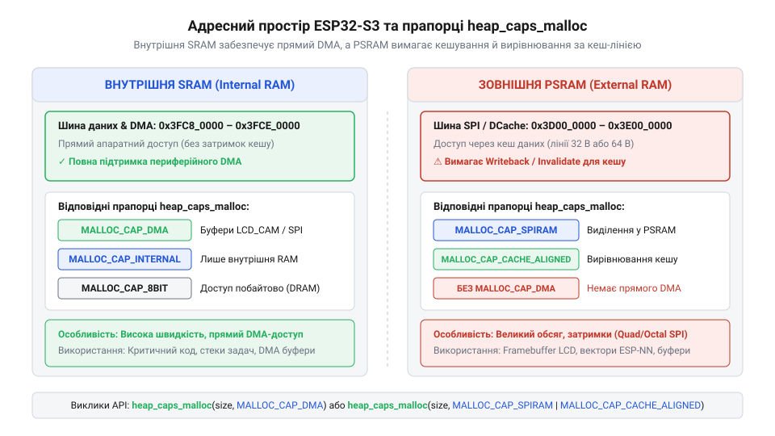
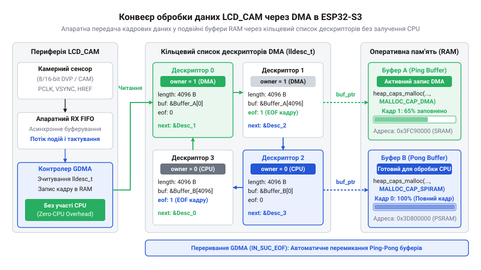

# Програмний інтерфейс налаштування фреймворку ESP-IDF для систем на ESP32-S3

<preknowlist>
- [Мікроконтролер ESP32-S3](root:cat-hw-boards/esp32s3-microcontroller) — Загальна апаратна архітектура чипа ESP32-S3, розміщення внутрішньої та зовнішньої пам'яті, структура векторного розширення PIE та відмінності між шинами Quad SPI та Octal SPI.
- [Waveshare ESP32-S3R2 (16 МБ Flash, 2 МБ PSRAM)](root:cat-hw-boards/esp32-s3r2-waveshare) — Специфіка комбінації обсягів Flash та впаяної Octal/Quad PSRAM на реальних платах розробки для правильного вибору конфігураційного профілю.
</preknowlist>

## Проблеми дефолтної конфігурації прошивки ESP32-S3

Спроба запустити прошивку на сучасній платі розробки з дефолтним файлом конфігурації фреймворку @@en|ESP-IDF@@ (англ. *Espressif IoT Development Framework* — фреймворк розробки для інтернету речей від компанії Espressif) часто призводить до фатальних помилок ще на етапі початкового завантаження. Стандартний файл @@en|sdkconfig@@ (англ. *software development kit configuration* — налаштування комплекту розробки програмного забезпечення), який генерується автоматично за допомогою системи @@en|Kconfig@@ (англ. *kernel configuration* — система конфігурування ядра та компонентів), орієнтований на найпростіші базові апаратні моделі. Для просунутого [чипа серії ESP32-S3](root:cat-hw-boards/esp32s3-microcontroller) це створює критичний розрив між вимогами реального заліза та програмними налаштуваннями.

Головна проблема полягає у виборі режимів шини пам'яті. Стандартна конфігурація передбачає роботу з повільною зовнішньою пам'яттю @@en|Flash@@ (англ. *flash memory* — енергонезалежна напівпровідникова пам'ять) за протоколом @@en|Quad SPI@@ (латин. *quattuor* — чотири, англ. *Serial Peripheral Interface* — послідовний периферійний інтерфейс із чотирма лініями даних) на тактовій частоті 40 МГц у режимі одинарної швидкості @@en|SDR@@ (англ. *Single Data Rate* — одинарна швидкість передачі даних за такт). Утім, на реальних пристроях, як-от [плата Waveshare ESP32-S3R2](root:cat-hw-boards/esp32-s3r2-waveshare), встановлено високошвидкісні мікросхеми розширеної пам'яті @@en|PSRAM@@ (англ. *Pseudo Static Random Access Memory* — псевдостатична оперативна пам'ять) із вісімковим інтерфейсом @@en|Octal SPI@@ (латин. *octo* — вісім) та подвійною передачею даних @@en|DDR@@ (англ. *Double Data Rate* — подвійна швидкість передачі даних за такт) на частоті 80 або 120 МГц. Якщо прошивка намагається звертатися до вісімкової шини через чотириканальний контролер, контролер пам'яті не збігається по таймінгах, і процесор впадає в нескінченне циклування перезавантажень із панікою ядра `Core 0 panic'ed (Cache disabled but cached memory region accessed)`.

Другим вузьким місцем дефолтного середовища є маршрутизація діагностичних повідомлень. За замовчуванням виведення системних логів спрямовується на апаратний трансивер @@en|UART0@@. Якщо плата розведена під прямо з'єднаний нативний інтерфейс @@en|USB Serial/JTAG@@, розробник втрачає доступ до логів паніки ядра та трасування помилок. Пристрій візуально виглядає завислим, хоча насправді він функціонує, а виведення спрямоване у відсутній фізичний порт.

Третій фактор — пропускна здатність динамічної пам'яті купи. За замовчуванням виділення пам'яті через стандартний виклик `malloc` виконується виключно із внутрішньої оперативної пам'яті @@en|SRAM@@. Обсяг внутрішнього статичного ОЗП становить лише 512 КБ, і значна його частина зайнята системними таблицями ядра та кешем. Без явного ввімкнення підтримки @@en|PSRAM@@ у @@en|sdkconfig@@ прошивка відмовляється задіювати додаткові 2–8 МБ зовнішньої пам'яті, що унеможливлює розміщення буферів кадрів для камери чи масивів нейромережевих ваг.

Усунення цих проблем вимагає від розробника глибокого розуміння архітектури @@en|ESP32-S3@@ та ручного коригування параметрів фреймворку @@en|ESP-IDF@@ для повного узгодження коду з апаратними можливостями конкретного чипа.

## Конфігурація шин пам'яті Flash та PSRAM

Контролер зовнішньої пам'яті мікроконтролера @@en|ESP32-S3@@ оперує двома незалежними або суміщеними шинами для мікросхем @@en|Flash@@ та @@en|PSRAM@@. Фізична обробка сигналів виконується периферійними блоками @@en|SPI1@@ та @@en|SPI2@@, які підтримують протоколи @@en|Quad SPI@@ (чотири лінії даних @@en|IO0@@–@@en|IO3@@) та @@en|Octal SPI@@ (вісім ліній даних @@en|IO0@@–@@en|IO7@@). Вибір відповідного режиму вимагає точного встановлення параметрів у файлі конфігурації @@en|sdkconfig@@.

Для вибору режиму роботи зовнішньої оперативно-статичної пам'яті @@en|PSRAM@@ у меню @@en|Kconfig@@ використовуються прапорці конфігурації. Увімкнення самої підтримки зовнішньої купи виконується параметрами `CONFIG_SPIRAM=y` та `CONFIG_SPIRAM_TYPE_AUTO=y`. Вибір ширини шини здійснюється між режимами `CONFIG_SPIRAM_MODE_QUAD=y` та `CONFIG_SPIRAM_MODE_OCT=y`. На відміну від чотириканального режиму, вісімковий шинний інтерфейс вимагає використання додаткових сигналів тактування та підтвердження готовності даних @@en|DQS@@ (англ. *Data Strobe Signal* — сигнал стробування даних).

Забезпечення максимальної швидкості обміну досягається переведенням шини з режиму одинарної швидкості @@en|SDR@@ у режим подвійної швидкості @@en|DDR@@. У режимі @@en|SDR@@ зчитування даних відбувається лише за наростаючим фронтом тактового імпульсу, а в режимі @@en|DDR@@ — за наростаючим і спадним фронтами. При частоті тактування 80 МГц режим @@en|Octal SPI DDR@@ забезпечує пікову пропускну здатність шини до 160 МБ/с.

Конфігурування часових затримок та фазування шини вимагає налаштування параметрів @@en|sdkconfig@@:

```ini
CONFIG_ESP32S3_SPIRAM_SUPPORT=y
CONFIG_SPIRAM_MODE_OCT=y
CONFIG_SPIRAM_SPEED_80M=y
CONFIG_SPIRAM_FETCH_INSTRUCTIONS=y
CONFIG_SPIRAM_RODATA=y
CONFIG_ESPTOOLPY_FLASHMODE_OPI=y
CONFIG_ESPTOOLPY_FLASHFREQ_80M=y
```

Ввімкнення `CONFIG_SPIRAM_FETCH_INSTRUCTIONS=y` та `CONFIG_SPIRAM_RODATA=y` дозволяє модулю виділення пам'яті мапити виконання коду прошивки та константні дані безпосередньо у простір @@en|PSRAM@@ через апаратний кеш. Це звільняє критично важливу внутрішню пам'ять @@en|SRAM@@ під потреби системи.

Програмна перевірка успішності ініціалізації зовнішньої пам'яті в коді виконується через спеціалізований інтерфейс API фреймворку @@en|ESP-IDF@@:

:::tabs
@tab C (ESP-IDF)
```c|esp-idf
#include <stdio.h>
#include "esp_psram.h"
#include "esp_log.h"

static const char *TAG = "PSRAM_INIT";

void check_psram_configuration(void) {
    if (esp_psram_is_initialized()) {
        size_t psram_size = esp_psram_get_size();
        ESP_LOGI(TAG, "Успішно ініціалізовано зовнішню PSRAM. Обсяг: %zu байт", psram_size);
    } else {
        ESP_LOGE(TAG, "Помилка ініціалізації PSRAM! Перевірте налаштування sdkconfig.");
    }
}
```
@tab C++ (ESP-IDF)
:::code api-esp32-s3-esp-idf-config/cpp/esp-idf/memorychecker.cpp
:::

Якщо налаштування фазування та тактової частоти в @@en|sdkconfig@@ не відповідають фізичним кристалам на платі, контролер блоків пам'яті генерує помилки вирівнювання тактових шин, що зупиняє завантажувач прошивки ще до виклику функції `app_main`.

## Розподіл оперативної пам'яті через heap_caps_malloc

Адресний простір мікроконтролера @@en|ESP32-S3@@ має чіткий розподіл між швидкою внутрішньою оперативною пам'яттю @@en|SRAM@@ та об'ємною зовнішньою пам'яттю @@en|PSRAM@@. Внутрішня пам'ять поділена на блоки @@en|IRAM@@ (англ. *Instruction RAM* — оперативна пам'ять для шини інструкцій) та @@en|DRAM@@ (англ. *Data RAM* — оперативна пам'ять для шини даних). Зовнішня пам'ять мапиться в адресний простір через блок керування пам'яттю @@en|MMU@@ (англ. *Memory Management Unit* — вузол керування пам'яттю) та проходить через чотириканальний кеш першого рівня @@en|L1 Cache@@.


*Структура адресного простору мікроконтролера ESP32-S3 із розділенням фізичних областей пам'яті та прив'язкою прапорців виділення купи.*

Для керування виділенням динамічної пам'яті у фреймворку @@en|ESP-IDF@@ використовується функція `heap_caps_malloc` (англ. *heap capabilities memory allocation* — виділення динамічної пам'яті купи з урахуванням властивостей). На відміну від стандартної функції `malloc`, вона приймає бітову маску прапорців capabilities, які визначають фізичний тип пам'яті, швидкодію та апаратні обмеження доступу.

Основні прапорці виділення пам'яті включають:
- `MALLOC_CAP_INTERNAL` — виділення блоку виключно із внутрішньої @@en|SRAM@@. Пам'ять працює на повній частоті ядра процесора без затримок кешування.
- `MALLOC_CAP_SPIRAM` — розміщення буфера у зовнішній мікросхемі @@en|PSRAM@@. Забезпечує великі обсяги, але має більшу латентність доступу через шину @@en|SPI@@.
- `MALLOC_CAP_DMA` — виділення пам'яті, яка має фізичні лінії адресації, сумісні з периферійним контролером прямого доступу до пам'яті @@en|DMA@@ (англ. *Direct Memory Access* — прямий доступ до пам'яті).
- `MALLOC_CAP_8BIT` — вимоги до підтримки побайтового та 16-бітного читання/запису.

Критичним фактором при роботі із зовнішньою пам'яттю @@en|PSRAM@@ є вирівнювання за розміром кеш-лінії. Розмір кеш-лінії @@en|L1 Cache@@ в @@en|ESP32-S3@@ становить 16, 32 або 64 байти залежно від конфігурації. Якщо виділений буфер не вирівняний по межі кеш-лінії, паралельні операції запису процесора та периферійних модулів спричиняють колізію кешу (англ. *cache line eviction collision* — конфлікт витіснення рядка кешу), що призводить до спотворення даних.

Для гарантованого вирівнювання застосовується виклик `heap_caps_aligned_alloc`:

:::tabs
@tab C (ESP-IDF)
:::code api-esp32-s3-esp-idf-config/c/esp-idf/allocate-memory-example.c
@tab C++ (ESP-IDF)
:::code api-esp32-s3-esp-idf-config/cpp/esp-idf/memorymanager.cpp
:::

Використання правильних прапорців запобігає вичерпанню внутрішньої @@en|SRAM@@ та гарантує стабільну роботу високошвидкісних периферійних інтерфейсів.

## Конфігурування буферів LCD_CAM та транзакцій DMA

Спеціалізований апаратний модуль @@en|LCD_CAM@@ (англ. *Liquid Crystal Display / Camera Interface* — апаратний інтерфейс рідкокристалічних дисплеїв та відеокамер) у чипі @@en|ESP32-S3@@ розроблений для високошвидкісного паралельного зчитування даних із відеодатчиків (інтерфейс @@en|DVP@@) та виведення зображень на паралельні дисплеї. У порівнянні з класичним [модулем камери ESP32-CAM](root:cat-hw-boards/esp32-cam), новий периферійний вузол оперує в зв'язці з генеральним контролером прямого доступу до пам'яті @@en|GDMA@@ (англ. *General Direct Memory Access* — загальний контролер прямого доступу до пам'яті), що повністю звільняє процесор від участі в побайтовому пересиланні пікселів.


*Конвеєр передачі відеопотоку від периферійного модуля LCD_CAM у оперативну пам'ять за допомогою кільцевих дескрипторів DMA.*

Транзакції @@en|DMA@@ побудовані на використанні зв'язаних списків дескрипторів. Кожен дескриптор структури `dma_descriptor_t` описує окремий блок пам'яті в ОЗП, вказуючи його фізичну адресу, розмір, кількість фактично переданих байтів та вказівник на наступний дескриптор у кільці. Максимальний розмір даних, які один дескриптор може адресувати за одну транзакцію, обмежений 4095 байтами. Тому для передачі одного кадру зображення (наприклад, кадру @@en|QVGA@@ розміром 320×240 пікселів у форматі @@en|RGB565@@ — 153 600 байтів) формується кільцевий список із 38 дескрипторів.

Для відсутності затримок та пропусків кадрів у відеопотоці (англ. *frame dropping* — пропуск кадрів через переповнення буфера) реалізується техніка подвійного буферування (англ. *double buffering* — технологія почергового використання двох буферів пам'яті). Поки апаратний контролер @@en|GDMA@@ заповнює перший буфер `Buffer A`, процесор або векторний прискорювач обробляє раніше отриманий кадр у другому буфері `Buffer B`.

Приклад конфігурації передачі даних через API @@en|esp_lcd@@ / @@en|cam_ctlr@@:

:::tabs
@tab C (ESP-IDF)
:::code api-esp32-s3-esp-idf-config/c/esp-idf/init-dma-framebuffers.c
@tab C++ (ESP-IDF)
:::code api-esp32-s3-esp-idf-config/cpp/esp-idf/framebuffermanager.cpp
:::

Вибір розміру буферів та їх правильне вирівнювання за межею 64 байтів запобігає виниканню помилок шини @@en|GDMA@@ та забезпечує максимальну пропускну здатність при роботі з графікою.

## Апаратне прискорення обчислень PIE та ESP-NN

Мікроконтролер @@en|ESP32-S3@@ оснащений двома 32-бітними ядрами @@en|Xtensa LX7@@, які містять розширення векторних інструкцій @@en|PIE@@ (англ. *Processor Instruction Extensions* — векторне розширення команд процесора). Цей апаратний прискорювач оперує 128-бітними векторними регістрами та дозволяє виконувати паралельні математичні операції над векторами за принципом @@en|SIMD@@ (англ. *Single Instruction, Multiple Data* — одна інструкція, множинні дані). ESP32-S3@@ оснащений двома | Детальний низькорівневий опис системи інструкцій, регістрової моделі та арифметико-логічних блоків співпроцесора висвітлює [архітектура векторного розширення PIE у мікроконтролерах ESP32-S3](root:hw-arch/esp32s3-pie-architecture).

Розширення @@en|PIE@@ забезпечує виконання до восьми 16-бітних або шістнадцяти 8-бітних операцій множення із накопиченням @@en|MAC@@ (англ. *Multiply-Accumulate* — множення з накопиченням) за один такт процесора. Для максимального спрощення задіяння векторних команд компанія Espressif розробила оптимізовану бібліотеку @@en|ESP-NN@@ (англ. *Espressif Neural Network* — бібліотека нейромережевих обчислень Espressif).

Бібліотека @@en|ESP-NN@@ надає готові функції для цифрової обробки сигналів та прискорення викликів операторів глибокого навчання:
- Згортка 2D (англ. *2D Convolution*) для квантованих даних у форматі 8-бітних цілих чисел `int8`.
- Поглиблено-роздільна згортка (англ. *Depthwise Separable Convolution*).
- Векторне додавання, активації @@en|ReLU@@ та квантоване масштабування.

Приклад виклику оптимізованого векторного додавання масивів за допомогою API @@en|ESP-NN@@:

:::tabs
@tab C (ESP-IDF)
:::code api-esp32-s3-esp-idf-config/c/esp-idf/run-vector-acceleration-example.c
@tab C++ (ESP-IDF)
:::code api-esp32-s3-esp-idf-config/cpp/esp-idf/vectoraccelerator.cpp
:::

Використання векторних інструкцій @@en|PIE@@ через виклики бібліотеки @@en|ESP-NN@@ прискорює виконання математичних обчислень у 4–5 разів у порівнянні зі стандартними скалярними циклами мови C.

## Налаштування нативного контролера USB Serial/JTAG

Чип @@en|ESP32-S3@@ містить апаратний периферійний модуль @@en|USB Serial/JTAG@@ (англ. *Universal Serial Bus / Joint Test Action Group* — універсальна послідовна шина та інтерфейс апаратного відлагодження). Цей блок підключається безпосередньо до виводів мікроконтролера @@en|GPIO19@@ (сигнал @@en|USB D-@@) та @@en|GPIO20@@ (сигнал @@en|USB D+@@). Він інтегрує два віртуальні пристрої: адаптер послідовного порту класу @@en|CDC@@ (англ. *Communications Device Class* — клас пристроїв зв'язку) для пересилання системних логів та контролер @@en|JTAG@@ для апаратного відлагодження через середовище @@en|OpenOCD@@.

Головна перевага модуля полягає у відсутності потреби у зовнішніх мікросхема-конвертерах (як-от CP2102 чи CH340). Однак для його коректного функціонування у файлі @@en|sdkconfig@@ необхідно переналаштувати консоль виведення:

```ini
CONFIG_ESP_CONSOLE_USB_SERIAL_JTAG=y
CONFIG_ESP_CONSOLE_SECONDARY_NONE=y
CONFIG_ESP_SYSTEM_PANIC_PRINT_REBOOT=y
```

Якщо в конфігурації увімкнено `CONFIG_ESP_CONSOLE_USB_SERIAL_JTAG=y`, фреймворк @@en|ESP-IDF@@ переспрямовує стандартні потоки `stdout` та `stderr` через нативний USB-драйвер.

Програмне виведення логів та обробка підключення контролера реалізується через стандартні функції перехоплення:

:::tabs
@tab C (ESP-IDF)
```c|esp-idf
#include <stdio.h>
#include "esp_vfs_dev_usb_serial_jtag.h"
#include "esp_log.h"
#include "driver/usb_serial_jtag.h"

static const char *TAG = "USB_DIAG";

void setup_usb_serial_jtag_logging(void) {
    // Ініціалізація VFS драйвера для USB Serial/JTAG
    esp_vfs_dev_usb_serial_jtag_register();

    ESP_LOGI(TAG, "Систему виведення логів перенаправлено на нативний USB Serial/JTAG.");
    ESP_LOGW(TAG, "Апаратне відлагодження JTAG активне на лініях GPIO19 (D-) та GPIO20 (D+).");
}
```
@tab C++ (ESP-IDF)
```cpp|esp-idf
#include <iostream>
#include "esp_vfs_dev_usb_serial_jtag.h"
#include "esp_log.h"

class USBConsoleManager {
private:
    static constexpr const char *TAG = "USB_DIAG";
public:
    static void init() {
        esp_vfs_dev_usb_serial_jtag_register();
        ESP_LOGI(TAG, "Систему виведення логів перенаправлено на нативний USB Serial/JTAG.");
        ESP_LOGW(TAG, "Апаратне відлагодження JTAG активне на лініях GPIO19 (D-) та GPIO20 (D+).");
    }
};
```
:::

Використання нативного контролера @@en|USB Serial/JTAG@@ забезпечує не лише зручне моніторення логів без додаткового обладнання, а й дозволяє встановлювати точки зупинки (англ. *breakpoints*) та аналізувати стан регістрів ядра безпосередньо в середовищі розробки.
