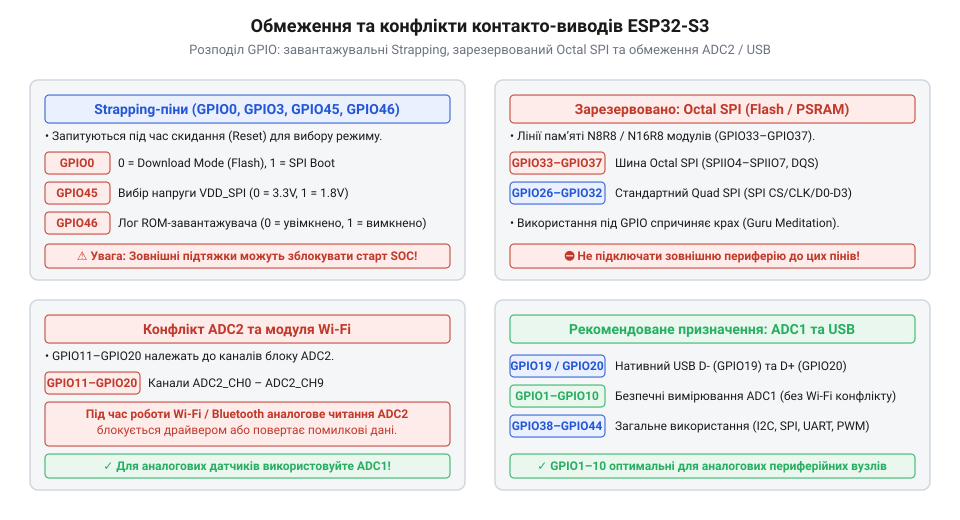
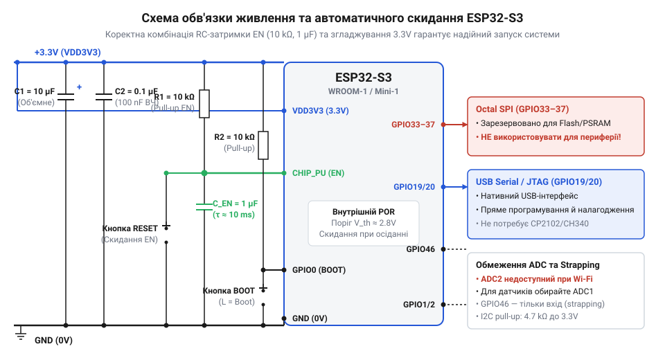

# Апаратна довідка розпіновки, електричних характеристик та топології плат ESP32-S3

<preknowlist>
- [Мікроконтролер ESP32-S3](root:cat-hw-boards/esp32s3-microcontroller) — архітектура ядра Xtensa LX7, системні шини та загальний склад периферійних блоків SoC ESP32-S3
- [Waveshare ESP32-S3R2 (16 МБ Flash, 2 МБ PSRAM)](root:cat-hw-boards/esp32-s3r2-waveshare) — конструктивні особливості плат із розширеною Octal PSRAM та топологія підключення внутрішньої пам'яті
- [ESP32-S3-Zero (Type-C, 4 МБ)](root:cat-hw-boards/esp32-s3-zero) — компактна топологія розпіновки та базові вимоги до підключення USB Type-C на платах ESP32-S3
</preknowlist>

## Апаратні конфлікти та помилки запуску

Несподіване перезавантаження мікроконтролера одразу після подачі живлення або під час виходу на робочий режим є однією з найпоширеніших проблем при розробці електронних пристроїв на базі чипів серії `@@en|ESP32-S3@@`. Пристрій потрапляє у безкінечний цикл перезапусків — `@@en|boot loop@@` (англ. *boot* — завантаження, *loop* — петля), не виконує завантажений код або зависає в невизначеному стані на етапі ініціалізації периферії. Для розробника це часто виглядає як помилка у програмному забезпеченні, проте справжня причина майже завжди лежить у площині схемотехніки та недотриманні електричних умов старту системи.

Головним джерелом апаратних блокувань є некоректне поводження з виводами загального призначення `@@en|General Purpose Input/Output@@` / `@@en|GPIO@@` (англ. *general purpose* — загального призначення, *input/output* — вхід/вихід) під час скидання `@@en|SoC@@` (від англ. `@@en|System on Chip@@`; грец. *system* — система, англ. *chip* — кристал). У момент подачі живлення або зняття сигналу скидання первинна завантажувальна програма `@@en|ROM Bootloader@@` виконує апаратне опитування логічних рівнів на групі службових контакто-виводів. Якщо зовнішнє коло чи підключений периферійний модуль утримує на такому виводі небажаний потенціал напруги, `@@en|ESP32-S3@@` інтерпретує це як команду змінити режим завантаження, переключити джерело виконання коду або виставити невірно напругу внутрішнього регулятора пам'яті. У результаті ядро намагається зчитати прошивку з неіснуючого інтерфейсу `@@en|UART@@` або отримує збій читання списку інструкцій.

Другою критичною причиною зависань і раптових скидань є нестабільність живлення під час пікових навантажень. Модулі бездротового зв'язку `@@en|Wi-Fi@@` у момент калібрування та активації вихідного каскаду передавача споживають короткі імпульсні струми амплітудою до пів ампера. Якщо джерело живлення має недостатню вихідну потужність або провідники друкованої плати володіють високим опором, напруга на шині 3.3 В миттєво просідає. Вбудована система контролю `@@en|Brown-out Reset@@` / `@@en|BOR@@` (англ. *brown-out* — просідання напруги, *reset* — скидання) фіксує це падіння і примусово скидає мікроконтролер, повертаючи його до початку циклу ініціалізації.

Третій клас апаратних конфліктів виникає при спробі використати для власної периферії ті контакто-виводи, які всередині корпусів розширених модулів вже підключені до кристалів високошвидкісної пам'яті `@@en|Flash@@` (англ. *flash* — спалах) або `@@en|PSRAM@@` (англ. *Pseudo Static Random Access Memory* — псевдостатична оперативна пам'ять). Спроба подати керуючий сигнал на такий контакто-вивід створює конфлікт шини, що призводить до пошкодження даних в пам'яті, аварійного зупинення ядра або фізичного перегріву вихідних каскадів. Також плаваючий стан вхідних виводів під час «гарячого» скидання може викликати непередбачувані аварійні зупинки процесора. Для коректного проєктування пристроїв на основі [архітектури мікроконтролера](root:cat-hw-boards/esp32s3-microcontroller) необхідно детально розібратися у внутрішній структурі живлення та специфіці виводів завантаження.

## Домени живлення та електричні обмеження

Надійна робота `@@en|ESP32-S3@@` спирається на розділення внутрішніх і зовнішніх кіл живлення, оскільки різні вузли кристала мають відмінні вимоги до напруги та струмового навантаження. Головною шиною живлення пристрою є домен `@@en|VDD3P3@@`, який забезпечує енергією процесорні ядра `@@en|Xtensa LX7@@`, периферійні блоки та цифрові буфери `@@en|GPIO@@`. Номінальне значення цієї напруги становить 3.3 В, а допустимий робочий діапазон знаходиться в межах від 3.0 В до 3.6 В. Проте під час бездротового обміну по мережі `@@en|Wi-Fi@@` та переключення тактової частоти ядра до 240 МГц струм споживання може короткочасно зростати до 500 мА. За відсутності належного згладжування це викликає просідання живлення та спрацьовування системи `@@en|BOR@@`.

Для живлення зовнішньої чи інтегрованої в корпус пам'яті всередині `@@en|SoC@@` передбачено окремий регулятор напруги з малим падінням `@@en|Low Dropout@@` / `@@en|LDO@@` (англ. *low dropout* — мале падіння напруги), який формує домен `@@en|VDD_SPI@@`. Цей домен може працювати на двох фіксованих рівнях: 3.3 В або 1.8 В. Вибір робочої напруги `@@en|VDD_SPI@@` здійснюється при старті мікроконтролера за допомогою конфігураційного виводу або через апаратні перемички `@@en|eFuse@@`. Помилка у конфігурації цього домену є руйнівною: подача 3.3 В на кристал пам'яті, розрахований на 1.8 В, призводить до його незворотного виходу з ладу, тоді як напруга 1.8 В для 3.3 В пам'яті викликає повну нездатність зчитати прошивку.

Електричні характеристики виводів `@@en|GPIO@@` вимагають суворого дотримання обмежень по струму та напрузі. Максимальний вихідний струм одного виводу в режимі джерела або споживача не повинен перевищувати 40 мА, а рекомендований робочий струм становить від 10 мА до 20 мА. Загальний сумарний струм, що протікає через усі виводи `@@en|GPIO@@` одночасно, обмежений значенням 120 мА. Слід обов'язково враховувати, що контакто-виводи `@@en|ESP32-S3@@` не мають захисту від напруги 5 В (англ. *not 5V tolerant*). Вхідна напруга на будь-якому `@@en|GPIO@@` не повинна перевищувати значення `V_DD + 0.3 В`, тобто максимум 3.6 В. Пряме підключення ліній з напругою 5 В від п'ятивольтових контролерів чи датчиків викликає пробій захисних діодів та руйнування напівпровідникового кристала.

Схема згладжування живлення повинна будуватися безпосередньо біля виводів живлення мікроконтролера. Обов'язковим є встановлення одного об'ємного керамічного або танталового конденсатора ємністю 10 мкФ та паралельного керамічного конденсатора 0.1 мкФ із низьким еквівалентним послідовним опором `@@en|Equivalent Series Resistance@@` / `@@en|ESR@@` (англ. *equivalent series resistance* — еквівалентний послідовний опір) біля кожної пари контакто-виводів `@@en|VDD3P3@@`. Також ефективне відведення тепла через контактний майданчик заземлення під кристалом запобігає локальному перегріву при тривалих пікових навантаженнях. На компактних прикладних платах, таких як [плати ESP32-S3-Zero](root:cat-hw-boards/esp32-s3-zero), така фільтрація є ключовою умовою стабільної роботи системного ядра.

## Strapping-виводи та шина Octal SPI

Для конфігурування режимів роботи при зведенні живлення в `@@en|ESP32-S3@@` застосовується група спеціалізованих контакто-виводів, які називаються `@@en|strapping-вивід@@` (англ. *strap* — обв'язувати, фіксувати). Внутрішня апаратна логіка зчитує логічні рівні на цих виводах під час наростання сигналу скидання і фіксує режим завантаження системи. Ключовими службовими виводами є `@@en|GPIO0@@`, `@@en|GPIO3@@`, `@@en|GPIO45@@` та `@@en|GPIO46@@`.

Вивід `@@en|GPIO0@@` відповідає за вибір джерела завантаження: якщо під час скидання на ньому утримується високий логічний рівень або він залишається плаваючим завдяки внутрішній підтяжці вгору `@@en|pull-up@@` (англ. *pull* — тягнути, *up* — вгору), мікроконтролер починає виконання коду з `@@en|Flash@@` пам'яті. Низький рівень на `@@en|GPIO0@@` переводить `@@en|SoC@@` у режим завантаження прошивки через послідовний порт `@@en|UART@@`. Вивід `@@en|GPIO45@@` керує вихідною напругою внутрішнього `@@en|LDO@@` для домену `@@en|VDD_SPI@@`: низький рівень виставляє 3.3 В, а високий — 1.8 В. Якщо зовнішнє коло випадково підтягне `@@en|GPIO45@@` до високого рівня при використанні 3.3 В `@@en|Flash@@`, кристал не зможе зчитати прошивку. Вивід `@@en|GPIO46@@` контролює вивід системних логів та у поєднанні з `@@en|GPIO0@@` захищає від хибного вибору режимів. Важливо пам'ятати, що `@@en|GPIO46@@` під час скидання працює виключно як вхід і має внутрішню підтяжку вниз `@@en|pull-down@@` (англ. *pull* — тягнути, *down* — вниз). Вивід `@@en|GPIO3@@` контролює джерело сигналів `@@en|Joint Test Action Group@@` / `@@en|JTAG@@` (англ. *joint test action group* — об'єднана група випробувальних дій) та режим друку системного логу з `@@en|ROM Bootloader@@`.

*Функціональна схема контакто-виводів ESP32-S3 з виділенням strapping-пінів завантаження та зарезервованих ліній Octal SPI Flash/PSRAM.*

Окрему увагу слід приділити контакто-виводам високошвидкісної шини пам'яті. На відміну від чотирибітної шини `@@en|Quad SPI@@` (лат. *quattuor* — чотири), у `@@en|ESP32-S3@@` реалізовано підтримку восьмибітної шини `@@en|Octal SPI@@` (лат. *octo* — вісім; англ. *Serial Peripheral Interface* — послідовний периферійний інтерфейс). При використанні високошвидкісної `@@en|Octal Flash@@` або `@@en|Octal PSRAM@@` виводи `@@en|GPIO33@@`, `@@en|GPIO34@@`, `@@en|GPIO35@@`, `@@en|GPIO36@@` та `@@en|GPIO37@@` жорстко задействовані під додаткові лінії даних `@@en|SPI_D4@@`–`@@en|SPI_D7@@` та строб тактування `@@en|DQS@@`.

У модулях із розширеною оперативною пам'яттю, таких як [Waveshare ESP32-S3R2](root:cat-hw-boards/esp32-s3r2-waveshare), ці виводи розводковані всередині корпусу і є категорично недоступними для підключення зовнішніх датчиків або кнопкових інтерфейсів. Оскільки лінія `@@en|DQS@@` на `@@en|GPIO37@@` забезпечує синфазне тактування в режимі подвійної швидкості передачі даних, будь-яка паразитна ємність або спроба подати зовнішній сигнал на `@@en|GPIO33@@`–`@@en|GPIO37@@` викликає збій тактування адресації пам'яті та миттєвий крах виконання коду.

## Обмеження ADC2 та апаратний USB

Робота з аналоговими сигналами в `@@en|ESP32-S3@@` має важливу апаратну особливість, зумовлену наявністю двох окремих модулів аналого-цифрового перетворення: `@@en|Analog-to-Digital Converter@@` / `@@en|ADC@@` (англ. *analog* — аналоговий, *digital* — цифровий). Перший блок `@@en|ADC1@@` обслуговує канали на виводах `@@en|GPIO1@@`–`@@en|GPIO10@@`, а другий блок `@@en|ADC2@@` охоплює виводи `@@en|GPIO11@@`–`@@en|GPIO20@@`.

Апаратний конфлікт виникає через те, що модуль `@@en|ADC2@@` фізично використовується вбудованим радіочастотним трактом `@@en|Wi-Fi@@` та `@@en|Bluetooth@@` для вимірювання потужності передавача та автоматичного регулювання підсилення `@@en|AGC@@`. Коли в програмі активовано бездротовий модуль, апаратний арбітр передає монопольний контроль над `@@en|ADC2@@` контролеру зв'язку. Усі програмні виклики до `@@en|ADC2@@` на виводах `@@en|GPIO11@@`–`@@en|GPIO20@@` під час активного зв'язку повертають помилку або зчитують викривлені значення. Застосування вбудованого калібрування `@@en|eFuse@@` дозволяє досягти високої лінійності вимірювань, проте для стабільного зчитування аналогових величин у мережевих пристроях слід використовувати виключно канали `@@en|ADC1@@`.

У частині комунікації з комп'ютером `@@en|ESP32-S3@@` оснащено двома незалежними апаратними контролерами `@@en|USB@@`. Перший — це вбудований `@@en|USB Serial/JTAG@@` контролер, підключений до виводів `@@en|GPIO19@@` (`@@en|USB_D-@@`) та `@@en|GPIO20@@` (`@@en|USB_D+@@`). Він дає змогу прошивати мікроконтролер, отримувати консольні логи та виконувати апаратне покрокове налагодження коду без використання зовнішніх мікросхем перетворювачів на кшталт CP2102 або CH340.

Другий контролер — це повноцінний периферійний модуль `@@en|On-The-Go@@` / `@@en|USB OTG@@` (англ. *on the go* — у русі), який підтримує режими `@@en|USB Device@@` та `@@en|USB Host@@`. Він дозволяє пристрою працювати у якості клавіатури, миші чи читати дані з накопичувачів. При розводці друкованої плати, подібної до [плати Waveshare ESP32-S3-Pico](root:cat-hw-boards/esp32-s3-pico), сигнальні лінії `@@en|GPIO19@@` та `@@en|GPIO20@@` вимагають трасування у вигляді диференціальної пари з імпедансом 90 Ом, однаковою довжиною провідників та встановленням захисних супресорних діодів із малою ємністю для захисту від сплесків статичної електрики.

## Схемотехніка обв'язки та розподіл GPIO

Проєктування завадостійкої друкованої плати на базі `@@en|ESP32-S3@@` вимагає грамотно розрахованого ланцюга скидання та правильного вибору опору підтягувальних резисторів. Сигнал увімкнення мікроконтролера `@@en|EN@@` (або `@@en|CHIP_PU@@`) має активний високий рівень. Щоб виключити запуск системного ядра до повного виходу напруги живлення `@@en|VDD3P3@@` на робочий рівень 3.3 В, застосовують затримувальне `@@en|RC-коло@@`.

Класичне коло скидання складається з підтягувального резистора `@@en|pull-up@@` опором 10 кОм до шини 3.3 В та конденсатора ємністю 1 мкФ, підключеного між виводом `@@en|EN@@` та землею `@@en|GND@@`. Ця комбінація формує постійну часу затримки близько 10 мс. Для автоматичного переведення пристрою в режим завантаження прошивки використовують схемотехнічне рішення на двох NPN-транзисторах, яке керується сигналами `@@en|RTS@@` та `@@en|DTR@@` від внутрішнього або зовнішнього USB-адаптера та послідовно притягує виводи `@@en|EN@@` та `@@en|GPIO0@@` до землі.

Потреба в зовнішніх резисторах `@@en|pull-up@@` зумовлена тим, що вбудовані підтяжки `@@en|ESP32-S3@@` мають високий опір (близько 45 кОм) і не здатні забезпечити швидкі фронти сигналів на високочастотних шинах. Для інтерфейсу `@@en|I2C@@` необхідно встановлювати зовнішні резистори `@@en|pull-up@@` опором 2.2–4.7 кОм на лінії `@@en|SDA@@` та `@@en|SCL@@`.

*Принципова схема обв'язки ESP32-S3 з ланцюгом автоматичного скидання EN/RESET, згладжувальними конденсаторами та підтягувальними резисторами GPIO.*

Підсумкова карта безпечного розподілу контакто-виводів `@@en|GPIO@@` зводить до мінімуму ризики апаратних помилок:
- **Суворо заборонені виводи**: `@@en|GPIO33@@`–`@@en|GPIO37@@` (зарезервовані під шину `@@en|Octal SPI Flash/PSRAM@@`).
- **Конфігураційні strapping-виводи**: `@@en|GPIO0@@`, `@@en|GPIO3@@`, `@@en|GPIO45@@`, `@@en|GPIO46@@` (потребують контролю потенціалу при скиданні).
- **Виключно вхідний вивід**: `@@en|GPIO46@@` (відсутній вихідний драйвер буфера).
- **Аналогові виводи при активному Wi-Fi**: `@@en|GPIO1@@`–`@@en|GPIO10@@` (модуль `@@en|ADC1@@`).
- **Виводи системного інтерфейсу USB**: `@@en|GPIO19@@` та `@@en|GPIO20@@`.
- **Універсальні вільні виводи**: `@@en|GPIO4@@`–`@@en|GPIO9@@`, `@@en|GPIO10@@`–`@@en|GPIO14@@`, `@@en|GPIO15@@`–`@@en|GPIO18@@`, `@@en|GPIO21@@`, `@@en|GPIO38@@`–`@@en|GPIO42@@`.

Використання цієї карти при проектуванні модулів на зразок [плати ESP32-S3 SuperMini](root:cat-hw-boards/esp32-s3-supermini) гарантує апаратну надійність та відсутність конфліктів при запуску.
