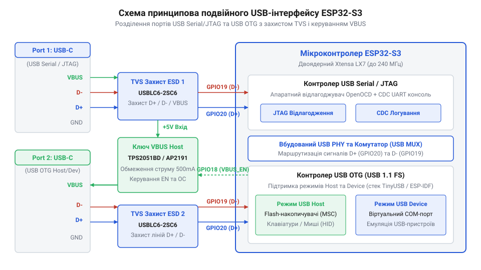

# Апаратна розпіновка, конфігурація шин SPI та схемотехніка Dual-USB у ESP32-S3

<preknowlist>
- [Мікроконтролер ESP32-S3](root:cat-hw-boards/esp32s3-microcontroller) — Базова будова ядра Xtensa LX7, системних шин та периферійних блоків
- [Waveshare ESP32-S3R2 (16 МБ Flash, 2 МБ PSRAM)](root:cat-hw-boards/esp32-s3r2-waveshare) — Практична реалізація платформ ESP32-S3 з інтегрованою Octal SPI пам'яттю
</preknowlist>

## Проблема конфлікту розпіновки та конфігурації шин

Проєктування апаратних платформ на базі [мікроконтролера ESP32-S3](root:cat-hw-boards/esp32s3-microcontroller) вимагає суворого обліку фізичного призначення системних ліній, оскільки помилкова комутація зовнішньої периферії може повністю заблокувати завантаження системи. На відміну від простих 8-бітних контролерів, де більшість виводів є взаємозамінними, чипи сімейства @@en|ESP32-S3@@ містять жорстко зафіксовані апаратні блоки. Сучасна система на чипі містить 45 портів @@en|GPIO@@ (англ. *@@en|General Purpose Input/Output@@* — вводи-виводи загального призначення), але частина з них прив'язана до кристала внутрішніми високошвидкісними магістралями.

Головна небезпека виникає при використанні зарезервованих ліній шини @@en|Octal SPI@@ (англ. *@@en|Serial Peripheral Interface@@* — послідовний периферичний інтерфейс) та виводів нативного контролера @@en|USB@@ (англ. *@@en|Universal Serial Bus@@* — універсальна послідовна шина). Якщо розробник підключає стандартний датчик або світлодіод до ліній розширеної пам'яті (`GPIO33`–`GPIO37`), додаткова паразитна ємність та зовнішні електричні рівні викривляють фронти високошвидкісних сигналів, через що мікроконтролер втрачає доступ до зовнішньої оперативної пам'яті @@en|PSRAM@@ (англ. *@@en|Pseudo Static RAM@@* — псевдостатична оперативна пам'ять). На платах із високошвидкісною пам'яттю, таких як [Waveshare ESP32-S3R2](root:cat-hw-boards/esp32-s3r2-waveshare), апаратними симптомами такого конфлікту є нездатність первинного завантажувача зчитати ідентифікатор чипа пам'яті (помилка `PSRAM ID read error` з нульовим значенням регістру), виникнення критичного винятку процесора `Cache disabled but cached memory region accessed` при спробі виконання коду з зовнішнього адресної області та неперервні циклічні перезавантаження за сторожовим таймером `RTCWDT_RTC_RESET`.

Не менш критичним є неправильне поводження з виводами конфігурації завантаження. Випадкова зовнішня підтяжка сигнальних ліній при виході зі стану скидання змінює режим старту чипа з нормального виконання коду Flash на службовий режим програмування. Щоб запобігти апаратним конфліктам, схемотехнік мусить попередньо класифікувати всі виводи на вільні, зарезервовані та службові ще до розміщення компонентів на друкованій платі.

## Карта системних виводів та зарезервовані GPIO

Системна розпіновка модулів @@en|ESP32-S3@@ розділена на кілька функціональних груп, кожна з яких має власний рівень доступу та апаратні обмеження. 

*Функціональна розпіновка системних портів мікроконтролера ESP32-S3 із зазначенням зарезервованих ліній та обмежень.*

Для вибору доступних ліній вводу-виводу використовують наступну класифікацію портів:

1. **Зарезервовані лінії пам'яті @@en|Octal SPI@@ (`GPIO33`–`GPIO37`):** Забезпечують 8-лінійний обмін даними з високошвидкісною пам'яттю @@en|PSRAM@@ та Flash у режимі подвійної передачі @@en|DDR@@ (англ. *@@en|Double Data Rate@@*). У модулях із 8-лінійним інтерфейсом ці виводи підключені безпосередньо всередині корпусу чипа й категорично заборонені для зовнішнього використання.
2. **Виводи защепкування @@en|strapping pins@@ (`GPIO0`, `GPIO3`, `GPIO45`, `GPIO46`):** Визначають початкову конфігурацію системи під час подачі живлення. Стан `GPIO0` задає режим завантаження: низький рівень активує режим завантажувача @@en|UART Bootload@@, а високий — запуск прикладного коду. Виводи `GPIO45` та `GPIO46` контролюють робочу напругу Flash-пам'яті та джерела тактування.
3. **Порт нативного контролера @@en|USB@@ (`GPIO19` / `GPIO20`):** Вивід `GPIO19` відповідає дифпарі @@en|USB D-@@, а `GPIO20` — лінії @@en|USB D+@@. Вони підключені до внутрішнього трансивера @@en|USB OTG / JTAG@@ і при використанні нативного порту не повинні навантажуватися сторонньою периферією.
4. **Виводи аналогово-цифрових перетворювачів та дотику (`GPIO1`–`GPIO10`):** Вхідні канали @@en|ADC1@@ та сенсорні входи, які можна вільно призначати через матрицю @@en|GPIO@@ на будь-які цифрові інтерфейси @@en|SPI@@, @@en|I2C@@ або @@en|UART@@.

На ультракомпактних платах на кшталт [ESP32-S3-Zero](root:cat-hw-boards/esp32-s3-zero) та [ESP32-S3 SuperMini](root:cat-hw-boards/esp32-s3-supermini) більшість зарезервованих виводів захована всередині плати, виводячи на зовнішні гребінки лише безпечні універсальні порти. Ключова апаратна відмінність у розпіновці між модифікаціями модулів полягає в архітектурі шини зовнішньої пам'яті: у версіях із чотирибітною пам'яттю @@en|Quad SPI@@ (англ. *@@en|Quad Serial Peripheral Interface@@*) лінії `GPIO33`–`GPIO37` залишаються вільними від обміну даними та можуть виводитися на зовнішні контакти як звичайні порти вводу-виведення. Натомість у високопродуктивних модулях із восьмибітною пам'яттю @@en|Octal SPI@@, таких як [Waveshare ESP32-S3R2](root:cat-hw-boards/esp32-s3r2-waveshare), виводи `GPIO33`–`GPIO37` жорстко задіяні під шину @@en|PSRAM@@ та сигнал тактування DQS для забезпечення подвійної швидкості @@en|DDR@@. Будь-яка спроба підключити зовнішню периферію до цих ліній у модулях @@en|Octal SPI@@ призводить до миттєвого руйнування адресації пам'яті та фатального панічного перезавантаження системи.

## Схемотехніка подвійного порту Dual-USB

Для забезпечення зручності налагодження та гнучкості підключення сучасні налагоджувальні платформи проєктують із двома портами роз'єму @@en|Type-C@@, створюючи конфігурацію @@en|Dual-USB@@.

*Схемотехніка реалізації подвійного USB-порту на базі ESP32-S3 із зовнішнім мостом та нативним контролером.*

Кожен із двох портів виконує окрему апаратну роль у системі розробки:

1. **Канал зовнішнього моста @@en|USB-to-UART@@:** Побудований на базі спеціалізованої мікросхеми перетворювача (наприклад, CP2102 або CH340). Мост підключається до виводів `GPIO43` (@@en|TXD0@@) та `GPIO44` (@@en|RXD0@@). Вузли автоматичного скидання на двох транзисторах керують лініями `EN` (чип-активація) та `GPIO0` (вивід защепкування @@en|strapping pins@@), забезпечуючи автоматичне переведення контролера в режим прошивки без натискання фізичних кнопок.
2. **Канал нативного контролера @@en|USB OTG / CDC / JTAG@@:** З'єднується безпосередньо з виводами `GPIO19` та `GPIO20`. Цей порт не потребує проміжних мікросхем-перетворювачів. Вбудований апаратний блок підтримки фреймворку @@en|ESP-IDF@@ забезпечує нативне апаратне налагодження за протоколом @@en|JTAG@@, емуляцію віртуального ком-порту @@en|CDC@@ (англ. *@@en|Communications Device Class@@*) та роботу пристроїв @@en|HID@@ (англ. *@@en|Human Interface Device@@* — пристрої людино-машинного інтерфейсу).

Плата [Waveshare ESP32-S3-Pico](root:cat-hw-boards/esp32-s3-pico) використовує таку схему для одночасного виведення системних логів через класичний мост та високошвидкісного пересилання відеопотоку чи трасування коду через нативний USB-інтерфейс. Для захисту диференційних ліній `D+` та `D-` від статичної електрики в схему обов'язково вмикають діодні масиви захисту @@en|ESD@@ (англ. *@@en|Electrostatic Discharge@@* — електростатичний розряд) та послідовні узгоджувальні резистори номіналом 22 Ом.

Паралельне використання двох роз'ємів створює небезпеку зустрічного струму при одночасному підключенні кабелів живлення від двох різних джерел до ліній `VBUS`. Якщо потенціали джерел відрізняються навіть на сотні мілівольт, виникає зворотний струм між портами, що здатне пошкодити контролери шини ПК чи вивести з ладу лінійний стабілізатор. Для захисту від таких витоків та перенапруг у схему розв'язки шини `VBUS` вмикають діоди Шотткі @@en|Schottky diode@@ (або схеми «ідеального діода» на транзисторах @@en|P-MOSFET@@), які пропускають струм лише в напрямку внутрішньої шини живлення плати та розривають коло між портами. Спільну лінію 5 В додатково захищають самовідновлювальними запобіжниками @@en|PTC@@ (англ. *@@en|Positive Temperature Coefficient@@*) та супресорами перенапруг @@en|TVS@@ (англ. *@@en|Transient Voltage Suppressor@@*), що гарантує безпечне функціонування лінійного регулятора напруги 3.3 В під час гарячого підключення.

## Електрична розв'язка живлення та кола підтяжки

Забезпечення стабільної роботи систем на базі @@en|ESP32-S3@@ вимагає обчислення та встановлення зовнішніх кіл фільтрації живлення та підтяжки сигналів. Основною проблемою мікроконтролера є короткочасні пікові кидки струму до 500 мА під час активації передавача @@en|Wi-Fi@@ або @@en|Bluetooth@@.

Для запобігання просіданню напруги живлення `3.3V` та самовільному скиданню чипа шину живлення підключають через комбінований фільтр. Паралельно джерелу ставлять електролітичний або танталовий конденсатор ємністю від 10 мкФ до 100 мкФ для компенсації низькочастотних кидків струму та керамічний конденсатор 0.1 мкФ безпосередньо біля виводів живлення `VDD33` для придушення високочастотних завад. Критичним критерієм вибору конденсаторів є їхній еквівалентний послідовний опір @@en|ESR@@ (від англ. *@@en|Equivalent Series Resistance@@* — еквівалентний послідовний опір). Для керамічних конденсаторів типу @@en|MLCC@@ обирають значення @@en|ESR@@ у межах від 5 мОм до 20 мОм, що гарантує миттєве шунтування високочастотних шумів. Для об'ємних танталових конденсаторів величина @@en|ESR@@ має становити від 100 мОм до 300 мОм: занадто високий опір спричиняє неприпустимий спад напруги при піковому струмі 500 мА, а надто низький опір (менше 50 мОм) може викликати паразитно-резонансне розгойдування шини та нестабільність лінійних регуляторів живлення.

Надійний старт системи забезпечує зовнішнє ланцюгове коло скидання на виводі `EN` (англ. *@@en|Enable@@* — активація). Для формування необхідної затримки зростання напруги використовують резисторно-конденсаторне коло @@en|RC@@. Необхідний час затримки `t` обчислюється за формулою:

t = R × C
= 10000 × 0.000001              [множення опору на ємність]
= 0.01                          [час затримки у секундах]

Отримане значення 0.01 секунди (10 мс) гарантує, що рівень напруги на виводі `EN` досягне логічної одиниці лише після повного виходу джерела `3.3V` на робочий режим. Для виводу защепкування `GPIO0` обов'язково встановлюють підтягувальний резистор номіналом 10 кОм до шини `3.3V`, що унеможливлює наведення завад та випадковий перехід у режим завантажувача. 

Нехтування цими правилами фільтрації та підтяжки на платах із високим споживанням, як-от [ESP32-CAM](root:cat-hw-boards/esp32-cam) та [ESP32-CAM з камерою OV3640](root:cat-hw-boards/esp32-cam-ov3640), призводить до критичного просідання живлення та систематичного виходу з ладу через апаратне скидання при випромінюванні радіопакетів.
