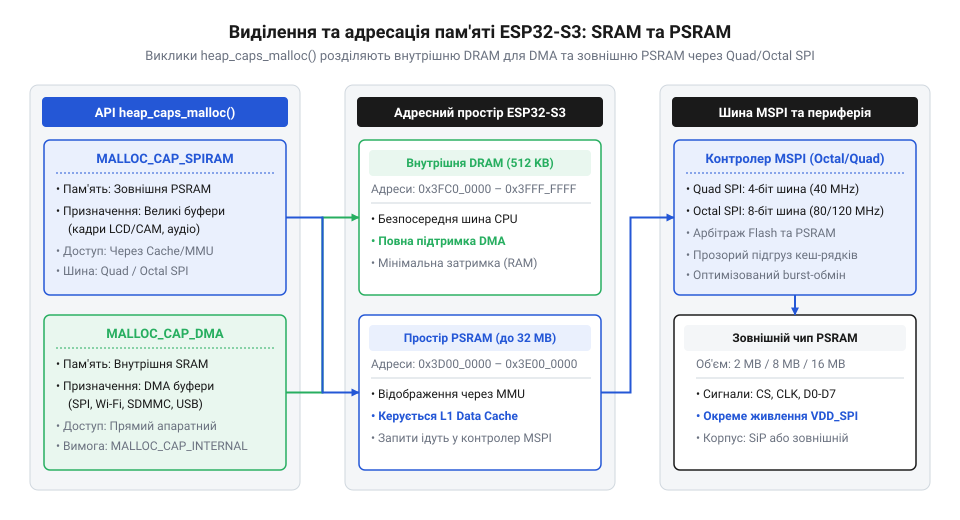
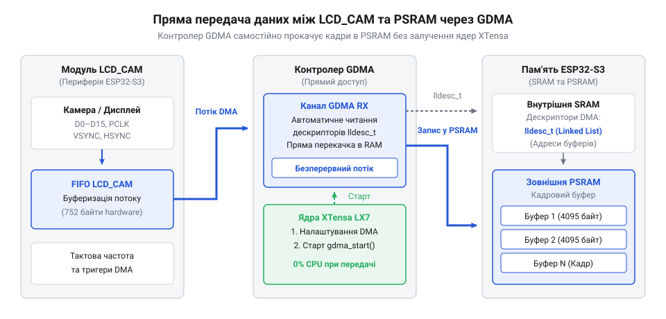

# Програмний інтерфейс конфігурації підсистем пам'яті, GPIO Matrix та USB/DMA в ESP-IDF

<preknowlist>
- [Мікроконтролер ESP32-S3](root:cat-hw-boards/esp32s3-microcontroller) — базові архітектурні особливості SoC, апаратні шини та призначення периферійних блоків
- [Модулі ESP32-S3-WROOM-1 та WROOM-2](root:cat-hw-boards/esp32-s3-wroom-modules-family) — апаратні відмінності шин флеш-пам'яті та PSRAM у варіантах Quad та Octal SPI
</preknowlist>

## Дефіцит пам'яті та комутаційні обмеження

При розробці на [мікроконтролері ESP32-S3](root:cat-hw-boards/esp32s3-microcontroller) виникають обмеження пам'яті та розведення сигналів. З 512 КБ внутрішньої @@en|SRAM@@ (від англ. @@en|Static RAM@@ — статична оперативна пам'ять) під купу залишається 300–350 КБ, бо решту займають системні таблиці та мережеві стеки.

Спроба виділити великі буфери — як у [модулях ESP32-CAM](root:cat-hw-boards/esp32-cam-camera-module-family) — викликає фрагментацію купи та збій системи. Одночасно жорстке прив'язування виводів у @@en|SoC@@ спричиняє конфлікти при підключенні кількох шин.

Для розв'язання цих проблем імплементовано дві підсистеми. Зовнішня @@en|PSRAM@@ (від англ. @@en|Pseudo Static RAM@@ — псевдостатична оперативна пам'ять) мапується в адресовий простір через блок @@en|MMU@@ (від англ. @@en|Memory Management Unit@@ — блок керування пам'яттю). А @@en|GPIO Matrix@@ (від англ. @@en|General Purpose Input/Output Matrix@@ — матриця комутації входів і виходів загального призначення) дозволяє програмно спрямовувати сигнали периферії на довільні контакти.

## Конфігурація PSRAM та виділення пам'яті

Зовнішня @@en|PSRAM@@ підключається до мікроконтролера через шину @@en|SPI@@ у двох апаратних режимах: @@en|Quad SPI@@ (від лат. *quattuor* — чотири, 4-бітне з'єднання) або @@en|Octal SPI@@ (від лат. *octo* — вісім, 8-бітне з'єднання). Режим @@en|Quad SPI@@ зі швидкістю до 40 МБ/с використовується в [модулях ESP32-S3-WROOM-1](root:cat-hw-boards/esp32-s3-wroom-modules-family) на платах на кшталт [ESP32-S3-Zero](root:cat-hw-boards/esp32-s3-zero). Для виводу графіки на @@en|LCD@@ чи обробки нейромереж у модулях @@en|WROOM-2@@, [SiP-модулях ESP32-S3-MINI-1](root:cat-hw-boards/esp32-s3-mini-sip-modules) та платах [Waveshare ESP32-S3R2](root:cat-hw-boards/esp32-s3r2-waveshare) застосовують шину @@en|Octal SPI@@, яка подвоює пропускну здатність до 80–160 МБ/с.

Для активації зовнішньої пам'яті у фреймворку @@en|ESP-IDF@@ у меню @@en|Kconfig@@ (`Component config -> ESP PSRAM`) вмикають параметр `CONFIG_SPIRAM`, обирають режим шини (`CONFIG_SPIRAM_MODE_QUAD` або `CONFIG_SPIRAM_MODE_OCT`) та тип інтеграції в систему розподілу пам'яті.


*Схема зв'язку шин Quad/Octal SPI PSRAM із системним простором RAM та викликами heap_caps_malloc().*

Звичайний виклик `malloc()` виділяє пам'ять із внутрішньої @@en|SRAM@@. Для точного розміщення буфера у зовнішній @@en|PSRAM@@ із байтовою адресацією викликають `heap_caps_malloc()` із прапорами `MALLOC_CAP_SPIRAM | MALLOC_CAP_8BIT`. Щоб уникнути витоків ресурсів, виділену пам'ять обов'язково вивільняють функцією `heap_caps_free()`.

```tabs
:::tab C (ESP-IDF)
```c|esp-idf
#include <stdio.h>
#include "esp_heap_caps.h"
#include "esp_log.h"

static const char *TAG = "psram_example";

void allocate_large_buffer(void) {
    size_t buffer_size = 1024 * 1024; // 1 МБ для кадрового буфера

    uint8_t *frame_buffer = (uint8_t *)heap_caps_malloc(buffer_size, MALLOC_CAP_SPIRAM | MALLOC_CAP_8BIT);

    if (frame_buffer == NULL) {
        ESP_LOGE(TAG, "Не вдалося виділити пам'ять у PSRAM!");
        return;
    }

    ESP_LOGI(TAG, "Успішно виділено %d байт у PSRAM за адресою %p", buffer_size, frame_buffer);

    frame_buffer[0] = 0xFF;

    heap_caps_free(frame_buffer);
}
```
:::
:::tab C++ (ESP-IDF)
:::code api-esp32-s3-system-config-and-peripherals-api/cpp/esp-idf/psrambuffermanager.cpp
:::
```

## Маршрутизація сигналів через GPIO Matrix

Фізичні контакти мікроконтролера @@en|ESP32-S3@@ розв'язані від периферійних блоків апаратним комутатором @@en|GPIO Matrix@@. Завдяки цьому внутрішні периферійні сигнали — наприклад, лінію `UART0_TXD` або `SPI2_CLK` — можна вивести на довільний контакт @@en|GPIO@@.

Напрямок перенаправлення задають викликами API: функція `gpio_matrix_out()` підключає внутрішній сигнальний вихід периферії до фізичної ніжки, а `gpio_matrix_in()` комутує вхідний стан контакту на внутрішній канал модуля.

При розведенні виводів діють апаратні обмеження. У модулях із пам'яттю @@en|Octal SPI@@ контакти GPIO33..GPIO37 зайняті 8-бітною шиною @@en|Flash@@/@@en|PSRAM@@, тож їх перепризначення руйнує адресацію й викликає аварійне перезавантаження @@en|Panic Handler@@. Крім того, виводи @@en|ADC1@@ (GPIO1..GPIO10) працюють незалежно від радіотрансивера, тоді як каналом @@en|ADC2@@ (GPIO11..GPIO20) не можна надійно користуватися під час активності @@en|Wi-Fi@@.

Гнучке призначення виводів критичне для компактних плат, таких як [ESP32-S3 SuperMini](root:cat-hw-boards/esp32-s3-supermini), [Waveshare ESP32-S3-Pico](root:cat-hw-boards/esp32-s3-pico) та при [розробці на ESP32-C6-Zero](root:cat-hw-boards/esp32-c6-zero).

```tabs
:::tab C (ESP-IDF)
```c|esp-idf
#include "driver/gpio.h"
#include "soc/gpio_sig_map.h"

void configure_custom_uart_routing(gpio_num_t tx_pin, gpio_num_t rx_pin) {
    gpio_set_direction(tx_pin, GPIO_MODE_OUTPUT);
    gpio_matrix_out(tx_pin, U0TXD_OUT_IDX, false, false);

    gpio_set_direction(rx_pin, GPIO_MODE_INPUT);
    gpio_matrix_in(rx_pin, U0RXD_IN_IDX, false);
}
```
:::
```

## Керування DMA-буферами периферії та LCD_CAM

Побайтове виведення кадрових масивів перевантажує @@en|CPU@@ @@en|Xtensa LX7@@. У @@en|ESP32-S3@@ це завдання вирішує модуль @@en|LCD_CAM@@ (блоки @@en|LCD@@ та @@en|CAM@@ для камери) разом із контролером @@en|DMA@@ (від англ. @@en|Direct Memory Access@@ — прямий доступ до пам'яті), який передає дані автономно.

Буфери й дескриптори @@en|DMA@@ вимагають 32-бітового вирівнювання та розміщення суворо у внутрішній @@en|SRAM@@.


*Схема потоку даних між модулем LCD_CAM, DMA-дескрипторами та розширеним буфером у PSRAM.*

Для великих буферів у зовнішній @@en|PSRAM@@ (як на [Waveshare ESP32-S3 Touch LCD](root:cat-hw-boards/waveshare-esp32-s3-touch-lcd-1-28)) драйвер @@en|ESP-IDF@@ застосовує транзитні буфери (@@en|bounce buffers@@): процес @@en|EDMA@@ переміщує дані з @@en|PSRAM@@ у буфер у @@en|SRAM@@ з прапором `MALLOC_CAP_DMA`, звідки @@en|DMA@@ виводить їх на шину.

```tabs
:::tab C (ESP-IDF)
```c|esp-idf
#include <string.h>
#include "esp_heap_caps.h"
#include "esp_lcd_panel_ops.h"
#include "esp_log.h"

void init_dma_bounce_buffer(size_t buffer_size) {
    // Виділення DMA-сумісного транзитного буфера у внутрішній SRAM
    void *dma_buffer = heap_caps_malloc(buffer_size, MALLOC_CAP_INTERNAL | MALLOC_CAP_DMA);

    if (!dma_buffer) {
        ESP_LOGE("DMA", "Помилка виділення DMA-буфера в SRAM");
        return;
    }

    // Гарантуємо вирівнювання та очищення пам'яті
    memset(dma_buffer, 0, buffer_size);
    ESP_LOGI("DMA", "DMA буфер створено: %p, розмір: %zu байт", dma_buffer, buffer_size);

    // Використання для LCD_CAM...
    heap_caps_free(dma_buffer);
}
```
:::
:::tab C++ (ESP-IDF)
:::code api-esp32-s3-system-config-and-peripherals-api/cpp/esp-idf/dmabuffer.cpp
:::
```

## Конфігурація нативних USB-інтерфейсів та TinyUSB

Для налагодження пристрою без залучення прошивки @@en|ESP32-S3@@ містить апаратний мост @@en|USB Serial/JTAG@@ на виводах GPIO19 (`USB_D-`) та GPIO20 (`USB_D+`). Він створює віртуальний порт @@en|CDC@@ і відлагоджувач @@en|JTAG@@ для @@en|GDB@@, працюючи незалежно від стану прошивки в @@en|Flash@@.

Повношвидкісний контролер @@en|USB OTG@@ (від англ. @@en|USB On-The-Go@@ — на ходу) працює на швидкості 12 Мбіт/с і вимагає програмного стека @@en|TinyUSB@@. Це дозволяє реалізувати кінцеві точки @@en|CDC@@, @@en|HID@@ чи @@en|MSC@@ на платах на кшталт [esp32-s3-zero-supermini](root:cat-hw-boards/esp32-s3-zero-supermini-boards).

```tabs
:::tab C (ESP-IDF)
```c|esp-idf
#include "tinyusb.h"

void init_native_usb_cdc(void) {
    const tinyusb_config_t tusb_cfg = {
        .device_descriptor = NULL,
        .string_descriptor = NULL,
        .external_phy = false,
        .configuration_descriptor = NULL,
    };
    ESP_ERROR_CHECK(tinyusb_driver_install(&tusb_cfg));
}
```
:::
```

Буфери кінцевих точок @@en|TinyUSB@@ повинні виділятись у @@en|DMA@@-доступній внутрішній пам'яті @@en|SRAM@@ для запобігання затримкам передачі пакетів.

## Діагностика та обробка системних помилок

Збій ініціалізації периферії або нестача пам'яті без належної обробки призводять до витоків ресурсів та зависання системи. У @@en|ESP-IDF@@ функції повертають код статусу `esp_err_t`, де `ESP_OK` означає успіх, а інші значення сигналізують про помилку.

Для критичних викликів використовують макрос `ESP_ERROR_CHECK()`. Якщо виклик повертає помилку, макрос виводить у відлагоджувальну консоль рядок, файл та назву функції, після чого передає керування в @@en|Panic Handler@@ (англ. *handle* — обробляти) для перезавантаження мікроконтролера.

Якщо збій не є фатальним, стан обробляють вручну: програма звільняє виділені буфери через `heap_caps_free()`, відновлює конфігурацію виводів і продовжує роботу в безпечному режимі.

```tabs
:::tab C (ESP-IDF)
```c|esp-idf
#include "esp_err.h"
#include "esp_log.h"
#include "esp_heap_caps.h"

esp_err_t safe_system_init(void) {
    uint8_t *buffer = (uint8_t *)heap_caps_malloc(1024, MALLOC_CAP_SPIRAM);
    if (!buffer) {
        ESP_LOGE("SYS", "Недостатньо пам'яті!");
        return ESP_ERR_NO_MEM;
    }

    esp_err_t err = gpio_reset_pin(GPIO_NUM_4);
    if (err != ESP_OK) {
        heap_caps_free(buffer);
        return err;
    }

    heap_caps_free(buffer);
    return ESP_OK;
}
```
:::
```
