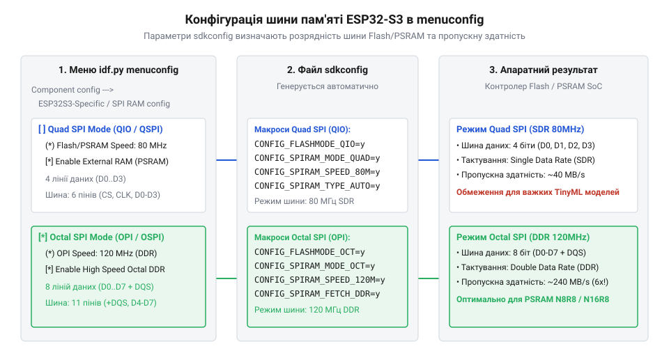
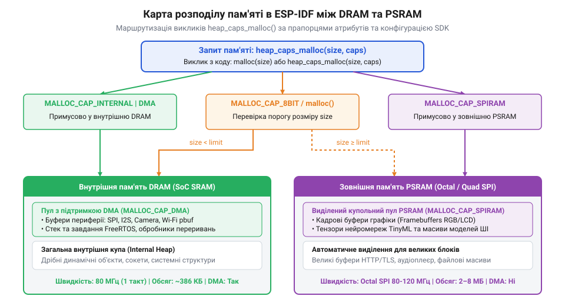

# Програмний інтерфейс ESP-IDF для конфігурування Flash, PSRAM та USB CDC/JTAG

<preknowlist>
- [Мікроконтролер ESP32-S3](root:cat-hw-boards/esp32s3-microcontroller) — Апаратна підтримка режимів Octal/Quad SPI, контролера USB та матриці пам'яті ESP32-S3
- [Waveshare ESP32-S3R2 (16 МБ Flash, 2 МБ PSRAM)](root:cat-hw-boards/esp32-s3r2-waveshare) — Конфігурації SiP-пам'яті та апаратні особливості підключення Flash/PSRAM
</preknowlist>

## Принципи конфігурування пам'яті в ESP-IDF

Розробка складних вбудованих систем на базі мікроконтролерів вимагає чіткої координації між апаратною конфігурацією та системним програмним забезпеченням. Коли застосунок потребує обробки потокового відео чи зберігання великих масивів даних, звичайних обсягів внутрішньої пам'яті стає недостатньо. Без належного підходу до налаштування системних шин мікроконтролер потрапляє в циклічне перезавантаження ще до того, як керування буде передано головній функції проєкту. У середовищі фреймворку (від англ. @@en|Espressif IoT Development Framework@@, @@en|ESP-IDF@@) це завдання вирішується шляхом декларативного опису параметрів у системі конфігурації Kconfig.

Під час збирання проєкту розробник взаємодіє з текстовим або графічним інтерфейсом налаштувань @@en|menuconfig@@. Значення, обрані в цьому меню, записуються до файлу `sdkconfig` у вигляді текстових параметрів. Компілятор і генератори системних скриптів перетворюють ці параметри на C-макроси в заголовковому файлі `sdkconfig.h`, а також формують бінарний заголовок первинного завантажувача (від англ. @@en|second-stage bootloader@@). Саме первинний завантажувач, який зберігається у початкових секціях енергонезалежної флеш-пам'яті, зчитує записані конфігураційні прапорці та ініціалізує фізичні драйвери шин SPI (від англ. @@en|Serial Peripheral Interface@@).

Якщо записати в чип конфігурацію, яка не відповідає реально розпаяним мікросхемам на друкованій платі, виникає критична помилка. Наприклад, якщо [мікроконтролер ESP32-S3](root:cat-hw-boards/esp32s3-microcontroller) налаштовано на роботу з восьмибітною шиною, а на платі встановлено чотирибітний чип пам'яті, пристрій отримує некоректний відгук від шини. У цей момент блокується функціонування блоку управління пам'яттю (від англ. @@en|Memory Management Unit@@, @@en|MMU@@), який відповідає за трансляцію віртуальних адрес процесора у фізичні адреси зовнішніх мікросхем. Подібний апаратний збій виникає й при розбіжності розміру таблиці розділів (від англ. @@en|partition table@@) із реальною ємністю флеш-пам'яті: якщо таблиця описує партиції поза межами фізичних адрес чипа, завантажувач при перевірці меж виявляє вихід за допустимий діапазон адрес. Оскільки спроба зчитати дані з несумісної шини або за межами фізичної флеш-пам'яті призводить до збою перевірки цілісності бінарного заголовка, система аварійного захисту фреймворку негайно генерує виключення паніки ядра (від англ. @@en|kernel panic@@) та викликає системну функцію переривання `abort()`, що запобігає пошкодженню даних і демонструє важливість точного статичного узгодження шин та партицій на етапі компіляції.

## Конфігурація шин Flash та PSRAM

Апаратне підключення зовнішніх мікросхем флеш-пам'яті та псевдостатичної оперативної пам'яті (від англ. @@en|Pseudo-Static RAM@@, @@en|PSRAM@@) у серії ESP32-S3 може реалізовуватися через чотирибітну шину Quad SPI або восьмибітну шину Octal SPI, яку також називають OPI. Ширина шини визначає кількість ліній даних, якими одночасно передаються біти між процесорним ядром та зовнішніми чипами. Для високоефективних застосувань важливим є не лише вибір кількості ліній, а й тактова частота шини, яка в ESP-IDF може набувати значень 40, 80 або 120 МГц.

*Покрокове дерево конфігурування режимів Quad SPI та Octal SPI для забезпечення стабільного доступу крізь MMU.*

Збільшення частоти з 40 МГц до 120 МГц подвоює чи потріює пропускну здатність, проте вимагає суворого дотримання таймінгів сигналу стробування даних (від англ. @@en|Data Strobe@@, @@en|DQS@@). Робота на частоті 120 МГц можлива лише в режимі OPI зі збереженням фазової синхронізації та при відповідному виборі напруги живлення чипа в @@en|menuconfig@@. При використанні режимів з подвійною передачею даних (від англ. @@en|Double Transfer Rate@@, @@en|DDR@@) біти зчитуються як по наростаючому, так і по спадаючому фронту тактового сигналу.

Помилки під час налаштування шин часто призводять до збоїв зчитування коду програми. Коли розробник обирає режим Octal SPI для плати, на якій розпаяно Quad SPI чипи, як-от [модуль ESP32-S3-Zero](root:cat-hw-boards/esp32-s3-zero), завантажувач не отримує правильного ідентифікатора @@en|JEDEC ID@@ від флеш-пам'яті. У лозі системної консолі з'являється помилка `ESP_ERR_FLASH_BASE`, після чого процесор зупиняє виконання коду. Для запобігання цим помилкам у файлі `sdkconfig` необхідно чітко балансувати між швидкістю шини та апаратними можливостями конкретного модуля.

Окремим фактором апаратної стабільності при роботі на максимальній частоті 120 МГц є правильний вибір напруги живлення шини флеш-пам'яті та @@en|PSRAM@@ у середовищі @@en|menuconfig@@. Високошвидкісні чипи пам'яті стандарту @@en|Octal SPI@@ розраховані на понижену робочу напругу 1.8 В, оскільки при стандартній напрузі 3.3 В фронти тактових сигналів зазнають фазових викривань і паразитного перенапруження, що унеможливлює точну фазову синхронізацію ліній. Вказування напруги 1.8 В у конфігураторі змушує внутрішній регулятор з малим падінням напруги (англ. @@en|Low Drop-Out@@, скорочено @@en|LDO@@, від low — малий, drop-out — падіння) виставляти належний рівень на виводі живлення шини, забезпечуючи мінімальний рівень фронтальних шумів та надійне зчитування сигналів стробування даних. Непогодженість цих налаштувань — вказування 3.3 В замість 1.8 В для швидкісних чипів у модулях рівня [Waveshare ESP32-S3R2 (16 МБ Flash, 2 МБ PSRAM)](root:cat-hw-boards/esp32-s3r2-waveshare) — призводить до теплового перегріву та збоїв синхронізації при обміні даними на граничних частотах.

## Динамічний розподіл оперативної пам'яті SPIRAM

Внутрішня оперативна пам'ять мікроконтролера (від англ. @@en|Static RAM@@, @@en|SRAM@@) має високу швидкість доступу та прямо підключена до шини DMA (від англ. @@en|Direct Memory Access@@), проте її обсяг обмежений кількома сотнями кілобайт. Зовнішня оперативна пам'ять @@en|SPIRAM@@ розширює доступний простір до кількох мегабайт, але доступається крізь кеш-пам'ять та модуль @@en|MMU@@. В середовищі ESP-IDF розробник керує виділенням блоків пам'яті за допомогою спеціалізованого API розподільника купи (від англ. @@en|Heap Allocator@@).

*Схема розподілу пам'яті за прапорцями heap_caps з виділенням специфічних буферів під DMA та великі масиви даних.*

Замість стандартної функції `malloc()`, у фреймворку застосовують виклик `heap_caps_malloc()`, який приймає прапорці властивостей пам'яті. Прапорець `MALLOC_CAP_SPIRAM` вказує системі виділити блок у зовнішній пам'яті @@en|PSRAM@@, тоді як `MALLOC_CAP_INTERNAL` гарантує розміщення в швидкій внутрішній пам'яті. Це критично для обробників переривань та периферійних буферів, оскільки звичайний доступ до @@en|PSRAM@@ тимчасово блокується під час операцій запису у флеш-пам'ять. Для завдань, що вимагають виконання машинного коду з оперативної пам'яті (наприклад, динамічної компіляції або інструкцій переривань), застосовують прапорець `MALLOC_CAP_EXEC`. Апаратний модуль @@en|MMU@@ мікроконтролера ESP32-S3 за замовчуванням блокує виконання коду з звичайних ділянок купи для захисту від зловмисного впровадження інструкцій. Передача `MALLOC_CAP_EXEC` змушує розподільник виділяти пам'ять виключно у внутрішніх блоках інструкційної оперативної пам'яті (англ. @@en|Instruction RAM@@, скорочено @@en|IRAM@@) та конфігурувати сторінки @@en|MMU@@ з дозволом на зчитування інструкцій процесорним ядром.

Якщо обсяг зовнішньої пам'яті на платі, такій як [плата Waveshare ESP32-S3R2](root:cat-hw-boards/esp32-s3r2-waveshare), перевищує 4 МБ, додаткові банки адресації не можуть бути відображені у віртуальний адресний простір одночасно. У такому разі використовується компонент `esp_himem`. Він надає виклики `esp_himem_alloc()` та `esp_himem_map()` для динамічного відображення фізичних вікон високої пам'яті у доступні адресні діапазони @@en|MMU@@.

:::code api-esp32s3-espidf-flash-psram-usb-config/c/esp-idf/allocate-frame-buffers.c

## Ініціалізація та використання USB CDC/JTAG

Мікроконтролер ESP32-S3 містить вбудований периферійний модуль USB Serial/JTAG, який виведений безпосередньо на виводи GPIO19 (лінія D-) та GPIO20 (лінія D+). Цей контролер дозволяє відмовитися від зовнішніх мікросхем конвертерів USB-UART під час розробки пристроїв. В середовищі ESP-IDF він забезпечує два основні класи функціональності: віртуальний послідовний порт (від англ. @@en|Communications Device Class@@, @@en|USB CDC@@) для обміну текстовими даними та апаратний інтерфейс налагодження (від англ. @@en|Joint Test Action Group@@, @@en|JTAG@@).

Для перенаправлення стандартних потоків виведення логів `stdout` та введення `stdin` у USB CDC достатньо увімкнути прапорець `CONFIG_ESP_CONSOLE_USB_SERIAL_JTAG` у конфігураторі `sdkconfig`. Для більш гнучкого програмного керування інтерфейсом розробник використовує драйвер `usb_serial_jtag`. За допомогою виклику `usb_serial_jtag_driver_install()` ініціалізуються внутрішні кільцеві буфери прийому та передачі, що дозволяє організувати надійне зчитування команд без втрати байтів.

Вбудований інтерфейс @@en|JTAG@@ працює паралельно з віртуальним послідовним портом через той самий фізичний роз'єм USB. Це дозволяє здійснювати покрокове налагодження коду програми за допомогою утиліти @@en|OpenOCD@@ та середовища @@en|GDB@@ без підключення зовнішніх програмних адаптерів. Під час розробки слід враховувати, що при м'якому скиданні мікроконтролера USB-з'єднання з комп'ютером тимчасово розривається на час ініціалізації завантажувача, що вимагає обережності при обробці критичних потоків даних у режимі реального часу.

:::code api-esp32s3-espidf-flash-psram-usb-config/c/esp-idf/init-usb-cdc-console.c

Під час високої інтенсивності виведення діагностичних повідомлень розмір кільцевих буферів `rx_buffer_size` та `tx_buffer_size` стає визначальним фактором стабільності роботи системи. Якщо внутрішній передавальний буфер виявиться занадто малим (наприклад, 128 або 256 байтів), під час масованого виклику макросів `ESP_LOGI` та системної функції `printf()` буфер швидко переповнюється. У випадках, коли хост-комп'ютер не встигає зчитувати пакети через USB-шину або коли фізичний кабель тимчасово відключено, драйвер змушений або блокувати виконання задачі, або скидати нові байти даних. Конфігурування обсягу буфера на рівні 1024–2048 байтів у структурі `usb_serial_jtag_driver_config_t` забезпечує достатній амортизаційний резерв для згладжування імпульсних сплесків трафіку, зберігаючи цілісність логів та запобігаючи втраті критичних діагностичних кадрів.
