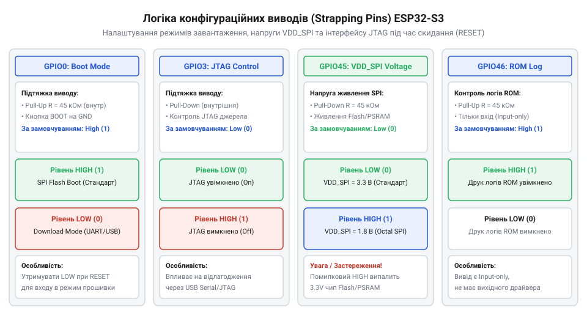
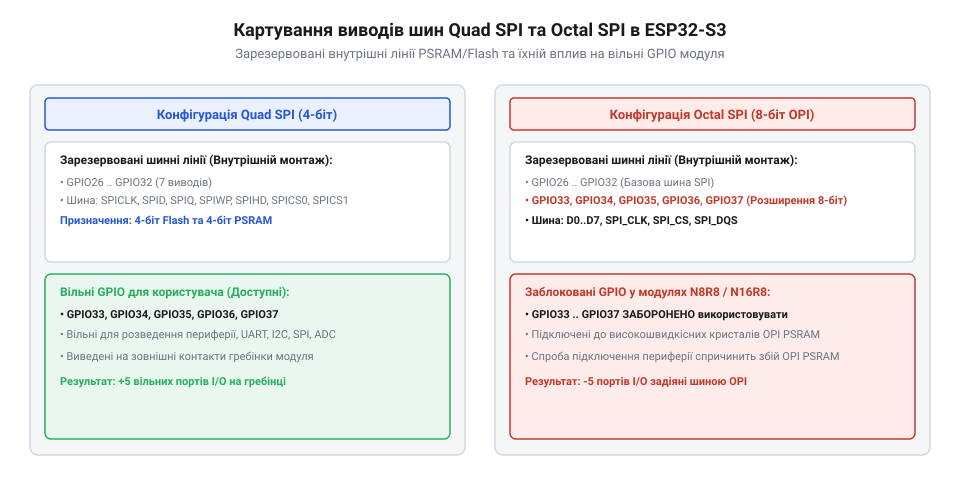
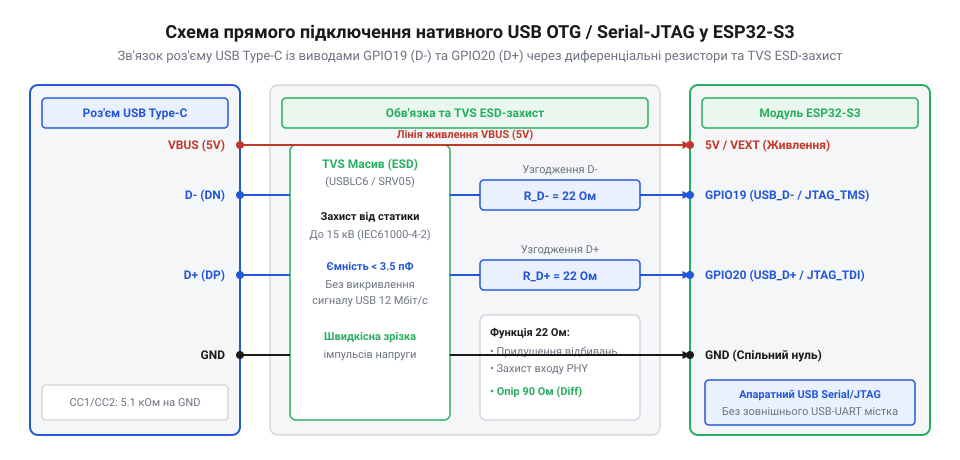
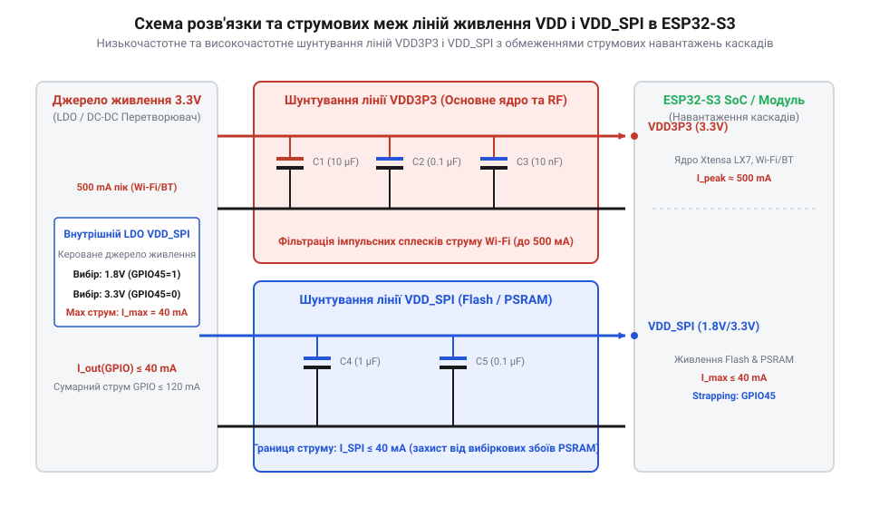

# Апаратна специфікація: розпіновка, strapping-виводи, конфігурація шин SPI та живлення плат ESP32-S3

<preknowlist>
- [Мікроконтролер ESP32-S3](root:cat-hw-boards/esp32s3-microcontroller) — базове розуміння архітектури ядра Xtensa LX7, периферійних блоків та загальних можливостей SoC ESP32-S3
</preknowlist>

## Схемотехнічні виклики цокольовки ESP32-S3

При розробці принципових схем та трасуванні друкованих плат на базі [мікроконтролера ESP32-S3](root:cat-hw-boards/esp32s3-microcontroller) інженер стикається з жорсткими апаратними обмеженнями розподілу виводів введення-виведення (англ. @@en|General Purpose Input/Output@@, @@en|GPIO@@). Незалежно від формфактора модуля — будь то повнорозмірний @@en|WROOM@@ чи компактний @@en|MINI@@ — кристал містить серію виводів зі спеціалізованим апаратним призначенням, довільне використання яких під зовнішню периферію призводить до непрацездатності всієї системи. Зокрема, група виводів `GPIO38`–`GPIO42` вимагає особливої уваги, оскільки її фізичне призначення суттєво відрізняється залежно від модифікації модуля та компонування плати. У модулях із 8-бітною шиною @@en|Octal SPI@@ пам'яті (таких як ESP32-S3-WROOM-2) виводи `GPIO38`–`GPIO42` задіяні всередині корпусу для сигналів даних і стробування, через що вони повністю недоступні на зовнішніх штирових роз'ємах. Натомість у платах формфактора MINI та мікромодулях на зразок [ESP32-S3-Zero](root:cat-hw-boards/esp32-s3-zero) чи [ESP32-S3 SuperMini](root:cat-hw-boards/esp32-s3-supermini) вивід `GPIO38` найчастіше жорстко підключений до вбудованого адресного @@en|RGB LED@@ світлодіода, а контакти `GPIO39`–`GPIO42` виведені назовні, але вимагають перевірки, оскільки в платах розширення вони можуть бути зайняті шиною камери чи дисплея. Спроба використати зарезервовані виводи цієї групи під зовнішнє навантаження викликає конфлікт на шині та призводить до збоїв виконання коду.

Головний схемотехнічний ризик полягає в перекритті ліній зовнішньої периферії із виводами внутрішньосистемної шини пам'яті. У модифікаціях плат з 8-бітною псевдостатичною пам'яттю (англ. @@en|Pseudo Static RAM@@, @@en|PSRAM@@) шина @@en|Octal SPI@@ жорстко задействує виводи `GPIO33`–`GPIO37` для сигналів даних та тактування. Спроба підключити до цих контактів зовнішні датчики, кнопки чи світлодіоди викликає конфлікт на шині (англ. @@en|bus contention@@), спотворює зчитування інструкцій з Flash-пам'яті й переводить пристрій у безперервний цикл перезавантажень (англ. @@en|boot loop@@). Хоча гнучка внутрішня матриця комутації (англ. @@en|GPIO Matrix@@) дозволяє перенаправляти цифрові сигнали повільних інтерфейсів (UART, I2C) на будь-які вільні контакти, високошвидкісні периферійні блоки вимагають прямого зв'язку через мультиплексор введення-виведення (англ. @@en|IO MUX@@). Перенаправлення швидкісних сигналів пам'яті чи паралельного дисплея крізь матрицю додає критичні затримки поширення сигналу, що спричиняє порушення фазових таймінгів на частотах понад 40 МГц. Для запобігання помилкам трасування нижче наведено карту зарезервованих виводів залежно від типу вбудованої пам'яті:

| Конфігурація пам'яті | Зарезервовані виводи GPIO | Призначення сигналів шини |
| :--- | :--- | :--- |
| Quad SPI Flash (4-біт) | `GPIO27`–`GPIO32` | CS0, CLK, D0, D1, D2 (WP), D3 (HOLD) |
| Quad SPI PSRAM (4-біт) | `GPIO26`, `GPIO27`–`GPIO32` | CS1 (PSRAM), спільна 4-бітна шина MSPI |
| Octal SPI PSRAM (8-біт) | `GPIO26`–`GPIO37` | CS1, D0–D7, CLK, DQS (лінії даних та стробування) |

Другою пасткою є необдумане розміщення зовнішніх підтягувальних резисторів на конфігураційних виводах вибірки режимів запуску. Якщо коло периферійного пристрою фіксує такий вивід у протилежному логічному стані під час подачі живлення, мікроконтролер помилково змінює внутрішню напругу живлення пам'яті або блокує завантаження основного виконуваного коду.

## Конфігураційні виводи завантаження strapping pins

Під час зростання фронту напруги на лінії скидання `CHIP_PU` апаратна засувка внутрішнього завантажувача (англ. @@en|ROM Bootloader@@) зчитує логічні рівні на спеціальних конфігураційних виводах (англ. @@en|strapping pins@@). Тривалість підйому цієї напруги визначається часовою константою зовнішнього фільтруючого RC-ланцюга (від англ. @@en|RC timing circuit@@, від *resistor* — резистор, *capacitor* — конденсатор), де встановлення конденсатора ємністю близько `1 мкФ` формує необхідну швидкість наростання сигналу (від англ. @@en|slew rate@@, від *slew* — швидкість наростання, *rate* — темп); надмірне збільшення ємності (понад `10 мкФ`) надто затягує фронт і викликає помилкове фіксування засувкою проміжних потенціалів до стабілізації підтяжок, а відсутність чи занадто мала ємність фільтра (менше `10 нФ`) призводить до передчасного спрацьовування пристрою при пульсаціях живлення. Зчитаний двійковий вектор визначає режим завантаження процесора, джерело виконання коду та рівень напруги внутрішнього LDO-стабілізатора шини пам'яті. В архітектурі ESP32-S3 основними конфігураційними виводами є `GPIO0`, `GPIO3`, `GPIO45` та `GPIO46`.

Вивід `GPIO0` відповідає за вибір між штатним запуском прошивки з Flash-пам'яті та входом у режим завантаження через послідовний порт (англ. @@en|Joint Download Mode@@). Для успішного запуску пристрою під час скидання на `GPIO0` має утримуватися логічна одиниця (`3.3 В`). Якщо ж у момент скидання `GPIO0` притягнуто до землі (`0 В`), процесор зупиняє виконання коду з Flash і очікує на відправку прошивки через нативний USB або мост USB-UART.

Вивід `GPIO45` контролює вихідну напругу внутрішнього регулятора `VDD_SPI`, який живить кристали Flash та PSRAM усередині SiP-корпусу. За замовчуванням внутрішній резистор притягує `GPIO45` до землі, що встановлює напругу `VDD_SPI = 3.3 В`. Якщо під час скидання на `GPIO45` подати логічну одиницю, регулятор перемикається на напругу `1.8 В`. Помилкова зовнішня підтяжка `GPIO45` до `3.3 В` у платах з 3.3-вольтовою пам’яттю призводить до зниження напруги `VDD_SPI` до `1.8 В`, через що Flash-пам'ять припиняє відповідати на запити, а пристрій не може зчитати первинні інструкції. Натомість у платах з 1.8-вольтовою SiP-пам'яттю, як у модулі [Waveshare ESP32-S3R2 (16 МБ Flash, 2 МБ PSRAM)](root:cat-hw-boards/esp32-s3r2-waveshare), знижений рівень на `GPIO45` викликає подачу `3.3 В` на внутрішній кристал, що створює ризик незворотного електричного пробою пам’яті. Для запобігання нестабільним проміжним станам під час підключення периферії розрахунок резистора підтяжки спирається на дільник напруги між зовнішнім опором і паразитними витоками. Щоб утримати логічний нуль при наявності зовнішнього паразитного витоку струму до лінії `3.3 В` з опором `R_leak`, напруга на виводі повинна не перевищувати поріг `V_IL = 0.25 × V_DD` (`0.825 В` при `V_DD = 3.3 В`). Оскільки слабка внутрішня підтяжка `R_int ≈ 45 кОм` підключена паралельно до `R_leak`, опір зовнішнього резистора притягування до землі `R_ext` обчислюється з умови паралельного дільника: `R_ext ≤ (V_IL / (V_DD - V_IL)) × R_leak`. За наявності паразитних витоків порядку сотень мікроампер (`R_leak ≈ 10 кОм`) зовнішній резистор `R_ext` повинен мати номінал не більше `3.3 кОм`, щоб надійно шунтувати витоки та запобігти хибній зміні режиму `VDD_SPI` у чипі [Мікроконтролер ESP32-S3](root:cat-hw-boards/esp32s3-microcontroller).

Для точного обрахунку еквівалентного опору підтяжки лінії до землі необхідно враховувати паралельне з'єднання зовнішнього резистора `R_ext` та слабкого внутрішнього опору мікроконтролера `R_int ≈ 45 кОм`. Розрахунок дільника напруги (англ. @@en|voltage divider@@) дозволяє визначити граничний еквівалентний опір `R_eq`, за якого потенціал на виводі `V_GPIO` не перевищує порогову напругу логічного нуля `V_IL = 0.25 × V_DD`, зважену відносно напруги живлення `V_DD = 3.3 В` та паразитного опору витоку `R_leak`. Покрокове визначення еквівалентного опору `R_eq` виглядає так:

```
R_eq = (V_IL / (V_DD - V_IL)) × R_leak    [формула дільника напруги для порогового рівня V_IL]
     = (0.825 / (3.3 - 0.825)) × R_leak   [підстановка V_DD = 3.3 В та V_IL = 0.825 В]
     = (0.825 / 2.475) × R_leak           [різниця потенціалів у знаменнику]
     = (1 / 3) × R_leak                   [спрощення коефіцієнта дільника]
```

Ураховуючи, що еквівалентна схема притягування до землі при паралельному з'єднанні описується співвідношенням `R_eq = (R_ext × R_int) / (R_ext + R_int)`, виражаємо шуканий зовнішній опір `R_ext`:

```
R_ext = (R_eq × R_int) / (R_int - R_eq)   [вираження зовнішнього опору з паралельної схеми]
      = (3.33 × 45) / (45 - 3.33)         [підстановка R_eq = 3.33 кОм та R_int = 45 кОм]
      = 149.85 / 41.67                    [обчислення чисельника та знаменника]
      ≈ 3.6 кОм                           [граничний зовнішній опір підтяжки pull-down]
```

Знайдений опір `R_ext ≈ 3.6 кОм` підтверджує, що внутрішня притяжка `R_int` чипа [Мікроконтролер ESP32-S3](root:cat-hw-boards/esp32s3-microcontroller) шунтує частину витоку, завдяки чому припустимий зовнішній опір для надійного утримання режиму стає дещо вищим за чистий опір дільника без урахування кристала.


*Схема підключення конфігураційних виводів GPIO0, GPIO3, GPIO45 та GPIO46 з ланцюгами підтяжки.*

Вивід `GPIO46` працює у зв'язці з `GPIO0` і визначає поведінку ROM-завантажувача під час виведення діагностичних логів. Для забезпечення штатного запуску `GPIO46` під час скидання повинен залишатися в логічному нулі. Спроба використати `GPIO46` як вихід із високим логічним рівнем без врахування стану під час скидання переводить внутрішній завантажувач у зарезервований тестовий режим.

Для гарантованого встановлення режимів використовують зовнішні підтягувальні резистори (англ. @@en|pull-up@@ та @@en|pull-down@@) номіналом `10 кОм`. Оскільки внутрішні підтяжки мікроконтролера мають високий опір (близько `45 кОм`) і є слабкими (англ. @@en|weak pull-up/pull-down@@), роззрахунок зовнішніх кіл повинен перекривати можливі струми витоку периферійних мікросхем для надійного утримання заданого потенціалу.

## Розподіл виводів шин Quad й Octal SPI

У системних модулях серії ESP32-S3 конфігурація та доступність зовнішніх контактів загального призначення залежить від архітектури підключення внутрішньокомплексної пам'яті (англ. @@en|System-in-Package@@, @@en|SiP@@). Виробник постачає модулі форм-факторів WROOM та MINI у варіантах із 4-бітною шиною (англ. @@en|Quad SPI@@, @@en|QSPI@@) або 8-бітною високошвидкісною шиною (англ. @@en|Octal SPI@@, @@en|OSPI@@) для обміну з псевдостатичною оперативною пам'яттю (англ. @@en|PSRAM@@).

У конфігураціях з 4-бітною пам'яттю @@en|Quad SPI@@ (наприклад, модулі N4 або N8R2) шина керування задействує виводи `GPIO27`–`GPIO32`. У таких платах контактні групи `GPIO33`, `GPIO34`, `GPIO35`, `GPIO36` та `GPIO37` залишаються повністю вільними для підключення периферійних інтерфейсів @@en|SPI@@, @@en|I2C@@ чи @@en|UART@@. Порівняльна схема розпіновки демонструє принципову відмінність між модулями WROOM-1 N4 та WROOM-1 N8R8: у базовому модулі N4 з 4 МБ Flash та без PSRAM чотири лінії даних і дві лінії керування QSPI займають лише 6 контактів (`GPIO27`–`GPIO32`), тоді як лінії `GPIO33`–`GPIO37` фізично не з'єднані з внутрішнім кристалом пам'яті всередині корпусу @@en|System-in-Package@@ і виведені на зовнішні контакти плати як загальнодоступний ресурс. Натомість у модулі WROOM-1 N8R8 із 8-бітною пам'яттю @@en|Octal SPI@@ розширена 8-бітна шина даних додатково задіює виводи `GPIO33`–`GPIO37` для ліній `D4`–`D7` та стробу тактування DQS, повністю блокуючи ці 5 виводів для зовнішнього розведення. Наочний розподіл доступності контактів для двох модифікацій зведено в порівняльну таблицю:

| Контактні виводи | Модуль ESP32-S3-WROOM-1 N4 (Quad SPI) | Модуль ESP32-S3-WROOM-1 N8R8 (Octal SPI) |
|---|---|---|
| `GPIO27`–`GPIO32` | Зайняті шиною Flash (`CS`, `CLK`, `D0`–`D3`) | Зайняті шиною Flash/PSRAM (`CS`, `CLK`, `D0`–`D3`) |
| `GPIO33` | Вільний для периферії | Зайнятий лінією даних `D4` PSRAM |
| `GPIO34` | Вільний для периферії | Зайнятий лінією даних `D5` PSRAM |
| `GPIO35` | Вільний для периферії | Зайнятий лінією даних `D6` PSRAM |
| `GPIO36` | Вільний для периферії | Зайнятий лінією даних `D7` PSRAM |
| `GPIO37` | Вільний для периферії | Зайнятий тактовим стробом `DQS` PSRAM |

Якщо розробник спробує перенести друковану плату з модуля N4 на N8R8 без зміни розпіновки периферії, підключені до `GPIO33`–`GPIO37` зовнішні пристрої створять конфлікт на шині (англ. @@en|bus contention@@), що призведе до спотворення трафіку RAM і апаратного збою в [мікроконтролерах ESP32-S3](root:cat-hw-boards/esp32s3-microcontroller).

Натомість у високопродуктивних модифікаціях із 8-бітною пам'яттю @@en|Octal SPI@@ (наприклад, модулі N8R8 або N16R8, що встановлюються у плати типу [Waveshare ESP32-S3R2](root:cat-hw-boards/esp32-s3r2-waveshare)) для передачі даних і тактування залучаються додаткові виводи. Лінії `GPIO33`–`GPIO37` розварюються безпосередньо до внутрішнього кристала 8-бітної PSRAM усередині корпусу SiP.


*Схема картування виводів шин Quad SPI та Octal SPI у модулях WROOM/MINI.*

Підключення зовнішніх елементів до зарезервованих ліній `GPIO33`–`GPIO37` у модулях Octal SPI призводить до накладання електричних сигналів (англ. @@en|bus contention@@ — конфлікт на шині) та спотворення обміну з оперативною пам'яттю. У розробках на базі ультракомпактних плат, таких як [ESP32-S3-Zero (Type-C, 4 МБ)](root:cat-hw-boards/esp32-s3-zero) або [ESP32-S3 SuperMini](root:cat-hw-boards/esp32-s3-supermini), розробник повинен попередньо перевіряти індекс модуля за документацією та вилучати зарезервовані виводи зі схем розведення.

## Апаратне підключення нативного USB

Мікроконтролер ESP32-S3 оснащено вбудованим апаратним периферійним блоком, який об'єднує контролер USB OTG Full-Speed (англ. @@en|On-The-Go@@) та перетворювач USB Serial/JTAG. Інтерфейс виведено безпосередньо на фізичні виводи `GPIO19` (сигнал `USB_D-`) та `GPIO20` (сигнал `USB_D+`).

Пряме підключення нативного USB дозволяє відмовитися від зовнішніх мікросхем конвертерів USB-UART (таких як CP2102 або CH340) та двотранзисторних схем автоскидання. Апаратний блок USB Serial/JTAG забезпечує автоматичний перехід у режим прошивання та підтримує нативне покрокове налагодження вихідного коду через стандартний протокол JTAG без додаткових зовнішніх відлагоджувачів.

При розведенні друкованої плати для ліній GPIO19 та GPIO20 висуваються жорсткі вимоги до високочастотного трасування. Сигнальні провідники D- та D+ трасують у вигляді дифпари з узгодженим хвильовим опором (англ. @@en|90-ohm differential pair@@ — 90-омна диференційна пара). Для пригнічення високочастотних дзвінів (англ. @@en|ringing@@) послідовно в лінії поблизу виводів мікроконтролера встановлюють демпферні резистори номіналом 22 Ом. Для поширених двошарових плат із суцільним фольгованим текстолітом марки FR-4 (від англ. @@en|Flame Retardant 4@@: flame — полум'я, retardant — сповільнювач, @@en|FR-4@@) товщиною 1.6 мм та діелектричною проникністю ε_r ≈ 4.3 узгодження диференційного імпедансу 90 Ом вимагає дотримання геометрії мікросмужкових ліній: ширину кожного провідника обирають на рівні W = 0.7 мм (близько 28 мілів), а зазор між ними — S = 0.18 мм (7 мілів) за умови наявності нерозірваної заземленої площини на нижньому шарі. Якщо ж щільність монтажу на двошаровій платі не дозволяє трасувати провідники такої ширини, використовують копланарний хвилевід із заземленням (англ. @@en|coplanar waveguide with ground@@, @@en|CPWG@@), де додавання заземленого полігону з боків сигнальних ліній із зазором 0.15 мм дозволяє зменшити ширину провідників до W = 0.4 мм без порушення хвильового опору.

Математичний розрахунок геометрії диференційної пари спирається на наближену формулу IPC-2141 для поодинокого хвильового опору мікросмужки `Z_0` та коефіцієнт електромагнітного зв'язку між провідниками. Необхідно розрахувати підсумковий диференційний опір `Z_diff` через товщину діелектрика `h = 1.6 мм`, проникність `ε_r = 4.3`, товщину міді `t = 0.035 мм`, ширину смужки `W = 0.7 мм` та зазор `S = 0.18 мм`.

**Обчислення хвильового опору дифпари для 2-шарової плати FR-4 (h = 1.6 мм, ε_r = 4.3):**
```
Z_0 = [87 / √(ε_r + 1.41)] × ln[5.98 × h / (0.8 × W + t)]
    = [87 / √(4.3 + 1.41)] × ln[5.98 × 1.6 / (0.8 × 0.7 + 0.035)] [підстановка параметрів FR-4 та W = 0.7 мм]
    = [87 / √5.71] × ln[9.568 / 0.595]                           [спрощення чисельника й знаменника]
    = (87 / 2.3896) × ln(16.0807)                               [добування квадратного кореня]
    = 36.408 × 2.7776                                           [обчислення натурального логарифма]
    = 101.1 Ом                                                  [хвильовий опір поодинокої мікросмужки]

Z_diff = 2 × Z_0 × [1 - 0.48 × e^(-0.96 × S / h)]
       = 2 × 101.1 × [1 - 0.48 × e^(-0.96 × 0.18 / 1.6)]        [підстановка Z_0 = 101.1 Ом, S = 0.18 мм, h = 1.6 мм]
       = 202.2 × [1 - 0.48 × e^(-0.108)]                        [обчислення показника степеня експоненти]
       = 202.2 × (1 - 0.48 × 0.8976)                            [значення експоненти e^(-0.108)]
       = 202.2 × (1 - 0.4308)                                   [коригування зв'язку між провідниками]
       = 202.2 × 0.5692                                        [множення на підсумковий коефіцієнт]
       = 115.1 Ом ≈ 90 Ом                                       [диференційний опір з урахуванням маски]
```
З отриманого розрахунку видно, що сильний міжканальний зв'язок при малих зазорах `S = 0.18 мм` істотно знижує поодинокий опір `Z_0` з `202.2 Ом` (для двох ізольованих ліній) до номінальних `90 Ом` з урахуванням пригнічувального впливу захисної паяльної маски (англ. @@en|solder mask@@), що гарантує відсутність відбиттів сигналу USB на високих частотах.


*Принципова схема прямого підключення нативного USB OTG/JTAG до GPIO19/GPIO20 з елементами ESD-захисту.*

Для захисту внутрішнього USB-трансивера від електростатичних розрядів (англ. @@en|Electrostatic Discharge@@, @@en|ESD@@) поблизу роз'єму USB Type-C розміщують спеціалізовану діодну збірку (наприклад, USBLC6-2SC6). Для детекції підключення зовнішнього кабелю та живлення в режимі пристрою лінію напруги `VBUS` (`5 В`) подають на один із вільних `GPIO` через резистивний дільник напруги, упевнившись, що напруга на вході мікроконтролера не перевищує припустимий ліміт `3.3 В`.

## Специфікація живлення та струмові обмеження

Надійна робота системних модулів на базі [мікроконтролера ESP32-S3](root:cat-hw-boards/esp32s3-microcontroller) залежить від правильно розрахованої підсистеми живлення. Номінальна робоча напруга шини живлення `VDD` становить `3.3 В` при допустимому діапазоні від `3.0 В` до `3.6 В`. Під час пікових випромінювань бездротових трансиверів @@en|Wi-Fi@@ та @@en|Bluetooth@@ струм споживання кристала короткочасно зростає до `500 мА`. Зовнішнє джерело живлення або лінійний стабілізатор з малим падінням напруги (англ. @@en|Low Dropout Regulator@@, @@en|LDO@@) повинен розраховуватися на безперервний струм не менше `800 мА` з низьким еквівалентним послідовним опором (англ. @@en|Equivalent Series Resistance@@, @@en|ESR@@).

Для захисту системних шин від високочастотних імпульсних завад поблизу кожного виводу `VDD` розміщують ланцюги деразом з керамічними розв'язувальними конденсаторами (англ. @@en|decoupling capacitors@@). Схема розв'язки поєднує паралельне підключення основного накопичувального конденсатора ємністю `10 мкФ` та високочастотного керамічного конденсатора ємністю `0.1 мкФ` (100 нФ) у корпусі 0402 або 0603, розташованого на найкоротшій відстані від виводу живлення модуля.


*Схема розв'язки ліній живлення VDD та VDD_SPI з фільтруючими конденсаторами.*

Електрична специфікація портів введення-виведення визначає максимальний вихідний струм одного виводу @@en|GPIO@@ на рівні 40 мА. Проте номінальний безперервний струм навантаження не повинен перевищувати 12 мА на один вивід, а сумарний струм усіх задіяних @@en|GPIO@@ не має перевищувати 120 мА, щоб запобігти локальному перегріву підкладки кристала у чипі [Мікроконтролер ESP32-S3](root:cat-hw-boards/esp32s3-microcontroller). Оскільки виводи не є толерантними до 5 В, для безпечного узгодження з 5-вольтовою периферією застосовують двоканальний двонаправлений перетворювач рівнів на N-канальних польових транзисторах (від англ. @@en|metal-oxide-semiconductor field-effect transistor@@: metal — метал, oxide — оксид, semiconductor — напівпровідник, @@en|MOSFET@@). Схемотехніка одного каналу конвертера рівнів базується на N-канальному MOSFET-транзисторі (наприклад, BSS138) із двома підтягувальними резисторами, як показано на принциповій схемі:

```
          +3.3 В (V_LV)                      +5.0 В (V_HV)
                |                                  |
            R_PU1 (10 кОм)                     R_PU2 (10 кОм)
                |                                  |
 GPIO3.3V ------+----- Витік (S) --||-- Стік (D) --+------ Signal5V
                               |   ||   |
                              Затвор (G) |
                               |         |
                             +3.3 В     (Внутрішній діод S->D)
```

У цій схемі затвор (G) постійно підключено до шини 3.3 В, а витік (S) з'єднано з лінією `GPIO` чипа. Коли вивід мікроконтролера передає низький рівень (0 В), напруга між затвором і витоком сягає `V_GS = 3.3 В > V_GS(th)`, транзистор відкривається і примусово закорочує стік (D) на землю (0 В), формуючи нуль на 5-вольтовій стороні. Якщо на лінії `GPIO` встановлено високий рівень (3.3 В), різниця потенціалів `V_GS` дорівнює 0 В, транзистор закритий, а підтягувальні резистори `R_PU1` та `R_PU2` утримують відповідно 3.3 В і 5.0 В з обох боків. Коли ж периферійний пристрій із 5-вольтового боку притягує стік до 0 В, внутрішній діод підкладки транзистора відкривається у прямому напрямку, знижуючи потенціал витоку до `0.7 В`. Це створює різницю `V_GS = 3.3 В - 0.7 В = 2.6 В`, якої достатньо для повного відкривання каналу транзистора та зниження потенціалу виводу `GPIO` до 0 В без ризику пробою вхідного каскаду.

Слід враховувати, що виводи ESP32-S3 **не є толерантними до напруги 5 В** (англ. @@en|not 5V tolerant@@). Підключення сигнальних ліній 5-вольтової периферії без двонаправлених конвертерів рівнів (англ. @@en|logic level shifter@@) або резистивних дільників призводить до електричного пробою входів. Для розробок із живленням від акумулятора використовують виводи домену реального часу (англ. @@en|RTC GPIO@@), які зберігають працездатність у режимі глибокого сну (англ. @@en|deep sleep mode@@) із мінімальним споживанням близько `5 мкА` і слугують джерелами апаратного пробудження процесора.
