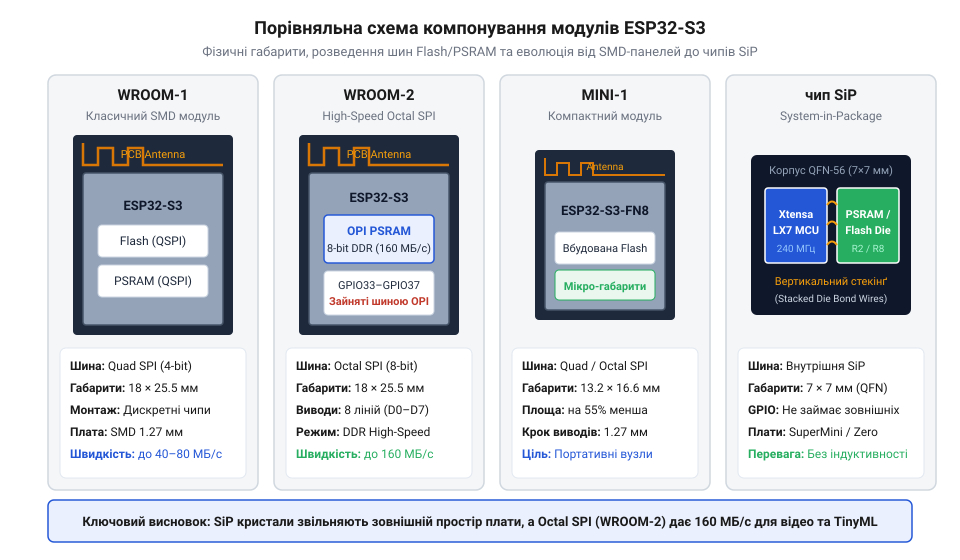
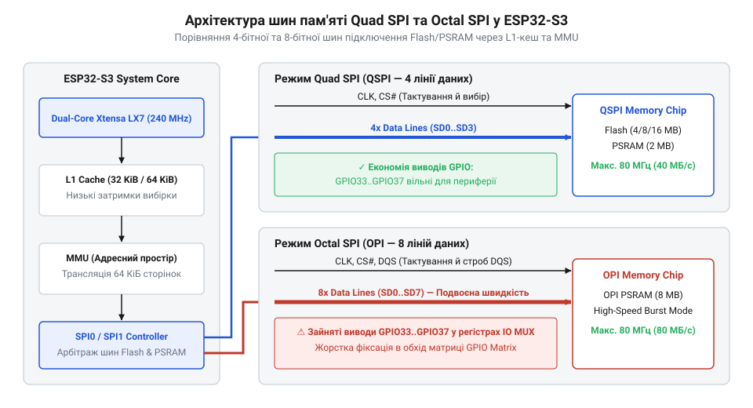
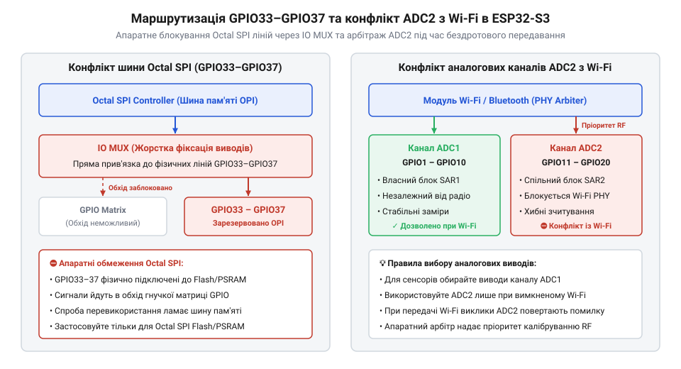

# Родина плат і модулів на ESP32-S3

<preknowlist>
- [Мікроконтролер ESP32-S3](root:cat-hw-boards/esp32s3-microcontroller) — архітектура ядра Xtensa LX7, підсистема L1-кешу та базовий комутатор IO MUX
- [Модуль ESP32-CAM: огляд архітектури, периферії та сімейства плат](root:cat-hw-boards/esp32-cam-camera-module-family) — базові вимоги до обсягів кадрових буферів та шин оперативної пам'яті при відеообробці
- [Waveshare ESP32-S3R2 (16 МБ Flash, 2 МБ PSRAM)](root:cat-hw-boards/esp32-s3r2-waveshare) — конструктивна специфіка SiP-модулів з інтегрованою оперативною пам'яттю
</preknowlist>

## Пастки вибору платформи ESP32-S3

Розробник, який обирає відлагоджувальну плату або готовий модуль на базі мікроконтролера @@en|ESP32-S3@@ (від англ. @@en|Espressif Systems 32-bit Microcontroller Generation 3@@), нерідко стикається з незрозумілими апаратними збоями під час запуску складних проєктів. Наприклад, спроба обробити відеопотік із паралельної камери або виконати інференс нейромережі @@en|TinyML@@ (від англ. @@en|Tiny Machine Learning@@ — компактні машинні алгоритми) раптово спричиняє падіння кадрової частоти та затримки виконання інструкцій. В іншому випадку підключення зовнішнього датчика до, здавалося б, вільного цифрового контакту призводить до негайного падіння процесора при спробі зчитати дані з оперативної пам'яті. Причина цих проблем полягає у схемотехнічних відмінностях між модифікаціями чипа та варіантами шин підключення зовнішньої пам'яті.

Апаратна платформа @@en|ESP32-S3@@ поєднує двоядерний 32-бітний процесор @@en|Xtensa LX7@@ із векторними інструкціями @@en|PIE@@ (від англ. @@en|Processor Instruction Extension@@) та гнучку підсистему пам'яті. Для роботи з ємними кадровими буферами та тензорами нейромереж внутрішнього обсягу @@en|SRAM@@ (від англ. @@en|Static Random-Access Memory@@ — статична оперативна пам'ять) не вистачає, тому на платах встановлюють зовнішню псевдостатичну оперативну пам'ять (від англ. @@en|pseudo-static random-access memory@@, @@en|PSRAM@@) та флеш-пам'ять @@en|Flash@@ (від англ. @@en|Flash Memory@@). Проте швидкість обміну даними та кількість доступних виводів загального призначення (від англ. @@en|General-Purpose Input/Output@@, @@en|GPIO@@) прямо залежать від того, якою шиною під'єднано кристали пам'яті — 4-бітною @@en|Quad SPI@@ чи 8-бітною @@en|Octal SPI@@.

Додатковим джерелом помилок стає комутація периферійних ліній та електроживлення. У разі використання 8-бітної шини @@en|Octal SPI@@ контролер виводів (від англ. @@en|Input/Output Multiplexer@@, @@en|IO MUX@@) апаратно вилучає лінії `GPIO33`–`GPIO37` із загальної матриці (від англ. @@en|GPIO Matrix@@ — матриця входів-виходів) і жорстко прив'язує їх до шини пам'яті. Спроба програмно переналаштувати ці виводи під звичайний цифровий вхід розриває зв'язок із кристалом пам'яті, породжуючи фатальний виняток процесора. Одночасна робота шини @@en|Octal SPI@@ та спалахи споживання модуля @@en|Wi-Fi@@ (від англ. @@en|Wireless Fidelity@@) створюють пікові сплески струму до `500 мА`. Якщо на платі відсутній виділений лінійний регулятор напруги з малим падінням (від англ. @@en|Low-DropOut Regulator@@, @@en|LDO@@) або фільтрувальні конденсатори з низьким еквівалентним послідовним опором, імпульсне падіння напруги викликає несподівані перезавантаження через апаратний захист від просідання живлення. Водночас вимірювання аналогових сигналів на контактах `ADC2` (від англ. @@en|Analog-to-Digital Converter 2@@ — аналогово-цифровий перетворювач 2) блокується під час передачі радіопакетів @@en|Wi-Fi@@. Детальні параметри електричних обмежень та карти виводів містить [апаратна специфікація та розпіновка](root:cat-hw-boards/esp32-s3-boards-family-overview/api-esp32s3-boards-pinout-hardware-spec.md) плат серії.

Усі ці підводні камені роблять попереднє планування архітектури вирішальним етапом розробки. Щоб уникнути апаратних конфліктів та раптових скидань прошивки, розробник має зіставити розпіновку потрібних периферійних модулів із типом шини зовнішньої пам'яті ще до проєктування схемотехніки. Наприклад, для завдань із високими вимогами до пропускної здатності кадрових буферів або масивів вагових коефіцієнтів доцільно обирати конфігурацію @@en|Octal SPI@@, заздалегідь враховуючи вилучення п'яти виводів @@en|GPIO@@ та резервуючи аналогові вимірювання виключно за першим блоком @@en|ADC1@@ (від англ. @@en|Analog-to-Digital Converter 1@@ — аналогово-цифровий перетворювач 1). Натомість для стандартних пристроїв автоматизації без обробки відеопотоків оптимальним вибором залишається 4-бітна шина @@en|Quad SPI@@, яка звільняє виводи для датчиків і знижує навантаження на систему живлення. Глибоке розуміння того, як влаштований [мікроконтролер ESP32-S3](root:cat-hw-boards/esp32s3-microcontroller) на рівні комутації пам'яті та периферії, дозволяє свідомо обрати оптимальну плату під конкретне завдання.

Практичний вибір конфігурації платформи зручно розглянути на двох протилежних сценаріях навантаження. Для автономної системи розпізнавання облич на базі нейромережі @@en|TinyML@@ із підключенням QVGA-камери потрібна обробка масивів даних зі швидкістю понад 15 кадрів за секунду, що вимагає виключно 8-бітної шини @@en|Octal SPI@@ та модуля з 8 МБ оперативної пам'яті @@en|PSRAM@@. У цьому разі розробник заздалегідь відмовляється від використання ліній `GPIO33`–`GPIO37`, обирає плату з підсиленим регулятором @@en|LDO@@ та підключає аналогові сенсори освітленості до каналів @@en|ADC1@@. Натомість для портативного датчика екологічного моніторингу з періодичною передачею даних по @@en|Wi-Fi@@ пріоритетом є мінімальне енергоспоживання та компактні габарити. Для такого завдання вигідніше обрати плату на кшталт [ESP32-S3-Zero](root:cat-hw-boards/esp32-s3-zero) з 4-бітною шиною @@en|Quad SPI@@, де всі виводи загального призначення @@en|GPIO@@ лишаються доступними для підключення цифрових сенсорів, а відсутність громіздкої 8-бітної оперативної пам'яті зменшує струм у режимі глибокого сну.

## Еволюція та класифікація модулів

Широкий асортимент готових модулів Espressif покликаний спростити проєктування пристроїв, пропонуючи збалансовані рішення під різні розміри та вимоги до обсягу пам'яті. Базовою лінійкою сімейства є серія @@en|WROOM-1@@ (від англ. @@en|Wireless Room Module 1@@), яка виготовляється в металевому екранованому корпусі із вбудованою друкованою антеною або роз'ємом @@en|IPEX@@ (від англ. @@en|IPEX Connector@@) під зовнішній випромінювач. Усередині модуля розташовано кристал чипа @@en|ESP32-S3@@, флеш-пам'ять @@en|Flash@@ обсягом 4, 8 або 16 МБ та опціональну псевдостатичну пам'ять @@en|PSRAM@@ на 2 або 8 МБ. Модулі серії @@en|WROOM-1@@ зазвичай використовують 4-бітну шину @@en|Quad SPI@@, що залишає більшість виводів `GPIO` вільними для підключення зовнішньої периферії.

Для застосунків із підвищеними вимогами до швидкості обміну даними створено серію @@en|WROOM-2@@. Ключовою відмінністю цієї модифікації є застосування 8-бітної шини @@en|Octal SPI@@ для підключення високошвидкісної пам'яті @@en|PSRAM@@ обсягом 8 або 16 МБ. Така схемотехніка подвоює пропускну здатність при роботі з кадровими буферами [модуля ESP32-CAM](root:cat-hw-boards/esp32-cam-camera-module-family), однак вимагає збільшеної площі корпусу та задіює додаткові лінії `GPIO` під шину пам'яті. Зі свого боку, серія @@en|MINI-1@@ орієнтована на надкомпактні пристрої: вона має зменшений крок контактних площадок та використовує SiP-компонування (від англ. @@en|System-in-Package@@ — система в корпусі), де кристали процесора та пам'яті змонтовано на спільній підкладці під єдиним компаундом.


*Конструктивні відмінності формфакторів модулів ESP32-S3 та розташування шин пам'яті.*

Окрім стандартних модулів із поверхневим монтажем @@en|SMD@@ (від англ. @@en|Surface-Mount Device@@), випускаються чипи в корпусах @@en|SiP@@, такі як чип @@en|ESP32-S3R2@@ з 2 МБ вбудованої пам'яті @@en|PSRAM@@. На базі цього чипа побудовано компактну плату [Waveshare ESP32-S3R2](root:cat-hw-boards/esp32-s3r2-waveshare), яка об'єднує 16 МБ флеш-пам'яті та двомегабайтну оперативну пам'ять без потреби у зовнішніх мікросхемах. Хронологічний розвиток формфакторів платформи та огляд еволюції від перших чипів висвітлює [історична вставка розвитку модулів](root:cat-hw-boards/esp32-s3-boards-family-overview/hist-esp32-s3-modules-and-boards-evolution.md).

Важливим критерієм вибору між модулями є тепловий режим під тривалим обчислювальним навантаженням алгоритмів @@en|TinyML@@. Металевий екран модулів серії @@en|WROOM@@ виконує роль ефективного вирівнювача тепла (від англ. @@en|heat spreader@@), розподіляючи теплове випромінювання від процесорного ядра по всій площі металевої кришки й запобігаючи виникненню локальних точок перегріву. Натомість відкриті корпуси чипів @@en|SiP@@ з епоксидним компаундом вимагають продуманого відведення тепла через внутрішні мідні шари друкованої плати та перехідні отвори під заземлювальною площадкою, оскільки без додаткового охолодження локальний перегрів викликає автоматичне зниження тактової частоти процесора.

Окрім теплового режиму, геометричні параметри та вибір типу антенного блоку визначають успішність компонування модуля у кінцевому корпусі. У разі використання модифікацій @@en|WROOM-1@@ із друкованою інвертованою F-антеною (від англ. @@en|Inverted-F Antenna@@, @@en|IFA@@) на материнській платі необхідно залишати сувору зону відчуження (від англ. @@en|keepout zone@@) без мідних полігонів та сигнальних треків під консольним виступом модулю. Проте якщо пристрій розміщується у закритому металевому корпусі чи герметичному шасі, друкована антена повністю екранується і втрачає узгодження. У таких умовах єдино можливим рішенням стає застосування модулів із роз'ємом @@en|IPEX@@, який дозволяє вивести зовнішню антену через коаксіальний кабель за межі металевого екрану. Це вимагає урахування додаткового радіуса вигину високочастотного кабелю та дотримання геометричних допусків висоти монтажу, що є критичним для компактних пристроїв на кшталт [модуля ESP32-CAM](root:cat-hw-boards/esp32-cam-camera-module-family) в умовах щільного приладового збирання.

## Шини Quad SPI та Octal SPI

Продуктивність обробки даних у мікроконтролері @@en|ESP32-S3@@ безпосередньо обмежена швидкодією послідовного інтерфейсу периферії (від англ. @@en|Serial Peripheral Interface@@, @@en|SPI@@), яким чип звертається до зовнішніх мікросхем пам'яті. У конфігурації @@en|Quad SPI@@ (від англ. @@en|Quad Serial Peripheral Interface@@, @@en|QSPI@@) передача здійснюється чотирма паралельними лініями даних `SD0`–`SD3`. За частоти шини `80 МГц` теоретична пропускна здатність становить:

```
B_qspi = F_bus × N_lines ÷ 8
= 80 · 10⁶ × 4 ÷ 8                   [множення частоти на 4 біти та переведення в байти]
= 40 · 10⁶ Байт/с                    [пропускна здатність 40 МБ/с]
```

Для багатьох задач автоматики цієї швидкості достатньо, але під час одночасного зчитування відеокадру через контролер прямого доступу до пам'яті (від англ. @@en|Direct Memory Access@@, @@en|DMA@@) та виконання інференсу нейромережі виникає дефіцит смуги пропускання. Перехід на 8-бітний інтерфейс @@en|Octal SPI@@ (від англ. @@en|Octal Serial Peripheral Interface@@, @@en|OPI@@) задіює вісім ліній даних `SD0`–`SD7` та підтримку режиму подвійної передачі (від англ. @@en|Double Data Rate@@, @@en|DDR@@), що подвоює зчитування за такт. Пропускна здатність шини @@en|Octal SPI@@ досягає `80 МБ/с` на частоті `80 МГц`, усуваючи просідання кадрової частоти при буферизації.


*Архітектура підключення шин Quad SPI та Octal SPI через кеш-контролер L1 та блок MMU.*

Згладжування затримок прямого звернення до зовнішньої псевдостатичної пам'яті покладається на блок управління пам'яттю (від англ. @@en|Memory Management Unit@@, @@en|MMU@@) та двоканальний кеш першого рівня обсягом 32 КБ на ядро (від англ. @@en|L1 Cache@@). Блок @@en|MMU@@ відображає віртуальні адреси процесора [мікроконтролера ESP32-S3](root:cat-hw-boards/esp32s3-microcontroller) на фізичні сектори @@en|PSRAM@@. При промаху кешу (від англ. @@en|cache miss@@) ядро витрачає від 16 до 32 тактів на завантаження 32-байтного рядка з зовнішньої шини. У двоядерній архітектурі паралельний доступ процесорів `CPU0` та `CPU1` до спільних масивів у пам'яті @@en|PSRAM@@ вимагає підтримки когерентності кешу (від англ. @@en|L1 Cache Coherence@@). За це відповідає апаратний арбітр стеження (від англ. @@en|Snoop Controller@@): коли одне ядро модифікує рядок у своєму кеші, арбітр надсилає сигнал інвалідації (від англ. @@en|Cache Invalidation@@) сусідньому ядру, позначаючи застарілі дані й примушуючи його повторно зчитати оновлений рядок із шини. Математичну модель затримок та детальний розрахунок пропускної здатності наведено у [математичному аналізі шин пам'яті](root:cat-hw-boards/esp32-s3-boards-family-overview/math-spi-bus-throughput-and-psram-latency.md).

Для практичної оцінки швидкодії розробник може провести [співставне тестування продуктивності PSRAM](root:cat-hw-boards/esp32-s3-boards-family-overview/proj-esp32s3-psram-performance-benchmark.md) на реальних платах з різними типами шин. Налаштування режимів роботи пам'яті та активізація прапорця `CONFIG_SPIRAM_MODE_OCTAL` виконуються у конфігураційному файлі фреймворку, про що детально описує [програмний довідник sdkconfig](root:cat-hw-boards/esp32-s3-boards-family-overview/api-esp32s3-sdkconfig-psram-usb-config.md).

## Апаратне обмеження розпіновки та периферії

Розпиновка мікроконтролера @@en|ESP32-S3@@ налічує 45 програмованих виводів `GPIO`, проте їх використання вимагає урахування апаратного розподілу шин та блоків периферії. У платах із 4-бітною шиною @@en|Quad SPI@@ зарезервовано лише лінії `GPIO26`–`GPIO32` для з'єднання з флеш-пам'яттю @@en|Flash@@. Коли ж у системі застосовується 8-бітна шина @@en|Octal SPI@@ (наприклад, у модулях @@en|WROOM-2@@ або платах з оперативною пам'яттю @@en|PSRAM@@ на 8 чи 16 МБ), шина додатково займає контакти `GPIO33`, `GPIO34`, `GPIO35`, `GPIO36` та `GPIO37`.

Причина неможливості використання виводів `GPIO33`–`GPIO37` криється в архітектурі мультиплексора виводів @@en|IO MUX@@. При включенні режим `Octal SPI` апаратно відключає ці п'ять виводів від гнучкої перехресної матриці @@en|GPIO Matrix@@ та жорстко комутує їх на високошвидкісні регістри контролера пам'яті. Якщо розробник спробує ініціалізувати будь-який з цих контактів як цифровий вхід чи вихід під зовнішню кнопку або датчик, комутатор `IO MUX` розриває лінію зв'язку з пам'яттю, що викликає миттєвий збій читання команд і аварійне перезавантаження прошивки.


*Апаратне блокування виводів IO MUX для Octal SPI та взаємодія каналів ADC2 з арбітром Wi-Fi.*

Другим принциповим обмеженням є організація аналогових блоків. Блок `ADC1` (виводи `GPIO1`–`GPIO10`) є автономним і дозволяє проводити точнове вимірювання напруги без перешкод. Натомість канали блоку `ADC2` (виводи `GPIO11`–`GPIO20`) апаратно розділені з контролером бездротового зв'язку @@en|Wi-Fi@@. Під час активної передачі мережевих пакетів апаратний арбітр блокує перетворювач `ADC2`, унаслідок чого виклики функцій зчитання напруги повертають помилку доступу або скинуті значення. Повну карту обмежень та схемотехніку виводів описує [апаратна специфікація та розпіновка](root:cat-hw-boards/esp32-s3-boards-family-overview/api-esp32s3-boards-pinout-hardware-spec.md).

У фреймворку розробки @@en|ESP-IDF@@ (від англ. @@en|Espressif IoT Development Framework@@) захист від конфліктів доступу до блоку `ADC2` реалізовано через системне м'ютекс-блокування (від англ. @@en|mutex@@ — взаємне виключення). Під час виклику функції зчитування аналогового сигналу драйвер намагається захопити апаратний м'ютекс; якщо в цей момент модуль @@en|Wi-Fi@@ виконує калібрування вихідного каскаду чи передачу кадру, виклик переходить у стан очікування на заданий тайм-аут (від англ. @@en|timeout@@). У разі тривалої радіоактивності системна функція припиняє виконання та повертає код помилки `ESP_ERR_TIMEOUT`, тому розробники мусять передбачати обробку цього коду в повторних циклах опитування або примусово прив'язувати критичні вимірювальні датчики до каналів автономного блоку `ADC1`.

У підсумку правильне проєктування периферійних інтерфейсів вимагає чіткого розмежування виводів за їхнім апаратним призначенням. Для точних вимірювальних датчиків, прецизійних сенсорів струму чи аналогових клавіатур слід обирати виключно канали `ADC1`, звільняючи блок `ADC2` від часових залежностей радіомодуля @@en|Wi-Fi@@. Водночас цифрові шини на кшталт @@en|I2C@@ (від англ. @@en|Inter-Integrated Circuit@@ — міжмікросхемна шина даних) або @@en|SPI@@ (від англ. @@en|Serial Peripheral Interface@@ — послідовний периферійний інтерфейс) безпечно розподіляються через комутаційну матрицю @@en|GPIO Matrix@@ на будь-які вільні виводи, що не перетинаються з лініями пам'яті. Такий систематичний підхід до картографування сигналів дозволяє гарантувати стабільну роботу прошивки навіть при розробці надкомпактних пристроїв, де кожна ніжка плати на кшталт [мікроконтролерна плата ESP32-S3 SuperMini](root:cat-hw-boards/esp32-s3-supermini-pinout-and-power) виконує критичну функцію.

## Нативний USB та одноплатники

Важливою перевагою мікроконтролера @@en|ESP32-S3@@ є вбудований контролер @@en|USB Serial/JTAG@@ (від англ. @@en|USB Communication Device Class / Joint Test Action Group@@, @@en|CDC/JTAG@@), під'єднаний до виводів `GPIO19` (лінія `USB D-`) та `GPIO20` (лінія `USB D+`). Контролер комбінує функції віртуального послідовного порту для виводу логів та апаратного адаптера @@en|JTAG@@ для інтерактивного дебагінгу прошивки без залучення зовнішніх мостів на чипах @@en|CP2102@@ чи @@en|CH340@@. Вбудований у завантажувальне ПЗУ драйвер дозволяє прошивати пристрій безпосередньо через кабель @@en|USB-C@@, спрощуючи схемотехніку й знижуючи собівартість розробницьких плат.

Наявність нативного USB та компактного корпусу чипа зумовила появу серії ультрамалих одноплатників. Компактна плата [ESP32-S3-Zero](root:cat-hw-boards/esp32-s3-zero) виконана у форматі `18 × 23.5 мм` із контактами для поверхневого монтажу та роз'ємом @@en|USB-C@@. Вона містить 4 МБ флеш-пам'яті @@en|Flash@@ та використовує 4-бітну шину @@en|Quad SPI@@, що залишає вільними більшість периферійних виводів. Іншим популярним рішенням є відлагоджувальна плата [ESP32-S3 SuperMini](root:cat-hw-boards/esp32-s3-supermini), яка мінімізує обв'язку та пропонує двостороннє розташування компонентів для інтеграції у компактні корпуси. Схемотехніка живлення обох одноплатників підтримує входи `5V` (живлення від шини USB), `3.3V` (вихід лінійного регулятора) та контакт `VBAT` для підключення літій-полімерного акумулятора. Через відсутність великих електролітичних ємностей у надкомпактному формфакторі розробники мусять встановлювати додаткові танталові фільтрувальні конденсатори ємністю `10`–`47 мкФ` паралельно з керамікою `100 нФ` біля контактів живлення, щоб запобігти падінню напруги нижче порту скидання під час пікових спалахів випромінювача @@en|Wi-Fi@@. Схемотехніку розведення ніжок та підключення периферії детально описує [одноплатник ESP32-S3-Zero](root:cat-hw-boards/esp32-s3-zero-compact-board).

Окреме місце посідає плата [Waveshare ESP32-S3R2](root:cat-hw-boards/esp32-s3r2-waveshare), яка поєднує SiP-кристал з 2 МБ пам'яті @@en|PSRAM@@ та 16 МБ флеш-пам'яті. Завдяки високій щільності монтажу та інтегрованому понижувальному регуляторові напруги з низьким падінням (від англ. @@en|Low-DropOut Regulator@@, @@en|LDO@@) ця плата забезпечує живлення периферії без просідань струму під час пікових спалахів @@en|Wi-Fi@@. Порівняльне тестування швидкодії пам'яті та інтерфейсів цих одноплатників наведено у [практичному проєкті тестування PSRAM](root:cat-hw-boards/esp32-s3-boards-family-overview/proj-esp32s3-psram-performance-benchmark.md), а програмні прапорці налаштування нативного USB у середовищі розробки розкрито в [довіднику конфігурації sdkconfig](root:cat-hw-boards/esp32-s3-boards-family-overview/api-esp32s3-sdkconfig-psram-usb-config.md).
