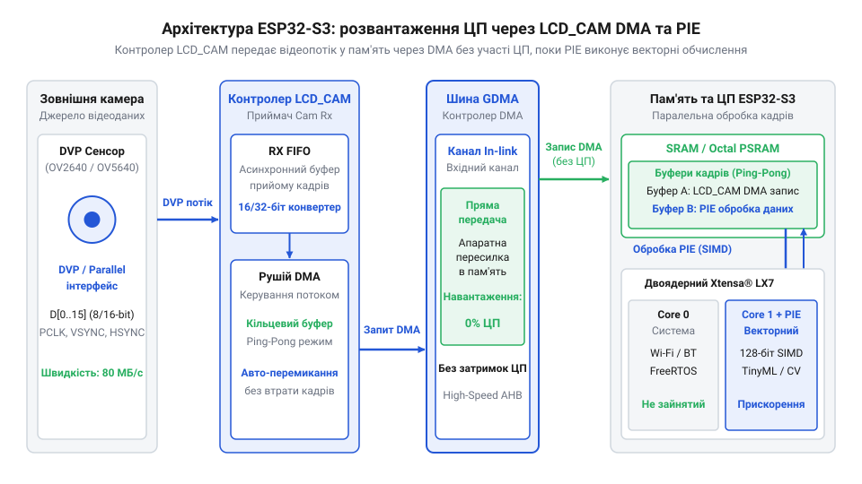
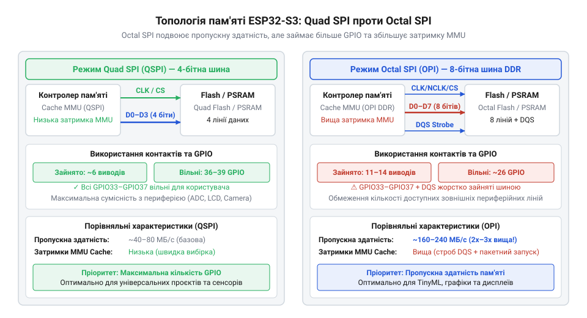
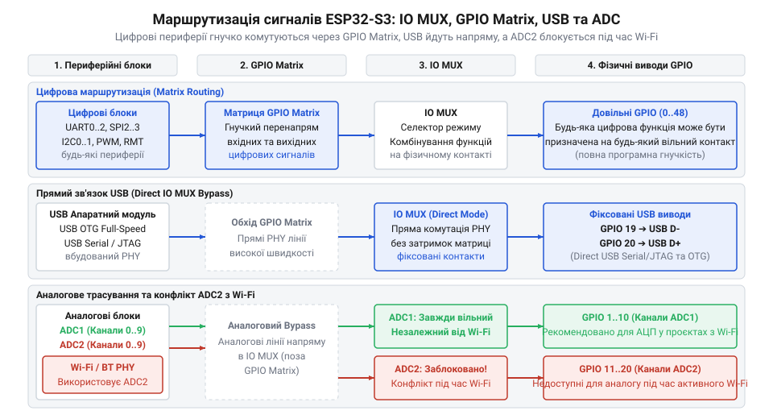
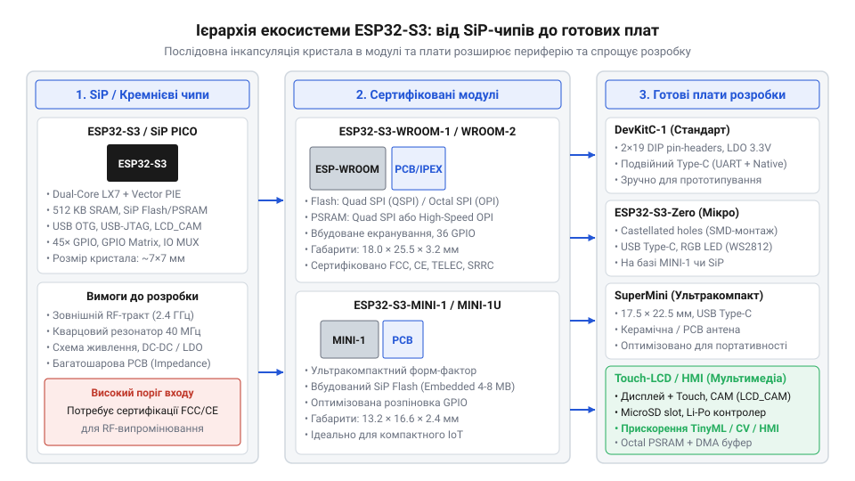
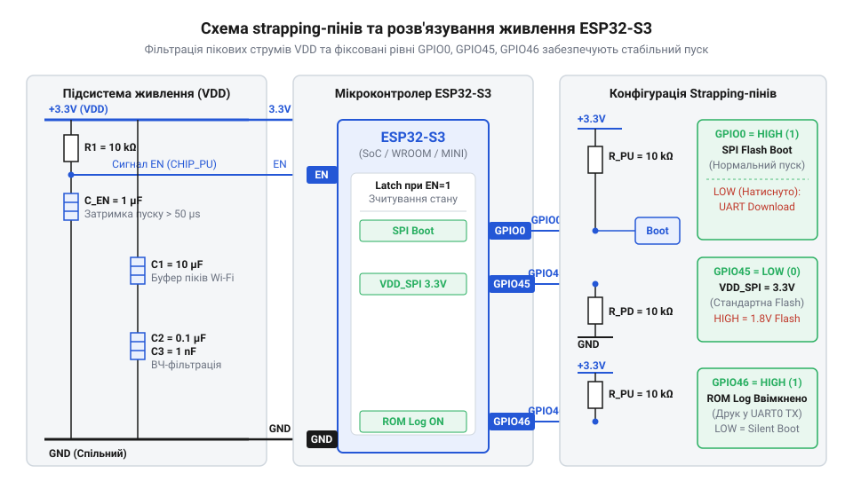

# Родина плат і модулів на ESP32-S3

<preknowlist>
- [Мікроконтролер ESP32-S3](root:cat-hw-boards/esp32s3-microcontroller) — базові архітектурні характеристики та внутрішню структуру ядра ESP32-S3
- [Модулі ESP32-S3-WROOM-1 та WROOM-2](root:cat-hw-boards/esp32-s3-wroom-modules-family) — конструкцію та варіанти виконання базових модулів WROOM
- [Модуль ESP32-CAM: огляд архітектури, периферії та сімейства плат](root:cat-hw-boards/esp32-cam-camera-module-family) — особливості підключення камери та картки пам'яті в класичному сімействі ESP32
</preknowlist>

## Архітектурний стрибок та підсистема обчислень ESP32-S3

Розробка сучасних пристроїв інтернет-речей та систем крайового обчислення висуває високі вимоги до обробки даних у реальному часі. Під час створення пристроїв комп'ютерного зору або локального аналізу сигналів розробники класичних мікроконтролерів @@en|ESP32@@ неминуче зіштовхуються з апаратним вузьким місцем. Спроба обробити кадрові потоки з відеокамери або виконати математичний вивід нейромережі на двох скалярних ядрах призводить до різкого зростання затримок. Скалярне ядро змушене послідовно виконувати кожну операцію множення з додаванням для кожного елемента масиву, а пересилання сирих байтів кадру з периферії у пам'ять програмно завантажує процесор обробкою переривань. У результаті процесорні ядра витрачають майже весь свій тактовий ресурс на рутинне переміщення байтів та циклічні обчислення, не залишаючи обчислювальної потужності для бездротового стека @@en|Wi-Fi@@ чи @@en|Bluetooth@@.

Еволюція мікроконтролерів серії Espressif продемонструвала чіткий перехід від простих бездротових чіпів до потужних обчислювальних платформ. Базовий чіп @@en|ESP8266@@ започаткував масову доступність @@en|Wi-Fi@@ для інтернет-речей, а оригінальний @@en|ESP32@@ додав друге ядро @@en|Xtensa LX6@@ та @@en|Bluetooth@@. Однак зростання вимог до крайових обчислень зумовило появу @@en|ESP32-S2@@ із покращеною безпекою, а згодом — вихід розширеного сімейства @@en|ESP32-S3@@. Нова архітектура перейшла на двоядерні 32-бітні ядра @@en|Xtensa LX7@@ із підтримкою векторних інструкцій @@en|Processor Instruction Extension@@ (від англ. _processor_ — процесор, _instruction_ — інструкція, _extension_ — розширення; скорочено @@en|PIE@@) для завдань @@en|TinyML@@ (від англ. _tiny_ — крихітний, _machine learning_ — машинне навчання). Крім того, інженери Espressif інтегрували високошвидкісний восьмибітний шинний інтерфейс @@en|Octal SPI@@ для оперативної пам'яті та Flash-накопичувачів, а також нативний контролер @@en|USB OTG@@ (від англ. _On-The-Go_) поруч із відлагоджувачем @@en|USB Serial/JTAG@@. Саме обмеження продуктивності та шини попередніх поколінь змусили створити @@en|ESP32-S3@@ як універсальну основу для мультимедійних пристроїв та штучного інтелекту.

Для подолання цих обмежень розробники перейшли на [двореактивні процесорні ядра](root:hw-arch/esp32-s3-microcontroller-architecture) @@en|Xtensa LX7@@, що мають вбудоване векторне розширення. Архітектурне розширення @@en|PIE@@ додає до стандартної системи команд @@en|Xtensa@@ нові векторні інструкції та 128-бітні векторні регістри. Завдяки концепції @@en|Single Instruction Multiple Data@@ (від англ. _single_ — один, _instruction_ — інструкція, _multiple_ — багаторазовий, _data_ — дані; скорочено @@en|SIMD@@) векторний рушій здатний виконати одну операцію над кількома елементами даних паралельно за один тактовий цикл процесора. Зокрема, за один такт рушій @@en|PIE@@ може здійснити чотири 16-бітних або вісім 8-бітних операцій множення з накопиченням (від англ. _multiply-accumulate_, @@en|MAC@@). Під час розрахунку згорткових шарів нейромереж чи фільтрації сигналів це дає прискорення математичних обчислень у 3–5 разів порівняно зі скалярним ядром @@en|Xtensa LX6@@. Практична побудова такого вузла детально описана в матеріалі про [системи крайового комп'ютерного зору](root:cat-hw-boards/esp32-s3-boards-family-overview/proj-esp32-s3-tinyml-vector-camera-pipeline.md) на базі плати з модулем @@en|N16R8@@.

Проте висока швидкість обчислювального ядра втрачає сенс, якщо вхідні дані надходять із затримками. У мультимедійних системах вхідний кадр із камери має безперервно передаватися в оперативну пам'ять, а сформований кадр зображення — виводитися на дисплей. Паралельне приймання відеоданих здійснює [спеціалізований периферійний контролер](root:hw-arch/esp32-s3-lcd-cam-bus-interface) @@en|LCD_CAM@@, який працює незалежно від обчислювальних ядер. Контролер містить окремий підблок камери @@en|CAM@@ із підтримкою 8-бітної або 16-бітної паралельної шини даних @@en|DVP@@ (від англ. _Digital Video Port_) та підблок дисплея @@en|LCD@@ з підтримкою шин @@en|RGB565@@ та @@en|I8080@@.

Ключова перевага @@en|LCD_CAM@@ полягає у його прямому зв'язку з підсистемою @@en|Direct Memory Access@@ (від англ. _direct_ — прямий, _memory_ — пам'ять, _access_ — доступ; скорочено @@en|DMA@@). Під час захоплення кадру контролер @@en|CAM@@ приймає тактові сигнали пікселів @@en|PCLK@@, строби рядків @@en|HREF@@ та кадрів @@en|VSYNC@@, після чого апаратний @@en|DMA@@-рушій самостійно записує байтовий потік у кільцеві буфери у внутрішній пам'яті @@en|SRAM@@ (від англ. _Static Random Access Memory_) або у зовнішній @@en|PSRAM@@. На відміну від систем попереднього покоління на базі [класичної плати розробки](root:cat-hw-boards/esp32-cam), новий контролер не вимагає програмного опитування виводів або обробки кожного прийнятого байта через переривання. Процесорні ядра @@en|Xtensa LX7@@ повністю звільняються від рутинного пересилання кадрових даних і підключаються до обробки лише тоді, коли апаратний @@en|DMA@@ завершує запис цілого буфера. Конфігурація кільцевих буферів реалізується через [низькорівневі виклики функцій](root:cat-hw-boards/esp32-s3-boards-family-overview/api-esp32-s3-system-config-and-peripherals-api.md) у середовищі @@en|ESP-IDF@@ (від англ. _Espressif IoT Development Framework_).


_Взаємодія обчислювальних ядер Xtensa LX7 з периферійним контролером LCD_CAM та пам'яттю через шину DMA._

Завдяки синергії векторного рушія @@en|PIE@@ та апаратного розвантаження через @@en|LCD_CAM DMA@@, мікроконтролер @@en|ESP32-S3@@ усуває затримки обробки мультимедіа та забезпечує високу частоту кадрів без перевантаження операційної системи реального часу @@en|FreeRTOS@@.

## Організація пам'яті та шинні компроміси

Апаратне прискорення обчислень та автоматична передача кадрових потоків через @@en|DMA@@ висувають високі вимоги до підсистеми пам'яті. Внутрішня оперативна пам'ять @@en|SRAM@@ обсягом 512 КБ забезпечує найвищу швидкість доступу з мінімальними затримками, проте її обсягу недостатньо для збереження декількох кадрових буферів високої роздільної здатності та вагових коефіцієнтів глибоких нейромереж. Тому реальні проєкти на @@en|ESP32-S3@@ спираються на зовнішню енергонезалежну пам'ять @@en|Flash@@ та зовнішню оперативну пам'ять @@en|Pseudo Static RAM@@ (від англ. _pseudo_ — несправжній, _static_ — статичний; скорочено @@en|PSRAM@@). Для підтримки високого кадрового потоку потрібне [підключення високошвидкісної пам'яті](root:com-devices/octal-spi-psram-architecture) через розширену шину даних.

Вся зовнішня пам'ять адресується процесорними ядрами не напряму, а через підсистему трансляції адрес @@en|Memory Management Unit@@ (від англ. _memory_ — пам'ять, _management_ — керування, _unit_ — вузол; скорочено @@en|MMU@@) та швидкісний апаратний кеш. Коли ядро @@en|Xtensa LX7@@ виконує інструкцію або звертається до масиву даних у @@en|PSRAM@@, @@en|MMU@@ перевіряє наявність потрібного блоку у кєш-пам'яті. Якщо виникає промах кешу, процесорне ядро призупиняє виконання інструкцій на час завантаження лінії кешу із зовнішньої шини @@en|SPI@@. Чим нижча пропускна здатність цієї шини, тим довше ядро простоює в очікуванні даних, що нівелює переваги швидкісного векторного рушія @@en|PIE@@. Детальний аналіз часових затримок наведено в матеріалі про [розрахунок пропускної здатності](root:cat-hw-boards/esp32-s3-boards-family-overview/math-esp32-s3-memory-bus-bandwidth-and-gpio-tradeoff.md) підсистеми пам'яті та лімітів виводів.

Для з'єднання з зовнішніми чіпами @@en|Flash@@ та @@en|PSRAM@@ мікроконтролер @@en|ESP32-S3@@ підтримує два основних режими шини @@en|SPI@@:
1. @@en|Quad SPI@@ (від латинського _quattuor_ — чотири; скорочено @@en|QSPI@@) — використовує 4 лінії даних (`D0`–`D3`), одну лінію тактування `CLK` та лінії вибору чіпа `CS`. За один тактовий імпульс передається 4 біти інформації в режимі @@en|Single Data Rate@@ (скорочено @@en|SDR@@) або 8 бітів у режимі @@en|Double Data Rate@@ (скорочено @@en|DDR@@).
2. @@en|Octal SPI@@ (від грецького _okto_ — вісім; скорочено @@en|OSPI@@ або @@en|OPI@@) — використовує розширену 8-бітну шину даних (`D0`–`D7`), лінію тактування `CLK`, додатковий строб даних @@en|DQS@@ (від англ. _Data Strobe_) та лінії `CS`. Передача 8 бітів за такт у режимі @@en|SDR@@ або 16 бітів за такт у режимі @@en|DDR@@ удвічі збільшує обсяг даних, що передаються за кожен тактовий цикл.

Розрахуємо теоретичну пропускну здатність шини пам'яті `B` (вимірюється в мегабайтах за секунду, МБ/с). Пропускна здатність обчислюється як добуток тактової частоти шини `f` (у мегагерцах, МГц), розрядності шини `w` (у бітах) та коефіцієнта передачі за такт `m` (`m = 1` для @@en|SDR@@, `m = 2` для @@en|DDR@@), поділений на 8 біт у байті.

Формула для обчислення пропускної здатності шини має такий вигляд:

```
B = (f × w × m) ÷ 8
= (f × w × m) ÷ 8      [застосовано переведення бітів у байти]
```

**Обчислення пропускної здатності для різних режимів шини пам'яті ESP32-S3:**

```
1. Quad SPI SDR на частоті 80 МГц (f = 80, w = 4, m = 1):
B = (80 × 4 × 1) ÷ 8
  = 320 ÷ 8              [множення частоти на розрядність]
  = 40 МБ/с              [ділення на 8 біт/байт]

2. Octal SPI DDR на частоті 80 МГц (f = 80, w = 8, m = 2):
B = (80 × 8 × 2) ÷ 8
  = 1280 ÷ 8             [множення частоти, розрядності та DDR]
  = 160 МБ/с             [ділення на 8 біт/байт]

3. Octal SPI DDR на частоті 120 МГц (f = 120, w = 8, m = 2):
B = (120 × 8 × 2) ÷ 8
  = 1920 ÷ 8             [множення частоти, розрядності та DDR]
  = 240 МБ/с             [ділення на 8 біт/байт]
```

Як видно з розрахунку, перехід з @@en|Quad SPI SDR@@ на @@en|Octal SPI DDR@@ підвищує пропускну здатність шини з 40 МБ/с до 160 МБ/с (у 4 рази). Це принципово скорочує час завантаження ліній кешу @@en|MMU@@ і дозволяє читати важкі вагові матриці @@en|TinyML@@ без призупинення процесора.

Однак максимальна швидкість шини пам'яті вимагає суттєвого апаратного компромісу. Фізичні виводи кристала @@en|ESP32-S3@@ є обмеженим ресурсом. Застосування @@en|Quad SPI@@ вимагає 6 виводів @@en|GPIO@@ для Flash і ще 1-2 додаткові лінії для @@en|PSRAM@@. Натомість режим @@en|Octal SPI@@ задіює 8 ліній даних, лінії @@en|DQS@@, `CLK`, `CS0` та `CS1` — загалом від 11 до 12 виводів @@en|GPIO@@ (зокрема виводи `GPIO33`–`GPIO37` та суміжні).

У готових системних модулях із 8-бітною пам'яттю @@en|Octal SPI@@ ці виводи розводяться всередині екранованого корпусу безпосередньо до чіпів @@en|Flash@@ та @@en|PSRAM@@. Через це вони стають недоступними на зовнішніх гребінках плати і не можуть бути розведені через @@en|IO MUX@@ чи @@en|GPIO Matrix@@ під користувацькі периферійні інтерфейси. У результаті використання 8-бітної пам'яті зменшує кількість доступних розробнику контактів @@en|GPIO@@ орієнтовно з 36 до 26. Такі характеристики притаманні модифікаціям [готових системних модулів](root:cat-hw-boards/esp32-s3-wroom-modules-family) серій @@en|WROOM-1@@ та @@en|WROOM-2@@. Для порівняння, плати на зразок [компактної плати розробки](root:cat-hw-boards/esp32-s3r2-waveshare) використовують вбудований SiP-чіп із 2 МБ @@en|PSRAM@@ в режимі @@en|Quad SPI@@, що зберігає більшу кількість виводів @@en|GPIO@@ для підключення датчиків та периферії.


_Схемотехнічні відмінності шин Quad SPI та Octal SPI та їхній вплив на кількість вільних виводів GPIO._

Таким чином, вибір між @@en|Quad SPI@@ та @@en|Octal SPI@@ є ключовим інженерним рішенням під час проєктування пристрою: @@en|Octal SPI@@ забезпечує найвищу швидкість обміну з пам'яттю за рахунок зменшення кількості виводів @@en|GPIO@@, тоді як @@en|Quad SPI@@ вивільняє більше контактів для зовнішньої периферії за помірної пропускної здатності.

## Маршрутизація сигналів, USB та аналогові обмеження

Вибір високошвидкісного інтерфейсу пам'яті Octal SPI створює жорсткий апаратний компроміс: контролер зовнішньої пам'яті монополізує від 10 до 12 фізичних виводів мікроконтролера (зокрема виводи IO33–IO37), що за класичного жорсткого прив'язування периферії зробило б неможливим підключення зовнішніх датчиків та дисплеїв. Для розв'язання цієї проблеми розробники Espressif розділили фізичні контактні площадки кремнієвого кристала та внутрішні периферійні блоки за допомогою дворівневої підсистеми маршрутизації: блоку `@@en|IO MUX@@` (від англ. @@en|Input/Output Multiplexer@@ — вхідно-вихідний мультиплексор) та матриці `@@en|GPIO Matrix@@` (від англ. @@en|General Purpose Input/Output Matrix@@ — матриця вводу-виводу загального призначення). Блок `@@en|IO MUX@@` забезпечує пряме апаратне з'єднання фізичних виводів із фіксованими критичними за швидкістю блоками (такими як шини пам'яті SPI0/1 або виводи USB JTAG GPIO19/GPIO20). Воно має субнаносекундну затримку розповсюдження сигналу та найвищу частотну пропускну здатність, але не надає жодної гнучкості. Натомість `@@en|GPIO Matrix@@` є повним апаратним кросбаром, який дозволяє комутувати практично будь-який внутрішній вхідний чи вихідний сигнал периферії (UART, I2C, SPI2, PWM, LCD_CAM) на будь-який вільний вивід корпусу. Ціною такої гнучкості є внесення додаткової затримки проходження сигналу в 1–2 такти внутрішньої шини `@@en|APB@@` (що відповідає приблизно 4.16 нс за частоти шини 80 МГц). Для низькочастотних шин ця затримка непомітна, проте для високошвидкісного паралельного виведення даних її слід враховувати. Більш детально розібрати [маршрутизацію в ESP-IDF](root:sf-devices/esp-idf-gpio-matrix-iomux-routing) та конфігураційні регістри допоможе відповідний розділ документації, а також опис системних функцій у [програмному довіднику ESP-IDF](root:cat-hw-boards/esp32-s3-boards-family-overview/api-esp32-s3-system-config-and-peripherals-api.md).


*Підпис:* Архітектура мультиплексування сигналів в ESP32-S3: комутація виводів через IO MUX та GPIO Matrix, зв'язок із периферією, USB-контролерами та блоками ADC.

Структурна організація комутації сигналів чітко демонструє проходження даних від фізичної ніжки чипа до внутрішнього регістру периферійного модуля. Сигнали високої частоти оминають гнучку матрицю і спрямовуються напряму через `@@en|IO MUX@@`, тоді як загальна периферія комутується динамічно. При цьому розробник мусить зважати на апаратні обмеження шини пам'яті, сформульовані під час вибору режимів Quad SPI та Octal SPI, з якими можна ознайомитися у матеріалі з [розрахунком пропускної здатності шини](root:cat-hw-boards/esp32-s3-boards-family-overview/math-esp32-s3-memory-bus-bandwidth-and-gpio-tradeoff.md).

Окремої уваги заслуговує двокомпонентна підсистема `@@en|USB@@` мікроконтролера ESP32-S3, яка усуває потребу у зовнішніх мікросхемах USB-UART перетворювачів (таких як CP2102 чи FT2232H). На кристалі інтегровано два принципово різних USB-контролери: вбудований апаратний відлагоджувач `@@en|USB Serial/JTAG@@` та нативний контролер `@@en|USB OTG@@` (від англ. @@en|USB On-The-Go@@ — USB на ходу). Контролер `@@en|USB Serial/JTAG@@` жорстко підключений через `@@en|IO MUX@@` до виводів GPIO19 (D-) та GPIO20 (D+). Він реалізує на рівні апаратного ROM-коду класичний віртуальний COM-порт (CDC ACM) та інтерфейс `@@en|JTAG@@`. Це дозволяє прошивати мікроконтролер і проводити повноцінне апаратне налагодження з виставленням точок зупинки через `@@en|OpenOCD@@` та `@@en|GDB@@` за допомогою звичайного пасивного USB-кабелю без застосування зовнішніх програматорів. Проте цей контролер працює виключно в режимі веденого пристрою (Device). Натомість повнофункціональний контролер `@@en|USB OTG@@` (стандарту USB 1.1 Full-Speed зі швидкістю до 12 Мбіт/с) здатен працювати як у режимі пристрою, так і в режимі хоста (Host). У режимі хоста ESP32-S3 може самостійно зчитувати USB-флешки, підключати клавіатури, миші або UVC-відеокамери. На практиці обидва контролери можуть ділити спільні лінії GPIO19/GPIO20. Ознайомитися з реалізацією двопортової відлагоджувальної схеми можна у проєкті [станції з USB OTG та JTAG](root:cat-hw-boards/esp32-s3-boards-family-overview/proj-esp32-s3-dual-usb-otg-jtag-station.md), а поглибити знання щодо апаратної специфікації — у матеріалі про роботу з [контролерами USB OTG та JTAG](root:hw-arch/esp32-s3-native-usb-cdc-jtag).

При проєктуванні аналогових кіл розробники часто потрапляють у пастку апаратного конфлікту між блоком аналогово-цифрового перетворювача `@@en|ADC2@@` та бездротовим модулем `@@en|Wi-Fi@@`. Мікроконтролер містить два 12-бітних модулі АЦП: `@@en|ADC1@@` (10 каналів, виводи GPIO1–GPIO10) та `@@en|ADC2@@` (10 каналів, виводи GPIO11–GPIO20). Внутрішня схемотехніка модуля `@@en|ADC2@@` фізично задіяна в апаратному арбітрі високочастотного радіотракту Wi-Fi та Bluetooth для вимірювання рівня сигналу `@@en|RSSI@@`, автокалібрування та регулювання підсилення. Коли підсистема Wi-Fi активна (передає або очікує пакети), радіоконтролер блокує `@@en|ADC2@@`. Спроба зчитати аналогове значення з виводів `@@en|ADC2@@` із програмного коду в цей момент повертає помилку `ESP_ERR_TIMEOUT` або спотворені дані. Залізним правилом розробки є використання виключно каналів `@@en|ADC1@@` для всіх критичних аналогових вимірювань (датчиків напруги, терморезисторів, струмових сенсорів), залишаючи `@@en|ADC2@@` лише для режимів, де бездротовий зв'язок повністю вимкнено.

Програмне налаштування периферійних сигналів та безпечна робота з АЦП ілюструється наведеним нижче прикладом коду для середовищ ESP-IDF та Arduino.

:::tabs

:::code esp32-s3-boards-family-overview-d/c/esp-idf/app-main.c

:::code esp32-s3-boards-family-overview-d/cpp/arduino/setup.cpp

:::

## Ієрархія компонування: SiP, модулі й плати

Аналіз фізичного втілення екосистеми ESP32-S3 демонструє чітку трирівневу ієрархію компонування: від первинного напівпровідникового чипа до сертифікованих модулів та готових відлагоджувальних плат. На найнижчому рівні знаходяться чипи та `@@en|SiP@@` (від англ. @@en|System-in-Package@@ — система в корпусі, зокрема модифікації ESP32-S3, ESP32-S3R2, ESP32-S3R8 та ESP32-S3FH4R2). У корпусі `@@en|SiP@@` (розміром 7×7 мм QFN-56) поруч із двоядерним кристаллом LX7 упаковано кристал псевдостатичної оперативної пам'яті `@@en|PSRAM@@` (наприклад, 2 МБ чи 8 МБ) або енергонезалежної пам'яті `@@en|Flash@@`. Проєктування пристроїв безпосередньо на базі `@@en|SiP@@` вимагає від інженера розробки багатошарової друкованої плати з узгодженням імпедансу радіотракту 2.4 ГГц, обв'язкою 40 МГц кварцового резонатора та фільтрацією живлення. Для спрощення розробки та прискорення сертифікації Espressif випускає готові поверхнево-монтовані модулі. Основу лінійки складають [серію модулів WROOM-1 та WROOM-2](root:cat-hw-boards/esp32-s3-wroom-modules-family). Модулі `@@en|WROOM-1@@` використовують 4-бітову шину Quad SPI для Flash та PSRAM, тоді як `@@en|WROOM-2@@` оснащені 8-бітовою шиною Octal SPI, що забезпечує подвоєння пропускної здатності під час роботи з відеопотоками. Для надкомпактних пристроїв та носимої електроніки розроблено [серії SiP-модулів ESP32-S3-MINI-1](root:cat-hw-boards/esp32-s3-mini-sip-modules), які мають габарити всього 13.2×16.6 мм завдяки використанню SiP-чипів із вбудованою пам'яттю.

Верхній рівень ієрархії займають готові відлагоджувальні плати (DevKits). Класичні плати серії `@@en|DevKitC-1@@` розводять усі виводи GPIO на дворядні штирьові роз'єми з кроком 2.54 мм та містять подвійні роз'єми Type-C для USB-UART та нативного USB OTG. Для мініатюрних IoT-вузлів розроблено серії [плат Zero та SuperMini](root:cat-hw-boards/esp32-s3-zero-supermini-boards), представлені зокрема компактною [платою ESP32-S3 SuperMini](root:cat-hw-boards/esp32-s3-supermini) та виробами у [форм-факторі ESP32-S3-Zero](root:cat-hw-boards/esp32-s3-zero). Для порівняння архітектурних рішень розробники часто розглядають альтернативні плати, такі як [плат розробки ESP32-C6-Zero](root:cat-hw-boards/esp32-c6-zero), [плати WeAct ESP32-C6-Mini](root:cat-hw-boards/esp32-c6-mini) або [моделі Waveshare ESP32-S3-Pico](root:cat-hw-boards/esp32-s3-pico). Для мультимедійних завдань випускаються спеціалізовані плати: векторні системи з [архітектурою модулів ESP32-CAM](root:cat-hw-boards/esp32-cam-camera-module-family) на базі [модулями серії ESP32-CAM](root:cat-hw-boards/esp32-cam) та сенсорами з [камерою високої роздільності OV3640](root:cat-hw-boards/esp32-cam-ov3640), а також плати з дисплеями, як-от [плату Waveshare Touch LCD 1.28](root:cat-hw-boards/waveshare-esp32-s3-touch-lcd-1-28) або потужні модулі на [платах Waveshare ESP32-S3R2](root:cat-hw-boards/esp32-s3r2-waveshare). Вимогливі обчислювальні системи у майбутньому можуть мігрувати на рішення рівня [флагманського чипа ESP32-P4](root:cat-hw-boards/esp32-p4-microcontroller). Детальні характеристики самого [чипу мікроконтролера ESP32-S3](root:cat-hw-boards/esp32s3-microcontroller) залишаються базисом для всієї лінійки.


*Підпис:* Ієрархічна структура екосистеми ESP32-S3: шлях від кремнієвого SiP-чипа через сертифіковані модулі WROOM і MINI до різнотипних відлагоджувальних плат.

Грамотна схемотехнічна розводка плати вимагає суворого дотримання правил обв'язки `@@en|strapping-пінів@@` (від англ. @@en|strapping pins@@ — виводи фіксації режиму завантаження) та побудови кіл живлення. Під час подачі живлення або скидання за сигналом `CHIP_PU` внутрішній завантажувач ROM зчитує логічні рівні на критичних виводах: GPIO0, GPIO3, GPIO45 та GPIO46. Вивід `@@en|GPIO0@@` визначає режим завантаження: логічна `0` переводить чип у режим прошивки через Serial/USB, а логічна `1` запускає виконання програми з Flash-пам'яті. Якщо зовнішня периферія підтягує GPIO0 до землі під час старту, мікроконтролер зависне в режимі завантажувача. Вивід `@@en|GPIO45@@` задає робочу напругу шини `VDD_SPI` (0 = 3.3 В, 1 = 1.8 В). Помилкове підтягування GPIO45 до високого рівня під час скидання встановить напругу живлення Flash у 1.8 В, що унеможливить зчитування 3.3-вольтової мікросхеми Flash та призведе до апаратного циклічного перезавантаження. Тому будь-які зовнішні навантаження на `@@en|strapping-піни@@` мають підключатися через високоімпедансні буфери або ізолюючі резистори.

Другою причиною апаратних зависань є імпульсне просідання напруги живлення під час роботи радіопередавача Wi-Fi 4, піковий струм якого сягає 500 мА із високою швидкістю наростання. Якщо лінійний стабілізатор `@@en|LDO@@` або джерело живлення має повільну перехідну характеристику, а в колах живлення відсутні розв'язувальні конденсатори (`@@en|decoupling capacitors@@`), напруга 3.3 В просідає нижче порогового значення 2.8 В. Це викликає спрацьовування внутрішнього детектора `@@en|Brownout reset@@` (від англ. @@en|brownout reset@@ — скидання через просідання напруги) та вічне перезавантаження плати. Для запобігання цього біля кожної групи виводів VDD слід встановлювати керамічні конденсатори ємністю 10 мкФ паралельно з 100 нФ та 10 пФ. Схемотехнічні правила та математичні формули розкриті у матеріалі з [розрахунком енергетичного бюджету](root:cat-hw-boards/esp32-s3-boards-family-overview/math-esp32-s3-power-budget-and-decoupling-calc.md), а повний залізний довідник розпіновки міститься у [довіднику апаратних інтерфейсів](root:cat-hw-boards/esp32-s3-boards-family-overview/api-esp32-s3-boards-pinout-and-hardware-interface.md).


*Підпис:* Схемотехнічні вимоги до обв'язки ESP32-S3: конфігурація strapping-виводів під час завантаження та блоки розв'язувальних конденсаторів у колах живлення.

Практичний вибір конкретної модифікації плати визначається вимогами цільового проєкту:
1. **Проєкти крайового штучного інтелекту та комп'ютерного зору** (обробка відеопотоку з камери, нейромережеві моделі): вимагають максимальної оперативної пам'яті та пропускної здатності. Тут єдиним вибором є плати з модулем `@@en|WROOM-2@@` або `@@en|DevKitC-1 N16R8@@` (16 МБ Octal Flash + 8 МБ Octal PSRAM), які здатні утримувати відеокадри у буферах DMA. Для реалізації такого вузла рекомендовано звернутися до інструкції з [проєктом крайового штучного інтелекту](root:cat-hw-boards/esp32-s3-boards-family-overview/proj-esp32-s3-tinyml-vector-camera-pipeline.md), враховуючи специфіку роботи з [архітектурою ядер LX7](root:hw-arch/esp32-s3-microcontroller-architecture), периферією, що описується як [периферійний контролер LCD_CAM](root:hw-arch/esp32-s3-lcd-cam-bus-interface), та високошвидкісною [підсистемою Octal SPI](root:com-devices/octal-spi-psram-architecture).
2. **Компактні портативні пристрої та автономні сенсори**: вимагають мінімальних габаритів та низького споживання у режимі сну. Оптимальним вибором є SiP-модулі `@@en|MINI-1@@` або компактні плати розробки [плату ESP32-S3 SuperMini](root:cat-hw-boards/esp32-s3-supermini).
3. **Мультимедійні пристрої з сенсорним інтерфейсом**: потребують інтегрованого графічного контролера та PSRAM, що реалізовано у спеціалізованих рішеннях на кшталт [плату Waveshare Touch LCD 1.28](root:cat-hw-boards/waveshare-esp32-s3-touch-lcd-1-28).

## Схемотехніка живлення, strapping-піни та вибір плати

Раптове перезавантаження мікроконтролера в момент активації бездротового зв'язку або при запуску інтенсивних обчислень векторного рушія — найпоширеніша проблема під час розробки пристроїв. У мікроконтролерах @@en|ESP32-S3@@ високопродуктивні ядра @@en|Xtensa LX7@@ та модуль Wi-Fi створюють екстремально нерівномірне динамічне навантаження на лінію живлення. Під час імпульсного вмикання вихідного підсилювача потужності передавача Wi-Fi споживання струму здатне зростати до 500 мА за частки мікросекунди. Якщо джерело живлення побудоване на основі лінійного стабілізатора з малим падінням напруги @@en|Low Dropout Regulator@@ (@@en|LDO@@, від англ. *low dropout* — мале падіння напруги) з обмеженою віддачею струму або недостатньою ємністю фільтрів, напруга на шині 3.3 В миттєво просідає. Вбудована апаратна схема захисту від просідання живлення @@en|Brownout Reset@@ (від англ. *brownout* — просідання напруги, *reset* — скидання) фіксує падіння напруги нижче критичної межі 2.8 В і примусово скидає процесор, утворюючи циклічну петлю перезавантажень.

Для запобігання апаратним збоям схемотехніка живлення повинна розраховуватися з урахуванням сумарного пікового струму процесорного ядра, шин пам'яті, радіомодуля та зовнішньої периферії. Імпульсний знижувальний стабілізатор @@en|Buck Converter@@ (від англ. *buck* — понижувати) забезпечує високий коефіцієнт корисної дії та низьке тепловиділення під час роботи від акумуляторів, але потребує ретельної фільтрації високочастотних завад. Поряд із вихідним накопичувальним конденсатором джерела живлення ємністю 10–22 мкФ безпосередньо біля виводів живлення мікроконтролера необхідно встановлювати керамічні розв'язувальні конденсатори @@en|decoupling capacitor@@ (від англ. *decouple* — розв'язувати, розділяти) номіналом 100 нФ та 1 мкФ із мінімальним індуктивним опором виводів.

Для оцінки необхідної потужності стабілізатора обчислюють пікову споживану потужність `P_peak` на основі напруги живлення `V_in` та сумарного пікового струму `I_peak`, що складається зі струму процесора `I_cpu` (150 мА), радіомодуля `I_wifi` (380 мА), оперативної пам'яті `I_psram` (40 мА) та периферії `I_periph` (80 мА):

P_peak = V_in × I_peak
= 3.3 × 0.650            [підстановка напруги живлення 3.3 В та пікового струму 650 мА]
= 2.145 Вт              [обчислення пікової споживаної потужності підсистеми]

Наведений розрахунок показує, що стабілізатор живлення повинен гарантовано видавати струм щонайменше 800 мА із запасом по потужності. Щоб розрахувати теплові режими та розв'язувальні фільтри під конкретний сценарій використання, застосовують [розрахунок енергетичного бюджету](root:cat-hw-boards/esp32-s3-boards-family-overview/math-esp32-s3-power-budget-and-decoupling-calc.md), який описує динаміку струмів.

Другим критичним аспектом схемотехніки є правильне використання виводів конфігурації завантаження @@en|strapping pins@@ (від англ. *strap* — обв'язувати, фіксувати стан). Логічні рівні на цих контактах зчитуються внутрішніми регістрами чипа в момент підняття сигналу скидання `CHIP_PU` з низького рівня у високий, визначаючи режим роботи первинного завантажувача @@en|bootloader@@ (від англ. *boot* — завантаження, *loader* — завантажувач). В @@en|ESP32-S3@@ ключову роль відіграють чотири конфліктні виводи:

- `GPIO0`: визначає режим запуску. Логічна одиниця забезпечує стандартне завантаження програми з пам'яті @@en|Flash memory@@ (@@en|Flash@@), а логічний нуль переводить мікроконтролер у режим завантаження прошивки через UART або USB.
- `GPIO45`: вибирає напругу живлення @@en|VDD_SPI@@ для внутрішньої або зовнішньої пам'яті @@en|Flash@@ та @@en|PSRAM@@ (від англ. *Pseudo Static RAM* — псевдостатична оперативна пам'ять). Рівень логічного нуля задає напругу 3.3 В, а логічна одиниця — 1.8 В. Помилкова зовнішня підтяжка цього виводу до землі в модулях з 1.8 В шиною @@en|Octal SPI@@ призводить до подачі 3.3 В на чутливі кристали пам'яті та їхнього незворотного пошкодження.
- `GPIO46`: використовується в комбінації з `GPIO0` для вибору джерела налагоджувальних логів системного ПЗУ та керування завантаженням. Вивід має бути високого рівня під час старту для збереження стандартного виведення системних повідомлень.
- `GPIO3`: контролює джерело сигналів апаратного налагодження, перемикаючи між класичним виводом JTAG та вбудованим контролером USB Serial/JTAG.


*Принципова схемотехніка джерела живлення 3.3 В та безпечного підключення виводів конфігурації завантаження.*

Якщо до виводів @@en|strapping pins@@ підключити зовнішні кнопки, датчики або індикатори без захисних резисторів або часових розв'язок, пристрій може не завантажитися або перейти у фатальний стан. Повний перелік електричних характеристик та правил підтяжки містить [апаратний довідник розпіновки](root:cat-hw-boards/esp32-s3-boards-family-overview/api-esp32-s3-boards-pinout-and-hardware-interface.md), що деталізує призначення кожного контакту. Для програмного налаштування детектора просідання напруги використовується [системне програмне меню](root:cat-hw-boards/esp32-s3-boards-family-overview/api-esp32-s3-system-config-and-peripherals-api.md) у конфігурації фреймворку.

Широкий асортимент плат та модулів @@en|ESP32-S3@@ класифікується за суфіксами маркування, які визначають обсяг і тип вбудованої пам'яті. Позначення вида `ESP32-S3-WROOM-1-N16R8` розшифровується наступним чином: літера `N` вказує на обсяг енергонезалежної пам'яті @@en|Flash@@ у мегабайтах (наприклад, `N4` — 4 МБ, `N8` — 8 МБ, `N16` — 16 МБ), а літера `R` визначає обсяг оперативної пам'яті @@en|PSRAM@@ (наприклад, `R2` — 2 МБ, `R8` — 8 МБ). Суфікс без літери `R` означає повну відсутність зовнішньої @@en|PSRAM@@.

Важливо враховувати, що модифікації з 2 МБ @@en|PSRAM@@ (`R2`) працюють через чотирибічний інтерфейс @@en|Quad SPI@@ при напрузі 3.3 В, залишаючи вільними виводи `GPIO33`–`GPIO37`. Натомість версії з 8 МБ @@en|PSRAM@@ (`R8`) використовують високошвидкісний восьмибічний інтерфейс @@en|Octal SPI@@ при напрузі 1.8 В, який апаратно задіює контактові групи `GPIO33`–`GPIO37` для ліній даних. Нерозуміння цієї відмінності призводить до спроб використати відсутні виводи в розпіновці друкованої плати. Оцінити вплив розрядності шини на затримки обміну допомагає [розрахунок пропускної здатності](root:cat-hw-boards/esp32-s3-boards-family-overview/math-esp32-s3-memory-bus-bandwidth-and-gpio-tradeoff.md), який описує роботу контролера пам'яті. Для побудови базових пристроїв вибирають [серію готових модулів](root:cat-hw-boards/esp32-s3-wroom-modules-family) у металевому екрані або [безкорпусні модулі MINI](root:cat-hw-boards/esp32-s3-mini-sip-modules) для обмеженого простору.

Алгоритм свідомого вибору конкретної модифікації плати або модуля під вимоги проєкту складається з п'яти послідовних кроків:

1. **Визначення обсягу пам'яті під завдання**: Якщо проєкт передбачає обробку відеопотоків, локальне розпізнавання облич або алгоритми @@en|TinyML@@, необхідно обирати модифікацію з 8 МБ або 16 МБ @@en|Octal SPI@@ @@en|PSRAM@@ (індекси `N8R8` чи `N16R8`), де реалізовано [векторний конвеєр обробки](root:cat-hw-boards/esp32-s3-boards-family-overview/proj-esp32-s3-tinyml-vector-camera-pipeline.md) даних. Для простих сенсорних вузлів IoT достатньо базових версій `N4` або `N8` без додаткової оперативної пам'яті.
2. **Розрахунок доступних виводів @@en|GPIO@@**: При потребі підключення великої кількості периферійних пристроїв слід уникати модулів `Octal SPI` @@en|PSRAM@@ або обирати плати формату `DevKitC`, де виведено максимальну кількість вільних контактів.
3. **Вибір формфактора та джерела живлення**: Для портативних автономних пристроїв із живленням від акумулятора застосовують [мініатюрні плати розробки](root:cat-hw-boards/esp32-s3-supermini) або [компактні плати Zero](root:cat-hw-boards/esp32-s3-zero) із низьким власним споживанням у режимі сну.
4. **Вимоги до графічного інтерфейсу**: Якщо пристрій потребує кольорового дисплея з сенсорним керуванням, оптимальним вибором є готова [плата з дисплеєм](root:cat-hw-boards/waveshare-esp32-s3-touch-lcd-1-28), що містить інтегрований контролер екрана.
5. **Аналіз апаратних обмежень та завантаження**: Зафіксувати [налаштування бітів eFuse](root:cat-hw-boards/esp32-s3-efuse-and-boot-configuration) для захисту конфігурації живлення пам'яті та перевірити відсутність підключення важких навантажень до @@en|strapping pins@@. Детальний [опис базового мікроконтролера](root:cat-hw-boards/esp32s3-microcontroller) дозволяє остаточно верифікувати граничні режими роботи чипа.

Нижче наведено приклад конфігурації системного моніторингу та ініціалізації в середовищах розробки:

:::tabs
@tab ESP-IDF
```c|esp-idf
#include "esp_system.h"
#include "esp_log.h"
#include "driver/gpio.h"

static const char *TAG = "POWER_CHECK";

void app_main(void)
{
    ESP_LOGI(TAG, "Ініціалізація перевірки живлення та конфігурації ESP32-S3");
    // Перевірка стану системних ресурсів та конфігурації завантаження
}
```
@tab Arduino
```cpp|arduino
#include <Arduino.h>

void setup() {
    Serial.begin(115200);
    Serial.println("Ініціалізація перевірки живлення та конфігурації ESP32-S3");
}

void loop() {
}
```
:::
