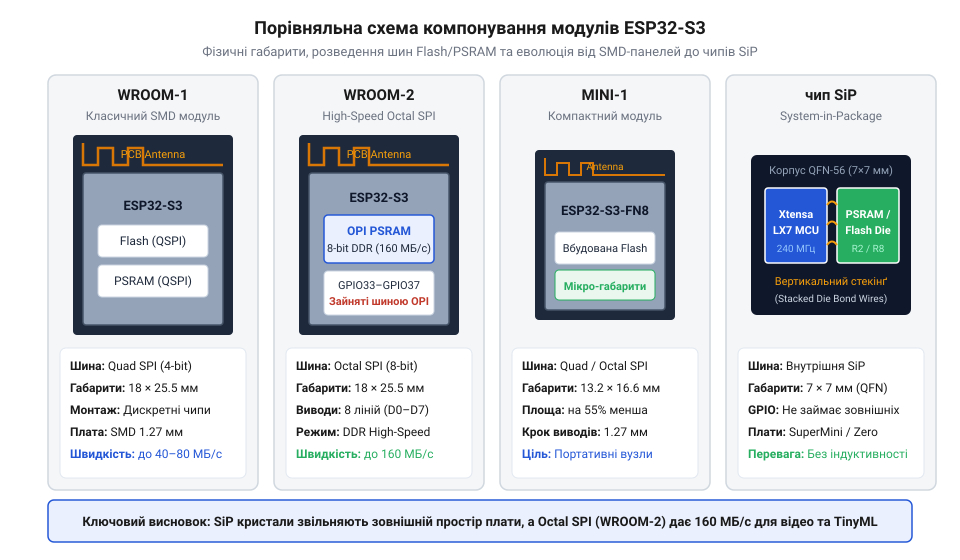
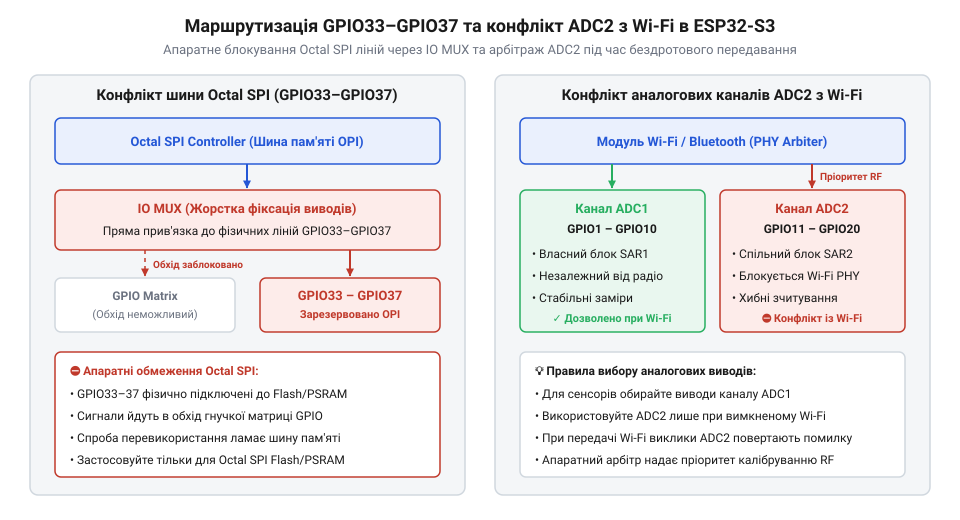

# Родина плат і модулів на ESP32-S3

<preknowlist>
- [Мікроконтролер ESP32-S3](root:cat-hw-boards/esp32s3-microcontroller) — архітектура ядра Xtensa LX7, підсистема L1-кешу та базовий комутатор IO MUX
- [Модуль ESP32-CAM: огляд архітектури, периферії та сімейства плат](root:cat-hw-boards/esp32-cam-camera-module-family) — базові вимоги до обсягів кадрових буферів та шин оперативної пам'яті при відеообробці
- [Waveshare ESP32-S3R2 (16 МБ Flash, 2 МБ PSRAM)](root:cat-hw-boards/esp32-s3r2-waveshare) — конструктивна специфіка SiP-модулів з інтегрованою оперативною пам'яттю
</preknowlist>

## Пастки вибору платформи ESP32-S3

При проєктуванні пристроїв на базі двоядерного [мікроконтролера ESP32-S3](root:cat-hw-boards/esp32s3-microcontroller) найпоширенішою причиною апаратних збоїв є недооцінка відмінностей між модифікаціями чипа та модулів. Різні варіанти платформи суттєво відрізняються типом шини зовнішньої пам'яті, обсягом оперативної пам'яті та кількістю доступних контактів введення-виведення. Нерозуміння цих нюансів призводить до циклічних перезавантажень процесора через падіння живлення або блокування периферійних ліній.

Основним джерелом раптових циклічних перезавантажень є імпульсні кидки струму споживання до 500 мА під час калібрування й передавання даних радіомодулем `@@en|Wi-Fi@@` (англ. @@en|Wi-Fi@@, від @@en|Wireless Fidelity@@ — бездротова точність). Якщо лінія живлення та стабілізатор LDO не здатні компенсувати це просідання напруги нижче 2.8 В, спрацьовує апаратне схематичне скидання `@@en|Brownout Reset@@` (англ. @@en|Brownout Reset@@, від @@en|Brownout@@ — просідання напруги, та @@en|Reset@@ — скидання). Без достатньої ємності згладжувальних конденсаторів мікроконтролер потрапляє у нескінченний цикл перезапусків ще на етапі ініціалізації мережі, що часто спостерігається у компактних одноплатниках [ESP32-S3 SuperMini](root:cat-hw-boards/esp32-s3-supermini).

Головною пасткою є вибір між 4-бітною та 8-бітною шинами зв'язку із зовнішньою пам'яттю. Застосування 8-бітної шини подвоює пропускну здатність, проте апаратно вилучає групу сигнальних виводів для зв'язку з чипом пам'яті. Нехтування обмеженнями ліній живлення та аналогових блоків викликає фатальні винятки системи при одночасній роботі бездротового зв'язку та високому навантаженні на обчислювальні ядра.

## Класифікація модулів та шин пам'яті

Лінійка готових системних модулів поділяється на кілька стандартних формфакторів: повнорозмірні `WROOM-1` і `WROOM-2`, надкомпактні `MINI-1` та монолітні рішення `SiP` (англ. *System-in-Package*; @@en|чип у корпусі SiP@@), представлені на платах [Waveshare ESP32-S3R2](root:cat-hw-boards/esp32-s3r2-waveshare). Вибір конкретного формфактора визначає не лише розміри друкованої плати, а й тепловий режим та тип шини пам'яті @@en|Flash@@ і псевдостатичної оперативної пам'яті @@en|PSRAM@@.

*Порівняння конструктивних формфакторів модулів ESP32-S3 та розташування контактів.*

Контролер пам'яті підтримки шини `Quad SPI` (англ. *Quad Serial Peripheral Interface*; @@en|чотирибітна шина Quad SPI@@) використовує 4 лінії даних, забезпечуючи швидкість обміну до 40 МБ/с і залишаючи максимальну кількість вільних виводів `GPIO`. Натомість 8-бітна шина `Octal SPI` (англ. *Octal Serial Peripheral Interface*; @@en|восьмибітна шина Octal SPI@@) подвоює пропускну здатність до 80 МБ/с, що є критичним для обробки високої роздільної здатності у додатках [серії ESP32-CAM](root:cat-hw-boards/esp32-cam-camera-module-family). Затримки звернення до послідовної пам'яті прозоро маскуються апаратним блоком управління пам'яттю `MMU` та двоуровневим кешем `L1`.

## Обмеження розпіновки та нативний USB

Апаратною платою за використання високошвидкісної шини `Octal SPI` є вилучення контактів `GPIO33`–`GPIO37` з загальної матриці `IO MUX` для виключного внутрішнього з'єднання з пам'яттю. Спроба програмної конфігурації цих виводів викликає збій шини та негайне перезавантаження пристрою.

*Апаратна карта розподілу виводів GPIO33–GPIO37 під шину Octal SPI та зона блокування аналогового блоку ADC2.*

Іншим критичним обмеженням є блокування аналогово-цифрового перетворювача `ADC2` під час роботи модуля `Wi-Fi`. Системний м'ютекс драйвера радіомодуля блокує виклики `ADC2`, тому аналогові датчики слід підключати виключно до блоку `ADC1`. Для спрощення розробки мікроконтролер обладнано вбудованим апаратним контролером `USB Serial/JTAG`, який дозволяє здійснювати пряме прошивання та налагодження без зовнішніх конвертерів `UART`. Це рішення реалізовано в надкомпактних одноплатниках [ESP32-S3-Zero](root:cat-hw-boards/esp32-s3-zero) та [ESP32-S3 SuperMini](root:cat-hw-boards/esp32-s3-supermini).
