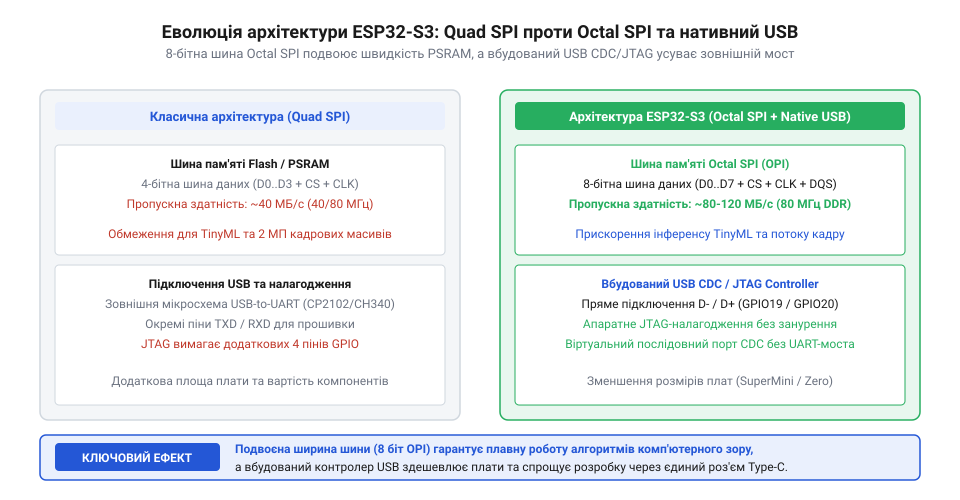
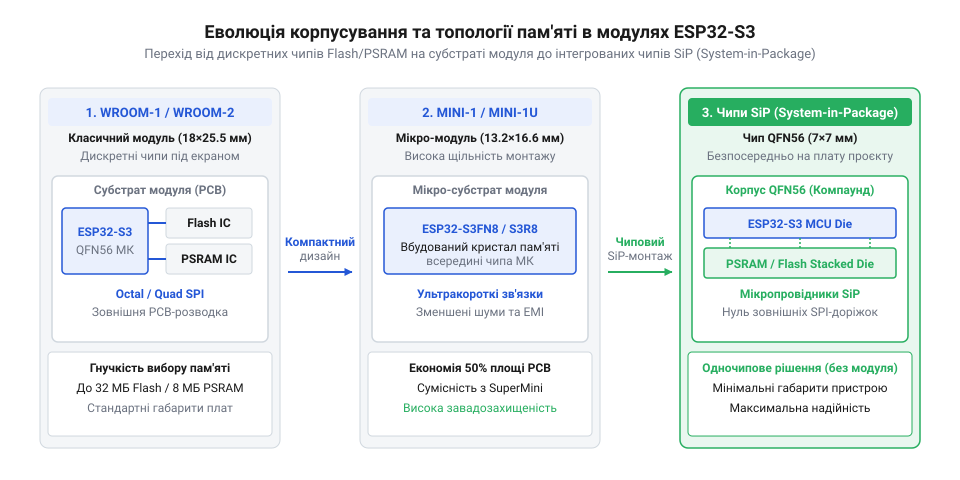

# Еволюція модулів та розробницьких плат на базі ESP32-S3

<preknowlist>
- [ESP32-S3 SuperMini](root:cat-hw-boards/esp32-s3-supermini) — Ультракомпактний формфактор плат розробки на базі ESP32-S3.
- [Мікроконтролер ESP32-S3](root:cat-hw-boards/esp32s3-microcontroller) — Архітектура ядра Xtensa LX7, векторні інструкції SIMD та специфікації шини Octal SPI.
- [Родина плат і модулів на ESP32-S3](root:cat-hw-boards/esp32-s3-boards-family-overview) — Огляд номенклатури модулів та розробницьких платформ серії ESP32-S3.
</preknowlist>

## Передумови появи ESP32-S3 та обмеження WROOM

Поява у 2016 році двоядерного мікроконтролера `ESP32` від компанії `Espressif Systems` створила революцію в галузі бездротового інтернету речей. Модулі серії `ESP32-WROOM-32` стали базовим стандартом для автономних контролерів завдяки інтегрованій периферії та низькій вартості. Проте зі зростанням популярності концепції локальних інтелектуальних викликів (від англ. @@en|Tiny Machine Learning@@, від *tiny* — крихітний, *machine* — машинне та *learning* — навчання; @@en|вбудований штучний інтелект TinyML@@) та цифрового відеофіксування класична апаратна платформа наштовхнулася на нездоланні апаратні обмеження. Крім того, у завданнях з автономним живленням виявилася специфіка енергоспоживання першого покоління модулів у режимі глибокого сну (англ. *Deep Sleep*; @@en|режим Deep Sleep@@): попри заявлений струм самого кристала на рівні `5 мкА`, реальне споживання модуля `ESP32-WROOM-32` досягало `100–150 мкА` через витоки струму у внутрішніх кола підтяжки шини `Flash`-пам'яті та особливості організації силових ключів периферійного домену @@en|RTC@@. Для бездротових сенсорів із багаторічним циклом автономності від батареї це створювало критичний перерозхід енергії, що спонукало до перегляду системної архітектури.

Головним вузьким місцем першого покоління платформ виявилася пропускна здатність системної оперативної пам'яті. Зовнішня псевдостатична оперативна пам'ять (від англ. @@en|Pseudo-Static RAM@@; @@en|пам'ять PSRAM@@) підключалася до кристала через 4-бітну шину @@en|Quad SPI@@. Швидкість зчитування даних у цьому режимі була обмежена межею 40–80 МБ/с, але реальна ефективна швидкість `B_eff` з урахуванням накладних витрат протоколу SPI та затримок регенерації складала лише близько 20 МБ/с. Обчислимо тривалість зчитування `t_frame` та граничну кадрову частоту `FPS_max` для нестисненого кадру роздільності @@en|VGA@@ (`640 × 480` пікселів) у кодуванні @@en|RGB565@@ обсягом `V_frame = 614400` байтів (600 КіБ):

```
V_frame = 640 × 480 × 2 B
        = 614400 B                  [обчислення обсягу нестисненого кадру VGA у байтах]

t_frame = V_frame ÷ B_eff
        = 614400 ÷ 20000000         [ділення обсягу кадру на ефективну швидкість QSPI 20 МБ/с]
        = 0.03072 с                 [тривалість шинного передавання кадру 30.72 мс]

FPS_max = 1 ÷ t_frame
        = 1 ÷ 0.03072               [обчислення граничної кадрової частоти]
        ≈ 32.55 кадрів/с            [теоретична межа без урахування обчислень ядром]
```

Оскільки зчитування `VGA`-кадру забирає понад 30.72 мс шинного часу `Quad SPI`, при спробах одночасного інференсу алгоритмів машинного навчання чи трансляції через Wi-Fi пропускна здатність шини вичерпувалася, викликаючи затримки системного ядра та переповнення прийматильних буферів камери.

Другою суттєвою перешкодою стала відсутність нативного `USB`-інтерфейсу всередині самого кристала `ESP32`. Плати розробки змушені були використовувати зовнішні мости-перетворювачі `USB-UART` (чипи `CP2102` або `CH340`). Швидкість передавання даних через послідовний порт обмежувалася значеннями 115200–3000000 бод, що унеможливлювало передачу якісного відеопотоку на комп'ютер у реальному часі. Крім того, апаратне зневадження вимагало підключення зовнішніх `JTAG`-адаптерів, що ускладнювало розробку. Спроби побудови компактних відеосистем на базі [модулів ESP32-CAM](root:cat-hw-boards/esp32-cam-camera-module-family) виявили також чутливість лінійних регуляторів живлення `LDO` до імпульсних сплесків струму Wi-Fi передавача, що викликало хаотичні перезавантаження пристрою.

## Архітектурний прорив Octal SPI та USB JTAG

Наприкінці 2020 року компанія `Espressif` презентувала мікроконтролер нового покоління `@@en|ESP32-S3@@`. Новий кристал отримав двоядерний 32-бітний процесор `Xtensa LX7` із тактовою частотою 240 МГц та двома фундаментальними апаратними інноваціями, спрямованими на усунення вузьких місць попередника.

Першим архітектурним проривом стало впровадження 8-бітної шини @@en|Octal SPI@@ (від англ. @@en|Octal Peripheral Interface@@, від *octal* — восьмеричний, *peripheral* — периферійний та *interface* — інтерфейс; @@en|шина Octal SPI OPI@@). Завдяки розширенню розрядності шини з 4 до 8 ліній (`D0`–`D7`) та підтримці режиму подвійної передачі даних за такт `DDR` на частоті 80 МГц, підсумкова пропускна здатність оперативної пам'яті `PSRAM` зросла до 160 МБ/с. Це повністю усунуло голодування відеопотоку та забезпечило швидкісне вивантаження кадрових буферів високої роздільності. Висока пропускна здатність Octal SPI дозволила апаратному контролеру прямого доступу до пам'яті (від англ. *Direct Memory Access*; @@en|контролер DMA@@) автоматично прокачувати масиви кадрових буферів між `PSRAM` та мережевими дескрипторами Wi-Fi стека без залучення обчислювальних ядер процесора, усуваючи затримки трансляції відеопотоку у реальному часі.

Другою важливою зміною стала інтеграція безпосередньо у кристал апаратного контролера `USB CDC/JTAG`. Мікроконтролер отримав змогу напряму підключатися до шини `USB 1.1 Full-Speed` (12 Мбіт/с) через фізичні виводи `GPIO19` та `GPIO20`. Це дозволило відмовитися від зовнішніх мостів `USB-UART`, забезпечило віртуальний послідовний порт високої швидкості та надало можливість повноцінного апаратного зневадження прошивки через `JTAG` без застосування додаткових програвачів. На фізичному рівні ця схема відрізняється від повноцінного режиму `Native USB Host/Device` (@@en|контролер USB OTG@@, від англ. @@en|On-The-Go@@, від *on-the-go* — на ходу): спеціалізований блок `USB CDC/JTAG` є автономним апаратним автоматом, що працює через спрощений трансивер @@en|Full-Speed PHY@@ (від англ. @@en|Physical Layer@@, від *physical* — фізичний та *layer* — шар; @@en|фізичний рівень PHY@@) виключно як пристрій зневадження й прошивки, незалежно від стану системного ядра МК, тоді як режим `Native USB Host/Device` задіює гнучкий контролер периферії з довільним налаштуванням кінцевих точок (англ. *endpoints*), підтримкою класів `HID` чи `MSC` та можливістю виступати хостом шини для керування зовнішніми пристроями, що вимагає активної програмної підтримки з боку стека прошивки.


_*Порівняльна архітектурна схема системних шин Quad SPI та Octal SPI з вбудованим блоком USB CDC/JTAG у чипах ESP32 та ESP32-S3._*

Впровадження архітектури `ESP32-S3` розвінчало популярний міф про зворотну бінарну сумісність прошивок між поколіннями `ESP32` та `ESP32-S3`. Через зміну системного ядра `Xtensa LX6` на `LX7`, нові вектори переривань та відмінності в таблицях регістрів периферії, виконувані бінарні файли `.bin` не є взаємозамінними і вимагають повної перекомпіляції коду під нову платформу. Подібно до цього, уявлення про можливість програмного прискорення нейромережевих обчислень на старій платформі `ESP32` виявилося хибним: лише наявність апаратного векторного розширення `Vector Extension` у [мікроконтролері ESP32-S3](root:cat-hw-boards/esp32s3-microcontroller) дала змогу ефективно прискорювати матричні операції `SIMD` для алгоритмів комп'ютерного зору.

## Еволюція формфакторів модулів WROOM і SiP

Зростання вимог до щільності компонування у портативних пристроях та системах комп'ютерного зору зумовило швидку еволюцію системного корпусування планарних модулів серії `ESP32`. Перше покоління класичних модулів `ESP32-WROOM-32` та початкових версій `ESP32-S3-WROOM-1` будувалося за принципом поверхневого монтажу (від англ. *Surface-Mount Device*; @@en|SMD-модулі@@) на окремій друкованій платі під металевим екраном. Усередині модуля мікроконтролерний кристал розміщувався поруч із дискретними мікросхемами пам'яті `@@en|Flash@@` та `@@en|PSRAM@@`, з'єднаними зовнішніми друкованими доріжками підкладки, що збільшувало габарити до `18 × 25.5` мм та обмежувало граничні тактові частоти через паразитну індуктивність виводів. Перехід до компактизованого вертикального стекінгу у чипах @@en|чипи SiP@@ розв'язав проблему габаритів, однак створив суттєві температурні обмеження: при максимальному обчислювальному навантаженні обох ядер процесора на частоті 240 МГц тепло від базового кристала МК передається безпосередньо на вертикально розміщений кристал `@@en|PSRAM@@`. Оскільки осередки псевдостатичної пам'яті критично чутливі до перегріву (при перевищенні температури `85 °C` зростають витоки зарядів і скорочується час регенерації даних), без належного відведення тепла через мідні шари друкованої плати виникає ризик спотворення даних та збоїв адресації.

Для зменшення площі посадкового місця компанія Espressif розробила компактну серію `MINI-1` та перейшла до створення систем у корпусі (від англ. *System-in-Package*; @@en|чипи SiP@@). У корпусах `SiP` мікросхеми пам'яті інтегровано безпосередньо у пластиковий корпус самого мікроконтролера за технологією вертикального стекінгу кристалів (від англ. *Stacked Die*; @@en|стекінг кристалів@@). З'єднання між обчислювальними ядрами та масивами `@@en|PSRAM@@` виконується мікроскопічними золотими розварювальними дротиками безпосередньо усередині корпусу, що повністю усуває зовнішні розведення шини.


*Еволюційна схема корпусування та топологічного розведення пам'яті у модулях WROOM-1, MINI-1 та чипах SiP.*

Ідентифікувати конструктивні особливості модулів розробник може за заводським маркуванням кристалів. Суфікс `N8` або `N16` позначає обсяг вбудованої `@@en|Flash@@` пам'яті у базі `SiP` (8 або 16 МБ відповідно), а літери `R2` або `R8` вказують на наявність високошвидкісної `@@en|PSRAM@@` пам'яті обсягом 2 або 8 МБ. При цьому маркування визначає не лише обсяг, а й схему підключення: у чипах `N8R2` з 2 МБ `@@en|PSRAM@@` кристал пам'яті з'єднано всередині корпусу через 4-бітну шину Quad SPI, тоді як у модифікаціях `N16R8` з 8 МБ застосовано повноцінну 8-бітну шину Octal SPI (OPI DDR), що забезпечує подвійну пропускну здатність шини. Використання корпусування `SiP` дозволило створити ультракомпактні планарні модулі `ESP32-S3-MINI-1` із габаритами всього `13.2 × 16.6` мм, зберегши повну продуктивність двох ядер Xtensa LX7 для задач обробки відео у пристроях на базі [мікроконтролера ESP32-S3](root:cat-hw-boards/esp32s3-microcontroller).

## Сучасні планарні платформи та критерії вибору

Паралельно з еволюцією внутрішніх модулів змінювалися й планарні платформи для швидкого прототипування. Повнорозмірні платформи першого покоління `DevKitC` мали значну ширину, блокуючи обидва ряди контактів при встановленні на макетну плату, та живилися від лінійних регуляторів напруги `@@en|LDO@@`. Зі збільшенням обчислювального навантаження під час виконання алгоритмів штучного інтелекту та пікових струмів передавача Wi-Fi лінійні регулятори почали перегріватися через падіння напруги з 5 В до 3.3 В, розсіюючи значну потужність у вигляді тепла. Це змусило розробників перейти на високоефективні імпульсні перетворювачі (від англ. *DC-to-DC converter*; @@en|DC-DC перетворювачі@@), які забезпечують ККД понад 90% та стабільний струм до 1.5 А без термального тротлінгу.

Сучасний ринок планарних платформ розділився на кілька чітких формфакторів під конкретні прикладні задачі. Для мініатюрних сенсорних вузлів та переносної електроніки створено ультракомпактні платформи [ESP32-S3 SuperMini](root:cat-hw-boards/esp32-s3-supermini) та [ESP32-S3-Zero](root:cat-hw-boards/esp32-s3-zero), які мають розміри поштової марки, вбудований USB Type-C роз'єм та торцеві контактні площадки типу кастеляція для прямого розпаювання на материнські плати.

Критерієм вибору оптимальної розробницької платформи є тип підсистеми пам'яті та наявність спеціалізованої периферії. Для задач вбудованого штучного інтелекту та відеоспостереження обирають платформи з 8-бітною шиною Octal SPI та роз'ємом FPC, сумісним із платами з серії [модулів ESP32-CAM](root:cat-hw-boards/esp32-cam-camera-module-family). Цей роз'єм розводять під паралельний цифровий відеопорт (від англ. *Digital Video Port*; @@en|інтерфейс DVP@@) для безпосереднього зв'язку з відеосенсором. Потік відеоданих через @@en|DVP@@ приймає нативний апаратний контролер периферії мікроконтролера. Проте для ліній даних та синхронізації @@en|DVP@@ задіює від 12 до 16 виводів GPIO, що суттєво зменшує кількість вільних контактів плати. Більш сучасний послідовний відеоінтерфейс (від англ. *Mobile Industry Processor Interface Camera Serial Interface*; @@en|інтерфейс MIPI-CSI@@) економить виводи завдяки дифпарам, але кристал ESP32-S3 позбавлений апаратного контролера фізичного рівня MIPI. Через це підключення сенсорів @@en|MIPI-CSI@@ вимагає зовнішніх мікросхем-містків, тому паралельний @@en|DVP@@ залишається основним стандартом прямого підключення камер. Завдяки цьому розробник отримує узгоджену апаратну платформу, здатну обробляти відеопотік у реальному часі без збоїв шини або вичерпання системних буферів.
