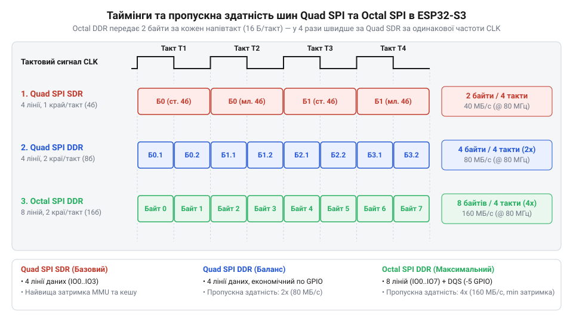
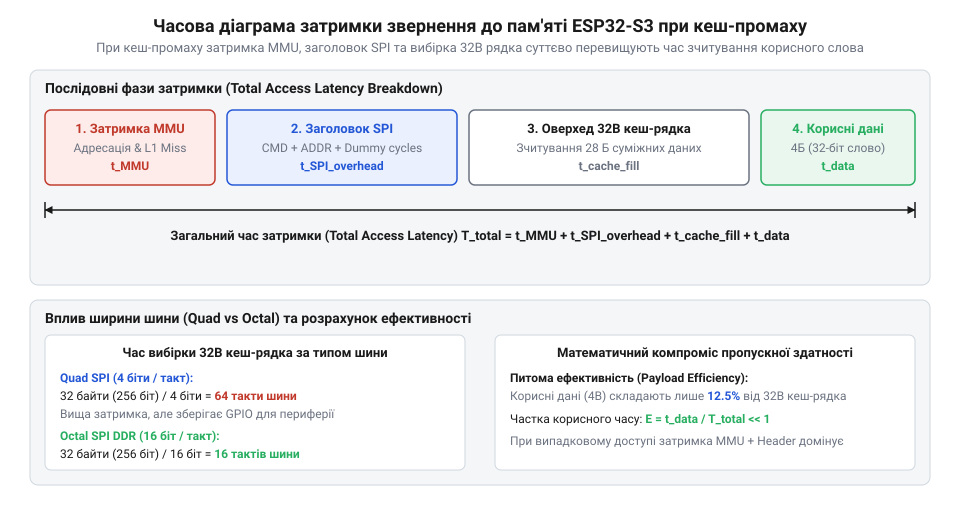

# Математичний розрахунок пропускної здатності шини Flash/PSRAM, затримок MMU та доступності GPIO в ESP32-S3

<preknowlist>
- [Мікроконтролер ESP32-S3](root:cat-hw-boards/esp32s3-microcontroller) — Базову архітектуру системної шини ESP32-S3, подвійне ядро Xtensa LX7 та принцип підключення зовнішньої пам'яті.
- [Модулі ESP32-S3-WROOM-1 та WROOM-2](root:cat-hw-boards/esp32-s3-wroom-modules-family) — Апаратні відмінності між конфігураціями Quad SPI та Octal SPI у виводі та розпайці системних ніжок.
</preknowlist>

## Проблема просідання швидкості обробки даних

Виведення графіки на [платі Waveshare ESP32-S3 Touch LCD 1.28](root:cat-hw-boards/waveshare-esp32-s3-touch-lcd-1-28) нерідко наражається на падіння швидкодії: замість `60 FPS` двоядерний процесор Xtensa LX7 (`240 МГц`) видає лише `15 FPS`. Виникають простої ядер, хоча обсяг обчислень не перевищує їхніх лімітів.

Причина — обмеження підсистеми пам'яті. [Мікроконтролер ESP32-S3](root:cat-hw-boards/esp32s3-microcontroller) виконує код і тримає буфери у зовнішній @@en|Flash@@ (від англійського *flash* — спалах) та @@en|PSRAM@@ (від *Pseudo-Static RAM* — псевдостатична оперативна пам'ять), бо внутрішня @@en|SRAM@@ (від *Static RAM* — статична оперативна пам'ять) має лише `512 КБ`. Зовнішню пам'ять підключено через послідовну шину @@en|SPI@@ (від *Serial Peripheral Interface* — послідовний периферійний інтерфейс).

Контролер шини перетворює 32-бітні транзакції ядер на послідовність імпульсів. Якщо її пропускна здатність нижча за швидкість споживання даних, конвеєр команд зупиняється. Усунути простої дає змогу математична модель, що враховує ширину й частоту шини, накладні витрати протоколу та затримки адресації.

## Розрахунок пропускної здатності Quad та Octal

Спроможність підсистеми пам'яті передавати дані визначається архітектурою шини SPI. У мікроконтролері ESP32-S3 зовнішні чипи підключають через @@en|Quad SPI@@ (від латинського *quadruplus* — вчетверо, 4 лінії даних) або @@en|Octal SPI@@ (від *octal* — восьмеричний, 8 ліній). Передача йде у режимах @@en|SDR@@ (від *Single Data Rate* — поодинока швидкість) чи @@en|DDR@@ (від *Double Data Rate* — подвійна швидкість).

*Часова діаграма порівняння передачі даних Quad SPI SDR, Quad SPI DDR та Octal SPI DDR на однакових частотах тактування, що ілюструє зростання пропускної здатності при збільшенні кількості ліній та подвійній швидкості.*

Для оцінювання швидкості обчислимо пікову пропускну здатність `B_peak` (байти за секунду). Вона залежить від частоти `f_bus` (Гц), кількості ліній `N_lines` та активних фронтів `N_edges`, а ділення на `8` переводить біти в байти:

    B_peak = (f_bus × N_lines × N_edges) ÷ 8

**Розрахунок пікової пропускної здатності для різних конфігурацій шини SPI:**

    B_Quad_SDR_40 = (40 000 000 × 4 × 1) ÷ 8
                  = 160 000 000 ÷ 8          [множення частоти на лінії]
                  = 20 000 000                [байти за секунду]
                  = 20                        [переведення у МБ/с]

    B_Quad_DDR_80 = (80 000 000 × 4 × 2) ÷ 8
                  = 640 000 000 ÷ 8          [подвійний фронт DDR]
                  = 80 000 000                [байти за секунду]
                  = 80                        [переведення у МБ/с]

    B_Octal_DDR_80 = (80 000 000 × 8 × 2) ÷ 8
                   = 1 280 000 000 ÷ 8        [восьмибітна шина DDR]
                   = 160 000 000              [байти за секунду]
                   = 160                      [переведення у МБ/с]

    B_Octal_DDR_120 = (120 000 000 × 8 × 2) ÷ 8
                    = 1 920 000 000 ÷ 8       [частота 120 МГц]
                    = 240 000 000             [байти за секунду]
                    = 240                     [переведення у МБ/с]

Проте `B_peak` досяжна лише при безперервному читанні. У реальних протоколах транзакція містить команду, адресу й холості такти синхронізації чипа @@en|PSRAM@@. Позначимо службові такти через `N_overhead`, а корисний блок — через `L_block` байтів.

Еквівалентні втрати `L_overhead` дорівнюють добутку тактів паузи на кількість байтів за такт. Ефективна пропускна здатність `B_eff` є відношенням корисного навантаження до повного часу транзакції:

    B_eff = B_peak × (L_block ÷ (L_block + L_overhead))

**Розрахунок ефективної пропускної здатності при читанні блоку 64 байти в режимі Octal DDR 80 МГц з 16 службовими тактами:**

    L_overhead = (16 × 8 × 2) ÷ 8
               = 256 ÷ 8                      [переведення бітів у байти]
               = 32                           [байтів службових фаз]

    B_eff = 160 × (64 ÷ (64 + 32))
          = 160 × (64 ÷ 96)                   [додавання службового накладу]
          = 160 × 0.6667                      [визначення ККД шини]
          = 106.67                            [ефективна швидкість у МБ/с]

Отже, при читанні блоків `64 байти` службовий наклад зменшує швидкість [модулів ESP32-S3-WROOM-1 та WROOM-2](root:cat-hw-boards/esp32-s3-wroom-modules-family) зі `160 МБ/с` до `106.67 МБ/с`. Для [Waveshare ESP32-S3R2](root:cat-hw-boards/esp32-s3r2-waveshare) максимізація `B_eff` вимагає більших пакетів читання. Фізичні деталі часових діаграм, фазування тактових сигналів та стробування DQS описують [часові діаграми та фізичний протокол Octal SPI DDR](root:com-devices/octal-spi-psram-timing).

## Математика затримок MMU та кеш-пам'яті

Звернення процесора до зовнішньої пам'яті ускладнене трансляцією адрес у блоці управління пам'яттю @@en|MMU@@ (англ. *Memory Management Unit*) та вибіркою через спільний для двох ядер кеш L1. Одноразовий обмін відбувається фіксованими кеш-рядками @@en|Cache Line@@ розміром `16 байтів` або `32 байти`. Детально внутрішні механізми трансляції віртуальних адрес та роботу кеш-пам'яті описує [архітектура MMU та кеш-контролера ESP32-S3](root:hw-arch/esp32-s3-psram-cache-mmu-topology).

*Часова діаграма затримки читання даних з PSRAM при кеш-промаху, що показує сумарний штраф заповнення кеш-рядка через шину SPI.*

Відсутність слова у кеші спричиняє промах кешу @@en|Cache Miss@@. Виконання інструкцій зупиняється на час перезаповнення кеш-рядка @@en|Cache Line Refill Penalty@@. Загальна затримка `T_miss` додає час трансляції сторінки `T_mmu`, передачу команди `T_cmd` та завантаження `L_line` байтів з ефективною швидкістю шини `B_eff` (`1 МБ/с = 0.001 байт/нс`):

    T_miss = T_mmu + T_cmd + (L_line ÷ B_eff)

Для ядра на частоті `240 МГц` один такт триває `4.167 нс`.

**Розрахунок затримки кеш-промаху для кеш-рядка 32 байти в режимі Octal DDR 80 МГц:**

    T_refill = 32 ÷ 0.10667
             = 300                             [час вибірки 32 байтів кеш-рядка у наносекундах]

    T_miss = 15 + 35 + 300
           = 350                               [додавання затримок MMU і арбітражу шини]

    N_stall = 350 ÷ 4.167
            = 84.0                              [кількість простоїв тактів процесора]

Один промах кешу зупиняє ядро Xtensa LX7 на `84 такти`. Для оцінки середнього часу доступу `T_avg` використовують частку промахів `h_miss` та час кеш-влучання `T_hit` (`4.167 нс`). При `h_miss = 0.05` (5% промахів у @@en|PSRAM@@):

    T_avg = T_hit + (h_miss × T_miss)
          = 4.167 + (0.05 × 350)
          = 4.167 + 17.5                       [обчислення штрафного внеску кеш-промахів]
          = 21.667                             [середній час доступу в наносекундах]

Зростання затримки з `4.167 нс` до `21.667 нс` означає п'ятикратне зниження швидкодії при обробці векторизованих даних. Тому оптимізація структур під розмір кеш-рядка в ESP32-S3 є критичною. Попередню вибірку в новіших чипах висвітлює [мікроконтролер ESP32-P4](root:cat-hw-boards/esp32-p4-microcontroller).

## Апаратний компроміс між шиною та GPIO

Перехід на 8-бітну шину пам'яті підвищує швидкість, але зменшує кількість вільних виводів @@en|GPIO@@ (англ. *General-Purpose Input/Output*). Кристал ESP32-S3 має `45` виводів: частина зарезервована для системи, а решта розподіляється між периферією та зовнішньою пам'яттю.

У режимі @@en|Quad SPI@@ шина займає `7` ліній (CLK, CS, D0–D3 та CS2). У модулях [ESP32-S3-Zero](root:cat-hw-boards/esp32-s3-zero) й [ESP32-S3 SuperMini](root:cat-hw-boards/esp32-s3-supermini) це виводи `GPIO26–GPIO32`.

Режим @@en|Octal SPI@@ додає лінії D4–D7 та сигнал стробування DQS для @@en|DDR@@, займаючи `12` ліній із вилученням `GPIO33–GPIO37`.

Бюджет доступних виводів `N_avail` обчислюють відніманням від загальної кількості `N_total` системних ніжок `N_sys = 6` та ліній шини `N_bus`:

    N_avail = N_total - (N_sys + N_bus)

**Обчислення доступних ліній GPIO для Quad SPI та Octal SPI:**

    N_avail_Quad = 45 - (6 + 7)
                 = 45 - 13                     [сума системних ліній та Quad SPI]
                 = 32                          [вільних виводів GPIO]

    N_avail_Octal = 45 - (6 + 14)
                  = 45 - 20                    [сума системних ліній та Octal SPI]
                  = 25                         [вільних виводів GPIO]

Втрата `7` виводів (скорочення бюджету на `22%`) блокує паралельні 8-бітні шини дисплеїв (Intel 8080). У [модулях ESP32-S3-MINI-1](root:cat-hw-boards/esp32-s3-mini-sip-modules) та платі [ESP32-CAM](root:cat-hw-boards/esp32-cam) це унеможливлює одночасну роботу камери й SD-карти у 4-бітному SDIO.

## Вибір оптимальної конфігурації Flash і PSRAM

Вибір конфігурації підсистеми пам'яті вимагає системного аналізу розрахункових вимог до пропускної здатності та апаратного ліміту виводів. Для визначення мінімально необхідної швидкості шини `B_req` при роботі з дисплейними буферами застосуємо формулу обчислення графічного потоку.

Позначимо через `W` ширину дисплея у пікселях, через `H` — висоту у пікселях, через `bpp` — кількість байтів на піксель (зазвичай `2 байти` для колірного формату RGB565), через `FPS` — цільову частоту оновлення кадрів, а через `K_buf` — коефіцієнт буферизації (`2` для подвійної буферизації). Значення `1 048 576` переводить результат у мегабайти:

    B_req = (W × H × bpp × FPS × K_buf) ÷ 1 048 576

Обчислимо необхідну пропускну здатність для дисплея `800×480` пікселів при `60 FPS` з подвійним буфером у чипі @@en|PSRAM@@.

**Розрахунок необхідної пропускної здатності графічного буфера:**

    B_req = (800 × 480 × 2 × 60 × 2) ÷ 1 048 576
          = 92 160 000 ÷ 1 048 576             [повний обсяг графічного потоку у байтах]
          = 87.89                              [необхідна пропускна здатність у МБ/с]

Порівняння розрахованої величини `B_req = 87.89 МБ/с` із показниками з другого розділу свідчить, що конфігурація @@en|Quad SPI@@ DDR (ефективна швидкість біля `53.3 МБ/с`) фізично не здатна забезпечити плавну анімацію. Для цього сценарію безальтернативним вибором є @@en|Octal SPI@@ DDR зі швидкістю `106.67–160 МБ/с`.

Для прийняття обґрунтованого інженерного рішення сформулюємо алгоритм вибору конфігурації пам'яті:

1. **Мультимедійні системи високої роздільності** (дисплеї `800×480`, бібліотека LVGL, подвійна буферизація): обирається модуль з Octal DDR @@en|PSRAM@@. Незважаючи на втрату 7 ліній @@en|GPIO@@, висока пропускна здатність запобігає розривам кадру.
2. **Периферійні системи та плати із [камерою OV3640](root:cat-hw-boards/esp32-cam-ov3640)**: перевага надається Quad SPI пам'яті. Збереження 32 вільних ліній виводів дозволяє одночасно підключити 8-бітну шину камери, карти пам'яті та бездротові сенсори на платах на кшталт [Waveshare ESP32-S3-Pico](root:cat-hw-boards/esp32-s3-pico).
3. **Обчислювальні вузли Edge AI та DSP**: використовуються модулі з Quad SPI Flash та розширеним обсягом внутрішньої @@en|SRAM@@. Для критичних обчислень векторизовані масиви копіюються @@en|DMA@@-контролером у внутрішню пам'ять, що повністю нівелює штрафи затримок адресації @@en|MMU@@.

Комплексна оцінка математичної моделі шини та периферійного бюджету дозволяє проектувати надійні вимірювальні та мультимедійні пристрої на базі [серії плат esp32-s3-zero-supermini-boards](root:cat-hw-boards/esp32-s3-zero-supermini-boards), оминаючи проблему простоїв процесора. Базові принципи побудови відеосистем висвітлені у матеріалах про [огляд архітектури ESP32-CAM](root:cat-hw-boards/esp32-cam-camera-module-family).
