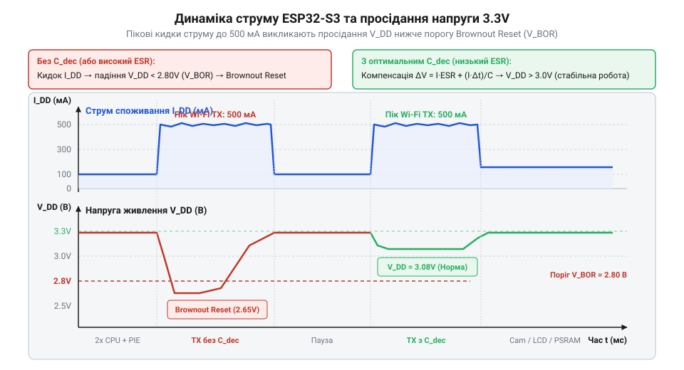
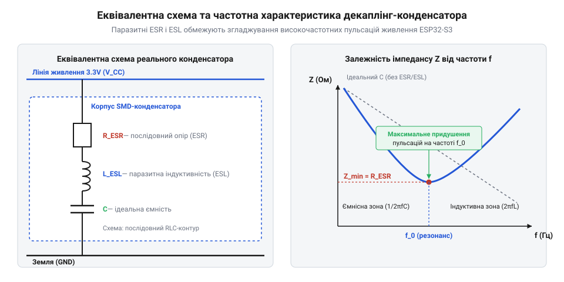

# Розрахунок енергетичного бюджету, пікових струмів та кіл живлення для плат ESP32-S3

<preknowlist>
- [Мікроконтролер ESP32-S3](root:cat-hw-boards/esp32s3-microcontroller) — архітектуру двоядерного процесора Xtensa LX7, роботу векторного розширення PIE та відмінності базових режимів енергоспоживання.
- [Модулі ESP32-S3-WROOM-1 та WROOM-2](root:cat-hw-boards/esp32-s3-wroom-modules-family) — конструктивні особливості модулів, топологію внутрішніх ліній VDD і споживання вбудованої пам'яті PSRAM.
- [Плата Waveshare ESP32-S3 Touch LCD 1.28](root:cat-hw-boards/waveshare-esp32-s3-touch-lcd-1-28) — приклад складу периферійного навантаження плати, включаючи споживання LCD-екрана та підсвічування.
</preknowlist>

## Фізика спалахів струму та скидань

Розробка надійних пристроїв на базі [мікроконтролера ESP32-S3](root:cat-hw-boards/esp32s3-microcontroller) нерідко супроводжується спонтанними перезавантаженнями чипа під час підключення до бездротової мережі або виконання складних обчислень. При первинному аналізі схеми напруга живлення в статичному режимі становить номінальні `3.3 В`, а джерело розраховане на постійне навантаження `200–300 мА`. Проте в момент активації радіопередавача мікроконтролер раптово фіксує апаратне скидання при просіданні живлення (від англ. @@en|Brownout Reset@@; апаратне скидання при просіданні живлення). Збої виникають через нехтування високочастотною динамікою струму споживання, який у мікросекундних інтервалах демонструє високі амплітудні спалахи.

Причиною виникнення кидків струму є фізика роботи основних вузлів [модулів ESP32-S3-WROOM-1](root:cat-hw-boards/esp32-s3-wroom-modules-family). Двоядерний процесор Xtensa LX7 з тактовою частотою `240 МГц` містить векторний співпроцесор (від англ. @@en|Vector Coprocessor@@; @@en|векторний співпроцесор@@) PIE, який виконує паралельні 128-бітові інструкції для обробки сигналів та нейромережевих обчислень. Одночасна перекомутація тисяч внутрішніх КМОН-транзисторів створює динамічний струм споживання, пропорційний ємності навантаження `C_eff`, напрузі `V_DD` та частоті переключення `f_sw`:

I_dyn = C_eff · V_DD · f_sw

Ще масштабніші імпульсні сплески генерує радіочастотний тракт Wi-Fi 4. Перед відправкою бікон-пакетів або даних вбудований синтезатор частоти виконує процедуру автоматичного калібрування (від англ. @@en|RF Calibration@@; радіочастотне калібрування). У цей момент підсилювач потужності (від англ. @@en|Power Amplifier@@; @@en|підсилювач потужності@@) стрибкоподібно збільшує споживання струму з базового рівня `40–80 мА` до пікових значень `350–500 мА`. Тривалість такого спалаху становить від кількох мікросекунд до одиниць мілісекунд, а швидкість наростання струму `dI / dt` сягає десятків ампер на мікросекунду.


*Часова діаграма ілюструє виникнення імпульсних кидків струму споживання ESP32-S3 та відповідне просідання напруги на лінії 3.3 В.*

Будь-яка фізична лінія живлення на друкованій платі має паразитний опір `R_trace` та паразитну індуктивність `L_trace`. Коли струм споживання змінюється на величину `ΔI` за час `Δt`, сумарне спадання напруги на провідниках живлення обчислюється як сума омічного та індуктивного падінь:

ΔV_line = ΔI · R_trace + L_trace · (dI / dt)

Якщо миттєва напруга на виводах живлення мікроконтролера падає нижче порогу вбудованого детектора (від англ. @@en|Brownout Detector@@; @@en|детектор просідання напруги@@), який для ESP32-S3 становить приблизно `2.8 В`, схеми контролю скидають процесор для запобігання пошкодженню даних у пам'яті.

Для компенсації високих швидкостей наростання струму `dI / dt` безпосередньо біля виводів живлення чипа встановлюють блокувальний конденсатор (від англ. @@en|Decoupling Capacitor@@; @@en|блокувальний конденсатор@@). Головне завдання цього конденсатора — віддати накопичений електричний заряд `ΔQ = I_spike · Δt` протягом часу імпульсу, поки джерело живлення не встигне відреагувати через індуктивність траси.

Однак реальний конденсатор має власні паразитні параметри: еквівалентний послідовний опір (від англ. @@en|Equivalent Series Resistance@@; ESR) та еквівалентну послідовну індуктивність (від англ. @@en|Equivalent Series Inductance@@; ESL).


*Показано еквівалентну схему заміщення блокувального конденсатора та залежність його імпедансу від частоти.*

Повний імпеданс `Z(f)` блокувального конденсатора на частоті `f` визначається за виразом:

Z(f) = √( ESR² + (2 · π · f · ESL - 1 / (2 · π · f · C))² )

На власній резонансній частоті `f_0 = 1 / (2 · π · √(ESL · C))` реактивні опори індуктивності та ємності взаємно компенсуються, і імпеданс конденсатора стає мінімальним, дорівнюючи суто активному опору `ESR`. Щоб імпульс струму `I_spike` не викликав просідання напруги понад допустиме значення `ΔV_max`, параметри конденсатора повинні задовольняти виведені нерівності:

C_min = I_spike · Δt / ΔV_max

ESR_max = ΔV_max / I_spike

Якщо опір `ESR` виявиться занадто високим, конденсатор не зможе миттєво віддати заряд, і на лінійці живлення утвориться високочастотна пульсація, що призведе до спрацьовування порогу скидання.

## Обчислення пікового й середнього струму

Проектування схеми живлення та розрахунок часу автономної роботи від акумулятора вимагають точного визначення двох величин: середнього струму споживання `I_avg` та максимального пікового струму `I_peak_total`. Середній струм визначає загальне енергоспоживання системи й тепловий режим стабілізатора, тоді як піковий струм задає граничні вимоги до максимальної віддачі джерела живлення та перерізу провідників.

Математична модель середнього струму системи з кількома периферійними модулями базується на зваженому підсумовуванні струмів кожного компонента з урахуванням його робочого циклу (від англ. @@en|Duty Cycle@@; @@en|робочий цикл@@) `D_i = t_active_i / T_period`:

I_avg_total = ∑ (I_active_i · D_i + I_idle_i · (1 - D_i))

Найгірший сценарій пікового споживання відповідає моменту часу, коли всі активні вузли системи одночасно переходять у режим максимального навантаження:

I_peak_total = I_CPU_max + I_PIE_max + I_WiFi_TX_max + I_PSRAM_max + I_LCD_max + I_CAM_max

Розглянемо внесок кожного компонента системи на основі характеристик типових модулів та плат:

1. Двоядерний процесор ESP32-S3 (Частота `240 МГц` + векторний співпроцесор PIE): при виконанні базових обчислень струм становить `70–80 мА`. За максимального завантаження обох ядер та активного використання 128-бітних векторних команд PIE споживання зростає до `I_CPU_max = 120 мА`.
2. Передавач Wi-Fi 4 (Стандарт 802.11b/g/n, вихідна потужність `+20 dBm`): у режимі очікування чи прийому RX споживання становить `40–60 мА`. Під час передачі пакетів TX струм зростає до `I_WiFi_TX_max = 340 мА`, а при короткочасній видачі імпульсу на вищому рівні потужності може сягати `450–500 мА`.
3. Зовнішня оперативна пам'ять Octal PSRAM (Шина OPI на частоті `80 МГц`): наприклад, як на [пам'яттю Waveshare ESP32-S3R2](root:cat-hw-boards/esp32-s3r2-waveshare), під час безперервного зчитування чи запису кадрів зображення споживає `I_PSRAM_max = 40 мА`.
4. Дисплейний модуль із підсвічуванням: на прикладі [плати Waveshare ESP32-S3 Touch LCD](root:cat-hw-boards/waveshare-esp32-s3-touch-lcd-1-28), контролер LCD споживає близько `10 мА`, а світлодіодне підсвічування на максимальній яскравості додає `30 мА`. Отже, `I_LCD_max = 40 мА`.
5. Камера високої роздільної здатності: під час знімання й кодування кадрів у формат JPEG (наприклад, модуль OV2640 на [модулі ESP32-CAM](root:cat-hw-boards/esp32-cam)) споживання додає `I_CAM_max = 60 мА`.

Проведемо покроковий розрахунок для вказаного набору периферії у складі портативного графічного термографа.

**Обчислення енергетичного бюджету системи**

Приймемо такі умови роботи пристрою:
- Процесор ESP32-S3 працює постійно (`D_CPU = 1.0`), струм у роботі `100 мА`.
- Пам'ять PSRAM звертається постійно під час виведення графіки (`D_PSRAM = 1.0`), струм `40 мА`.
- Дисплей із підсвічуванням увімкнений постійно (`D_LCD = 1.0`), струм `40 мА`.
- Камера опитується з частотою 10 кадрів/с з тривалістю захвату `20 мс` на кадр (`D_CAM = 0.2`), струм у роботі `60 мА`, у простої `5 мА`.
- Модуль Wi-Fi передає накопичені дані короткими спалахами тривалістю `50 мс` щосекунди (`D_WiFi = 0.05`), струм при передачі `340 мА`, у режимі прийому/очікування `50 мА`.

Розрахуємо середній струм системи `I_avg_total`:

I_CPU_avg = 100 · 1.0 = 100.0 мА      [підсумовування постійної складової CPU]
I_PSRAM_avg = 40 · 1.0 = 40.0 мА      [підсумовування складової PSRAM]
I_LCD_avg = 40 · 1.0 = 40.0 мА        [підсумовування складової дисплея]
I_CAM_avg = 60 · 0.2 + 5 · 0.8 = 16.0 мА [підсумовування складової камери з урахуванням duty cycle]
I_WiFi_avg = 340 · 0.05 + 50 · 0.95 = 64.5 мА [підсумовування складової Wi-Fi з урахуванням duty cycle]

I_avg_total = 100.0 + 40.0 + 40.0 + 16.0 + 64.5
= 260.5 мА                           [сумування середніх струмів усіх вузлів]

Тепер обчислимо піковий струм найгіршого сценарію `I_peak_total`, який виникає під час одночасного знімання кадру, передачі даних по Wi-Fi та активної роботи векторного співпроцесора PIE:

I_peak_total = I_CPU_max + I_PSRAM_max + I_LCD_max + I_CAM_max + I_WiFi_TX_max
= 120 + 40 + 40 + 60 + 340           [підстановка найгірших значень]
= 600 мА                             [сумування пікових струмів]

Результати розрахунку свідчать: незважаючи на помірне середнє споживання в `260.5 мА`, джерело живлення пристрою та дрібний стабілізатор на [платах ESP32-S3 SuperMini](root:cat-hw-boards/esp32-s3-supermini) повинні гарантовано витримувати короткочасне навантаження щонайменше `600 мА` без просідання напруги.

## Тепловий розрахунок лінійних стабілізаторів LDO

Для забезпечення мікроконтролера напругою `3.3 В` від джерела з вищою напругою (наприклад, акумулятора Li-Po `3.7–4.2 В` або шини USB `5.0 В`) часто застосовують лінійні стабілізатори з малим падінням напруги (від англ. @@en|Low Dropout Regulator@@; @@en|LDO-стабілізатор@@). Вся різниця напруг між входом та виходом перетворюється LDO-стабілізатором на теплову потужність `P_D`.

Втрата потужності на LDO-стабілізаторі обчислюється за виразом:

P_D = (V_IN - V_OUT) · I_avg + V_IN · I_GND

Оскільки власний струм землі стабілізатора `I_GND` становить від кількох мікроампер до одиниць міліампер, результуючою величиною `V_IN · I_GND` можна знехтувати порівняно зі струмом навантаження `I_avg`:

P_D ≈ (V_IN - V_OUT) · I_avg

Температура напівпровідникового кристала стабілізатора `T_J` залежить від температури навколишнього середовища `T_A`, виділеної теплової потужності `P_D` та параметра теплового опору кристал-довкілля (від англ. @@en|Thermal Resistance Junction-to-Ambient@@; @@en|тепловий опір кристал-довкілля@@) `θ_JA` (вимірюється в `°C/Вт`):

T_J = T_A + P_D · θ_JA

Для запобігання спрацьовуванню схеми теплового захисту (від англ. @@en|Thermal Shutdown@@; @@en|теплове вимкнення@@) температура кристала `T_J` не повинна перевищувати гранично допустиме значення `T_J_max`, яке для більшості кремнієвих LDO становить `125 °C`. Звідси гранична допустима середня потужність розсіювання дорівнює:

P_D_max = (T_J_max - T_A) / θ_JA

Крім теплового розрахунку стабілізатора, важливо контролювати омічний опір друкованих трас живлення `R_trace`. Опір мідної доріжки довжиною `L`, шириною `w` та товщиною шару міді `t` обчислюється через питомий опір міді `ρ ≈ 1.72 · 10⁻⁸ Ом·м`:

R_trace = ρ · L / (w · t)

Максимально допустимий опір траси `R_trace_max`, який забезпечує збереження напруги живлення мікроконтролера вище мінімального порогу `V_MCU_min = 3.0 В` при вихідній напрузі LDO `V_OUT = 3.3 В` під час пікового струму `I_peak_total`, виводиться з закону Ома:

R_trace_max = (V_OUT - V_MCU_min) / I_peak_total

Розглянемо практичний приклад теплового оцінювання LDO-стабілізаторів у різних корпусах при живленні плати від USB.

**Порівняльний тепловий розрахунок LDO у корпусах SOT-23 та SOT-223**

Вихідні дані розрахунку:
- Вхідна напруга від USB: `V_IN = 5.0 В`.
- Вихідна напруга LDO: `V_OUT = 3.3 В`.
- Падіння напруги на регуляторі: `ΔV_LDO = 5.0 - 3.3 = 1.7 В`.
- Середній струм споживання пристрою: `I_avg = 260.5 мА = 0.2605 А`.
- Робоча температура всередині корпусу: `T_A = 45 °C`.
- Гранична температура кристала: `T_J_max = 125 °C`.

Порівняємо два варіанти виконання регуляторів на [компактних платах ESP32-S3-Zero](root:cat-hw-boards/esp32-s3-zero) та [модулях ESP32-S3-MINI-1](root:cat-hw-boards/esp32-s3-mini-sip-modules):
1. Мініатюрний стабілізатор у корпусі SOT-23 (наприклад, ME6211 або AP2112K) з тепловим опором `θ_JA = 230 °C/Вт`.
2. Потужніший стабілізатор у корпусі SOT-223 (наприклад, AMS1117-3.3) з тепловим опором `θ_JA = 90 °C/Вт`.

Розрахуємо виділення потужності та температуру кристалів:

P_D = (5.0 - 3.3) · 0.2605
= 1.7 · 0.2605
= 0.44285 Вт                         [обчислення теплової потужності]

Для корпусу SOT-23:
T_J_SOT23 = 45 + 0.44285 · 230
= 45 + 101.85
= 146.85 °C                          [температура кристала SOT-23]

Для корпусу SOT-223:
T_J_SOT223 = 45 + 0.44285 · 90
= 45 + 39.86
= 84.86 °C                           [температура кристала SOT-223]

Висновок обчислень: стабілізатор у корпусі SOT-23 в даному режимі нагріється до `146.85 °C`, що істотно перевищує допустимий ліміт `125 °C` і призведе до уходження LDO в циклічне теплове вимкнення (@@en|Thermal Shutdown@@). Натомість корпус SOT-223 працює в безпечній зоні із температурою `84.86 °C`. Для малогабаритних плат у корпусі SOT-23 необхідне обмеження середнього струму споживання або застосування більш ефективних імпульсних DC-DC перетворювачів. Докладніше про підвищення ефективності живлення читайте у матеріалі про [імпульсні DC-DC перетворювачі для ESP32](root:hw-power/dcdc-converters-esp32).

## Розрахунок блокувальних конденсаторів та ESR

Короткочасний кидок струму амплітудою до `500 mA`, викликаний роботою передавача `@@en|Wi-Fi@@` чи векторного співпроцесора в [мікроконтролера ESP32-S3](root:cat-hw-boards/esp32s3-microcontroller), виникає за частки мікросекунди. Вторинне джерело живлення та регулятор напруги через власну індуктивність провідників і скінченну швидкість реакції петлі зворотного зв'язку не здатні миттєво наростити струм у лінії живлення. Без локального джерела енергії напруга живлення `VDD` просідає нижче критичної межі, спричиняючи небажане апаратне скидання `@@en|Brownout Reset@@`. Роль накопичувача локального заряду виконує `@@en|Decoupling Capacitor@@` (англ. *decouple* — відокремлювати, розв'язувати), який віддає накопичену енергію в лінію на час імпульсного навантаження.

Щоб обчислити мінімальну ємність `C_min`, необхідну для утримання напруги в безпечних межах, виходять із закону збереження електричного заряду. Нехай `I_peak` — піковий струм споживання (А), `Δt` — тривалість імпульсу навантаження (с), а `ΔV_max` — максимально допустиме падіння напруги живлення (В). Заряд `ΔQ`, який споживає мікроконтролер під час імпульсу, мусить покриватися конденсатором без падіння напруги більше ніж на `ΔV_max`.

```
ΔQ = I_peak · Δt          [закон збереження заряду для імпульсу струму]
C_min = ΔQ / ΔV_max       [визначення ємності через заряд та напругу]
= (I_peak · Δt) / ΔV_max  [підстановка виразу для заряду]
```

З отриманого співвідношення видно, що необхідна ємність прямо пропорційна амплітуді та тривалості імпульсу струму. Проте реальний конденсатор володіє паразитичними параметрами: `@@en|ESR@@` (еквівалентний послідовний опір) та `@@en|ESL@@` (еквівалентна послідовна індуктивність). На самому початку імпульсу, коли `t = 0⁺`, ємність ще не встигла розрядитися, але струм `I_peak` уже створює миттєве падіння напруги на омічному опорі обкладок і контактів. Максимально допустимий опір `ESR_max` визначається як співвідношення допустимого спаду напруги `ΔV_max` до пікового струму `I_peak`.

```
ΔV_ESR = I_peak · ESR     [падіння напруги на послідовному опорі]
ESR_max = ΔV_max / I_peak [гранична умова стабільності напруги]
```

Якщо `ESR` перевищує `ESR_max`, напруга на лінії живлення просяде нижче допустимого рівня в першу ж наносекунду, незалежно від величини ємності `C_min`. Для зменшення `ESR` та `ESL` у сучасній мікроелектроніці застосовують `@@en|MLCC@@` (англ. *Multi-Layer Ceramic Capacitor* — багатошаровий керамічний конденсатор). Оскільки великі ємності (наприклад, `22 μF`) мають більші габарити й вищу паразитичну індуктивність `ESL`, вони втрачають ефективність на високих частотах. Тому паралельно з ними встановлюють високочастотні керамічні конденсатори ємністю `100 nF` та `1 nF` у безпосередній близькості до виводів живлення мікросхеми, як це реалізовано, коли будується [компактна бездротова плата](root:cat-hw-boards/esp32-s3-supermini) для автономних вузлів.


*Паралельне підключення конденсаторів 22 мкФ, 100 нФ та 1 нФ забезпечує мінімальний імпеданс у широкому спектрі частот.*

**Умова розрахунку:**
Для систем на базі `@@en|ESP32-S3@@` піковий струм становить `I_peak = 500 mA = 0.5 A`, а допустиме падіння напруги від номінальних `3.3 V` до порога спрацьовування `@@en|Brownout Detector@@` (`3.0 V`) дорівнює `ΔV_max = 0.3 V`. Тривалість високочастотного спалаху струму під час підключення передавача становить `Δt = 100 ns = 10⁻⁷ s`. Для тривалих радіоімпульсів калібрування `@@en|RF Calibration@@` тривалість сягає `Δt = 10 μs = 10⁻⁵ s`.

Обчислення параметрів блокувальних конденсаторів виконаємо покроково:

```
C_min_hf = (0.5 × 10⁻⁷) ÷ 0.3
= 5 × 10⁻⁸ ÷ 0.3               [обчислення заряду високочастотного імпульсу]
≈ 1.67 × 10⁻⁷ F = 167 nF       [мінімальна ємність для наносекундних піків]

C_min_bulk = (0.5 × 10⁻⁵) ÷ 0.3
= 5 × 10⁻⁶ ÷ 0.3               [обчислення заряду мікросекундного імпульсу]
≈ 1.67 × 10⁻⁵ F = 16.7 μF      [мінімальна ємність для тривалих імпульсів]

ESR_max = 0.3 ÷ 0.5
= 0.6 Ω                        [максимально допустимий послідовний опір]
```

Розрахунок показує, що один конденсатор не здатний задовольнити всі вимоги. Ємність `167 nF` компенсує первинний високочастотний імпульс, але для збереження енергії протягом всієї тривалості калібрування потрібна накопичувальна ємність не менше `16.7 μF`. Оптимальним рішенням є паралельне поєднання накопичувального керамічного конденсатора `22 μF` (типорозмір 0805 чи 0603) та двох локальних конденсаторів `100 nF` (типорозмір 0402) з `ESR < 0.1 Ω`. Детальніше про методику підбору типорозмірів та діелектриків читайте у статті про [вибір керамічних MLCC-конденсаторів для декаплінгу](root:hw-components/mlcc-decoupling-selection).

## Синтез цілісного енергетичного бюджету схеми

Проєктування стабільної системи живлення вимагає зведення всіх обчислених параметрів струму, теплових обмежень та умов декаплінгу в єдиний `@@en|Power Budget@@` (англ. *power* — потужність, *budget* — розрахунок ресурсів). Вибір джерела живлення лише за середнім струмом мікроконтролера призводить до просідання напруги під час підключення периферії або до теплового пробою регулятора `@@en|LDO@@` (англ. *Low Dropout Regulator* — стабілізатор із малою різницею напруг). Оптимальна топологія повинна забезпечувати як термостійкість стаціонарного режиму, так і запаси амплітуди струму для пікових режимів навантаження.

Алгоритм розрахунку цілісного бюджету починається з підсумовування пікових струмів усіх активних компонентів системи. Нехай `I_MCU_peak` — піковий струм мікроконтролера, `I_PSRAM` — струм зовнішньої пам'яті `@@en|PSRAM@@`, `I_LCD` — струм дисплея з підсвічуванням, а `I_Cam` — струм відеокамери. Загальний піковий струм `I_total_peak` визначає вимоги до максимальної віддачі джерела живлення.

```
I_total_peak = I_MCU_peak + I_PSRAM + I_LCD + I_Cam  [сумування пікових струмів периферії]
```

Середній струм споживання `I_total_avg` обчислюється з урахуванням коефіцієнта завантаження `@@en|Duty Cycle@@` (`D_i`) кожного з модулів. Цей параметр визначає середнє тепловиділення на лінійному стабілізаторі напруги. Якщо теплова потужність `P_diss = (V_IN - V_OUT) · I_total_avg` перевищує можливості корпусу `@@en|SOT-23@@`, необхідно перейти на корпус `@@en|SOT-223@@` або застосувати високоефективний імпульсний перетворювач `@@en|DC-DC@@`.

```
I_total_avg = ∑ (I_i · D_i)                           [середньозважений струм за робочим циклом]
P_diss = (V_IN - V_OUT) · I_total_avg                 [потужність теплового розсіювання LDO]
```

Для гарантування надійності номінальний струм джерела живлення `I_PSU_rating` повинен вибиратися з коефіцієнтом запасу `k_safety = 1.3 ... 1.5` відносно пікового навантаження. Додатково перевіряється спад напруги на опорі трас друкованої плати `R_trace`: опір траси не повинен перевищувати `R_trace_max = (V_LDO_min - V_MCU_min) / I_total_peak`, щоб падіння напруги на мідному провіднику не знижувало рівень `VDD` нижче порога спрацьовування `@@en|Brownout Detector@@`. Такий підхід застосовується в розробці пристроїв, де використовуються [модулі ESP32-S3-WROOM-1](root:cat-hw-boards/esp32-s3-wroom-modules-family) або складаються [плати з сенсорним дисплеєм](root:cat-hw-boards/waveshare-esp32-s3-touch-lcd-1-28) з високим споживанням.


*Структурна схема розподілу струмів живлення між джерелом, регулятором LDO, декаплінг-конденсаторами та периферійним навантаженням.*

**Умова розрахунку:**
Розглянемо систему на основі `@@en|ESP32-S3@@` із підключеним кольоровим `@@en|LCD@@`-екраном та пам'яттю `@@en|Octal PSRAM@@`.
- `I_MCU_peak = 500 mA` (Wi-Fi передача у піку), `I_MCU_avg = 120 mA` (`D = 1.0`);
- `I_Wi-Fi_TX = 350 mA` додаткового струму при робочому циклі `D = 0.2`;
- `I_PSRAM = 40 mA` при робочому циклі `D = 0.5`;
- `I_LCD = 80 mA` (включаючи підсвічування, `D = 1.0`).
Напруга живлення від `USB` становить `V_IN = 5.0 V`, вихідна напруга `LDO` — `V_OUT = 3.3 V`. Корпус `LDO` — `@@en|SOT-223@@` із тепловим опором `R_θJA = 60 °C/W`. Робоча температура навколишнього середовища `T_ambient = 40 °C`.

Покроковий розрахунок цілісного бюджету живлення:

```
I_total_peak = 500 + 40 + 80
= 620 mA = 0.62 A              [сумарний піковий струм навантаження]

I_total_avg = 120 × 1.0 + 350 × 0.2 + 40 × 0.5 + 80 × 1.0
= 120 + 70 + 20 + 80          [обчислення середніх струмів складових]
= 290 mA = 0.29 A              [підсумковий середній струм системи]

P_diss = (5.0 - 3.3) × 0.29
= 1.7 × 0.29                   [різниця напруг між входом і виходом LDO]
= 0.493 W ≈ 0.5 W              [теплова потужність розсіювання на LDO]

T_junction = 40 + 0.493 × 60
= 40 + 29.58                   [перегрів кристала відносно середовища]
= 69.58 °C ≤ 125 °C            [перевірка запасу за температурою кристала]

I_PSU_min = 1.3 × 0.62 A
= 0.806 A ≈ 0.81 A             [мінімальний струм джерела живлення із запасом 30%]
```

Обчислення підтверджують, що джерело живлення мусить забезпечувати струм не менше `0.81 A` (практично `1.0 A`), регулятор `LDO` у корпусі `@@en|SOT-223@@` працюватиме при безпечній температурі кристала `69.58 °C`, а шина живлення потребує комбінованої ємності не менше `22 μF` для компенсації піків `620 mA`.
