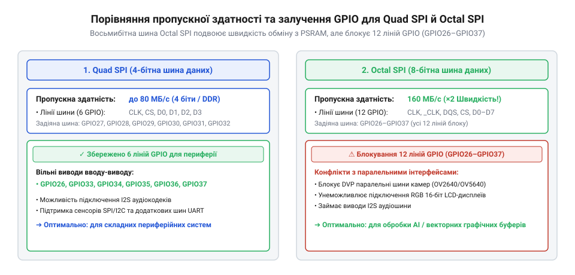

# Розрахунок пропускної здатності шин Flash/PSRAM та бюджету доступних виводів GPIO

<preknowlist>
- [Мікроконтролер ESP32-S3](root:cat-hw-boards/esp32s3-microcontroller) — Базова архітектура чипа ESP32-S3, матриця GPIO та підтримка шин Octal/Quad SPI
- [Waveshare ESP32-S3R2 (16 МБ Flash, 2 МБ PSRAM)](root:cat-hw-boards/esp32-s3r2-waveshare) — Конфігурація SiP-пам'яті та розподіл виводів у платах серії ESP32-S3
</preknowlist>

## Обмеження пропускної здатності шин пам'яті

Вбудована статична оперативна пам’ять (від англ. @@en|static random-access memory@@: static — постійний, @@en|SRAM@@) [мікроконтролера ESP32-S3](root:cat-hw-boards/esp32s3-microcontroller) обсягом 512 кБ достатня для операційної системи, проте замала для кадрових чи аудіобуферів, що вимагає підключення зовнішніх кристалів Flash та псевдостатичної оперативної пам'яті (від англ. @@en|pseudo-static random-access memory@@: pseudo — несправжній, static — постійний, @@en|PSRAM@@).

Підключення кристалів у корпусі система в корпусі (від англ. @@en|System-in-Package@@: system — система, package — корпус, @@en|SiP@@) здійснює блок керування пам'яттю (від англ. @@en|memory management unit@@: memory — пам'ять, unit — блок, @@en|MMU@@). Він транслює віртуальну адресацію ядер Tensilica LX7 у фізичні сигнали шин. При збої зчитування кешу (від англ. @@en|cache miss@@: cache — хованка, miss — промах) ядро замирає на час вибірки @@en|MMU@@ 32-байтного рядка ззовні. Детальніше про механізми трансляції адрес та витіснення рядків кешу розкрито у розборі [внутрішньої будови MMU-кешу](root:cat-hw-boards/esp32s3-mmu-cache-architecture).

Оскільки Flash та @@en|PSRAM@@ ділять спільну шину SPI, одночасний прямий доступ до пам'яті (від англ. @@en|Direct Memory Access@@: direct — прямий, @@en|DMA@@) для дисплея та вибірка коду процесором викликають арбітражний конфлікт. Фізична ширина шини стає вузьким місцем (від англ. @@en|bottleneck@@: bottle — пляшка, neck — шийка), що робить математичний розрахунок затримок єдиним способом запобігти втраті даних.

## Розрахунок швидкодії Quad та Octal SPI

Для зв'язку з чипами Flash та @@en|PSRAM@@ у чипах ESP32-S3 застосовують два принципово різних типи шин: 4-бітну шину @@en|Quad SPI@@ та 8-бітну шину @@en|Octal SPI@@. Вибір архітектури визначає як фізичну кількість залучених провідників, так і обсяг даних, переданих за один тактовий імпульс.

*Схема порівняння пропускної здатності та ширин залучених ліній GPIO для Quad SPI (4-біт) і Octal SPI (8-біт) конфігурацій Flash і PSRAM.*

Шина @@en|Quad SPI@@ використовує 4 сигнальні лінії даних D0..D3. У режимі одинарної швидкості передачі (від англ. @@en|Single Data Rate@@: single — поодинокий, @@en|SDR@@) за один такт передається 4 біти (0.5 байта). У режимі подвійної швидкості (від англ. @@en|Double Data Rate@@: double — подвійний, @@en|DDR@@) дані зчитуються за обома фронтами тактового сигналу, забезпечуючи 1 байт за такт. Натомість шина @@en|Octal SPI@@ має 8 ліній даних D0..D7, передаючи 1 байт за такт у режимі @@en|SDR@@ та 2 байти за такт у режимі @@en|DDR@@.

Загальну теоретичну пропускну здатність шини пам'яті B у мегабайтах за секунду (МБ/с) обчислюють за формулою:

        B = (W × f × M) ÷ 8

де W — ширина шини в бітах (W = 4 для @@en|Quad SPI@@, W = 8 для @@en|Octal SPI@@); f — тактова частота шини в мегагерцах (МГц, f ∈ {40, 80, 120}); M — множник режиму тактування (M = 1 для @@en|SDR@@, M = 2 для @@en|DDR@@); 8 — коефіцієнт переведення бітів у байти.

**Приклад обчислення пропускної здатності для Quad SPI SDR та Octal SPI DDR на частоті 80 МГц:**

        B_QSPI = (4 × 80 × 1) ÷ 8
               = 320 ÷ 8                [перетворення бітів у байти]
               = 40 МБ/с                [пропускна здатність Quad SPI SDR 80 МГц]

        B_OSPI = (8 × 80 × 2) ÷ 8
               = 1280 ÷ 8               [перетворення бітів у байти]
               = 160 МБ/с               [пропускна здатність Octal SPI DDR 80 МГц]

На практиці реальна пропускна здатність зменшується через накладні витрати передачі команд SPI, адресних циклів та затримок @@en|MMU@@. Ефективний коефіцієнт використання шини становить η ≈ 0.75. Це дає реальну швидкість B_eff = 0.75 × 160 = 120 МБ/с для @@en|Octal SPI DDR@@ та B_eff = 0.75 × 40 = 30 МБ/с для @@en|Quad SPI SDR@@.

Знаючи ефективну швидкість, розраховують граничну частоту оновлення кадрів (від англ. @@en|frames per second@@: frame — кадр, @@en|FPS@@) для дисплея. Обсяг кадрового буфера S_frame залежить від роздільності та глибини кольору (для кодування @@en|RGB565@@ використовують 2 байти на піксель). Для панелі 480×320 пікселів:

        S_frame = 480 × 320 × 2
                = 307200 байтів          [обсяг кадрового буфера в байтах]
                = 0.3072 МБ              [обсяг буфера в мегабайтах]

Максимальна частота кадрів FPS_max визначається відношенням ефективної пропускної здатності до розміру кадру:

        FPS_max = B_eff ÷ S_frame
                = 120 ÷ 0.3072           [ділення пропускної здатності на розмір кадру]
                ≈ 390.6 Гц               [граничний FPS для Octal SPI DDR 80 МГц]

Для шини @@en|Quad SPI SDR@@ на цій же роздільності граничний показник суттєво нижчий:

        FPS_QSPI = 30 ÷ 0.3072
                 ≈ 97.65 Гц              [граничний FPS для Quad SPI SDR 80 МГц]

Якщо ж використати більший дисплей 800×480 пікселів (S_frame = 800 × 480 × 2 = 768000 байтів = 0.768 МБ), то на шині @@en|Quad SPI SDR@@ гранична частота впаде до 30 ÷ 0.768 ≈ 39.06 Гц. Це завантажує шину пам'яті майже на 100%, унаслідок чого будь-який промах кешу процесора викликає затримки рендерингу.

## Бюджет GPIO залежно від конфігурації SiP

Фізична кількість виводів загального призначення (від англ. @@en|general-purpose input/output@@: general — загальний, @@en|GPIO@@) у мікроконтролері обмежена топологією корпусу. Кристал ESP32-S3 у базовому варіанті містить 45 фізичних ліній введення-виведення (GPIO0..GPIO44). Проте реальний доступний бюджет виводів для підключення зовнішніх давачів та індикаторів залежить від способу інтеграції внутрішньої пам'яті @@en|SiP@@.

Частина ліній @@en|GPIO@@ є системно зарезервованою. До них належать лінії апаратного інтерфейсу USB (GPIO19, GPIO20), конфігураційні виводи стартового завантаження (від англ. @@en|strapping pins@@) та послідовна консоль UART (GPIO43, GPIO44). Загалом кількість фіксованих системних ліній становить N_sys = 6.

Решта виводів розподіляється між периферією та шиною пам'яті. Конфігурація @@en|Quad SPI@@ підключає Flash та @@en|PSRAM@@ через 6 базових ліній: вибір чипа CS0, тактування CLK та 4 лінії даних D0..D3. При додаванні другого чипа пам'яті використовується лише одна додаткова лінія вибору CS1. Загальна кількість витрачених виводів становить N_mem = 7 (типово GPIO26..GPIO32).

Натомість 8-бітна шина @@en|Octal SPI@@ вимагає значно більшого ресурсу: 8 ліній даних D0..D7, диференційне тактування CLK і CLKB, сигнальний строб даних DQS та окремі лінії вибору чипів CS0 і CS1. Сумарні витрати складають N_mem = 13 ліній (виводи GPIO33..GPIO37, GPIO14 та GPIO10..GPIO13).

Математична модель розрахунку доступного бюджету N_avail описується рівнянням:

        N_avail = N_total - N_sys - N_mem

де N_total = 45 — загальна кількість фізичних ліній чипа; N_sys = 6 — зарезервовані системні виводи; N_mem — витрати на шину пам'яті.

**Приклад розрахунку бюджету GPIO для Quad SPI та Octal SPI модулів:**

        N_avail_QSPI = 45 - 6 - 7
                     = 32               [доступні виводи GPIO для Quad SPI]

        N_avail_OSPI = 45 - 6 - 13
                     = 26               [доступні виводи GPIO для Octal SPI]

Втрата бюджету виводів при переході на 8-бітну шину становить:

        ΔN = N_mem_OSPI - N_mem_QSPI
           = 13 - 7                     [різниця витрачених ліній пам'яті]
           = 6 виводів                  [втрачені виводи GPIO]

Втрачені 6 виводів є критичними при розробці складних пристроїв. Наприклад, паралельний інтерфейс камери на модулях [ESP32-CAM](root:cat-hw-boards/esp32-cam) вимагає від 10 до 12 вільних ліній. У платах із 8-бітною пам'яттю, як-от [Waveshare ESP32-S3R2](root:cat-hw-boards/esp32-s3r2-waveshare), доступний бюджет зменшується до 26 ліній, що змушує відмовлятися від шинних дисплеїв або переходити на компактні модулі формату [ESP32-S3-Zero](root:cat-hw-boards/esp32-s3-zero) чи [ESP32-S3 SuperMini](root:cat-hw-boards/esp32-s3-supermini) з 4-бітною конфігурацією пам'яті.

## Теплове розсіювання LDO при пікових навантаженнях

Надійність роботи плат розробки на базі ESP32-S3 визначається не лише швидкодією шин, а й параметрами системи живлення. Живлення кристала та периферійних ліній вимагає напруги 3.3 В. Для зниження зовнішньої напруги USB (5.0 В) на платах встановлюють лінійний регулятор зі зниженим падінням напруги (від англ. @@en|low dropout regulator@@: low — низький, dropout — випадіння, @@en|LDO@@).

Принцип роботи лінійного регулятора полягає у перетворенні надлишку напруги на теплову енергію. Загальний струм споживання I_total складається з трьох основних компонентів: струму мікроконтролера з пам'яттю I_MCU ≈ 100 мА, пікового струму передавача Wi-Fi I_WiFi ≈ 350 мА та струму зовнішнього навантаження (дисплей, давачі) I_periph ≈ 150 мА.

        I_total = I_MCU + I_WiFi + I_periph
                = 100 + 350 + 150       [додавання компонентів струму]
                = 600 мА = 0.6 А        [сумарний піковий струм споживання]

Теплову потужність розсіювання P_d у ватах (Вт) обчислюють за формулою:

        P_d = (V_in - V_out) × I_total

де V_in = 5.0 В — вхідна напруга USB; V_out = 3.3 В — вихідна напруга живлення; I_total = 0.6 А — сумарний струм.

        P_d = (5.0 - 3.3) × 0.6
            = 1.7 × 0.6                 [падіння напруги помножене на струм]
            = 1.02 Вт                   [потужність теплового розсіювання LDO]

Температуру кристала регулятора T_j у градусах Цельсія (°C) обчислюють через тепловий опір кристал-довкілля R_θJA (від англ. @@en|thermal resistance junction-to-ambient@@, °C/Вт) та температуру довкілля T_a = 25 °C:

        T_j = T_a + (P_d × R_θJA)

**Приклад порівняння корпусу SOT-223 (R_θJA = 65 °C/Вт) та компактного SOT-23-5 (R_θJA = 180 °C/Вт):**

        T_j_SOT223 = 25 + (1.02 × 65)
                   = 25 + 66.3          [температурний приріст для SOT-223]
                   = 91.3 °C            [температура кристала регулятора]

        T_j_SOT23 = 25 + (1.02 × 180)
                  = 25 + 183.6          [температурний приріст для SOT-23-5]
                  = 208.6 °C            [критичне перевищення порогу T_j_max!]

Оскільки максимальна припустима температура кристала регулятора становить T_j_max = 125 °C, корпус SOT-23-5 при струмі 0.6 А входить у режим термічного захисту. Це викликає просідання напруги V_out нижче критичної межі 2.8 В і фіксує скидання при просіданні живлення (від англ. @@en|brownout reset@@: brownout — просідання, reset — скидання). Для відвернення перегріву на компактних платах на зразок [Waveshare ESP32-S3-Pico](root:cat-hw-boards/esp32-s3-pico) або [Waveshare ESP32-C6-Zero](root:cat-hw-boards/esp32-c6-zero) застосовують додаткове мідне відведення тепла через шари друкованої плати або імпульсні DC-DC перетворювачі.
