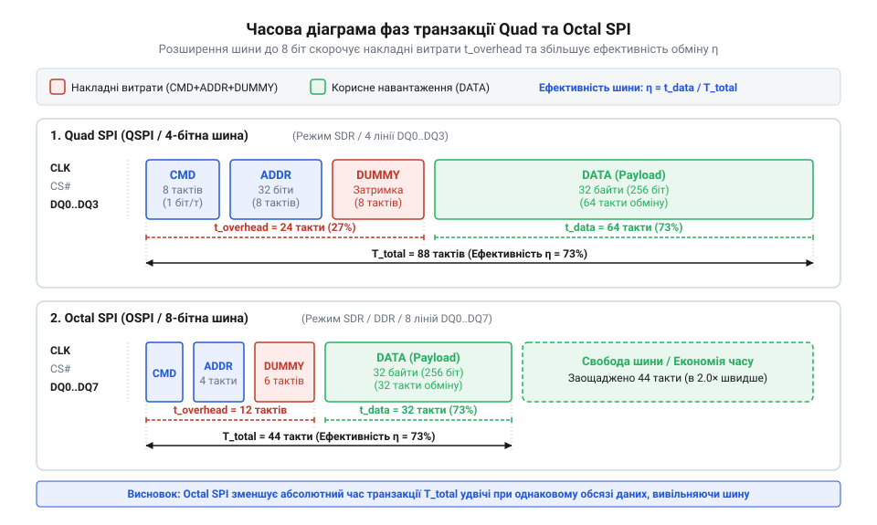
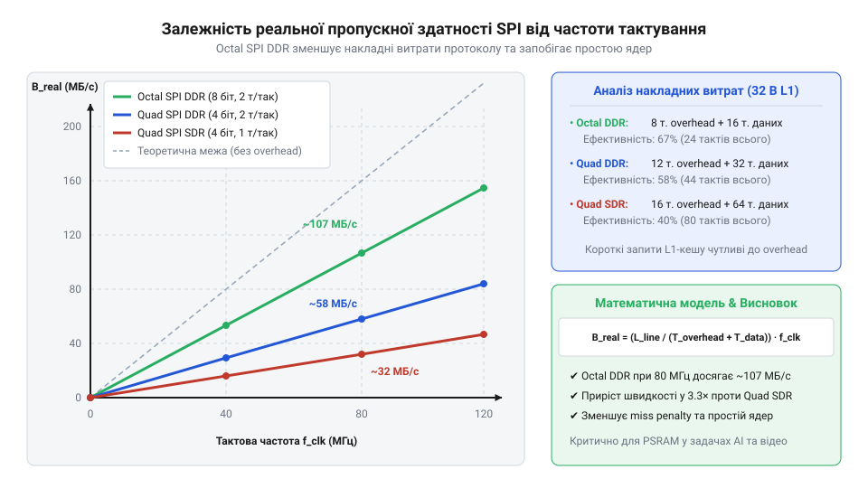
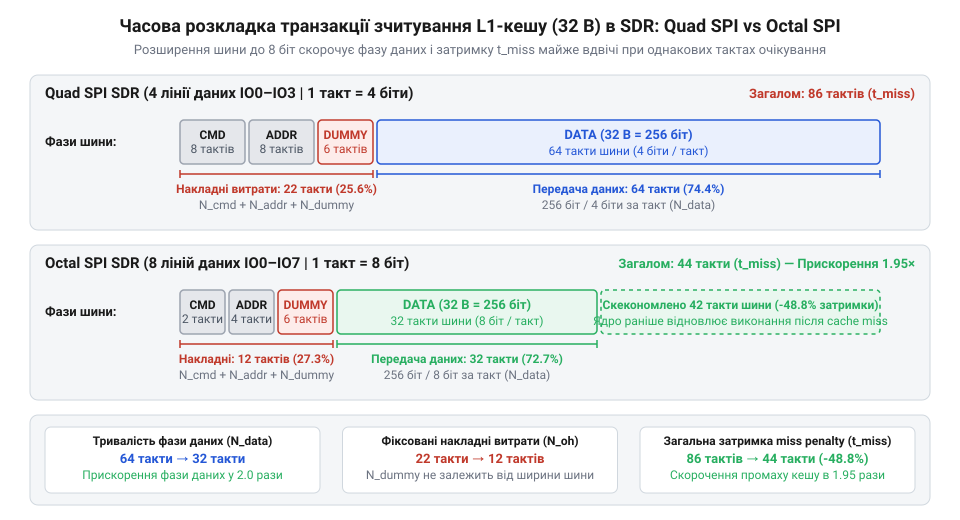

# Математичний аналіз пропускної здатності та затримок шин Quad/Octal SPI

<preknowlist>
- [Мікроконтролер ESP32-S3](root:cat-hw-boards/esp32s3-microcontroller) — архітектуру шин SPI/Octal SPI, зв'язок L1-кешу із зовнішньою пам'яттю та режими адресації.
- [Waveshare ESP32-S3R2 (16 МБ Flash, 2 МБ PSRAM)](root:cat-hw-boards/esp32-s3r2-waveshare) — практичні схеми спільного підключення Quad SPI Flash та Octal SPI PSRAM на друкованій платі.
</preknowlist>

## Простояння ядер при промахах кешу

Коли обчислювальне ядро виконує інструкції безпосередньо із зовнішньої пам'яті, процес обробки даних розраховує на оперативне надходження чергового машинного слова. Проте фізична флеш-пам'ять (англ. @@en|Flash memory@@) та псевдостатична оперативна пам'ять (англ. @@en|Pseudo Static RAM@@, @@en|PSRAM@@) розташовані за межами кристала мікроконтролера та підключені через послідовні шини. У мікроконтролерах, як-от [модулях ESP32-S3](root:cat-hw-boards/esp32s3-microcontroller), для прискорення доступу між ядрами та зовнішніми чипами встановлюють швидку однорівневу кеш-пам'ять (англ. @@en|cache memory@@, від фр. @@fr|cacher@@ — ховати). Вона зберігає локальні копії даних у вигляді фіксованих блоків, що звуться лініями кешу (англ. @@en|cache line@@). Коли потрібна інструкція або величина вже є в кеші, ядро отримує її без жодної затримки за один-два такти процесора. Проте якщо необхідної адреси у внутрішній пам'яті немає, виникає так званий промах кешу (англ. @@en|cache miss@@). У цей момент конвеєр процесора змушений повністю зупинити виконання поточної нитки обчислень — настає простій конвеєра (англ. @@en|pipeline stall@@). Ядро залишається в блокованому стані на весь час, поки кеш-контролер зчитує повний обсяг лінії кешу із зовнішнього чипа через послідовну шину.

Наївна модель продуктивності припускає, що читання з пам'яті відбувається миттєво, а пропускна здатність шини дорівнює її максимальній тактовій частоті. У системах реального часу таке спрощення призводить до зриву критичних часових дедлайнів та деградації обчислювальної потужності. Щоб математично оцінити час простою ядер, необхідно визначити тривалість обслуговування промаху кешу (англ. @@en|miss penalty@@), яку позначають як T_miss. Вона дорівнює сумарному часу, необхідному для виходу з режиму очікування, передачі командних команд, виставляння адреси, проходження протокольних затримок та фактичного зчитування всіх байтів лінії кешу. Кількість утрачених тактів процесора `C_miss` визначають шляхом множення часу затримки `T_miss` на робочу частоту ядра `f_cpu`.

Введемо позначення величин, що формують затримку транзакції:
- `f_cpu` — тактова частота обчислювального ядра процесора (Гц);
- `f_clk` — тактова частота послідовної шини SPI (Гц);
- `B_line` — розмір лінії L1-кешу в байтах (Б);
- `w` — ширина шини даних у бітах (наприклад, 4 біти для Quad SPI або 8 бітів для Octal SPI);
- `k_ddr` — коефіціент передачі даних за такт (1 для SDR, 2 для DDR);
- `N_cmd` — кількість тактів шини для передачі коду команди;
- `N_addr` — кількість тактів шини для передачі адреси;
- `N_dummy` — кількість затишкових тактів очікування (англ. @@en|dummy cycles@@).

Часова діаграма послідовних фаз обміну даними показує порядок передачі службових і корисних бітів під час завантаження лінії кешу:


*Фази транзакції шини SPI: послідовна передача команди, адреси та тактів очікування передує зчитуванню лінії кешу.*

Загальний час обслуговування промаху кешу `T_miss` виражається через суму затримок окремих фаз транзакції на послідовній шині:

```
T_cmd = N_cmd / f_clk              [тривалість фази команди]
T_addr = N_addr / f_clk            [тривалість фази адреси]
T_dummy = N_dummy / f_clk          [тривалість фази очікування]
T_data = (8 * B_line) / (f_clk * w * k_ddr) [тривалість передачі даних]
T_miss = T_cmd + T_addr + T_dummy + T_data [сумарний час затримки]
```

Отримана формула показує, що тривалість блокування ядра `T_miss` складається з двох основних частин: фіксованих протокольних накладних витрат (`T_cmd + T_addr + T_dummy`) та змінного часу вибірки корисного навантаження (`T_data`). Якщо розмір лінії кешу `B_line` малий, частка службових тактів стає визначальною, істотно погіршуючи підсумковий час доступу.

Для визначення числового значення втрачених циклів процесора переведемо час `T_miss` у кількість тактових імпульсів `C_miss`, під час яких ядро перебуває в стані простою:

```
C_miss = T_miss * f_cpu
       = (N_cmd + N_addr + N_dummy + (8 * B_line) / (w * k_ddr)) * (f_cpu / f_clk) [підстановка фаз і співвідношення частот]
```

З формули видно, що кількість утрачених циклів процесора прямо пропорційна відношенню частоти ядра до частоти шини `f_cpu / f_clk`. Якщо процесор працює на частоті 240 МГц, а шина SPI — на частоті 80 МГц, то кожен такт шини коштує ядру трьох втрачених тактів виконання інструкцій.

**Обчислення на прикладі:**
Обчислимо тривалість простою ядра та кількість втрачених тактів процесора для [плати Waveshare ESP32-S3R2](root:cat-hw-boards/esp32-s3r2-waveshare) при промаху L1-кешу під час зчитування лінії розміром 32 байти з Quad SPI Flash в режимі SDR. Вхідні параметри: `f_cpu = 240 МГц`, `f_clk = 80 МГц`, `B_line = 32 байти`, `w = 4 біти`, `k_ddr = 1` (SDR). Службові фази транзакції займають: `N_cmd = 8 тактів` (1 байт по 1 лінії), `N_addr = 6 тактів` (3 байти по 4 лініях), `N_dummy = 6 тактів`.

```
N_data = (8 * 32) / (4 * 1)
       = 256 / 4                   [ділення загальної кількості бітів на ширину шини]
       = 64                        [кількість тактів для передачі даних]

N_total = 8 + 6 + 6 + 64
        = 84                       [сумарна кількість тактів шини SPI]

T_miss = 84 / (80 * 10⁶)
       = 1.05 * 10⁻⁶               [час у секундах, тобто 1.05 мікросекунди]

C_miss = 1.05 * 10⁻⁶ * (240 * 10⁶)
       = 84 * 3                    [множення тактів шини на співвідношення частот]
       = 252                       [втрачені такти процесора]
```

Таким чином, один промах L1-кешу примушує обчислювальне ядро простояти 252 такти процесора (або 1.05 мікросекунди). У застосунках обробки звуку чи сигналів цифрового керування на [платформі ESP32-S3-Zero](root:cat-hw-boards/esp32-s3-zero) повторювані промахи кешу здатні заморозити конвеєр на десятки тисяч циклів, повністю руйнуючи дедлайни виконання системних завдань.

## Протокольні накладні витрати шини SPI

Маючи математичну модель простою ядер, перейдемо до аналізу внутрішньої структури транзакцій шини послідовного периферійного інтерфейсу (англ. @@en|Serial Peripheral Interface@@, @@en|SPI@@). Кожна операція зчитування даних із зовнішньої Flash або PSRAM складається з чотирьох послідовних етапів: передачі коду інструкції (англ. @@en|Command phase@@), адреси потрібної комірки (англ. @@en|Address phase@@), фіктивних тактів очікування (англ. @@en|Dummy cycles@@) та блоку корисного навантаження (англ. @@en|Data payload@@). Такти очікування необхідні фізичній мікросхемі пам'яті для внутрішнього декодування адреси та вибірки даних із матриці накопичувача перед подачею їх на вихідні буфери.

Ширина шини даних `w` визначає, скільки бітів інформації передається паралельно за один тактовий імпульс. У традиційній шині Quad SPI (англ. @@en|Quad SPI@@, @@en|QSPI@@) використовуються 4 сигнальні лінії даних (IO0–IO3). У розширеній шині Octal SPI (англ. @@en|Octal SPI@@, @@en|OSPI@@) кількість сигнальних ліній зростає до 8 (IO0–IO7). Окрім ширини шини, вирішальне значення має режим тактування. У режимі одиничної швидкості передачі (англ. @@en|Single Data Rate@@, @@en|SDR@@, від лат. @@la|singulus@@ — поодинокий) фіксація стану ліній відбувається лише по одному фронту тактового сигналу (зазвичай висхідному). У режимі подвійної швидкості (англ. @@en|Double Data Rate@@, @@en|DDR@@, від лат. @@la|duplus@@ — подвійний) дані зчитуються як по висхідному, так і по спадному фронту тактового імпульсу, що подвоює обсяг інформації за один такт (`k_ddr = 2`).

Теоретична пропускна здатність шини (англ. @@en|theoretical bandwidth@@), яку часто вказують у технічних паспортах чипів, обчислюється як максимальна фізична швидкість передачі бітів без урахування службових тактів:

```
R_max = (f_clk * w * k_ddr) / 8     [максимальна пропускна здатність у байтах за секунду]
```

Проте реальна пропускна здатність (англ. @@en|effective throughput@@) `R_eff` виявляється суттєво нижчою через протокольні накладні витрати (англ. @@en|protocol overhead@@). Співвідношення між корисним часом передачі даних та загальним часом транзакції визначає коефіцієнт протокольної ефективності `η` (англ. @@en|protocol efficiency@@):

```
N_data = (8 * B_line) / (w * k_ddr) [кількість тактів для корисних даних]
N_overhead = N_cmd + N_addr + N_dummy [кількість службових тактів]
N_total = N_overhead + N_data       [загальна кількість тактів транзакції]
η = N_data / N_total               [коефіцієнт протокольної ефективності]
R_eff = R_max * η                   [реальна пропускна здатність шини]
```

Зміна ефективності `η` при переході від Quad SPI до Octal SPI обумовлена не лише розширенням шини даних з 4 до 8 бітів, але й тим, що фази адреси та команди в Octal SPI передаються по 8 лініях паралельно. Це зменшує тривалість фаз `N_cmd` та `N_addr` вдвічі порівняно з Quad SPI, скорочуючи загальні службові накладні витрати `N_overhead`.

Графічний аналіз залежності реальної пропускної здатності від тактової частоти демонструє вплив оверхеду на різних режимах роботи шини:


*Залежність реальної пропускної здатності від частоти шини: Octal SPI DDR зберігає високу ефективність на частотах 40, 80 та 120 МГц.*

Підвищення тактової частоти шини `f_clk` з 40 МГц до 80 МГц та 120 МГц пропорційно зменшує абсолютний час транзакції `T_miss`, проте коефіцієнт ефективності `η` залишається незмінним, якщо кількість затишкових тактів `N_dummy` не збільшується. На високих частотах (120 МГц) мікросхеми пам'яті вимагають збільшення `N_dummy` з 6–8 до 10–12 тактів для компенсації затримок спрацьовування внутрішніх схем. Це призводить до зростання `N_overhead` та зниження відносної ефективності `η` при малих розмірах порції даних.

**Обчислення на прикладі:**
Порівняємо ефективність та реальну пропускну здатність шин Quad SPI SDR та Octal SPI DDR при зчитуванні лінії кешу `B_line = 32 байти` на частоті `f_clk = 80 МГц`.
Для Quad SPI SDR: `w = 4`, `k_ddr = 1`, `N_cmd = 8`, `N_addr = 6`, `N_dummy = 6`.
Для Octal SPI DDR: `w = 8`, `k_ddr = 2`, `N_cmd = 2`, `N_addr = 2`, `N_dummy = 6` (передача команд та адрес у режимі DDR по 8 лініях).

Обчислення для Quad SPI SDR:
```
R_max_quad = (80 * 10⁶ * 4 * 1) / 8
           = 40 * 10⁶               [максимальна швидкість 40 МБ/с]

N_data_quad = (8 * 32) / (4 * 1)
            = 64                    [тактивності даних]

N_total_quad = 8 + 6 + 6 + 64
             = 84                   [всього тактів]

η_quad = 64 / 84
       ≈ 0.7619                     [ефективність 76.19%]

R_eff_quad = 40 * 10⁶ * 0.7619
           ≈ 30.48 * 10⁶            [реальна швидкість 30.48 МБ/с]
```

Обчислення для Octal SPI DDR:
```
R_max_octal = (80 * 10⁶ * 8 * 2) / 8
            = 160 * 10⁶             [максимальна швидкість 160 МБ/с]

N_data_octal = (8 * 32) / (8 * 2)
             = 16                   [тактивності даних]

N_total_octal = 2 + 2 + 6 + 16
              = 26                  [всього тактів]

η_octal = 16 / 26
        ≈ 0.6154                    [ефективність 61.54%]

R_eff_octal = 160 * 10⁶ * 0.6154
            ≈ 98.46 * 10⁶           [реальна швидкість 98.46 МБ/с]
```

Результати розрахунку показують, що хоча коефіцієнт ефективності Octal SPI DDR у цьому конкретному випадку нижчий через порівняно високу частку тактів очікування (`N_dummy = 6`) відносно малих тактів даних (`N_data = 16`), підсумкова реальна пропускна здатність зростає у 3.23 раза (з 30.48 МБ/с до 98.46 МБ/с). Завдяки цьому тривалість затримки зменшується з 1.05 мікросекунди до 0.325 мікросекунди, звільняючи конвеєр процесора від тривалих простоїв.

## Математика режимів SDR Quad та Octal

Коли обчислювальне ядро стикається з відсутністю потрібних інструкцій або даних у локальній кеш-пам'яті, конвеєр процесора зупиняється. Виникає @@en|pipeline stall@@ (від англійського *stall* — зупинка, простій), під час якого система чекає на завантаження повного блоку пам'яті, відомого як @@en|cache line@@ (від французького *cacher* — ховати). Тривалість цього простою визначається тим, наскільки швидко послідовна шина передасть необхідний обсяг байтів. У найпростішому режимі @@en|Single Data Rate@@ (@@en|SDR@@, від англійського *single* — один, поодинокий) кожен провід шини передає рівно один біт даних за один тактовий імпульс.

Для розширення каналу обміну використовують шину @@en|Quad SPI@@ (@@en|QSPI@@, від латинського *quattuor* — чотири), яка має 4 лінії даних, або @@en|Octal SPI@@ (@@en|OSPI@@, від грецького *okto* — вісім) з 8 лініями даних. Будь-яке читання з зовнішньої пам'яті @@en|Flash@@ (від англійського *flash* — спалах) або @@en|PSRAM@@ (від англійського @@en|Pseudo Static Random-Access Memory@@) складається з чотирьох послідовних фаз: передачі коду команди, передачі адреси комірки, очікування готовності кристала та безпосередньо зчитування даних.

Такти очікування @@en|dummy cycles@@ (від англійського *dummy* — макетний, фіктивний) виникають через фізичну затримку внутрішнього декодера пам'яті `t_acc`. Кристал зовнішньої пам'яті потребує фіксованого часу у наносекундах для вибірки рядка та переключення виводів у стан виходу. Оскільки ця затримка є фізичною константою напівпровідника, зі зростанням тактової частоти `F_clk` та зменшенням періоду тактування `T_clk = 1 ÷ F_clk` кількість необхідних тактів очікування `N_dummy` обчислюється як:

N_dummy = ⌈t_acc ÷ T_clk⌉
        = ⌈t_acc × F_clk⌉                                   [перехід від періоду до частоти]

При фіксованому часі внутрішнього доступу `t_acc = 75 нс` на частоті 40 МГц (`T_clk = 25 нс`) отримуємо `N_dummy = 3` такти (з урахуванням системного запасу — 4 такти). На частоті 80 МГц (`T_clk = 12.5 нс`) кількість тактів зростає до `N_dummy = 6`, а на частоті 120 МГц (`T_clk = 8.33 нс`) — до `N_dummy = 10` тактів.

Для обчислення повної тривалості зчитування лінії кешу визначимо початкові величини. Позначимо загальну кількість тактів транзакції як `N_total`, кількість тактів команди як `N_cmd`, такти адреси як `N_addr`, такти очікування як `N_dummy`, такти передачі даних як `N_data`, тактову частоту шини як `F_clk`, а підсумковий час транзакції як `t_read`. Кількість тактів фази даних залежить від розміру лінії кешу `B_line` у байтах та кількості ліній шини. Для 4-бітної шини Quad SDR значення `N_data = (B_line × 8) ÷ 4 = 2 × B_line`, а для 8-бітної шини Octal SDR значення `N_data = (B_line × 8) ÷ 8 = B_line`.

Загальний час обслуговування промаху кешу обчислюється за формулою:

N_total = N_cmd + N_addr + N_dummy + N_data
t_read = N_total ÷ F_clk

Отримана формула показує, що загальний час транзакції є сумою фіксованих накладних витрат шини та часу безпосереднього прокачування корисного навантаження. Звідси випливає вираз для реальної пропускної здатності @@en|throughput@@ (від англійського *through* — наскрізь та *put* — класти), яку позначимо як `S_eff`, та коефіцієнта протокольної ефективності `η`:

S_eff = B_line ÷ t_read
      = (B_line × F_clk) ÷ (N_cmd + N_addr + N_dummy + N_data)      [підстановка часу транзакції]

η = N_data ÷ N_total
  = N_data ÷ (N_cmd + N_addr + N_dummy + N_data)                   [відношення корисних тактів до загальних]

Аналітичний вираз показує, що розширення шини з 4 до 8 біт зменшує кількість тактів даних `N_data` вдвічі, проте фази `N_cmd`, `N_addr` та `N_dummy` залишаються суттєвою часткою загального часу.


*Структура часових витрат при зчитуванні лінії кешу для шин різної розрядності.*

Розглянемо практичний розрахунок затримки обслуговування промаху кешу @@en|miss penalty@@ (від англійського *miss* — промах та *penalty* — штраф, затримка) для [мікроконтролера ESP32-S3](root:cat-hw-boards/esp32s3-microcontroller), який працює з кеш-лінією розміром 32 байти.

**Обчислення затримки зчитування лінії кешу розміром 32 байти на частоті 80 МГц для шин Quad SDR та Octal SDR:**

N_data_quad = 32 × 2 = 64 такти                              [розрахунок тактів даних для Quad SDR]
N_total_quad = 8 + 8 + 6 + 64 = 86 тактів                    [додавання накладних витрат Quad SDR]
t_read_quad = 86 ÷ 80 000 000 Гц = 1.075 × 10⁻⁶ с            [обчислення часу для Quad SDR]
S_eff_quad = 32 ÷ (1.075 × 10⁻⁶) ≈ 29.77 МБ/с                 [реальна швидкість Quad SDR]

N_data_octal = 32 × 1 = 32 такти                             [розрахунок тактів даних для Octal SDR]
N_total_octal = 2 + 4 + 8 + 32 = 46 тактів                   [додавання накладних витрат Octal SDR]
t_read_octal = 46 ÷ 80 000 000 Гц = 0.575 × 10⁻⁶ с           [обчислення часу для Octal SDR]
S_eff_octal = 32 ÷ (0.575 × 10⁻⁶) ≈ 55.65 МБ/с                [реальна швидкість Octal SDR]

З розрахунку видно, що перехід на 8-бітну шину Octal SDR скорочує час затримки з 1075 нс до 575 нс, підвищуючи реальну швидкість майже вдвічі. Якщо збільшити розмір лінії кешу до 64 байтів, тривалість фази даних зростає до 128 тактів для Quad SDR і до 64 тактів для Octal SDR. При цьому ефективність `η` для Octal SDR зростає з 69.6% до 82.1%, оскільки відносна вага протокольного очікування зменшується.

Однак при підвищенні частоти до 120 МГц режим SDR вичерпує свої можливості. Тривалість тактового періоду зменшується до 8.33 нс, через що вимоги до часу утримання та встановлення сигналів стають критичними. Крім того, зростання кількості `N_dummy` до 12 тактів нівелює частотний виграш. Для подальшого прискорення необхідний перехід до передачі даних по обох фронтах тактового сигналу.

## Подвоєна швидкість DDR та затримка PSRAM

Прагнення підвищити швидкість обміну без безкінечного нарощування тактової частоти привело до створення режиму @@en|Double Data Rate@@ (@@en|DDR@@, від англійського *double* — подвійний). У цьому режимі зчитування бітів відбувається як по наростаючому, так і по спадному фронту тактового сигналу `CLK`. Це дозволяє подвоїти кількість переданих бітів за один тактовий цикл: 4-бітна шина Quad DDR передає 1 байт за такт, а 8-бітна шина Octal DDR досягає швидкості 2 байти за такт.

Практична реалізація high-speed пам'яті має свої особливості. Зовнішня мікросхема @@en|PSRAM@@ побудована на динамічних комірках з автоматичним регенераційним циклом, через що затримка першого доступу залежить від поточного стану внутрішніх матриць. На частотах 80–120 МГц тривалість такту стає меншою за фізичну розбіжність затримок поширення сигналів на друкованій платі. Для компенсації фазового зсуву та зміни температури чи напруги в Octal DDR PSRAM використовується двонаправлений строб даних @@en|DQS@@ (від англійського @@en|Data Strobe@@, де *strobe* — спалах, імпульсний сигнал).

Пам'ять сама генерує сигнал `DQS` синхронно з вихідними даними `DQ[7:0]`. Контролер мікроконтролера запізнює цей строб на 90 градусів фази для точного захоплення центру бітового вікна. Однак використання `DQS` вимагає додаткових преамбульних тактів `N_pre` для захоплення фази строба та збільшеної кількості `N_dummy_ddr`. При цьому в режимі Octal DDR команди та адреси також передаються у режимі DDR, що зменшує `N_cmd_ddr` до 1 такту, а `N_addr_ddr` — до 2 тактів. Кількість тактів фази даних для лінії кешу розміром `B_line` байтів у режимі Octal DDR обчислюється як `N_data_ddr = B_line ÷ 2`. Алгоритми динамічного налаштування затримок сигналів DQS для стабільної роботи Octal DDR PSRAM на частотах 120 МГц описує [калібрування фазового зсуву строба DQS](root:hw-arch/dqs-strobe-calibration-esp32s3).


*Часові діаграми передачі даних по двох фронтах сигналу з фазовим узгодженням стробом DQS.*

Для оцінки впливу затримки зовнішньої пам'яті на продуктивність обчислювальних ядер введемо модель тривалості простою конвеєра `N_stall` у тактах процесора. Позначимо тактову частоту ядра процесора як `F_cpu`, а підсумковий час обслуговування промаху кешу як `t_miss`.

Час затримки та кількість втрачених тактів процесора описуються формулою:

t_miss = (N_cmd_ddr + N_addr_ddr + N_dummy_ddr + N_pre + N_data_ddr) ÷ F_clk
N_stall = t_miss × F_cpu

Рівняння демонструє прямий зв'язок між затримкою шини пам'яті та кількістю простоїв конвеєра процесора. Що вища частота ядра `F_cpu`, то більше тактів втрачає процесор під час кожного промаху кешу.

Проведемо порівняльний розрахунок підсумкового @@en|miss penalty@@ для зчитування 64-байтової лінії кешу на платі [Waveshare ESP32-S3R2](root:cat-hw-boards/esp32-s3r2-waveshare) з процесором [мікроконтролері ESP32-S3](root:cat-hw-boards/esp32s3-microcontroller), який працює на частоті 240 МГц (`F_cpu = 240 МГц`). Порівняємо конфігурацію Quad SDR Flash на 80 МГц та Octal DDR PSRAM на 120 МГц.

**Обчислення затримки простою конвеєра для 64-байтової лінії кешу при частоті CPU 240 МГц:**

t_miss_quad = (8 + 8 + 6 + 128) ÷ 80 000 000 Гц = 1.875 × 10⁻⁶ с         [обчислення t_miss для Quad SDR 80 МГц]
N_stall_quad = 1.875 × 10⁻⁶ с × 240 000 000 Гц = 450 тактів              [розрахунок простоїв для Quad SDR 80 МГц]

t_miss_octal = (1 + 2 + 7 + 2 + 32) ÷ 120 000 000 Гц ≈ 0.3667 × 10⁻⁶ с     [обчислення t_miss для Octal DDR 120 МГц]
N_stall_octal = 0.3667 × 10⁻⁶ с × 240 000 000 Гц ≈ 88 тактів             [розрахунок простоїв для Octal DDR 120 МГц]

Обчислення показують, що перехід від 4-бітної Flash SDR на 80 МГц до 8-бітної PSRAM DDR на 120 МГц скорочує затримку простою конвеєра з 450 до 88 тактів процесора — у 5.1 раза. Реальна пропускна здатність при цьому зростає з 34.13 МБ/с до 174.55 МБ/с.

Математичний вибір конфігурації пам'яті визначається профілем навантаження системи. Для виконання коду з Flash на компактних модулях на кшталт [ESP32-S3 SuperMini](root:cat-hw-boards/esp32-s3-supermini) або [ESP32-S3-Zero](root:cat-hw-boards/esp32-s3-zero) режим Quad SDR є достатнім, оскільки локальний кеш згладжує поодинокі звернення. Проте для обробки відеопотоків камери на платах типу [ESP32-CAM](root:cat-hw-boards/esp32-cam), роботи з масивами звукових даних чи векторних обчислень штучного інтелекту необхідна шина Octal DDR PSRAM, яка запобігає голодуванню конвеєра процесора.
