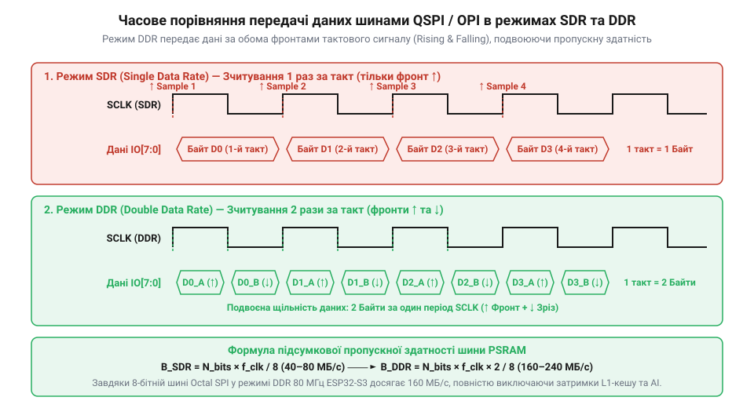
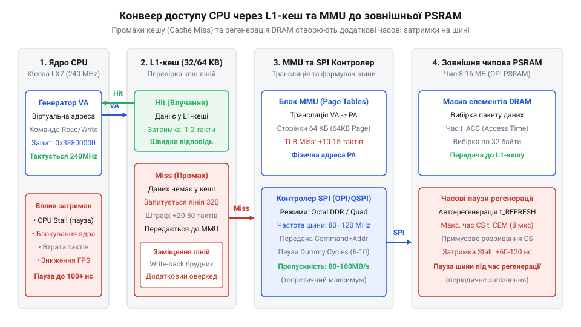

# Розрахунок пропускної здатності шин QSPI/OPI та затримок пам'яті PSRAM

<preknowlist>
- [Мікроконтролер ESP32-S3](root:cat-hw-boards/esp32s3-microcontroller) — архітектура периферійних шин DMA та взаємодія із зовнішньою пам'яттю PSRAM
- [Waveshare ESP32-S3R2 (16 МБ Flash, 2 МБ PSRAM)](root:cat-hw-boards/esp32-s3r2-waveshare) — специфікація підключення та режими роботи PSRAM
</preknowlist>

## Задача розгортання шин QSPI та OPI

При розробці пристроїв комп'ютерного зору та графічних інтерфейсів на мікроконтролерах вбудована статична оперативна пам'ять (англ. @@en|SRAM@@, від @@en|Static Random-Access Memory@@) вичерпується після виділення кількох кадрових буферів. Наприклад, один кадр кольорового зображення роздільністю 640×480 пікселів у форматі RGB565 займає 614.4 кБ, що перевищує весь обсяг внутрішньої оперативної пам'яті більшості чипів. Для збереження масивних потоків даних розробники підключають зовнішню псевдостатичну оперативну пам'ять (англ. @@en|PSRAM@@, від @@en|Pseudo-Static RAM@@). Проте розширення шини підключення з чотирьохбітової `QSPI` (лінії `D0`–`D3`) до восьмибітової `OPI` (лінії `D0`–`D7`) створює жорсткі фізичні обмеження на корпусі мікроконтролера: підключення `OPI` разом із додатковими сигналами тактування `CLK` та стробування `DQS` (англ. @@en|Data Strobe@@; @@en|строб даних DQS@@) займає понад 11 виводів загального призначення (англ. @@en|GPIO@@, від @@en|General-Purpose Input/Output@@). На схемотехнічному рівні це вимагає суворого вирівнювання довжин трас друкованої плати для запобігання часовому перекосу фаз (англ. @@en|skew@@; @@en|часовий перекіс сигналів@@) між 8 паралельними лініями даних на частотах 80–120 МГц та вилучає ці виводи з доступного ресурсу для периферійних інтерфейсів.

Класичний послідовний інтерфейс (англ. @@en|SPI@@, від @@en|Serial Peripheral Interface@@) передає дані по одній лінії (MOSI/MISO). На тактовій частоті 40 МГц максимальна швидкість передачі не перевищує 5 МБ/с, через що вивантаження одного кадру триває понад 120 мс, обмежуючи частоту оновлення позначкою 8 кадрів за секунду (англ. @@en|FPS@@, від @@en|Frames Per Second@@).

Щоб подолати це обмеження, шинні інтерфейси розширюють розрядність ліній даних. Чотирьохбітовий інтерфейс Quad SPI (англ. @@en|QSPI@@, від @@en|Quad Serial Peripheral Interface@@) передає 4 біти за один тактовий імпульс. Восьмибітовий інтерфейс Octal SPI (англ. @@en|OPI@@, від @@en|Octal Peripheral Interface@@) подвоює ширину шини до 8 паралельних ліній. Коли [мікроконтролер ESP32-S3](root:cat-hw-boards/esp32s3-microcontroller) працює з зовнішньою пам'яттю, вибір між QSPI та OPI разом із частотою тактування розмежувальної шини визначає, чи зможе система обробляти відеопотік без випадіння кадрів.

Крім ширини шини, ключову роль відіграє режим стробування сигналів на гранях тактового імпульсу. У режимі одинарної швидкості (англ. *Single Data Rate*; @@en|SDR-режим@@) зчитування бітів відбувається лише по одному збуджувальному фронту клоку, тоді як режим подвійної швидкості (англ. *Double Data Rate*; @@en|DDR-режим@@) передає дані по обох фронтах — наростаючому та спадаючому. Таким чином, повне математичне формалізування задачі вимагає побудови єдиного рівняння шинного балансу, яке враховує розрядність (4 або 8 бітів), тактову частоту `f_clk` (від `80` до `120 МГц`) та кількість вибірок за такт. Для таких платформ, як [Waveshare ESP32-S3R2 (16 МБ Flash, 2 МБ PSRAM)](root:cat-hw-boards/esp32-s3r2-waveshare), це дає змогу заздалегідь розрахувати, який режим розгортання шини забезпечить необхідний запас пропускної здатності для цільової кадрової частоти.

## Математична модель шин SDR та DDR

Пропускна здатність шини залежить не лише від кількості фізичних ліній, а й від способу синхронізації даних із тактовим сигналом. 

У режимі одинарної швидкості (англ. @@en|SDR@@, від @@en|Single Data Rate@@) передача кожного біта фіксується лише по наростаючому фронту тактового імпульсу. Режим подвійної швидкості (англ. @@en|DDR@@, від @@en|Double Data Rate@@) зчитує біти як по наростаючому, так і по спадному фронту тактового сигналу, що дає змогу передавати удвічі більше даних за той самий проміжок часу без збільшення частоти генератора.

*Часова діаграма тактових імпульсів та передачі даних на лініях QSPI та OPI у режимах SDR та DDR.*

Теоретичну пропускну здатність шини `B_{theo}` у мегабайтах за секунду (МБ/с) обчислюють за формулою, що враховує кількість ліній, тактову частоту й спосіб стробування. Проте реальне подвоєння передачі в режимі `DDR` порівняно із `SDR` вимагає складнішого механізму фізичної синхронізації: якщо у режимній конфігурації `SDR` зчитування відбувається по єдиному фронту клоку, то у `DDR` на тактових частотах 80–120 МГц вікно дійсності даних скорочується вдвічі, що зумовлює фазовий зсув сигналів через паразитну ємність плати. Для компенсації цього запізнення впроваджують двоправлений строб-сигнал `DQS` (англ. @@en|Data Strobe@@, від *data* — дані, та *strobe* — строб; @@en|сигнал стробування DQS@@), який апаратно затримується контролером на фазовий кут 90° (четверть періоду такту), центруючи зчитувальний імпульс точно посередині інтервалу стабільності бітів `D0`–`D7` та запобігаючи збоям вибірки на перехідних фронтах.

`B_{theo} = (f_{clk} × N_{lines} × K_{rate}) ÷ 8`

де `f_{clk}` — тактова частота шини в МГц, `N_{lines}` — кількість ліній даних (4 для QSPI, 8 для OPI), `K_{rate}` — коефіцієнт передачі за такт (1 для SDR, 2 для DDR), а ділення на 8 переводить біти у байти.

Проведемо покроковий розрахунок для основних конфігурацій шини:

Конфігурація QSPI SDR на частоті 80 МГц:
`B_{theo}`
= (80 × 4 × 1) ÷ 8      [підстановка параметрів QSPI SDR]
= 320 ÷ 8               [перемноження частоти та ліній]
= 40 МБ/с               [переведення в мегабайти за секунду]

Конфігурація QSPI DDR на частоті 80 МГц:
`B_{theo}`
= (80 × 4 × 2) ÷ 8      [підстановка параметрів QSPI DDR]
= 640 ÷ 8               [врахування подвійного фронту]
= 80 МБ/с               [переведення в мегабайти за секунду]

Конфігурація OPI SDR на частоті 80 МГц:
`B_{theo}`
= (80 × 8 × 1) ÷ 8      [підстановка параметрів OPI SDR]
= 640 ÷ 8               [перемноження 8 ліній]
= 80 МБ/с               [переведення в мегабайти за секунду]

Конфігурація OPI DDR на частоті 80 МГц:
`B_{theo}`
= (80 × 8 × 2) ÷ 8      [підстановка параметрів OPI DDR]
= 1280 ÷ 8              [врахування 8 ліній у режимі DDR]
= 160 МБ/с              [переведення в мегабайти за секунду]

Конфігурація OPI DDR на частоті 120 МГц:
`B_{theo}`
= (120 × 8 × 2) ÷ 8     [підстановка розгону OPI DDR до 120 МГц]
= 1920 ÷ 8              [обчислення бітового потоку]
= 240 МБ/с              [максимальна пропускна здатність]

Модулі пам'яті, які використовує [плата Waveshare ESP32-S3R2](root:cat-hw-boards/esp32-s3r2-waveshare), підтримують режим Octal DDR на частотах до 40–80 МГц, забезпечуючи реальний потік даних до 160 МБ/с. Практичне налаштування регістрів та драйверів для включення цього режиму розкрито в інструкції про [налаштування шини Octal SPI](root:hw-arch/esp32s3-psram-octal-spi-init) у середовищі ESP-IDF.

## Затримки MMU та промахи L1-кешу

Теоретична пропускна здатність 160–240 МБ/с показує межу безперервного потокового передавання байтів. Проте процесор не звертається до зовнішньої пам'яті напряму — кожна операція читання чи запису проходить через блок керування пам'яттю (англ. @@en|MMU@@, від @@en|Memory Management Unit@@) та кеш-пам'ять першого рівня (англ. @@en|L1 cache@@, @@en|L1-кеш@@).

Фізичний механізм доступу працює кеш-лініями (фіксованими блоками по 32 байти). Коли процесор запитує адресу, відсутню в L1-кеші, виникає промах кешу (англ. @@en|cache miss@@). Конвеєр ядра зупиняється (англ. @@en|stall@@), чекаючи на завантаження всього 32-байтового блоку з зовнішньої PSRAM.

*Схема конвеєра доступу процесора через L1-кеш та MMU до зовнішньої PSRAM.*

Загальна затримка обслуговування промаху кешу `T_{miss}` у тактах процесора складається з трьох компонентів:

`T_{miss} = T_{mmu} + T_{cmd} + T_{transfer}`

де `T_{mmu}` — затримка трансляції віртуальної адреси у фізичну сторінку MMU (зазвичай 4–6 тактів ядра), `T_{cmd}` — командний оверхед шини PSRAM (надсилання команди читання, адреси та затримка вибірки @@en|latency cycles@@, сумарно 6–10 тактів шини), а `T_{transfer}` — час фізичного зчитування 32 байтів кеш-лінії.

Обчислимо часовий штраф промаху кешу для шини OPI DDR на частоті 80 МГц при частоті процесора 240 МГц:

`T_{transfer}`
= (32 байти × 8 біт) ÷ (8 ліній × 2 біти/такт) [обчислення тактів шини на кеш-лінію]
= 256 ÷ 16 [передавання 16 бітів за такт]
= 16 тактів шини [тривалість передачі даних]

Оскільки процесор працює на частоті 240 МГц (у 3 рази швидше за шину 80 МГц), один такт шини дорівнює 3 тактам ядра. При `T_{mmu} = 6` тактам ядра та `T_{cmd} = 8` тактам шини (24 тактам ядра), загальна затримка становить:

`T_{miss}`
= 6 + (8 × 3) + (16 × 3) [переведення тактів шини в такти ядра]
= 6 + 24 + 48 [підсумовування фаз MMU, команд та передачі]
= 78 тактів ядра [штраф зупинки конвеєра]

Таким чином, один промах L1-кешу блокує виконання інструкцій процесора на 78 тактів. При хаотичному доступі до пам'яті ефективна пропускна здатність падає в кілька разів порівняно з теоретичним максимумом.

## Ефективна пропускна здатність та паузи PSRAM

Теоретична пропускна здатність шини описує максимальну пікову швидкість пересилання бітів удеалізованого потоку, проте реальна продуктивність підсистеми пам'яті завжди виявляється нижчою. Фізична структура зовнішньої псевдостатичної пам'яті розширюваного ОЗП (англ. *Pseudo-Static RAM*, від грец. *pseudēs* — несправжній, та англ. *static* — статичний; @@en|PSRAM-пам'ять@@) базується на динамічних конденсаторних комірках DRAM. Через природне витікання електричного заряду з мікроскопічних ємностей кристала пам'ять вимагає регулярної оновлювальної процедури — відтворення заряду комірок (англ. *Self-Refresh*, від англ. *self* — сам, та *refresh* — оновлювати; @@en|саморегенерація комірок@@).

Під час циклу саморегенерації внутрішня матриця PSRAM тимчасово блокує зовнішні операції зчитування та запису. Нехай загальний період оновлення всього масиву становить `T_ref = 64 мс` для `8192` рядків пам'яті, що визначає інтервал між окремими циклами `t_ref_cycle = 7.81 мкс`. Якщо тривалість одного перезаряджання рядка дорівнює `t_RFC = 78 нс`, то часовий коефіцієнт втрат доступності шини `η_ref` розраховується як:

        η_ref = 1 - (t_RFC ÷ t_ref_cycle)
        = 1 - (0.078 ÷ 7.81)      [відношення часу регенерації до інтервалу між циклами]
        ≈ 0.99                     [99% часової доступності матриці пам'яті]

Другим джерелом втрат є службові витрати на передачу команд (англ. *command overhead*, від англ. *command* — команда, та *overhead* — накладні витрати; @@en|командний оверхед@@). Кожна пакетизована транзакція на шині Octal SPI вимагає надсилання байта команди, трьох байтів адреси та витримування фази паузи (англ. *dummy cycles*, від англ. *dummy* — макет або фіктивний, та *cycle* — такт; @@en|холості такти очікування@@) для стабілізації внутрішніх підтяжок кристала. Для 8-бітної шини OPI DDR на тактовій частоті `f_clk = 80 МГц` (теоретична швидкість `160 МБ/с`) час протокольного оверхеду `t_cmd` забирає `8` тактів шини (`100 нс`). При пакетній передачі блоку даних `S_burst = 64 Б` (довжина однієї кеш-лінії L1) тривалість транзакції обчислюється так:

        t_data = S_burst ÷ (2 × f_clk)
        = 64 ÷ 160                 [тривалість передавання 64 байтів на швидкості 160 МБ/с]
        = 0.40 мкс                 [час безпосереднього пересилання даних]

        t_total = t_cmd + t_data
        = 0.10 + 0.40              [додавання часу протокольного оверхеду та даних]
        = 0.50 мкс                 [загальний час транзакції пакету]

        η_cmd = t_data ÷ t_total
        = 0.40 ÷ 0.50              [відношення часу передавання даних до загального часу]
        = 0.80                     [80% ефективності використання шини]

Зраховувальний підсумок ефективної пропускної здатності `B_eff` з урахуванням обох коефіцієнтів становить:

        B_eff = B_theo × η_ref × η_cmd
        = 160 × 0.99 × 0.80        [добуток пікової швидкості на коефіцієнти ефективності]
        = 126.72 МБ/с              [реальна пропускна здатність пам'яті PSRAM]

Такий розрахунок показує, що для плати [Waveshare ESP32-S3R2 (16 МБ Flash, 2 МБ PSRAM)](root:cat-hw-boards/esp32-s3r2-waveshare) реальна швидкість обміну даними є нижчою за пікову і становить близько `126.72 МБ/с`, що слугує базом для розрахунку потокових відеобуферів.

## Розрахунок FPS та швидкодії векторних обчислень

Отримане значення ефективної пропускної здатності дозволяє обчислити граничні параметри продуктивності при обробці відеопотоку у реальному часі. При потоковій трансляції кадр від камери спочатку записується через DMA у зовнішню пам'ять, після чого зчитується процесорним ядром для аналізу.

Розглянемо зйомку сенсором [ESP32-CAM з камерою OV3640 (2 МП)](root:cat-hw-boards/esp32-cam-ov3640) у роздільності UXGA (`1600 × 1200` пікселів) із форматизацією кольору RGB565 (`2 Б` на піксель). Обсяг одного нестисненого кадру `V_frame` становить:

        V_frame = 1600 × 1200 × 2 B
        = 3 840 000 B              [множення кількості пікселів на розмір коду кольору]
        ≈ 3.66 МБ                  [переведення обсягу кадру у мегабайти]

Оскільки процес подвійної буферизації вимагає одночасного запису нового кадру та зчитування попереднього, сумарний трафік шини на один кадр дорівнює `V_total = 2 × V_frame = 7.32 МБ`. Гранична кадрова частота (англ. *Frames Per Second*; @@en|кадрова частота FPS@@) `FPS_max` визначається відношенням ефективної пропускної здатності до подвійного обсягу кадру:

        FPS_max = B_eff ÷ V_total
        = 126.72 ÷ 7.32            [ділення пропускної здатності на подвійний розмір кадру]
        ≈ 17.31 кадра/с            [максимальна кадрова частота для нестисненого UXGA]

При використанні апаратного JPEG-стиснення коефіцієнт стиснення `K_comp ≈ 10` зменшує обсяг кадру до `V_JPEG ≈ 366 КБ`, підвищуючи математичну межу `FPS_max` понад `100 кадрів/с`, що повністю усуває затори шини пам'яті.

Паралельно з пересиланням даних [мікроконтролер ESP32-S3](root:cat-hw-boards/esp32s3-microcontroller) виконує математичну обробку масивів за допомогою спеціалізованих векторних команд (англ. *Single Instruction Multiple Data*; @@en|векторні інструкції SIMD@@). Векторний регістр розрядністю `128 бітів` обробляє `8` елементів формату `int16` за один такт. Проте при промаху кешу L1 виконання зупиняється на час штрафної затримки `t_miss = 32` такти. Середній час обробки одного елемента `T_elem` при ймовірності промаху кешу `P_miss = 0.05` (5%) становить:

        T_elem = (1 + P_miss × t_miss) ÷ N_elements
        = (1 + 0.05 × 32) ÷ 8      [обчислення середнього часу з урахуванням штрафу кешу]
        = 2.6 ÷ 8                  [ділення сумарних тактів на кількість елементів у векторі]
        = 0.325 такту/елемент      [середня тривалість обробки одного числового елемента]

Отже, дотримання локальності даних у кеші та правильне калібрування розміру кадрових буферів гарантують стійку роботу підсистеми пам'яті без ризику випадіння кадрів.
