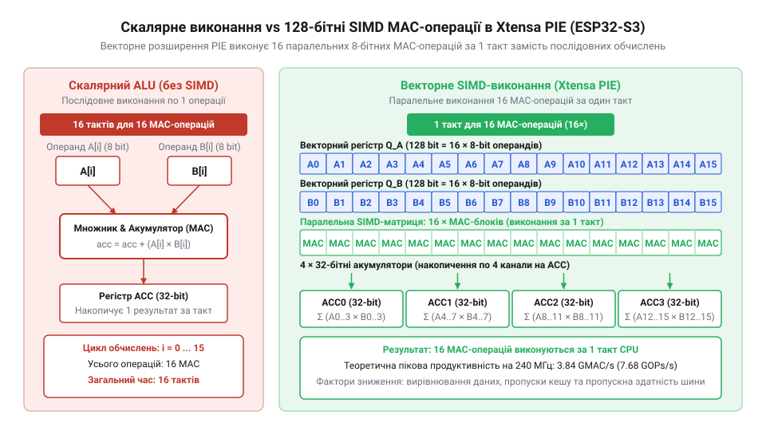

# Розрахунок продуктивності векторних інструкцій Xtensa PIE у задачах TinyML

<preknowlist>
- [Мікроконтролер ESP32-S3](root:cat-hw-boards/esp32s3-microcontroller) — Базова архітектура процесора Xtensa LX7, тактові частоти ядра та організація підсистеми пам'яті.
</preknowlist>

## Неможливість реалтайм-інференсу на скалярній архітектурі

Обробка потокових даних у реальному часі на мікроконтролерах висуває суворі вимоги до швидкодії обчислювального ядра. Коли пристрій отримує звуковий сигнал із частотою дискретизації 16 кГц або захоплює відеокадри з матриці камери — як це відбувається на популярних модулях [ESP32-CAM з камерою OV3640](root:cat-hw-boards/esp32-cam-ov3640) чи [ESP32-CAM (OV2640 + microSD)](root:cat-hw-boards/esp32-cam) — кожен кадр чи аудіофрейм має бути повністю опрацьований до приходу наступного порційного пакета. Якщо часовий інтервал між кадрами при частоті 30 кадрів за секунду становить лише 33.3 мілісекунди, уся нейромережева модель фільтрації чи розпізнавання об'єктів мусить виконати свої розрахунки всередині цього жорсткого часового вікна.

Основною математичною операцією у задачах цифрової обробки сигналів @@en|DSP@@ (від англ. *Digital Signal Processing* — цифрова обробка сигналів) та алгоритмах компактного машинного навчання @@en|TinyML@@ (від англ. *Tiny Machine Learning* — компактне машинне навчання) є операція множення з накопиченням @@en|MAC@@ (від англ. *Multiply-Accumulate* — множення з накопиченням). Операція @@en|MAC@@ обчислює добуток двох значень і додає результат до поточного значення акумулятора:

```
y = y + a × b
```

Один крок операції @@en|MAC@@ складається з двох послідовних арифметичних дій: одного множення та одного додавання. У класичній скалярній архітектурі процесорного ядра @@en|Xtensa@@ @@en|LX7@@ (від англ. *Xtensa LX7 Microarchitecture* — мікроархітектура процесорних ядер Xtensa), яка лежить в основі класичних обчислювачів, арифметико-логічний блок @@en|ALU@@ (від англ. *Arithmetic Logic Unit* — арифметико-логічний блок) здатний виконати лише одну скалярну операцію @@en|MAC@@ за один такт процесора.

Для обчислення граничної скалярної продуктивності ядра позначимо тактову частоту процесора як `f` (у герцах), кількість скалярних каналів обробки як `N_scalar` (де `N_scalar = 1`), а кількість арифметичних дій в одній операції @@en|MAC@@ як `k_mac` (де `k_mac = 2`). Тоді теоретична обчислювальна потужність скалярного ядра `P_scalar` у мегаопераціях за секунду @@en|MOPS@@ (від англ. *Mega Operations Per Second* — мегаоперацій за секунду) виводиться наступним чином:

```
P_scalar = f × N_scalar × k_mac
         = 240 × 10⁶ × 1 × 2        [підстановка тактової частоти 240 МГц та 1 MAC за такт]
         = 4.8 × 10⁸ OPS             [обчислення добутку арифметичних дій]
         = 480 MOPS                  [переведення в мегаоперації за секунду]
```

Отримане значення у 480 @@en|MOPS@@ відповідає 240 мільйонам операцій @@en|MAC@@ за секунду за умови ідеального виконання без затримок пам'яті. Проте реальні згорткові шари нейронних мереж або глибокі фільтри обробки аудіо вимагають виконання десятків мільйонів операцій @@en|MAC@@ для одного кадру. Якщо легка згорткова мережа розпізнавання образів потребує `M_frame = 1.2 × 10⁷` операцій @@en|MAC@@ на один кадр, то мінімальна кількість процесорних тактів `T_cycles` для виконання цього обсягу обчислень становить:

```
T_cycles = M_frame ÷ N_scalar
         = 1.2 × 10⁷ ÷ 1            [ділення кількості MAC на 1 MAC за такт]
         = 12 000 000 тактів        [необхідний обсяг тактів процесора]
```

При тактовій частоті ядра `f = 240 × 10⁶` Гц підсумкова часова затримка виконання `T_scalar` становить:

```
T_scalar = T_cycles ÷ f
         = 12 000 000 ÷ (240 × 10⁶) [ділення кількості тактів на тактову частоту]
         = 0.050 s                  [розрахунок затримки у секундах]
         = 50 ms                    [переведення у мілісекунди]
```

Значення затримки у 50 мілісекунд суттєво перевищує доступне часове вікно у 33.3 мілісекунди для відеопотоку 30 кадрів/с, що робить реалтайм-інференс на скалярному ядрі математично неможливим. Крім того, накладні витрати на вибірку інструкцій з пам'яті, організацію циклів та вибірку операндів збільшують реальну кількість тактів на один @@en|MAC@@ до 3–4 тактів, збільшуючи підсумкову затримку до 150–200 мілісекунд. Таким чином, скалярне виконання створює критичне вузьке місце, яке вимагає принципово іншого підходу — апаратної паралелізації обчислень за допомогою векторних співпроцесорів.

## Математика паралельних MAC-операцій співпроцесора PIE

Щоб подолати обмеження скалярного обчислювального ядра, сучасний [мікроконтролер ESP32-S3](root:cat-hw-boards/esp32s3-microcontroller) містить у своєму складі спеціалізований співпроцесор векторного прискорення @@en|PIE@@ (від англ. *Processor Instruction Extensions* — розширення інструкцій процесора). Головною архітектурною особливістю цього співпроцесора є впровадження 128-бітних векторних регістрів (`Q0`–`Q7`) та виконання інструкцій за принципом @@en|SIMD@@ (від англ. *Single Instruction, Multiple Data* — одна інструкція, множинні дані).

Суть векторної обробки полягає в тому, що одна процесорна інструкція застосовується одночасно до масиву однакових за розміром даних, упакованих у широкий векторний регістр. Загальна ширина векторного регістрового шинопроводу становить `W_reg = 128` біт. Залежно від розрядності оброблюваних операндів `b`, у один 128-бітний регістр пакується різна кількість паралельних обчислювальних елементів `N_simd`:

```
N_simd = W_reg ÷ b
```

Для квантованих 8-бітних цілочисельних даних @@en|Int8@@ (де `b = 8` біт) кількість паралельних елементів у регістрі становить:

```
N_simd_int8 = 128 ÷ 8
            = 16 елементів         [розподіл 128-бітного регістра на 8-бітні блоки]
```

Для 16-бітних цілочисельних даних @@en|Int16@@ (де `b = 16` біт) кількість паралельних елементів дорівнює:

```
N_simd_int16 = 128 ÷ 16
             = 8 елементів          [розподіл 128-бітного регістра на 16-бітні блоки]
```

Під час виконання векторної інструкції множення з накопиченням співпроцесор @@en|PIE@@ за один такт зчитує операнди з двох 128-бітних регістрів, здійснює паралельне множення усіх `N_simd` пар елементів та додає отримані добутки до відповідних акумуляторних регістрів розширеної розрядності (32 біти), запобігаючи арифметичному переповненню.


*Структура 128-бітного векторного регістра та паралельне виконання 16 операцій множення з накопиченням за один такт.*

Завдяки паралельній упаковці операндів обчислювальна потужність векторного співпроцесора прямо пропорційно залежить від ширини шинопроводу `W_reg` та зворотно пропорційно від розрядності даних `b`. Виконання 16 паралельних операцій @@en|MAC@@ за один такт для формату @@en|Int8@@ дозволяє скоротити кількість необхідних процесорних тактів у 16 разів порівняно зі скалярним ядром, створюючи апаратну основу для обробки складних нейромережевих моделей у реальному часі.

## Виведення формул теоретичної обчислювальної потужності

Для аналітичного оцінювання граничних можливостей мікроконтролера в задачах штучного інтелекту необхідно вивести математичну формулу теоретичної обчислювальної потужності. Позначимо загальну продуктивність як `P_theoretical`, виміряну в операціях за секунду @@en|OPS@@ (від англ. *Operations Per Second* — операцій за секунду) або гігаопераціях за секунду @@en|GTOPS@@ (від англ. *Giga Operations Per Second* — гігаоперацій за секунду).

Основними змінними параметрами системи є тактова частота ядра `f` (у герцах), кількість активних обчислювальних ядер процесора `N_cores`, кількість паралельних векторних каналів @@en|MAC@@ у регістрі `N_simd` та кількість арифметичних дій на одну операцію @@en|MAC@@ `k_mac = 2`. Узагальнене рівняння теоретичної продуктивності має вигляд:

```
P_theoretical = f × N_cores × N_simd × k_mac
```

Проведемо покрокове обчислення граничної продуктивності для одного ядра при використанні 8-бітних квантованих даних @@en|Int8@@ (де `N_simd = 16`, `N_cores = 1`, `f = 240 × 10⁶` Гц):

```
P_single_int8 = 240 × 10⁶ × 1 × 16 × 2
              = 240 × 10⁶ × 32          [обчислення добутку кількості каналів та дій]
              = 7.68 × 10⁹ OPS           [підсумкова кількість операцій за секунду]
              = 7.68 GTOPS               [переведення у гігаоперації за секунду]
```

Якщо обчислювальне навантаження паралелиться на обидва ядра процесора, як це реалізують компактні плати [Waveshare ESP32-S3-Pico](root:cat-hw-boards/esp32-s3-pico) або [ESP32-S3 SuperMini](root:cat-hw-boards/esp32-s3-supermini), значення `N_cores = 2`. У цьому випадку двоядерна продуктивність `P_dual_int8` становить:

```
P_dual_int8 = 240 × 10⁶ × 2 × 16 × 2
            = 480 × 10⁶ × 32            [добуток частоти двох ядер на обчислювальний фактор]
            = 1.536 × 10¹⁰ OPS          [загальна кількість операцій для двох ядер]
            = 15.36 GTOPS               [переведення у гігаоперації за секунду]
```

Для задач обробки звукових сигналів та спектрального аналізу методом швидкого перетворення Фур'є @@en|FFT@@ (від англ. *Fast Fourier Transform* — швидке перетворення Фур'є) найчастіше застосовують 16-бітну точність @@en|Int16@@. Обчислимо теоретичний пік для одноядерного виконання при `N_simd = 8`:

```
P_single_int16 = 240 × 10⁶ × 1 × 8 × 2
               = 240 × 10⁶ × 16         [добуток 8 каналів на 2 арифметичні дії]
               = 3.84 × 10⁹ OPS          [загальна кількість операцій]
               = 3.84 GTOPS              [переведення у гігаоперації за секунду]
```

Для порівняння оцінимо продуктивність обчислень з плаваючою крапкою одинарної точності @@en|FP32@@ (від англ. *Single-Precision Floating-Point* — 32-бітний формат із плаваючою крапкою). Скалярний математичний блок обробки чисел із плаваючою крапкою @@en|FPU@@ (від англ. *Floating-Point Unit* — блок обробки чисел з плаваючою крапкою) виконує лише 1 операцію @@en|MAC@@ за такт на один канал (`N_simd = 1`). Розрахунок продуктивності `P_fp32` у гігафлопсах @@en|GFLOPS@@ (від англ. *Giga Floating-point Operations Per Second* — гігафлопс) дає наступний результат:

```
P_fp32 = 240 × 10⁶ × 1 × 1 × 2
       = 4.8 × 10⁸ FLOPS                [перемноження параметрів скалярного FPU]
       = 0.48 GFLOPS                    [переведення у гігафлопси]
```

Порівнюючи обчислювальні показники, можна вивести відношення прискорення `R_speedup` квантованого векторного формату @@en|Int8@@ до скалярного @@en|FP32@@:

```
R_speedup = P_single_int8 ÷ P_fp32
          = 7.68 ÷ 0.48                 [ділення векторної продуктивності на скалярну]
          = 16                          [кратність прискорення обчислень]
```

Перехід від класичних обчислень із плаваючою крапкою @@en|FP32@@ до квантованих цілочисельних векторних обчислень @@en|Int8@@ дає рівно 16-кратний теоретичний приріст продуктивності при аналогічній тактовій частоті мікроконтролера.

## Фактори деградації продуктивності в реальних умовах

Теоретичний пік обчислювальної потужності у 7.68 @@en|GTOPS@@ досягається лише за умов, коли векторний співпроцесор @@en|PIE@@ отримує операнди без жодної затримки на кожному такті процесора. Проте реальна апаратна архітектура мікроконтролера накладає фізичні обмеження, які знижують ефективну швидкодію.

Першим і найкритичнішим фактором є пропускна здатність шини пам'яті. Для безперервного виконання 16 паралельних операцій @@en|MAC@@ за один такт векторний блок мусить зчитувати два 128-бітних векторних регістри з вагами та активаціями щотакту. Це створює вимогу до пропускної здатності шини пам'яті `B_required`:

```
B_required = (W_reg × 2) × f
           = (128 × 2) × 240 × 10⁶       [зчитування двох 128-бітних векторів щотакту]
           = 256 × 240 × 10⁶ біт/с        [необхідний бітрейт даних]
           = 6.144 × 10¹⁰ біт/с           [загальний бітрейт у бітах за секунду]
           = 7.68 GB/s                    [переведення у гігабайти за секунду]
```

Внутрішня статична оперативна пам'ять @@en|SRAM@@ (від англ. *Static Random-Access Memory* — статична оперативна пам'ять) підключена через шину прямого доступу і здатна забезпечити таку швидкість. Однак коли вагові коефіцієнти великих моделей нейронних мереж розташовані у зовнішній псевдостатичній пам'яті @@en|PSRAM@@ (від англ. *Pseudo-Static Random-Access Memory* — псевдостатична оперативна пам'ять), яка на платах на кшталт [Waveshare ESP32-S3R2](root:cat-hw-boards/esp32-s3r2-waveshare) підключається через послідовний інтерфейс @@en|SPI@@ (від англ. *Serial Peripheral Interface* — послідовний периферійний інтерфейс), реальна пропускна здатність падає до 40–80 МБ/с. У результаті процесор вимушений простоювати в очікуванні вибірки даних з пам'яті.

Другим фактором деградації є невирівняний доступ до пам'яті. Векторні інструкції завантаження даних `EE.VLD.128` вимагають, щоб адреса в пам'яті була суворо вирівняна по 16-байтній межі (адреса кратна 16). Якщо масив активацій або ваг зміщений у пам'яті, процесор витрачає 2–4 додаткові такти на програмну зсувну корекцію та маскування даних.

Третім фактором є накладні витрати на організацію циклів, збереження результатів, пропуски кеш-пам'яті першого рівня @@en|L1@@ (від англ. *Level 1 Cache* — кеш-пам'ять першого рівня) та обнулення акумуляторів.

Для врахування сукупного впливу деградаційних факторів вводиться безрозмірний коефіцієнт ефективності використання векторного прискорювача `η` (де `0 < η ≤ 1`). Формула реальної продуктивності `P_real` набуває вигляду:

```
P_real = η × P_theoretical
```

Розглянемо покрокове обчислення реальної продуктивності для оптимального коду, який зберігає дані у внутрішній пам'яті @@en|SRAM@@ із суворим 16-байтним вирівнюванням при коефіцієнті ефективності `η = 0.75` (75% використання векторного потенціалу):

```
P_real_sram = η × P_single_int8
            = 0.75 × 7.68 × 10⁹ OPS       [підстановка коефіцієнта 0.75 та теоретичного піку]
            = 5.76 × 10⁹ OPS              [реальна обчислювальна потужність]
            = 5.76 GTOPS                  [підсумкова ефективна швидкодія]
```

Якщо ж ваги знаходяться у зовнішній пам'яті @@en|PSRAM@@ із невирівняним доступом, коефіцієнт ефективності падає до `η = 0.20` (20% від теоретичного піку):

```
P_real_psram = η × P_single_int8
             = 0.20 × 7.68 × 10⁹ OPS      [підстановка коефіцієнта 0.20 для PSRAM]
             = 1.536 × 10⁹ OPS            [деградована обчислювальна потужність]
             = 1.536 GTOPS                [падіння швидкості майже в 4 рази]
```

Розрахований коефіцієнт ефективності дозволяє реально оцінювати втрати обчислювальної потужності та демонструє критичну важливість оптимізації розміщення даних у пам'яті.

## Прогнозування часу виконання моделей TinyML

Маючи розраховану ефективну продуктивність `P_real`, можна аналітично спрогнозувати часову затримку інференсу моделі @@en|TinyML@@ або цифрового фільтра до запуску коду на реальному пристрої. Загальна затримка виконання `T_inference` (у секундах) визначається як відношення загальної кількості необхідних арифметичних операцій `Ops_total` до реальної обчислювальної швидкодії `P_real`.

Якщо алгоритм описується загальною кількістю операцій множення з накопиченням `M_total`, то загальна кількість арифметичних дій становить `Ops_total = 2 × M_total`. Підставивши значення реальної продуктивності `P_real = η × P_theoretical`, отримуємо підсумкову формулу часової затримки:

```
T_inference = (2 × M_total) ÷ (η × P_theoretical)
```

Проведемо аналітичне обчислення затримки інференсу для згорткового блоку розпізнавання голосових команд, який виконує `M_total = 6.0 × 10⁶` операцій @@en|MAC@@ (що відповідає `1.2 × 10⁷` арифметичним операціям). Обчислення виконуються на одному ядрі при частоті 240 МГц із квантуванням @@en|Int8@@ (`P_theoretical = 7.68 GTOPS`).

Розглянемо випадок оптимізованого розміщення даних у внутрішній пам'яті @@en|SRAM@@ з вирівнюванням (`η = 0.75`):

```
T_sram = (2 × 6.0 × 10⁶) ÷ (0.75 × 7.68 × 10⁹)
       = 1.2 × 10⁷ ÷ (5.76 × 10⁹)       [обчислення знаменника реальної швидкодії]
       = 0.002083 s                     [ділення кількості операцій на продуктивність]
       = 2.083 ms                       [переведення часу у мілісекунди]
```

Тепер обчислимо затримку для того самого алгоритму, але при зчитуванні вагових коефіцієнтів із зовнішньої пам'яті @@en|PSRAM@@ без вирівнювання (`η = 0.20`):

```
T_psram = (2 × 6.0 × 10⁶) ÷ (0.20 × 7.68 × 10⁹)
        = 1.2 × 10⁷ ÷ (1.536 × 10⁹)      [знаменник реальної швидкодії для PSRAM]
        = 0.0078125 s                    [розрахунок часу у секундах]
        = 7.813 ms                       [підсумкова затримка у мілісекундах]
```

Порівнюючи результати обчислень, розраховуємо коефіцієнт сповільнення `K_slowdown`:

```
K_slowdown = T_psram ÷ T_sram
           = 7.813 ÷ 2.083              [ділення затримки в PSRAM на затримку в SRAM]
           = 3.75                       [кратність зростання затримки інференсу]
```

Аналітичний розрахунок показує, що розміщення даних у пам'яті @@en|SRAM@@ із суворим 16-байтним вирівнюванням прискорює виконання моделі в 3.75 раза. Розробник може самостійно обчислити точний час виконання кожного шару нейронної мережі ще на етапі проектування архітектури, гарантуючи виконання вимог реального часу без довготривалого підбору параметрів безпосередньо на мікроконтролері.
