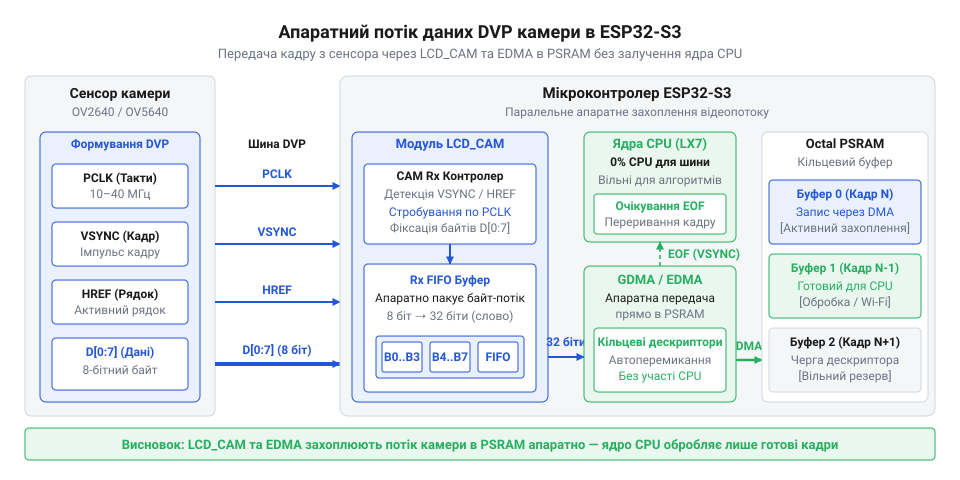
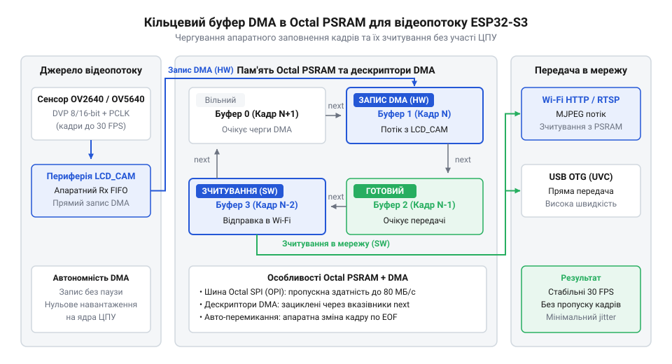

# Побудова високошвидкісного відеопотокового вузла на ESP32-S3 із використанням LCD_CAM та Octal PSRAM

<preknowlist>
- [Мікроконтролер ESP32-S3](root:cat-hw-boards/esp32s3-microcontroller) — архітектуру ядра Xtensa LX7, систему системних шин та особливості підключення високошвидкісної Octal PSRAM.
- [Модуль ESP32-CAM: огляд архітектури, периферії та сімейства плат](root:cat-hw-boards/esp32-cam-camera-module-family) — базові принципи збору кадрових даних із CMOS-сенсорів та історичні обмеження передачі через I2S.
</preknowlist>

## Обмеження класичного збору кадрів камери

При розробці автономних відеопотокових вузлів на базі мікроконтролерів захоплення відеопотоку високої роздільної здатності зі швидкістю 30 кадрів на секунду висуває суворі вимоги до апаратної периферії. У відеосистемах [першого покоління плат](root:cat-hw-boards/esp32-cam) для прийому кадрових даних від матриці камери використовували шину @@en|I2S@@ (англ. *Inter-IC Sound* — внутрішньосхемний звук). Оскільки виділеного апаратного контролера камери не було, інтерфейс @@en|I2S@@ примусово переналаштовували на паралельний режим збору байтів.

Обчислимо обсяг сирого кадрового буфера `S` у байтах для роздільної здатності SVGA 800×600 пікселів у форматі RGB565 (2 байти на піксель) та необхідну смугу пропускання `B` при частоті 30 кадрів на секунду:

    S = 800 × 600 × 2
      = 960000 байт          [розмір одного нестиснутого кадру]

    B = 960000 × 30
      = 28800000 байт/с      [загальний потік даних камери]
      = 28.8 МБ/с            [переведення у мегабайти на секунду]

Як видно з розрахунку, потокова передача потребує понад 28.8 МБ/с безперервного пропуску даних. Навіть при використанні апаратного стиснення @@en|JPEG@@ у сенсорах @@en|OV2640@@ та @@en|OV5640@@ розмір одного кадру варіюється від 20 до 100 КБ. При використанні класичного @@en|I2S@@ кожен маленький блок даних викликав переривання ядра процесора. Через накладні витрати обробки переривань @@en|ISR@@ (англ. *Interrupt Service Routine* — процедура обробки переривань) процесорне ядро витрачає майже увесь свій час на перемикання контексту, що викликає затримки та випадання кадрів.

Другою критичною перешкодою є обсяг та швидкість оперативної пам'яті. Внутрішній оперативній пам'яті @@en|SRAM@@ (англ. *static* — статичний, *random-access memory* — пам'ять довільного доступу) мікроконтролера бракує суцільного простору для утримання навіть одного повного кадру. Для збереження кадрів розробники змушені використовувати зовнішню псевдостатичну пам'ять @@en|PSRAM@@ (англ. *pseudo* — несправжній, *static* — статичний, *random-access memory* — пам'ять довільного доступу). У старих чипах пам'ять @@en|PSRAM@@ підключалася через чотирибітну шину @@en|QSPI@@ (англ. *quad* — чотирикратний, *serial peripheral interface* — послідовний периферійний інтерфейс).

Коли прямий доступ до пам'яті @@en|DMA@@ (англ. *direct* — прямий, *memory* — пам'ять, *access* — доступ) намагається одночасно записувати дані камери в @@en|QSPI@@ @@en|PSRAM@@, а процесор звертається до кешу, виникає колізія шини. Низька пропускна здатність @@en|QSPI@@ переповнює внутрішній буфер @@en|FIFO overrun@@ (англ. *first in, first out* — перший зайшов, перший вийшов), що призводить до втрати байтів і спотворення кадру. Огляд проблем показує, чому [застарілу архітектуру модулів](root:cat-hw-boards/esp32-cam-camera-module-family) неможливо застосувати для стабільного відеопотоку без випадання кадрів. Для вирішення цієї проблеми сучасний [чіпсет серії ESP32-S3](root:cat-hw-boards/esp32s3-microcontroller) отримав новий спеціалізований периферійний блок @@en|LCD_CAM@@.

## Архітектура паралельного блоку LCD_CAM

Для повного усунення процесорних накладних витрат при зборі відеоданих у мікроконтролері ESP32-S3 реалізовано апаратний блок @@en|LCD_CAM@@ (англ. *liquid crystal display / camera* — рідкокристалічний дисплей / камера). Цей периферійний модуль розділено на два незалежних підрозділи: контролер LCD для керування дисплеями та підмодуль CAM для прийому кадрових даних з відеосенсорів.

Підмодуль CAM працює як ведений приймач паралельної шини @@en|DVP@@ (англ. *digital* — цифровий, *video* — відео, *port* — порт). Взаємодія з камерою вибудовується на основі наступних ліній зв'язку:

- `XCLK` (англ. *external clock* — зовнішній такт): Тактовий сигнал, який генерується мікроконтролером для тактування внутрішнього генератора камери та її системи фазового автопідлаштування частоти @@en|PLL@@ (англ. *phase-locked loop* — система фазового автопідлаштування частоти).
- `PCLK` (англ. *pixel clock* — піксельний такт): Тактовий сигнал пікселів, який видає сенсор. Кожен активний фронт `PCLK` сигналізує про наявність нового дійсного байта на шині даних.
- `VSYNC` (англ. *vertical synchronization* — вертикальна синхронізація): Сигнал кадрової синхронізації, який імпульсом позначає початок і кінець нового кадру.
- `HREF` / `HSYNC` (англ. *horizontal reference* — горизонтальний орієнтир): Сигнал рядкової синхронізації, який залишається активним під час передачі дійсних пікселів горизонтального рядка.
- `D0`–`D7`: 8-бітна паралельна шина даних для передачі байтів пікселів або стиснутого потоку @@en|JPEG@@.

Підмодуль CAM апаратно контролює сигнали `VSYNC` та `HREF`. При активному рівні `HREF` кожен фронт `PCLK` фіксує стан 8 ліній даних `D0`–`D7` безпосередньо у вхідний апаратний буфер. Апаратний блок виконує упаковку 8-бітних байтів у 32-бітні слова та фільтрацію системних байтів без залучення жодної інструкції ядра процесора. Після цього 32-бітні слова передаються в розширений контролер прямого доступу до пам'яті @@en|EDMA@@ (англ. *enhanced direct memory access* — вдосконалений прямий доступ до пам'яті).

_*Потік сигналів DVP камери перетворюється блоком LCD_CAM у паралельні слова для передачі в EDMA без залучення ядра Xtensa._

Для налаштування вхідного тракту в середовищі ESP-IDF розробник конфігурує структури GPIO та налаштовує частоту генератора `XCLK`:

:::code proj-camera-streamer-lcdcam/cpp/include/CameraDmaDriver.hpp 17-41

Функція конфігурації виводів налаштовує підтяжки та режим роботи виводів `D0`–`D7`, `PCLK`, `VSYNC` і `HREF`, а генератор тактування створює стабільний сигнал `XCLK` із частотою 20 МГц:

:::code proj-camera-streamer-lcdcam/cpp/src/CameraDmaDriver.cpp 68-88

Завдяки такій організації вхідні байти кадру збираються повністю апаратно, звільняючи обчислювальні ядра для задач мережевої передачі та первинного аналізу відео.

## Кільцеві буфери DMA в Octal PSRAM

Після апаратного захоплення байтів постає задача їх безперервного збереження у пам'яті без затримок та копіювання. Оскільки розмір стиснутого кадру @@en|JPEG@@ постійно змінюється залежно від динаміки сцени, система повинна мати ефективний механізм управління буферами.

Мікроконтролер ESP32-S3 підтримує швидкісну 8-бітну зовнішню пам'ять [інтерфейсом Octal PSRAM](root:com-devices/octal-spi-psram-architecture) (також відому як @@en|OPI PSRAM@@). На відміну від чотирибітної @@en|QSPI@@, восьмибітна шина працює в режимі подвійної передачі даних @@en|DDR@@ (англ. *double data rate* — подвійна швидкість передачі даних) на частоті до 120 МГц. Це забезпечує пропускну здатність до 400–800 МБ/с, що повністю усуває колізії при одночасному записі даних від контролера @@en|EDMA@@ та читанні процесорними ядрами.

Передача даних із периферії @@en|LCD_CAM@@ у зовнішню пам'ять організується за допомогою кільцевого списку описувачів @@en|DMA descriptor@@ (англ. *descriptor* — описувач). Кожен описувач являє собою 16-байтову структуру в системній @@en|SRAM@@, яка містить:

1. Прапори керування (розмір буфера, фактична довжина записаних даних, прапор кінця кадру @@en|EOF@@).
2. Вказівник на фізичну адресу буфера в пам'яті @@en|Octal PSRAM@@.
3. Вказівник на наступний описувач у списку.

Описувачі замкнені у кільцеву структуру. Під час прийому відеокадру контролер @@en|EDMA@@ послідовно заповнює буфери, прив'язані до описувачів. Коли кадр повністю прийнято (що фіксується за спадом сигналу `VSYNC` або знаходженням маркера кінця @@en|JPEG@@ `0xFF 0xD9`), контролер @@en|EDMA@@ встановлює біт @@en|EOF@@ (англ. *end of frame* — кінець кадру) і генерує переривання для задачі FreeRTOS.

_*Дескриптори DMA зв'язують буфери в Octal PSRAM у замкнене кільце, забезпечуючи безперервний запис відеокадрів без колізій із читанням._

Для досягнення максимальної швидкодії реалізовано принцип нульового копіювання @@en|zero-copy@@ (англ. *zero* — нуль, *copy* — копіювання). Виділення пам'яті в @@en|Octal PSRAM@@ виконується з вирівнюванням під 32-байтові кеш-лінії:

:::code proj-camera-streamer-lcdcam/cpp/src/FrameBuffer.cpp 10-45

Клас `FrameBuffer` інкапсулює масив у пам'яті @@en|Octal PSRAM@@ та підрахунок посилань для безпечної передачі між декількома паралельними споживачами:

:::code proj-camera-streamer-lcdcam/cpp/include/FrameBuffer.hpp 41-98

Апаратний драйвер виділяє кільцеві буфери у внутрішній пам'яті для контролера @@en|EDMA@@ і керує чергою кадрів:

:::code proj-camera-streamer-lcdcam/cpp/src/CameraDmaDriver.cpp 90-106

Коли обробник переривання отримує сповіщення про завершення кадру, він не копіює дані, а передає розумний вказівник у чергу @@en|FreeRTOS queue@@. Одержувачі відеопотоку, такі як модуль [передавача класу UVC](root:com-protocol/uvc-usb-video-class-esp32s3) або HTTP-стример, зчитують кадр безпосередньо з @@en|Octal PSRAM@@, досягаючи стабільної частоти 30 кадрів на секунду без навантаження на процесор.

## Схема підключення сенсорів OV2640 та OV5640

При розробці високошвидкісного кадрового вузла фізичне проєктування інтерфейсу між відеосенсором та мікроконтролером є першим критичним етапом. Спроба довільного підключення виводів матриці до перших вільних контактів призводить до апаратних колізій. У [мікроконтролерах ESP32-S3](root:cat-hw-boards/esp32s3-microcontroller) частина виводів @@en|GPIO@@ (англ. *general-purpose* — загального призначення, *input/output* — вхід/вихід) жорстко зарезервована внутрішньою системною шиною для обміну з пам'яттю @@en|Octal PSRAM@@ (контакти @@en|GPIO33@@–@@en|GPIO37@@). Використання цих ліній для відеопериферії унеможливлює функціонування зовнішнього оперативною пам'яті.

Шина паралельного відеоінтерфейсу @@en|DVP@@ (англ. *digital* — цифровий, *video* — відео, *port* — порт) передає дані на високих частотах. Сигнал піксельного тактування @@en|PCLK@@ (англ. *pixel* — піксельний, *clock* — такт) може досягати 24–40 МГц, а опорна частота @@en|XCLK@@ (англ. *external* — зовнішній, *clock* — такт) становить 20 МГц. Неправильне трасування провідників на друкованій платі @@en|PCB@@ (англ. *printed* — друкована, *circuit* — схема, *board* — плата) викликає перехресні наводки між лініями даних `D0`–`D7` та стробом `PCLK`, що призводить до спотворення зчитаних байтів у блоці @@en|LCD_CAM@@.

Для стабільного збору кадрів з матриць @@en|OV2640@@ та @@en|OV5640@@ лінії @@en|GPIO@@ розподіляють із урахуванням матричного мультиплексора периферії. Окрім 8-бітної шини даних, схема включає лінії синхронізації `VSYNC` (англ. *vertical* — вертикальна, *synchronization* — синхронізація) та `HREF` / `HSYNC` (англ. *horizontal* — горизонтальний, *reference* — орієнтир), а також дворівневу шину керування @@en|SCCB@@ (англ. *serial* — послідовний, *camera* — камера, *control* — керування, *bus* — шина), яка є сумісною із протоколом @@en|I2C@@ (англ. *inter-integrated* — міжінтегральна, *circuit* — схема).

Структура конфігурації виводів драйвера задає розподіл сигнальних ліній:

:::code proj-camera-streamer-lcdcam/cpp/include/CameraDmaDriver.hpp 17-41

Обчислимо граничну довжину провідника $L_{\text{crit}}$ на печатній платі @@en|PCB@@, при якій лінії takтування `XCLK` та `PCLK` починають проявляти властивості довгих ліній з імпедансними відбиттями. При швидкості поширення сигналу в діелектрику FR-4 $v \approx 15 \text{ см/нс}$ та тривалості фронту @@en|GPIO@@ $T_r \approx 2.5 \text{ нс}$:

    L_crit = (v × T_r) ÷ 2
           = (15 × 2.5) ÷ 2        [розрахунок критичної довжини лінії]
           = 37.5 ÷ 2               [ділення на коефіцієнт зворотного шляху]
           = 18.75 см              [гранична довжина провідника без узгодження]

Якщо довжина траси перевищує 5–10 см або провідник має високу паразитну ємність, на фронтах `PCLK` виникає ringing (дзвін) і викиди напруги, що призводить до помноженого зчитування одного байта. Для усунення цього ефекту послідовно в лінії `XCLK` та `PCLK` встановлюють демпфуючі резистори номіналом 22–33 Ом безпосередньо біля виводів мікроконтролера. Лінії шини [керування SCCB](root:com-devices/sccb-bus-protocol-camera-control) (`SDA` та `SCL`) потребують зовнішніх підтягуючих резисторів до лінії живлення 3.3 В номіналом 1.5–4.7 кОм.

Низькорівнева функція конфігурації периферії налаштовує режими роботи виводів та вмикає внутрішнє підтягування:

:::code proj-camera-streamer-lcdcam/cpp/src/CameraDmaDriver.cpp 68-82

Окрему увагу приділяють живленню сенсорів @@en|OV2640@@ та @@en|OV5640@@. Аналогова частина матриці (2.8 В) та цифрове ядро (1.2 В для @@en|OV5640@@) чутливі до пульсацій. Живлення камери слід подавати через окремий малошумний регулятор @@en|LDO@@ (англ. *low* — низький, *dropout* — перепад, *regulator* — регулятор) із керамічними розв'язувальними конденсаторами (100 нФ та 10 мкФ), розташованими максимально близько до роз'єму камери.

_*Електричні з'єднання забезпечують розділення високошвидкісних ліній DVP та шини SCCB із вирівнюванням імпедансу.*_

Завдяки правильному електричному розведенню сигнальних ліній та тактуванню забезпечується цілісність даних на високій частоті без випадання бітів.

## Конфігурація драйвера в середовищі ESP-IDF

Після проєктування апаратної схеми необхідно програмно ініціалізувати вхідний периферійний блок та налаштувати приймальні дескриптори @@en|DMA@@ (англ. *direct* — прямий, *memory* — пам'ять, *access* — доступ). Спроба опитувати лінії камери у звичайному програмному циклі призводить до миттєвого переповнення вхідних буферів через неможливість ядра обробляти мільйони байтів на секунду.

У середовищі @@en|ESP-IDF@@ (англ. *Espressif* — назва компанії, *IoT* — інтернет речей, *development* — розробка, *framework* — фреймворк) драйвер камери конфігурує підсистему @@en|LCD_CAM@@ для автоматичного виділення пам'яті та зв'язування з апаратним списком дескрипторів. Метод `init` класу `CameraDmaDriver` виконує повну послідовність налаштування периферії, створює чергу задач @@en|FreeRTOS@@ та алокує первинний буфер кадру у зовнішній пам'яті:

:::code proj-camera-streamer-lcdcam/cpp/src/CameraDmaDriver.cpp 23-66

Ключовим елементом неблокуючої обробки є апаратний обробник переривань @@en|ISR@@ (англ. *interrupt* — переривання, *service* — обслуговування, *routine* — процедура). Коли блок @@en|LCD_CAM@@ фіксує завершення прийому кадру (за спадом сигналу `VSYNC` або маркером кінця стиснутого кадру), контролер генерує переривання.

Функція `handleDmaInterrupt`, розміщена в оперативній пам'яті інструкцій @@en|IRAM@@ (англ. *instruction* — інструкція, *random-access memory* — пам'ять довільного доступу) для мінімізації затримок, виконує фіксацію метаданих і передає покажчик на буфер у чергу без копіювання байтів:

:::code proj-camera-streamer-lcdcam/cpp/src/CameraDmaDriver.cpp 143-174

Після надходження покажчика в чергу системний координатор `FrameServer` підхоплює кадр і розсилає його усім підключеним споживачам. Для досягнення високої пропускної здатності виконується принцип нульового копіювання @@en|zero-copy@@ (англ. *zero* — нуль, *copy* — копіювання): сам масив даних у пам'яті @@en|Octal PSRAM@@ залишається на місці, а споживачі отримують копії розумного покажчика `std::shared_ptr`:

:::code proj-camera-streamer-lcdcam/cpp/src/FrameServer.cpp 147-161

Такий підхід дозволяє передавати відеопотік паралельно кільком модулям без додаткового навантаження на шину пам'яті.

## Передача потоку через USB та Wi-Fi

Отримавши працездатний драйвер захоплення кадрів у пам'яті @@en|Octal PSRAM@@, необхідно організувати вихідний канал трансляції відеопотоку зовнішнім споживачам. При спробі передавати відео по мережі в тому ж потоці виконання, що й захоплення кадрів, мережеві затримки сокетів спричинять простій DMA-буферів та втрату кадрів.

Двоядерна архітектура ESP32-S3 дає змогу розділити задачі: ядро 1 виділяється під апаратну обробку переривань @@en|LCD_CAM@@ та диспетчеризацію `FrameServer`, а ядро 0 обробляє мережевий стек @@en|Wi-Fi@@ та протокол @@en|HTTP@@ (англ. *hypertext* — гіпертекст, *transfer* — передача, *protocol* — протокол).

Мережевий передавач `MjpegStreamer` розгортає @@en|TCP@@ (англ. *transmission* — передача, *control* — керування, *protocol* — протокол) сокет @@en|socket@@ (англ. *socket* — гніздо / сокет) на порту 8080. З'єднання форматується як потік @@en|MJPEG@@ (англ. *motion* — рухомий, *JPEG* — формат зображень) з заголовком `multipart/x-mixed-replace`. Кадри вичитуються з черги підписника та передаються клієнту:

:::code proj-camera-streamer-lcdcam/cpp/src/MjpegStreamer.cpp 127-156

Паралельно з мережевим потоком пристрій може функціонувати як стандартна веб-камера для ПК. Для цього використовується нативний контролер @@en|USB OTG@@ (англ. *universal* — універсальна, *serial* — послідовна, *bus* — шина, *on-the-go* — на ходу) мікроконтролера ESP32-S3. Модуль `UvcTransmitter` розбиває кадр на пакети корисного навантаження @@en|payload@@ (англ. *pay* — корисний, *load* — вантаж) розміром до 1024 байт та додає 2-байтовий заголовок стандарту @@en|UVC@@ (англ. *USB video class* — клас USB-відеопристроїв) із перемиканням біта @@en|FID@@ (англ. *frame* — кадр, *identifier* — ідентифікатор) та полем @@en|EOF@@ (англ. *end* — кінець, *of* — з, *frame* — кадр) згідно з [протоколом UVC](root:com-protocol/uvc-usb-video-class-esp32s3):

:::code proj-camera-streamer-lcdcam/cpp/src/UvcTransmitter.cpp 113-148

Головна функція прошивки `app_main` зв'язує усі компоненти в єдину системну архітектуру. Вона ініціалізує драйвер камери, запускає кадровий сервер та активує обидва канали трансляції:

:::code proj-camera-streamer-lcdcam/cpp/src/main.cpp 36-69

Побудований таким чином відеовузол на [компактній платі ESP32-S3-Zero](root:cat-hw-boards/esp32-s3-zero) або [модулі серії ESP32-CAM](root:cat-hw-boards/esp32-cam-camera-module-family) забезпечує стабільну трансляцію стиснутого відео з частотою 30 кадрів на секунду через USB UVC та Wi-Fi без втрати кадрів.
