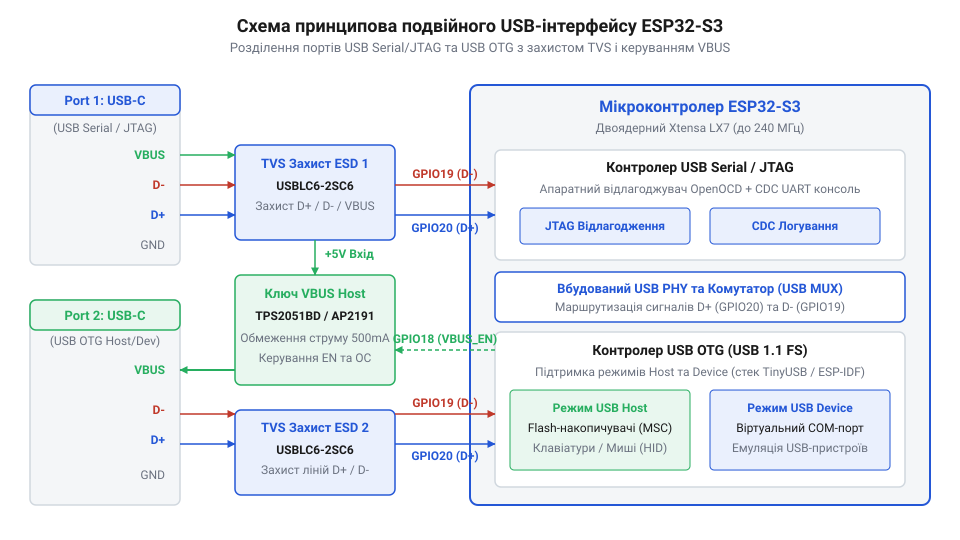
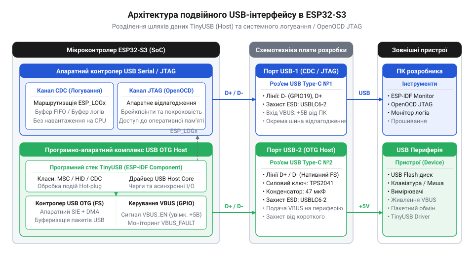

# Практична побудова вимірювально-налагоджувальної станції з підтримкою USB OTG Host та апаратного JTAG

<preknowlist>
- [Мікроконтролер ESP32-S3](root:cat-hw-boards/esp32s3-microcontroller) — Апаратна архітектура ядра Xtensa LX7, призначення виводів GPIO для периферійних інтерфейсів та підсистема живлення.
- [Модулі ESP32-S3-WROOM-1 та WROOM-2](root:cat-hw-boards/esp32-s3-wroom-modules-family) — Цокольовка модулів, виведення ліній USB D+/D- та підключення зовнішньої пам'яті Flash/PSRAM.
</preknowlist>

## Проблема суміщеного відлагодження та периферії

Розробка вбудованих систем, які працюють у режимі @@en|USB Host@@ (англ. *Host*, від *host* — господар, приймаюча сторона), зіштовхується з критичним бар'єром під час апаратного відлагодження на однопортових платах. Коли вимірювальна периферія чи @@en|USB-накопичувач@@ підключається до єдиного роз'єму @@en|USB-C@@, який одночасно слугує для виведення системних логів та трасування коду, зв'язок із комп'ютером розробника негайно розривається. Потік діагностичних повідомлень припиняється саме в момент гарячого підключення пристрою, а сесія відлагодження @@en|OpenOCD@@ (англ. *Open On-Chip Debugger*, від *open* — відкритий, *on-chip* — на кристалі, *debugger* — відлагоджувач) аварійно завершується.

Причина такої поведінки полягає в архітектурі апаратних інтерфейсів мікроконтролера. [Мікроконтролер ESP32-S3](root:cat-hw-boards/esp32s3-microcontroller) містить два незалежні USB-контролери: вбудований периферійний модуль @@en|USB Serial/JTAG@@ та повнофункціональний контролер @@en|USB OTG@@ (англ. *On-The-Go*, від *on the go* — у русі, на ходу). Проте обидва апаратні блоки в базовому режимі ділять між собою єдиний внутрішній трансивер @@en|PHY@@ (англ. *Physical Layer*, від *physical* — фізичний, *layer* — рівень), жорстко прив'язаний до виводів @@en|GPIO19@@ (лінія @@en|D-@@) та @@en|GPIO20@@ (лінія @@en|D+@@). Високошвидкісні диференційні сигнали трансивера @@en|PHY@@ працюють безпосередньо з апаратними виводами й не можуть маршрутизуватися через внутрішню цифрову матрицю сигналів @@en|GPIO Matrix@@ (англ. *GPIO Matrix*, від *general-purpose input/output* — загального призначення, *matrix* — матриця), що змушує мікроконтролер використовувати внутрішній аналоговий мультиплексор. Компактні плати, як-от [ESP32-S3-Zero](root:cat-hw-boards/esp32-s3-zero) або [ESP32-S3 SuperMini](root:cat-hw-boards/esp32-s3-supermini), виводять ці лінії безпосередньо на єдиний роз'єм @@en|USB-C@@. Коли програмний стек ініціалізує режим @@en|USB Host@@, внутрішній мультиплексор перемикає трансивер @@en|PHY@@ на контролер @@en|USB OTG@@, через що фізичний зв'язок із периферією @@en|USB Serial/JTAG@@ миттєво втрачається, позбавляючи розробника логів та апаратних точок зупинки. Зовнішній міст @@en|USB-UART@@ повністю обходить цей конфлікт мультиплексування: ззвичайні послідовні цифрові сигнали модуля @@en|UART0@@ вільно передаються через @@en|GPIO Matrix@@ на будь-які довільні виводи мікроконтролера, взагалі не залучаючи трансивер @@en|PHY@@ і залишаючи його повністю доступним для нативного контролера @@en|USB OTG@@.

Контролер @@en|USB Serial/JTAG@@ є фіксованим апаратним пристроєм @@en|USB Device@@, що підтримує емуляцію віртуального послідовного порту @@en|CDC@@ (англ. *Communications Device Class*, від *communications* — комунікації, *device* — пристрій, *class* — клас) та інтерфейсу @@en|JTAG@@ (англ. *Joint Test Action Group*, від *joint* — об'єднана, *test* — тестова, *action* — дія, *group* — група). Він не здатен керувати живильною шиною або ініціювати сесії обміну. Натомість контролер @@en|USB OTG@@ генерує маркери кадрів @@en|SOF@@ (англ. *Start of Frame*, від *start* — початок, *frame* — кадр) та керує шиною у режимі @@en|USB Host@@. Для забезпечення безперервного трасування вимірювально-налагоджувальна станція потребує двопортової апаратної архітектури: перший порт @@en|Port 1@@ виділяється під відлагоджувальну консоль та @@en|JTAG@@, а другий порт @@en|Port 2@@ працює з нативним контролером @@en|USB OTG@@ і власним ключем живлення.

## Апаратна схемотехніка двох USB-портів

Побудова електричної принципової схеми станції базується на чіткому електричному та функціональному розділенні двох USB-трактів. Вхідними даними слугує архітектурне розмежування відлагоджувального порту @@en|UART0@@ та периферійного нативного порту @@en|USB OTG@@.

Відлагоджувальний порт @@en|Port 1@@ будується на базі зовнішньої мікросхеми USB-UART мосту (наприклад, @@en|CP2102N@@ або @@en|CH340K@@), яка підключається до виводів @@en|GPIO43@@ (лінія @@en|TXD0@@) та @@en|GPIO44@@ (лінія @@en|RXD0@@) мікроконтролера. Лінії керування @@en|DTR@@ та @@en|RTS@@ мосту підключаються через транзисторну схему автозавантаження до виводів @@en|EN@@ та @@en|GPIO0@@, що гарантує надійне автоматичне скидання та перехід у режим прошивки без залучення внутрішнього трансивера @@en|PHY@@. Для забезпечення повноцінного апаратного відлагодження через зовнішній програматор @@en|ESP-Prog@@ (англ. *ESP-Prog*, від *programmer* — програматор) до складу цього ж відлагоджувального вузла входить окремий роз'єм @@en|JTAG@@. Електрична схема підключення передбачає розведення виводів [мікроконтролера ESP32-S3](root:cat-hw-boards/esp32s3-microcontroller): вивід @@en|GPIO39@@ виділяється під лінію тактування @@en|TCK@@ (англ. *Test Clock*, від *test* — тестовий, *clock* — тактовий сигнал), вивід @@en|GPIO40@@ — під вихід даних @@en|TDO@@ (англ. *Test Data Output*, від *test* — тестовий, *data* — дані, *output* — вихід), вивід @@en|GPIO41@@ — під вхід даних @@en|TDI@@ (англ. *Test Data Input*, від *test* — тестовий, *data* — дані, *input* — вхід), а вивід @@en|GPIO42@@ — під сигнал вибору режиму @@en|TMS@@ (англ. *Test Mode Select*, від *test* — тестовий, *mode* — режим, *select* — вибір). Окрім сигнальних ліній, на контактну групу роз'єму виводяться лінії живлення +3.3 В для фіксації опорної напруги буферів програматора, спільний провідник землі та лінія скидання @@en|EN@@ з підтягувальним резистором 10 кОм до шини живлення, що гарантує стабільну синхронізацію та завадостійкість під час високочастотного трасування.

Периферійний порт @@en|Port 2@@ підключається безпосередньо до виводів @@en|GPIO19@@ (сигнал @@en|D-@@) та @@en|GPIO20@@ (сигнал @@en|D+@@) мікроконтролера. Для захисту від чутливих електростатичних розрядів обидва роз'єми @@en|USB-C@@ оснащуються захисними збірками @@en|TVS-діод@@ (англ. *Transient Voltage Suppressor*, від *transient* — перехідний, *voltage* — напруга, *suppressor* — подавлювач), такими як @@en|USBLC6-2SC6@@. Збірки встановлюються в безпосередній близькості до контактів портів, а диференційні лінії @@en|D+@@/@@en|D-@@ проходять безпосередньо крізь виводи діодів без додаткових відводів провідників.

Робота в режимі @@en|USB Host@@ вимагає подачі живлення +5 В на лінію @@en|VBUS@@ (англ. *Voltage Bus*, від *voltage* — напруга, *bus* — шина) підключеного периферійного пристрою. Оскільки виводи @@en|GPIO@@ мікроконтролера не спроможні комутувати струм периферії, у схему вводиться силовий ключ на основі @@en|P-channel MOSFET@@ або спеціалізованого інтегрального перемикача @@en|TPS2051@@. Сигнал керування з виводу @@en|GPIO18@@ (лінія @@en|VBUS_EN@@) відкриває ключ, подаючи напругу +5 В від системного джерела живлення на роз'єм @@en|Port 2@@ із захистом від перевантаження за струмом.


*Принципова схема підключення відлагоджувального та периферійного USB-портів до ESP32-S3 із захистом від статичної електрики та керованим живленням VBUS.*

## Конфігурування середовища та розділення контролерів

Після реалізації апаратної частини необхідно зконфігурувати програмне середовище @@en|ESP-IDF@@ (англ. *Espressif IoT Development Framework*, від *framework* — платформа) задля усунення конфліктів за спільні периферійні блоки. За замовчуванням фреймворк спрямовує виведення системного логування `esp_log` через контролер @@en|USB Serial/JTAG@@, що призводить до захоплення виводів @@en|GPIO19@@/@@en|GPIO20@@ і унеможливлює запуск драйвера @@en|USB Host@@.

Розподіл апаратних ресурсів виконується через конфігуратор `menuconfig` або безпосередньо у файлі `sdkconfig`. Для перенаправлення логів консолі на зовнішній мост @@en|UART0@@ задаються параметри `CONFIG_ESP_CONSOLE_UART_DEFAULT=y` та `CONFIG_ESP_CONSOLE_UART_NUM=0`, що прив'язує текстові потоки до виводів @@en|GPIO43@@/@@en|GPIO44@@. Одночасно вимикається параметр `CONFIG_ESP_CONSOLE_USB_SERIAL_JTAG=n`, звільняючи внутрішній трансивер @@en|PHY@@.

Для активації нативного периферійного контролера встановлюється параметр `CONFIG_USB_HOST_ENABLE=y`. Це дозволяє програмному стеку @@en|TinyUSB@@ перебрати повний контроль над контролером @@en|USB OTG@@ та виводами @@en|GPIO19@@/@@en|GPIO20@@ без ризику апаратних накладань.

```kconfig
# Маршрутизація системної консолі логування на UART0
CONFIG_ESP_CONSOLE_UART=y
CONFIG_ESP_CONSOLE_UART_DEFAULT=y
CONFIG_ESP_CONSOLE_UART_NUM=0
CONFIG_ESP_CONSOLE_UART_BAUDRATE=115200
CONFIG_ESP_CONSOLE_USB_SERIAL_JTAG=n

# Активація нативного контролера USB OTG в режимі Host
CONFIG_USB_HOST_ENABLE=y
CONFIG_USB_HOST_CONTROL_TRANSFER_MAX_SIZE=256
CONFIG_USB_HOST_HW_BUFFER_BIAS_BALANCED=y
```

Завдяки цьому налаштуванню середовище розділяє потоки даних: порт @@en|Port 1@@ безперервно передає діагностичні повідомлення зі швидкістю 115200 бод через @@en|UART0@@, тоді як порт @@en|Port 2@@ працює у режимі @@en|USB Host@@ під керуванням стека @@en|TinyUSB@@. Таке конфігурування запобігає виникненню фатальної помилки ядра @@en|Guru Meditation Error@@ під час одночасного трасування та роботи з периферією.

## Розгортання стека TinyUSB для Host-режиму

Фізичне підключення периферійного пристрою до другого порту вимагає від мікроконтролера складного алгоритму узгодження: керування живленням шини, розпізнавання швидкості підключення та обробки сигнальних станів без затримки основних обчислювальних задач. Спроба написати власну реалізацію обробників низькорівневих транзакцій шини під конкретний [мікроконтролер ESP32-S3](root:cat-hw-boards/esp32s3-microcontroller) призводить до громіздкого коду з високим ризиком гонитви сигналів. Для вирішення цього завдання в середовище розробки інтегровано відкритий бібліотечний стек @@en|TinyUSB@@ (англ. *TinyUSB*, від *tiny* — крихітний, *USB* — універсальна послідовна шина).

Програмна архітектура стека у середовищі @@en|ESP-IDF@@ (англ. *Espressif IoT Development Framework*, від *framework* — платформа) побудована на асинхронній подійній моделі. Основу стека становить фонова служба ядра @@en|Daemon Task@@ (англ. *Daemon Task*, від *daemon* — фонова служба, *task* — задача), яка запускається в окремому потоці операційної системи реального часу та викликає функцію обробки подій у безперервному циклі. Під час підключення зовнішнього пристрою контролер шини фіксує зміну потенціалів на диференційній парі та генерує апаратне переривання. Служба стека перехоплює це переривання, запускає процес ідентифікації пристрою @@en|Enumeration@@ (англ. *Enumeration*, від *enumerate* — перераховувати) та викликає зареєстрований зворотний виклик @@en|Callback@@ (англ. *Callback*, від *call* — викликати, *back* — назад). Одночасно система подає сигнал на силовий ключ для стабілізації напруги на лінії @@en|VBUS@@ (англ. *Voltage Bus*, від *voltage* — напруга, *bus* — шина).


*Архітектура взаємодії програмного стека TinyUSB з нативним контролером USB OTG та системною консоллю логування на ESP32-S3.*

Після завершення ідентифікації стек визначає клас пристрою — наприклад, @@en|Mass Storage Class@@ (скорочено @@en|MSC@@, англ. *Mass Storage Class*, від *mass* — масове, *storage* — збереження, *class* — клас) для зовнішніх накопичувачів або @@en|CDC@@ для послідовних адаптерів — та монтує відповідний драйвер. Для стабільного читання даних у режимі реального часу гаряче підключення @@en|Hot-Plug@@ (англ. *Hot-Plug*, від *hot* — гаряче, *plug* — підключення) обробляється без блокування головної програми.

:::tabs
=== C (ESP-IDF)
:::code proj-esp32-s3-dual-usb-otg-jtag-station/c/esp-idf/-usb-host-event-callback.c
=== C++ (ESP-IDF)
:::code proj-esp32-s3-dual-usb-otg-jtag-station/cpp/esp-idf/usbhostdaemontask.cpp
:::

## Налаштування апаратного JTAG та відлагодження

Після розгортання периферійного стека виникає потреба в глибокому моніторингу роботи системи під час непередбачуваних подій на шині. Зависання та збої розподілу пам'яті під час гарячого підключення складних пристроїв важко діагностувати лише за допомогою текстових логів. Для повноцінного аналізу внутрішнього стану процесорних ядер необхідне крокове трасування коду @@en|Tracing@@ (англ. *Tracing*, від *trace* — слід, трасування) та розстановка апаратних точок зупинки @@en|Breakpoint@@ (англ. *Breakpoint*, від *break* — зупинка, *point* — точка).

Оскільки нативний контролер шини зайнятий роботою в режимі господарського порту на другому роз'ємі, внутрішній модуль відлагодження звільняє виводи шини. Апаратне відлагодження реалізується через підключення відлагоджувального сервера @@en|OpenOCD@@ (англ. *Open On-Chip Debugger*, від *open* — відкритий, *on-chip* — на кристалі, *debugger* — відлагоджувач). Налагоджувальна станція використовує первинний порт, де текстові логи спрямовуються через апаратний міст на виводи послідовного порту, а трасування ядра здійснюється через виділений відлагоджувальний інтерфейс @@en|JTAG@@ (англ. *Joint Test Action Group*, від *joint* — об'єднана, *test* — тестова, *action* — дія, *group* — група). Популярні [модулі серії ESP32-S3-WROOM](root:cat-hw-boards/esp32-s3-wroom-modules-family) та компактні [SiP-модулі ESP32-S3-MINI](root:cat-hw-boards/esp32-s3-mini-sip-modules) дозволяють вивести виділені лінії сигналів відлагодження безпосередньо на зовнішній програматор @@en|ESP-Prog@@ (англ. *ESP-Prog*, від *programmer* — програматор).

Паралельний моніторинг функціонує за триканальною схемою:
1. Консольний канал передає повідомлення логування через первинний послідовний порт зі швидкістю 115200 бод, відображаючи високорівневий стан програмного стека.
2. Апаратний канал відлагодження через сервер @@en|OpenOCD@@ підключається до налагоджувача @@en|GDB@@ (англ. *GNU Debugger*, від *debugger* — відлагоджувач) на порт 3333, забезпечуючи перехоплення винятків та аналіз точок спостереження @@en|Watchpoint@@ (англ. *Watchpoint*, від *watch* — спостереження, *point* — точка) у реальному часі.
3. Подієвий канал стека виводить інформацію про збої транзакцій шини безпосередньо в консоль логування, не перериваючи сесію відлагодження.

У результаті верифікації розробник отримує завершену станцію, де апаратне відлагодження та робота з периферійним пристроєм відбуваються одночасно й повністю незалежно. На відміну від однопортових рішень, складний режим господарського порту не перешкоджає покроковому виконанню коду, гарантуючи надійність вбудованої системи.
