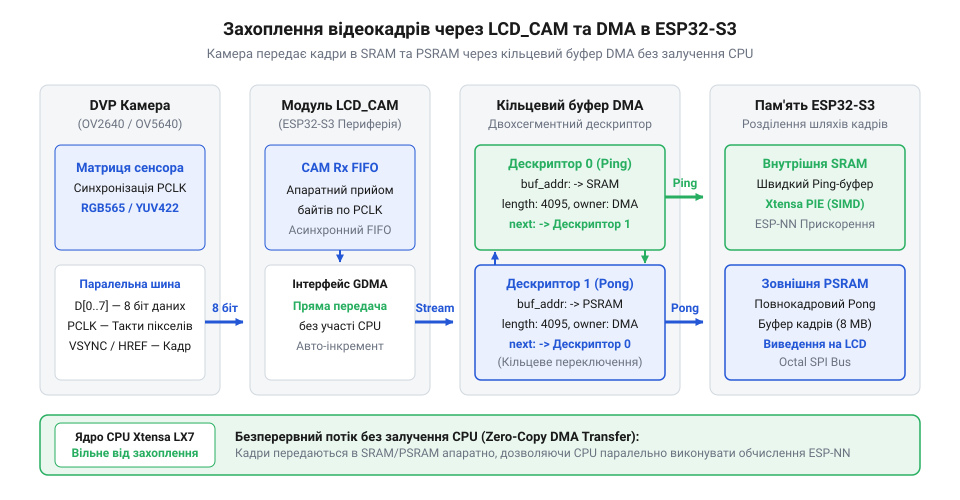
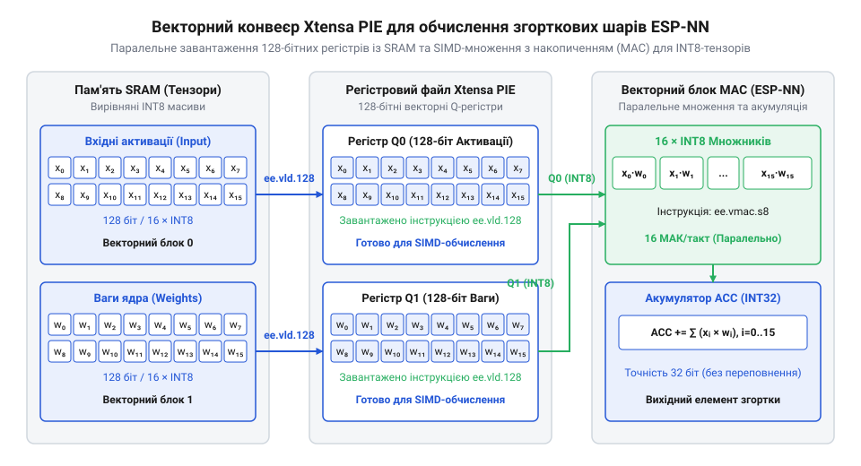

# Проєктування та реалізація системи крайового комп'ютерного зору з прискоренням Xtensa PIE на платі ESP32-S3

<preknowlist>
- [Мікроконтролер ESP32-S3](root:cat-hw-boards/esp32s3-microcontroller) — архітектуру двоядерного процесора Xtensa LX7, підсистему шин та базову карту оперативної пам'яті
- [Модулі ESP32-S3-WROOM-1 та WROOM-2](root:cat-hw-boards/esp32-s3-wroom-modules-family) — розпіновку, підключення шини Octal SPI та внутрішню конфігурацію модуля N16R8
- [Модуль ESP32-CAM: огляд архітектури, периферії та сімейства плат](root:cat-hw-boards/esp32-cam-camera-module-family) — паралельний інтерфейс DVP сенсора камери OV2640 та роботу сигналів синхронізації PCLK, VSYNC, HREF
</preknowlist>

## Обмеження швидкодії класичного крайового зору

Під час спроби побудувати систему комп'ютерного зору на базі компактного мікроконтролера розробники часто стикаються із розчаровуваним результати: замість плавної трансляції відеопотік перетворюється на серію слайдів із частотою 1–2 кадрів на секунду (від @@en|FPS@@, англійського @@en|frame@@ — кадр, та @@en|second@@ — секунда). На перший погляд здається, що обчислювального ядра на частоті 240 МГц має вистачати для простих нейромереж. Проте у разі класичного програмного підходу процесор майже 100% робочого часу витрачає не на математику розпізнавання, а на прості операції пересилання байтів із ніжок периферії у пам'ять.

Розглянемо сенсор камери @@en|OV2640@@, що передає кадр роздільністю QVGA (`320 × 240` пікселів) у кольоровому форматі @@en|RGB565@@. Один кадр містить 153 600 байтів даних. При частоті 30 @@en|FPS@@ потік даних становить приблизно 4.6 МБ/с, а тактовий сигнал пікселів @@en|PCLK@@ прямує з частотою від 8 до 12 МГц. Якщо процесор зчитує кожен байт через програмні переривання чи опитування стану прапорців роз'єму, на один символ даних припадає лише 20–30 тактів CPU. Значна частина цього часу витрачається на збереження регістрів та перемикання контексту переривання. У результаті процесор повністю блокується прийманням даних і не здатен виконувати жодних інших завдань.

Друга критична проблема класичного виклику — це послідовне стробування конвеєра:

```
[ Кадр N: Захоплення камери ] -> [ Кадр N: Обробка нейромережею ] -> [ Виведення результату ]
          (33 мс)                        (300 мс)                      (20 мс)
```

Загальний час обробки одного кадру складає:
```
T_total = 33 + 300 + 20
        = 353 мс                  [сумування затримок конвеєра]
```

Оскільки частота кадрів визначається як `FPS = 1000 / T_total`, система отримує:
```
FPS = 1000 / 353
    ≈ 2.83 FPS                    [обчислення підсумкової частоти]
```

Поки процесор упродовж 300 мс обчислює шар нейромережі для кадру N, сенсор камери продовжує безперервно надсилати наступні кадри N+1, N+2, N+3. Оскільки процесор зайнятий і не зчитує шину, всі ці кадри безповоротно втрачаються.

Третьою перепоною на [мікроконтролері ESP32-S3](root:cat-hw-boards/esp32s3-microcontroller) виступає вузьке місце шини пам'яті. Якщо проміжні матричні дані та вагові коефіцієнти моделі зберігаються у повільній зовнішній пам'яті без попереднього розподілу, процесор вимушений очікувати завантаження даних по шині SPI.

Для подолання цих обмежень у застарілих [модулях ESP32-CAM](root:cat-hw-boards/esp32-cam-camera-module-family) знадобилася докорінна зміна апаратної архітектури. Потрібно повністю вивільнити процесор від обробки вхідного потоку за допомогою прямого доступу до пам'яті (від @@en|DMA@@, англійського @@en|direct memory access@@, @@en|direct@@ — прямий, @@en|memory@@ — пам'ять, та @@en|access@@ — доступ). Вхідні кадри мають записуватися безпосередньо в оперативну пам'ять у фоновому режимі, поки процесор виконує векторні інструкції над попереднім кадром.

## Конфігурація безперервного захоплення кадру DMA

Щоб усунути затримки захоплення зображення та звільнити процесор, у мікроконтролері @@en|ESP32-S3@@ передбачено спеціалізований периферійний блок @@en|LCD_CAM@@, з'єднаний із багатоканальним контролером генеративного прямого доступу до пам'яті (@@en|GDMA@@). Блок камери приймає паралельний цифровий порт (від @@en|DVP@@, англійського @@en|digital video port@@, @@en|digital@@ — цифровий, @@en|video@@ — відео, та @@en|port@@ — порт), що складається з 8 ліній даних `D0..D7`, сигналу тактування пікселів @@en|PCLK@@, а також сигналів кадр-кадрової @@en|VSYNC@@ та рядкової @@en|HREF@@ синхронізації.

Модуль @@en|LCD_CAM@@ апаратно зчитує рівні з ліній даних під час кожного фронту @@en|PCLK@@ та накопичує їх у внутрішньому буфері першим-прийшов-першим-вийшов (від @@en|FIFO@@, англійського @@en|first in, first out@@, @@en|first@@ — перший, @@en|in@@ — вхід, та @@en|out@@ — вихід). Звідти контролер @@en|GDMA@@ самостійно, без залучення ядра CPU, пересилає накопичені байти у пам'ять за допомогою зв'язаного списку дескрипторів. Кожен дескриптор містить вказівник на фізичну адресу буфера в оперативній пам'яті та довжину блоку (зазвичай до 4095 байтів).


*Схема потоку даних від камери через модуль LCD_CAM та кільцевий буфер DMA в SRAM та PSRAM без залучення ядра CPU.*

Для забезпечення безперервного захоплення без пропуску кадрів використовується кільцевий подвійний буфер (техніка @@en|ping-pong buffer@@). Контролер @@en|GDMA@@ почергово заповнює два буфери в пам'яті:

```
+-------------------------------------------------------------------+
| Буфер А (SRAM/PSRAM): GDMA записує кадр N+1 (без участі CPU)      |
+-------------------------------------------------------------------+
| Буфер Б (SRAM/PSRAM): CPU та PIE обчислюють інференс кадру N     |
+-------------------------------------------------------------------+
```

Коли контролер @@en|GDMA@@ завершує заповнення Буфера А, він апаратно генерує одне переривання для операційної системи та миттєво перемикається на запис у Буфер Б. Процесор отримує сповіщення про готовність кадру N+1 і може одразу взяти його в обробку, поки @@en|GDMA@@ приймає кадр N+2 у Буфер А.

У середовищі @@en|ESP-IDF@@ для [модулів ESP32-S3-WROOM-1](root:cat-hw-boards/esp32-s3-wroom-modules-family) така конфігурація задається ініціалізацією драйвера камери з вказанням подвійної буферизації `fb_count = 2` та режиму `CAMERA_GRAB_LATEST`:

:::tabs
:::code proj-esp32-s3-tinyml-vector-camera-pipeline/c/esp-idf/init-camera-pipeline.c
:::code proj-esp32-s3-tinyml-vector-camera-pipeline/cpp/esp-idf/cameradmapipeline.cpp
:::

Завдяки такій апаратній організації процесор звільняється від рутинного пересилання кожного пікселя й отримує можливість паралельно виконувати математичні обчислення над підготовленим вектором даних.

## Розподіл пам'яті між SRAM та PSRAM

Навіть після налаштування фонового DMA-захоплення виникає гостра проблема розміщення даних в оперативній пам'яті. Внутрішня статична пам'ять (від @@en|SRAM@@, грецького @@el|στατικός@@ — нерухомий, та англійського @@en|memory@@ — пам'ять) мікроконтролера @@en|ESP32-S3@@ має загальний обсяг 512 КБ, з яких для динамічної пам'яті застосунку (`DRAM`) доступно близько 320 КБ. У той самий час два буфери кадру QVGA у форматі @@en|RGB565@@ потребують 307.2 КБ, що майже повністю вичерпує внутрішній ресурс пристрою і не залишає місця для фреймворку [TensorFlow Lite Micro](root:sys-fw/tensorflow-lite-micro-esp32).

Для розширення обсягу пам'яті у модифікації N16R8 використовується зовнішня псевдостатична пам'ять (від @@en|PSRAM@@, грецького @@el|ψευδής@@ — несправжній, та @@el|στατικός@@ — нерухомий) ємністю 8 МБ, підключена через швидкісну 8-бітну шину @@en|Octal SPI@@. Проте швидкість доступу до цих двох типів пам'яті суттєво відрізняється:

```
+------------------+-----------------------+------------------------+
| Параметр         | Внутрішня SRAM        | Зовнішня PSRAM         |
+------------------+-----------------------+------------------------+
| Пропускна здатн. | До 240 МГц (32-біт)   | 80 МГц DDR (Octal SPI) |
| Затримка доступу | 1 такт CPU            | 12-20 тактів (з кешу)  |
| Призначення      | Tensor Arena, DMA     | Буфери кадрів, Ваги    |
|                  | descriptors           | моделі                 |
+------------------+-----------------------+------------------------+
```

Для досягнення максимальної продуктивності обчислень застосовується гібридна стратегія розподілу пам'яті:

1. **Внутрішня SRAM (висока пріоритетність затримки):** У швидкій внутрішній пам'яті розміщується так звана тензорна арена (від @@en|Tensor Arena@@) фреймворку нейромережі — робочий буфер, де векторні інструкції процесора постійно зчитують та перезаписують проміжні значення активацій шарів. Також тут розміщуються дескриптори кільцевого буфера @@en|GDMA@@.
2. **Зовнішня PSRAM (висока ємність):** У зовнішній пам'яті виділяються об'ємні буфери кадру зображення, куди @@en|GDMA@@ записує сирий відеопотік, а також зберігається згорткова модель у форматі квантованого плоского буфера (`.tflite`).

Під час передачі кадру з камери у пам'ять важливо враховувати кєш-когерентність. Оскільки процесор зчитує дані з @@en|PSRAM@@ через кєш-пам'ять даних, після завершення запису кадру контролером @@en|GDMA@@ необхідно виконати інвалідацію кєшу для відповідного діапазону адрес:

:::code proj-esp32-s3-tinyml-vector-camera-pipeline/c/esp-idf/sync-dma-cache.c

Така топологія пам'яті на [платах ESP32-S3-Zero](root:cat-hw-boards/esp32-s3-zero) та [модулях ESP32-S3-MINI-1](root:cat-hw-boards/esp32-s3-mini-sip-modules) гарантує, що векторний співпроцесор обробляє активаційні матриці без затримок на шині @@en|Octal SPI@@, а об'ємні зображення розміщуються без ризику переповнення пам'яті пристрою.

## Векторне прискорення інференсу інструкціями PIE

Під час виконання обчислень згорткових шарів на кшталт @@en|Conv2D@@ (від англ. @@en|2D Convolutional Layer@@, від лат. *convolvere* — згортати) у нейронних мережах крайового бачення виникає вузьке місце продуктивності. Послідовне множення матриць ваг на тензор вхідного кадру скалярним ядром процесора потребує мільйонів послідовних арифмометрових циклів. Кожна операція @@en|MAC@@ (англ. @@en|Multiply-Accumulate@@, від лат. *multiplicare* — помножувати та *accumulare* — накопичувати) вимагає окремих тактів на вибірку операндів із пам'яті, виконання множення та додавання результату до акумулятора. При обробці потоку кадрів із камери послідовне виконання цих кроків призводить до падіння частоти кадрів @@en|FPS@@ до одиничних значень, що унеможливлює роботу в реальному часі.

Щоб подолати це обмеження, [мікроконтролер ESP32-S3](root:cat-hw-boards/esp32s3-microcontroller) інтегрує апаратне розширення векторних інструкцій @@en|PIE@@ (англ. @@en|Processor Instruction Extensions@@, від лат. *instructio* — вказівка). На відміну від застарілих платформ на зразок [ESP32-CAM (OV2640 + microSD)](root:cat-hw-boards/esp32-cam), архітектура ядра Xtensa LX7 у ESP32-S3 містить вісім спеціалізованих 128-бітних векторних регістрів `q0`–`q7` та підтримує обчислення за принципом @@en|SIMD@@ (англ. @@en|Single Instruction, Multiple Data@@, від лат. *singularis* — поодинокий та *datum* — дане).

Оскільки в компактних TinyML-моделях вагові коефіцієнти й тензори квантуються до 8-бітних цілих чисел `int8`, один 128-бітний векторний регістр здатний одночасно вміщати шістнадцять 8-бітних значень. Перед обчисленням згортки визначаємо кількість паралельних операцій `N_ops`, яку здатне виконати векторне розширення за один такт із 128-бітного регістра для квантованих 8-бітних даних `int8`:

```text
N_ops = 128 біт / 8 біт
      = 16 паралельних операцій    [ділення ширини векторного регістра на розрядність int8]
```

Звідси бачимо, що векторні регістри дозволяють обробити 16 елементів за один такт замість послідовного виклику 16 скалярних інструкцій. Для ефективного використання цих апаратних можливостей у фреймворку @@en|TensorFlow Lite Micro@@ (від англ. @@en|TensorFlow Lite for Microcontrollers@@, від лат. *tensus* — натягнутий) стандартні еталонні ядра C++ замінюють на прискорені функції з [бібліотеці ESP-NN](root:sys-fw/esp-nn-library) (від англ. @@en|Espressif Neural Network@@, від грец. *neuron* — жила, нерв).

Бібліотека [ESP-NN](root:sys-fw/esp-nn-library) надає оптимізовані асемблерні ядра для ключових операцій, зокрема `esp_nn_conv_s8` та `esp_nn_depthwise_conv_s8` (від англ. @@en|DepthwiseConv2D@@). Для досягнення максимальної швидкодії векторного вибірки вимагається суворе вирівнювання даних: вхідні тензори й матриці ваг у @@en|Tensor Arena@@ повинні бути вирівняні по межі 16 байтів у пам'яті @@en|SRAM@@ або @@en|PSRAM@@. Це дозволяє завантажувати 128-бітні вектори в регістри за один шинний звернення без виникнення штрафних тактів повторного зчитування. Детальніше про використання прискорених ядер згортки та матричного множення розповідає [оптимізація обчислень бібліотекою ESP-NN для Xtensa PIE](root:sys-fw/esp-nn-acceleration-library).


*Схема паралельної обробки квантованих даних інструкціями PIE в ESP-NN для прискорення математичних операцій згортки.*

Для підключення прискорених ядер у проєкт на базі ESP-IDF реалізують конфігурацію розпізнавача операцій фреймворку з використанням оптимізованого виклику:

:::tabs
:::code proj-esp32-s3-tinyml-vector-camera-pipeline/c/esp-idf/run-vector-conv2d.c
:::code proj-esp32-s3-tinyml-vector-camera-pipeline/cpp/esp-idf/setup-tflite-pie-interpreter.cpp
:::

## Організація виведення обробленого потоку на дисплей

Після завершення обчислень нейромережі отримати вектори детекції (координати рамок та клас об'єкта) необхідно візуалізувати разом із вхідним відеопотоком на кольоровому дисплеї. Проте прямий послідовний запис пікселів у контролер екрана через центральний процесор викликає розриви зображення та блокує виконання нових циклів нейромережі. У реальних системах крайового бачення на [модулях ESP32-S3-WROOM-1](root:cat-hw-boards/esp32-s3-wroom-modules-family) така затримка повністю знівелювала б приріст частоти кадрів @@en|FPS@@, отриманий від векторного прискорення.

Для усунення просідання продуктивності виведення кадру на дисплей через шину @@en|SPI@@ (англ. @@en|Serial Peripheral Interface@@, від лат. *series* — ряд) або паралельну шину @@en|I8080@@ (від назви архітектури @@en|Intel 8080@@) застосовують подвійну @@en|ping-pong@@ (від англ. @@en|ping-pong buffer@@) буферизацію в поєднанні з контролером @@en|GDMA@@. У пам'яті виділяються два окремих графічних буфери у 16-бітному форматі колірності @@en|RGB565@@ (від англ. @@en|Red-Green-Blue 565@@). Доки контролер @@en|GDMA@@ асинхронно передає вміст першого буфера на дисплей, центральний процесор виконує оверлейне малювання @@en|overlay@@ (англ. @@en|overlay@@, від англ. *over* — над та *lay* — класти) — накладає рамки детекції та текстові мітки на кадр у другому буфері.

Оверлейне малювання здійснюється безпосередньо в оперативній пам'яті @@en|SRAM@@ перед ініціалізацією чергової передачі. Оскільки вектори розпізнавання займають малий обсяг пам'яті, ЦП модифікує лише пікселі ліній прямокутника, не перезаписуючи весь матричний кадр. Після завершення передачі контролер @@en|GDMA@@ генерує переривання, і буфери міняються ролями. Це забезпечує повну паралелізацію: приймання даних камери через @@en|LCD_CAM@@, векторний інференс на інструкціях @@en|PIE@@ та виведення кадру на екран виконуються одночасно.

На практиці для компактних пристроїв, таких як [Waveshare ESP32-S3 Touch LCD 1.28](root:cat-hw-boards/waveshare-esp32-s3-touch-lcd-1-28), використовують високошвидкісні дисплеї з інтерфейсом SPI. У більш продуктивних архітектурах на зразок [мікроконтролера ESP32-P4](root:cat-hw-boards/esp32-p4-microcontroller) застосовують апаратні шини MIPI-DSI, проте для ESP32-S3 саме подвоєна буферизація SPI DMA є оптимальним стандартом побудови відеоконвеєра.

Для реалізації асинхронного виведення кадру з накладанням векторів детекції у середовищі ESP-IDF використовують наступний програмний модуль:

:::tabs
:::code proj-esp32-s3-tinyml-vector-camera-pipeline/c/esp-idf/draw-bounding-box-rgb565.c
:::code proj-esp32-s3-tinyml-vector-camera-pipeline/cpp/esp-idf/displaypipeline.cpp
:::
