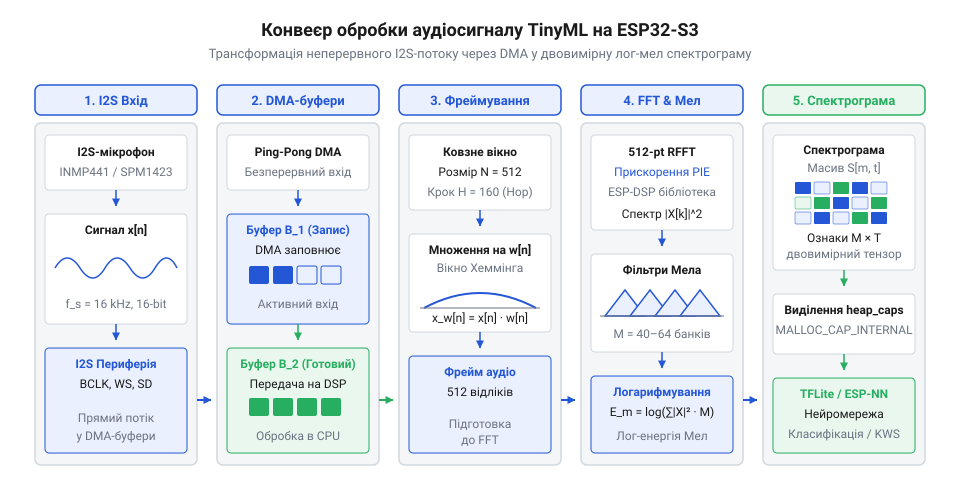
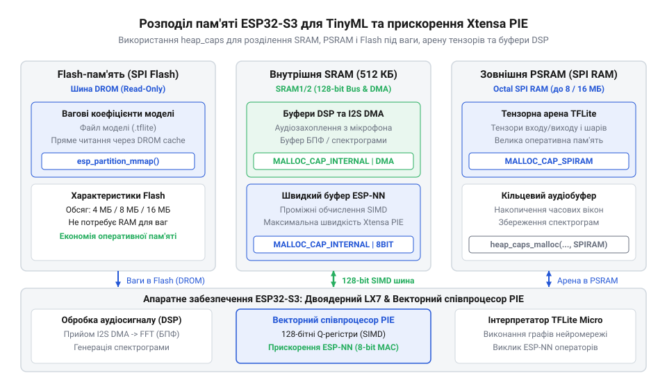

# Розробка автономного вузла аналізу аудіосигналів із векторним прискоренням TinyML

<preknowlist>
- [Мікроконтролер ESP32-S3](root:cat-hw-boards/esp32s3-microcontroller) — Базові архітектурні особливості двоядерного процесора Xtensa LX7, векторні інструкції PIE та структура оперативної пам'яті.
- [Waveshare ESP32-S3R2 (16 МБ Flash, 2 МБ PSRAM)](root:cat-hw-boards/esp32-s3r2-waveshare) — Особливості використання зовнішньої PSRAM для збереження вагових коефіцієнтів та розведення I2S-інтерфейсу.
</preknowlist>

## Проблема автономної безперервної обробки аудіо

Автономний моніторинг акустичного середовища — від виявлення витоків газу та аномальних шумів промислового обладнання до розпізнавання тривожних звуків чи голосових команд — вимагає безперервного аналізу аудіопотоку. Однак спроба передавати сирий звуковий сигнал у хмару для подальшого аналізу миттєво руйнує концепцію автономного бездротового давача. Цифровий аудіопотік із частотою дискретизації `16 кГц` та розрядністю `16 біт` створює постійне обчислювальне та мережеве навантаження.

Розрахунок швидкісного потоку сирих даних `R` для монофонічного звукового сигналу виконують за базовою формулою:

```
R = fₛ × b × N_ch
= 16000 × 16 × 1          [множення частоти дискретизації на розрядність та кількість каналів]
= 256000 біт/с            [обчислення підсумкової швидкості потоку (32 КБ/с)]
```

Обсяг даних `32 КБ/с` означає, що за одну добу пристрій генерує понад `2.76 ГБ` нестисненого аудіо.

Безперервне бездротове передавання такого обсягу через інтерфейси `@@en|Wi-Fi@@` або `@@en|Bluetooth@@` вимагає постійної роботи радіочастотного трансивера. У режимі передавання бездротовий модуль споживає струм у межах `100–240 мА` при напрузі `3.3 В`. Стандартний літієвий акумулятор ємністю `3000 мА·год` розрядиться менш ніж за добу безперервної трансляції. Крім того, передавання в хмару робить вузол критично залежним від наявності стабільного зв'язку: короткочасний збій мережі призводить до незворотної втрати звукових подій, що неприпустимо для систем безпеки та промислової діагностики.

Альтернативний підхід — обробка звуку на самому мікроконтролері без передавання в хмару — також зіштовхується з апаратними бар'єрами. Класична послідовна обробка аудіоданих на скалярному ядрі загального призначення виконується занадто повільно. Коли процесор обробляє кожен відлік звуку послідовними скалярними інструкціями з плаваючою або фіксованою крапкою, математичні операції фільтрації та спектрального аналізу потребують мільйонів тактів. Процесор змушений працювати на максимальній тактовій частоті (`240 МГц`), витрачаючи значну енергію акумулятора. Якщо швидкість математичної обробки кадрів менша за швидкість надходження нових аудіовідліків, виникає переповнення буферів і втрата фрагментів аудіосигналу.

Розв'язанням цієї проблеми є локальний аналіз сигналів за допомогою концепції `@@en|TinyML@@` (англ. *tiny machine learning* — крихітне машинне навчання). Замість передавання аудіо або його виснажливої обробки скалярними ядрами, пристрій виконує згорткову нейромережу безпосередньо на боці [мікроконтролера ESP32-S3](root:cat-hw-boards/esp32s3-microcontroller). Нейромережа аналізує стиснені спектральні ознаки в реальному часі та залишає пристрій у режимі низького споживання, генеруючи зовнішній сигнал тривоги або передаючи коротке повідомлення обсягом у кілька байтів лише при виявленні конкретної події. Зчитування даних при цьому покладають на периферійний контролер `@@en|DMA@@` (англ. *direct memory access* — прямий доступ до пам'яті), який заповнює буфери в `@@en|SRAM@@` (англ. *static random-access memory* — статична оперативна пам'ять) без залучення ядра процесора. Для розробки таких автономних вузлів чудово підходить [компактна плата ESP32-S3 SuperMini](root:cat-hw-boards/esp32-s3-supermini), яка поєднує малі габарити із потужним двоядерним обчислювальним ядром.

## Захоплення аудіосигналу та побудова спектрограм

Побудова первинного тракту обробки починається із захоплення звукових коливань та їх перетворення на цифровий формат. Використання аналогових мікрофонів із внутрішнім `@@en|ADC@@` мікроконтролера створює суттєві наводки й вимагає зовнішніх підсилювачів. Тому в автономних TinyML-вузлах застосовують цифрові мікрофони з інтерфейсом `@@en|I2S@@` (англ. *Inter-IC Sound* — міжмікросхемний звук). Цифровий мікрофон самостійно виконує дискретизацію звукової хвилі, кодуючи амплітуду в формат `@@en|PCM@@` (англ. *pulse-code modulation* — імпульсно-кодова модуляція), і передає дані за трьома лініями: тактування `@@en|SCK@@`, вибору каналу `@@en|WS@@` та послідовних даних `@@en|SD@@`. Модуль `@@en|I2S@@` в `ESP32-S3` приймає цей потік і за допомогою `@@en|DMA@@` автоматично записує відліки в кільцевий буфер оперативної пам'яті. Це звільняє процесор від обробки переривань на кожному аудіовідліку. Докладний огляд налаштування кільцевих буферів пам'яті та безперервного прийому даних містить стаття про [апаратну конфігурацію I2S та DMA в ESP32](root:hw-arch/i2s-dma-esp32).


*На діаграмі зображено послідовний потік даних від I2S-мікрофона через DMA-буфери до блоків віконного фреймування, швидкого перетворення Фур'є та формування лог-мел спектрограми в пам'яті. З неї видно, як неперервний аудіопотік трансформується у двовимірний масив спектральних ознак для нейромережі.*

Суцільний цифровий потік `@@en|PCM@@` не підходить для безпосередньої подачі в згорткову нейромережу. Для вилучення часово-частотних ознак потік розбивають на окремі кадри (фрейми) тривалістю `30 мс` із перекриттям у `20 мс` (крок фрейму `10 мс`). Перекриття запобігає втраті інформації на межах кадрів. Щоб усунути спектральне розтікання (англ. *spectral leakage*), що виникає через різкий обрив сигналу на краях кадру, до кожного масиву відліків застосовують віконну функцію Ганна або Геммінга. Множення відліків кадру `xᵢ` на коефіцієнти вікна `wᵢ` плавно згладжує амплітуду на межах кадру до нуля.

Після віконної обробки кожен кадр піддають швидкому перетворенню Фур'є `@@en|FFT@@` (англ. *fast Fourier transform* — швидке перетворення Фур'є). Апаратне обчислення `@@en|FFT@@` здійснюється за допомогою бібліотеки `@@en|ESP-DSP@@`, яка перетворює часові відліки кадру на масив амплітуд частотного спектра. Оскільки людський слух і більшість акустичних подій сприймають частоту нелінійно, отриманий спектр пропускають через набір трикутних мел-фільтрів (англ. *mel-filterbank*). Банк із `40` мелю-фільтрів групує спектральні лінії у відповідно зважені частотні смуги. Наостанок до кожної смуги застосовують логарифмування `log(E + ε)`, де `E` — енергія смуги, а `ε` — мале позитивне число для запобігання обчисленню логарифма нуля. Логарифмування стискає динамічний діапазон амплітуд, роблячи незначні зміни тихих звуків так само помітними для нейромережі, як і гучні сплески. Послідовне накопичення таких лог-мел векторів створює двовимірну матрицю (спектрограму), яка є вхідним тензором для класифікатора. Практичні прийоми генерації спектрограм та математичні алгоритми FFT описано у керівництві з використання [бібліотеки цифрової обробки сигналів ESP-DSP](root:sys-fw/esp-dsp-library).

## Векторне прискорення обчислень з ESP-NN

Сформована двовимірна лог-мел спектрограма потрапляє на вхід згорткової нейромережі. Основним математичним навантаженням під час інференсу є операції множення з накопиченням `@@en|MAC@@` (англ. *multiply-accumulate* — множення з накопиченням) у двовимірних згорткових (`Conv2D`) та повнозв'язаних (`FullyConnected`) шарах. Для обробки однієї спектрограми розміром `49 × 40` точок нейромережа виконує мільйони операцій `@@en|MAC@@`. Якщо ці операції виконувати скалярними інструкціями процесора, кожен відлік вимагає послідовного завантаження ваги, завантаження активації, перемноження та додавання до акумулятора. Це створює вузьке місце за продуктивністю та тримає процесор активним занадто довго.

Двоядерний процесор `Xtensa LX7` у складі `ESP32-S3` містить векторний співпроцесор `@@en|PIE@@` (англ. *Processor Instruction Extensions* — інструкційні розширення процесора). Співпроцесор `@@en|PIE@@` додає 128-бітні векторні регістри та підтримує паралельні інструкції `@@en|SIMD@@` (англ. *single instruction, multiple data* — одна інструкція, багато даних). Завдяки 128-бітній ширині шини даних один векторний регістр здатний вмістити шістнадцять 8-бітних квантованих цілих чисел (`int8`) або вісім 16-бітних чисел. Одна інструкція `@@en|SIMD@@` виконує паралельне множення та додавання шістнадцяти пар 8-бітних операндів всього за один тактовий цикл процесора, що теоретично збільшує обчислювальну потужність у 16 разів порівняно зі 8-бітним скалярним кодом. Детальніше про архітектуру 128-бітних векторних регістрів та ефективне виконання паралельних обчислень ідеться у статті про [векторний співпроцесор Xtensa PIE та SIMD-інструкції](root:hw-arch/esp32s3-pie-architecture).

Для використання векторного співпроцесора розробнику не потрібно писати складний код ассемблера вручну. Компанія Espressif розробила спеціалізовану бібліотеку `@@en|ESP-NN@@`, яка містить оптимізовані обчислювальні ядра для векторних інструкцій `@@en|PIE@@`. Бібліотека `@@en|ESP-NN@@` безперешкодно інтегрується у фреймворк `@@en|TensorFlow Lite for Microcontrollers@@` (`@@en|TFLite Micro@@`), замінюючи стандартні скалярні оператори C++ на прискорені векторні функції. При виконанні шарів `Conv2D`, `DepthwiseConv2D` та `FullyConnected` фреймворк `@@en|TFLite Micro@@` автоматично викликає функції `@@en|ESP-NN@@`, знижуючи час інференсу аудиомоделі в `3–5 разів`. Завдяки цьому час обробки кадру зменшується зі `120 мс` до `25 мс`, що дозволяє мікроконтролеру миттєво повертатися в режим низького енергоспоживання.

Максимальна ефективність векторного прискорення досягається лише за умови правильної організації оперативної пам'яті. Векторні інструкції `@@en|PIE@@` вимагають суворого вирівнювання даних у пам'яті по межі `16 байтів`. Невирівняні масиви активацій або вагових коефіцієнтів призводять до апаратних винятків або додаткових тактів на вирівнювання. Крім того, хоча [плата Waveshare ESP32-S3R2](root:cat-hw-boards/esp32-s3r2-waveshare) надає `2 МБ` зовнішньої `@@en|PSRAM@@`, швидкість доступу до неї через шину SPI значно нижча за внутрішню `@@en|SRAM@@`. Тому проміжні тензори активацій, тимчасові буфери `@@en|ESP-DSP@@` та робочі масиви `@@en|ESP-NN@@` обов'язково розміщують у швидкій внутрішній пам'яті `@@en|SRAM@@`, залишаючи зовнішнє джерело `@@en|PSRAM@@` лише для збереження великих статичних вагових коефіцієнтів моделей.

## Оптимізація пам'яті та інференс TFLite

Динамічне виділення пам'яті за допомогою стандартної функції `@@en|malloc@@` (від лат. *allocare* — виділяти, розміщувати) під час обробки аудіосигналів у реальному часі створює високий ризик фрагментації `@@en|купи@@` (від англ. @@en|heap@@ — купа пам'яті). Коли пристрій безперервно аналізує `@@en|аудіопотік@@`, найменший `@@en|витік пам'яті@@` або непередбачуване розщеплення вільних блоків оперативної пам'яті призводять до аварійного зупинення системи через помилку `@@en|Out of Memory@@`. Крім того, векторний співпроцесор `@@en|Xtensa PIE@@` вимагає суворого 16-байтового вирівнювання адрес для виконання 128-бітних інструкцій `@@en|SIMD@@`. Виділення буферів без урахування цієї вимоги позбавляє системний `@@en|інференс@@` (від англ. @@en|inference@@ — висновок, виконання нейромережі) апаратного прискорення через падіння у повільну скалярну емуляцію.

У [мікроконтролері ESP32-S3](root:cat-hw-boards/esp32s3-microcontroller) структура оперативної пам'яті розділена на швидку внутрішню `@@en|SRAM@@` (від англ. @@en|Static Random-Access Memory@@ — статична оперативна пам'ять) та зовнішню псевдостатичну `@@en|PSRAM@@` (від англ. @@en|Pseudo-Static RAM@@ — псевдостатична пам'ять). Внутрішня SRAM підключена безпосередньо до шини процесора й працює без затримок, що критично для обчислення `@@en|FFT@@` та виконання згорткових шарів. Однак її обсяг обмежений. Натомість зовнішня PSRAM, наявна у [платах Waveshare ESP32-S3R2](root:cat-hw-boards/esp32-s3r2-waveshare), дає кілька мегабайтів простору через шину `@@en|Octal SPI@@`, але має вищу затримку доступу. Диспетчер пам'яті `@@en|ESP-IDF@@` пропонує API `@@en|heap_caps@@` (від англ. @@en|heap capabilities@@ — можливості купи пам'яті), яке дозволяє чітко керувати розміщенням даних залежно від вимог до швидкодії.


*Архітектура розподілу пам'яті ізолює статичні ваги моделі в зовнішній пам'яті або Flash від критичної до затримок тензорної арени у внутрішній SRAM.*

Для стабільної роботи фреймворку `@@en|TensorFlow Lite for Microcontrollers@@` створюється суцільна `@@en|тензорна арена@@` (від англ. @@en|tensor arena@@ — виділений суцільний буфер пам'яті для операцій). У ній розміщуються проміжні активації нейромережі, вхідна спектрограма та вихідний вектор ймовірностей. Щоб забезпечити максимальну обчислювальну потужність бібліотеки `@@en|ESP-NN@@`, тензорну арену потрібно розміщувати у внутрішній SRAM із прапорцями `@@en|MALLOC_CAP_INTERNAL | MALLOC_CAP_8BIT@@` та гарантованим 16-байтовим вирівнюванням через функцію `@@en|heap_caps_aligned_alloc@@`. Вагові коефіцієнти навченої моделі лишаються у пам'яті `@@en|Flash@@` або завантажуються у PSRAM через `@@en|MALLOC_CAP_SPIRAM@@`, не витрачаючи дорогоцінні кілобайти внутрішньої SRAM.

Ще одним джерелом перевитрати ресурсів є нативний реєстр операторів. Використання `@@en|tflite::AllOpsResolver@@` підтягує у підсумковий бінарний файл усі існуючі оператори фреймворку, що роздуває розмір прошивки. Оптимальний підхід полягає у застосуванні `@@en|tflite::MicroMutableOpResolver@@`, де розробник вручну реєструє лише потрібні для звукової моделі шари (наприклад, `@@en|AddConv2D@@`, `@@en|AddDepthwiseConv2D@@`, `@@en|AddReshape@@`, `@@en|AddFullyConnected@@` та `@@en|AddSoftmax@@`). Ініціалізація `@@en|tflite::MicroInterpreter@@` зі статично виділеною ареною унеможливлює динамічний розрив пам'яті під час нескінченного циклу класифікації аудіосигналів. Практичні прийоми вирівнювання тензорної арени та оптимізованого формування операторів висвітлено у керівництві з [адаптації та вирівнювання тензорних буферів TFLite Micro на ESP32-S3](root:sf-ml/tflite-micro-esp32s3).

:::tabs
@tab C
:::code proj-tinyml-audio-classifier/c/esp-idf/allocate-tensor-arena.c
@tab C++
:::code proj-tinyml-audio-classifier/cpp/esp-idf/init-tflite-engine.cpp
:::

## Енергорежими та автономна батарейна робота

Безперервна робота двох ядер процесора `@@en|ESP32-S3@@` на частоті 240 МГц разом із постійним опитуванням `@@en|I2S@@`-мікрофона споживає від 100 до 150 мА струму. При використанні стандартного `@@en|Li-Po@@` акумулятора ємністю 1000 мА·год такий пристрій повністю виснажить джерело живлення менш ніж за 8 годин. Щоб перетворити плату на автономний сенсор, здатний працювати місяцями, пристрій мусить більшість часу перебувати у глибокому сні й прокидатися лише у разі появи акустичних подій.

Для оптимізації споживання [мікроконтролер ESP32-S3](root:cat-hw-boards/esp32s3-microcontroller) має кілька енергетичних станів. У режимі `@@en|Active Mode@@` працюють усі ядра та периферія. У режимі `@@en|Light Sleep@@` (від англ. @@en|Light Sleep@@ — легкий сон) тактування ядра зупиняється, але оперативна пам'ять зберігає свій стан, а периферія та `@@en|DMA@@` можуть продовжувати прийом аудіофреймів зі споживанням біля 1.5–3 мА. Найбільш економічним є `@@en|Deep Sleep@@` (від англ. @@en|Deep Sleep@@ — глибокий сон), у якому процесорні ядра, основна SRAM і високочастотні генератори вимикаються, зменшуючи струм до 7–10 мкА. У цьому стані функціонує лише пам'ять `@@en|RTC SRAM@@` та наднизькоспоживаний співпроцесор `@@en|ULP@@` (від англ. @@en|Ultra-Low Power@@ — наднизькоспоживаний співпроцесор).

Пробудження мікроконтролера з режиму `@@en|Deep Sleep@@` реалізується двома архітектурними шляхами. Перший передбачає роботу співпроцесора `@@en|ULP@@` RISC-V, який періодично зчитує амплітуду аудіосигналу через аналоговий `@@en|ADC@@` (від англ. @@en|Analog-to-Digital Converter@@ — аналогово-цифровий перетворювач) або цифровий інтерфейс і обчислює значення `@@en|RMS@@` (від англ. @@en|Root Mean Square@@ — середньоквадратичне значення). Якщо рівень шуму перевищує заданий поріг, `@@en|ULP@@` генерує переривання й пробуджує основні ядра Xtensa для обчислення спектрограми та виконання `@@en|TFLite Micro@@` інференсу. Другий шлях полягає у використанні зовнішньої схеми порогового компаратора, яка при появі звуку подає логічний імпульс на вивід `@@en|GPIO@@`, викликаючи миттєве апаратне пробудження `@@en|esp_sleep_enable_ext0_wakeup@@`. Deep Sleep@@` | Алгоритми періодичного вимірювання амплітуди звукового сигналу та схемотехніку пробудження описано в матеріалі про [моніторинг аудіосигналів за допомогою ULP-співпроцесора ESP32-S3](root:hw-arch/ulp-audio-monitoring).

Спроєктувати автономний пристрій на [компактній платі ESP32-S3-Zero](root:cat-hw-boards/esp32-s3-zero) вимагає суворого добору компонентів обв'язки живлення. Стандартні лінійні регулятори напруги `@@en|AMS1117@@` мають власний струм спокою `@@en|I_q@@` біля 5 мА, що нівелює будь-яку оптимізацію `@@en|Deep Sleep@@`. Заміна регулятора на малошумний `@@en|LDO@@` (від англ. @@en|Low Dropout Regulator@@ — стабілізатор напруги з малим падінням) серії `@@en|AP2112K@@` або `@@en|HT7333@@` зі струмом спокою менше 1.5 мкА дозволяє знизити фонові витрати енергії до мінімуму. Крім того, вимірювання напруги батареї через резистивний дільник вимагає використання польового транзистора `@@en|MOSFET@@`, який розмикає дільник під час сну, запобігаючи постійному витоку струму через резистори.

Для оцінки тривалості автономної роботи вузла розрахуємо середній струм споживання при роботі від `@@en|Li-Po@@` акумулятора ємністю 1200 мА·год, де 2% часу припадає на активний інференс (120 мА), а 98% — на режим `@@en|Deep Sleep@@` (0.01 мА).

I_avg = I_active · t_active + I_sleep · t_sleep
= 120 mA · 0.02 + 0.01 mA · 0.98         [підстановка струмів активного режиму 2% і сну 98%]
= 2.40 mA + 0.0098 mA                    [обчислення зваженого значення]
= 2.41 mA                                [середній струм вузла]

Отримавши середній струм споживання, обчислимо загальний час роботи пристрою від одного заряду батареї:

T_hours = Q_battery / I_avg
= 1200 mAh / 2.41 mA                     [ділення ємності акумулятора на середній струм]
= 497.9 hours ≈ 20.7 days                [тривалість автономної роботи]

:::tabs
@tab C
:::code proj-tinyml-audio-classifier/c/esp-idf/enter-deep-sleep-until-audio.c
@tab C++
:::code proj-tinyml-audio-classifier/cpp/esp-idf/powermanager.cpp
:::
