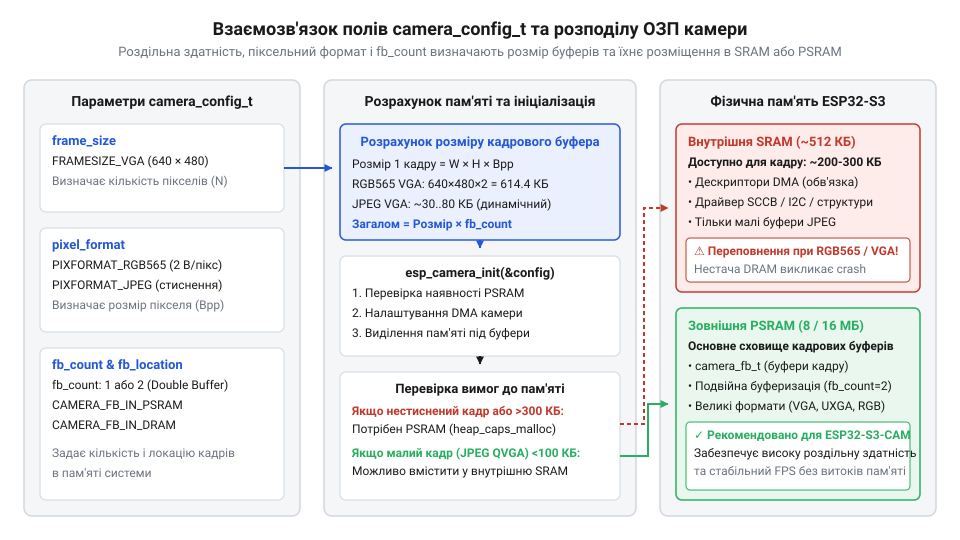
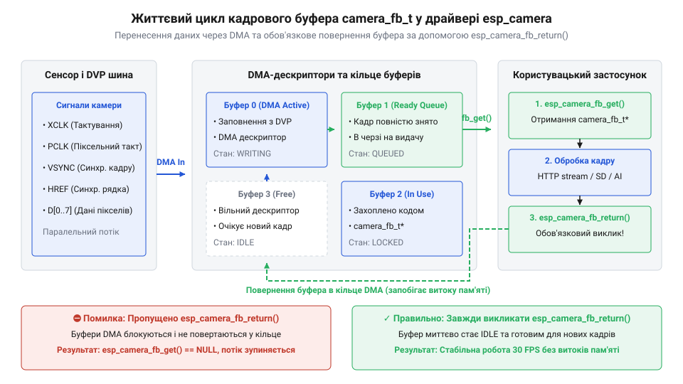

# Програмний інтерфейс драйвера камери esp_camera та налаштування DMA

<preknowlist>
- [Мікроконтролер ESP32-S3](root:cat-hw-boards/esp32s3-microcontroller) — загальну архітектуру SoC, систему переривань та принципи буферизації даних периферійними модулями
- [ESP32-CAM (OV2640 + microSD)](root:cat-hw-boards/esp32-cam) — схемотехнічну структуру плати та базові обмеження паралельного відеоінтерфейсу DVP
- [Схемотехніка та розпіновка шин Octal SPI Flash та PSRAM в ESP32-S3](root:cat-hw-boards/esp32-s3-octal-spi-bus-layout) — особливості адресації та пропускну здатність зовнішньої пам'яті PSRAM для розміщення великих кадрових буферів
</preknowlist>

## Чому пряме відеозахоплення спричиняє збої

Спроба отримати цифровий відеопотік від матриці камери шляхом програмного опитування ліній @@en|GPIO@@ (англ. General Purpose Input/Output, від general-purpose — загального призначення + input/output — вхід/вихід) у циклі призводить до фатальних збоїв. Паралельний цифровий відеоінтерфейс @@en|DVP@@ (англ. Digital Video Port, від digital — цифровий + video — відео + port — порт) генерує високошвидкісний потік даних, де строб піксельного тактування @@en|PCLK@@ (англ. Pixel Clock, від pixel — піксель + clock — такт) становить від 10 до 20 МГц. Це означає, що новий байт з'являється на шинах `D0`–`D7` кожні 50 наносекунд. Програмний цикл мікроконтролера на частоті 240 МГц витрачає кілька тактів лише на читання регістру `GPIO` та перевірку прапорця синхронізації, а обробник переривання @@en|ISR@@ (англ. Interrupt Service Routine, від interrupt — переривання + service — обслуговування + routine — підпрограма) в операційній системі @@en|FreeRTOS@@ додає накладні витрати у сотні наносекунд. У результаті ядро пропускає строби @@en|HREF@@ (англ. Horizontal Reference, від horizontal — горизонтальний + reference — опорний) та імпульси @@en|VSYNC@@ (англ. Vertical Synchronization, від vertical — вертикальний + synchronization — синхронізація), що спричиняє зміщення байтів у пікселях і переповнення буферів.

Для розв'язання цієї проблеми розроблено драйвер @@en|esp_camera@@, який відчужує прийом байтів від процесорного ядра. Драйвер налаштовує апаратні периферійні блоки [мікроконтролера ESP32-S3](root:cat-hw-boards/esp32s3-microcontroller) (`@@en|I2S@@` або `@@en|LCD_CAM@@`) на автоматичне перенесення даних через канали @@en|DMA@@ (англ. Direct Memory Access, від direct — прямий + memory — пам'ять + access — доступ). Апаратний модуль працює у режимі паралельного приймача: за кожним активним фронтом стробу `@@en|PCLK@@` він фіксує стан шин `D0`–`D7` і буферизує байти у внутрішній апаратний буфер @@en|FIFO@@ (англ. First In, First Out, від first — перший + in — увійти + out — вийти). Передачею керує сигнал горизонтальної синхронізації `@@en|HREF@@`: поки він перебуває у високому логічному стані, байти безперервно заповнюють поточний DMA-буфер, а при спаді `@@en|HREF@@` між рядками модуль фіксує межу рядка й призупиняє прийом. Щоб запобігти втраті пікселів на межах рядків і кадрів, контролер @@en|DMA@@ використовує кільцевий список подвійних DMA-дескрипторів: поки один дескриптор адресно накопичує байти й записує їх у внутрішню оперативну пам'ять @@en|SRAM@@ (англ. Static Random-Access Memory, від static — статичний + random-access — довільного доступу + memory — пам'ять) або зовнішню [розширену пам'ять PSRAM](root:cat-hw-boards/esp32-s3-octal-spi-bus-layout), наступний дескриптор у ланцюжку чекає своєї черги. Під час зрізу сигналу `@@en|HREF@@` або досягнення ліміту розрядності дескриптора апаратний контролер миттєво перемикається на наступний DMA-дескриптор без зупинки шини, а процесорне ядро отримує повідомлення лише для обробки вже сформованих блоків даних. Це дозволяє пристрою приймати відеопотоки на [компактних платах ESP32-CAM](root:cat-hw-boards/esp32-cam) без завантаження ядра під час транспортування кадрів.

## Конфігурація драйвера та розрахунок ресурсів

Параметри відеопідсистеми задаються через об'єкт структури @@en|camera_config_t@@, який передається функціональному обробнику `esp_camera_init()`. Конфігурація визначає призначення пінів паралельної шини @@en|DVP@@ (`pin_d0`–`pin_d7`), сигналів @@en|VSYNC@@, @@en|HREF@@, @@en|PCLK@@ та опорної частоти @@en|XCLK@@ (англ. External Clock, від external — зовнішній + clock — такт). Частота @@en|XCLK@@ (`xclk_freq_hz`), яка зазвичай задається у діапазоні 10–20 МГц за допомогою апаратного ШІМ-генератора @@en|LEDC@@ (англ. LED Control, від LED — світлодіод + control — керування), подається на сенсор і визначає швидкість зчитування матриці. Окрім розпінування, структура задає роздільну здатність через тип `frame_size` (від `FRAMESIZE_QQVGA` 160×120 до `FRAMESIZE_UXGA` 1600×1200) та формат кодування пікселів `pixel_format` (`PIXFORMAT_JPEG`, `PIXFORMAT_RGB565` або `PIXFORMAT_YUV422`). Крім того, на рівні конфігурації задається режим захоплення кадрів `grab_mode` (англ. grab mode, від grab — захоплювати + mode — режим), який визначає стратегію оновлення буферів та затримку передачі відеопотоку у випадках, коли програма не встигає обробляти кадри з частотою їх надходження від сенсора. У режимі `CAMERA_GRAB_WHEN_EMPTY` (від when — коли + empty — порожній) драйвер наповнює буфери послідовно за принципом @@en|FIFO@@ (англ. First-In, First-Out, від first — перший + in — вхід + out — вихід) і забезпечує отримання кожного знятого кадру без втрат, але якщо прикладний цикл затримується, у черзі накопичуються застарілі дані, створюючи часовий лаг. Натомість режим `CAMERA_GRAB_LATEST` (від latest — найновіший) під час зчитування автоматично скидає накопичені в черзі @@en|DMA@@ проміжні кадри й повертає лише найсвіжіший кадр, що мінімізує затримку потоку для задач реального часу ціною можливого пропуску кадрів.

Вибір роздільності та формату визначає споживання оперативної пам'яті. Для сирого несжиманого кадру `RGB565` (2 байти на піксель) обсяг необхідного буфера розраховується за формулою:

```
Size_raw = Width × Height × BytesPerPixel
         = 1600 × 1200 × 2             [підстановка роздільності UXGA та формату RGB565]
         = 3840000 B                   [обчислення обсягу кадрового буфера 3.84 МБ]
```

Кадровий буфер обсягом 3.84 МБ фізично неможливо розмістити у внутрішній @@en|SRAM@@ (обсяг якої в ESP32 складає 512 КБ), тому для високих роздільностей у несжиманих форматах потрібна зовнішня @@en|PSRAM@@ (англ. Pseudo-Static Random-Access Memory, від pseudo — псевдо + static — статичний + random-access — довільний доступ + memory — пам'ять) та налаштування `fb_location = CAMERA_FB_IN_PSRAM`. Використання стиснення `PIXFORMAT_JPEG` у сенсорах зменшує розмір кадру в 10–20 разів (до 150–300 КБ для UXGA), що дозволяє виділяти кільцеві буфери у внутрішній @@en|DRAM@@ за відсутності PSRAM на [модульних платах камери](root:cat-hw-boards/esp32-cam-camera-module-family).


*Схема прийняття рішень драйвером esp_camera щодо розміщення кадрових буферів у внутрішній SRAM або зовнішній PSRAM залежно від конфігурації camera_config_t.*

Приклад ініціалізації драйвера @@en|esp_camera@@ для середовищ ESP-IDF та Arduino ESP32:

:::tabs
@tab C (ESP-IDF)
:::code api-esp-camera-driver/c/esp-idf/init-camera-custom.c
@tab C++ (Arduino)
:::code api-esp-camera-driver/cpp/arduino/setupcamera.cpp
:::

## Життєвий цикл кадрового буфера камери

Після ініціалізації драйвера отримати доступ до кадру можна через функцію `esp_camera_fb_get()`. Вона блокує таск до завершення @@en|DMA@@-перенесення поточного кадру й повертає вказівник на структуру кадрового буфера @@en|camera_fb_t@@. Об'єкт містить вказівник `buf` на масив байтів зображення, довжину `len` у байтах, виміри `width` та `height`, піксельний формат `format` і часову позначку `timestamp`, зафіксовану в момент імпульсу @@en|VSYNC@@.

Робота з буфером підпорядковується суворому інваріанту: кожен виклик `esp_camera_fb_get()` зобов'язаний мати парний виклик `esp_camera_fb_return(fb)`. Драйвер @@en|esp_camera@@ утримує обробку кадрів у кільцевому списку @@en|DMA@@-дескрипторів (обмеженому параметром `fb_count`). Коли застосунок викликає `esp_camera_fb_get()`, відповідний буфер вилучається з пулу драйвера. Якщо розробник забуде викликати `esp_camera_fb_return()`, пам'ять залишається заблокованою. Після вичерпання усіх `fb_count` буферів кільце @@en|DMA@@ блокується, і наступні виклики `esp_camera_fb_get()` завершуються тайм-аутом або повертають `NULL`.


*Послідовний життєвий цикл вказівника camera_fb_t із виділенням буфера з DMA-кільця та обов'язковим поверненням через esp_camera_fb_return().*

Для запобігання витокам пам'яті при виникненні виняткових ситуацій повернення буфера слід розміщувати у гарантовано виконуваних блоках:

:::tabs
@tab C (ESP-IDF)
:::code api-esp-camera-driver/c/esp-idf/process-single-frame.c
@tab C++ (Arduino)
:::code api-esp-camera-driver/cpp/arduino/captureandsendframe.cpp
:::

## Динамічне керування параметрами сенсора камери

Після ініціалізації розробник може змінювати параметри роботи оптичної матриці під час виконання програми. Для цього застосовується вказівник на структуру @@en|sensor_t@@, який дістають функцією `esp_camera_sensor_get()`. Об'єкт @@en|sensor_t@@ містить набір функціональних вказівників (методи-чисельники), які здійснюють запис у керуючі регістри сенсора (OV2640 або OV5640) через послідовну шину @@en|SCCB@@ (англ. Serial Camera Control Bus, від serial — послідовний + camera — камера + control — керування + bus — шина), схемотехнічно сумісну з протоколом @@en|I2C@@ (англ. Inter-Integrated Circuit, від inter — між + integrated circuit — інтегральна схема).

Перевага використання `sensor_t` полягає у тому, що зміна коефіцієнтів підсилення, експозиції чи білого балансу відбувається на льоту без деініціалізації драйвера @@en|esp_camera@@ та без перезапуску @@en|DMA@@. Через метод `s->set_framesize(s, FRAMESIZE_QVGA)` можна динамічно зменшити роздільну здатність кадру для прискорення обробки алгоритмами машинного зору, а потім повернути високу роздільність для знімка. Основні методи керування сенсором:

1. **Експозиція та підсилення:** `s->set_exposure_ctrl(s, enable)` керує автоматичною експозицією @@en|AEC@@ (англ. Auto Exposure Control), `s->set_aec_value(s, val)` задає витримку, а `s->set_gain_ctrl(s, enable)` та `s->set_agc_gain(s, gain)` керують автоматичним @@en|AGC@@ (англ. Auto Gain Control) та ручним підсиленням. 2. **Баланс білого:** `s->set_whitebal(s, enable)` вмикає автоматичний баланс білого @@en|AWB@@ (англ. Auto White Balance), а `s->set_wb_mode(s, mode)` задає пресети освітлення. 3. **Орієнтація та оцифрування:** `s->set_hmirror(s, enable)` виконує дзеркалювання кадру, а `s->set_vflip(s, enable)` перевертає зображення вертикально.

Приклад динамічного переналаштування параметрів матриці:

:::tabs
@tab C (ESP-IDF)
:::code api-esp-camera-driver/c/esp-idf/adjust-sensor-settings.c
@tab C++ (Arduino)
:::code api-esp-camera-driver/cpp/arduino/configuresensordynamic.cpp
:::

## Діагностика помилок та режими енергозбереження

Під час роботи камери у реальних пристроях можуть виникати апаратні та програмні збої. Найпоширенішою помилкою запуску є `ESP_ERR_NOT_FOUND` або `ESP_ERR_CAMERA_NOT_DETECTED`. Цей збій свідчить про відсутність зв'язку по шині @@en|SCCB@@ між мікроконтролером та сенсором, що викликано неправильним розпінуванням ліній `SDA`/`SCL`, відсутністю підтягувальних резисторів 4.7 кОм або збоєм генерації тактової частоти @@en|XCLK@@. Якщо лінія @@en|XCLK@@ не видає меандр 10–20 МГц, контролер матриці не відповідає на виклики шини @@en|I2C@@.

У процесі захоплення кадрів головним симптомом несправності є повернення вказівника `NULL` функцією `esp_camera_fb_get()` із повідомленням про тайм-аут @@en|DMA@@ у логах. Помилки тайм-ауту виникають через завади на лінії @@en|PCLK@@, провисання живлення сенсора чи вичерпання кадрових буферів у пам'яті. Для автономних пристроїв важливе значення має управління енергоспоживанням. Сенсор камери у робочому стані споживає 20–40 мА. Для переведення камери у режим глибокого сну застосовують керування лінією `pin_pwdn` (Power Down):

:::tabs
@tab C (ESP-IDF)
:::code api-esp-camera-driver/c/esp-idf/power-save-enter.c
@tab C++ (Arduino)
:::code api-esp-camera-driver/cpp/arduino/sleepcamerasensor.cpp
:::

У випадку збоїв передачі даних використовують алгоритм автоматичного відновлення (англ. auto-recovery), який зупиняє драйвер через `esp_camera_deinit()`, виконує імпульс скидання лінії `pin_reset` і повторно викликає `esp_camera_init()`.