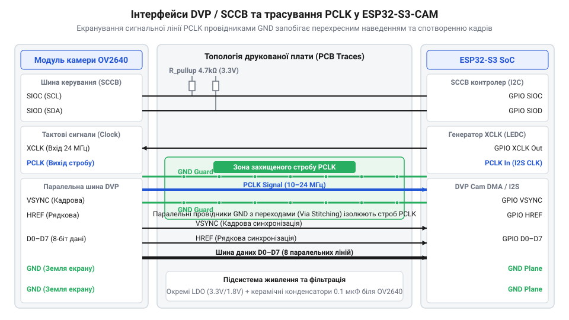
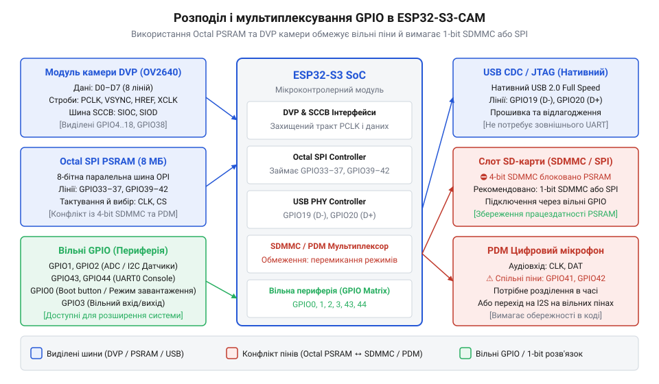

# Апаратне підключення та розводка шини камери і периферії ESP32-S3-CAM

<preknowlist>
- [Мікроконтролер ESP32-S3](root:cat-hw-boards/esp32s3-microcontroller) — архітектуру системних виводів GPIO та базові периферійні блоки мікроконтролера ESP32-S3
- [ESP32-CAM (OV2640 + microSD)](root:cat-hw-boards/esp32-cam) — концепцію організації паралельного відеоінтерфейсу DVP та базового підключення камери в платах серії ESP32-CAM
- [Схемотехніка та розводка шин Octal SPI Flash та PSRAM в ESP32-S3](root:cat-hw-boards/esp32-s3-octal-spi-bus-layout) — внутрішню розводку сигналів Octal SPI для забезпечення сумісності із зовнішньою PSRAM
</preknowlist>

## Чому кадровий потік ESP32-S3-CAM спотворюється

Підключення плати @@en|ESP32-S3-CAM@@ та перша спроба отримати зображення нерідко завершуються хаотичними артефактами або аварійною зупинкою драйвера `@@en|esp_camera@@`. Сприйняття камери як звичайної низькошвидкісної периферії ігнорує жорсткі фізичні обмеження. Паралельний відеоінтерфейс пересилає мільйони байтів на секунду, де кожен біт вимагає суворого узгодження за часом, напругою та завадозахищеністю.

В основі передачі відеопотоку лежить стробувальний сигнал піксельного тактування `@@en|PCLK@@` (від англ. @@en|Pixel Clock@@, тактовий сигнал пікселів). За опорної частоти `@@en|XCLK@@` (від англ. @@en|External Clock@@, зовнішнє тактування) у 10–20 МГц, сенсор формує `@@en|PCLK@@` на частоті 8–40 МГц. За кожного фронту `@@en|PCLK@@` мікроконтролер фіксує стан восьми ліній даних `@@en|D0–D7@@`. Якщо тривалість фронту спотворюється паразитною ємністю чи індуктивністю провідників, часові вікна встановлення (від англ. @@en|Setup Time@@, час передфронтового утримання) та утримання (від англ. @@en|Hold Time@@, час післяфронтового утримання) порушуються. У результаті периферійний блок [базового мікроконтролера](root:cat-hw-boards/esp32s3-microcontroller) зчитує викривлені біти, викликаючи сніг або зсув кадру.

Другою критичною причиною спотворення є імпульсне споживання струму матрицею. Під час зчитування кадрів та активної роботи вбудованого аналого-цифрового перетворювача (від англ. @@en|Analog-to-Digital Converter@@, АЦП), споживання струму шинами камери змінюється стрибкоподібно. Якщо підсистема живлення побудована без урахування цих піків або має спільний регулятор із потужними споживачами, напруга просідає. Це викликає зсув опорних рівнів АЦП камери або скидання регістрів сенсора.

Третій фактор — трасування друкованої плати. На відміну від [попередніх плат серії ESP32-CAM](root:cat-hw-boards/esp32-cam), плата @@en|ESP32-S3-CAM@@ використовує пам'ять `@@en|PSRAM@@` (від англ. @@en|Pseudo-Static Random Access Memory@@, псевдостатична оперативна пам'ять) на шині [восьмиканальної пам'яті](root:cat-hw-boards/esp32-s3-octal-spi-bus-layout) `@@en|Octal SPI@@`. Неправильне трасування відеосигналів поруч із шиною пам'яті створює перехресні завади (від англ. @@en|Crosstalk@@, перехресне наведення), що призводить до втрати синхронізації та відмови каналів прямого доступу до пам'яті `@@en|DMA@@` (від англ. @@en|Direct Memory Access@@, прямий доступ до пам'яті). Збагнути взаємодію всіх цих ліній та усунути збої можна детально розібравши сигнальну структуру шин `@@en|DVP@@` та `@@en|SCCB@@`.

## Сигнальні шини DVP і SCCB та трасування

Дворівневий зв'язок між мікроконтролером @@en|ESP32-S3@@ та сенсором камери забезпечують паралельний відеоінтерфейс `@@en|DVP@@` (від англ. @@en|Digital Video Port@@, цифровий відеопорт) і двопровідна шина керування `@@en|SCCB@@` (від англ. @@en|Serial Camera Control Bus@@, послідовна шина керування камерою). Шина `@@en|SCCB@@` є функціональним аналогом `@@en|I2C@@` із лініями тактування `@@en|SIOC@@` та даних `@@en|SIOD@@`. Вона працює на частоті 100–400 кГц і відповідає за конфігурацію внутрішніх регістрів камери — експозицію, підсилення, роздільну здатність та формат даних. Обидві лінії `@@en|SCCB@@` потребують підтягувальних резисторів (від англ. @@en|Pull-up Resistor@@, резистор підтяжки) номіналом 1.5–4.7 кОм до лінії 3.3 В.

Відеошина `@@en|DVP@@` передає кадровий потік трьома групами сигналів:
1. Тактові сигнали: опорний `@@en|XCLK@@`, який генерує [мікроконтролер ESP32-S3](root:cat-hw-boards/esp32s3-microcontroller) для тактування матриці, та стробувальний `@@en|PCLK@@`, який камера формує для кожного байта даних. 2. Кадрова синхронізація: `@@en|VSYNC@@` (від англ. @@en|Vertical Synchronization@@, вертикальна синхронізація) визначає межі кадру, а `@@en|HREF@@` (від англ. @@en|Horizontal Reference@@, горизонтальна опорна лінія) вказує на передачу активного рядка. 3. Інформаційна шина `@@en|D0–D7@@`: вісім паралельних ліній, якими синхронно за фронтом `@@en|PCLK@@` передаються пікселі або блоки `@@en|JPEG@@`.

*Підключення паралельної шини камери та міжкаскадне екранування стробувального сигналу.*

Високочастотна топологія шини `@@en|DVP@@` найчутливіша до лінії `@@en|PCLK@@`. Оскільки її фронти мають крутизну наростання менше 2 нс, круті перепади напруги випромінюють електромагнітні завади. Паралельне трасування `@@en|PCLK@@` поруч із `@@en|D0–D7@@` або `@@en|SCCB@@` без розрядки створює ємнісний та індуктивний зв'язок, що спричиняє хибні спрацьовування тригерів @@en|ESP32-S3@@ та зворотний джиттер (від англ. @@en|Jitter@@, фазове тремтіння сигналу).

Щоб зберегти цілісність сигналів під час розводки плати @@en|ESP32-S3-CAM@@, дотримуються таких вимог:
- Лінію `@@en|PCLK@@` екранують захисними земляними доріжками (від англ. @@en|Ground Guard Trace@@, захисна земляна доріжка) з обох боків із перехідними отворами на шар `@@en|GND Plane@@` кожні 3–5 мм. - Довжину ліній даних `@@en|D0–D7@@`, `@@en|VSYNC@@` та `@@en|HREF@@` вирівнюють із точністю до 2 мм задля уникнення часового перекосу (від англ. @@en|Skew@@, часовий зсув). - Хвильовий опір поодиноких ліній витримують на рівні 50 Ом. - Послідовно у лінії `@@en|PCLK@@` та `@@en|XCLK@@` поблизу джерела встановлюють демпфувальні резистори (від англ. @@en|Damping Resistor@@, демпфувальний резистор) номіналом 22–47 Ом для пригнічення відбитків хвилі (від англ. @@en|Ringing@@, дзвін сигналу).

Збереження цілісності відеосигналів марне без стабільного живлення камери, що потребує аналізу відповідної підсистеми.

## Підсистема живлення камери та декуплювання

Аналогово-цифрова структура сенсорів камери (зокрема @@en|OV2640@@ та @@en|OV5640@@ у [серії плат ESP32-CAM](root:cat-hw-boards/esp32-cam-camera-module-family)) вимагає розділення живлення на три незалежні лінії:
1. `@@en|AVDD@@` (від англ. @@en|Analog Voltage Domain@@, аналогова напруга): 2.8–3.0 В. Живить піксельну матрицю та аналогові підсилювачі. Пульсації на цій лінії трансформуються у шум, кольорові плями чи вертикальні смуги на зображенні. 2. `@@en|DVDD@@` (від англ. @@en|Digital Voltage Domain@@, цифрова напруга ядра): 1.2–1.8 В. Живить логічне ядро сенсора та процесор стиснення `@@en|JPEG@@`. 3. `@@en|DOVDD@@` (від англ. @@en|Digital I/O Voltage Domain@@, напруга цифрових периферійних буферів): 3.3 В. Живить вихідні буфери GPIO камери (`@@en|D0–D7@@`, `@@en|PCLK@@`, `@@en|VSYNC@@`, `@@en|HREF@@`) і відповідає логічним рівням [мікроконтролера ESP32-S3](root:cat-hw-boards/esp32s3-microcontroller).

На платах @@en|ESP32-S3-CAM@@ живлення камери формують окремі лінійні регулятори `@@en|LDO@@` (від англ. @@en|Low Dropout Regulator@@, регулятор з малою різницею напруги). Спільний LDO з мікроконтролером недопустимий: під час передачі по `@@en|Wi-Fi@@` чи `@@en|Bluetooth@@` мікроконтролер споживає струми до 350–500 мА. Їхні просідання потрапляють у тракт `@@en|AVDD@@` і спотворюють кадр.

Окремий LDO камери повинен мати високий коефіцієнт пригнічення завад живлення `@@en|PSRR@@` (від англ. @@en|Power Supply Rejection Ratio@@, коефіцієнт пригнічення завад живлення) — не менше 60–70 дБ на 10–100 кГц. Для додаткової фільтрації лінії `@@en|AVDD@@` застосовують послідовний феритовий фільтр (від англ. @@en|Ferrite Bead@@, феритова намистина) з імпедансом 600 Ом на 100 МГц, який ізолює аналогову шину від високочастотного шуму цифрової плати.

Схема декуплювання (від англ. @@en|Decoupling@@, розв'язка/декуплювання) будується на паралельному об'єднанні керамічних конденсаторів `@@en|MLCC@@` (від англ. @@en|Multi-Layer Ceramic Capacitor@@, багатошаровий керамічний конденсатор) різної ємності:
- Низькочастотний накопичувальний конденсатор ємністю 10 мкФ (танталовий або `@@en|MLCC@@` X7R) розміщують на виході LDO для компенсування повільних просідань напруги при зміні режимів камери. - Високочастотні шунтувальні конденсатори ємністю 0.1 мкФ (100 нФ) розставляють безпосередньо (не далі 2 мм) біля виводів живлення сенсора (`@@en|AVDD@@`, `@@en|DVDD@@`, `@@en|DOVDD@@`). Вони мають мінімальний еквівалентний послідовний опір `@@en|ESR@@` (від англ. @@en|Equivalent Series Resistance@@, еквівалентний послідовний опір) та пригнічують високочастотні імпульсні завади. - Для пригнічення наведень від стробувального сигналу `@@en|XCLK@@` паралельно додають конденсатор ємністю 10–100 пФ.

## Розподіл GPIO між PSRAM та периферією

На відміну від [плат серії Zero](root:cat-hw-boards/esp32-s3-zero) чи [плат SuperMini](root:cat-hw-boards/esp32-s3-supermini), плата @@en|ESP32-S3-CAM@@ містить зовнішню `@@en|PSRAM@@` (2, 8 або 16 МБ). У чипах @@en|ESP32-S3@@ її підключення вимагає 8-бітної шини `@@en|Octal SPI@@`.

Застосування `@@en|Octal SPI@@` накладає суворі обмеження: 10 або 11 системних виводів `@@en|GPIO@@` (від англ. @@en|General Purpose Input/Output@@, контакти введення-виведення загального призначення; GPIO30–GPIO32 та GPIO33–GPIO37) жорстко зафіксовані внутрішньою розводкою кристала для обміну з `@@en|Flash@@` та `@@en|PSRAM@@`. Спроба задіяти їх для камери, `@@en|SD-карти@@` чи датчиків призводить до краху операційної системи та пошкодження даних у пам'яті.

*Розподіл системних виводів GPIO для забезпечення сумісності з Octal SPI та периферією.*

Виводи GPIO19 та GPIO20 за замовчуванням задіяв трансивер `@@en|USB CDC/JTAG@@` (від англ. @@en|Communications Device Class / Joint Test Action Group@@). Їхнє перепрограмування під звичайні `@@en|GPIO@@` позбавляє плату завантаження прошивки та налагодження через роз'єм `@@en|USB Type-C@@`.

Раціональна карта розподілу виводів `@@en|GPIO@@` для @@en|ESP32-S3-CAM@@:
- Шина DVP камери: `@@en|XCLK@@` — GPIO15; `@@en|PCLK@@` — GPIO13; `@@en|VSYNC@@` — GPIO6; `@@en|HREF@@` — GPIO7; шина даних `@@en|D0–D7@@` — GPIO11, GPIO9, GPIO8, GPIO10, GPIO12, GPIO18, GPIO17, GPIO16. - Шина керування `@@en|SCCB@@`: `@@en|SIOC@@` — GPIO4, `@@en|SIOD@@` — GPIO5. - Карта пам'яті `@@en|MicroSD@@`: у 1-бітному режимі `@@en|SDMMC@@` задіюються `@@en|CLK@@` (GPIO39), `@@en|CMD@@` (GPIO38) та `@@en|D0@@` (GPIO40). 4-бітний режим вимагає додаткових ліній, що викликає дефіцит виводів. - Вільні виводи: GPIO1, GPIO2, GPIO41, GPIO42 доступні для периферії (цифрового `@@en|PDM@@`-мікрофона на GPIO41/GPIO42 чи сенсорів `@@en|I2C@@`).

На відміну від [плат серії P4](root:cat-hw-boards/esp32-p4-microcontroller) з апаратним `@@en|MIPI-CSI@@`, мікроконтролер @@en|ESP32-S3@@ обробляє відеопотік блоком `@@en|LCD/CAM@@` та каналами `@@en|DMA@@`. Будь-який конфлікт виводів призводить до втрати кадрових буферів. Докладніше про внутрішню архітектуру цього блоку та конфігурацію каналів DMA для апаратного захоплення відеопотоку читайте у статті про [периферійний контролер LCD/CAM в ESP32-S3](root:hw-arch/esp32-s3-lcd-cam-bus-interface).

## Діагностика й усунення апаратних збоїв

Систематична локалізація апаратних збоїв @@en|ESP32-S3-CAM@@ полягає у послідовній перевірці шини керування @@en|SCCB@@, відеошини @@en|DVP@@ та підсистеми живлення.

Перший симптом — помилка ініціалізації камери під час старту прошивки: @@en|Camera probe failed with error 0x20001@@ або відсутність відповіді по шині @@en|SCCB@@. 1. Осцилографом перевірити опорний тактовий сигнал @@en|XCLK@@ на виході GPIO15. За амплітуди нижче 2.8 В або відсутності сигналу сенсор перебуває у глибокому скиданні й не відповідає по @@en|SCCB@@. 2. Перевірити резистори підтяжки 3.3 кОм на лініях @@en|SIOC@@ (GPIO4) та @@en|SIOD@@ (GPIO5). За їх відсутності рівні напруги не досягають логічної одиниці. 3. Проконтролювати вихідні напруги LDO-регуляторів: @@en|AVDD@@ має становити 2.8 В ± 2%, @@en|DOVDD@@ — 3.3 В.

Другий симптом — зображення містить вертикальні кольорові смуги, артефакти або зсув рядків (від англ. @@en|Line Tearing@@, розрив рядка). 1. Осцилографом перевірити форму імпульсів на лінії @@en|PCLK@@. За наявності дзвенячих відбитків (перерегулювання понад 3.6 В або просідання нижче -0.5 В) встановити послідовний демпфувальний резистор 22–33 Ом біля виводу камери. 2. За наявності перехресних наведень між @@en|PCLK@@ та лініями @@en|D0–D7@@ зменшити програмну частоту @@en|XCLK@@ у конфігурації драйвера з 20 МГц до 10–12 МГц (@@en|config.xclk_freq_hz = 10000000@@), що розширить часове вікно валідності даних. 3. Перевірити вирівнювання фази @@en|PCLK@@ у регістрах [налаштування блоків eFuse](root:cat-hw-boards/esp32-s3-efuse-and-boot-configuration) або конфігурації драйвера (@@en|config.pixel_mode@@).

Третій симптом — раптове перезавантаження мікроконтролера @@en|ESP32-S3@@ під час захоплення кадру з повідомленням @@en|Brownout detector was triggered@@. 1. Збій виникає через спад напруги шини 3.3 В нижче 2.43 В під час одночасного вмикання спалаху камери та пікового споживання матриці. 2. Встановити додатковий електролітичний або танталовий конденсатор ємністю 47–100 мкФ на вхідну шину живлення 3.3 В. 3. Відокремити лінію живлення спалаху від аналогового регулятора @@en|AVDD@@ камери.