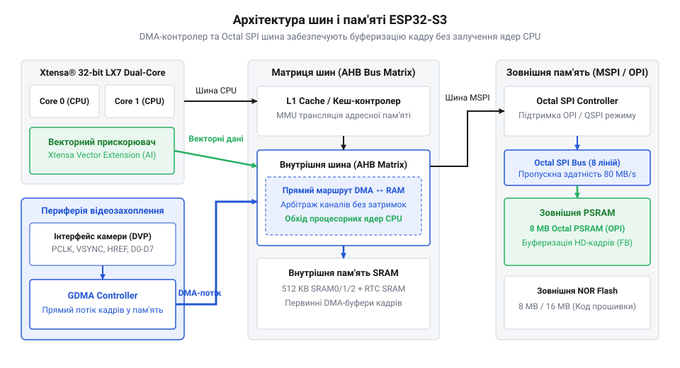
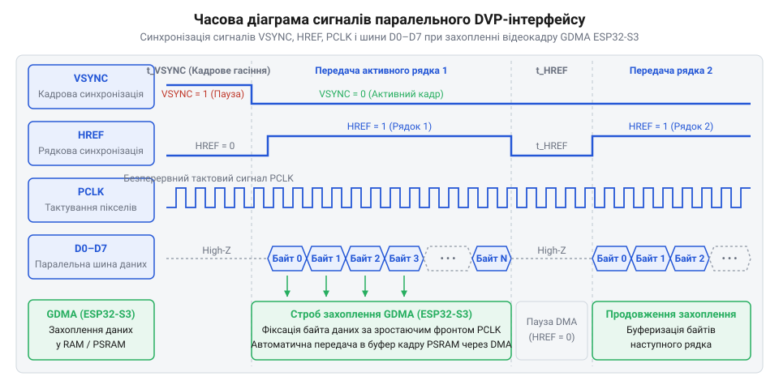
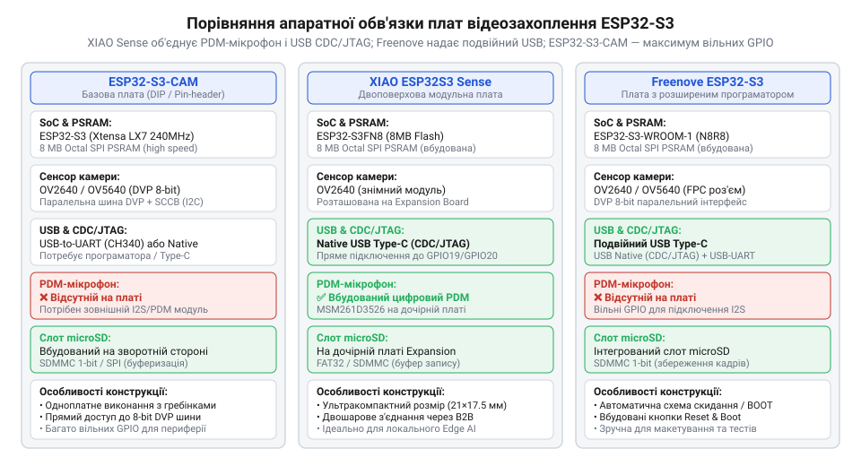
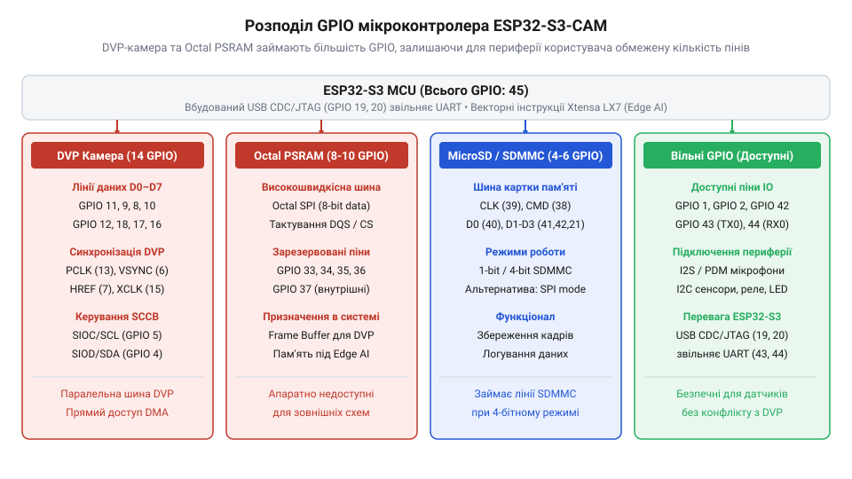
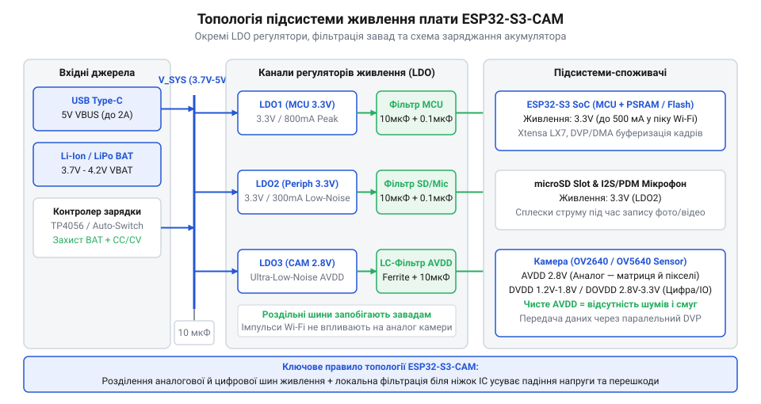

# Плати відеозахоплення нового покоління на базі ESP32-S3

<preknowlist>
- [Мікроконтролер ESP32-S3](root:cat-hw-boards/esp32s3-microcontroller) — базово розуміти двоядерну архітектуру Xtensa LX7, систему переривань та систему периферійних інтерфейсів контролера.
- [ESP32-CAM (OV2640 + microSD)](root:cat-hw-boards/esp32-cam) — знати схемотехнічне облаштування та обмеження класичної плати першого покоління на ESP32-D0WD.
- [Схемотехніка та розпіновка шин Octal SPI Flash та PSRAM в ESP32-S3](root:cat-hw-boards/esp32-s3-octal-spi-bus-layout) — орієнтуватися у принципах підключення 8-бітної шини пам'яті Octal SPI та розподілі GPIO для Quad/Octal режимів.
</preknowlist>

## Проблеми ESP32-CAM та виклики відеозахоплення

Побудова автономної системи відеоспостереження або пристрою первинного аналізу зображення починається із потреби отримати стабільний відеопотік без непередбачуваних падінь кадрів та зависань контролера. Базовим рішенням, з якого роками починали розробники, була спроба застосувати модуль [класичної плати ESP32-CAM](root:cat-hw-boards/esp32-cam), побудований на першому поколінні мікроконтролера @@en|ESP32@@ та матриці @@en|OV2640@@. Проте практична експлуатація таких модулів у завданнях неперервного стримінгу чи комп'ютерного зору швидко впирається у жорсткий апаратний тупик. Як показує [історичний розвиток плат відеозахоплення](root:cat-hw-boards/esp32-s3-cam-boards-overview/hist-esp32-cam-evolution.md), спроба витиснути мультимедійні можливості з чіпа, розробленого першочергово для бездротового збору даних з датчиків, оголила декілька фундаментальних обмежень апаратної обв'язки. Для детального вивчення апаратної структури, схемотехніки та специфіки використання карт пам'яті в першому поколінні модулів перегляньте огляд про [плату відеозахоплення ESP32-CAM першого покоління](root:cat-hw-boards/esp32-cam).

Головним бар'єром під час роботи з відеопотоком виявилася нестача швидкодії пам'яті. Внутрішня оперативна пам'ять @@en|SRAM@@ (від англ. *Static Random-Access Memory*) мікроконтролера першого покоління становить близько 520 КБ і фізично не здатна вмістити навіть один нестиснутий відеокадр високої роздільної здатності. Для буферизації кадрів на плату встановлюють зовнішню мікросхему @@en|PSRAM@@ (від англ. *Pseudo Static Random-Access Memory*, де *pseudo* — від грец. ψευδής — несправжній). Обсяг пам'яті для збереження одного кадру формата @@en|SVGA@@ у нестиснутому повнокольоровому кодуванні @@en|RGB565@@ розраховується за формулою:

M = W × H × B
  = 800 × 600 × 2    [роздільна здатність SVGA 800×600 та 2 байти на піксель у кодуванні RGB565]
  = 960000 байт      [обсяг одного нестиснутого кадру]
  ≈ 0.96 МБ          [переведення у мегабайти]

Оскільки обсяг `0.96 МБ` перевищує усю доступну внутрішню @@en|SRAM@@, кожен кадр мусить записуватися у зовнішню @@en|PSRAM@@. У платах @@en|ESP32-CAM@@ першого покоління мікросхема @@en|PSRAM@@ підключається через 4-бітну шину @@en|Quad SPI@@ (від англ. *Quad Serial Peripheral Interface*), яка працює на частоті 80 МГц у режимі @@en|SDR@@ (від англ. *Single Data Rate*). Реальна пропускна здатність цієї шини з урахуванням накладних витрат протоколу та арбітражу між виконанням коду з @@en|SPI@@ @@en|Flash@@ та записом у @@en|PSRAM@@ не перевищує 10–15 МБ/с. Для передачі відеопотоку зі частотою 15 кадр/с потрібна смуга пропускання `0.96 МБ × 15 = 14.4 МБ/с`. 4-бітна шина працює на межі фізичних можливостей: будь-яка затримка шини чи переривання процесора призводить до переповнення буферів @@en|DMA@@ (від англ. *Direct Memory Access*), що викликає втрату кадрів, розрив зображення чи аварійний скид драйвера. Через це класичні плати змушені використовувати апаратний стискач @@en|JPEG@@ безпосередньо в сенсорі @@en|OV2640@@, що унеможливлює прямий аналіз сирих пікселів алгоритмами локального ШІ.

Другим критичним обмеженням виявився гострий дефіцит та конфлікт ніжок @@en|GPIO@@ (від англ. *General Purpose Input/Output*). Паралельний відеоінтерфейс @@en|DVP@@ (від англ. *Digital Video Port*) вимагає 15 виділених ліній: 8 ліній даних `D0`–`D7`, сигнали тактування `PCLK`, рядкової синхронізації `HREF`, кадрової синхронізації `VSYNC`, системного тактування сенсора `XCLK` та шину керування @@en|SCCB@@ (`SIOC`, `SIOD`). У [серії модулів камери](root:cat-hw-boards/esp32-cam-camera-module-family) першого покоління інтеграція слота @@en|microSD@@-карти виконувалася за 1-бітною схемою @@en|SDMMC@@ (від англ. *Secure Digital MultiMediaCard*) через нестачу вільних виводів. Це створило апаратні конфлікти:
- Лінія `GPIO4` одночасно розведена на сигнал `DAT0` SD-карти та на силовий транзистор потужного світлодіода підсвічування. Будь-який запис кадру на карту супроводжується сліпучими спалахами світлодіода та кидками струму. - Лінія `GPIO12` є системним виводом конфігурації завантаження (bootstrapping pin), який визначає напругу живлення внутрішньої @@en|Flash@@-пам'яті (3.3 В чи 1.8 В). Якщо під час увімкнення підтяжка SD-карти утримує `GPIO12` у високому стані, мікроконтролер подає знижену напругу на 3.3-вольтову @@en|Flash@@, заганяючи плату у вічний цикл перезавантаження. - Вивід `GPIO0` використовується для вибору режиму прошивки та одночасно подає тактовий сигнал `XCLK` на камеру, що створює нестабільність під час старту.

У результаті розробник розширюваної системи опиняється без жодного вільного виводу @@en|GPIO@@ для підключення зовнішніх датчиків, сервоприводів чи шин зв'язку.

Третя проблема полягає у топології живлення. Захоплення кадру сенсором @@en|OV2640@@ створює імпульсне споживання струму до 150–200 мА, а передача даних через модуль @@en|Wi-Fi@@ викликає короткочасні сплески до 250–300 мА. Загальний піковий струм плати перевищує 500 мА. Використання дешевих лінійних регуляторів @@en|LDO@@ (від англ. *Low Drop-Out*) серії AMS1117 з високою напругою падіння (близько 1.1 В) призводить до того, що при живленні від @@en|USB@@ під навантаженням напруга на шині 3.3 В просідає нижче 3.0 В. Це викликає спрацьовування внутрішнього детектора @@en|Brownout Reset@@ і скидання процесора. Відсутність фільтрації аналогової лінії живлення камери `AVDD` додатково накладає високочастотні шуми на зображення у вигляді горизонтальних смуг.

Нарешті, відсутність вбудованого перетворювача @@en|USB@@ позбавляє розробника зручних засобів налагодження. Спроба створити надійний [потоковий MJPEG-відеосервер](root:cat-hw-boards/esp32-s3-cam-boards-overview/proj-mjpeg-stream-server.md) вимагає тривалого пошуку витоків пам'яті та помилок @@en|DMA@@, що без апаратного інтерфейсу @@en|USB CDC/JTAG@@ перетворюється на рутинне перепідключення зовнішніх @@en|UART@@-адаптерів та встановлення перемичок на `GPIO0`. Для вирішення цих викликів виникла потреба у новій апаратній платформі з розширеною шиною пам'яті, векторним прискорювачем та виділеною периферією.

## Апаратна архітектура ESP32-S3 для медіаобробки

Апаратною відповіддю на обмеження попередніх плат став мікроконтролер [мікроконтролера ESP32-S3](root:cat-hw-boards/esp32s3-microcontroller), побудований на двоядерному 32-бітному процесорі Xtensa LX7 з тактовою частотою до 240 МГц. Ключовою архітектурною інновацією для медіаобробки стало впровадження векторного розширення інструкцій @@en|PIE@@ (від англ. *Processor Instruction Extensions*). На відміну від класичного ядра LX6, процесор LX7 отримав 128-бітні векторні регістри та підтримку команд @@en|SIMD@@ (від англ. *Single Instruction Multiple Data*). Векторний прискорювач здатний за один тактовий цикл виконувати до восьми 16-бітних або шістнадцяти 8-бітних операцій множення з накопиченням, обчислення скалярного добутку та насиченої арифметики. Це дає змогу виконувати первинну обробку зображень — фільтрацію, зміну розміру, конвертацію колірних просторів та математику матричних множень для нейромереж — безпосередньо на ядрах процесора без залучення зовнішніх співпроцесорів.

Другим фундаментальним покращенням стала [схемотехніка шини Octal SPI](root:cat-hw-boards/esp32-s3-octal-spi-bus-layout). Контролер пам'яті @@en|ESP32-S3@@ підтримує 8-бітну шину @@en|Octal SPI@@ (від англ. *Octal Serial Peripheral Interface*, де *octal* — від латин. *octo* — вісім), яка працює у режимі @@en|DDR@@ (від англ. *Double Data Rate*), зчитуючи та передаючи дані за обома фронтами тактового сигналу. Розрахунок теоритичної пікової пропускної здатності шини @@en|Octal SPI@@ @@en|PSRAM@@ на частоті 80 МГц здійснюється наступним чином:

B = W × f × D
  = 8 × 80 × 2    [8 біт ширини шини, 80 МГц тактова частота, 2 передачі за такт у режимі DDR]
  = 1280 Мбіт/с   [пікова пропускна здатність у бітах за секунду]
  = 160 МБ/с      [переведення у мегабайти за секунду]

У реальних умовах [архітектура Octal SPI PSRAM](root:hw-arch/esp32-octal-spi-psram-architecture) забезпечує стабільну швидкість зчитування та запису на рівні 80–100 МБ/с, що майже у 8 разів перевищує показники 4-бітної шини @@en|Quad SPI@@. Такий запас пропускної здатності дозволяє [розрахунок пропускної здатності DVP-шини](root:cat-hw-boards/esp32-s3-cam-boards-overview/math-dvp-frame-buffer-bandwidth.md) виконувати без затримок: шина легко пропускає нестиснуті кадри роздільної здатності @@en|UXGA@@ (1600×1200) або HD (1280×720) зі частотою 15–20 кадр/с через @@en|DMA@@-канали, залишаючи достатній квант часу для паралельного читання цих даних процесором.

Внутрішня структура @@en|ESP32-S3@@ побудована на багатошаровій матриці шин AHB, яка розв'язує потоки даних між ядрами, внутрішньою пам'яттю та периферією. Контролер паралельного відеоінтерфейсу камери підключено до виділеного модуля @@en|EDMA@@ (від англ. *Enhanced Direct Memory Access*). Модуль @@en|EDMA@@ захоплює піксельні дані з фізичних виводів камери та записує їх у кольорові буфери кадру в @@en|PSRAM@@ повністю автономно, не завантажуючи кєш та обчислювальні конвеєри ядер процесора.


*Внутрішня архітектура шин ESP32-S3 забезпечує паралельний доступ векторного прискорювача та DMA-контролера камери до Octal SPI PSRAM без блокування ядер процесора.*

Ще однією важливою перевагою архітектури стало виділення вбудованого контролера @@en|USB@@ 1.1 із підтримкою апаратних режимів @@en|CDC@@ (від англ. *Communications Device Class*) та @@en|JTAG@@ (від англ. *Joint Test Action Group*) на виводах `GPIO19` (`D-`) та `GPIO20` (`D+`). Вбудований @@en|USB CDC@@ дозволяє прошивати мікроконтролер і передавати дані через віртуальний послідовний порт без проміжних мікросхем-перетворювачів @@en|UART@@. Апаратний модуль @@en|USB JTAG@@ відкриває можливість наскрізного крос-налагодження коду у середовищах OpenOCD та GDB: розробник може покроково проходити виконання алгоритмів, ставити точки зупинки та контролювати стан вказівників у @@en|PSRAM@@ під час розробки складних систем, таких як [детекцію людей на Edge AI](root:cat-hw-boards/esp32-s3-cam-boards-overview/proj-edge-ai-person-detection.md) на базі [фреймворку комп'ютерного зору ESP-WHO](root:sys-fw/esp-who-edge-ai-framework).

Правильна конфігурація буферів кадру у @@en|PSRAM@@ здійснюється через виділені виклики драйвера камери. Нижче наведено практичний приклад ініціалізації камери з розміщенням буферів у пам'яті @@en|Octal SPI PSRAM@@ для середовищ @@en|ESP-IDF@@ та @@en|Arduino@@:

:::tabs
@tab ESP-IDF (C)
:::code esp32-s3-cam-boards-overview-d/c/esp-idf/init-camera-octal-psram.c
@tab Arduino (C++)
:::code esp32-s3-cam-boards-overview-d/cpp/arduino/initcameraoctalpsram.cpp
:::

Використання описуваного підходу дає змогу виділити потрібний обсяг під буфери кадру без загрози вичерпати внутрішню @@en|SRAM@@. Детальна [розпіновка та апаратне підключення](root:cat-hw-boards/esp32-s3-cam-boards-overview/api-esp32-s3-cam-hardware-interface.md) визначає конкретні номери виводів для різних моделей плат, але базова архітектура обробки даних залишається єдиною для всього сімейства @@en|ESP32-S3@@.

## Принцип функціонування паралельного DVP-інтерфейсу камери

Передача безперервного потоку відеоданих високої роздільної здатності створює екстремальне навантаження на підсистему введення-виведення мікроконтролера. Якщо зчитувати кожен піксель вручну за допомогою програмного опитування портів, двоядерний процесор [мікроконтролера ESP32-S3](root:cat-hw-boards/esp32s3-microcontroller) витрачатиме всі свої обчислювальні ресурси лише на обробку переривань на частотах у десятки мегагерц, що унеможливить виконання будь-яких задач аналітики чи мережевого стримінгу. Для вирішення цієї проблеми апаратний модуль камери використовує @@en|Digital Video Port@@ (від англ. *digital* — цифровий, *video* — відео, *port* — порт; @@en|DVP@@) — паралельний цифровий відеоінтерфейс, який забезпечує пряму передачу байтів пікселів від матриці в оперативну пам'ять. Для детального розгляду сигналів синхронізації, часових діаграм та апаратних режимів роботи шини перегляньте статтю про [паралельний цифровий відеоінтерфейс DVP у мікроконтролерних системах](root:com-devices/dvp-parallel-video-interface).

Функціонування паралельного DVP-інтерфейсу спирається на сувору синхронізацію кількох апаратних ліній. 8-бітна паралельна шина даних `D0`–`D7` відповідає за одновчасну передачу одного байта відеоінформації. Тактування кожної операції зчитування здійснює сигнал @@en|Pixel Clock@@ (від англ. *pixel* — елемент зображення, та *clock* — тактовий сигнал; @@en|PCLK@@), по фронту або зрізу якого мікроконтролер фіксує стан ліній даних. Організацію геометрії кадру забезпечують два сигнали синхронізації: @@en|Horizontal Reference@@ (від англ. *horizontal* — горизонтальний, та *reference* — опорний сигнал; @@en|HREF@@) утримує високий логічний рівень протягом передачі активних пікселів поточного рядка, а @@en|Vertical Synchronization@@ (від англ. *vertical* — вертикальний, та *synchronization* — синхронізація; @@en|VSYNC@@) генерує імпульс між кадрами, сигналізуючи про завершення попереднього та початок наступного зображення. Налаштування режимів роботи сенсора (роздільної здатності, формату кодування, експозиції та підсилення) здійснюється через окрему двопровідну шину керування @@en|Serial Camera Control Bus@@ (від англ. *serial* — послідовний, *camera* — камера, *control* — керування, *bus* — шина; @@en|SCCB@@), яка є сумісною з протоколом I2C. Конкретна розпіновка сигнальних ліній та електричні рівні наведені у довіднику [підключення камери ESP32-S3](root:cat-hw-boards/esp32-s3-cam-boards-overview/api-esp32-s3-cam-hardware-interface.md).


*Часова діаграма сигналів паралельного DVP-інтерфейсу камери під час передачі відеокадру. Рядки даних фіксуються строго по тактах PCLK у період активного стану HREF, а міжкадровий інтервал виділяється імпульсом VSYNC.*

Для того щоб зрозуміти часові обмеження шини, розглянемо процес формування зображення на прикладі кодування RGB565, де один піксель складається з двох послідовних байтів. Протягом активного стану лінії `HREF` кожен такт `PCLK` зчитує один байт, тому для передачі одного пікселя вимагається два тактові імпульси `PCLK`. Повний кадр містить не лише активні пікселі, а й часові інтервали гасіння (@@en|blanking intervals@@), необхідні для стабілізації внутрішніх шин сенсора.

Передача відеоданих у пам'ять без участі ядра процесора реалізується завдяки системі @@en|Direct Memory Access@@ (від англ. *direct* — прямий, *memory* — пам'ять, *access* — доступ; @@en|DMA@@). У мікроконтролері ESP32-S3 периферійний модуль LCD/CAM з'єднаний із контролером @@en|Enhanced Direct Memory Access@@ (від англ. *enhanced* — розширений; @@en|EDMA@@), який захоплює байти з шини `D0`–`D7` синхронно з `PCLK` та безпосередньо записує їх у кольцевий @@en|Frame Buffer@@ (від англ. *frame* — кадр, *buffer* — проміжне сховище; @@en|буфер кадру@@), розміщений у зовнішній псевдостатичній пам'яті (@@en|PSRAM@@). Завдяки використанню схеми @@en|Ping-Pong Buffer@@ (від назви настільного тенісу, що означає поперемінний рух туди-сюди; @@en|двобуферна схема@@) DMA-контролер заповнює перший буфер, поки ядро процесора обробляє або передає по мережі другий. Це реалізує принцип @@en|Zero-Copy@@ (від англ. *zero* — нульове, *copy* — копіювання), усуваючи зайві операції пересилання даних у RAM.

Для розрахунку необхідної частоти тактування `PCLK` та обсягу оперативної пам'яті застосовується виведення математичних співвідношень. Частота `F_PCLK` залежить від ширини кадру `W`, висоти `H`, кількості байтів на піксель `B_pixel`, кадрової частоти `FPS` та коефіцієнта службових інтервалів гасіння `K_blank`:

```
F_PCLK
= W × H × B_pixel × K_blank × FPS      [базова формула пропускної здатності DVP]
= 800 × 600 × 2 × 1.2 × 30             [підстановка параметрів SVGA RGB565 при 30 fps]
= 34.56 × 10⁶ Гц                       [обчислення підсумкової частоти тактування PCLK]
```

Обсяг оперативної пам'яті `V_buffer` для організації двобуферної схеми `Ping-Pong` розраховується наступним чином:

```
V_buffer
= 2 × W × H × B_pixel                  [двобуферна схема Ping-Pong]
= 2 × 800 × 600 × 2                    [обчислення обсягу в байтах]
= 1 920 000 Байт                       [переведення в мегабайти: 1.83 МБ]
```

З обчислень видно, що для нестисненого відеопотоку SVGA із частотою 30 кадрів на секунду потрібна пропускна здатність шини близько 34.56 МБ/с та буфер у 1.83 МБ. У [класичній платі ESP32-CAM](root:cat-hw-boards/esp32-cam) з 4-бітною шиною Quad SPI PSRAM така пропускна здатність була межею можливостей пам'яті, що призводило до випадання кадрів. Натомість у ESP32-S3 завдяки [шині пам'яті Octal SPI](root:cat-hw-boards/esp32-s3-octal-spi-bus-layout) зі швидкістю 80–100 МБ/с потік проганяється без затримок. Більш детальний аналіз формул наведено у матеріалі про [розрахунок пропускної здатності DVP](root:cat-hw-boards/esp32-s3-cam-boards-overview/math-dvp-frame-buffer-bandwidth.md).

Некоректне налаштування частоти `PCLK` або малий обсяг DMA-дескрипторів можуть викликати апаратні збої, такі як розрив зображення (@@en|frame tearing@@) чи розсинхронізація ліній. Щоб уникнути цього, драйвер повинен чітко виділяти достатню кількість DMA-ланцюжків у внутрішній SRAM для підтримання безперервного потоку. Практична конфігурація описується у довіднику з [драйвера камери esp_camera](root:cat-hw-boards/esp32-s3-cam-boards-overview/api-esp-camera-driver.md), а готова програмна побудова потокового вузла реалізована в проекті [MJPEG-відеосервера на ESP32-S3](root:cat-hw-boards/esp32-s3-cam-boards-overview/proj-mjpeg-stream-server.md).

Нижче наведено приклад налаштування та ініціалізації DVP-камери з буферизацією кадрів у PSRAM:

:::tabs
@tab ESP-IDF (C)
:::code esp32-s3-cam-boards-overview-d/c/esp-idf/init-camera-dvp.c
@tab Arduino (C++)
:::code esp32-s3-cam-boards-overview-d/cpp/arduino/setupcameradvp.cpp
:::

## Огляд та порівняння плат ESP32-S3-CAM

Поява мікроконтролера ESP32-S3 привела до створення нового покоління плат відеозахоплення, які докорінно усунули апаратні недоліки старих модулів першої генерації. Історичний шлях розвитку пристроїв відеозахоплення висвітлено в матеріалі про [еволюцію плат ESP32-CAM](root:cat-hw-boards/esp32-s3-cam-boards-overview/hist-esp32-cam-evolution.md). Головними апаратними здобутками нових плат стали вбудований USB-контролер, розширений обсяг високошвидкісної пам'яті Octal SPI та оптимізований розподіл сигнальних ліній.


*Порівняльна структурна схема компонування периферії та підсистем живлення на платах ESP32-S3-CAM, Seeed XIAO ESP32S3 Sense і Freenove. Схема ілюструє різницю між інтегрованим USB-інтерфейсом та зовнішніми програматорами.*

На ринку сформувалися три провідні архітектурні концепції плат на базі ESP32-S3:

1. **Класична плата ESP32-S3-CAM** (повнорозмірний модуль типу AI-Thinker / NBridge):
Побудована на базі готового модуля ESP32-S3-WROOM-1 з 8 МБ Flash та 8 МБ Octal SPI PSRAM. Плата містить повну 8-бітну DVP-шину, роз'єм для підключення матриць OV2640 або OV5640, слот для карт пам'яті microSD (працює в режимі SDMMC або SPI) та інтегрований порт USB Type-C.

2. **Seeed XIAO ESP32S3 Sense**:
Ультракомпактне рішення із двошаровою конструкцією («сендвіч»), де плата розширення камери монтується поверх базового модуля XIAO. Плата використовує систему в корпусі (@@en|System-in-Package@@; @@en|SiP@@) ESP32-S3R8 зі вбудованою 8 МБ Octal SPI PSRAM. На платі розширення додатково інтегровано цифровий мікрофон @@en|Pulse Density Modulation@@ (від англ. *pulse* — імпульс, *density* — щільність, *modulation* — модуляція; @@en|PDM@@) MSM261D4030H0R, що робить її ідеальною для сумісного аналізу відео та звуку.

3. **Freenove ESP32-S3-CAM**:
Орієнтована на розробку складної периферії та лабораторні експерименти. Вона має 16 МБ Flash та 8 МБ PSRAM, виводить максимальну кількість контактів на дворядні гребінки і часто оснащується двома портами USB (один підключений до USB CDC/JTAG ядра, інший — до USB-to-UART мосту CH340K для сумісності).


*Карта розподілу GPIO мікроконтролера ESP32-S3 між паралельною камерою, Octal SPI пам'яттю та периферійними роз'ємами. Наочно видно відсутність апаратних конфліктів.*

Критичною перевагою плат нового покоління є розв'язання конфліктів виводів. У перших платах ESP32-CAM лінії SD-карти перетиналися з шиною камери та світлодіодом підсвічування, що спричиняло збої під час одночасного запису на картку та зйомки. У ESP32-S3 завдяки наявності гнучкої матриці виводів @@en|GPIO Matrix@@ шину камери, карту SDMMC та додатковий I2S/PDM мікрофон розведено без жодних апаратних перетинів. Більш того, вбудована апаратна підтримка @@en|Communications Device Class@@ (від англ. *communications* — зв'язок, *device* — пристрій, *class* — клас; @@en|CDC@@) та @@en|Joint Test Action Group@@ (від назви об'єднаної робочої групи з апаратного тестування; @@en|JTAG@@) через виводи `GPIO19`/`GPIO20` дає змогу прошивати та налагоджувати плату через єдиний кабель USB без зовнішніх USB-UART адаптерів.


*Схемотехніка підсистеми живлення сучасних плат ESP32-S3-CAM. Розділення цифрової (DVDD) та аналогової (AVDD) ліній LDO гарантує відсутність шумів у відеопотоці та виключає спрацьовування Brownout Reset.*

Схемотехніка підсистеми живлення нових плат суттєво ускладнилася заради підвищення стабільності. Замість одного дешевого регулятора @@en|Low Dropout Regulator@@ (від англ. *low* — низький, *dropout* — падіння, *regulator* — регулятор; @@en|LDO@@), який у старих платах перегрівався й спричиняв скидання через просідання напруги (@@en|Brownout Reset@@), плати ESP32-S3-CAM застосовують каскадну схему:
- Окремий LDO на 3.3 В (струм до 800 мА) для живлення мікроконтролера, Flash та PSRAM;
- Окремий ультранизьконоїзний LDO для аналогового живлення матриці камери (`AVDD` 2.8 В);
- Незалежне цифрове джерело `DVDD` 1.2 В / 1.5 В для внутрішнього ядра сенсора.

Вибір конкретної плати визначається вимогами цільового проєкту:
- **Для компактних носимих пристроїв та макетів з аудіомоніторингом** оптимальним вибором є **Seeed XIAO ESP32S3 Sense**. Вона займає мінімум місця й має готовий PDM-мікрофон. - **Для стаціонарних систем відеоспостереження та розпізнавання об'єктів на базі Edge AI** (наприклад, проекту [детекції облич на ESP32-S3](root:cat-hw-boards/esp32-s3-cam-boards-overview/proj-edge-ai-person-detection.md) з використанням [фреймворку ESP-WHO](root:sys-fw/esp-who-edge-ai-framework)) найкраще підійдуть **ESP32-S3-CAM** або **Freenove** завдяки 8–16 МБ Octal SPI PSRAM, що вимагаються для завантаження вагових коефіціентів нейромереж. - Огляд інших варіантів виконання модулів наведено у загальних оглядах [родини плат ESP32-S3](root:cat-hw-boards/esp32-s3-boards-family-overview) та [модулів ESP32-S3-WROOM](root:cat-hw-boards/esp32-s3-wroom-modules-family).

## Розподіл GPIO та підключення периферійних модулів

Побудова систем відеозахоплення на базі мікроконтролера @@en|ESP32-S3@@ вимагає суворого апаратного планування розподілу виводів, оскільки висока щільність периферійних інтерфейсів створює ризик конфліктів між шинами пам'яті, камери та зовнішніх датчиків. Корпус мікроконтролера у виконанні @@en|QFN56@@ надає 45 фізичних ліній @@en|GPIO@@ (від англ. @@en|General-Purpose Input/Output@@ — входи/виходи загального призначення), охоплюючи діапазон від `GPIO0` до `GPIO48`. Проте значна частина цих ліній жорстко зафіксована внутрішнім розведенням модуля та специфікою високошвидкісних протоколів.

Першим апаратним обмеженням виступає шина оперативної пам'яті. У модулях із 8-бітною @@en|Octal SPI@@ (від англ. @@en|Serial Peripheral Interface@@ з 8-бітною шиною) @@en|PSRAM@@ (від англ. @@en|Pseudo Static Random-Access Memory@@ — псевдостатична оперативна пам'ять) — таких як @@en|ESP32-S3-WROOM-1-N16R8@@ — під потреби пам'яті виділяється 11 виводів. Лінії `GPIO33`, `GPIO34`, `GPIO35`, `GPIO36`, `GPIO37` разом із лініями `GPIO11`, `GPIO12`, `GPIO13`, `GPIO14` задіяні для передачі даних і тактування пам'яті та @@en|Flash@@. Фізичне [трасування шини пам'яті](root:cat-hw-boards/esp32-s3-octal-spi-bus-layout) усередині @@en|SiP@@ (від англ. @@en|System in Package@@) або модуля унеможливлює використання цих ніжок для будь-яких інших цілей. Спроба підключити до них зовнішнє навантаження призводить до миттєвого збою читання інструкцій та аварійного зупину ядра.

Паралельний цифровий відеоінтерфейс @@en|DVP@@ (від англ. @@en|Digital Video Port@@ — паралельний цифровий відеоінтерфейс) потребує 12 виділених ліній: вісім паралельних ліній даних (`D0`–`D7`), тактовий сигнал пікселів @@en|PCLK@@ (від англ. @@en|Pixel Clock@@ — тактовий сигнал пікселів), сигнал кадрової синхронізації @@en|VSYNC@@ (від англ. @@en|Vertical Synchronization@@ — сигнал кадрової синхронізації), сигнал рядкової синхронізації @@en|HREF@@ (від англ. @@en|Horizontal Reference@@ — сигнал рядкової синхронізації) та опорну частоту сенсора @@en|XCLK@@ (від англ. @@en|System Clock Output@@ — опорна частота сенсора). Керування регістрами матриці здійснюється окремою двопровідною шиною @@en|SCCB@@ (від англ. @@en|Serial Camera Control Bus@@ — послідовна шина керування камерою), яка використовує сигнали `SIOC` (тактування) та `SIOD` (дані). На відміну від [першого покоління плат](root:cat-hw-boards/esp32-cam), де лінії камери перетиналися з шиною карт пам'яті, в @@en|ESP32-S3@@ лінії @@en|DVP@@ підключаються до високошвидкісних виводів через підсистему @@en|EDMA@@ (від англ. @@en|Enhanced Direct Memory Access@@ — покращений прямий доступ до пам'яті). Вичерпна [карта розпіновки сигналів](root:cat-hw-boards/esp32-s3-cam-boards-overview/api-esp32-s3-cam-hardware-interface.md) визначає точне призначення виводів для кожної серійної плати.

Окрему увагу розробник має приділити виводам конфігурації завантаження. Виводи `GPIO0`, `GPIO3`, `GPIO45` та `GPIO46` належать до групи @@en|strapping pins@@ (від англ. @@en|strapping pins@@ — конфігураційні виводи завантаження), стан яких зчитується апаратним завантажувачем у момент скиду. Лінія `GPIO0` визначає режим завантаження: низький рівень переводить мікроконтролер у режим завантаження прошивки через @@en|ROM@@, а високий — у режим виконання коду з @@en|SPI Flash@@. Якщо підключити до `GPIO0` сигнал @@en|VSYNC@@ або зовнішній датчик без підтягуючого резистора, під час увімкнення живлення мікроконтролер може зависнути в режимі завантажувача. Також вбудований контролер @@en|USB CDC/JTAG@@ займає виводи `GPIO19` (`USB D-`) та `GPIO20` (`USB D+`). Їхнє повторне призначення під периферію позбавляє плату можливості апаратного налагодження та виведення логів через порт @@en|USB-C@@.

Підключення накопичувачів та аудіопериферії виконується з урахуванням мінімізації кількості задіяних ліній. Карта пам'яті @@en|microSD@@ підключається через шину @@en|SDMMC@@ (від англ. @@en|Secure Digital MultiMediaCard@@ — інтерфейс карт пам'яті) в 1-бітному режимі (сигнали `CLK`, `CMD`, `D0`), що вимагає лише 3 виводи і забезпечує вищу швидкість, ніж режим @@en|SPI@@. Для запису звуку на платах наразок @@en|Seeed XIAO ESP32S3 Sense@@ застосовується цифровий мікрофон з інтерфейсом @@en|PDM@@ (від англ. @@en|Pulse Density Modulation@@ — імпульсно-щільнісна модуляція), який потребує лише дві лінії (`CLK` та `DAT`) і обробляється апаратним модулем @@en|I2S@@ (від англ. @@en|Inter-IC Sound@@ — міжмікросхемна звукова шина). Докладніше про апаратну реалізацію та програмне налаштування зчитування аудіоданих розповідає стаття про [інтерфейс PDM-мікрофонів у мікроконтролерах ESP32-S3](root:hw-arch/esp32-s3-pdm-microphone-interface).

Після розподілу виводів під пам'ять, камеру, накопичувач та @@en|USB@@ розробнику лишається від 4 до 8 вільних виводів @@en|GPIO@@ (наприклад, `GPIO1`, `GPIO2`, `GPIO41`, `GPIO42`, `GPIO47`, `GPIO48`). Для запобігання наведенню завад на тактовий сигнал @@en|PCLK@@ (який працює на частотах 10–24 МГц), високочастотні траси камери не повинні проходити поруч із лініями зовнішніх датчиків. Зовнішні пристрої @@en|I2C@@ (від англ. @@en|Inter-Integrated Circuit@@ — міжмікросхемна шина даних) слід підключати до вільних @@en|GPIO@@ з окремими підтягуючими резисторами номіналом 4.7 кОм, не об'єднуючи їх із шиною @@en|SCCB@@. Конфігурація периферійних інтерфейсів та налаштування DMA здійснюються через [програмний драйвер камери](root:cat-hw-boards/esp32-s3-cam-boards-overview/api-esp-camera-driver.md).

:::tabs
@tab C (ESP-IDF)
:::code esp32-s3-cam-boards-overview-d/c/esp-idf/init-external-i2c-sensor.c
@tab C++ (Arduino)
```cpp|arduino
#include <Wire.h>

// Ініціалізація додаткової шини I2C на вільних виводах GPIO1 та GPIO2
// окремо від системної шини SCCB камери
#define SDA_PIN 1
#define SCL_PIN 2

void setupExternalSensors() {
    // Використання окремого примірника Wire для запобігання конфліктам шин
    Wire.begin(SDA_PIN, SCL_PIN, 400000);
}
```
:::

## Схемотехніка живлення та запобігання апаратним збоям

Підсистема живлення плат відеозахоплення на базі @@en|ESP32-S3@@ функціонує в умовах значних динамічних перепадів струму. Одночасна робота радіопередавача @@en|Wi-Fi@@ (від англ. @@en|Wireless Fidelity@@ — бездротовий зв'язок), зчитування матриці камери та інтенсивні операції запису в @@en|Octal SPI@@ @@en|PSRAM@@ створюють імпульсні кидки струму амплітудою до 500 мА. Якщо первинне джерело або лінійний регулятор не здатні компенсувати ці сплески, напруга живлення просідає нижче критичної межі, викликаючи апаратний скид мікроконтролера або шуми на зображенні.

Основою підсистеми живлення плати виступає первинний перетворювач напруги, який знижує вхідну напругу 5 В (від порту @@en|USB-C@@ або зовнішнього роз'єму) до системного рівня 3.3 В (`VDD33`). У платах першого покоління застосовувався дешевий регулятор @@en|AMS1117-3.3@@ типу @@en|LDO@@ (від англ. @@en|Low Dropout@@ — лінійний регулятор із малим падінням напруги). Падіння напруги `V_drop` у @@en|AMS1117@@ становить від 1.1 В до 1.3 В. При просіданні напруги на порту @@en|USB@@ до 4.4 В вихідна напруга регулятора падає нижче 3.1 В, що викликає моментальне перезавантаження мікроконтролера. Сучасні плати — такі як @@en|ESP32-S3-CAM@@ чи @@en|Freenove@@ — оснащуються високоефективними @@en|LDO@@ (наприклад, @@en|ME6211@@, @@en|AP2112K@@, @@en|LP5907@@), які мають падіння напруги менше 250 мВ при струмі 500 мА та високий коефіцієнт пригнічення завад @@en|PSRR@@ (від англ. @@en|Power Supply Rejection Ratio@@ — коефіцієнт пригнічення завад живлення).

Аналогове живлення сенсора камери вимагає окремої ізоляції від цифрових шин. Матриці зображення (наприклад, @@en|OV2640@@ або @@en|OV5640@@) потребують трьох ліній живлення: аналогового @@en|AVDD@@ (2.8 В), цифрового інтерфейсу @@en|DOVDD@@ (3.3 В) та ядра сенсора @@en|DVDD@@ (1.5 В або 1.8 В). Високочастотні завади від ядра @@en|ESP32-S3@@ (240 МГц) та підсилювача @@en|Wi-Fi@@ легко проникають в аналоговий тракт сенсора при спільному живленні від шини 3.3 В, проявляючись у вигляді горизонтальних смуг або кольорового шуму на відео. Для усунення цього ефекту в схемотехніці використовують окремий регулятор @@en|LDO@@ на 2.8 В або індуктивно-ємнісний фільтр, що складається з феритової намистини (@@en|Ferrite Bead@@) та керамічних конденсаторів із низьким еквівалентним послідовним опором @@en|ESR@@ (від англ. @@en|Equivalent Series Resistance@@ — еквівалентний послідовний опір).

Автономне живлення портативних пристроїв реалізується за допомогою мікросхем заряджання одноелементних акумуляторів @@en|Li-Po@@ (від англ. @@en|Lithium-Polymer@@ — літій-полімерний акумулятор) — таких як @@en|TP4056@@ або @@en|ETA6003@@. Струм заряджання задається зовнішнім резистором `R_PROG`. Контроль рівня заряду здійснюється через високоомний резистивний дільник напруги (два резистори по 100 кОм та фільтруючий конденсатор 100 нФ), підключений до аналогово-цифрового перетворювача @@en|ADC@@ (від англ. @@en|Analog-to-Digital Converter@@ — аналогово-цифровий перетворювач). Високий опір дільника запобігає паразитному розряджанню акумулятора у вимкненому стані.

Апаратний захист від збоїв живлення забезпечується блоком @@en|BOD@@ (від англ. @@en|Brownout Detector@@ — детектор зниження напруги) у складі @@en|ESP32-S3@@. При зниженні напруги `VDD33` нижче порогового значення (зазвичай налаштованого на 2.43–2.8 В) блок @@en|BOD@@ генерує переривання або примусовий скид @@en|Brownout Reset@@, запобігаючи пошкодженню даних у @@en|Flash@@. Докладніше про пороги спрацьовування захисту, схеми вимірювання напруги та оптимізацію енергоспоживання читайте у матеріалі про [систему керування живленням та захисту від Brownout в ESP32-S3](root:hw-arch/esp32-s3-power-management-and-brownout).

Для визначення теплового навантаження регулятора та вибору параметрів підсистеми живлення розраховується сумарний піковий струм `I_peak` та потужність теплового розсіювання `P_diss` лінійного регулятора @@en|LDO@@. У розрахунку беруть участь струм мікроконтролера у режимі передачі `I_chip`, струм сенсора камери `I_cam`, струм оперативної пам'яті `I_psram`, вхідна напруга `V_in` та вихідна напруга `V_out`.

```
I_peak = I_chip + I_cam + I_psram
       = 0.35 + 0.12 + 0.05      [додавання пікових струмів підсистем]
       = 0.52 A                  [сумарний піковий струм споживання]

P_diss = (V_in - V_out) × I_peak
       = (5.0 - 3.3) × 0.52      [обчислення падіння напруги на регуляторі]
       = 1.7 × 0.52              [множення падіння напруги на піковий струм]
       = 0.884 W                 [потужність теплового розсіювання]
```

Значення теплового розсіювання 0.884 Вт показує, що без достатньої площі мідного полігону для відведення тепла компактний корпус @@en|SOT-23-5@@ швидко розігріється до температури понад 85 °C, викликаючи спрацьовування теплового захисту @@en|LDO@@ та просідання напруги. Точний [розрахунок пропускної здатності](root:cat-hw-boards/esp32-s3-cam-boards-overview/math-dvp-frame-buffer-bandwidth.md) визначає обсяг навантаження на пам'ять, що прямо впливає на споживання струму.

Для компенсації короткочасних кидків струму паралельно лінії 3.3 В встановлюють бак конденсаторів: танталовий або полімерний конденсатор ємністю 100–220 мкФ для низькочастотного згладжування та керамічні конденсатори 10 мкФ і 100 нФ для фільтрації високочастотних завад. При тривалій трансляції відеопотоку у [практичній реалізації сервера](root:cat-hw-boards/esp32-s3-cam-boards-overview/proj-mjpeg-stream-server.md) чи розгортанні моделей у [автономних системах розпізнавання](root:cat-hw-boards/esp32-s3-cam-boards-overview/proj-edge-ai-person-detection.md) необхідне встановлення пасивних алюмінієвих радіаторів на корпус модуля для запобігання тепловому тротолінгу.

:::tabs
@tab C (ESP-IDF)
```c|esp-idf
#include "esp_adc/adc_oneshot.h"
#include "esp_log.h"

// Зчитування напруги акумулятора через резистивний дільник 100к/100к
#define ADC_CHANNEL ADC_CHANNEL_0 // GPIO1 (ADC1_CHANNEL_0)

uint32_t read_battery_voltage_mv(adc_oneshot_unit_handle_t handle) {
    int raw_val = 0;
    adc_oneshot_read(handle, ADC_CHANNEL, &raw_val);
    
    // Перерахунок сирого значення ADC (12-біт, 0..4095) з урахуванням дільника 1:2
    uint32_t voltage_mv = (uint32_t)raw_val * 3300 * 2 / 4095;
    return voltage_mv;
}
```
@tab C++ (Arduino)
```cpp|arduino
#include <Arduino.h>

// Вимірювання напруги Li-Po акумулятора на виводі GPIO1
const int BATTERY_ADC_PIN = 1;

float readBatteryVoltage() {
    int raw = analogRead(BATTERY_ADC_PIN);
    // Напруга на виводі ADC з урахуванням дільника напруги (2x)
    float voltage = (raw / 4095.0f) * 3.3f * 2.0f;
    return voltage;
}
```
:::