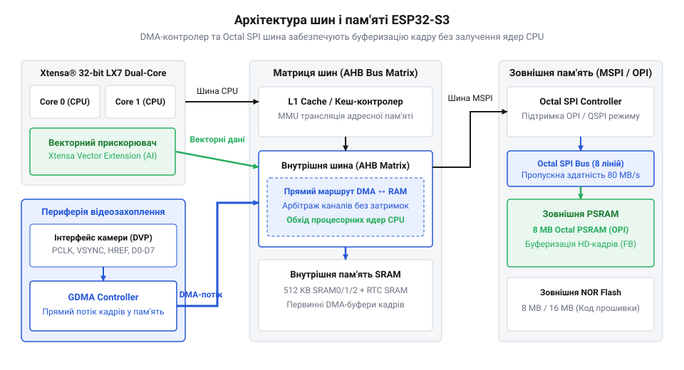
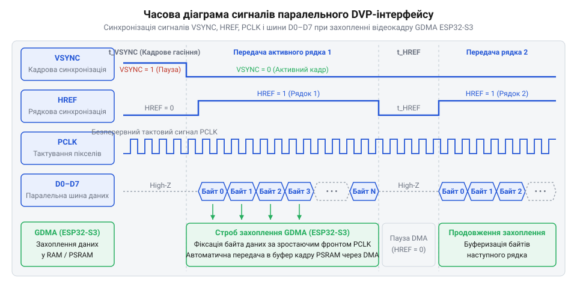
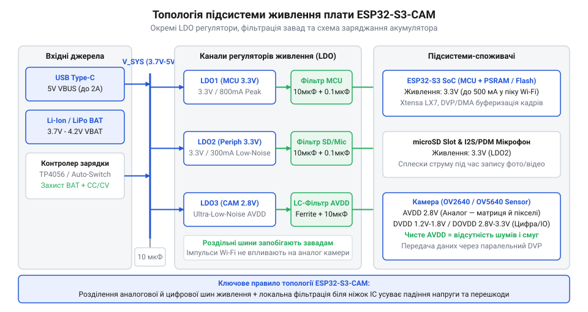

# Плати відеозахоплення нового покоління на базі ESP32-S3

<preknowlist>
- [Мікроконтролер ESP32-S3](root:cat-hw-boards/esp32s3-microcontroller) — Базово розуміти двоядерну архітектуру Xtensa LX7, систему переривань та систему периферійних інтерфейсів контролера.
- [ESP32-CAM (OV2640 + microSD)](root:cat-hw-boards/esp32-cam) — Знати схемотехнічне облаштування та обмеження класичної плати першого покоління на ESP32-D0WD.
- [Схемотехніка та розпіновка шин Octal SPI Flash та PSRAM в ESP32-S3](root:cat-hw-boards/esp32-s3-octal-spi-bus-layout) — Орієнтуватися у принципах підключення 8-бітної шини пам'яті Octal SPI та розподілі GPIO для Quad/Octal режимів.
</preknowlist>

## Обмеження класичних плат ESP32-CAM

Спроба організувати неперервний стримінг відеопотоку або локальний аналіз зображень на базі [класичної плати ESP32-CAM](root:cat-hw-boards/esp32-cam) часто завершується просіданням частоти кадрів та зависанням системи. Головна причина полягає в апаратному вузькому місці підсистеми пам'яті: перше покоління мікроконтролерів працює з зовнішньою оперативною пам'яттю @@en|PSRAM@@ (англ. *Pseudo Static Random Access Memory* — псевдостатична оперативна пам'ять) через 4-бітну шину @@en|Quad SPI@@ (латин. *quattuor* — чотири). Її пропускна здатність на частоті 40 МГц не перевищує 20 МБ/с, чого недостатньо для стабільного передавання нестиснутих відеокадрів високої роздільної здатності.

Ситуацію ускладнюють схемотехнічні конфлікти ліній @@en|GPIO@@ (англ. *General Purpose Input/Output* — виводи загального призначення). На модулі @@en|ESP32-CAM@@ шина паралельного цифрового відеопорту камери @@en|DVP@@ (англ. *Digital Video Port* — цифровий відеопорт) та інтерфейс накопичувача @@en|microSD@@ ділять між собою однакові фізичні виводи. Одночасний запис кадрів на картку пам'яті та зчитування відеопотоку призводять до збоїв шини або змушують переводити накопичувач у повільний 1-бітний режим. Крім того, відсутність нативного @@en|USB@@ змушує використовувати зовнішній перетворювач інтерфейсів для прошивання, що ускладнює розробку та налагодження.

## Апаратна архітектура мікроконтролера ESP32-S3

Для подолання обчислювального бар'єра розроблено [мікроконтролер ESP32-S3](root:cat-hw-boards/esp32s3-microcontroller) на базі двоядерного процесора @@en|Xtensa LX7@@. Головною обчислювальною перевагою чипа є векторне розширення @@en|PIE@@ (англ. *Processor Instruction Extensions* — розширення інструкцій процесора). Векторні інструкції дають змогу паралельно обробляти 8-бітні та 16-бітні масиви даних, прискорюючи первинну обробку пікселів, нормалізацію масивів та виправлення кольору без перевантаження основних ядер.

*Зв'язок процесорних ядер Xtensa LX7, векторного блока PIE та шини Octal SPI PSRAM.*

Вирішальним кроком у мультимедійній продуктивності стала [підтримка шини Octal SPI](root:cat-hw-boards/esp32-s3-octal-spi-bus-layout). Використання 8-бітної шини для зовнішньої пам'яті @@en|PSRAM@@ у режимі @@en|DDR@@ (англ. *Double Data Rate* — подвійна швидкість передачі даних) піднімає пропускну здатність шини до 160 МБ/с. Це забезпечує буферизацію нестиснутого відео у форматах @@en|RGB565@@ або @@en|YUV422@@ реального часу. Нативний контролер @@en|USB CDC/JTAG@@ доповнює архітектуру, забезпечуючи пряме прошивання й налагодження через один кабель.

## Принцип функціонування DVP-інтерфейсу та EDMA

Прийом відеопотоку від сенсора камери відбувається через паралельний інтерфейс @@en|DVP@@. Передавання кожного байта піксельних даних по шині @@en|D0-D7@@ синхронізується тактовим імпульсом @@en|PCLK@@ (англ. *Pixel Clock* — тактовий сигнал пікселів). Сигнал @@en|HREF@@ (англ. *Horizontal Reference* — горизонтальна опорна мітка) визначає тривалість активного рядка кадру, а сигнал @@en|VSYNC@@ (англ. *Vertical Synchronization* — вертикальна синхронізація) сповіщає про початок та завершення нового кадру. Конфігурація режимів сенсора виконується окремою послідовною шиною @@en|SCCB@@ (англ. *Serial Camera Control Bus* — послідовна шина керування камерою).

*Часові співвідношення сигналів синхронізації паралельного інтерфейсу камери DVP.*

Для вивантаження процесорних ядер захоплення даних виконує периферійний контролер @@en|GDMA@@ (англ. *General Direct Memory Access* — загальний прямий доступ до пам'яті). Він перехоплює байти з шини @@en|DVP@@ та автоматично записує їх у буфер оперативної пам'яті за принципом @@en|Zero-Copy@@ (англ. *zero copy* — нульове копіювання). Використання двобуферної схеми @@en|Ping-Pong@@ дозволяє @@en|EDMA@@ заповнювати один буфер, поки процесор опрацьовує попередньо збережений кадр з другого буфера, виключаючи затримки й втрату кадрів.

## Топологія плат та схемотехніка живлення

Оцінка [родини плат ESP32-S3](root:cat-hw-boards/esp32-s3-boards-family-overview) показує різний підхід до компонування периферії. Повнорозмірні плати @@en|ESP32-S3-CAM@@ виводять максимальну кількість ліній @@en|GPIO@@ для підключення камери й сенсорів. Модуль @@en|Seeed XIAO ESP32S3 Sense@@ орієнтований на ультракомпактність: він містить цифровий мікрофон та знімну плату розширення з @@en|microSD@@. Модулі @@en|Freenove@@ пропонують розширене розведення із вбудованим адресованим світлодіодом. Усі ці плати об'єднує грамотне розведення виводів, де шина камери не перетинається з лініями картки пам'яті чи аудіоінтерфейсу.

*Схема підключення окремих LDO-регуляторів для аналогового та цифрового доменів камери.*

Критичним вузлом стабільності є підсистема живлення. Сенсор камери створює короткочасні імпульсні кидки струму під час старт-кадрів. Щоб уникнути перезавантаження мікроконтролера через @@en|Brownout Reset@@ (англ. *brownout* — просідання живлення) та позбутися шуму на зображенні, схемотехніка відокремлює цифрове живлення @@en|DVDD@@ від аналогового домену @@en|AVDD@@. Використання окремих регуляторів @@en|LDO@@ (англ. *Low Dropout* — регулятор напруги з малим падінням) та згладжувальних конденсаторів гарантує стабільну роботу сенсора й чистий відеосигнал.