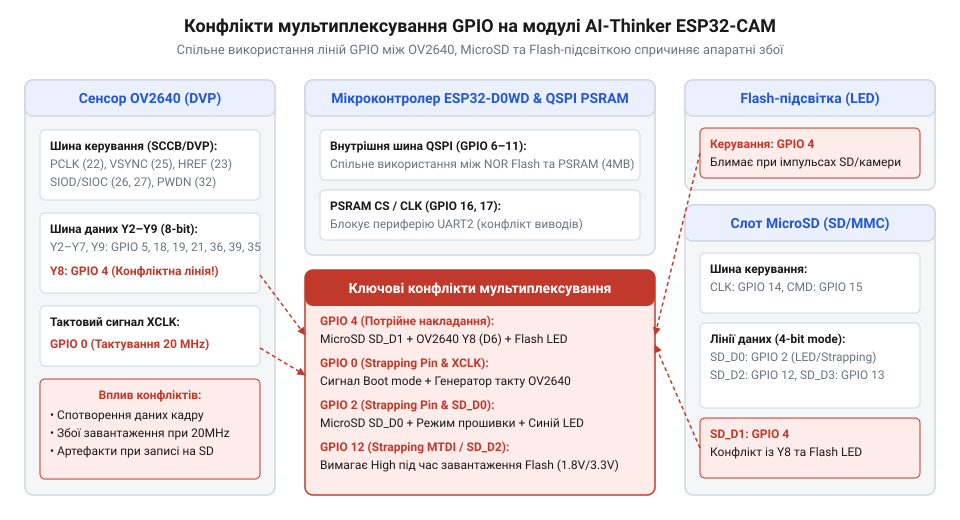
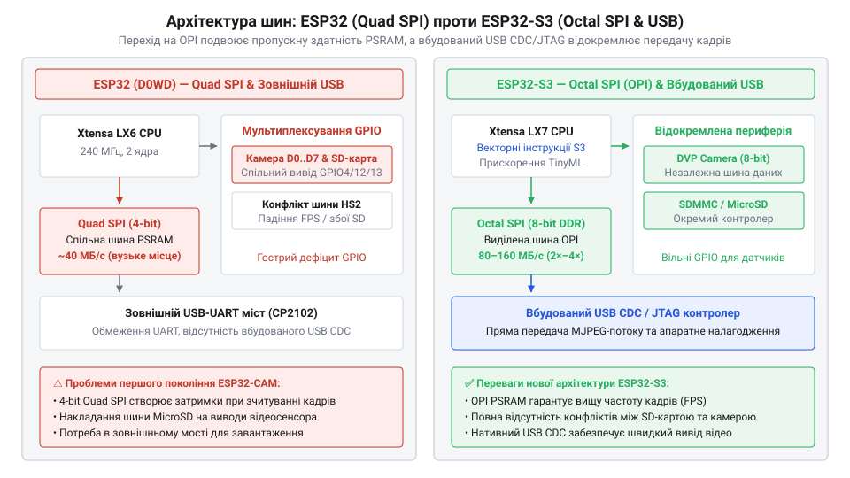

# Еволюція плат відеозахоплення від ESP32-CAM до ESP32-S3

<preknowlist>
- [ESP32-CAM (OV2640 + microSD)](root:cat-hw-boards/esp32-cam) — базове схемотехнічне компонування плати та принцип підключення сенсора OV2640
- [Мікроконтролер ESP32-S3](root:cat-hw-boards/esp32s3-microcontroller) — обчислювальні можливості двоядерного чипа S3 та наявність векторних розширень
- [Схемотехніка та розпіновка шин Octal SPI Flash та PSRAM в ESP32-S3](root:cat-hw-boards/esp32-s3-octal-spi-bus-layout) — принцип організації 8-бітної шини OPI для прискорення доступу до PSRAM
</preknowlist>

## Криза відеозахоплення першого покоління ESP32-CAM

Розробка автономних бездротових відеокамер та систем комп'ютерного зору на базі мікроконтролерів тривалий час впиралася у високу вартість апаратних платформ. Справжнім технологічним проривом став випуск модуля AI-Thinker [ESP32-CAM](root:cat-hw-boards/esp32-cam), який поєднав на компактній друкованій платі двоядерний чип ESP32-D0WD, сенсор зображення OV2640 та слот для карт пам'яті microSD. Поява пристрою ціною в кілька доларів спричинила бум у робототехніці та системній інтеграції, однак перші ж спроби розгортання надійних промислових рішень викрили глибоку апаратну кризу схемотехнічного компонування першого покоління.

Причина кризи полягала у нездоланному дефіциті вільних периферійних виводів. Загальний [огляд сімейства ESP32-CAM](root:cat-hw-boards/esp32-cam-camera-module-family) свідчить, що чип ESP32 у корпусі QFN48 має 34 фізичні лінії вводу-виводу general-purpose input/output (@@en|GPIO@@). Тільки для підключення CMOS-сенсора зображення OV2640 через паралельний інтерфейс Digital Video Port (@@en|DVP@@) потрібно 15 цифрових ліній. Шина DVP містить вісім паралельних ліній даних `Y2`–`Y9` (підключених до `GPIO5`, `GPIO18`, `GPIO19`, `GPIO21`, `GPIO36`, `GPIO39`, `GPIO34`, `GPIO35`), тактовий сигнал пікселів `PCLK` (`GPIO22`), лінії кадрової та рядкової синхронізації `VSYNC` (`GPIO25`) та `HREF` (`GPIO23`), опорну тактову частоту `XCLK` (`GPIO0`), а також двопровідний інтерфейс керування Serial Camera Control Bus (@@en|SCCB@@) на базі I2C — `SIOC` (`GPIO27`) та `SIOD` (`GPIO26`). Для детального вивчення часових діаграм, принципів організації та виводу сигналів камери дивіться матеріал про [паралельний інтерфейс DVP у мікроконтролерах ESP32](root:com-devices/dvp-parallel-video-interface).

Додатково шість ліній (`GPIO6`–`GPIO11`) жорстко задіяні внутрішньою шиною Quad Serial Peripheral Interface (@@en|QSPI@@) для зв'язку процесора з мікросхемами зовнішньої Flash-пам'яті та псевдостатичного оперативного запам'ятівача Pseudo Static RAM (@@en|PSRAM@@). У результаті для підключення решти периферії залишилася крихітна кількість фізичних ніжок. Щоб додати на плату слот microSD-карти та яскравий світлодіод підсвічування, інженери AI-Thinker застосували агресивне мультиплексування (від латинського @@la|multiplex@@ — складений), приєднавши декілька функціональних вузлів до одних і тих самих ліній.

*Розводка периферійних ліній модуля AI-Thinker ESP32-CAM з позначенням перетинів GPIO між DVP-камерою, microSD, Flash-світлодіодом та QSPI PSRAM.*

Це схемотехнічне рішення створило жорстку матрицю апаратних конфліктів. Лінія `GPIO0`, яка подає опорну частоту `XCLK` 20 МГц на камеру, одночасно є апаратним виводом конфігурації завантаження (@@en|strapping pin@@). Якщо під час увімкнення живлення `GPIO0` притягнутий до землі, мікроконтролер переходить у режим завантаження прошивки через UART, а якщо підтягнутий до високого рівня — запускає програму з Flash. Наявність тактового кола камери на `GPIO0` постійно призводила до збоїв старту системи або неможливості прошити плату без фізичного від'єднання камери чи натискання комбінацій кнопок.

Ще критичнішим виявився конфлікт шини Secure Digital Input Output (@@en|SDIO@@) microSD-карти. У 4-бітному режимі SDMMC лінія `DAT0` прив'язана до `GPIO2` (який також є виводом конфігурації завантаження та синім системним світлодіодом), `DAT2` — до `GPIO12` (визначення напруги живлення Flash 1.8V/3.3V при завантаженні), `CMD` — до `GPIO15`, а лінія `DAT1` підключена до `GPIO4`. На цьому ж виводі `GPIO4` розводчики розмістили силовий транзистор потужного білого світлодіода-спалаху. У результаті кожен крок читання чи запису сектора на microSD-карту змушував світлодіод спалахувати на повну яскравість або створював сильні паразитні наведення на шині даних камери, роблячи одночасний стримінг відео та збереження кадрів на карту пам'яті фізично нестабільним.

## Схемотехнічні пастки та міфи першого покоління

Масовий досвід експлуатації плат ESP32-CAM породив популярний міф серед розробників про те, що перше покоління чипів ESP32 має «занадто слабкі обчислювальні ядра» і нібито саме дефіцит тактової частоти двоядерного 32-бітного процесора Xtensa LX6 (240 МГц) є головною причиною низького фреймрейту та пропущених кадрів. Однак глибокий аналіз показує, що обчислювальна потужність ядра була цілком достатньою для обробки кадрових буферів MJPEG, а справжнім апаратним вузьким місцем виявилися низька пропускна здатність шини пам'яті, системні просідання живлення та відсутність апаратного інтерфейсу USB.

Ключовим обмежувальником продуктивності стала архітектура доступу до зовнішньої пам'яті PSRAM обсягом 4 МБ. Для збереження неопрацьованого кадру зображення роздільною здатністю SVGA (800×600 пікселів) у формі RGB565 або задіяння подвійної буферизації internal SRAM мікроконтролера (яка має лише близько 328 КБ вільного простору) категорично недостатньо. Кадрові буфери змушено виділялися у зовнішній PSRAM. Проте обмін даними між ядром ESP32 та PSRAM відбувається через 4-бітну шину Quad SPI на частоті 80 МГц.

Теоретична межа шини QSPI становить 40 МБ/с, але через накладні витрати протоколу SPI, промахи кеш-пам'яті та арбітраж (від латинського @@la|arbitrium@@ — рішення арбітра) між процесором і контролером прямого доступу до пам'яті Direct Memory Access (@@en|DMA@@) реальна пропускна здатність не перевищувала 15–20 МБ/с. Коли DMA-контролер камери OV2640 записував прибулі пікселі з шини DVP у PSRAM, а мережевий стек Wi-Fi паралельно зчитував попередній кадр для передачі через HTTP-сервер, шина QSPI повністю насичувалася. Процесорні ядра зупинялися в очікуванні вибірки інструкцій та даних з кешу (@@en|cache miss stalls@@), що викликало випадання кадрів (@@en|frame drop@@) та пошкодження заголовків JPEG-потоку. Докладніший аналіз швидкодії та порівняння шин зовнішньої пам'яті наведено у статті про [пропускну здатність та арбітраж шин PSRAM у чипах ESP32](root:hw-arch/esp32-psram-bandwidth-bottlenecks).

Другою прихованою пасткою схемотехніки стало живлення. Під час пікових передач пакетах Wi-Fi передавач ESP32 споживає імпульсний струм до 240–300 мА. У поєднанні із постійним споживанням сенсора OV2640 (близько 140 мВт) та увімкненим спалахом на `GPIO4` навантаження на первинне джерело живлення різко зростає. Більшість дешевих модулів ESP32-CAM оснащувалися лінійними стабілізаторами напруги LDO на кшталт AMS1117-3.3 з високою напругою падіння. Під час сплесків струму напруга 3.3 В просідала нижче порога 2.8 В, викликаючи спрацьовування апаратного детектора просідання живлення @@en|brownout detector@@ (`RTC_CNTL_BROWN_OUT_REG`) та раптове перезавантаження мікроконтролера прямо посеред трансляції.

Ситуацію ускладнювала відсутність вбудованого контролера USB. На відміну від сучасних плат, де використовується [мікроконтролер ESP32-S3](root:cat-hw-boards/esp32s3-microcontroller), перше покоління не мало апаратної підтримки USB CDC/JTAG. Прошивка та вивід налагоджувальної інформації здійснювалися через зовнішній перехідник USB-UART (CP2102 або CH340), підключений до ніжок `TX0`/`RX0` (`GPIO1`/`GPIO3`). Через це розробники не мали можливості передавати сирий неспрямований відеопотік через швидкісний USB-канал для локального аналізу й були змушені спиратися на повільний послідовний порт або нестабільне бездротове з'єднання.

Насамкінець, архітектура Xtensa LX6 не мала векторних інструкцій Single Instruction Multiple Data (@@en|SIMD@@) та спеціалізованих прискорювачів для задач штучного інтелекту. Виконання навіть найпростіших нейромережевих моделей розпізнавання облич із бібліотеки ESP-WHO вимагало скалярних обчислень із плаваючою комою, що займало сотні мілісекунд на кадр. Сукупність цих обмежень — вузьке місце QSPI, конфлікти GPIO, просідання живлення та відсутність USB — остаточно сформувала потребу у принципово новій архітектурі плат відеозахоплення.

## Архітектурний прорив із появою чипа ESP32-S3

Накопичений досвід експлуатації першого покоління плат виявив системні апаратні обмеження, які неможливо було усунути лише програмними оптимізаціями. Вихід на ринок кремнієвої платформи, де встановлено новий [мікроконтролер ESP32-S3](root:cat-hw-boards/esp32s3-microcontroller), ознаменував докорінний перегляд архітектури шин пам'яті, периферійних інтерфейсів та обчислювального ядра. Інженери компанії @@en|Espressif Systems@@ спроектували чип із урахуванням вимог вбудованого комп'ютерного зору, усунувши вузькі місця шинного арбітражу, відсутності USB та обмежень скалярних обчислень.

Головним рішенням проблеми низької пропускної здатності став перехід від 4-бітної шини Quad SPI (@@en|QSPI@@) до 8-бітної шини Octal SPI (від англійського @@en|octal@@ — восьмеричний, скорочено @@en|OPI@@). Фізичне подвоєння розрядності шини даних разом із підтримкою режиму передачі за обома фронтами тактового сигналу Dual Data Rate (@@en|DDR@@) збільшило теоретичну межу обміну з зовнішньою пам'яттю @@en|PSRAM@@ до 80–160 МБ/с. Детальна [розпіновка шин Octal SPI](root:cat-hw-boards/esp32-s3-octal-spi-bus-layout) показує, що 8-бітна шина потребує 10–11 ліній зв'язку, проте забезпечує необхідний запас швидкодії. Для глибокого вивчення схемотехніки та сигнального арбітражу 8-бітної шини перегляньте статтю про [архітектуру та схемотехніку 8-бітної шини Octal SPI у мікроконтролерах ESP32-S3](root:hw-arch/esp32-octal-spi-psram-architecture).

Завдяки цьому прямий доступ до пам'яті Direct Memory Access (@@en|DMA@@) під час запису кадрів із камери більше не блокує процесорні ядра. Вбудована кеш-пам'ять здатна паралельно вибирати інструкції та дані без затримок (@@en|cache miss stalls@@), що дозволило наростити швидкість потокової передачі відео роздільною здатністю SVGA та UXGA з 5–10 кадрів за секунду до стабільних 25–30 кадрів за секунду без випадання кадрів (@@en|frame drop@@).

*Порівняльна структурна схема шинного арбітражу між Quad SPI у першому ESP32 та Octal SPI (OPI) в ESP32-S3 разом із вбудованим USB CDC/JTAG.*

Другим принциповим кроком стала інтеграція апаратного контролера @@en|USB CDC/JTAG@@ безпосередньо у кристалик мікроконтролера. Виводи `GPIO19` (`D-`) та `GPIO20` (`D+`) отримали нативну підтримку протоколу USB Full-Speed (12 Мбіт/с). Це повністю звільнило розробників від потреби встановлювати зовнішні мікросхеми конвертерів USB-UART на кшталт @@en|CP2102@@ чи @@en|CH340@@.

Вбудований контролер дозволяє виконувати апаратне налагодження через JTAG без додаткових програматорів, забезпечує автоматичний скид та перехід у режим прошивки без маніпуляцій із виводами завантаження. Параметри завантаження контролює апаратне [налаштування eFuse](root:cat-hw-boards/esp32-s3-efuse-and-boot-configuration), а висока швидкість нативного USB відкрила можливість прямої передачі неспрямованого відеопотоку на комп'ютер за стандартом USB Video Class (@@en|UVC@@). Докладніші відомості про налаштування режимів прошивки, JTAG-апаратури та UVC-трансляції описано в матеріалі про [інтегрований контролер USB CDC/JTAG в ESP32-S3 та передачу відео UVC](root:hw-arch/esp32-s3-native-usb-cdc-jtag).

Третім елементом прориву стало оновлення обчислювального ядра до архітектури @@en|Xtensa LX7@@ із двома 32-бітними ядрами на частоті 240 МГц та впровадженням векторних розширень (від латинського @@la|vector@@ — носій). Векторні інструкції Single Instruction Multiple Data (@@en|SIMD@@) додали 128-бітні векторні регістри та апаратні прискорювачі точкового добутку та матричного множення для 8-бітних та 16-бітних цілих чисел.

Завдяки векторним розширенням спеціалізовані бібліотеки @@en|ESP-NN@@ та @@en|ESP-WHO@@ отримали трикратне–десятикратне прискорення виконання математичних операцій нейронних мереж. Це перетворило ESP32-S3 на повноцінну платформу для завдань граничного штучного інтелекту (@@en|TinyML@@), здатної локально виконувати детект облич, розпізнавання жестів та класифікацію об'єктів у реальному часі.

## Конструкція та схемотехніка сучасних S3-плат

Архітектурні можливості чипа ESP32-S3 дали поштовх до створення нового покоління готових модулів та розширювальних плат. Загальний огляд пропонує розмаїта [родина плат ESP32-S3](root:cat-hw-boards/esp32-s3-boards-family-overview), до якої входять як універсальні [модулі WROOM-1](root:cat-hw-boards/esp32-s3-wroom-modules-family) (@@en|WROOM-1@@), так і надкомпактні [SiP-модулі](root:cat-hw-boards/esp32-s3-mini-sip-modules) (@@en|SiP@@). Виробники плат задіяли розширений корпус ESP32-S3 із 45 виводами @@en|GPIO@@, що дозволило кардинально переглянути розводку друкованих плат та остаточно усунути конфлікти периферії, притаманні пристроям [перше покоління ESP32-CAM](root:cat-hw-boards/esp32-cam).

Головним схемотехнічним досягненням сучасних плат стало повне відокремлення шини камери Digital Video Port (@@en|DVP@@) від інших периферійних вузлів. Навіть із урахуванням того, що 8-бітна шина Octal SPI PSRAM займає 10 ліній вводу-виводу, великий запас вільних ніжок дозволив розвести лінії даних `Y2`–`Y9`, тактові сигнали `PCLK`, `XCLK`, `VSYNC` та `HREF` на окремі виводи. Слот карт пам'яті microSD тепер підключається через виділену шину SDMMC або SPI без мультиплексування із лініями спалаху чи системних світлодіодів.

Це ліквідувало взаємні завади між записом на карту пам'яті та трансляцією відео. Крім того, лінії завантаження (@@en|strapping pins@@) більше не перетинаються з опорною частотою камери `XCLK`, що забезпечує 100% надійність старту пристрою після подачі живлення.

Інженерна думка також матеріалізувалася у формі двошарових сенсорних плат та модульних конструкцій. Популярні плати, такі як @@en|Seeed Studio@@ @@en|XIAO ESP32S3 Sense@@ або модулі від @@en|Freenove@@, відмовилися від розміщення всіх компонент componentів на одній площині. Замість цього вони застосовують двокомпонентну компоновку: базова плата містить мікроконтролер, @@en|Flash@@/PSRAM пам'ять та USB-роз'єм, а верхня дочірня плата (від англійського @@en|daughterboard@@ — дочірня плата) несе сенсор камери OV2640 або OV5640 та цифровий мікрофон. З'єднання між платами здійснюється через високощільний міжплатний роз'єм Board-to-Board (@@en|B2B connector@@).

Таке конструктивне рішення забезпечує фізичну та електромагнітну розв'язку. Чутливі аналогові та цифрові лінії камери й мікрофона віддалені від високочастотних шин Octal SPI, імпульсних перетворювачів живлення та антенного тракту Wi-Fi/Bluetooth, що значно знижує рівень високочастотних завад на зображенні.

Важливим доповненням сучасних плат відеозахоплення стала масова інтеграція цифрових мікрофонів стандарту Pulse Density Modulation (@@en|PDM@@) або @@en|I2S@@. Використання мікрофонів @@en|MEMS@@ на дочірній платі дозволяє будувати мультимодальні системи штучного інтелекту, де один компактний вузол одночасно обробляє відеопотік та розпізнає голосові команди чи акустичні події.

Суттєвих змін зазнала і система живлення. Замість застарілих лінійних стабілізаторів @@en|AMS1117@@ із високим падінням напруги, сучасні плати оснащуються високоефективними імпульсними понижувальними перетворювачами (@@en|buck converters@@) або сучасними @@en|LDO@@ із низьким струмом спокою та піковим струмом до 500–1000 мА. Це остаточно розв'язало проблему просідання напруги 3.3 В та усунуло помилкові спрацьовування апаратного захисту @@en|brownout detector@@ під час сплесків споживання передавача Wi-Fi.

Для надкомпактних розробок розробники можуть обирати [плати SuperMini](root:cat-hw-boards/esp32-s3-zero-supermini-boards) (@@en|SuperMini@@), мініатюрну [плату ESP32-S3-Zero](root:cat-hw-boards/esp32-s3-zero) (@@en|ESP32-S3-Zero@@) або [модуль Waveshare ESP32-S3R2](root:cat-hw-boards/esp32-s3r2-waveshare) (@@en|Waveshare ESP32-S3R2@@) із 2 МБ вбудованої PSRAM. Точний вибір конфігурації платформи тепер визначається конкретними вимогами проєкту: від найпростіших локальних сенсорів до складних автономних систем комп'ютерного зору із мережевою потоковою трансляцією.