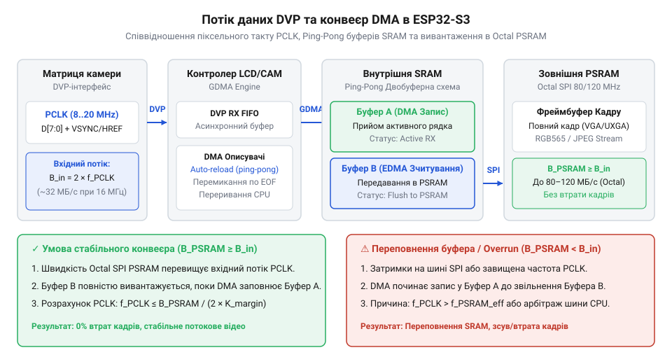
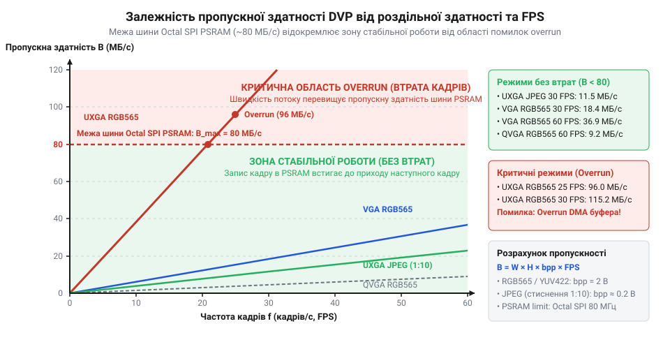

# Розрахунок пропускної здатності та буферів пам'яті для DVP-відеопотоку

<preknowlist>
- [Мікроконтролер ESP32-S3](root:cat-hw-boards/esp32s3-microcontroller) — Архітектура двоядерного процесора Xtensa LX7, розподіл внутрішньої пам'яті SRAM та принципи роботи периферійного контролера DMA.
- [Схемотехніка та розпіновка шин Octal SPI Flash та PSRAM в ESP32-S3](root:cat-hw-boards/esp32-s3-octal-spi-bus-layout) — Організація шини Octal SPI, швидкодія зовнішньої PSRAM та фізичні обмеження швидкості передачі даних по спільному інтерфейсу.
- [Модуль ESP32-CAM: огляд архітектури, периферії та сімейства плат](root:cat-hw-boards/esp32-cam-camera-module-family) — Принципи підключення сенсорів камери через паралельний DVP-інтерфейс та призначення сигналів піксельного годинника і синхронізації.
</preknowlist>

## Проблема переповнення буферів DVP-відеопотоку

Спроба захопити відеопотік високої роздільної здатності з камери часто завершується випаданням кадрів або спотворенням зображення. Розробник налаштовує сенсор і виділяє пам'ять, але отримує помилки апаратного переповнення. Порт камери не є запитально-відповідною шиною й не чекає на готовність процесора.

Паралельний відеоінтерфейс @@en|DVP@@ (англ. Digital Video Port, від digital — цифровий, video — відео та port — порт) передає відеодані як безперервний потік. Тактовий генератор пікселів @@en|PCLK@@ (англ. Pixel Clock, від pixel — елемент зображення та clock — тактовий генератор) формує послідовність імпульсів, виставляючи за кожним тактом новий байт на восьми лініях даних. Лінії синхронізації @@en|VSYNC@@ та @@en|HREF@@ позначають межі кадру й рядка, але не зупиняють потік. Якщо периферія не встигає зберегти байт до наступного такту PCLK, новий байт перезаписує попередній.

Усередині мікроконтролера (див. [мікроконтролер ESP32-S3](root:cat-hw-boards/esp32s3-microcontroller)) прийом DVP-відеопотоку виконує контролер LCD/CAM у зв'язці з модулем @@en|DMA@@ (англ. Direct Memory Access, від direct — прямий, memory — пам'ять та access — доступ). DMA записує дані в оперативну пам'ять за кільцевою структурою: кожен @@en|DMA-описувач@@ (англ. DMA descriptor) містить адресу внутрішнього буфера та посилання на наступний елемент.

Заповнивши буфер, DMA ґенерує переривання й переключається на наступний (режим @@en|ping-pong@@ буферизації), поки програма вивантажує дані. Проте обсяг швидкої внутрішньої пам'яті @@en|SRAM@@ (англ. Static Random-Access Memory, від static — статичний, random-access — з довільним доступом та memory — пам'ять) в ESP32-S3 обмежений. Кадри високої роздільної здатності зберігають у зовнішній @@en|PSRAM@@ (англ. Pseudo-Static RAM, від pseudo — несправжній, static — статичний та RAM — пам'ять довільного доступу) через шину @@en|Octal SPI@@ (див. [схемотехніка та розпіновка](root:cat-hw-boards/esp32-s3-octal-spi-bus-layout) зовнішньої пам'яті).

Апаратна пастка полягає у різниці пропускної здатності та затримок між SRAM і PSRAM. Якщо DMA записує безпосередньо у зовнішню PSRAM або процесор затримує вивантаження буферів через шинну конкуренцію (зчитування з Flash чи затримки кешу), кільцевий список DMA-описувачів вичерпується.

*Схема потоку даних паралельного DVP-інтерфейсу від матриці камери через PCLK та DMA-описувачі у внутрішню SRAM і зовнішню Octal SPI PSRAM.*

Апаратне переповнення @@en|overrun@@ (англ. overrun, від over — понад та run — бігти) виникає, коли FIFO-буфер камери заповнено, а вільного DMA-описувача немає — периферія скидає байти й втрачає кадри. Спустошення буфера @@en|underrun@@ (англ. underrun, від under — під та run — бігти) спостерігається, коли алгоритм зчитує кадр раніше, ніж DMA завершить запис.

Отже, виділення пам'яті без урахування навантаження на шини призводить до нестабільності. Як під час роботи з [модулем ESP32-CAM](root:cat-hw-boards/esp32-cam-camera-module-family), так і на платах ESP32-S3 належне керування відеопотоком вимагає побудови цілісної математичної моделі ще до налаштування драйвера.

## Обчислення обсягу непригніченого фреймбуфера

Без попереднього розрахунку пам'яті відеопотік може переповнити оперативну пам'ять мікроконтролера ще до обробки першого кадру. Обсяг непригніченого @@en|фреймбуфера@@ (англ. frame buffer, від frame — кадр та buffer — проміжне сховище) визначається геометричною роздільною здатністю кадру та колірним форматом представлення пікселів.

Ширина кадру `W` та висота `H` задають загальну кількість пікселів `N_{pixel}` у кадровій матриці:

N_{pixel} = W × H

Колірний формат кодування визначає обсяг пам'яті на один піксель `B_{pixel}` у байтах:

1. @@en|Grayscale@@ (градації сірого): 1 байт (`B_{pixel} = 1`), що кодує 256 рівнів яскравості. 2. @@en|RGB565@@ (колірна модель Red-Green-Blue): 2 байти (`B_{pixel} = 2`), з яких 5 біт відведено на червоний канал, 6 біт на зелений та 5 біт на синій. 3. @@en|YUV422@@ (модель яскравість-хроматичність): у середньому 2 байти (`B_{pixel} = 2`), де пара пікселів описується чотирма байтами (два байти яскравості Y та по байту сигналів U і V).

Підсумковий розмір непригніченого фреймбуфера `V_{raw}` у байтах обчислюють за формулою:

V_{raw} = W × H × B_{pixel}

**Умова:** Розрахунок обсягу непригніченого фреймбуфера для стандарту QVGA (320 × 240 пікселів) у форматі RGB565.

V_{raw} = W × H × B_{pixel}
        = 320 × 240 × 2        [підстановка параметрів QVGA та 2 байт на піксель]
        = 153600               [значення обсягу фреймбуфера у байтах]
V_{KiB} = 153600 ÷ 1024        [переведення обсягу в кібібайти]
        = 150                  [необхідний обсяг пам'яті в KiB]

Отримане значення 150 KiB відповідає розміру одного кадру QVGA RGB565. Для подвійної буферизації захоплення потреба в пам'яті подвоюється до 300 KiB.

**Умова:** Розрахунок обсягу непригніченого кадру стандарту VGA (640 × 480 пікселів) у форматі RGB565.

V_{raw} = 640 × 480 × 2        [підстановка параметрів VGA та 2 байт на піксель]
        = 614400               [розмір фреймбуфера у байтах]
V_{KiB} = 614400 ÷ 1024        [переведення обсягу в кібібайти]
        = 600                  [необхідний обсяг пам'яті в KiB]

Кадр VGA RGB565 вимагає 600 KiB, тоді як у форматі Grayscale цей обсяг зменшується вдвічі до 300 KiB.

**Умова:** Розрахунок обсягу кадру високої роздільної здатності UXGA (1600 × 1200 пікселів) у форматі YUV422.

V_{raw} = 1600 × 1200 × 2      [підстановка параметрів UXGA та 2 байт на піксель]
        = 3840000              [розмір фреймбуфера у байтах]
V_{MiB} = 3840000 ÷ 1048576    [переведення обсягу в мебібайти]
        ≈ 3.6621               [підсумковий розмір кадру в MiB]

Загальний обсяг внутрішньої SRAM мікроконтролера ESP32-S3 становить 512 KiB. Після виділення буферів операційної системи @@en|FreeRTOS@@, стеку Wi-Fi та задач користувача неперервний блок SRAM під DMA-буфери камери становить не більше 250–300 KiB.

Тому у внутрішній SRAM може розміститися лише один кадр QVGA RGB565 (150 KiB) або VGA Grayscale (300 KiB). Спроба виділити непригнічений фреймбуфер VGA RGB565 (600 KiB) чи UXGA (3.66 MiB) у внутрішній пам'яті призводить до помилки дефіциту пам'яті при ініціалізації.

Для роздільної здатності VGA і вище у форматах RGB565/YUV422 необхідна зовнішня PSRAM. [Плати ESP32-S3 SuperMini](root:cat-hw-boards/esp32-s3-supermini) без PSRAM обмежені низькою роздільною здатністю (QVGA) або стиснутим потоком, тоді як [модулі ESP32-S3-MINI-1](root:cat-hw-boards/esp32-s3-mini-sip-modules) з інтегрованою PSRAM дозволяють зберігати непригнічені кадри високої роздільної здатності.

## Врахування коефіцієнтів стиснення JPEG-кадрів

Непригнічені фреймбуфери високої роздільної здатності занадто великі для внутрішньої SRAM, а постійний транзит сирого потоку виснажує пропускну здатність шини Octal SPI зовнішньої PSRAM. Для розвантаження пам'яті сенсори на кшталт OV2640 на [класичній платі ESP32-CAM](root:cat-hw-boards/esp32-cam) виконують апаратне стиснення YUV-потоку у формат @@en|JPEG@@ (англ. Joint Photographic Experts Group, об'єднана група експертів з фотографії).

На відміну від нестиснутого кадру з фіксованим обсягом `V_{raw}`, розмір стиснутого кадру `V_{jpeg}` динамічно змінюється залежно від деталізації сцени та налаштованого рівня якості `Q_{jpeg}`. Співвідношення між цими обсягами визначає коефіцієнт стиснення `k_{comp}`.

Обсяг стиснутого кадру `V_{jpeg}` обчислюють через обсяг нестиснутого кадру `V_{raw}` (добуток ширини `W`, висоти `H` та глибини пікселя `B_{pixel}`) і коефіцієнт стиснення `k_{comp}`:

V_{jpeg} = V_{raw} ÷ k_{comp}
         = (W × H × B_{pixel}) ÷ k_{comp}

Вираз показує, що вищий коефіцієнт `k_{comp}` пропорційно зменшує розмір кадру в пам'яті.

Оскільки складна або зашумлена сцена стискається гірше, розраховувати буфер за середнім значенням `k_{comp, avg}` не можна — це призведе до переповнення пам'яті під час сплеску деталізації. Для обчислення безпечного розміру кадрового буфера `V_{buf, jpeg}` беруть найгірший коефіцієнт стиснення `k_{comp, worst}` та коефіцієнт запасу `k_{safe}` (зазвичай 1.2–1.3 для резерву на оптичний шум).

Необхідний обсяг буфера `V_{buf, jpeg}` обчислюють шляхом множення найгіршого розміру кадру на коефіцієнт запасу:

V_{buf, jpeg} = (V_{raw} ÷ k_{comp, worst}) × k_{safe}

Отримане значення гарантує збереження кадру навіть за максимальної деталізації зображення.

**Умова:** Захоплення відеопотоку UXGA (1600 × 1200 пікселів) у форматі JPEG із середньою якістю (`Q_{jpeg} = 12`), де найгірший коефіцієнт стиснення `k_{comp, worst} = 5`, а коефіцієнт запасу `k_{safe} = 1.3`.

V_{raw} = W × H × B_{pixel}
        = 1600 × 1200 × 2         [непригнічений розмір YUV422 у байтах]
        = 3840000                 [значення непригніченого обсягу 3.66 MiB]
V_{jpeg, worst} = V_{raw} ÷ k_{comp, worst}
                = 3840000 ÷ 5     [обчислення найгіршого розміру JPEG-кадру]
                = 768000          [розмір найгіршого кадру в байтах]
V_{buf, jpeg} = V_{jpeg, worst} × k_{safe}
              = 768000 × 1.3      [урахування 30% коефіцієнта запасу]
              = 998400            [підсумковий розмір буфера кадру у байтах]
V_{KiB} = 998400 ÷ 1024           [переведення у кібібайти]
        = 975                     [необхідний резерв пам'яті в KiB]

Для збереження одного JPEG-кадру UXGA потрібно 975 KiB пам'яті, що у 3.84 раза менше за непригнічений варіант.

Для передачі JPEG-кадрів змінної довжини контролер DMA зчитує потік у кільцевий буфер SRAM (наприклад, 32 KiB), звідки переривання послідовно копіює блоки у динамічний буфер PSRAM. Така двопакетна черга дозволяє [платам Waveshare ESP32-S3-Pico](root:cat-hw-boards/esp32-s3-pico) підтримувати високу частоту кадрів без переповнення внутрішньої пам'яті.

## Розрахунок частоти PCLK та пропускності DMA

Після визначення обсягів кадрових буферів наступним кроком є розрахунок часових параметрів передачі відеоданих через паралельний DVP-інтерфейс. Поширена помилка розробників полягає в припущенні, що швидкість надходження байтів визначається виключно множенням активних пікселів кадру на частоту кадрів. Насправді фізичний фотосенсор передає відеопотік із додатковими часовими затримками апаратної синхронізації.

Кожен кадр зображення містить не лише видиму матрицю пікселів, а й службові часові інтервали @@en|blanking interval@@ (англ. blanking interval, від blanking — затемнення та interval — інтервал). Ці інтервали виникли історично в електронно-променевих трупках, проте збереглися в сучасних CMOS-сенсорах для скидання накопичувальних регістрів рядків, обробки автоматичної експозиції та внутрішнього перемикання матриці:

1. Рядкове гасіння @@en|HBLANK@@ (англ. Horizontal Blanking, від horizontal — горизонтальний та blanking — затемнення): пауза після кожного зчитаного рядка. Загальна тривалість рядка в піксельних тактах `W_{total}` складається з активної ширини кадру `W` та тривалості гасіння `H_{blank}`: `W_{total} = W + H_{blank}`. 2. Кадрове гасіння @@en|VBLANK@@ (англ. Vertical Blanking, від vertical — вертикальний та blanking — затемнення): пауза між завершенням одного кадру та початком наступного. Загальна кількість рядків кадрового циклу `H_{total}` дорівнює сумі висоти кадру `H` та кадрового гасіння `V_{blank}`: `H_{total} = H + V_{blank}`.

Окрім геометрії з урахуванням гасіння, необхідно враховувати параметр кількості тактів на піксель @@en|clocks per pixel@@ (англ. clocks per pixel, від clock — тактовий імпульс та pixel — елемент зображення) `C_{pixel}`. Для 8-бітної паралельної шини DVP кожен байт передається за один тактовий імпульс сигналу `PCLK`. Оскільки колірні формати RGB565 та YUV422 потребують 2 байти на один піксель, сенсор формує два тактових імпульси `PCLK` на один піксель (`C_{pixel} = 2`). Для колірного формату Grayscale чи передачі стиснутого JPEG-потоку один байт відповідає одному такту (`C_{pixel} = 1`).

Знаючи геометричні параметри та частоту кадрів `FPS`, мінімальну частоту піксельного годинника `f_{PCLK}` обчислюють за формулою:

f_{PCLK} = (W + H_{blank}) × (H + V_{blank}) × FPS × C_{pixel}
         = W_{total} × H_{total} × FPS × C_{pixel}

Відповідно, необхідна пропускна здатність DMA-каналу @@en|DMA bandwidth@@ (англ. DMA bandwidth, від Direct Memory Access та bandwidth — ширина смуги) `B_{DMA}` у байтах за секунду для 8-бітної шини DVP дорівнює значенню частоти `f_{PCLK}` у герцах.

Нижче наведено покроковий розрахунок параметрів PCLK та DMA для відеопотоку VGA.

**Умова:** Необхідно розрахувати частоту `PCLK` та пропускну здатність DMA для відеопотоку VGA (640 × 480 пікселів) у форматі RGB565 із частотою 30 кадрів на секунду. Згідно з специфікацією сенсора, тривалість рядкового гасіння становить `H_{blank} = 160` тактів, кадрового гасіння — `V_{blank} = 45` рядків, а `C_{pixel} = 2`.

W_{total} = W + H_{blank}
          = 640 + 160             [обчислення загальної довжини рядка з гасінням]
          = 800                   [кількість піксельних тактів у одному рядку]
H_{total} = H + V_{blank}
          = 480 + 45              [обчислення загальної кількості рядків у кадрі]
          = 525                   [повна кількість рядків у кадровому циклі]
N_{clk}   = W_{total} × H_{total} × C_{pixel}
          = 800 × 525 × 2         [кількість імпульсів PCLK на один повний кадр]
          = 840000                [загальна кількість тактів PCLK на кадр]
f_{PCLK}  = N_{clk} × FPS
          = 840000 × 30           [множення тактів кадру на необхідну частоту FPS]
          = 25200000              [підсумкова частота піксельного годинника в Гц]
f_{MHz}   = 25200000 ÷ 1000000    [переведення значення у мегагерци]
          = 25.2                  [необхідна частота PCLK в MHz]

Обчислена частота 25.2 МГц означає, що периферійний DMA-контролер мікроконтролера повинен неперервно приймати потік даних зі швидкістю 25.2 МБ/с під час активних рядків.

Проте апаратні можливості периферійного контролера LCD/CAM у [мікроконтролері ESP32-S3](root:cat-hw-boards/esp32s3-microcontroller) мають рекомендовану верхню межу вхідної частоти `PCLK` на рівні 20 МГц для забезпечення стабільного захоплення без збоїв фази. Якщо подати сигнал `PCLK` частотою 25.2 МГц через нестабільно розведені провідники [модуля ESP32-CAM](root:cat-hw-boards/esp32-cam-camera-module-family), виникають апаратні зсуви засувки даних. Для адаптації системи розробник повинен знизити частоту кадрів до 22–23 FPS або зменшити інтервали гасіння через регістри камери, утримуючи `PCLK` у межах допустимих 20 МГц.

## Обмеження шини PSRAM і граничний FPS

Розраховані параметри PCLK та DMA-потоку визначають швидкість надходження даних усередину мікроконтролера. Проте головним вузьким місцем усієї відеосистеми на базі ESP32-S3 є не швидкість обробки DMA, а фізична пропускна здатність зовнішньої шини пам'яті.

Внутрішні DMA-буфери SRAM здатні приймати дані на швидкостях понад 80 МБ/с. Проте через малий обсяг внутрішньої пам'яті кадри високої роздільної здатності необхідно скидати у зовнішню пам'яті. Шина [Octal SPI PSRAM](root:cat-hw-boards/esp32-s3-octal-spi-bus-layout) працює на тактовій частоті 80 МГц. Хоча теоретична межа 8-бітної шини у режимі одинарної передачі @@en|SDR@@ (англ. Single Data Rate) становить 80 МБ/с, а у режимі подвійної передачі @@en|DDR@@ (англ. Double Data Rate) сягає 160 МБ/с, реальна ефективна швидкість запису відеопотоку є значно нижчою.

Ефективна пропускна здатність запису в PSRAM `B_{PSRAM, write_eff}` обмежена арбітражем шини. Зовнішній інтерфейс SPI є спільним для мікросхеми Flash-пам'яті та PSRAM. Одночасне зчитування команд процесором Xtensa, поновлення кеш-пам'яті та накладні витрати протоколу адресації знижують реальну доступну швидкість запису DMA до `B_{PSRAM, write_eff} ≈ 30`...`35` МБ/с.

Якщо прикладний процесор додатково зчитує кадр з PSRAM для обробки чи відправки по Wi-Fi, навантаження на шину подвоюється. Критична умова виникнення переповнення @@en|overrun@@ настає у момент, коли вхідний потік DMA перевищує ефективну пропускну здатність запису у PSRAM. Внутрішні кільцеві DMA-буфери SRAM миттєво переповнюються, викликаючи втрату кадрів.

Для визначення граничної частоти кадрів `FPS_{max}` розраховують дві межі: за пропускною здатністю PSRAM та за максимально допустимою частотою `PCLK`:

FPS_{max} = min(FPS_{max, RAM}, FPS_{max, PCLK})

Де межу за пам'яттю `FPS_{max, RAM}` обчислюють через ефективну швидкість PSRAM `B_{PSRAM, write_eff}` та повний розмір кадру з урахуванням накладних витрат гасіння `B_{frame} = V_{raw} × k_{blank}`:

FPS_{max, RAM} = B_{PSRAM, write_eff} ÷ (W × H × B_{pixel} × k_{blank})

Нижче наведено обчислення граничного FPS для непригніченого кадру VGA RGB565.

**Умова:** Визначити гранично припустиму частоту кадрів `FPS_{max}` для непригніченого відеопотоку VGA (640 × 480 пікселів) у форматі RGB565. Ефективна швидкість запису в PSRAM прийнята `B_{PSRAM, write_eff} = 32` МБ/с (`32000000` байт/с), коефіцієнт накладних витрат гасіння `k_{blank} = 1.3125`, а максимальна стабільна частота `PCLK` обмежена `f_{PCLK, max} = 20` МГц (`20000000` Гц).

V_{raw}        = W × H × B_{pixel}
                 = 640 × 480 × 2        [непригнічений обсяг активного кадру в байтах]
                 = 614400               [розмір фреймбуфера 600 KiB]
B_{frame}      = V_{raw} × k_{blank}
                 = 614400 × 1.3125      [повний обсяг байтів каду разом із гасінням]
                 = 806400               [загальна кількість байтів на один кадр]
FPS_{max, RAM} = B_{PSRAM, write_eff} ÷ B_{frame}
                 = 32000000 ÷ 806400    [граничний FPS за пропускністю шини PSRAM]
                 ≈ 39.68                [теоретична межа швидкості PSRAM у кадр/с]
FPS_{max, PCLK}= f_{PCLK, max} ÷ B_{frame}
                 = 20000000 ÷ 806400    [граничний FPS за частотою піксельного годинника]
                 ≈ 24.80                [фізична межа частоти кадрів через PCLK]
FPS_{max}      = min(FPS_{max, RAM}, FPS_{max, PCLK})
                 = min(39.68, 24.80)    [вибір найвужчого місця апаратної системи]
                 ≈ 24.8                 [підсумкова гранична частота кадрів]

Отриманий результат показує, що для VGA RGB565 граничним вузьким місцем є не шина PSRAM (яка витримала б 39.68 FPS), а фізична межа `PCLK` (24.8 FPS).

Проте при переході до високої роздільної здатності UXGA (1600 × 1200, 3.84 МБ на кадр) непригнічений потік вимагатиме `B_{frame} ≈ 4.8` МБ на кадр. У цьому випадку межа PSRAM знижується до `FPS_{max, RAM} = 32000000 ÷ 4800000 ≈ 6.67` FPS, роблячи шину PSRAM головним гальмом системи.

Використання апаратного JPEG-стиснення зі середнім розміром кадру 768 КБ знижує `B_{frame, jpeg}` до 960 КБ, що піднімає межу шини PSRAM до `FPS_{max, RAM} ≈ 33.3` FPS. Це переконує у вирішальній ролі JPEG-кодування для збереження високої частоти кадрів.

*Порівняння необхідної пропускної здатності для різних роздільностей відеокадру та форматів кодування із фізичною межею швидкості шини Octal SPI PSRAM ESP32-S3.*

Залежність пропускної здатності від параметрів потоку демонструє, що для проєктів із непригніченим відео високої роздільної здатності можливостей шини ESP32-S3 недостатньо. На [платах Waveshare ESP32-S3R2](root:cat-hw-boards/esp32-s3r2-waveshare) з високою частотою кадрів необхідно застосовувати кодування JPEG, а для побудови систем із прямим несжиманим потоком високої чіткості вимагається перехід на [мікроконтролер ESP32-P4](root:cat-hw-boards/esp32-p4-microcontroller) з апаратною шиною MIPI-CSI.