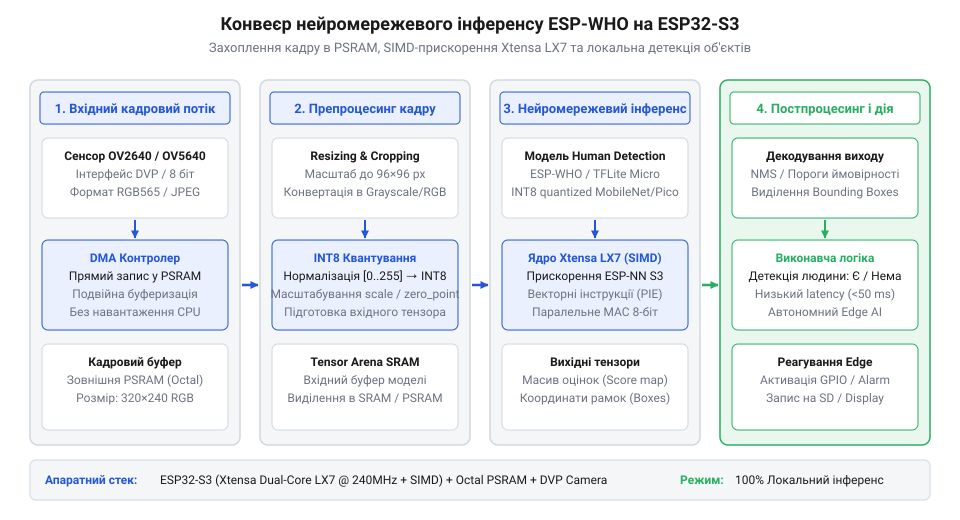
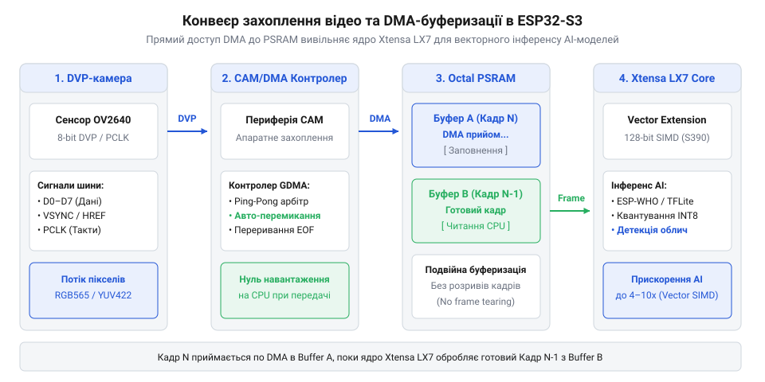

# Локальний розпізнавач об'єктів Edge AI на базі ESP32-S3 та ESP-WHO

<preknowlist>
- [Мікроконтролер ESP32-S3](root:cat-hw-boards/esp32s3-microcontroller) — базову архітектуру двоядерного процесора Xtensa LX7, внутрішню розподілену пам'ять SRAM та периферійні шини контролера.
- [Схемотехніка та розпіновка шин Octal SPI Flash та PSRAM в ESP32-S3](root:cat-hw-boards/esp32-s3-octal-spi-bus-layout) — принципи фізичного підключення зовнішньої PSRAM через Octal/Quad SPI та режим тактування шини для роботи з кадровими буферами.
- [Модуль ESP32-CAM: огляд архітектури, периферії та сімейства плат](root:cat-hw-boards/esp32-cam-camera-module-family) — схему сполучення CMOS-матриць OV2640 через DVP-інтерфейс, тактування SCCB та базові режими роботи сенсора.
</preknowlist>

## Проблема затримок хмарного комп'ютерного зору

Автономні системи безпеки, робототехніка та розумні камери спостереження потребують негайного реагування на появу людини чи сторонніх об'єктів у зоні контролю. У традиційних архітектурах відеопотік з камери неперервно стискається й передається мережею на віддалений хмарний сервер, де потужні графічні прискорювачі виконують нейромережевий аналіз кадрів. Однак передача даних через інтернет-канали створює суттєву затримку (англ. @@en|latency@@, від лат. *latens* — прихований), яка складається з часу кодування відео, мережевої маршрутизації, черг на сервері та зворотного надсилання тривожного сигналу. Сукупне запізнення часто перевищує 200–500 мілісекунд, що робить хмарні @@en|Cloud Computing@@ рішення непридатними для критичних сценаріїв, де затримка в частки секунди призводить до пропуску інциденту.

Окрім часових затримок, хмарний комп'ютерний зір (англ. @@en|Computer Vision@@) потерпає від нестабільності зв'язку та високого споживання мережевого трафіку. Будь-який тимчасовий обрив Wi-Fi з'єднання або збій у провайдера повністю сліпить систему безпеки. До того ж цілодобова трансляція нестисненого або високодеталізованого відео потребує значної ширини смуги пропускання і створює серйозні ризики порушення приватності, оскільки чутливі біометричні дані залишають локальний контур пристрою.

Розв'язанням цієї проблеми є концепція автономних обчислень на межі мережі — @@en|Edge AI@@. Перенесення процесу виконання нейромережевої моделі (англ. @@en|inference@@, інференс, від лат. *inferre* — приносити, виводити) безпосередньо на мікроконтролер дозволяє обробляти кожен відеокадр локально за лічені мілісекунди. Пристрій не відправляє відеопотік у хмару, а формує лише вихідні структури метаданих із координатами обмежувальних рамок або миттєво активує фізичні виконавчі реле.

Головним бар'єром на шляху реалізації @@en|Edge AI@@ є обмеженість ресурсів класичних мікроконтролерів. Обробка сучасних згорткових нейромереж вимагає виконання мільйонів операцій помноження із накопиченням (англ. @@en|Multiply-Accumulate@@, MAC) на кожен кадр. Для реалізації локальної детекції в реальному часі необхідне поєднання векторного прискорення математичних операцій (англ. @@en|SIMD@@, Single Instruction, Multiple Data) та спеціалізованої архітектури пам'яті. Усім цим вимогам відповідає двоядерний [мікроконтролер ESP32-S3](root:cat-hw-boards/esp32s3-microcontroller), який входить до [широкого сімейства плат](root:cat-hw-boards/esp32-s3-boards-family-overview) для завдань граничного штучного інтелекту.

## Векторні інструкції та оперативна пам'ять PSRAM

Виконання локального інференсу нейромереж на мікроконтролері ESP32-S3 впирається у два ключові апаратні обмеження: обсяг оперативної пам'яті для збереження вагових коефіцієнтів моделей і швидкість обчислення матричних добутків. Внутрішній статичний масив пам'яті SRAM мікроконтролера має загальний обсяг 512 КБ. Після виділення системних ресурсів під операційну систему FreeRTOS, мережеві буфери та стек виконання додатків для користувача залишається суттєво менше вільного простору:

Free_SRAM = 512 KB - 128 KB - 64 KB
= 320 KB      [віднімання системних накладних витрат FreeRTOS та стеків]

Водночас один нестиснений кадр кольорового зображення з роздільною здатністю 240×240 пікселів у форматі RGB888 займає:

Frame_bytes = 240 × 240 × 3
= 172800 B              [множення ширини, висоти та 3 колірних каналів]
= 168.75 KB             [ділення на 1024 для переведення в кілобайти]

Збереження навіть двох кадрових буферів разом із тензорами вагових коефіцієнтів компактної нейромережі (розміром від 1.5 до 4 МБ) у внутрішній SRAM є фізично неможливим. Для подолання цього бар'єра ESP32-S3 використовує зовнішню псевдостатичну оперативну пам'ять (англ. @@en|PSRAM@@, Pseudo-Static RAM), яка підключається через високошвидкісну [шину Octal SPI](root:cat-hw-boards/esp32-s3-octal-spi-bus-layout). Модулі пам'яті, якими оснащуються [модулі ESP32-S3-WROOM](root:cat-hw-boards/esp32-s3-wroom-modules-family) або [компактні SiP-модулі](root:cat-hw-boards/esp32-s3-mini-sip-modules), надають від 2 до 8 МБ додаткової оперативної пам'яті, що працює на частотах до 80–120 МГц. У такій системі реалізується чіткий розподіл пам'яті: зовнішня PSRAM зберігає сирі кадрові буфери, вагові коефіцієнти моделей та проміжні карти ознак, тоді як швидка внутрішня SRAM відводиться під швидкодіючі буфери векторних обчислень та критичні до затримок стеки функцій.

Для розгону обчислень двоядерний процесор Xtensa LX7 із тактовою частотою 240 МГц оснащено розширенням векторних інструкцій (англ. @@en|Vector Instructions@@, PIE — Processor Instruction Extensions, від лат. *vector* — той, що веде/несе). Векторний прискорювач має 128-бітні регістри й здатний за один тактовий цикл виконувати до восьми 8-бітних операцій помноження із накопиченням (INT8 MAC) або чотири 16-бітні операції (INT16 MAC):

Ops_per_cycle = 8 INT8 MAC ops
Total_OPS = 240 MHz × 8 MAC × 2 ops/MAC
= 3840000000 ops/s      [максимальна пікова обчислювальна потужність 3.84 TOPS/GFLOPS]

Для ефективного використання векторного прискорювача вихідні нейромережеві моделі піддаються квантуванню (англ. @@en|Quantization@@) — переведенню 32-бітних чисел із плаваючою крапкою (FP32) в 8-бітні цілі числа (INT8). Квантування зменшує розмір моделі в чотири рази та ідеально лягає на конвеєр векторних інструкцій Xtensa LX7.

*Блок-схема руху кадрових даних та тензорів ваг між зовнішньою PSRAM, внутрішньою SRAM та векторним прискорювачем ядра Xtensa LX7 під управлінням фреймворку ESP-WHO.*

Завдяки такій архітектурі фреймворк @@en|ESP-WHO@@ та бібліотека @@en|TensorFlow Lite Micro@@ досягають швидкості інференсу у 15–25 кадрів на секунду під час детекції облич та людей, роблячи пристрій повністю автономним.

## Захоплення відеокадрів DVP-камери та буферизація DMA

Після підготовки векторного прискорювача та розподілу пам'яті в PSRAM виникає задача побудови високошвидкісного тракту введення відеоданих. Підключення оптичних CMOS-сенсорів OV2640 або OV5640 на [платах серії ESP32-CAM](root:cat-hw-boards/esp32-cam) здійснюється через паралельний цифровий відеоінтерфейс (англ. @@en|Digital Video Port@@, DVP). Шина DVP містить 8 паралельних ліній даних (D0–D7), тактовий сигнал пікселів PCLK (Pixel Clock), лінії вертикальної VSYNC та горизонтальної HREF синхронізації, а також шину налаштування реєстрів сенсора SCCB.

Програмне зчитування пікселів процесорним ядром через звичайне опитування шини GPIO є недопустимим: при тактовій частоті PCLK у 10–20 МГц процедура читання повністю заблокувала б обидва ядра мікроконтролера. Для забезпечення беззатримної передачі даних в ESP32-S3 використовується периферійний контролер LCD/CAM у зв'язці з модулем прямого доступу до пам'яті (англ. @@en|Direct Memory Access@@, DMA, від лат. *directus* — прямий). Контролер GDMA самостійно захоплює байтові потоки з ліній DVP та записує їх у кадрові буфери PSRAM через матрицю внутрішніх шин, не залучаючи ресурси CPU.

Щоб уникнути розриву кадрів та затримок під час обробки, організовується подвійна DMA-буферизація за схемою ping-pong:

*Архітектура відеотракту ESP32-S3: паралельне захоплення кадрів з CMOS-сенсора через DVP-інтерфейс, трансляція через GDMA-контролер та подвійна буферизація у зовнішній PSRAM.*

У цій конфігурації в зовнішній PSRAM виділяються два незалежні буфери: `Buffer_A` та `Buffer_B`. Доки контролер GDMA в фоновому режимі заповнює `Buffer_A` поточним кадром N з камери, перше ядро процесора виконує препроцесинг та інференс нейромережі над попереднім кадром N-1, збереженим у `Buffer_B`. По завершенні кадру за сигналом переривання VSYNC буфери миттєво міняються ролями.

Етап препроцесингу перетворює сирі кадрові дані з формату RGB565 або Grayscale у планарний тензор потрібного розміру (наприклад, 96×96×1 або 224×224×3), виконує масштабування, нормування пікселів від [0, 255] до діапазону [-128, 127] і передає покажчик безпосередньо на вхідний шар нейромережевого конвеєра @@en|ESP-WHO@@.

## Інтеграція бібліотеки ESP-WHO та квантування моделей

Сформований у попередньому розділі відеотракт забезпечує безперервне постачання кадрів у зовнішню пам'ять, але сам по собі масив RGB-пікселів у PSRAM не дає відповіді про наявність об'єктів у кадрі. Спроба виконати стандартну згорткову нейромережу з ваговими коефіцієнтами у форматі з плаваючою крапкою (FP32) на мікроконтролері призведе до запізнення в кілька секунд на кожен кадр, що повністю заблокує роботу системи в реальному часі. Для подолання обчислювального бар'єра використовується фреймворк @@en|ESP-WHO@@, побудований на базі бібліотеки @@en|TensorFlow Lite Micro@@, який адаптує архітектури нейромереж до векторного прискорювача ядра Xtensa LX7. Детальніше про будову цього рішення та алгоритми розпізнавання можна дізнатися в [огляді архітектури фреймворку ESP-WHO](root:sf-ml/esp-who-framework-overview).

Ключовим елементом оптимізації є квантування (англ. @@en|quantization@@) — процедура переведення 32-бітних дійсних значень вагових коефіцієнтів та активацій моделі в 8-бітні цілочисельні еквіваленти (англ. @@en|INT8@@). Лінійне квантування описується математичним співвідношенням перетворення дійсного числа `x` у ціле значення `q`:

Scale = (Real_Max - Real_Min) / 255.0
ZeroPoint = -128 - round(Real_Min / Scale)
q = round(x / Scale) + ZeroPoint      [квантування FP32 значення у діапазон INT8]

Параметр `Scale` визначає крок квантування, а `ZeroPoint` забезпечує точне відображення дійсного нуля в цілочисельний діапазон `[-128, 127]`. Завдяки цьому замість ресурсомістких операцій з плаваючою крапкою векторне ядро процесора виконує високошвидкісні цілочисельні інструкції помноження із накопиченням. Більше про переведення математики в цілочисельний формат читайте у статті про [принципи квантування моделей у TensorFlow Lite Micro на ESP32-S3](root:sf-ml/tflite-micro-esp32s3).

Окрім квантування, висока обчислювальна ефективність фреймворку @@en|ESP-WHO@@ досягається завдяки використанню оптимізованих архітектур на кшталт @@en|MobileNet@@. Замість класичних 2D-згортань застосовуються глибинно-сепарабельні згортки (англ. @@en|depthwise separable convolution@@, від *depth* — глибина, *separable* — той, що розділяється, та *convolution* — згортка, від лат. *convolvere* — згортати). Процес обробки розділяється на два послідовні етапи: фільтрацію просторових ознак окремо для кожного каналу (англ. @@en|depthwise convolution@@) та подальше об'єднання каналів за допомогою згортки 1×1 (англ. @@en|pointwise convolution@@). Зменшення кількості операцій MAC описується відношенням:

Conv_MACs = K_h × K_w × C_in × C_out × H × W
Depthwise_MACs = (K_h × K_w × C_in + C_in × C_out) × H × W
Reduction_Ratio = Depthwise_MACs / Conv_MACs
= (K_h × K_w + C_out) / (K_h × K_w × C_out)      [ділення на K_h × K_w × C_in × H × W]
≈ 1 / 9                                         [при розмірі ядра K=3×3 та C_out=64]

Таке розщеплення зменшує обсяг обчислень і кількість вагових коефіцієнтів майже в 9 разів при незначній втраті точності розпізнавання.

Для виконання інференсу фреймворк @@en|ESP-WHO@@ потребує виділення оперативної пам'яті під арену тензорів (англ. @@en|tensor arena@@, від лат. *arena* — відкритий майданчик). Арена тензорів зберігає вхідні й вихідні тензори шарів, а також проміжні буфери активації. Завдяки наявності зовнішньої оперативної пам'яті в [модулях ESP32-S3-WROOM](root:cat-hw-boards/esp32-s3-wroom-modules-family) виділення арени розміром від 1 до 2 МБ здійснюється через виклик `heap_caps_malloc()` з прапором `MALLOC_CAP_SPIRAM`.

Нижче наведено приклад ініціалізації конвеєра інференсу моделі детекції облич та людей на [мікроконтролері ESP32-S3](root:cat-hw-boards/esp32s3-microcontroller):

:::tabs
:::code proj-edge-ai-person-detection/c/esp-idf/init-inference-pipeline.c
:::code proj-edge-ai-person-detection/cpp/arduino/setup-edge-ai.cpp
:::

Результатом роботи нейромережевого конвеєра є масив виявлених об'єктів із нормалізованими координатами обмежувальних рамок (англ. @@en|bounding box@@, від *bound* — обмежувати та *box* — коробка) у діапазоні `[0.0, 1.0]` та рівнем впевненості (англ. @@en|confidence score@@). Ці дані передаються далі для побудови асинхронної виконавчої логіки реагування.

## Розробка виконавчої логіки реагування та запису

Отримання координат виявленої людини від нейромережевої моделі є лише першим кроком розробки Edge AI пристрою. У реальних умовах сирі вихідні дані детекції містять шуми: поодинокі оптичні відблиски або випадкові тіні можуть спричинити короткочасні хибні спрацьовування тривалості в один кадр. Крім того, синхронний запис відеокадру на карту пам'яті триває від 50 до 150 мілісекунд, що заблокувало б захоплення нових кадрів і призвело до розриву відеотракту.

Для запобігання хибним спрацьовуванням застосовується часова фільтрація результатів на основі гістерезису та оцінки перетину обмежувальних рамок суміжних кадрів (англ. @@en|Intersection over Union@@, @@en|IoU@@, від *intersection* — перетин та *union* — об'єднання). Відношення @@en|IoU@@ для двох рамок `A` та `B` обчислюється як:

IoU = Area_Overlap / Area_Union
= Overlap(A, B) / (Area(A) + Area(B) - Overlap(A, B))      [ділення площі перетину на площу об'єднання]

Якщо об'єкт виявляється у щонайменше `N` послідовних кадрах з високим рівнем @@en|IoU@@, система підтверджує присутність людини й переходить у стан тривоги.

Асинхронне виконання виконавчих дій реалізується за допомогою черг операційної системи реального часу @@en|FreeRTOS@@. Процесорне ядро, відповідальне за інференс, після виявлення об'єкта формує компактну структуру події (покажчик на JPEG-кадр у PSRAM та метадані детекції) і відправляє її в міжзадачну чергу `QueueHandle_t`. Окремий фоновий потік із нижчим пріоритетом зчитує події з черги та виконує тригерну активацію виконавчих реле через @@en|GPIO@@, запис знімка на [плату ESP32-CAM з microSD](root:cat-hw-boards/esp32-cam) та формування мережевих сповіщень.

Передача телеметрії (англ. @@en|telemetry@@, від грец. *tele* — далеко та *metron* — вимір) на зовнішній сервер верифікації здійснюється через послідовний порт @@en|UART@@ або мережевий потік @@en|Wi-Fi@@. Для забезпечення надійності пакети даних містять сигнатурний заголовок `0xAA55`, довжини JSON-метаданих та JPEG-зображення, а також контрольне підсумовування @@en|CRC32@@.

Нижче наведено фрагмент розбору та перевірки цілісності бінарних пакетів детекції в ПК-клієнті прийому телеметрії:

:::code proj-edge-ai-person-detection/py/edge_receiver.py 190-239

Прийнятий кадр та метадані обробляються модулем візуалізації, який накладає кольорові обмежувальні рамки та текстові підписи класів на вихідне зображення в реальному часі:

:::code proj-edge-ai-person-detection/py/vision_overlay.py 68-123

Така розділена асинхронна архітектура повністю ізолює конвеєр відеозахоплення від затримок введення-виведення на накопичувачі та мережеві інтерфейси.

## Оптимізація продуктивності та профілювання системи

Фінальним етапом створення Edge AI розпізнавача на базі [чіпа ESP32-S3](root:cat-hw-boards/esp32s3-microcontroller) є комплексна оптимізація частоти кадрів (англ. @@en|FPS@@), затримок інференсу та енергоспоживання. Неконтрольована робота обох ядер на максимальній тактовій частоті 240 МГц із постійним зверненням до [шини Octal SPI](root:cat-hw-boards/esp32-s3-octal-spi-bus-layout) призводить до підвищеного нагріву корпусу мікроконтролера (до 65–70°C) та споживання струму понад 250 мА, що унеможливлює тривалу автономну експлуатацію від акумуляторів.

Основою оптимізації швидкодії є чіткий розподіл обчислювальних задач між двома ядрами Xtensa LX7 за допомогою прив'язки потоків @@en|FreeRTOS@@:
1. Ядро протоколів `PRO_CPU` (Core 0): повністю відводиться під обробку фонових стеків @@en|Wi-Fi@@, Bluetooth, HTTP-сервера потокового відео, зчитування датчиків та запис даних на microSD. 2. Ядро додатків `APP_CPU` (Core 1): виділяється виключно під переривання DVP-камери, препроцесинг кадрового буфера та виконання векторних інструкцій інференсу нейромережі.

Для профілювання часових характеристик системи вимірюється загальна затримка сквозного конвеєра (англ. @@en|end-to-end latency@@), яка складається із затримки виконання нейромережі та затримки передачі даних:

Total_Latency = Inference_Latency + Transmission_Latency
FPS_effective = 1000.0 / Total_Latency      [розрахунок ефективного FPS від загальної затримки у мс]

Аналіз розподілу затримок та оцінка 95-го перцентиля (англ. @@en|percentile@@, від лат. *per centum* — на сто, @@en|P95@@) дозволяють виявити вузькі місця у відеотракті. Нижче наведено фрагменти модуля акумуляції метрик продуктивності та головного циклу оцінки:

:::code proj-edge-ai-person-detection/py/metrics_evaluator.py 39-93

:::code proj-edge-ai-person-detection/py/main.py 110-188

Для досягнення оптимального балансу між точністю та енергоефективністю застосовуються такі інженерні прийоми:
* **Динамічне масштабування частоти CPU**: зменшення тактової частоти з 240 МГц до 160 МГц знижує енергоспоживання ядра на 30–35% при збереженні прийнятної частоти детекції (10–12 FPS). * **Оптимізація роздільної здатності кадру**: зниження розміру вхідного тензора з 240×240 до 96×96 пікселів прискорює прохід нейромережі в 6,25 рази завдяки квантованому зменшенню кількості MAC-операцій. * **Гібридні режими сну**: переведення мікроконтролера в режим легкого сну (англ. @@en|Light Sleep@@) між подіями з пробудженням від зовнішнього PIR-датчика руху.

Для вирішення ще більш вимогливих задач комп'ютерного зору з високою роздільною здатністю перспективним кроком є перехід на пристрої з [продуктивнішим мікроконтролером ESP32-P4](root:cat-hw-boards/esp32-p4-microcontroller), який оснащено апаратними прискорювачами обробки зображень та двоядерною архітектурою RISC-V. Створений локальний Edge AI розпізнавач на ESP32-S3 забезпечує повну автономність, приватність та миттєве реагування в задачах закритих систем моніторингу.