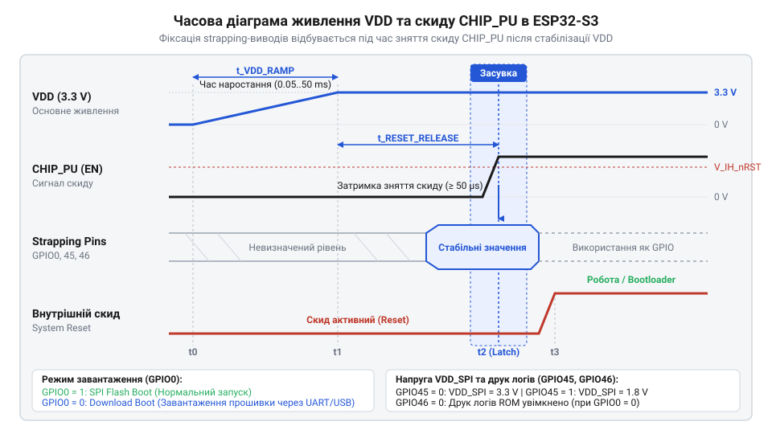
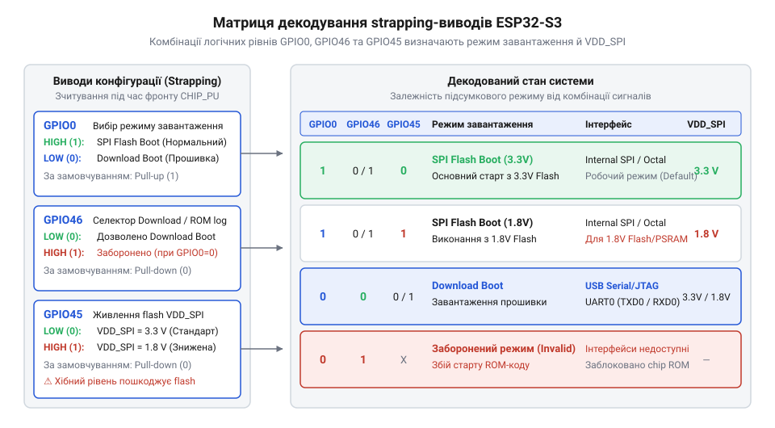

# Специфікація залізного інтерфейсу завантаження, strapping-виводів та доменів живлення ESP32-S3

<preknowlist>
- [Мікроконтролер ESP32-S3](root:cat-hw-boards/esp32s3-microcontroller) — базову архітектуру ядра Xtensa LX7, внутрішні шини, призначення виводів та загальні електричні характеристики мікроконтролера ESP32-S3.
- [Модулі ESP32-S3-WROOM-1 та WROOM-2](root:cat-hw-boards/esp32-s3-wroom-modules-family) — схемотехнічне розведення виводів strapping, вбудовану Flash/PSRAM пам'ять та організацію домену живлення VDD_SPI у стандартних модулях.
- [Схемотехніка та розпіновка шин Octal SPI Flash та PSRAM в ESP32-S3](root:cat-hw-boards/esp32-s3-octal-spi-bus-layout) — вимоги до напруги живлення (1.8 V проти 3.3 V) і конфігурації шини SPI/Octal SPI пам'яті, що живиться від домену VDD_SPI.
</preknowlist>

## Збої завантаження та вигорання пам'яті

Під час подачі живлення на плату з мікроконтролером розробники часто стикаються із симптомами, які здаються невизначеними: пристрій потрапляє у нескінченне циклічне перезавантаження, відмовляється реагувати на команди прошивки або взагалі перестає зчитувати код із зовнішньої пам'яті після першого ж увімкнення. У найгірших випадках мікросхема флеш-пам'яті чи псевдостатичної оперативної пам'яті (PSRAM) отримує незворотні фізичні пошкодження від термічного пробою.

Причина таких аварійних станів криється в логічній невизначеності режимних виводів під час ініціалізації системи. На відміну від простих мікроконтролерів із фіксованим джерелом завантаження, [мікроконтролер ESP32-S3](root:cat-hw-boards/esp32s3-microcontroller) під час подачі сигналу скиду зчитує логічні рівні на спеціальних виводах конфігурування. Ці виводи визначають не лише джерело завантаження коду (зовнішня пам'ять SPI Flash, послідовний порт UART0 чи вбудований USB-контролер), а й вихідну напругу внутрішнього LDO-регулятора живлення `VDD_SPI`.

Якщо на платі розведена високошвидкісна пам'ять із робочою напругою `1.8 V`, яка використовується на [шині Octal SPI Flash](root:cat-hw-boards/esp32-s3-octal-spi-bus-layout), а вивід конфігурації живлення під час скиду опинився у низькому стані, внутрішній регулятор подає на шину `3.3 V`. Перевищення номінальної напруги майже вдвічі викликає миттєвий електричний пробій напівпровідникової структури пам'яті. З іншого боку, якщо для стандартної пам'яті `3.3 V`, яка встановлена на [модулях ESP32-S3-WROOM-1](root:cat-hw-boards/esp32-s3-wroom-modules-family), регулятор через помилковий рівень виводу сформує лише `1.8 V`, пам'ять просто не зможе відповісти на команди зчитування. Внутрішній первинний завантажувач @@en|bootloader@@ (від англ. @@en|boot@@ — «завантажувати») не отримує дійсної інструкції і відправляє ядро Xtensa в постійне перезавантаження.

Недотримання часових затримок і плаваючі електричні потенціали на лініях конфігурації роблять запуск системи випадковим. Для проектування надійного вузла живлення та скиду необхідно суворо дотримуватися специфікації залізного інтерфейсу завантаження.

## Часові параметри скиду CHIP_PU

Запуск мікроконтролера починається з наростання напруги первинного джерела живлення `VDD` та наступного зняття блокуючого потенціалу з входу скиду `CHIP_PU`. Оскільки напруга живлення не може зрости миттєво через ємність фільтруючих конденсаторів, часовий інтервал наростання напруги `VDD` від `0 V` до робочого мінімуму `3.0 V` визначається параметром `t_VDD_RAMP`. Специфікація вимагає, щоб час `t_VDD_RAMP` перебував у межах від `0.05 ms` до `10 ms`. Занадто повільне або переривчасте зростання живлення призводить до збоїв у роботі внутрішніх схем скиду по увімкненню живлення.

Щоб запобігти збоям виконання коду при нестабільній напрузі, лінію `CHIP_PU` слід утримувати в низькому стані (нижче порогу `V_IL`, що становить `0.25 × VDD` або приблизно `0.6 V`) упродовж усього часу наростання живлення. Після досягнення рівня `VDD` позначки `3.0 V` сигнал `CHIP_PU` повинен залишатися низьким ще упродовж інтервалу `t_RESET_RELEASE`, який має становити не менше `50 µs` (на практиці обирають від `1 ms` до `10 ms`).

У момент, коли напруга на `CHIP_PU` перетинає верхній логічний поріг `V_IH` (`0.75 × VDD`), внутрішній апаратний тригер @@en|latch@@ (від англ. @@en|latch@@ — «засувка») відкриває коротке часове вікно. Упродовж цього вікна первинний @@en|bootloader@@ фіксує логічні рівні на виводах `GPIO0`, `GPIO45` та `GPIO46`. Якщо напруга живлення в цей момент ще продовжує коливатися, збережені значення режимів завантаження будуть спотворені.

Для гарантованого витримування часового інтервалу `t_RESET_RELEASE` лінію `CHIP_PU` підключають до зовнішнього RC-кола, яке складається з підтягуючого резистора `R_pu` до шини `VDD` та конденсатора `C_pu` на землю. Стала часу `τ` такого кола обчислюється за формулою:

```
τ = R_pu × C_pu
  = 10000 × 0.000001
  = 0.01 s [10 ms]
```

Отримана затримка в `10 ms` повністю перекриває час стабілізації джерела живлення і забезпечує надійне зняття скиду.


*Часова діаграма наростання напруги VDD, зняття сигналу скиду CHIP_PU та вікна засувки режимних виводів.*

## Кодування режимів strapping-виводами GPIO0 GPIO45 GPIO46

У момент зняття скиду по передньому фронту сигналу `CHIP_PU` апаратна логіка фіксує логічні стани трьох режимних виводів. Ці виводи називаються @@en|strapping@@ (від англ. @@en|strap@@ — «прив'язувати, ремінь») і визначають підсумкову конфігурацію системи.

Вивід `GPIO0` відповідає за вибір джерела, з якого @@en|bootloader@@ почне зчитувати виконання програми. Логічна одиниця (`1`) на `GPIO0` вказує на нормальний запуск із зовнішньої SPI Flash пам'яті. Логічний нуль (`0`) переводить мікроконтролер у режим завантаження прошивки через послідовні інтерфейси UART0 або вбудований USB-контролер.

Вивід `GPIO45` задає вихідну напругу внутрішнього LDO-регулятора домену `VDD_SPI`. Якщо під час скиду на `GPIO45` зафіксовано логічний нуль (`0`), регулятор видає напругу `3.3 V`. Якщо на `GPIO45` подано логічну одиницю (`1`), LDO знижує напругу до `1.8 V`.

Вивід `GPIO46` використовується разом із `GPIO0` для конфігурації виводу системного логу ROM та керування режимом завантажувача. Логічний нуль (`0`) на `GPIO46` залишає стандартне виведення діагностичних повідомлень у консоль. Логічна одиниця (`1`) при `GPIO0 = 0` вмикає пригнічений безшумний режим завантажувача, при якому повідомлення ROM не відправляються в UART.

Під час дії сигналу скиду внутрішні резистори підтяжки мікроконтролера мають наступну конфігурацію:
на виводі `GPIO0` активна внутрішня слабка підтяжка вгору @@en|pull-up@@ (від англ. @@en|pull@@ — «тягнути») опором близько `45 kΩ`;
на виводі `GPIO45` активна внутрішня слабка підтяжка вниз @@en|pull-down@@ (від англ. @@en|pull@@ — «тягнути») опором близько `45 kΩ`;
на виводі `GPIO46` активна внутрішня слабка підтяжка вниз @@en|pull-down@@ опором близько `45 kΩ`. Варто враховувати, що вивід `GPIO46` апаратно позбавлений внутрішнього резистора @@en|pull-up@@ під час скиду.

Повна матриця логічних комбінацій strapping-виводів та відповідних їм режимів наведена на діаграмі.


*Логічні комбінації рівнів на виводах GPIO0, GPIO45 та GPIO46 і їхній вплив на вибір режиму завантаження та рівень VDD_SPI.*

## Конфігурація та захист домену VDD_SPI

Домен живлення `VDD_SPI` призначений для подачі напруги на внутрішню або зовнішню Flash та PSRAM пам'ять. Хоча за замовчуванням рівень напруги встановлюється під час скиду за допомогою виводу `GPIO45`, покладатися лише на зовнішній потенціал виводу не завжди безпечно, особливо якщо вивід перевикористовується зовнішньою периферією.

Для забезпечення абсолютного захисту пам'яті в ESP32-S3 передбачено механізм апаратного фіксування конфігурації через енергонезалежні одноразові програмовані перемички @@en|eFuse@@ (від англ. @@en|fuse@@ — «запобіжник»). У блоці `BLOCK0` масиву @@en|eFuse@@ розташовані біти керування регулятором `VDD_SPI`.

Якщо біт `VDD_SPI_FORCE` випалено в одиницю (`1`), апаратна логіка мікроконтролера повністю ігнорує стан виводу `GPIO45` під час скиду. Напруга на `VDD_SPI` у цьому випадку жорстко задається бітом `EFUSE_VDD_SPI_TIEH`: значення `0` фіксує напругу `3.3 V`, а значення `1` — напругу `1.8 V`.

Такий захист є обов'язковим для серійних модулів із `1.8 V` пам'яттю, зокрема у [компактних SiP-модулях ESP32-S3-MINI-1](root:cat-hw-boards/esp32-s3-mini-sip-modules) та модулях серії WROOM-2. Це виключає ризик термічного руйнування пам'яті, якщо користувач випадково підтягне `GPIO45` до землі на власній друкованій платі або спробує використати цей вивід як загальний GPIO. Для детального ознайомлення з розкладкою блоків eFuse, механізмами одноразового програмування та апаратним фіксуванням системних конфігурацій перегляньте матеріал про [систему eFuse та енергонезалежну конфігурацію ESP32-S3](root:cat-hw-boards/esp32-s3-efuse-system).

Після завершення роботи первинного завантажувача ROM і передачі керування вторинному завантажувачу ESP-IDF, регістри периферії RTC блокують зміну параметрів LDO в коді програми, забезпечуючи стабільну роботу системи в робочому режимі.

## Схемотехніка USB Serial JTAG та підтяжок

Вбудований контролер USB Serial/JTAG в ESP32-S3 дозволяє виконувати прошивку та налагодження безпосередньо через лінії `GPIO19` (`USB_D-`) та `GPIO20` (`USB_D+`) без використання зовнішніх мікросхем конвертерів USB-UART. Для детального вивчення принципів роботи вбудованого периферійного контролера USB CDC ACM та організації JTAG-відлагодження через лінії GPIO19 і GPIO20 читайте статтю про [вбудований USB Serial/JTAG контролер ESP32-S3](root:cat-hw-boards/esp32-s3-usb-serial-jtag-controller).

Лінії `GPIO19` та `GPIO20` утворюють високошвидкісну дифпару @@en|differential pair@@ (від англ. @@en|pair@@ — «пара»). При розведенні друкованої плати необхідно дотримуватися суворих схемотехнічних правил:
диференційний хвильовий опір провідників повинен становити `90 Ω` з допуском не більше `± 10%`;
довжини трас `D+` та `D-` мають бути узгоджені між собою з точністю до `0.5 mm`;
під трасами дифпари повинен проходити суцільний нерозривний шар землі без міжшарових переходів та гострих кутів.

Оскільки внутрішні резистори підтяжки режимних виводів є слабкими (~`45 kΩ`), зовнішні завади або підключена периферія можуть змінити потенціал на виводах під час скиду. Для гарантованого встановлення режимів розраховують зовнішні підтягуючі резистори:

Для виводу `GPIO0` встановлюють зовнішній резистор @@en|pull-up@@ опором `10 kΩ` до шини `3.3 V`. Для переведення в режим прошивки кнопку `BOOT` підключають паралельно з розрядним резистором `470 Ω` на землю та фільтруючим конденсатором `100 nF` для усунення дребезгу контактів.

Для виводу `GPIO45` у системах із пам'яттю `3.3 V` рекомендується додавати зовнішній резистор @@en|pull-down@@ опором `10 kΩ` на землю. Це запобігає випадковому наведенню високого потенціалу від сусідніх трас. У системах із `1.8 V` пам'яттю без випалених бітів @@en|eFuse@@ вивід `GPIO45` підтягують резистором `10 kΩ` до `3.3 V`.

Для виводу `GPIO46` зовнішній резистор @@en|pull-down@@ опором `10 kΩ` на землю є обов'язковим, якщо вивід виведено на зовнішні роз'єми плати, оскільки відсутність внутрішнього @@en|pull-up@@ робить його чутливим до наводок.

Вивід `GPIO3` у деяких ревізіях кристала може впливати на фізичний рівень вбудованого USB-PHY, тому додавання сильних зовнішніх підтяжок на `GPIO3` під час скиду слід уникати.

## Діагностика конфліктів та завадозахищеність

На реальних розробницьких платах, таких як [родина плат ESP32-S3](root:cat-hw-boards/esp32-s3-boards-family-overview) чи [відеомодулях ESP32-CAM](root:cat-hw-boards/esp32-cam), виводи `GPIO0`, `GPIO45` та `GPIO46` часто перевикористовуються після завершення завантаження як лінії шин I2C, SPI або інтерфейси кнопок та світлодіодів.

Головною небезпекою при цьому є паразитний витік струму @@en|leakage current@@ (від англ. @@en|leak@@ — «витік»). Якщо зовнішній модуль живиться від окремого джерела або має власні підтяжки до напруги, яка з'являється раніше за `VDD` мікроконтролера, струм витоку через захисні діоди вводу-виводу може підняти потенціал на `GPIO45` або знизити на `GPIO0` ще до того, як `CHIP_PU` досягне логічної одиниці.

Діагностика таких конфліктів виконується шляхом підключення термінала до послідовного порту UART0 (виводи `GPIO43`/`GPIO44`) на швидкості `115200` бод. Під час зняття скиду ROM @@en|bootloader@@ виводить рядок стану:

`rst:0x1 (POWERON),boot:0x13 (SPI_FAST_FLASH_BOOT)`

Значення `boot:0x13` у hex-форматі означає розшифровку зафіксованих станів: біт 4 вказує на `GPIO0 = 1` (запуск із Flash), а додаткові біти показують стан `GPIO45` та `GPIO46`. Якщо замість цього зчитується `boot:0x03`, це свідчить про те, що `GPIO0` був помилково притиснутий до землі зовнішнім витоком струму.

Для схемотехнічного захисту від завад і паразитного струму застосовують буферні мікросхеми із трьома станами (наприклад, 74LVC1G125) або польові транзистори. Вони повністю відключають зовнішню периферію від виводів `GPIO0`, `GPIO45` та `GPIO46` на час дії сигналу скиду, поки напруга на `CHIP_PU` не досягне високого рівня.