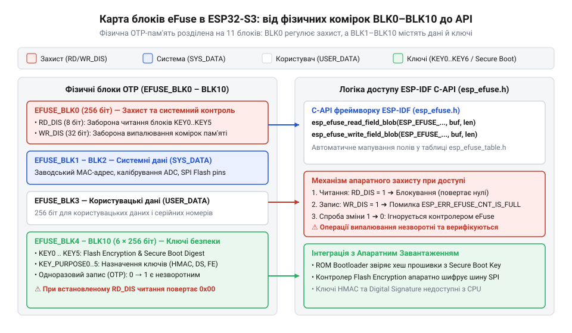
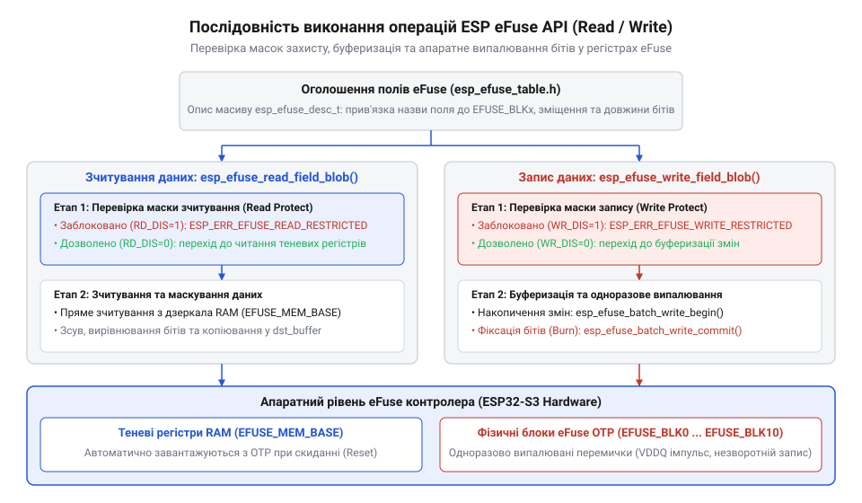

# Програмний довідник ESP-IDF API для читання та управління пам'яттю eFuse

<preknowlist>
- [Мікроконтролер ESP32-S3](root:cat-hw-boards/esp32s3-microcontroller) — архітектура шин даних, підсистема апаратного завантаження та основи вбудованих систем безпеки контролера.
- [Родина плат і модулів на ESP32-S3](root:cat-hw-boards/esp32-s3-boards-family-overview) — апаратні відмінності між виконаннями кристалу ESP32-S3 та конфігурації за замовчуванням у різних модулях.
</preknowlist>

<h2>Проблема збереження незмінної конфігурації мікроконтролера</h2>

При розробці комерційних та промислових пристроїв на базі [мікроконтролерах ESP32-S3](root:cat-hw-boards/esp32s3-microcontroller) виникає гостра потреба у надійному фіксуванні незмінних системних параметрів, апаратної ідентичності та криптографічних ключів. Якщо зберігати унікальний серійний номер пристрою, конфігурацію пріоритетів завантаження або криптографічний ключ у звичайній @@en|Flash-пам'яті@@ (англ. *flash memory* — енергонезалежна електрично перепрограмована пам'ять), система залишається вразливою до цілого спектра атак. Зовнішню мікросхему пам'яті можна фізично демонтувати з друкованої плати, зчитати її вміст за допомогою сигнального аналізатора шини SPI або перезаписати шкідливою прошивкою при отриманні фізичного чи програмного доступу до пристрою. Втрата або несанкціонована модифікація таких даних руйнує апаратну ідентичність та робить неможливим побудову захищеної системи.

Для розв'язання цієї проблеми в архітектурі всієї [родині плат ESP32-S3](root:cat-hw-boards/esp32-s3-boards-family-overview) передбачено спеціалізоване апаратне сховище — @@en|OTP@@ (англ. *one-time programmable* — одноразово програмована) пам'ять на основі технології @@en|eFuse@@ (англ. *electric fuse* — електричний запобіжник). Фізично @@en|eFuse@@ являє собою масив мікроскопічних полікремнієвих або металевих перемичок, сформованих безпосередньо на кремнієвому кристалі мікроконтролера. У початковому стані всі комірки пам'яті містять логічні нулі, що відповідає цілісним перемичкам зі збереженою провідністю. Запис інформації здійснюється шляхом випалювання — подачі контрольованого імпульсу підвищеного струму та напруги, який фізично розплавляє перемичку та незворотно переводить комірку в стан логічної одиниці.

Завдяки такій фізичній природі носія інформація, записана в @@en|eFuse@@, стає полностью захищеною від будь-яких спроб електронного стирання чи модифікації. Пам'ять @@en|eFuse@@ виконує роль апаратного фундаменту довіри — @@en|root of trust@@ (англ. *root of trust* — апаратний корінь довіри). Саме з аналізу стану бітів @@en|eFuse@@ первинний внутрішній завантажувач, зашитий у замасковане ROM кристала, починає свою роботу після подачі живлення. Контролер перевіряє стан систем безпеки, конфігурацію шин пам'яті та допустимість налагоджувальних інтерфейсів ще до моменту виконання першої інструкції з користувацької прошивки.

<h2>Структура блоків eFuse в ESP32-S3</h2>

Фізичний масив пам'яті @@en|eFuse@@ у мікроконтролерах ESP32-S3 впорядковано у вигляді 11 логічних та фізичних блоків, які позначаються як `EFUSE_BLK0`–`EFUSE_BLK10`. Кожен блок має фіксовану ширину 256 бітів, що сумарно надає 2816 бітів незмінної конфігурації. Такий розподіл дозволяє чітко розмежувати системні налаштування кристала, серійні дані виробника, інформацію розробника додатків та секретні ключі криптографічних апаратних акселераторів. При проектуванні вбудованих систем на компактних [SiP-модулях ESP32-S3-MINI-1](root:cat-hw-boards/esp32-s3-mini-sip-modules) розуміння призначення кожного блоку є критично важливим для уникнення колізій при запису даних.

Блок `EFUSE_BLK0` є головним системним контролером доступу та конфігурації. У ньому розміщені прапорці налаштування джерел завантаження, параметри живлення внутрішнього регулятора, вибір схеми кодування даних @@en|coding scheme@@ (англ. *coding scheme* — схема кодування даних), а також апаратні маски захисту доступу. Блоки `EFUSE_BLK1` та `EFUSE_BLK2` відведено під системні дані кристала: у `EFUSE_BLK0` записано унікальну заводську MAC-адресу пристрою та версію кремнію, а блок `EFUSE_BLK2` (`SYS_DATA_PART1`) містить калібрувальні коефіцієнти аналогово-цифрового перетворювача (ADC) та налаштування внутрішнього осцилятора. Для розробника кінцевих пристроїв на [Waveshare ESP32-S3 Touch](root:cat-hw-boards/waveshare-esp32-s3-touch-lcd-1-28) виділено блок `EFUSE_BLK3` (`USER_DATA`), у який можна вільно записувати власний серійний номер, ключі активації або специфічні прапорці конфігурації прошивки.

*Структура блоків eFuse ESP32-S3 від EFUSE_BLK0 до EFUSE_BLK10, включаючи системні параметри, криптографічні ключі та маски обмеження доступу.*

Блоки `EFUSE_BLK4`–`EFUSE_BLK9` слугують спеціалізованим сховищем для 256-бітних криптографічних ключів. Призначення кожного конкретного блоку ключів задається за допомогою відповідного поля `KEY_PURPOSE` у блоці `EFUSE_BLK0`. Апаратний захист вмісту блоків забезпечується двома незалежними масками: @@en|read-disable@@ (англ. *read disable* — маска заборони зчитування) та @@en|write-disable@@ (англ. *write disable* — маска заборони запису). Якщо для блоку ключів встановлено біт @@en|read-disable@@, його вміст стає повністю недоступним для зчитування центральним процесором через шину даних. Ключ залишається доступним виключно внутрішнім шинам апаратних блоків шифрування, що унеможливлює його витік навіть при виконанні довільного коду з правами ядра.

<h2>Базовий API читання та запису</h2>

Для безпечної програмної взаємодії з пам'яттю @@en|eFuse@@ фреймворк ESP-IDF надає високорівневий C-API, оголошений у заголовочному файлі `esp_efuse.h`, та набір стандартних описувачів полів у `esp_efuse_table.h`. Замість прямого звернення до регістрів розробник оперує структурою `esp_efuse_desc_t`, яка містить інформацію про номер блоку, початковий зсув бітів та їхню довжину. Зчитати довільне логічне поле у буфер пам'яті дозволяє функція `esp_efuse_read_field_blob()`. Під час зчитування API автоматично виконує розрахунок масок, зсув бітів та вирівнювання байтів у заданому буфері. При розробці пристроїв на [модулі ESP32-S3-Zero](root:cat-hw-boards/esp32-s3-zero) виконання операцій читання повертає стандартний код помилки `esp_err_t`.

Випалювання бітів є незворотною фізичною операцією, яка вимагає суворого дотримання часових інтервалів подачі напруги живлення та обчислення контрольних кодів корекції помилок @@en|Reed-Solomon@@ (англ. *Reed-Solomon code* — код виправлення помилок Ріда — Соломона). Щоб запобігти частковому випалюванню полів при раптовому збої живлення чи некоректних аргументах, у ESP-IDF реалізовано транзакційний механізм @@en|batch write@@ (англ. *batch write* — пакетна транзакція запису). Виклик `esp_efuse_batch_write_begin()` переводить драйвер у режим накопичення змін у теневих регістрах оперативної пам'яті. Потім функції запису `esp_efuse_write_field_blob()` підтовлюють потрібні зміни. Для остаточного випалювання бітів у кремнії викликається `esp_efuse_batch_write_commit()`, а для скасування черги змін — `esp_efuse_batch_write_cancel()`.

*Послідовність виконання операцій зчитування та транзакційного запису полів eFuse через високорівневий C-API ESP-IDF.*

Нижченаведені приклади коду демонструють правильну обробку кодів повернення `esp_err_t` та транзакційний запис користувацьких даних у пам'яті @@en|eFuse@@.

:::tabs
@tab C (ESP-IDF)
:::code api-esp32s3-efuse-esp-idf-hal-api/c/esp-idf/read-mac-and-write-user-id.c
@tab C++ (ESP-IDF)
:::code api-esp32s3-efuse-esp-idf-hal-api/cpp/esp-idf/efusehal.cpp
:::

<h2>Керування ключами безпеки та шифрування</h2>

Найважливішою функцією пам'яті @@en|eFuse@@ є забезпечення роботи апаратних підсистем безпеки кристала: режиму безпечного завантаження @@en|Secure Boot@@ (англ. *secure boot* — режим безпечного завантаження) та апаратного шифрування флеш-пам'яті @@en|Flash Encryption@@ (англ. *flash encryption* — апаратне шифрування вмісту флеш-пам'яті). Для перевірки стану захисних механізмів під час виконання прошивка використовує спеціалізовані функції ESP-IDF API, такі як `esp_efuse_read_field_cnt()`. Вона підраховує кількість випалених бітів у відповідному контрольному полі. Якщо кількість бітів перевищує нуль, відповідна система захисту активована апаратно, і її вимкнення стає фізично неможливим.

Запис ключів у блоки `EFUSE_BLK4`–`EFUSE_BLK9` здійснюється за допомогою спеціалізованої функції `esp_efuse_write_key()`. Вона приймає цільовий номер блоку, тип призначення `esp_efuse_purpose_t`, вказівник на ключ та його розмір у байтах. Функція автоматично випалює 256-бітне значення ключа, встановлює відповідний код у полі `KEY_PURPOSE` блоку `EFUSE_BLK0` та, за потреби, випалює маску @@en|read-disable@@. Наприклад, для апаратних модулів автентифікації повідомлень @@en|HMAC@@ (англ. *hash-based message authentication code* — хеш-код автентифікації повідомлень) та цифрового підпису @@en|Digital Signature@@ (англ. *digital signature* — апаратний модуль цифрового підпису) ключі записуються з призначеннями `ESP_EFUSE_KEY_PURPOSE_HMAC_DOWN_ALL` або `ESP_EFUSE_KEY_PURPOSE_HMAC_DOWN_DIGITAL_SIGNATURE`. Модуль цифрового підпису використовує записаний у @@en|eFuse@@ ключ для розшифрування закритих параметрів RSA безпосередньо у внутрішній апаратній пам'яті, не розкриваючи ключовий матеріал центральному процесору. На [платах Waveshare ESP32-S3R2](root:cat-hw-boards/esp32-s3r2-waveshare) це гарантує захист криптографічних ключів при роботі з зовнішніми мережевими сервісами. Докладніше про будову криптографічної периферії, механізми апаратної ізоляції ключів та використання підсистеми Digital Signature дивіться у матеріалі про [апаратні акселератори HMAC та Digital Signature в ESP32-S3](root:cat-hw-boards/esp32s3-hmac-ds-hardware-accelerators).

Нижче наведено приклад програмної перевірки активності захисних систем та автоматичного програмування ключа @@en|HMAC@@ у пам'ять @@en|eFuse@@.

:::tabs
@tab C (ESP-IDF)
:::code api-esp32s3-efuse-esp-idf-hal-api/c/esp-idf/configure-hmac-key-in-efuse.c
@tab C++ (ESP-IDF)
:::code api-esp32s3-efuse-esp-idf-hal-api/cpp/esp-idf/securitymanager.cpp
:::

<h2>Захист блоків та запобігання заблокуванню</h2>

Завершальним етапом налаштування конфігурації мікроконтролера у серійному виробництві є остаточне блокування доступу до чутливих регістрів. Для цього використовуються системні функції `esp_efuse_set_read_dis_mask()` та `esp_efuse_set_write_dis_mask()`. Перша випалює біти у відповідній масці `EFUSE_BLK0`, незворотно ізолюючи обрані блоки ключів від шини зчитування процесора. Друга функція фіксує обрані блоки чи логічні поля від будь-яких подальших спроб випалювання нових бітів. Наприклад, блокування запису для полів конфігурації [шини Octal SPI](root:cat-hw-boards/esp32-s3-octal-spi-bus-layout) унеможливлює випадкову або зловмисну зміну таймінгів роботи з флеш-пам'яттю.

Окрім захисту блоків даних, критично важливо правильно керувати апаратними прапорцями блокування периферійних інтерфейсів. Випалювання біта `DIS_PAD_JTAG` повністю вимикає функціональність апаратного відлагодження через фізичні виводи @@en|JTAG@@ (англ. *Joint Test Action Group* — відлагоджувальний апаратний інтерфейс). Біт `DIS_USB_JTAG` відключає контролер відлагодження у вбудованому периферійному модулі @@en|USB-CDC@@ (англ. *USB communications device class* — віртуальний послідовний порт). Однак необдумане випалювання цих бітів створює серйозний ризик незворотного заблокування пристрою ("перетворення на цеглину"). Якщо розробник повністю вимикає @@en|JTAG@@ та можливість завантаження прошивки через первинний завантажувач @@en|bootloader@@ (англ. *bootloader* — первинний завантажувач прошивки) без попереднього випробування робочого механізму оновлення по повітрю (OTA), пристрій на базі [модуля ESP32-S3 SuperMini](root:cat-hw-boards/esp32-s3-supermini) буде втрачено для подальшого обслуговування при першій же помилці у програмі.

Нижче наведено приклад безпечного випалювання бітів захисту від зчитування та блокування налагоджувальних інтерфейсів із попередньою транзакційною перевіркою.

:::tabs
@tab C (ESP-IDF)
:::code api-esp32s3-efuse-esp-idf-hal-api/c/esp-idf/apply-final-device-lockdown.c
@tab C++ (ESP-IDF)
:::code api-esp32s3-efuse-esp-idf-hal-api/cpp/esp-idf/devicelockdown.cpp
:::