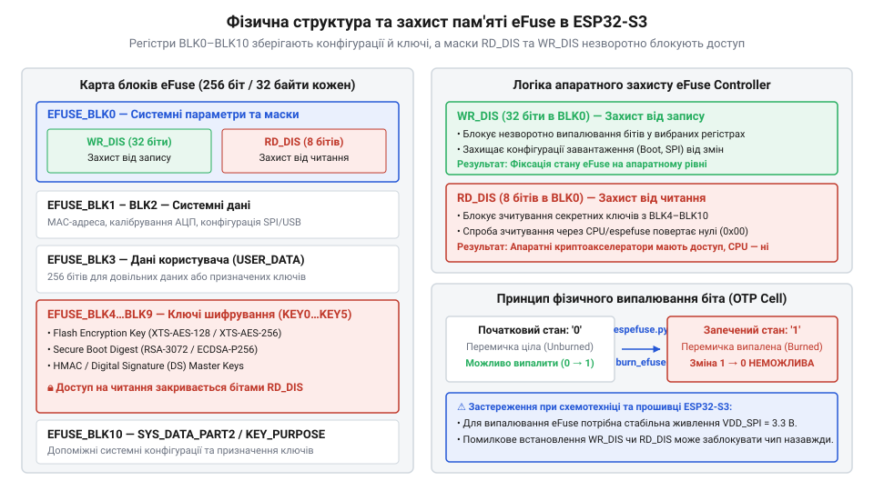
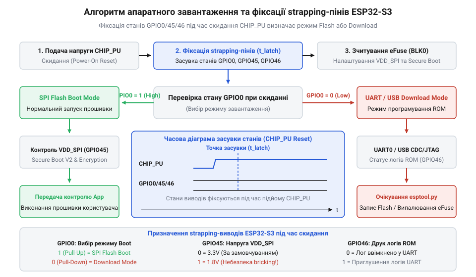
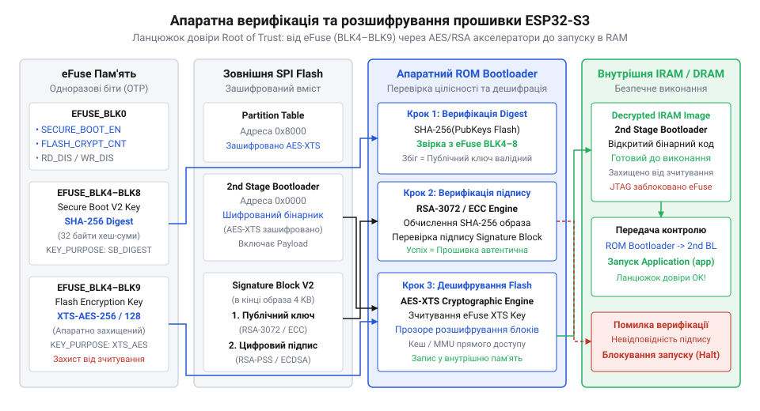
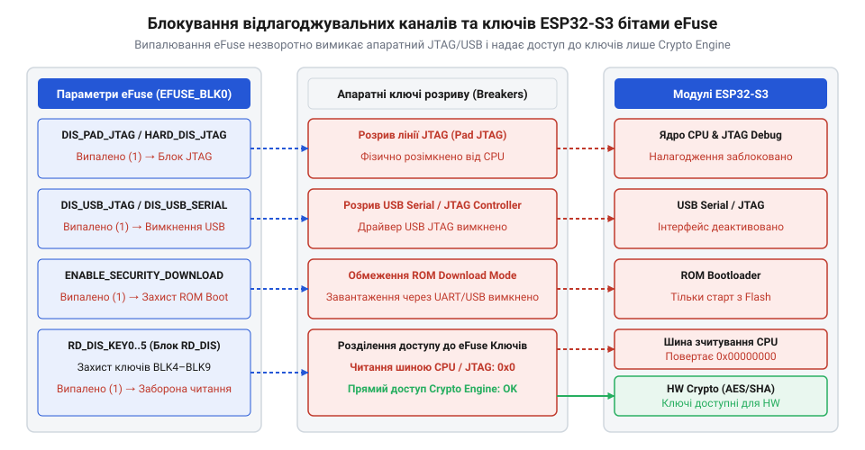
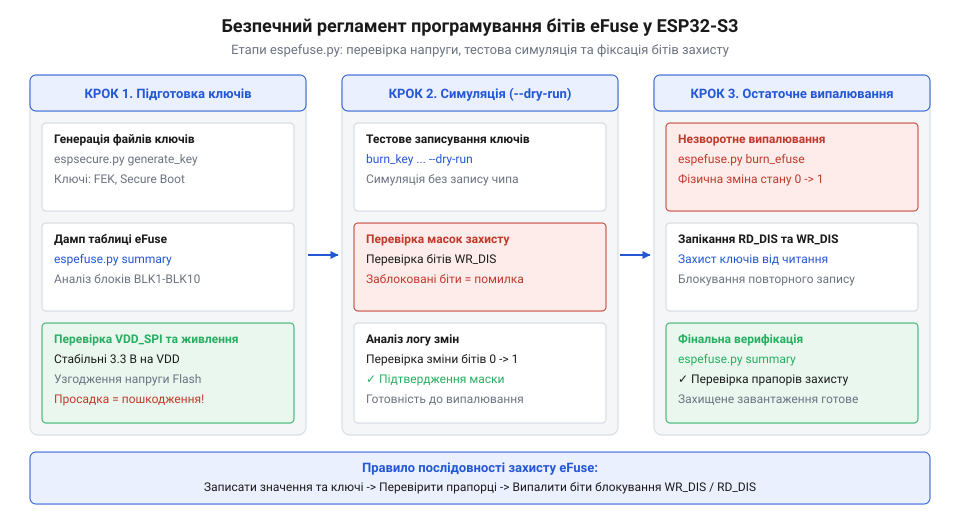

# Конфігурація eFuse та апаратне завантаження ESP32-S3

<preknowlist>
- [Мікроконтролер ESP32-S3](root:cat-hw-boards/esp32s3-microcontroller) — базову системну архітектуру двоядерного процесора Xtensa LX7, структуру внутрішньої пам'яті SRAM та підсистему скидання й живлення SoC
- [Родина плат і модулів на ESP32-S3](root:cat-hw-boards/esp32-s3-boards-family-overview) — класифікацію апаратних платформ ESP32-S3, особливості розведення USB CDC/JTAG та інтегровану периферію відлагодження
- [Схемотехніка та розпіновка шин Octal SPI Flash та PSRAM в ESP32-S3](root:cat-hw-boards/esp32-s3-octal-spi-bus-layout) — домени живлення VDD_SPI, топологію сигнальних ліній Flash-пам'яті та апаратну залежність від strapping-виводу GPIO45
</preknowlist>

## Фатальні збої первинного завантаження мікроконтролера

Розробка складних вбудованих систем на базі [мікроконтролера ESP32-S3](root:cat-hw-boards/esp32s3-microcontroller) нерідко зупиняється на першому ж етапі апаратного запуску. Інженер збирає дослідний зразок пристрою, подає живлення, однак замість виконання прошивки отримує циклічне перезавантаження SoC (англ. *bootloop*), вічне застрягання у режимі скачування або повну відсутність реакції з боку периферії. Найбільш фатальний сценарій полягає в апаратному виході з ладу мікросхеми зовнішньої високошвидкісної пам'яті одразу після подачі живлення. Спроби розробника знайти помилку у програмному коді додатка виявляються марними, оскільки проблема виникає до виконання першої інструкції в системній пам'яті SRAM. Корінь такого збою лежить у роботі первинної програми @@en|ROM Bootloader@@ (англ. *Read-Only Memory Bootloader* — первинний завантажник із масочно-запрограмованого ПЗП), яка зчитує фізичний стан схемотехнічних виводів під час скидання та конфігурує життєво важливі параметри SoC.

Апаратний цикл запуску починається з подачі сигналу на вивід @@en|CHIP_PU@@ (англ. *Chip Power Up* — вивід увімкнення та скидання мікроконтролера). Коли напруга на @@en|CHIP_PU@@ перетинає порогове значення, внутрішній контролер скидання при подачі живлення @@en|POR@@ (англ. *Power-On Reset* — вбудована схема скидання при подачі живлення) запускає генератори тактового сигналу, ініціалізує низьковольтні домени живлення та знімає блокування з двоядерного процесора Xtensa LX7. Проте ядра процесора ще не мають доступу до зовнішньої Flash-пам'яті та не виконують код користувача. Перші такти керування передаються масочно-запрограмованому коду ПЗП. Перш ніж ініціалізувати шину SPI, @@en|ROM Bootloader@@ зчитує фізичний стан чотирьох системних сигнальних ліній — @@en|GPIO0@@, @@en|GPIO3@@, @@en|GPIO45@@ та @@en|GPIO46@@. Ці виводи мають спеціальну назву @@en|strapping-вивід@@ (англ. *strap* — ремінь, затискач), оскільки вони жорстко засувають логічний режим роботи пристрою на етапі скидання без звернення до будь-якої зовнішньої пам'яті. Внутрішній апаратний регістр фіксує (англ. *latch*) напругу на цих лініях саме у момент наростання фронту сигналу @@en|CHIP_PU@@.

Призначення @@en|strapping-вивід@@ полягає в апаратному виборі джерела завантаження коду та налаштуванні режимів живлення внутрішньосистемних периферійних блоків. Головним селектором режиму виступає вивід @@en|GPIO0@@. Якщо під час скидання на @@en|GPIO0@@ утримується високий логічний рівень, @@en|ROM Bootloader@@ починає процедуру ініціалізації зовнішньої Flash-пам'яті та завантаження другого етапу (англ. *Second Stage Bootloader*). Якщо ж на @@en|GPIO0@@ діє низький потенціал, SoC переходить у @@en|Download Mode@@ (англ. *Download Mode* — режим завантаження через периферійні інтерфейси). У цьому режимі завантажник зупиняє запуск із Flash, виводить у консоль службовий рядок `boot:0x1 (DOWNLOAD(USB/UART0))` і переходить в очікування команд по протоколу SLIP. Якщо розробник спроєктував схему так, що до @@en|GPIO0@@ підключено кнопковий перемикач, сенсор або вихід транзистора без підтягувального резистора до лінії `3.3V`, будь-яка завада під час ввімкнення переведе мікроконтролер у режим скачування. Оцінити схемотехнічне розведення таких вузлів можна на прикладі [сімейства плат ESP32-S3](root:cat-hw-boards/esp32-s3-boards-family-overview), де розпіновка системних кнопок вимагає суворого дотримання часових та електричних параметрів.

Ще більшу апаратну небезпеку становить помилкова конфігурація виводу @@en|GPIO45@@. Цей вивід керує вихідною напругою вбудованого регулятора з низьким падінням напруги (англ. *Low Dropout*, LDO), який живить [доменом живлення VDD_SPI](root:cat-hw-boards/esp32-s3-octal-spi-bus-layout) для зовнішніх мікросхем Flash та PSRAM. Якщо у момент засувки на @@en|GPIO45@@ зафіксовано низький рівень (логічний `0`), внутрішній регулятор перемикається у режим вихідної напруги `3.3V`. Якщо ж зафіксовано високий рівень (логічна `1`), регулятор знижує напругу до `1.8V`. Неправильна зовнішня підтяжка призводить до фатальних наслідків: подача напруги `1.8V` на стандартну мікросхему пам'яті `3.3V` унеможливлює зчитування коду, викликаючи циклічні перезавантаження первинного завантажника через помилки читання шини. З іншого боку, подача напруги `3.3V` на високошвидкісні мікросхеми Octal SPI Flash та PSRAM, розраховані виключно на `1.8V`, призводить до пробою тонких діелектричних шарів напівпровідника та незворотного фізичного виходу пам'яті з ладу.

Третій конфігураційний вивід @@en|GPIO46@@ працює узгоджено з @@en|GPIO0@@ та визначає конкретний фізичний канал зв'язку при переході в @@en|Download Mode@@. Він регулює вибір між послідовним портом @@en|UART0@@ та нативним контролером @@en|USB CDC/JTAG@@, а також контролює трансляцію діагностичних логів ПЗП. Якщо у схемотехнічному рішенні лінії @@en|GPIO46@@ або @@en|GPIO0@@ підключені до периферійних мікросхем із високою паразитною ємністю чи низьким вихідним опором, швидкість наростання напруги на них зменшується. Під час засувки сигналу [електричні рівні сигналів](root:cat-hw-boards/esp32-s3-efuse-and-boot-configuration/api-esp32s3-boot-hardware-strapping-spec.md) потрапляють у неозначену зону між пороговою напругою логічного нуля та одиниці, спричиняючи хаотичні збої запуску при кожному повторному ввімкненні.

Щоб запобігти збоям, інженер мусить детально прораховувати часовий бюджет заряду ємностей на лінії скидання. Знаючи формули розрахунку [часових констант RC-кіл](root:cat-hw-boards/esp32-s3-efuse-and-boot-configuration/math-strapping-pins-rc-timing-budget.md), швидкість наростання напруги на виводі @@en|CHIP_PU@@ можна узгодити з постійними часу зовнішніх підтяжок. Проте покладатися виключно на зовнішні дискретні компоненти друкованої плати недоцільно: вони збільшують габарити пристрою та обмежують використання виводів GPIO для цілей додатка після завершення завантаження. Для розв'язання цього обмеження в інженерній еволюції Espressif виникла потреба в апаратному механізмі внутрішньої фіксації конфігурації. З тим, як [еволюціонували механізми завантаження](root:cat-hw-boards/esp32-s3-efuse-and-boot-configuration/hist-esp32-boot-efuse-evolution.md) у мікроконтролерах компанії, первинний завантажник отримав можливість ігнорувати зовнішні виводи та зчитувати параметри запуску безпосередньо з кремнієвої пам'яті @@en|eFuse@@. Зрозуміти низькорівневий протокол обміну пристрою у режимі скачування допомагають специфіковані [протоколи ROM-завантажувача](root:sys-ide/esp32-s3-rom-bootloader-download-protocol-spec), які описують структуру службових кадрів та команд.

## Архітектура та захист блоків eFuse

Необхідність надійно зберігати системні параметри без залежності від зовнішнього схемотехнічного обв'язування призвела до впровадження внутрішньої одноразово програмованої пам'яті @@en|eFuse@@ (англ. *electric fuse* — електричний запобіжник). На відміну від класичного ПЗП чи Flash-пам'яті, @@en|eFuse@@ являє собою масив мікроскопічних кремнієвих або металевих перемичок, сформованих безпосередньо у структурі напівпровідникового кристала SoC. У первинному стані кожна перемичка проводитиме електричний струм, що відповідає логічному нулю (`0`). Під час процедури програмування (запікання) спеціалізований апаратний контролер подає на обрану комірку короткочасний потужний імпульс струму підвищеної напруги. Цей струм фізично випалює перемичку, перетворюючи її на розрив електричного кола та апаратно фіксуючи логічну одиницю (`1`). Фізична руйнація кремнієвого містка є повністю незворотною: відновлення випаленого матеріалу неможливе жодними програмними чи електричними впливами. Така пам'ять належить до класу @@en|OTP@@ (англ. *One-Time Programmable* — пам'ять одноразового програмування).

У мікроконтролері ESP32-S3 пам'ять @@en|eFuse@@ організована у вигляді `11` апаратних блоків, позначених від @@en|EFUSE_BLK0@@ до @@en|EFUSE_BLK10@@. Кожен окремий блок має довжину 256 біт (32 байти), що забезпечує загальний обсяг пам'яті у 2816 біти (352 байт). Блоки розділені за функціональним призначенням на системні регістри конфігурації, користувацькі поля та криптографічні сховища ключів. Головний блок @@en|EFUSE_BLK0@@ виступає системним центром управління SoC. У ньому розміщені біти ревізії кристала, прапорці версії контролера, конфігуратори доменів живлення та біти блокування апаратного налагодження. Зокрема, випалювання бітів у @@en|EFUSE_BLK0@@ дозволяє примусово встановити напругу регулятора @@en|VDD_SPI@@ на `1.8V` або `3.3V`, повністю ігноруючи стан зовнішнього виводу @@en|GPIO45@@ під час скидання. Також у блоці 0 розташовані системні бітові маски обмеження доступу: маска захисту від читання @@en|RD_DIS@@ (англ. *Read Disable* — маска захисту від читання) та маска захисту від запису @@en|WR_DIS@@ (англ. *Write Disable* — маска захисту від запису).

Блоки @@en|EFUSE_BLK1@@ та @@en|EFUSE_BLK2@@ зарезервовані для зберігання заводських калібрувальних параметрів, унікального фізичного @@en|MAC-адрес@@ пристрою, параметрів корекції АЦП та налаштувань радіочастотного тракту. Блок @@en|EFUSE_BLK3@@ виділено для довільних даних користувача, де розробник може зберегти серійний номер продукту чи криптографічні сертифікати. Особливе місце в архітектурі посідають блоки від @@en|EFUSE_BLK4@@ до @@en|EFUSE_BLK9@@. Це шість універсальних заповнювальних слотів для 256-бітних секретних ключів. Саме сюди записуються ключі для апаратного [шифрування Flash-пам'яті](root:sf-security/esp32-s3-flash-encryption-and-hmac-key-management), хеш-образи публічних ключів для перевірки підписів під час [криптографічну валідацію Secure Boot](root:sf-security/esp32-s3-secure-boot-v2-cryptographic-architecture), а також системні секрети для модулів HMAC та цифрового підпису. Блок @@en|EFUSE_BLK0@@ містить спеціальні 4-бітні поля призначення ключів `KEY_PURPOSE_0` – `KEY_PURPOSE_5`, які жорстко зв'язують конкретний блок ключів із відповідним апаратним криптографічним акселератором. Завершальний блок @@en|EFUSE_BLK10@@ слугує додатковим резервним сховищем для користувацьких даних.

*Структура блоків eFuse EFUSE_BLK0–BLK10 та механізми маскування доступу RD_DIS і WR_DIS.*

Захист системних секретів та ключів шифрування від несанкціонованого зчитування чи модифікації реалізовано на логічному та електричному рівнях. Запікання біта у масці @@en|RD_DIS@@ в @@en|EFUSE_BLK0@@ призводить до негайного та фізичного відключення внутрішніх шин зчитування для відповідного блоку ключів (з BLK4 по BLK9). Після активації @@en|RD_DIS@@ ані ядро процесора Xtensa LX7, ані зовнішній програматор не можуть прочитати вміст блоку — будь-яке програмне звернення повертає суцільні нулі (`0x00`). Проте апаратні акселератори AES, HMAC та Secure Boot зберігають прямий доступ до випаленого ключа через ізольовані внутрішні канали, повністю недоступні для шини даних процесора. Аналогічно працює маска @@en|WR_DIS@@: випалювання біта у цій масці назавжди відключає подачу високовольтної напруги на відповідні біти або блоки, блокуючи будь-які подальші спроби повторного запікання чи фальсифікації конфігурації.

Оскільки фізичний процес випалювання кремнієвих містків піддається технологічному розкиду, виникає ризик неповного згоряння перемички або витоку струму під впливом температури. Для забезпечення безумовної цілісності даних Espressif інтегрувала в ESP32-S3 завадостійке кодування. Для блоків від @@en|EFUSE_BLK1@@ до @@en|EFUSE_BLK10@@ застосовується алгоритм @@en|Reed-Solomon ECC@@ (англ. *Reed-Solomon Error Correction Code* — код корекції помилок Ріда-Соломона). Пам'ять блоку розбивається на 64-бітні (8-байтові) порції. На кожні 32 байти корисних даних розраховується 12 байтів контрольних символів за допомогою схеми RS(44, 32) над скінченним полем Галуа GF(2^8). Це дозволяє апаратному контролеру @@en|eFuse@@ в режимі реального часу виявляти та автоматично виправляти пошкодження 1 байта або гарантовано виявляти пошкодження до 2 байт у кожному фрагменті. Детальні формули та обчислення контрольних матриць розкриваються у матеріалах, де наведено [кодування Ріда-Соломона](root:cat-hw-boards/esp32-s3-efuse-and-boot-configuration/math-esp32s3-efuse-reed-solomon-ecc.md).

Практичне програмування системних прапорців та ключів у процесі розробки й серійного виробництва здійснюється за допомогою утиліти командного рядка espefuse.py. Покроковий регламент перевірки та безпечні процедури випалювання описано в матеріалах про роботу [утиліти espefuse](root:cat-hw-boards/esp32-s3-efuse-and-boot-configuration/proj-esp32s3-efuse-provisioning-espefuse.md). Для програмної перевірки стану @@en|eFuse@@-полів та захисних масок безпосередньо з коду прошивки під час виконання застосовуються спеціалізовані [функції ESP-IDF HAL](root:cat-hw-boards/esp32-s3-efuse-and-boot-configuration/api-esp32s3-efuse-esp-idf-hal-api.md), які надають безпечний C-інтерфейс до регістрів контролера @@en|eFuse@@.

## Логіка strapping-виводів та режимів завантаження

Надійний запуск вбудованої системи вимагає від мікроконтролера здатності детерміновано визначити середовище виконання коду ще до того, як ядра процесора зможуть обробити першу інструкцію програміста. У складних проектних рішеннях на базі [мікроконтролера ESP32-S3](root:cat-hw-boards/esp32s3-microcontroller) розробник нерідко стикається із ситуацією, коли подача живлення завершується циклічним скиданням (англ. *bootloop*) або непередбачуваним виходом чипа в режим програмування. Причина полягає у тому, що первинний завантажник @@en|ROM Bootloader@@ (англ. *Read-Only Memory Bootloader* — масочно-запрограмоване ПЗП завантаження) змушений спиратися на зовнішні електричні сигнали на критичних сигнальних лініях для вибору джерела запуску, конфігурування інтерфейсів зв'язку та встановлення напруги внутрішніх регуляторів.

Ключовим апаратним механізмом цього вибору виступає фіксація логічних рівнів під час подачі живлення. Коли напруга живильної лінії зростає і вивід @@en|CHIP_PU@@ (англ. *Chip Power Up* — сигнал увімкнення та скидання чипа) перетинає пороговий рівень спрацьовування системи @@en|POR@@ (англ. *Power-On Reset* — апаратне скидання при подачі живлення), внутрішній контролер завантаження засуває (англ. *latch*) поточний стан напруги трьох спеціалізованих ліній: @@en|GPIO0@@, @@en|GPIO45@@ та @@en|GPIO46@@. У системній архітектурі Espressif ці лінії називаються @@en|strapping-вивід@@ (англ. *strap* — ремінь, прив'язка), оскільки вони жорстко прив'язують первинний режим роботи пристрою до фізичних потенціалів на друкованій платі. Часове вікно засувки вимагає, щоб логічні рівні на цих виводах були повністю стабільними та перебували в межах специфікованих [електричних параметрів підтяжок](root:cat-hw-boards/esp32-s3-efuse-and-boot-configuration/api-esp32s3-boot-hardware-strapping-spec.md) до моменту зняття скидання.

Вивід @@en|GPIO0@@ є головним селектором джерела виконання коду. Якщо під час засувки на @@en|GPIO0@@ зафіксовано високий логічний рівень (`1`), @@en|ROM Bootloader@@ розпочинає процедуру ініціалізації зовнішнього Flash-накопичувача через шину SPI та передає керування первинному завантажнику системи. Якщо ж на @@en|GPIO0@@ діє низький рівень (`0`), SoC зупиняє запуск із зовнішньої пам'яті та примусово активує режим скачування @@en|Download Mode@@ (англ. *Download Mode* — режим завантаження прошивки через периферійні порти). Другий конфігураційний вивід @@en|GPIO46@@ працює у зв'язці з @@en|GPIO0@@: під час входу у @@en|Download Mode@@ рівень на @@en|GPIO46@@ визначає, які саме фізичні периферійні канали доступні для зв'язку. При низькому рівні на @@en|GPIO46@@ пристрій відкриває можливість скачування прошивки як через послідовний порт @@en|UART0@@, так і через нативний контролер @@en|USB CDC/JTAG@@, а також керує трансляцією діагностичних логів ПЗП.

*Алгоритм вибору режиму завантаження ROM Bootloader за станом strapping-виводів та eFuse.*

Критична схемотехнічна вразливість криється у конфігуруванні виводу @@en|GPIO45@@, який відповідає за вибір вихідної напруги внутрішнього LDO-регулятора для [домену живлення VDD_SPI](root:cat-hw-boards/esp32-s3-octal-spi-bus-layout). За замовчуванням засувка логічного нуля (`0`) на @@en|GPIO45@@ переводить шину @@en|VDD_SPI@@ у режим `3.3V`, тоді як логічна одиниця (`1`) перемикає регулятор на `1.8V`. Помилка у зовнішньому підтягувальному резисторі на лінії @@en|GPIO45@@ призводить до фатальних наслідків: якщо на швидкісні мікросхеми Octal SPI Flash або PSRAM, розраховані виключно на `1.8V`, буде подано потенціал `3.3V`, відбудеться апаратний пробій кремнієвих структур і незворотне фізичне пошкодження пам'яті. Навпаки, подача `1.8V` на компоненти `3.3V` унеможливлює зчитування даних і переводить мікроконтролер у постійний стан збою завантаження.

Для усунення залежності від зовнішніх резисторів та запобігання апаратним конфліктам з периферією під час скидання розробники використовують внутрішню пам'ять @@en|eFuse@@. У блоці @@en|EFUSE_BLK0@@ розміщені спеціалізовані конфігураційні біти `VDD_SPI_FORCE`, `VDD_SPI_TIEH` та `VDD_SPI_XPD`. Якщо біт `VDD_SPI_FORCE` випалено у стан `1`, первинний завантажник @@en|ROM Bootloader@@ повністю ігнорує фізичний стан виводу @@en|GPIO45@@ під час подачі живлення. Натомість напруга шини @@en|VDD_SPI@@ жорстко задається значенням біта `VDD_SPI_TIEH`: логічна одиниця фіксує напругу `3.3V`, а логічний нуль — `1.8V`. Крім того, випалювання біта `DIS_DOWNLOAD_MODE` у блоці @@en|EFUSE_BLK0@@ дозволяє повністю та незворотно заблокувати перехід мікроконтролера у @@en|Download Mode@@, унеможливлюючи несанкціоноване перепрограмування пристрою через зовнішні фізичні інтерфейси.

Розробка схемотехніки друкованих плат із використанням strapping-ліній вимагає ретельного аналізу паразитних ємностей та вихідного опору підключених периферійних пристроїв. Якщо до @@en|GPIO0@@ або @@en|GPIO45@@ підключено сенсори чи транзисторні ключі, їхній стан під час подачі живлення може випадково спотворити логічний рівень. Розрахувати необхідні номінали резисторів та узгодити їх із часовим бюджетом заряду ємностей допомагає математичний аналіз [часових констант RC-кіл](root:cat-hw-boards/esp32-s3-efuse-and-boot-configuration/math-strapping-pins-rc-timing-budget.md). Інженерний аналіз [родини плат ESP32-S3](root:cat-hw-boards/esp32-s3-boards-family-overview) демонструє, що надійні промислові рішення комбінують апаратні підтяжувальні резистори з подальшим запіканням захисних бітів @@en|eFuse@@ для повної ізоляції системної конфігурації. Розібратися в деталях низькорівневого обміну даними під час налагодження допоможуть специфіковані [режими скачування ROM Bootloader](root:sys-ide/esp32-s3-rom-bootloader-download-protocol-spec), а оцінити інженерну преісторію розвитку завантажувальних механізмів можна через статтю про [еволюцію завантаження Espressif](root:cat-hw-boards/esp32-s3-efuse-and-boot-configuration/hist-esp32-boot-efuse-evolution.md).

## Механізми Secure Boot та Flash Encryption

Навіть якщо мікроконтролер успішно ініціалізував шину SPI та розпочав виконання коду з зовнішньої Flash-пам'яті, залишається критична загроза компрометації пристрою на фізичному рівні. Оскільки мікросхема Flash-пам'яті розміщена поза напівпровідниковим кристалом SoC, зловмисник із підключеним логічним аналізатором може перехопити нешифрований бінарний код або перепрограмувати накопичувач модифікованим шкідливим ПЗ. Для захисту цілісності та конфіденційності виконання коду в мікроконтролері ESP32-S3 реалізовано двоінструментальний апаратний бар'єр: механізм перевірки цифрового підпису @@en|Secure Boot V2@@ (англ. *Secure Boot* — захищене завантаження, апаратна перевірка цифрового підпису) та підсистему прозорого шифрування пам'яті @@en|Flash Encryption@@ (англ. *Flash Encryption* — апаратне шифрування зовнішньої пам'яті).

Захищене завантаження @@en|Secure Boot V2@@ формує нерозривний апаратний ланцюжок довіри @@en|Root of Trust@@ (англ. *Root of Trust* — корінь довіри, криптографічна основа безпеки), який починається у масочно-запрограмованому @@en|ROM Bootloader@@. В основі перевірки цілісності покладено асиметричне криптографічне шифрування на базі алгоритму @@en|RSA-3072@@ (англ. *Rivest–Shamir–Adleman* — асиметричний криптографічний алгоритм із довжиною ключа 3072 біти). При складанні проекту розробник підписує обраний бінарний образ вторинного завантажника (англ. *Second Stage Bootloader*) приватним ключем, а відповідний публічний ключ разом із цифровим підписом упаковується у спеціальний підписний блок наприкінці прошивки.

Під час первинного налаштування системи SHA-256 хеш-образ публічного ключа (англ. *Digest*) запікається у вільний блок eFuse (від @@en|EFUSE_BLK4@@ до @@en|EFUSE_BLK9@@). У системному блоці @@en|EFUSE_BLK0@@ для відповідного слота встановлюється значення цільового призначення ключа @@en|KEY_PURPOSE@@ (англ. *Key Purpose* — цільове призначення криптографічного ключа), рівне SECURE_BOOT_DIGEST0. Коли мікроконтролер вмикається, @@en|ROM Bootloader@@ до виконання будь-яких інструкцій із Flash зчитує запечений хеш із @@en|eFuse@@, вираховує SHA-256 від публічного ключа у Flash-пам'яті та порівнює їх. Якщо хеші збігаються, завантажник за допомогою апаратного акселератора перевіряє RSA-3072 підпис підписаного блоку прошивки. Спроба підміни бодай одного байта в прошивці призводить до відхилення підпису, блокування запуску та зупинки процесора. Крім того, система підтримує захист від відкоту версій (англ. *anti-rollback*): випалювання лічильників версій у @@en|eFuse@@ унеможливлює запуск застарілих підписаних прошивок із виявленими уразливостями. Деталізований математичний та криптографічний розбір цього процесу висвітлено у матеріалі про [валідацію Secure Boot V2](root:sf-security/esp32-s3-secure-boot-v2-cryptographic-architecture).

Паралельно з перевіркою цілісності працює підсистема @@en|Flash Encryption@@, яка забезпечує конфіденційність коду та даних. Для захисту від фізичного зчитування вмісту шини SPI в ESP32-S3 інтегровано апаратний акселератор шифрування @@en|AES-256-XTS@@ (англ. *Advanced Encryption Standard XEX Tweakable Block Cipher with Ciphertext Stealing* — режим блочного шифрування для носіїв даних), розміщений безпосередньо між кеш-пам'яттю процесора Xtensa LX7 та зовнішнім контролером SPI. Режим XTS виключає появу однакових шифротекстів для повторюваних блоків даних, оскільки використовує модифікатор адреси (англ. *tweak*) для кожного 16-байтового сектора. Ключ шифрування довжиною 256 або 512 біт генерується апаратним генератором випадкових чисел та запікається у блок ключа від @@en|EFUSE_BLK4@@ до @@en|EFUSE_BLK9@@ із встановленням `KEY_PURPOSE` = `FLASH_ENCRYPTION`.

*Ланцюжок безпечного завантаження та розшифрування Flash-пам'яті на льоту.*

Ключовим безпековим елементом @@en|Flash Encryption@@ є випалювання біта маски захисту від читання @@en|RD_DIS@@ у блоці @@en|EFUSE_BLK0@@ для обраного блоку ключів. Після активації @@en|RD_DIS@@ доступ до ключа із боку процесора або зовнішнього програматора стає повністю неможливим — будь-яке читання відповідного @@en|eFuse@@-блоку повертає суцільні нулі (`0x00`). При цьому апаратний AES-акселератор має прямий ізольований кремнієвий канал до ключового блоку. Під час роботи процесор виконує інструкції з Flash-пам'яті без затримок: апаратний модуль шифрування прозоро розшифровує блоки даних «на льоту» під час завантаження у кєш. Детальніше архітектура розподілу секретів розкривається у матеріалі про [управління ключами шифрування](root:sf-security/esp32-s3-flash-encryption-and-hmac-key-management).

Для гарантії повної безпеки пристрою у серійному виробництві активація @@en|Secure Boot V2@@ та @@en|Flash Encryption@@ повинна супроводжуватися апаратним блокуванням каналів відлагодження. За допомогою бітів у @@en|EFUSE_BLK0@@ розробник незворотно вимикає апаратний відлагоджувач @@en|JTAG@@ (біти `DIS_PAD_JTAG` та `DIS_USB_JTAG`), контролер @@en|USB Serial/JTAG@@ та можливість повторного входу в @@en|Download Mode@@. Порядок незворотного відключення цих інтерфейсів описується у матеріалі про [апаратне блокування JTAG](root:sys-ide/esp32-s3-jtag-debugging-and-security-lockout). Практичний алгоритм поетапного налаштування захищеного середовища у фреймворку ESP-IDF наведено в описі [розгортання Secure Boot та Flash Encryption](root:cat-hw-boards/esp32-s3-efuse-and-boot-configuration/proj-esp32s3-secure-boot-flash-encryption-setup.md), а процедури безпечного запікання ключів — у статтях про [утиліту espefuse.py](root:cat-hw-boards/esp32-s3-efuse-and-boot-configuration/proj-esp32s3-efuse-provisioning-espefuse.md) та [C-API фреймворку ESP-IDF](root:cat-hw-boards/esp32-s3-efuse-and-boot-configuration/api-esp32s3-efuse-esp-idf-hal-api.md).

## Блокування відлагодження та фіксація конфігурації

Увімкнення апаратного шифрування @@en|Flash Encryption@@ та перевірки цифрового підпису @@en|Secure Boot V2@@ створює потужний криптографічний бар'єр навколо зовнішньої Flash-пам'яті, проте залишає пристрій уразливим до атак із безпосереднім фізичним доступом. Якщо в серійному виробі на базі [мікроконтролера ESP32-S3](root:cat-hw-boards/esp32s3-microcontroller) залишаються активними апаратні відлагоджувальні інтерфейси, зловмисник може підключити зовнішній адаптер, зупинити виконання процесорних ядер @@en|Xtensa LX7@@ і зчитати відкритий вміст внутрішньої пам'яті @@en|SRAM@@. Оскільки розшифровані інструкції прошивки, змінні сесії та проміжні криптографічні дані під час виконання перебувають у кеші та @@en|SRAM@@ у відкритому вигляді, наявність фізичного каналу відлагодження повністю нівелює захист зовнішнього накопичувача.

Головним вектором фізичного проникнення виступає стандартний апаратний інтерфейс @@en|JTAG@@ (англ. *Joint Test Action Group* — об'єднана група дій із тестування, апаратний стандарт налагодження). У мікроконтролері ESP32-S3 підсистема відлагодження доступна через два незалежні фізичні канали. Перший — це виділені контактні площадки @@en|PAD JTAG@@ на виводах @@en|GPIO39@@–@@en|GPIO42@@ (сигнали TCK, TMS, TDI та TDO). Другий — вбудований апаратний контролер @@en|USB Serial/JTAG@@, підключений безпосередньо до нативних виводів USB D+ та D-. Підключення до будь-якого з цих портів надає повний контроль над контролером порту доступу @@en|TAP@@ (англ. *Test Access Port* — порт доступу до тестування), дозволяючи покроково виконувати інструкції, дампувати регістри процесора та вилучати секретні ключі з оперативної пам'яті.

*Перемикачі системного блоку EFUSE_BLK0 для блокування апаратних відлагоджувальних каналів та захисту пам'яті.*

Для незворотного усунення цих загроз у системному блоці пам'яті @@en|eFuse@@ (англ. *electronic fuse* — електронний виплавлюваний запобіжник) @@en|EFUSE_BLK0@@ передбачено групу безпекових бітів. Випалювання біта @@en|DIS_PAD_JTAG@@ (англ. *Disable Pad JTAG* — прапорець вимкнення фізичних виводів JTAG) фізично від'єднує контролер @@en|JTAG@@ від зовнішніх виводів @@en|GPIO39@@–@@en|GPIO42@@. Суміжний біт @@en|DIS_USB_JTAG@@ (англ. *Disable USB JTAG* — прапорець вимкнення відлагоджувача у складі USB-контролера) деактивує логіку відлагодження у складі нативного USB-інтерфейсу. При цьому нативний USB-порт зберігає можливість функціонування у режимі послідовного порту @@en|USB Serial@@ для виводу діагностичних повідомлень, але повністю втрачає здатність перехоплювати керування ядром процесора.

Окрім відлагоджувальних портів, критичною зоною ризику є первинний завантажник @@en|ROM Bootloader@@ (англ. *Read-Only Memory Bootloader* — масочно-запрограмоване ПЗП завантаження). За замовчуванням при подачі низького логічного рівня на strapping-вивід @@en|GPIO0@@ під час подачі живлення @@en|CHIP_PU@@ мікроконтролер переходить у режим скачування @@en|Download Mode@@. У цьому режимі через порти @@en|UART0@@ або @@en|USB CDC@@ зловмисник може надсилати командні пакети для зчитування внутрішньої пам'яті та завантаження довільного коду в @@en|SRAM@@. Для блокування цього каналу в блоці @@en|EFUSE_BLK0@@ призначено біт @@en|DIS_DOWNLOAD_MODE@@ (англ. *Disable Download Mode* — апаратна заборона режиму скачування). Його випалювання змушує @@en|ROM Bootloader@@ повністю ігнорувати стан виводу @@en|GPIO0@@ і забороняє перехід у режим скачування. Якщо ж пристрій потребує збереження можливості оновлення прошивки по дроту, замість повного блокування застосовують біт @@en|ENABLE_SECURITY_DOWNLOAD@@, який дозволяє запис нової прошивки, але блокує будь-які команди зчитування пам'яті та eFuse-полів.

Остаточним етапом фіксації конфігурації пристрою є застосування захисної маски @@en|RD_DIS@@ (англ. *Read Disable* — маска блокування зчитування). Усі криптографічні ключі шифрування @@en|AES-256-XTS@@ та хеш-образи публічних ключів @@en|Secure Boot V2@@ записуються у блоки від @@en|EFUSE_BLK4@@ до @@en|EFUSE_BLK9@@. Якщо після запису ключів біти маски @@en|RD_DIS@@ у @@en|EFUSE_BLK0@@ залишаться непаленими, зловмисник зможе зчитати значення ключів через системну шину або програматор. Випалювання відповідних бітів @@en|RD_DIS@@ апаратно відключає лінії зчитування для CPU та периферії: будь-яке звернення до комірок повертає суцільні нулі (`0x00`). При цьому криптографічні акселератори зберігають прямі ізольовані шини до блоків ключів, що забезпечує виконання шифрування без ризику витоку секретів. Глибокий інженерний аналіз питань [апаратного блокування JTAG](root:sys-ide/esp32-s3-jtag-debugging-and-security-lockout) висвітлює процедури тимчасового розблокування через @@en|HMAC@@-ключі та біт @@en|JTAG_SEL_ENABLE@@, а принципи безпечного [управління ключами шифрування](root:sf-security/esp32-s3-flash-encryption-and-hmac-key-management) описують порядок призначення ролей @@en|KEY_PURPOSE@@. Практичні деталі конфігурування розкрито у матеріалі про [розгортання Secure Boot](root:cat-hw-boards/esp32-s3-efuse-and-boot-configuration/proj-esp32s3-secure-boot-flash-encryption-setup.md), а програмні виклики перевірки стану eFuse містить [C-API фреймворку ESP-IDF](root:cat-hw-boards/esp32-s3-efuse-and-boot-configuration/api-esp32s3-efuse-esp-idf-hal-api.md).

## Практичне профілювання та прошивка eFuse

Фізична організація одноразово програмованої пам'яті @@en|eFuse@@ перетворює процедуру запікання бітів на найбільш відповідальний етап технологічного процесу виробництва. Пам'ять @@en|OTP@@ (англ. *One-Time Programmable* — пам'ять із одноразовим записом) базується на незворотній фізичній трансформації кремнієвих перемичок високим струмом. Після того як перемичка виплавлена у стан логічної одиниці (`1`), її неможливо повернути у початковий стан (`0`). Помилка у значеннях прапорців, запис ключа не у свій слот або передчасне випалювання захисних масок призводить до фізичного псування мікроконтролера та його остаточного блокування (англ. *bricking*).

Для проведення вимірювань, валідації та запису системних конфігурацій використовується офіційна консольна утиліта @@en|espefuse.py@@ (англ. *Espressif eFuse Provisioning Tool* — консольний інструмент програмування eFuse), яка входить до складу інструментарію @@en|esptool@@. Безпечний виробничий регламент вимагає обов'язкового первинного аудиту чипа за допомогою команд `espefuse.py summary` та `espefuse.py dump`. Вони відображають поточний стан усіх одинадцяти блоків (від @@en|EFUSE_BLK0@@ до @@en|EFUSE_BLK10@@), запечені значення цільового призначення ключів @@en|KEY_PURPOSE@@ та стан масок @@en|RD_DIS@@ і @@en|WR_DIS@@ (англ. *Write Disable* — маска блокування запису). Щоб виключити людські помилки під час розробки автоматизованих скриптів конвеєра, утиліта підтримує режим сухий прогон @@en|dry run@@ (англ. *dry run* — режим тестового прогону) з аргументом --path-efuse-file. Цей параметр симулює масив eFuse у локальному файлі, дозволяючи відлагодити всі команди запису без ризику пошкодження кремнієвого кристала справжнього пристрою.

*Безпечна послідовність операцій запікання eFuse-полів та масок захисту при серійному виробництві.*

Фундаментальне правило безпечної прошивки полягає у суворому дотриманні послідовності операцій запису даних та застосування масок захисту. Запис криптографічних секретів у блоки від @@en|EFUSE_BLK4@@ до @@en|EFUSE_BLK9@@ виконується командою `burn_key` (англ. *burn key* — команда випалювання криптографічного ключа). Під час цієї операції утиліта записує 256-бітний або 512-бітний ключ у цільовий блок, встановлює значення @@en|KEY_PURPOSE@@ у блоці @@en|EFUSE_BLK0@@ та автоматично обчислює 96-бітний контрольний код [кодування Ріда-Соломона](root:cat-hw-boards/esp32-s3-efuse-and-boot-configuration/math-esp32s3-efuse-reed-solomon-ecc.md) @@en|Reed-Solomon ECC@@ RS(44, 32). Лише після того як ключ запечено і контрольна сума цілісності підтверджена, дозволяється активувати маски захисту: спочатку випалюється біт @@en|RD_DIS@@ для приховування ключа від читання, а потім — біт @@en|WR_DIS@@ для блокування подальшого запису в цей блок.

Критична пастка виникає при порушенні цього порядку. Якщо випалити маску @@en|WR_DIS@@ для блоку ключів до моменту запису самого бінарного ключа, цей блок буде назавжди заблоковано у стані порожніх нулів (`0x00`), що унеможливить подальше використання Flash Encryption або Secure Boot. Подібним чином, якщо випалити маску @@en|RD_DIS@@ до встановлення значення @@en|KEY_PURPOSE@@ у блоці @@en|EFUSE_BLK0@@, апаратний криптографічний модуль не зможе визначити цільове призначення ключа, а система не зможе його перевизначити через заблоковане читання. У середовищі виконання @@en|ESP-IDF@@ низькорівневе читання та безпечний пакетний запис бітів здійснюються через [C-API фреймворку ESP-IDF](root:cat-hw-boards/esp32-s3-efuse-and-boot-configuration/api-esp32s3-efuse-esp-idf-hal-api.md) за допомогою функцій `esp_efuse_read_field_blob()` та `esp_efuse_burn_new_values()`. Практичні інструкції з налаштування автотестів конвеєра містить розділ про [утиліту espefuse.py](root:cat-hw-boards/esp32-s3-efuse-and-boot-configuration/proj-esp32s3-efuse-provisioning-espefuse.md). Дотримання викладеного регламенту гарантує надійний захист серійних виробів на базі [родини плат ESP32-S3](root:cat-hw-boards/esp32-s3-boards-family-overview) від физичного злому та блокування пристроїв у процесі виробництва.