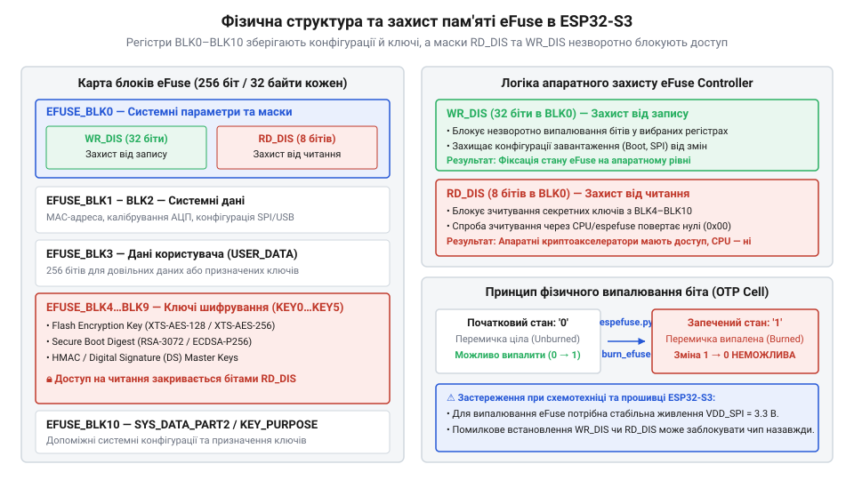
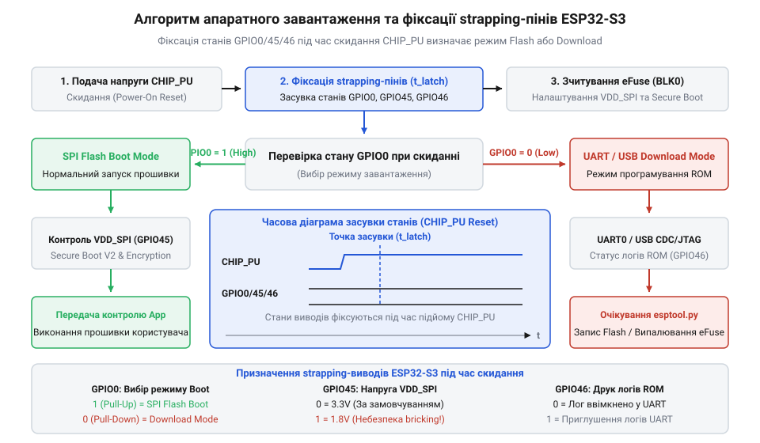
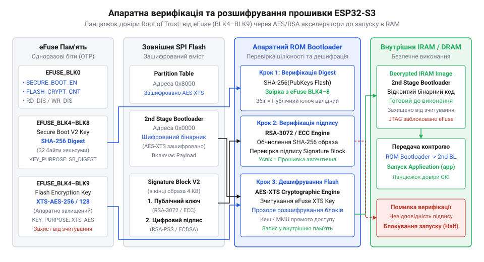
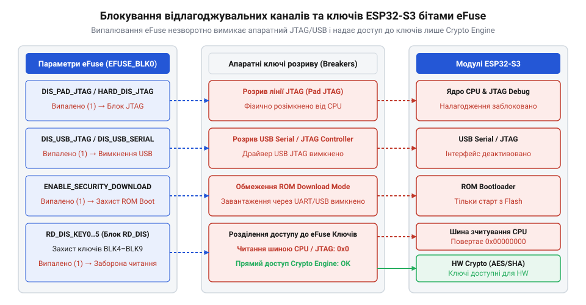
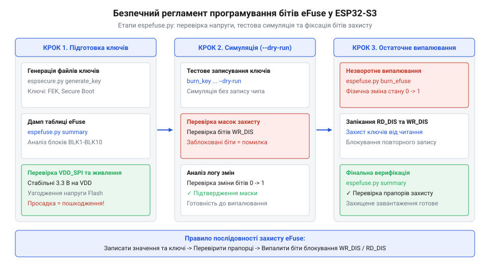

# Конфігурація eFuse та апаратне завантаження ESP32-S3

<preknowlist>
- [Мікроконтролер ESP32-S3](root:cat-hw-boards/esp32s3-microcontroller) — базову системну архітектуру двоядерного процесора Xtensa LX7, структуру внутрішньої пам'яті SRAM та підсистему скидання й живлення SoC
- [Родина плат і модулів на ESP32-S3](root:cat-hw-boards/esp32-s3-boards-family-overview) — класифікацію апаратних платформ ESP32-S3, особливості розведення USB CDC/JTAG та інтегровану периферію відлагодження
- [Схемотехніка та розпіновка шин Octal SPI Flash та PSRAM в ESP32-S3](root:cat-hw-boards/esp32-s3-octal-spi-bus-layout) — домени живлення VDD_SPI, топологію сигнальних ліній Flash-пам'яті та апаратну залежність від strapping-виводу GPIO45
</preknowlist>

## Фатальні збої первинного завантаження мікроконтролера

Причина @@en|bootloop@@ (від англ. *boot* + *loop* — зациклене перезавантаження) чи вигорання зовнішньої пам'яті криється у перших мікросекундах запуску. При наростанні напруги CHIP_PU мікрокод @@en|ROM Bootloader@@ (первинний завантажувач у масочному ПЗП, від англ. *Read-Only Memory*) зчитує рівні на виводах @@en|strapping@@ (від англ. *strap* — прив'язка станів): GPIO0, GPIO45 та GPIO46. Помилкова підтяжка GPIO0 переводить SoC у @@en|Download Mode@@ (режим скачування прошивки) замість виконання програми.

Хибний рівень GPIO45 виставляє напругу регулятора @@en|VDD_SPI@@: подача 3.3 В на 1.8-вольтові Flash та PSRAM випалює пам'ять до першої інструкції. Зовнішні резистори залежать від завад, тому коли ви [проектуєте мікроконтролерні плати](root:cat-hw-boards/esp32s3-microcontroller), конфігурацію фіксують одноразово програмованою пам'яттю @@en|eFuse@@ (від англ. *electronic fuse* — електронний запобіжник).

## Архітектура та захист блоків eFuse

Пам'ять @@en|eFuse@@ складається з 11 апаратних блоків EFUSE_BLK0–EFUSE_BLK10, де одиниці записують електричним випалюванням кремнієвих перемичок. Ролі цієї @@en|OTP@@-структури (від англ. *One-Time Programmable* — одноразово програмований) розділені між системними прапорцями, MAC-адресою та сховищем ключів EFUSE_BLK4–EFUSE_BLK9.

*Розподіл блоків EFUSE_BLK0–BLK10 та апаратна ізоляція масками RD_DIS й WR_DIS.*

Апаратну ізоляцію забезпечують маски: WR_DIS унеможливлює перезапис регістрів, а RD_DIS відключає шину зчитування для процесора та програматора. Від спонтанних помилок захищає кодування @@en|Reed-Solomon ECC@@ (код виправлення помилок Ріда-Соломона). Це дає змогу орієнтуватись [у родині плат ESP32-S3](root:cat-hw-boards/esp32-s3-boards-family-overview).

## Логіка strapping-виводів та режимів завантаження

При наростанні CHIP_PU @@en|ROM Bootloader@@ фіксує GPIO0, GPIO45 та GPIO46: високий GPIO0 запускає Flash, а низький при низькому GPIO46 — @@en|Download Mode@@. Хибні RC-підтяжки збивають вибір режиму.

*Алгоритм зчитування strapping-ліній та заміна зовнішніх підтяжок системними бітами VDD_SPI_FORCE та VDD_SPI_TIEH.*

Для [розведення шини Octal SPI](root:cat-hw-boards/esp32-s3-octal-spi-bus-layout) в EFUSE_BLK0 запікають VDD_SPI_FORCE (ігнорувати GPIO45) та VDD_SPI_TIEH (0 — 1.8 В, 1 — 3.3 В). DIS_DOWNLOAD_MODE незворотно блокує скачування.

## Механізми Secure Boot та Flash Encryption

@@en|Secure Boot V2@@ перевіряє підпис прошивки: @@en|ROM Bootloader@@ звіряє хеш RSA-3072 з EFUSE_BLK4–EFUSE_BLK9, формуючи @@en|Root of Trust@@ (від англ. *root of trust* — корінь довіри).

*Формування ланцюжка довіри та прозоре розшифрування даних шини SPI криптографічним блоком AES-256-XTS.*

@@en|Flash Encryption@@ розшифровує Flash «на льоту» акселератором AES-256-XTS. Маска RD_DIS ховає ключі від Xtensa, залишаючи доступ лише криптоблокам. Це захищає [модулі серії WROOM](root:cat-hw-boards/esp32-s3-wroom-modules-family).

## Блокування відлагодження та фіксація конфігурації

@@en|JTAG@@ (інтерфейс зневадження) та USB Serial/JTAG дозволяють зчитати SRAM, обходячи шифрування.

*Ізоляція TAP-контролера бітами DIS_PAD_JTAG та DIS_USB_JTAG.*

Випалювання DIS_PAD_JTAG та DIS_USB_JTAG у EFUSE_BLK0 блокує відлагодження, а DIS_DOWNLOAD_MODE фіксує конфігурацію перед серією.

## Практичне профілювання та прошивка eFuse

Програмування @@en|eFuse@@ незворотне: утиліта @@en|espefuse.py@@ вимагає аудиту регістрів через summary або dump і симуляції в режимі @@en|dry run@@ (від англ. *dry run* — пробний запуск) з параметром --path-efuse-file.

*Послідовність аудиту, симуляційного прогону та випалювання ключів і захисних масок WR_DIS й RD_DIS.*

Передчасне запікання WR_DIS чи RD_DIS блокує порожній EFUSE_BLK4. Ключ випалюють командою burn_key, перевіряють запис і лише потім запікають маски.