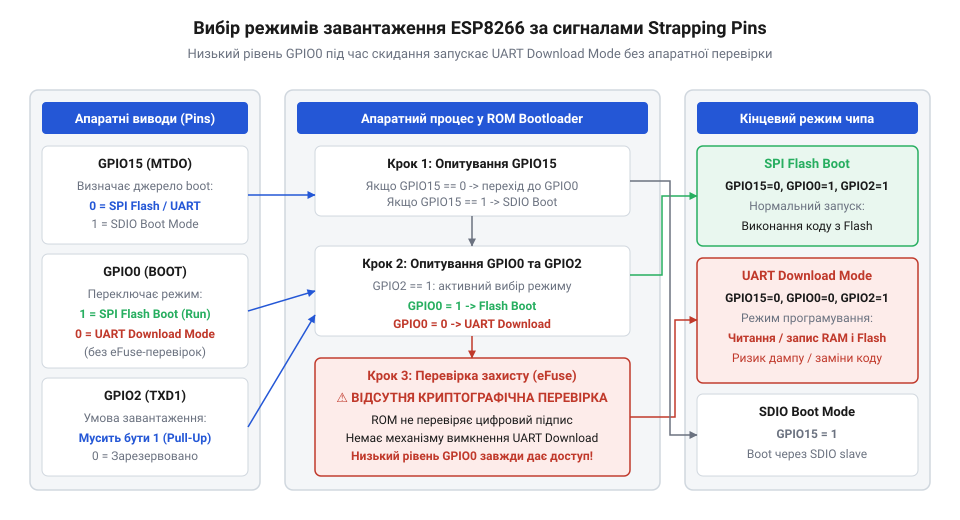
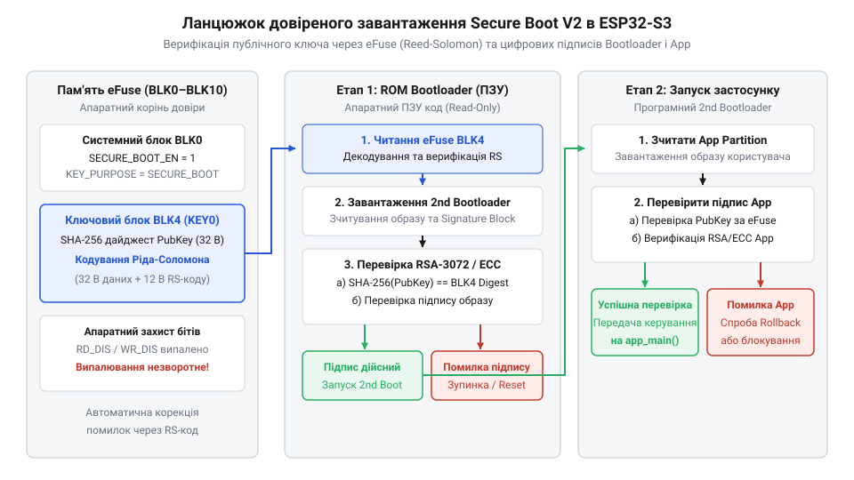

# Еволюція механізмів апаратного завантаження та eFuse в мікроконтролерах Espressif

<preknowlist>
- [Мікроконтролер ESP32-S3](root:cat-hw-boards/esp32s3-microcontroller) — загальну архітектуру ядра Xtensa LX7, внутрішній розподіл пам'яті та організацію периферійних шин
- [Схемотехніка та розпіновка шин Octal SPI Flash та PSRAM в ESP32-S3](root:cat-hw-boards/esp32-s3-octal-spi-bus-layout) — принципи адресації зовнішньої флеш-пам'яті та апаратного шифрування шини SPI
</preknowlist>

## Незахищений старт незахищеного ESP8266

У 2014 році поява мікроконтролера ESP8266 компанії Espressif Systems зробила справжній переворот у сфері бездротових пристроїв інтернет-речей завдяки безпрецедентно низькій вартості чипа. Щоб досягти мінімальної площі силіконового кристала та максимально здешевити виробництво, інженери відмовилися від розміщення внутрішньої флеш-пам'яті для зберігання виконуваного коду безпосередньо на кристалі. Замість цього прошивка користувача розміщувалася у зовнішньому мікросхемному модулі пам'яті, з'єднаному з контролером через послідовну шину SPI.

Під час подачі живлення або зняття сигналу скидання мікроконтролер повинен апаратно визначити, звідки саме слід розпочати виконання інструкцій CPU. Для цього у внутрішню постійну пам'ять кристала зашито незмінний апаратний завантажувач — @@en|ROM Bootloader@@ (англ. *read-only memory bootstrap loader* — апаратний завантажувач із постійного запам'ятовувача). До того як процесор виконає першу команду користувацької програми, апаратна логіка @@en|ROM Bootloader@@ зчитує електричні потенціали на трьох спеціалізованих фізичних виводах чипа: `GPIO0`, `GPIO2` та `GPIO15`. У технічній документації ці лінії називають @@en|strapping-виводи@@ (англ. *strap* — ремінь, апаратна прив'язка конфігурації).

Якщо під час подачі живлення вивід `GPIO15` підтягнутий до низького рівня (GND), `GPIO2` — до високого (VCC), а `GPIO0` утримується у високому стані, апаратний завантажувач спрямовує процесор на виконання коду із зовнішньої пам'яті @@en|SPI Flash@@ (англ. *serial peripheral interface flash* — послідовна флеш-пам'ять). Якщо ж вивід `GPIO0` примусово замикають на землю, мікроконтролер переходить у режим сервісного завантаження — @@en|UART Download Mode@@ (англ. *universal asynchronous receiver-transmitter download mode* — режим завантаження через послідовний порт).

*Логічні рівні на виводах GPIO0, GPIO2 та GPIO15 під час подачі живлення фіксуються апаратним завантажувачем ROM для вибору джерела виконання коду.*

Така архітектура виявилася надзвичайно зручною для розробників, але створила фундаментальні уразливості з точки зору кібербезпеки. Фізичні провідники шини між ESP8266 та зовнішньою мікросхемою пам'яті залишаються абсолютно відкритими на друкованій платі. Будь-який зловмисник із дешевим логічним аналізатором або осцилографом може безперешкодно перехоплювати відкритий трафік, зчитуючи прошивку, ключі доступу до Wi-Fi та прополіційні алгоритми безпосередньо з шини SPI.

Більше того, фізичне замикання виводу `GPIO0` на землю під час включення живлення примушує @@en|ROM Bootloader@@ переходити в @@en|UART Download Mode@@. Оскільки ESP8266 не має жодних апаратних засобів перевірки цілісності чи шифрування, будь-яка зовнішня утиліта через послідовний порт може повністю вичитати вміст пам'яті @@en|SPI Flash@@, внести до двійкового коду довільні зміни та записати модифіковану прошивку назад у пристрій. Відсутність криптографічних бар'єрів у першому поколінні чипів вимагала від розробників Espressif фундаментального перегляду архітектури апаратного захисту при створенні наступних сімейств чипів, таких як [мікроконтролерах ESP32-S3](root:cat-hw-boards/esp32s3-microcontroller).

## Поява eFuse та Secure Boot V1

Масове розгортання пристроїв інтернет-речей у комерційних продуктах, розумних будинках та промислових системах поставило перед інженерами вимогу захисту інтелектуальної власності й унеможливлення підробки пристроїв. Зчитування незахищеного коду з відкритих шин стало неприпустимим. Тому у 2016 році компанія Espressif випустила нове покоління мікроконтролерів ESP32, у яке вперше було інтегровано спеціалізовану одноразово програмовану пам'ять @@en|eFuse@@ (англ. *electronic fuse* — електронний запобіжник).

Фізично елемент @@en|eFuse@@ є мікроскопічною провідною перемичкою із полікремнію або металу на силіконовому кристалі. У початковому стані перемичка ціла і зчитується апаратною логікою як логічний `0`. Для запису значення `1` на відповідну комірку подається підвищена програмуюча напруга, яка фізично випалює провідник, перетворюючи його на розрив кола. Оскільки силіконова перемичка руйнується фізично, процес випалювання є повністю незворотним. Вміст пам'яті @@en|eFuse@@ неможливо стерти, скинути програмним шляхом чи відновити до початкового стану `0` після завершення прошивки.

У першій ревізії мікроконтролерів ESP32 пам'ять @@en|eFuse@@ була структурована у 4 логічні блоки по 256 бітів кожен:
- `BLK0`: системний блок конфігурації, де зберігаються біти захисту від зчитування й запису інших блоків, а також прапорці активації захисних функцій;
- `BLK1`: спеціалізований блок для збереження апаратного ключа шифрування пам'яті @@en|Flash Encryption@@ (англ. *flash encryption* — шифрування флеш-пам'яті);
- `BLK2`: блок зберігання криптографічного ключа верифікації завантажувача для механізму @@en|Secure Boot V1@@ (англ. *secure boot version 1* — захищене завантаження першої версії);
- `BLK3`: блок для збереження користувацьких даних або унікального ідентифікатора пристрою.

Впровадження @@en|Flash Encryption@@ дозволило шифрувати вміст зовнішньої пам'яті @@en|SPI Flash@@ за допомогою апаратного блоку @@en|AES-128@@ (англ. *advanced encryption standard* — розширений стандарт шифрування) або `AES-256`. Контролер шини SPI виконує прозоре апаратне розшифрування інструкцій "на льоту" під час їх зчитування CPU. Якщо в блоці `BLK0` випалити біт заборони читання `BLK1`, ключ шифрування стає повністю недоступним для прочитання через процесор або налагоджувальні інтерфейси.

Механізм @@en|Secure Boot V1@@ базувався на симетричній криптографії та звіренні дайджесту завантажувача. Перед запуском програмного завантажувача з @@en|SPI Flash@@ апаратний @@en|ROM Bootloader@@ обчислював криптографічний хеш першого блоку прошивки та порівнював його з ключем, зафіксованим у `BLK2`.

Проте практична експлуатація першого покоління @@en|Secure Boot V1@@ виявила критичну архітектурну слабкість. Перевірка цілісності коду виконувалася програмними інструкціями @@en|ROM Bootloader@@ під час старту CPU. Дослідники з кібербезпеки продемонстрували успішні атаки методом впровадження апаратних збоїв — @@en|fault injection@@ (англ. *fault injection* — впровадження апаратних збоїв) або @@en|glitching@@ (англ. *glitch* — короткочасний збій живлення або тактування). Подаючи короткочасний сплеск напруги живлення або імпульс тактового сигналу в момент виконання інструкції порівняння дайджестів у ROM, вдавалося змусити процесор пропустити умовний перехід й запустити неавторизовану прошивку вільним ходом. Це змусило розробників створити принципово новий криптографічний ланцюжок довіри.

## Стандартизація Secure Boot V2 в ESP32-S3

Для повного усунення уразливостей до атак методом @@en|glitching@@ та переходу на сучасні стандарти корпоративної криптографії Espressif розробила технологію @@en|Secure Boot V2@@ (англ. *secure boot version 2* — захищене завантаження другої версії), втілену у [мікроконтролерах ESP32-S3](root:cat-hw-boards/esp32s3-microcontroller).

Архітектура пам'яті @@en|eFuse@@ в ESP32-S3 була кардинально розширена й отримала структуровану матрицю з 11 незалежних блоків (від `BLK0` до `BLK10`) загальним обсягом 4096 бітів. Системний блок `BLK0` містить глобальні налаштування та матриці блокування запису й читання. Блоки `BLK1` та `BLK2` зарезервовані під системні параметри й MAC-адреси, `BLK3` призначений для користувацьких даних, блоки від `BLK4` до `BLK8` відведено під фіксацію дайджестів публічних ключів @@en|Secure Boot V2@@, а `BLK9` та `BLK10` зберігають ключі апаратного шифрування [шини Octal SPI Flash](root:cat-hw-boards/esp32-s3-octal-spi-bus-layout).

Оскільки фізичне випалювання бітів у масовому виробництві може супроводжуватися нестабільністю струму або фізичною деградацією матеріалу перемичок, в ESP32-S3 вперше запроваджено апаратне кодування корекції помилок @@en|Reed-Solomon@@ (від імен розробників *Irving Reed* та *Gustave Solomon* — код корекції помилок Ріда-Соломона) за схемою RS (44, 32). Для кожного 256-бітного блоку даних апаратура розраховує 96 бітів контрольного коду Ріда-Соломона. Це дозволяє контролеру @@en|eFuse@@ під час кожного зчитування автоматично виявляти й виправляти до 6 пошкоджених або не повністю випалених байтів у кожному блоці, гарантуючи 100% надійність зчитування ключів.

Головна відмінність @@en|Secure Boot V2@@ полягає в переході від симетричних ключів до асиметричної криптографії на основі алгоритмів @@en|RSA-3072@@ (від прізвищ *Rivest, Shamir, Adleman* — криптографічний алгоритм з відкритим ключем) або @@en|ECDSA@@ (англ. *elliptic curve digital signature algorithm* — цифровий підпис на еліптичних кривих). Розробник пристрою зберігає приватний ключ підпису у захищеній інфраструктурі та підписує ним двійковий образ завантажувача. У блоки пам'яті @@en|eFuse@@ (`BLK4`–`BLK8`) випалюється лише криптографічний хеш @@en|SHA-256@@ (англ. *secure hash algorithm* — безпечний алгоритм хешування) відповідного публічного ключа, після чого цей блок остаточно блокується від запису.

*Апаратний завантажувач ROM Bootloader виконує багаторівневу перевірку довіри, звіряючи хеш публічного ключа із заблокованими блоками eFuse BLK4–BLK8 перед передачею управління.*

Під час увімкнення живлення апаратний @@en|ROM Bootloader@@ зчитує публічний ключ із заголовка прошивки на пам'яті @@en|SPI Flash@@, розраховує його хеш @@en|SHA-256@@ та апаратно звіряє його із еталонним дайджестом, зафіксованим у блоках `BLK4`–`BLK8` пам'яті @@en|eFuse@@. Лише за умови повної відповідності хешу апаратний криптопроцесор використовує цей публічний ключ для перевірки цифрового підпису самого образу завантажувача. Потім перевірений завантажувач аналогічно верифікує підпис головного додатку. Завдяки тому, що перевірка публічного ключа та цифрового підпису жорстко прив'язана до незмінних хешів у @@en|eFuse@@ та здійснюється апаратними криптографічними акселераторами, ізольовані атаки методом @@en|fault injection@@ більше не здатні обійти перевірку та примусити систему виконати неавторизований код.

## Контроль периферії та USB JTAG

Навіть найстійкіший криптографічний захист @@en|Secure Boot V2@@ та шифрування @@en|Flash Encryption@@ втрачають свою ефективність, якщо у розгорнутому пристрої залишаються відкритими апаратні інтерфейси налагодження. Підключившись до фізичних ліній @@en|JTAG@@ (англ. *Joint Test Action Group* — об'єднана група дій з тестування, стандарт апаратного налагодження), зловмисник отримує можливість примусово зупинити виконання інструкцій двоядерного процесора одразу після того, як @@en|ROM Bootloader@@ верифікує підпис прошивки. Через апаратні точки зупину відлагоджувача можна вичитати розшифровані секретні ключі та бінарний код безпосередньо з @@en|SRAM@@ (англ. *static random-access memory* — статична оперативна пам'ять) або підмінити значення лічильника інструкцій, повністю оминаючи захисні бар'єри.

У [сучасних мікроконтролерах ESP32-S3](root:cat-hw-boards/esp32s3-microcontroller) ця проблема набула додаткової складності через появу вбудованого контролера @@en|USB Serial/JTAG@@. Цей периферійний блок інтегрує апаратний відлагоджувач безпосередньо в кристал, дозволяючи прошивати та налагоджувати систему через звичайні виводи `D+` та `D-` без використання зовнішніх мікросхем-конвертерів. Проте у виробах на базі [компактних плат ESP32-S3-Zero](root:cat-hw-boards/esp32-s3-zero) ці лінії виведено на стандартний роз'єм Type-C. Якщо після завершення розробки відлагоджувальний функціонал залишається активним, будь-яка людина з фізичним доступом до порту USB може підключитися до системи через мост @@en|USB CDC@@ (англ. *USB communications device class* — клас комунікаційних пристроїв USB) та перехопити управління через канал @@en|JTAG@@.

Для надійної ізоляції периферійних загрожувальних векторів у системному блоці `BLK0` пам'яті @@en|eFuse@@ зарезервовано спеціальні конфігураційні біти. Випалювання біта `DIS_PAD_JTAG` остаточно відключає фізичні лінії @@en|JTAG@@ на контактах загального призначення GPIO, унеможливлюючи підключення зовнішніх зондових відлагоджувачів. Окремий прапорець `DIS_USB_JTAG` деактивує лише функцію налагодження у внутрішньому USB-контролері, зберігаючи працездатність послідовного порту @@en|USB CDC@@ для передачі діагностичних логів або оновлення прошивки. Якщо ж проект вимагає повної відсутності USB-інтерфейсу, біт `DIS_USB_SERIAL_JTAG` повністю блокує роботу вбудованого контролера на фізичному рівні.

Побудова комплексного апаратного захисту вимагає узгодженого блокування як відлагоджувальних портів, так і сервісних режимів завантаження. Разом із вимкненням @@en|JTAG@@ в eFuse випалюють біти `ENABLE_SECURITY_DOWNLOAD` та `DIS_DIRECT_BOOT`. Вони обмежують функціонал @@en|ROM Bootloader@@ у режимі @@en|UART Download Mode@@, забороняючи виконання довільних команд читання й запису оперативної пам'яті через послідовний порт. Створення такого багаторівневого бар'єру унеможливлює обхід захищеного завантажувача як через фізичні контактні майданчики, так і через роз'єми периферійних шин.

## Міфи та незворотність випалювання eFuse

У практичній розробці вбудованих систем нерідко виникають фатальні помилки через поширений міф про можливість програмного відновлення або скидання випалених комірок @@en|eFuse@@ до початкового стану за допомогою скидання до заводських налаштувань чи перепрошивки @@en|SPI Flash@@. Цю оману спростовує фізична природа електронного запобіжника. Запис логічної `1` в eFuse описує процес, за яким стоїть @@en|електроміграція@@ (грец. *elektron* — бурштин, лат. *migratio* — переселення, спрямований перенос атомів під дією струму високої густини) та термічне випалювання полікремнієвої або металевої перемички на кристалі. Короткий високовольтний імпульс струму фізично руйнує провідник, перетворюючи його на незворотний мікроскопічний розрив кола. Жодна програмна команда, перезапуск живлення чи стирання зовнішньої пам'яті не здатні відновити випалену кремнієву нитку.

Другий поширений міф стверджує, що для безпеки пристрою цілком достатньо встановити зовнішні резистори підтяжки на @@en|strapping-виводи@@, наприклад, жорстко зафіксувавши лінію `GPIO0` до високого рівня живлення. Однак логічний стан цих виводів опитується апаратним @@en|ROM Bootloader@@ лише протягом кількох мікросекунд під час скидання контролера для вибору початкового джерела завантаження. Якщо в пам'яті @@en|eFuse@@ залишаються незаблокованими біти `DIS_PAD_JTAG` або `ENABLE_SECURITY_DOWNLOAD`, зловмисник із легкістю ігнорує зовнішні резистори, зупиняючи процесор через відлагоджувальний порт або подаючи сервісні команди через послідовний інтерфейс. Зміщення потенціалу на зовнішніх контактах плати не перешкоджає апаратному обходу завантаження, якщо внутрішні захисні прапорці чипа не випалені.

Фізична незворотність випалювання вимагає суворого дотримання електричних параметрів під час фінальної прошивки за допомогою утиліти @@en|espefuse.py@@ (офіційний консольний інструмент з комплекту ESP-IDF). Для якісного пробою перемички лінія живлення повинна забезпечувати стабільний струм без падіння напруги. Якщо під час запису стається збій живлення, перемичка випалюється лише частково, опиняючись у проміжному стані з нестабільним електричним опором. Напівзгорілий біт під час зчитування видає хаотичні значення `0` або `1`. Хоча апаратний захист @@en|Reed-Solomon@@ у [модулях ESP32-S3-WROOM-1](root:cat-hw-boards/esp32-s3-wroom-modules-family) виправляє помилки у блоках даних, часткове випалювання системних бітів блокування в `BLK0` призводить до остаточного "скління" чипа — перетворення мікроконтролера на безповоротно заблокований кремнієвий кристал.

Щоб запобігти осклікінню чипів у масовому виробництві, інженери формують сувору послідовність випалювання конфігураційних бітів. Спочатку у флеш-пам'ять записують перевірену прошивку, після чого через @@en|espefuse.py@@ випалюють ключі шифрування та хеші @@en|Secure Boot V2@@ у блоки `BLK4`–`BLK10`. Далі виконують апаратну перевірку зчитаних дайджестів і лише після підтвердження їхньої коректності випалюють біти блокування читання й запису ключів `read_disable` та `write_disable` у системному блоці `BLK0`. Завершальним кроком випалюють прапорці вимкнення відлагоджувальних портів @@en|JTAG@@. Передчасне встановлення бітів заборони запису до фіксації ключів робить подальшу прошивку та запуск пристрою неможливими.