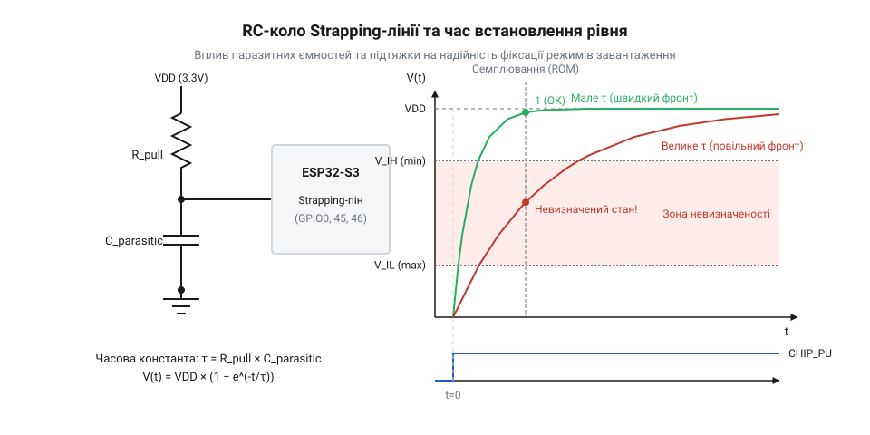
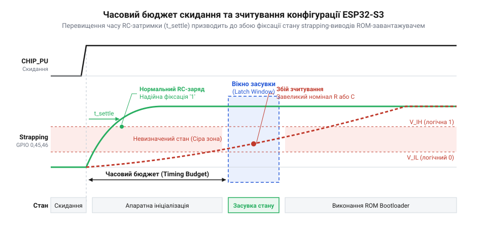

# Розрахунок часових констант RC-кіл та порогів напруги strapping-виводів під час скидання

<preknowlist>
- [Мікроконтролер ESP32-S3](root:cat-hw-boards/esp32s3-microcontroller) — принципи роботи підсистеми скидання CHIP_PU, вхідні логічні пороги V_IL та V_IH і внутрішній генератор тактування
- [Родина плат і модулів на ESP32-S3](root:cat-hw-boards/esp32-s3-boards-family-overview) — призначення strapping-виводів GPIO0, GPIO45, GPIO46 та стандартні варіанти конфігурації режимів завантаження
- [Схемотехніка та розпіновка шин Octal SPI Flash та PSRAM в ESP32-S3](root:cat-hw-boards/esp32-s3-octal-spi-bus-layout) — залежність напруги живлення Flash VDD_SPI від логічного стану виводу GPIO45 під час зняття сигналу скидання
</preknowlist>

## Чому ESP32-S3 стартує з помилковим режимом

Під час розробки схемотехніки на базі [мікроконтролера ESP32-S3](root:cat-hw-boards/esp32s3-microcontroller) інженери стикаються з хаотичною поведінкою пристрою при подачі живлення або натисканні кнопки скидання. Плата періодично відмовляється завантажувати прошивку з зовнішньої @@en|Flash-пам'яті@@, випадково впадає у @@en|ROM Download mode@@, втрачає зв'язок із шиною пам'яті або формує некоректну напругу на регуляторі V_DD_SPI. На перший погляд схема здається правильною: розробник встановлює класичні підтягуючі резистори 10 кОм на спеціальні @@en|strapping-виводи@@ (від англ. *strap* — ремінь або стрічка для фіксації початкового стану) GPIO0, GPIO45 та GPIO46.

Однак апаратна логіка старту первинного завантажувача @@en|System on Chip@@ (SoC) працює за жорстким часовим алгоритмом. У момент зняття сигналу скидання @@en|CHIP_PU@@ внутрішній модуль @@en|ROM Bootloader@@ фіксує (стробує) логічні рівні на цих трьох виводах для конфігурування системних режимів:

*   Вивід GPIO0 визначає джерело завантаження: логічна одиниця (1) активує старт із зовнішньої @@en|Flash-пам'яті@@ через шину SPI, а логічний нуль (0) переводить мікроконтролер у режим завантаження через послідовний порт @@en|ROM Download mode@@. *   Вивід GPIO45 задає вихідну напругу внутрішнього @@en|LDO-регулятора@@ живлення пам'яті V_DD_SPI: логічний нуль (0) відповідає 3.3 В, а логічна одиниця (1) перемикає регулятор на 1.8 В для низьковольтних чипів. *   Вивід GPIO46 у комбінації з GPIO0 визначає джерела виводу системних логів @@en|ROM Bootloader@@ та конфігурацію інтерфейсу @@en|JTAG@@.

Провідники друкованої плати, контактні площадки мікросхеми, захисні @@en|ESD-діоди@@ та вхідні каскади виводів володіють неминучою паразитною ємністю C_par. Коли сигнал скидання @@en|CHIP_PU@@ стає високим, напруга на @@en|strapping-виводі@@, підтягнутому через резистор 10 кОм, не зростає миттєво. Вона змінюється за експоненціальним законом заряду ємності через опір підтяжки @@en|pull-up@@ (від англ. *pull up* — підтягувати вгору до шини живлення).

Якщо паразитне навантаження лінії занадто велике або фронт наростання живлення затягнутий, напруга на виводі до моменту стробування не встигає досягти порогу логічної одиниці V_IH. В результаті @@en|ROM Bootloader@@ помилково зчитує 0 замість 1. Заниження напруги на GPIO0 викликає несподіваний вхід у режим прошивки, а викривлення сигналу на GPIO45 подає 1.8 В на 3.3 В пам'ять, що повністю блокує зчитування інструкцій.

Для запобігання збоям у серійних пристроях, включаючи модулі з [родині плат ESP32-S3](root:cat-hw-boards/esp32-s3-boards-family-overview) та плати [ESP32-S3 SuperMini](root:cat-hw-boards/esp32-s3-supermini), інженеру необхідно побудувати строгу математичну модель перехідних процесів та часового бюджету @@en|timing budget@@ скидання.

## Динамічна модель заряду strapping-лінії при скиданні

Для кількісного аналізу перехідних процесів при знятті імпульсу скидання сформуємо еквівалентну електричну схему @@en|strapping-лінії@@. Схема складається з джерела живлення V_DD, еквівалентного опору підтяжки R_eq, паразитної ємності C_par та струму витоку I_leak через вхідний каскад виводу й ізоляцію плати.

Еквівалентний опір R_eq враховує паралельне з'єднання зовнішнього резистора підтяжки R_pull та внутрішнього опору підтяжки SoC R_int_pull (якщо він активований при скиданні):

```
R_eq = (R_pull × R_int_pull) ÷ (R_pull + R_int_pull)    [паралельне з'єднання опорів]
```

Якщо внутрішню підтяжку вимкнено, еквівалентний опір дорівнює номіналу зовнішнього резистора: R_eq = R_pull.

Рівняння струмів за першим законом Кірхгофа у вузлі @@en|strapping-виводу@@ при заряді ємності від початкового стану V(0) = 0 В має вигляд:

```
C_par × (dV ÷ dt) + (V(t) - V_DD) ÷ R_eq + I_leak = 0
C_par × (dV ÷ dt) + V(t) ÷ R_eq = V_DD ÷ R_eq - I_leak    [групування змінних]
dV ÷ dt + V(t) ÷ (R_eq × C_par) = (V_DD - I_leak × R_eq) ÷ (R_eq × C_par)    [ділення на C_par]
```

Розв'язок цього лінійного диференціального рівняння з початковою умовою V(0) = 0 В дає експоненціальну формулу миттєвої напруги V(t) на @@en|strapping-виводі@@:

```
V(t) = (V_DD - I_leak × R_eq) × (1 - e^(-t ÷ tau))    [розв'язок рівняння заряду RC-кола]
```

де tau — часова константа заряду RC-кола:

```
tau = R_eq × C_par                                      [визначення часової константи tau]
```

Аналіз отриманого співвідношення показує два критичні ефекти:

1. **Асимптотичне обмеження напруги**: Струм витоку I_leak створює спад напруги на підтяжці R_eq. Усталена максимальна напруга дорівнює V_max = V_DD - I_leak × R_eq. Занадто великий опір R_eq при наявності витоку помітно знижує підсумковий логічний рівень. 2. **Швидкість наростання фронту**: За інтервал t = 1 × tau напруга досягає 63.2% від V_max, за t = 2.3 × tau — 90%, а за t = 3 × tau — 95%.

Проведемо чисельний розрахунок динаміки напруги для типової конфігурації @@en|strapping-лінії@@.

**Розрахунок часової константи та напруги для лінії GPIO0 з підтяжкою 10 кОм**

Умови розрахунку: напруга живлення V_DD = 3.3 В, опір підтяжки R_pull = 10 кОм (10000 Ом), внутрішню підтяжку вимкнено (R_eq = 10000 Ом), паразитна ємність C_par = 30 пФ (30 × 10⁻¹² Ф), струм витоку I_leak = 2 мкА (2 × 10⁻⁶ А).

```
tau = R_eq × C_par
    = 10000 × 30 × 10⁻¹²                       [підстановка опору й ємності]
    = 300 × 10⁻⁹ с = 300 нс                    [обчислення часової константи tau]

V_max = V_DD - I_leak × R_eq
      = 3.3 - 2 × 10⁻⁶ × 10000                 [врахування падіння від витоку]
      = 3.3 - 0.02 = 3.28 В                    [усталена асимптотична напруга]

V(500 нс) = 3.28 × (1 - e^(-500 ÷ 300))
          = 3.28 × (1 - e^(-1.667))            [обчислення показника експоненти]
          = 3.28 × (1 - 0.1889)                [значення експоненційної функції]
          = 3.28 × 0.8111 = 2.66 В             [напруга на виводі через 500 нс]
```

Через 500 нс після зняття скидання напруга на виводі GPIO0 досягає 2.66 В. Для оцінки надійності стартапу це значення необхідно зіставити з вхідними порогами завантажувача SoC.

## Пороги напруги та вікно стробування Bootloader

Вхідні каскади виводів GPIO мікроконтролера ESP32-S3 оснащені буферами з гістерезисом @@en|Schmitt trigger@@ (від прізвища американського винахідника *Otto Schmitt* — тригер Шмітта). Це забезпечує захист від завад, проте вимагає достатньої амплітуди сигналу під час засувки @@en|strapping-параметрів@@.

При напрузі живлення V_DD = 3.3 В вхідні порогові рівні ESP32-S3 становлять:

*   `V_IL`: Максимальна напруга вхідного нуля (0.25 × V_DD = 0.825 В). Напруга нижче V_IL гарантовано розпізнається як 0. *   `V_IH`: Мінімальна напруга вхідної одиниці (0.75 × V_DD = 2.475 В). Напруга вище V_IH гарантовано розпізнається як 1. *   **Сіра зона (зона невизначеності)**: Інтервал від 0.825 В до 2.475 В. При потраплянні напруги в цю зону стан тригера Шмітта є невизначеним.

Виведемо формулу критичного часу встановлення напруги t_settle, необхідного для зростання V(t) від 0 В до порогового рівня логічної одиниці V_IH.

Для визначення часу встановлення t_settle прирівнюємо миттєву напругу V(t) до порогового рівня V_IH (знехтувавши малим струмом витоку):

```
V_IH = V_DD × (1 - e^(-t_settle ÷ tau))
1 - V_IH ÷ V_DD = e^(-t_settle ÷ tau)                    [ділення на V_DD та перенесення]
e^(t_settle ÷ tau) = V_DD ÷ (V_DD - V_IH)                [інверсія обох частин]
t_settle ÷ tau = ln(V_DD ÷ (V_DD - V_IH))                [логарифмування обох частин]
t_settle = tau × ln(V_DD ÷ (V_DD - V_IH))                [виведення часу встановлення t_settle]
```

Підставимо порогове співвідношення для логічної одиниці V_IH = 0.75 × V_DD:

```
V_DD ÷ (V_DD - 0.75 × V_DD) = V_DD ÷ (0.25 × V_DD) = 4   [обчислення відношення напруг]
t_settle = tau × ln(4)                                   [підстановка у формулу]
t_settle ≈ 1.3863 × tau                                  [числовий розрахунок множника]
```

Для надійного фіксування одиниці на @@en|strapping-виводі@@ напруга має заряджатися протягом часу, що перевищує 1.39 × tau. При tau = 300 нс час встановлення становить t_settle = 1.3863 × 300 нс ≈ 416 нс.


*Електрична схема RC-кола strapping-виводу ESP32-S3 та графік заряду ємності лінії C_par відносно порогів V_IL та V_IH.*

Стробування @@en|strapping-виводів@@ здійснюється @@en|ROM Bootloader@@ у часовому вікні t_sample, прив'язаному до моменту переходу сигналу @@en|CHIP_PU@@ через поріг розблокування системного генератора.

Після наростання @@en|CHIP_PU@@ виникає апаратна затримка запуску внутрішнього RC-генератора та стабілізації частоти, після чого завантажувач фіксує значення вхідних регістрів. Для коректної роботи мають виконуватися дві умови:

1. **Час встановлення (setup time)**: Напруга на виводі повинна досягти рівня V > V_IH до моменту вибірки: t_settle < t_sample. 2. **Час утримання (hold time)**: Напруга зобов'язана залишатися вище V_IH протягом усього вікна засувки t_hold.

При проектуванні [схемотехніки Octal SPI](root:cat-hw-boards/esp32-s3-octal-spi-bus-layout) стан виводу GPIO45 є вирішальним. Якщо через велику ємність сигнал на GPIO45 у момент t_sample потрапляє у сіру зону, регулятор V_DD_SPI може встановити напругу 1.8 В замість 3.3 В, позбавивши Flash-пам'ять живлення і спричинивши циклічне перезавантаження чипу.

Розуміння меж V_IL, V_IH та часу t_settle створює математичну основу для розрахунку часового бюджету імпульсу скидання @@en|CHIP_PU@@.

## Розрахунок часового бюджету імпульсу CHIP_PU

Під час практичної експлуатації [мікроконтролера ESP32-S3](root:cat-hw-boards/esp32s3-microcontroller) розробники іноді спостерігають ситуацію, коли пристрій стабільно стартує при повільній подачі живлення, але відмовляється завантажуватися при швидкому натисканні кнопки скидання або спрацюванні зовнішнього супервізора. Причина полягає у порушенні апаратного часового бюджету @@en|timing budget@@ між моментом розряджання фільтруючих ємностей і вікном вибірки @@en|strapping-виводів@@.

Сигнал @@en|CHIP_PU@@ (від англ. *Chip Power Up*) є головним входом скидання та увімкнення @@en|System on Chip@@ (SoC). Він керує як запуском внутрішнього генератора тактування, так і часовим референсом, відносно якого @@en|ROM Bootloader@@ фіксує стану виводів GPIO0, GPIO45 та GPIO46.

При натисканні кнопки скидання конденсатор обв'язки лінії скидання C_reset розряджається через внутрішній опір замкнутої кнопки або відкритий транзистор супервізора R_sw. Зміна напруги V_pu(t) на лінії скидання описується функцією розряду:

```
V_pu(t) = V_DD × e^(-t ÷ (R_sw × C_reset))                [розряд ємності кнопки скидання]
```

Для повного скидання внутрішніх тригерів напруга V_pu(t) повинна опуститися нижче порогу вхідного нуля V_IL_chip (приблизно 0.25 × V_DD = 0.825 В):

```
V_IL_chip = V_DD × e^(-t_discharge ÷ (R_sw × C_reset))
e^(t_discharge ÷ (R_sw × C_reset)) = V_DD ÷ V_IL_chip    [ділення та інверсія рівняння]
t_discharge = R_sw × C_reset × ln(V_DD ÷ V_IL_chip)       [логарифмування обох частин]
t_discharge = R_sw × C_reset × ln(4)                      [підстановка порогу V_IL_chip = 0.25 × V_DD]
t_discharge ≈ 1.3863 × R_sw × C_reset                    [час розряду лінії скидання]
```

Мінімальна тривалість імпульсу скидання t_reset повинна перевищувати t_discharge плюс апаратний час цифрової фільтрації завад t_filter: t_reset ≥ t_discharge + t_filter.

Після розмикання кнопки напруга на виводі @@en|CHIP_PU@@ зростає через зовнішній підтягуючий резистор R_pu_chip (зазвичай 10 кОм) та ємність C_reset:

```
V_pu(t) = V_DD × (1 - e^(-t ÷ tau_chip))                  [заряд лінії CHIP_PU]
tau_chip = R_pu_chip × C_reset                           [часова константа кола скидання]
```

Активація внутрішнього 8 МГц RC-генератора та схеми керування живленням відбувається у момент досягнення напругою порогу розблокування V_pu_enable (0.75 × V_DD = 2.475 В). Тривалість цього етапу t_pu_rise становить:

```
t_pu_rise = tau_chip × ln(V_DD ÷ (V_DD - V_pu_enable))
          = tau_chip × ln(4)                             [підстановка V_pu_enable = 0.75 × V_DD]
t_pu_rise ≈ 1.3863 × tau_chip                            [час наростання напруги до V_pu_enable]
```

Після переходу V_pu(t) через поріг V_pu_enable внутрішньому генератору потрібен час стабілізації частоти t_osc (типово від 50 мкс до 100 мкс), після чого цифровий автомат запуску формує строб засувки t_sample:

```
t_sample_delay = t_pu_rise + t_osc                       [абсолютна затримка моменту стробування]
```

Для гарантованого зчитування логічної одиниці на @@en|strapping-виводах@@ (зокрема GPIO0 для стартапу з SPI Flash та GPIO45 для видачі 3.3 В на регулятор V_DD_SPI при [схемотехніці Octal SPI](root:cat-hw-boards/esp32-s3-octal-spi-bus-layout)) напруга V_strap(t) має досягти порогу V_IH до моменту вибірки t_sample_delay.

Зважаючи, що час досягнення порогу V_IH дорівнює t_settle = tau_strap × ln(4), фундаментальна умова належного часового бюджету має вигляд:

```
t_settle < t_sample_delay                                [загальна умова часового бюджету]
tau_strap × ln(4) < t_pu_rise + t_osc                    [розгорнута часова нерівність]
```


*Часова діаграма співвідношення імпульсу скидання CHIP_PU, інтервалу встановлення напруги t_settle та вікна засувки strapping-стану ROM Bootloader.*

Якщо t_settle перевищує t_sample_delay, значення на виводі зчитується у сірій зоні або як логічний нуль, що приводить до помилкового перемикання живильного @@en|LDO-регулятора@@ V_DD_SPI на 1.8 В або несподіваного входу у @@en|ROM Download mode@@.

**Розрахунок часового бюджету скидання для плат на базі ESP32-S3**

Умови розрахунку: опір підтяжки скидання R_pu_chip = 10 кОм (10000 Ом), конденсатор скидання C_reset = 100 нФ (100 × 10⁻⁹ Ф), затримка генератора t_osc = 80 мкс (80 × 10⁻⁶ с), параметри @@en|strapping-лінії@@: R_pull = 10 кОм, C_par = 40 пФ (40 × 10⁻¹² Ф).

```
tau_chip = R_pu_chip × C_reset
         = 10000 × 100 × 10⁻⁹                          [підстановка параметрів kola CHIP_PU]
         = 10⁻³ с = 1 мс                                [часова константа лінії CHIP_PU]

t_pu_rise = tau_chip × ln(4)
          = 1 мс × 1.3863 = 1.3863 мс                   [час наростання напруги CHIP_PU]

t_sample_delay = t_pu_rise + t_osc
               = 1.3863 мс + 0.080 мс                   [додавання затримки генератора]
               = 1.4663 мс = 1466.3 мкс                 [абсолютна затримка вибірки Bootloader]

tau_strap = R_pull × C_par
          = 10000 × 40 × 10⁻¹²                         [підстановка опору й ємності лінії]
          = 400 × 10⁻⁹ с = 400 нс = 0.4 мкс            [часова константа strapping-лінії]

t_settle = tau_strap × ln(4)
         = 0.4 мкс × 1.3863 ≈ 0.5545 мкс               [час встановлення напруги V_IH]

t_margin = t_sample_delay - t_settle
         = 1466.3 мкс - 0.5545 мкс ≈ 1465.7 мкс        [обчислення запасу часу]
```

Значення t_settle (0.55 мкс) на кілька порядків менше за t_sample_delay (1466.3 мкс), що гарантує абсолютну стабільність вибірки логічних рівнів для [модулів ESP32-S3-WROOM-1](root:cat-hw-boards/esp32-s3-wroom-modules-family) та серійних пристроїв з [родині плат на ESP32-S3](root:cat-hw-boards/esp32-s3-boards-family-overview).

## Граничні межі опорів підтяжки й ємностей

Хоча типові рекомендації пропонують використовувати зовнішній опір підтяжки @@en|pull-up@@ 10 кОм, реальні умови експлуатації розширюють діапазон електричних параметрів. При підвищеній вологості або забрудненні друкованої плати виникають струми витоку I_leak, а підключення зовнішньої периферії збільшує паразитно-вхідну ємність C_par. Для забезпечення 100% завадостійкості необхідно вивести граничні математичні межі R_pull,max та C_par,max.

Зовнішній резистор підтяжки R_pull разом зі струмом витоку I_leak утворює дільник напруги. Усталене значення асимптотичної напруги V_max при заряді ємності становить:

```
V_max = V_DD - I_leak × R_pull                           [усталена напруга з урахуванням витоку]
```

Для надійного зчитування логічної одиниці напруга V_max повинна перевищувати поріг V_IH із заданим запасом завадостійкості V_margin:

```
V_max ≥ V_IH + V_margin
V_DD - I_leak × R_pull ≥ V_IH + V_margin
I_leak × R_pull ≤ V_DD - V_IH - V_margin                 [перегрупування членів нерівності]
R_pull ≤ (V_DD - V_IH - V_margin) ÷ I_leak              [ділення на струм витоку]
```

Звідси формулюється вираження для максимально допустимого опору підтяжки R_pull,max:

```
R_pull,max = (V_DD - V_IH - V_margin) ÷ I_leak          [максимально допустимий опір підтяжки]
```

Враховуючи, що V_IH = 0.75 × V_DD, вираз спрощується до:

```
R_pull,max = (0.25 × V_DD - V_margin) ÷ I_leak          [гранична формула опору підтяжки]
```

**Розрахунок граничного опору підтяжки для умов промислової експлуатації**

Умови розрахунку: напруга живлення V_DD = 3.3 В, поріг одиниці V_IH = 2.475 В, необхідний запас напруги V_margin = 0.15 В, струм витоку лінії в умовах підвищеної вологості I_leak = 12 мкА (12 × 10⁻⁶ А).

```
R_pull,max = (3.3 - 2.475 - 0.15) ÷ (12 × 10⁻⁶)
           = 0.675 ÷ (12 × 10⁻⁶)                        [різниця допустимого спаду напруги]
           = 56250 Ом = 56.25 кОм                       [максимальний опір підтяжки]
```

Якщо розробник обере резистор номіналом 100 кОм, спад напруги від витоку складе 100 кОм × 12 мкА = 1.2 В, знизивши V_max до 2.1 В < V_IH (2.475 В). В результаті мікроконтролер при підвищенні температури чи вологості втратить здатність зчитувати 1 на даному виводі.

Друге обмеження стосується динамічної швидкості заряду. Час встановлення напруги t_settle не повинен перевищувати наявний часовий бюджет t_budget до моменту вибірки:

```
t_settle ≤ t_budget
R_eq × C_par × ln(4) ≤ t_budget
C_par ≤ t_budget ÷ (R_eq × ln(4))                       [ділення на опір та логарифм]
```

Звідси виводиться формула гранично допустимої паразитної ємності C_par,max:

```
C_par,max = t_budget ÷ (R_eq × 1.3863)                  [максимально допустима паразитна ємність]
```

**Розрахунок граничної ємності траси для компактних плат**

Умови розрахунку: критичний часовий бюджет засувки t_budget = 20 мкс (20 × 10⁻⁶ с), опір підтяжки R_pull = 10 кОм (10000 Ом), внутрішня підтяжка вимкнена (R_eq = 10000 Ом).

```
C_par,max = 20 × 10⁻⁶ ÷ (10000 × ln(4))
          = 20 × 10⁻⁶ ÷ (10000 × 1.3863)                [підстановка часового бюджету]
          = 20 × 10⁻⁶ ÷ 13863                          [значення знаменника]
          = 1.4426 × 10⁻⁹ Ф ≈ 1.44 нФ                   [гранична ємність лінії]
```

Якщо до @@en|strapping-виводу@@ на [плати ESP32-S3-Zero](root:cat-hw-boards/esp32-s3-zero) або [платах ESP32-S3 SuperMini](root:cat-hw-boards/esp32-s3-supermini) підключити небуферизовану зовнішню схему з ємністю 4.7 нФ, час встановлення зросте до 10000 × 4.7 × 10⁻⁹ × 1.3863 = 65.15 мкс > 20 мкс, що зумовить регулярні збої визначення режимів стартапу.

Для модулів на основі [компактних SiP-модулів ESP32-S3-MINI-1](root:cat-hw-boards/esp32-s3-mini-sip-modules) дотримання межі C_par,max досягається мінімізацією довжини трас і відмовою від прямих зовнішніх ємнісних фільтрів на @@en|strapping-лініях@@.

## Розрахунок завадостійкості та вибір компонентів обв'язки

Отримані граничні значення R_pull,max та C_par,max дозволяють перейти до формулювання інженерної методики вибору конкретних номіналів passive-компонентів обв'язки ліній скидання та @@en|strapping-виводів@@ ESP32-S3.

У промислових умовах на лінії зв'язку діють високочастотні імпульсні завади, наведені через ємнісні зв'язки від сусідніх швидкісних шин або силових перетворювачів. Заряд завади Q_noise = ∫ I_noise(t) dt, потрапляючи на @@en|strapping-вузол@@, викликає миттєву зміну напруги ΔV_noise:

```
ΔV_noise = Q_noise ÷ C_total                             [зміщення напруги від завади]
```

де C_total = C_par + C_ext — сумарна ємність вузла з урахуванням доданого зовнішнього фільтруючого конденсатора C_ext.

Для запобігання хибному перемиканню логічного рівня енергія завади E_noise, поглинута вузлом, не повинна перевищувати енергетичний запас завадостійкості E_margin:

```
E_margin = 0.5 × C_total × (V_max² - V_IH²)              [енергетичний запас логічної одиниці]
```

Якщо сумарна ємність вузла C_total занадто мала (наприклад, лише 15 пФ паразитної ємності траси), навіть незначний наведений імпульс заряду Q_noise = 0.3 нКл викликає стрибок напруги ΔV = 0.3 нКл ÷ 15 пФ = 20 В (що обмежується внутрішніми захисними @@en|ESD-діодами@@, але повністю спотворює логічний стан під час стробування).

Додавання невеликого керамічного конденсатора C_ext = 470 пФ збільшує ємність вузла до C_total = 485 пФ, знижуючи зсув напруги від тієї ж завади до ΔV = 0.3 нКл ÷ 485 пФ ≈ 0.62 В, що утримує потенціал лінії вище порогу V_IH.

**Інженерна методика вибору компонентів обв'язки ESP32-S3**

Для забезпечення 100% надійності стартапу пристроїв в умовах промислових завад вибір номіналів здійснюється у три послідовні кроки:

1. **Вибір обв'язки лінії CHIP_PU**:
    *   Рекомендовано обирати C_reset = 100 нФ (кераміка X7R) та R_pu_chip = 10 кОм. *   Це забезпечує tau_chip = 1 мс та t_pu_rise ≈ 1.39 мс. *   Зазначена затримка гарантує, що сигнал скидання залишається в активному низькому стані протягом усього інтервалу наростання живлення t_ramp < 1 мс, повністю виключаючи збої через @@en|brownout@@ первинного джерела.

2. **Оптимізація підтяжки strapping-ліній R_pull**:
    *   Стандартне значення 10 кОм створює струм споживання 330 мкА у замкнутому на землю стані та забезпечує t_settle ≈ 416 нс (при C_total = 30 пФ). *   Зниження опору до 4.7 кОм зменшує t_settle до 195 нс і вдвічі знижує вихідний імпеданс вузла, підвищуючи стійкість до струмів витоку I_leak та статики.

3.  **Контроль коефіцієнта запасу часу K_margin**:
    *   Для гарантованого засуву параметрів відношення затримки вибірки Bootloader до часу встановлення напруги має задовольняти умову:

```
K_margin = t_sample_delay ÷ t_settle ≥ 10             [критерій надійності часового бюджету]
```

**Обґрунтування обв'язки для промислового контролера на ESP32-S3**

Умови розрахунку для промислового модуля (на прикладі плат [Waveshare ESP32-S3 Touch LCD 1.28](root:cat-hw-boards/waveshare-esp32-s3-touch-lcd-1-28), [Waveshare ESP32-S3R2](root:cat-hw-boards/esp32-s3r2-waveshare) або [відеозахоплення ESP32-S3](root:cat-hw-boards/esp32-s3-cam-boards-overview)):
Параметри лінії @@en|CHIP_PU@@: R_pu_chip = 10 кОм, C_reset = 100 нФ, затримка генератора t_osc = 80 мкс. Параметри лінії GPIO0: R_pull = 4.7 кОм (4700 Ом), паразитна ємність C_par = 25 пФ, зовнішній фільтруючий конденсатор C_ext = 470 пФ (470 × 10⁻¹² Ф). Сумарна ємність вузла C_total = 25 пФ + 470 пФ = 495 пФ.

```
tau_chip = 10000 × 100 × 10⁻⁹ = 1 мс
t_pu_rise = 1 мс × 1.3863 = 1.3863 мс = 1386.3 мкс
t_sample_delay = 1386.3 мкс + 80 мкс = 1466.3 мкс

tau_strap = R_pull × C_total
          = 4700 × 495 × 10⁻¹²                         [підстановка опору й сумарної ємності]
          = 2.3265 × 10⁻⁶ с ≈ 2.33 мкс                 [часова константа фільтрованої лінії]

t_settle = tau_strap × ln(4)
         = 2.3265 мкс × 1.3863                         [обчислення часу досягнення V_IH]
         = 3.225 мкс                                   [час встановлення напруги V_IH]

K_margin = t_sample_delay ÷ t_settle
         = 1466.3 мкс ÷ 3.225 мкс                      [обчислення коефіцієнта запасу]
         = 454.6                                       [підсумковий запас часу]
```

Отриманий коефіцієнт K_margin = 455 суттєво перевищує мінімальний поріг (10). Встановлення конденсатора C_ext = 470 пФ підвищує завадостійкість лінії у 20 разів, зберігаючи більше ніж 400-кратний запас часового бюджету скидання. Це забезпечує 100% надійність визначення режимів завантаження та вибору напруги V_DD_SPI у найжорсткіших промислових умовах.