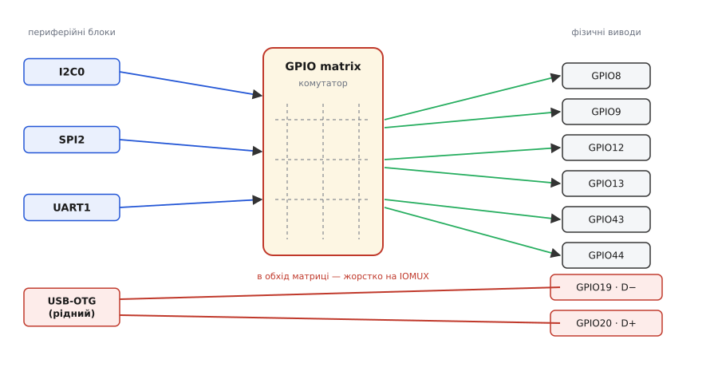
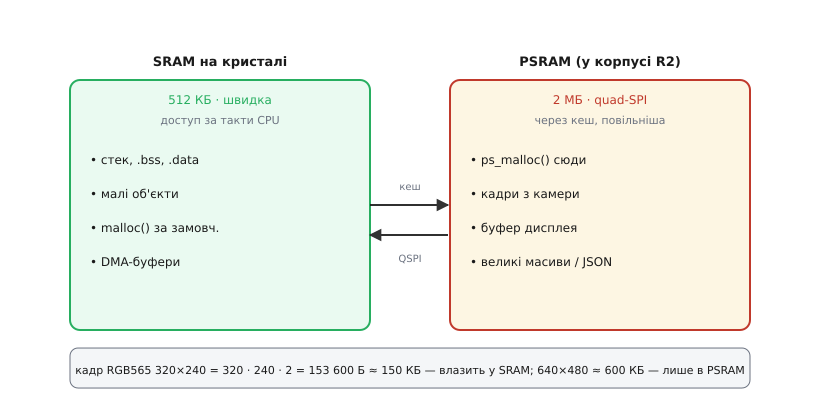

# ⚙️ Код для ESP32-S3-Pico: шини на довільних ногах, PSRAM, WS2812, рідний USB, сон

**Задача.** Плата вже в руках, кабель устромлено — і тепер треба змусити її робити корисне: завести давач по I²C на тих ногах, які зручно розвести, а не на тих, що «прийнято»; вивести на дисплей кадр, який не влазить у внутрішню пам'ять; блимнути вбудованим світлодіодом так, щоб він справді засвітився; віддавати журнал у комп'ютер по рідному USB без окремого перехідника; і, коли пристрій живиться від акумулятора, — приспати всю схему до майже нуля струму. Кожна з цих дрібниць має свою пастку, специфічну саме для ESP32-S3, і саме на них тут спіткаються найчастіше. Розберемо кожну як робочий шматок прошивки. Код скрізь показано вкладками: Arduino (найшвидший старт), ESP-IDF (те саме без обгорток), а де задача не є суто ESP32-івською — ще й STM32 HAL, бо сама робота на будь-якому мікроконтролері та сама, різняться лише назви функцій.

Одразу домовимося про рівні, бо це наскрізна умова всього коду нижче: **усі GPIO працюють на 3.3 В і не терплять 5 В**. Кожен приклад припускає, що давач, дисплей чи інша плата теж на 3.3-вольтовій логіці або під'єднані через перетворювач рівнів. Це не формальність — подача 5 В на ногу вбиває вхід чипа тихо й назавжди.

## Чому будь-яка нога: комутатор усередині чипа

Почнемо з того, що робить цю плату приємною в розводці й водночас плутає новачків. У класичному мікроконтролері периферійний блок «прибитий» до конкретних ніжок: I²C-контролер виведений на дві визначені ноги заводом, і крапка. В ESP32-S3 між периферійними блоками й фізичними виводами стоїть **комутатор — GPIO matrix**: майже будь-який внутрішній сигнал (SDA, SCK, TX, вихід ШІМ) можна спрямувати майже на будь-яку ногу програмно. Ви не «знаходите правильну ногу» — ви **призначаєте зручну**.


*Ліворуч — периферійні блоки, праворуч — фізичні виводи, посередині — GPIO matrix. Будь-який блок комутується на будь-яку вільну ногу (зелені стрілки) — тому SDA/SCK/TX ви задаєте в коді. Виняток — рідний USB: його лінії D−/D+ ідуть повз матрицю прямо на GPIO19/GPIO20 через швидший тракт IOMUX, і перенести їх не можна.*

З цього виходить проста, але важлива обережність: **у прикладах з інтернету номери ніг майже завжди інші, ніж у вас**, і це нормально — автор просто вибрав свої. Копіюєте чужий скетч — звіряйте, куди він призначає SDA/SCK, і міняйте на свої. Половина «давач не відповідає» — це саме розбіжність призначених ніг, а не поламане залізо.

> 🔧 **Навіщо це.** Свобода розводки — не косметика. Коли ви паяєте плату на власний носій (а `castellated`-контакти цієї версії саме для цього), ви ведете доріжки як зручно топології плати, а не вигинаєте їх під фіксовану розпіновку. Комутатор дозволяє вивести I²C на дві сусідні ноги в потрібному куті — і зекономити перехрещення на друкованій платі. Внутрішня схема комутатора й ціна цієї гнучкості (крихітна затримка, обмеження на найшвидші сигнали): [GPIO matrix ESP32: внутрішня схема](root:hw-arch/gpio-matrix-internals).

## I²C на своїх ногах

Найчастіший інтерфейс давачів — I²C: дві лінії (дані SDA, такт SCL), спільні для багатьох пристроїв, кожен зі своєю адресою. Контролеру I²C у будь-якому середовищі кажуть те саме: які ноги, яка частота такту й до якої адреси стукати. Різниця ESP32-S3 лише в першому пункті — ноги тут параметр коду, а не заводська фіксація: в Arduino вони йдуть аргументами `Wire.begin(sda, scl)`, в ESP-IDF — полями `i2c_config_t`.

Візьмемо схему з опису плати: давач сидить на SDA=GPIO8, SCL=GPIO9, живиться з виходу 3V3. Прочитаємо, скажімо, ходовий барометр BMP280 (адреса 0x76) — спершу переконаємось, що він узагалі відповідає на шині:

:::tabs
:::code api-quickstart/c/arduino/i-c-na-svoikh-nohakh.ino
:::code api-quickstart/c/esp-idf/i-c-na-svoikh-nohakh.c
:::code api-quickstart/c/stm32/i-c-na-svoikh-nohakh.c
:::

Тут захована найтиповіша I²C-пастка, і вона не в коді, а в залізі: **лінії I²C потребують підтяжок до 3.3 В**. SDA і SCL — це виходи з відкритим стоком: пристрої вміють тягнути лінію в нуль, але підняти її в одиницю мусить зовнішній резистор (типово 4.7 кОм) на кожну лінію. Багато готових модулів давачів уже несуть ці резистори на собі — тоді додавати нічого; але гола мікросхема без підтяжок дасть саме оту «тишу на шині», хоч би код був бездоганний. Внутрішні підтяжки ESP32-S3 (одиниці десятків кОм) для I²C зазвичай заслабкі — покладатися на них не варто.

> Чому саме відкритий стік і навіщо резистор, звідки береться 4.7 кОм і як ємність довгих проводів псує форму сигналу: [Шина I²C](root:com-devices/i2c-bus). Це основа, без якої «підтяг не той» лишається магією.

Друга шина I²C, коли треба два незалежні набори давачів, заводиться як окремий контролер:

:::tabs
```arduino
TwoWire i2cB = TwoWire(1);   // контролер I²C №1 (нульовий — це Wire)
i2cB.begin(11, 12, 400000);  // SDA=GPIO11, SCL=GPIO12, 400 кГц
```
```esp-idf
i2c_config_t cfgB = {                       // контролер I²C №1 (нульовий уже зайнято)
  .mode = I2C_MODE_MASTER, .sda_io_num = 11, .scl_io_num = 12,
  .sda_pullup_en = GPIO_PULLUP_ENABLE, .scl_pullup_en = GPIO_PULLUP_ENABLE,
  .master.clk_speed = 400000,               // SDA=GPIO11, SCL=GPIO12, 400 кГц
};
i2c_param_config(I2C_NUM_1, &cfgB);
i2c_driver_install(I2C_NUM_1, cfgB.mode, 0, 0, 0);
```
```stm32
extern I2C_HandleTypeDef hi2c2;   // другий контролер — окремий периферійний блок
                                  // зі своїми, наперед відомими ногами; вибору нема
HAL_I2C_Init(&hi2c2);             // частота — у hi2c2.Init.ClockSpeed
```
:::

Читання самих даних давача — уже його специфіка (регістри, калібрування), тут вона не важлива; важливо, що **вихід на шину й вибір ніг** ви тепер контролюєте повністю.

## SPI на своїх ногах

SPI швидший за I²C і йде на дисплеї, SD-картки, радіомодулі. Ліній чотири: такт SCK, дані від ведучого MOSI, дані до ведучого MISO і вибір пристрою CS. Налаштування скрізь однакове за змістом — ноги, частота такту, режим (CPOL/CPHA), керування CS — і різниться лише тим, де його записують: в Arduino на ESP32-S3 ноги йдуть аргументами `SPI.begin(sck, miso, mosi, ss)`, в ESP-IDF — полями `spi_bus_config_t`, на STM32 — налаштуваннями самого периферійного блоку:

:::tabs
:::code api-quickstart/c/arduino/spi-na-svoikh-nohakh.ino
:::code api-quickstart/c/esp-idf/spi-na-svoikh-nohakh.c
:::code api-quickstart/c/stm32/spi-na-svoikh-nohakh.c
:::

Ключове в SPI — це **одночасний обмін**: `SPI.transfer` за один такт і виштовхує байт, і зчитує те, що ведений подав назустріч; окремих «читати» й «писати» на рівні шини немає. Число в `SPISettings` — частота такту; ESP32-S3 тягне десятки мегагерц, але реальну стелю диктує не чип, а якість проводів і сам ведений пристрій — на макетці з довгими дротами 10 МГц безпечніше за 40.

Одна тонкість саме через комутатор: коли SPI виведено на **власні, довільні** ноги (як тут), сигнал іде через GPIO matrix, і на найвищих частотах це додає крихітну затримку. Якщо ганяєте SPI на межі швидкості й ловите збої — варто перевірити, чи не лягли ноги на прямий тракт IOMUX; для повсякденних десятків мегагерц різниці не відчути.

> Що таке режими SPI (CPOL/CPHA), чому MSBFIRST, як CS розділяє кілька пристроїв на одній шині: [Шина SPI](root:com-devices/spi-bus). Порядок бітів і фаза такту — саме те, що найчастіше плутають між ведучим і веденим.

## UART на своїх ногах

Послідовний порт UART — дві лінії (передача TX, прийом RX), кожна сторона шле у свою. На платі ноги GPIO43/GPIO44 навіть підписані як штатні TX/RX, але й тут ви вільні призначити інші. Апаратних UART у чипі кілька, і другий із них заводять окремо від журнального: в Arduino це об'єкт `Serial1`, в ESP-IDF — `UART_NUM_1`, на STM32 — окремий `huartN`:

:::tabs
```arduino
void setup() {
  Serial.begin(115200);              // це журнал у USB (див. нижче)
  Serial1.begin(9600, SERIAL_8N1, /*RX=*/44, /*TX=*/43);  // окремий пристрій
}

void loop() {
  if (Serial1.available())           // прийшов байт від зовнішнього пристрою
    Serial.write(Serial1.read());    // пересилаємо його в журнал
}
```
:::code api-quickstart/c/esp-idf/uart-na-svoikh-nohakh.c
:::code api-quickstart/c/stm32/uart-na-svoikh-nohakh.c
:::

Тут криється пастка, від якої губляться цілими вечорами: **канал у комп'ютер і фізичний UART до зовнішнього заліза — це різні порти**, хоч у коді вони й виглядають однаково. Журнальний на цій платі за замовчуванням іде по рідному USB, не займаючи жодної зовнішньої ноги (в Arduino це `Serial`, в ESP-IDF — консоль), а другий — це UART на призначених вами ногах для розмови з іншим залізом (GPS-модуль, інший МК, датчик із UART-виходом): `Serial1` в Arduino, `UART_NUM_1` в ESP-IDF. Плутанина «чому мій GPS мовчить, хоч Serial щось друкує» майже завжди — сплутані ці два порти.

`SERIAL_8N1` — це формат кадру: 8 біт даних, без біта парності (N), 1 стоповий біт. Швидкість (9600, 115200…) мусить збігтися з обох боків до біта, інакше на прийомі буде каша.

> Як улаштований кадр UART — старт-біт, біти даних, стоп-біт — і чому швидкість треба задати однакову з обох сторін: [Кадр UART](root:com-devices/uart-frame). Асинхронність без спільного такту тримається саме на точній домовленості про швидкість.

## PSRAM: 2 мегабайти під кадри й буфери

Тепер про пам'ять — головну причину, чому беруть саме версію з суфіксом «R2». Вбудованої швидкої SRAM у чипі 512 КБ, і з неї добра частина зайнята стеком, системою, Wi-Fi-стеком — вільними лишаються сотні кілобайтів, часто фрагментованих. Щойно вам треба суцільний великий блок — кадр із камери, буфер дисплея, великий масив під обробку сигналу, розлогий JSON із мережі, — цих сотень кілобайтів не вистачає. Тут і вмикається **PSRAM: 2 МБ додаткової пам'яті просто в корпусі R2**, під'єднані до чипа по чотирилінійній шині (quad-SPI) і видимі в адресному просторі через кеш. Ви працюєте покажчиком як зі звичайною пам'яттю — обмін по шині захований.


*Дві пам'яті поряд. Ліворуч — вбудована SRAM: швидка, мала, туди йдуть стек, дрібні об'єкти, буфери DMA і звичайний `malloc`. Праворуч — PSRAM: місткіша, трохи повільніша (через кеш і QSPI), туди явно кладуть `ps_malloc` великі рідко-чіпані буфери. Знизу — арифметика кадру: RGB565 320×240 важить ≈150 КБ і ще влазить у SRAM, а 640×480 ≈600 КБ — лише в PSRAM.*

Порядок дій завжди однаковий: **увімкнути → перевірити, що піднялася → виділяти явно**. Увімкнути — у середовищі: в Arduino IDE це пункт **Tools → PSRAM → «QSPI PSRAM»** (саме quad для R2, не octal — октальну має інша версія, 8R), в ESP-IDF — `CONFIG_SPIRAM` у `menuconfig`. Без цього кроку жодне виділення з PSRAM не вдасться, хоч би чип її й мав.

Перевірити наявність — один рядок на старті, щоб брак виявився тут, а не пізніше загадковим `NULL`:

:::tabs
:::code api-quickstart/c/arduino/psram-2-mehabaity-pid.ino
:::code api-quickstart/c/esp-idf/psram-2-mehabaity-pid.c
:::

Тепер саме виділення. У Arduino на ESP32 є коротка обгортка `ps_malloc(size)` — той самий `malloc`, але гарантовано з PSRAM. Заведемо кадровий буфер дисплея 320×240 у форматі RGB565 (два байти на піксель):

:::code api-quickstart/c/arduino/psram-2-mehabaity-pid-2.ino

Під капотом `ps_malloc` — це `heap_caps_malloc(size, MALLOC_CAP_SPIRAM)`: універсальний виклик ESP-IDF, де прапорцем ви кажете, з якої пам'яті брати блок. Той самий приклад мовою IDF, щоб було видно механізм і одразу — вибір «велике в PSRAM, гаряче й дрібне у внутрішній»:

:::code api-quickstart/c/esp-idf/psram-2-mehabaity-pid-2.c

Перевірити, скільки якої пам'яті лишилось у будь-який момент, — `heap_caps_get_free_size` із тим самим прапорцем (`MALLOC_CAP_SPIRAM` для зовнішньої, `MALLOC_CAP_INTERNAL` для внутрішньої). Це той рядок, що рятує від «чомусь падає, коли даних побільшало»: видно наживо, яка пам'ять кінчається першою.

Головне правило розміщення просте й випливає з фізики доступу: **велике й рідко-чіпане — у PSRAM, дрібне й гаряче — у внутрішній SRAM**. Кадр, який перемальовують кілька разів на секунду, повільність PSRAM не помітить. А от буфер, який смикають у тісному циклі чи всередині обробника переривання, у PSRAM гальмуватиме на кожному промаху кеша — і, гірше, може взагалі стати недосяжним у певні моменти. Ця друга, підступніша пастка PSRAM (недосяжність, поки кеш флеші вимкнено під час запису у флеш чи в обробнику переривання) заслуговує окремого розбору — тут лише тримайте в голові: **буфери під DMA й дані обробників переривань кладіть у внутрішню SRAM**, не в PSRAM.

> Повний цикл роботи з зовнішньою RAM — дві стратегії розміщення, поріг автоматичного `malloc`, і головна пастка «поки кеш флеші вимкнено, PSRAM недосяжна» з робочим кодом: [Робота з зовнішньою RAM на ESP32](root:hw-arch/psram/proj-esp32-psram.md). Саме там пояснено, чому дані ISR і буфери запису у флеш мусять лишатися внутрішніми.

## Вбудований WS2812 на GPIO21

На платі один адресний світлодіод WS2812 на GPIO21 — зручний індикатор стану. «Адресний» означає, що колір йому задають не трьома окремими виводами (як звичайному RGB-діоду), а **одним потоком точно витриманих у часі бітів по одній лінії**: усередині діода сидить крихітний контролер, що ловить 24 біти (по 8 на червоний, зелений, синій) і тримає заданий колір. Саме тому його **не можна засвітити простим `digitalWrite`** — потрібен сигнал із наносекундною точністю тривалостей, а звичайна нога перемикається надто грубо й нерівномірно (переривання, кеш збивають тайминг).

ESP32 має для цього спеціальну периферію — **RMT**, апаратний генератор точних імпульсних послідовностей: ви віддаєте йому байти, він сам формує біти з витриманим таймінгом, поки процесор зайнятий іншим. Готові обгортки ховають цю периферію за одним викликом: в Arduino це функція `rgbLedWrite(pin, r, g, b)`, в ESP-IDF — компонент `led_strip`; обидві під капотом піднімають той самий RMT:

:::tabs
:::code api-quickstart/c/arduino/vbudovanyi-ws2812-na.ino
:::code api-quickstart/c/esp-idf/vbudovanyi-ws2812-na.c
:::

Дві дрібниці, на яких спотикаються. Перша: **порядок кольорів у WS2812 фізично GRB**, не RGB — але обидві обгортки приймають аргументи як (червоний, зелений, синій) і самі переставляють їх у потрібний порядок, тож думати про GRB тут не треба; думати доведеться, якщо перейдете на сторонню бібліотеку зі стрічкою й побачите переплутані червоний із зеленим. Друга: **тримайте яскравість низькою для індикатора** — значення 20–40 цілком видно, а повні 255 сліплять і марно гріють; для одного діода це дрібниця, для стрічки з десятків — уже помітний струм.

Якщо кероване не один діод, а стрічка, беруть бібліотеку (FastLED, Adafruit NeoPixel) — вона так само стоїть на RMT, але дає зручний масив пікселів і ефекти.

> Чому колір — це потік бітів по одній лінії, як кодуються «0» і «1» різною тривалістю імпульсу і чому таймінг мусить бути наносекундно точним: [таймінг WS2812 у коді](root:hw-motion/addressable-leds/api-ws2812-protocol.md). Там видно, звідки саме береться вимога апаратного генератора замість `digitalWrite`.

## Рідний USB: журнал і режим USB-пристрою

Тепер про фішку, заради якої тут два USB-канали в одному кабелі. ESP32-S3 має **власний, рідний USB-контролер** просто в чипі (лінії D−/D+ на GPIO19/GPIO20) — і це принципово більше, ніж класичний перехідник USB↔UART. Через рідний USB чип може прикидатися будь-яким USB-пристроєм: послідовним портом (CDC), флешкою, клавіатурою, — і сам себе перепрошивати без окремого перехідника.

Найпростіший режим — **CDC, тобто послідовний порт по USB**. Коли ви друкуєте журнал звичним способом, а в налаштуваннях увімкнено рідний USB, він іде в комп'ютер **прямо через USB-контролер чипа**, не займаючи жодної фізичної ноги UART. В Arduino IDE це вмикають двома пунктами: **Tools → USB CDC On Boot → Enabled** і **Tools → USB Mode → «USB-OTG (TinyUSB)»**; в ESP-IDF ту саму роль грає компонент `esp_tinyusb` із класом CDC-ACM. Після цього звичний код працює як завжди — просто журнал тепер фізично тече по рідному USB:

:::tabs
:::code api-quickstart/c/arduino/ridnyi-usb-zhurnal-i.ino
:::code api-quickstart/c/esp-idf/ridnyi-usb-zhurnal-i.c
:::

Тут ховається пастка, унікальна саме для рідного USB, — оте очікування хоста на старті (`while (!Serial …)` в Arduino, `tud_cdc_connected()` в ESP-IDF). На класичному перехіднику UART порт існує завжди, і перший рядок ніколи не губиться. А рідний USB **з'являється в системі лише після того, як прошивка стартувала й підняла USB-стек**; поки комп'ютер не «побачив» і не відкрив порт, ранні рядки журналу летять у нікуди. Тому на старті дають цю коротку паузу — інакше найперші повідомлення (часто найважливіші, про ініціалізацію) просто зникають, і здається, що плата мертва.

Друга сторона рідного USB — **режим повноцінного USB-пристрою**. Чип може постати перед комп'ютером клавіатурою (HID) чи мишею й слати натискання, флешкою (MSC) з файлами на внутрішньому сховищі, або кількома віртуальними портами заразом. Робить це в обох середовищах той самий стек TinyUSB — Arduino лише накриває його бібліотеками `USBHIDKeyboard`, `USBMSC` та іншими, тоді як в ESP-IDF з ним працюють напряму. Ось мінімальний приклад — плата, увімкнена в комп'ютер, «натискає» клавіші сама:

:::tabs
:::code api-quickstart/c/arduino/ridnyi-usb-zhurnal-i-2.ino
:::code api-quickstart/c/esp-idf/ridnyi-usb-zhurnal-i-2.c
:::

І тут — головна практична обережність рідного USB: **GPIO19 і GPIO20 зайняті, поки ви ним користуєтесь**. Це ті самі ноги D−/D+, і, на відміну від решти сигналів, вони **не ходять через комутатор** — вони прибиті до USB-контролера через IOMUX і перенести їх нікуди. Тож якщо задіяли рідний USB (журнал по CDC, режим пристрою) — викресліть GPIO19/GPIO20 зі списку вільних для своєї периферії. Спроба повісити на них давач, поки активний USB, дасть або мовчазний конфлікт, або зникнення USB-порту. Ще підступніше: навіть якщо USB у коді не використовуєте, ці дві ноги з'єднані з роз'ємом, тож коли кабель устромлено, зовнішня схема на них конфліктує з лініями USB — тож для власної периферії їх краще обходити взагалі.

> Як улаштований рідний USB усередині ESP32-S3, чим CDC-порт по USB відрізняється від UART-прошивання і чому чип може сам себе перепрошити без перехідника: [USB в ESP32](root:sf-devices/esp32-usb). Це пояснює, звідки взялася сама можливість «двох каналів в одному кабелі».

## Глибокий сон: як приспати всю схему

Останнє — автономність. Пристрій на акумуляторі більшість часу нічого не робить: давач раз на хвилину прокидається, міряє, шле показник у мережу й знову засинає. Уся економія — в тому, наскільки глибоко він спить між цими сплесками. ESP32-S3 має **глибокий сон (deep sleep)**: ядра, Wi-Fi, більшість периферії вимикаються, лишається жити тільки крихітний RTC-домен, що вміє розбудити чип за таймером або зовнішнім сигналом. Струм падає з десятків міліампер до одиниць мікроампер.

Логіка коду незвична для тих, хто звик до нескінченного головного циклу: **після глибокого сну чип не «прокидається туди, де заснув» — він стартує з нуля, як після скидання**. Уся оперативна пам'ять (окрім невеликого RTC-шматка) стирається; програма починається знову з точки входу — `setup()` в Arduino, `app_main()` в ESP-IDF. Тому глибокий сон — це не пауза всередині логіки, а «зроби діло → засни → почни спочатку». Ось скелет вимірювача, що прокидається щохвилини:

:::tabs
:::code api-quickstart/c/arduino/hlybokyi-son-iak-pryspaty.ino
:::code api-quickstart/c/esp-idf/hlybokyi-son-iak-pryspaty.c
:::

Крім таймера, чип уміє прокидатися від **зовнішнього сигналу на нозі** — натиснута кнопка, спрацьований датчик руху. Для цього нога має належати до RTC-домену (на ESP32-S3 це GPIO0–GPIO21), бо решта чипа спить:

```cpp
  // прокинутися, коли на GPIO0 з'явиться високий рівень (натиснута кнопка):
  esp_sleep_enable_ext0_wakeup(GPIO_NUM_0, 1);   // 1 = будити по одиниці
  esp_deep_sleep_start();
```

А тепер — те, заради чого ця плата має окрему ногу, і чого немає на голому чипі. Навіть у найглибшому сні сам ESP32-S3 та обв'язка плати тягнуть якийсь струм; якщо на платі ще висять зовнішні давачі, вони споживають свій. Для по-справжньому довгого життя від батареї хочеться вимкнути **всю схему цілком**, а не лише приспати чип. Тут працює вивід **3V3_EN**: він керує внутрішнім перетворювачем 3.3 В, і **замикання 3V3_EN на землю глушить перетворювач — гасне вся 3.3-вольтова частина плати разом із давачами**.

Це не програмний прийом, а апаратний: щоб ним скористатися, потрібен зовнішній вимикач — наприклад, наднизькоспоживчий таймер або кнопка, що на час сну замикає 3V3_EN на GND, а для роботи відпускає. Схема «прокинутись за розкладом» тоді будується вже поза чипом: маленька мікросхема-таймер тримає плату знеструмленою й подає живлення (відпускає 3V3_EN) лише на секунди виміру. Так струм у сплячці падає нижче за все, що може дати сам глибокий сон чипа, — бо спить не чип, а вимкнена вся плата. Ціна — окремий зовнішній вузол керування живленням і те, що плата в такому сні втрачає навіть RTC-час (вона ж повністю знеструмлена), тож розклад мусить тримати зовнішній таймер.

> Що саме вимикається в кожному режимі сну ESP32, скільки лишається жити RTC-домен і звідки беруться ті одиниці мікроампер: [Режими сну](root:hw-arch/sleep-modes). Розуміння, що спить, а що ні, — ключ до того, чому просто `esp_deep_sleep_start()` іноді дає більший струм, ніж очікуєш.

## Пастки, стисло

Зведемо докупи те, на чому спотикаються найчастіше саме на цій платі — кожна з описаного вище, щоб було де швидко звіритися:

- **5 В на GPIO.** Чип суто 3.3-вольтовий і не терпить 5 В на жодному вході. З'єднання з 5-вольтовою логікою — тільки через перетворювач рівнів або хоча б дільник. Це вбиває плати найтихіше й найчастіше.
- **Живлення «навпаки».** VSYS — вхід (сюди подають 3.7–6 В), 3V3 — вихід перетворювача. Подача напруги ззовні на ногу 3V3 в обхід перетворювача псує плату. Живите ззовні — на VSYS.
- **I²C без підтяжок.** SDA/SCL мусять мати підтяжку до 3.3 В (типово 4.7 кОм). Готові модулі часто вже з нею; гола мікросхема без резисторів дасть «тишу на шині» попри бездоганний код. Внутрішні підтяжки заслабкі.
- **Сплутані `Serial` і `Serial1`.** `Serial` іде в комп'ютер по рідному USB, `Serial1` — фізичний UART на ваших ногах для зовнішнього заліза. «GPS мовчить, хоч Serial друкує» — майже завжди це.
- **Перші рядки в рідний USB губляться.** Порт з'являється лише після старту прошивки й підняття USB-стека; ранні `Serial.println` летять у нікуди. Дочекайтеся хоста на старті: `while (!Serial && millis() < 3000)` в Arduino, `tud_cdc_connected()` в ESP-IDF.
- **GPIO19/GPIO20 при USB.** Це лінії рідного USB, прибиті до IOMUX (комутатор їх не чіпає). Задіяли USB — не вішайте на них периферію; вони конфліктують із роз'ємом навіть без коду.
- **Гарячі дані в PSRAM.** Дрібне, часто-чіпане, буфери DMA й дані обробників переривань — тільки у внутрішній SRAM. У PSRAM тримайте велике й рідке (кадри, буфери дисплея); інакше — гальмування на промахах кеша, а часом і виняток недосяжності.
- **PSRAM не ввімкнено.** Без пункту Tools → PSRAM (QSPI для R2) чи `CONFIG_SPIRAM` у menuconfig виділення мовчки повертає `NULL`. Перевіряйте наявність на старті (`psramFound()` / `esp_psram_is_initialized()`), а не ловіть падіння пізніше.
- **WS2812 через `digitalWrite`.** Адресний діод так не засвітити — потрібен наносекундний таймінг. Уживайте обгортку над RMT: `rgbLedWrite(21, r, g, b)` в Arduino, компонент `led_strip` в ESP-IDF.
- **Strapping-виводи під жорсткою підтяжкою.** GPIO0 (BOOT), GPIO3, GPIO45, GPIO46 при вмиканні задають режим старту. Як звичайні GPIO — можна, але постійна зовнішня підтяжка на них нав'яже «не той» режим, і плата не стартує.
- **Сон, що не «продовжується».** Після глибокого сну — новий старт із `setup()`, а не повернення в місце засинання; оперативна пам'ять (крім RTC) стирається. Будуйте логіку як «зробив → заснув → почав спочатку».
