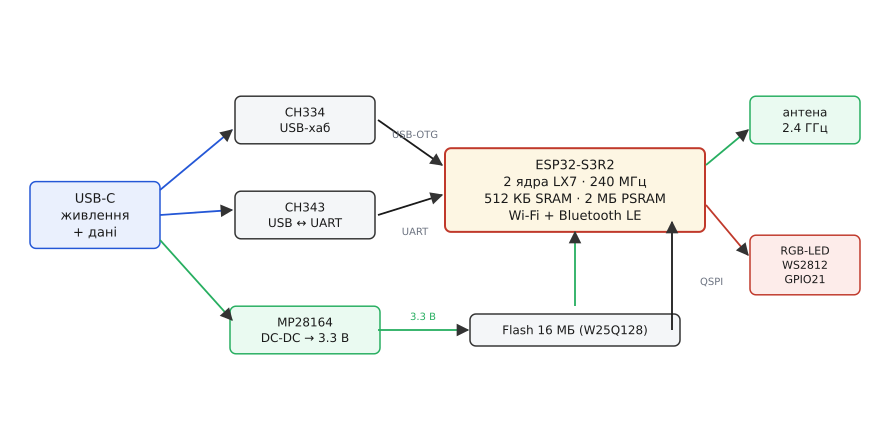
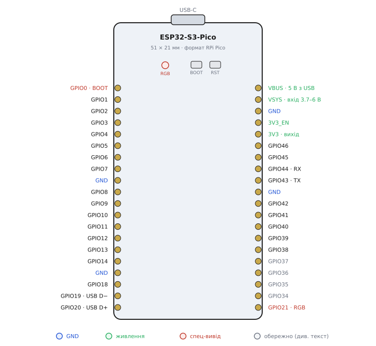

# Waveshare ESP32-S3-Pico

<preknowlist>
- [ESP32-S3 SuperMini](root:cat-hw-boards/esp32-s3-supermini) — розуміння архітектури чипа ESP32-S3 та нативного USB.
</preknowlist>

## Форм-фактор Pico та два виконання

Багато розробників уже мають плати розширення, створені для Raspberry Pi Pico, і хочуть використовувати їх із потужнішими чипами. Waveshare ESP32-S3-Pico розв'язує цю задачу: вона фізично повторює розмір та розташування виводів Raspberry Pi Pico. Це означає, що ви можете вставити її в ту саму макетну плату або шилд, замінивши базовий мікроконтролер на [Мікроконтролер ESP32-S3](root:cat-hw-boards/esp32s3-microcontroller).

*Анатомія плати показує щільне компонування елементів, що дозволяє вмістити багату периферію в стандартні габарити Pico.*

Плата існує у двох виконаннях: базова версія з напівкруглими контактними майданчиками (@@en|castellated@@), які дозволяють припаювати її як поверхневий компонент на іншу плату, та версія Pico-M із заздалегідь припаяними штировими гребінками для швидкого старту на макетній платі. Геометрія залишається ідентичною, тому вибір залежить лише від того, чи планується інтеграція плати у власний пристрій.

## Начинка плати та подвійний USB

У серці плати працює чип ESP32-S3R2. Він містить двоядерний процесор із частотою 240 МГц і, що найважливіше, має 2 МБ вбудованої оперативної пам'яті PSRAM. Додатково на платі розпаяно 16 МБ зовнішньої QSPI-флеш-пам'яті. Такий обсяг пам'яті дозволяє працювати з важкими інтерфейсами, буферизувати аудіо або обробляти графіку, що недоступно простішим платам на кшталт [ESP32-S3 SuperMini](root:cat-hw-boards/esp32-s3-supermini).

Для живлення в автономному режимі плата використовує стабілізатор MP28164. Це @@en|buck-boost@@ перетворювач, який вміє і знижувати, і підвищувати напругу, стабільно видаючи 3.3 В навіть тоді, коли напруга акумулятора падає нижче цього рівня.

Особливістю плати є система підключення USB. Щоб не обирати між нативним USB (для емуляції пристроїв) та апаратним UART (для гарантованого виводу логів), тут застосовано хаб на базі мікросхем CH334 та CH343. Один фізичний порт USB-C підключається до комп'ютера і розгалужується на два логічні пристрої: нативний USB мікроконтролера та мікросхему перетворювача USB-UART. Це дає змогу одночасно прошивати чип, дивитися логи та тестувати USB-протоколи через один кабель.

## Лінії живлення та пастки виводів

Хоча плата повторює геометрію Pico, логіка виводів чипа ESP32-S3 має свої жорсткі межі. Всі виводи GPIO працюють із напругою 3.3 В і не толерантні до 5 В — подача п'яти вольт на сигнальний вивід спалить вхідний каскад.

*Призначення виводів: плата дублює номери GPIO, але вимагає обережності з лініями живлення та службовими контактами.*

На платі є два важливі контакти живлення: `VSYS` та `3V3`. Контакт `VSYS` — це вхід, через який можна живити плату напругою від 3.7 до 6 В (наприклад, від Li-Po акумулятора). А от `3V3` — це вихід внутрішнього стабілізатора MP28164. Найгірше, що можна зробити, — подати напругу живлення безпосередньо на `3V3`. Це пустить струм в обхід захисних діодів і знищить стабілізатор.

Інша пастка — конфігураційні виводи (@@en|strapping@@). Під час увімкнення мікроконтролер зчитує стан кількох GPIO (наприклад, GPIO0 та GPIO46), щоб зрозуміти, у якому режимі завантажуватись. Якщо ви підключите до них периферію, яка примусово тягне ці лінії до землі або живлення під час старту, плата просто не запуститься або не зможе прошитись. Також слід пам'ятати, що виводи GPIO19 та GPIO20 зайняті нативним USB — якщо ви перепризначите їх у коді, зв'язок по USB перерветься.

## Способи живлення та завантаження коду

Плату можна живити двома штатними способами: через порт USB-C (5 В від комп'ютера або зарядного пристрою) або підключивши джерело 3.7–6 В до контакту `VSYS`. Завдяки вбудованому перетворювачу плата сама розбереться, звідки брати струм, і автоматично перемкнеться на батарею, якщо USB відключити.

Завантаження коду відбувається через той самий єдиний порт USB-C. Завдяки наявності моста CH343, середовище розробки самостійно переводить мікроконтролер у режим прошивання за допомогою сигналів DTR/RTS. Однак, якщо програма в чипі зависла або ви випадково переналаштували лінії нативного USB, автозавантаження може не спрацювати. На цей випадок на платі є кнопки BOOT і RESET. Щоб перевести чип у режим завантажувача вручну, затисніть BOOT, коротко натисніть RESET, а потім відпустіть BOOT. Після цього плата з'явиться в системі як COM-порт, готовий прийняти нову прошивку.
