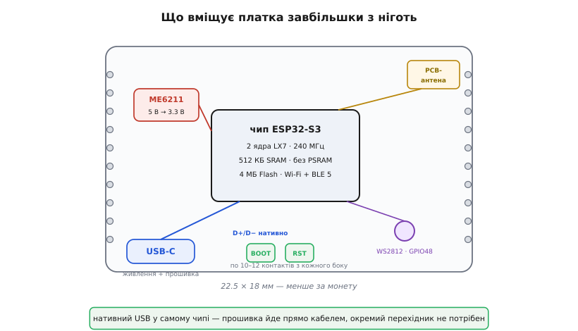
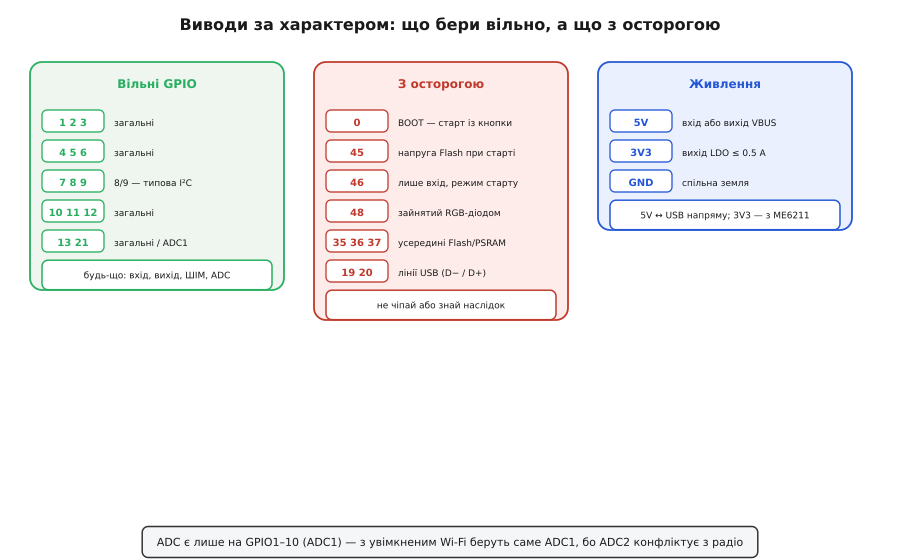

# ESP32-S3 SuperMini

<preknowlist>
- [Мікроконтролер ESP32-S3](root:cat-hw-boards/esp32s3-microcontroller) — архітектура чипа, призначення двох ядер та особливості нативного USB
</preknowlist>

## Повноцінний ESP32-S3 розміром із марку

Розмістити розумний бездротовий вузол у тісному корпусі буває складно, коли стандартні плати не вміщаються за габаритами. Плата ESP32-S3 SuperMini розв'язує цю проблему, пропонуючи потужний двоядерний [Мікроконтролер ESP32-S3](root:cat-hw-boards/esp32s3-microcontroller) у формфакторі розміром усього 18×22 мм. Щоб досягти такої компактності, розробникам довелося вивести назовні меншу кількість контактів і пожертвувати додатковою місткою пам'яттю — @@en|PSRAM@@ (псевдостатична оперативна пам'ять, pseudo-static RAM). Відсутність цієї пам'яті обмежує можливості плати: вона не здатна тримати великі буфери кадрів (@@en|framebuffer@@) для зображень, транслювати відео високої роздільної здатності чи обробляти масивні аудіобуфери, на відміну від плат із наявною @@en|PSRAM@@, як-от [Waveshare ESP32-S3R2](root:cat-hw-boards/esp32-s3r2-waveshare). Проте плата зберігає нативний інтерфейс USB-C та 4 МБ флешпам'яті, що робить її зручною для мініатюрних проєктів, хоча й вимагає уважності під час роботи з виводами.

## Що розташовано на платі

Анатомія плати підпорядкована максимальній економії місця. Центральним елементом є екранований чип, над яким на краю плати розміщена вбудована @@en|PCB-антена@@. 

*Розташування елементів на платі: гніздо USB-C, чип, антена у вигляді доріжки на краю, регулятор живлення та адресний світлодіод.*

Антена є частиною мідної доріжки, тому її категорично не можна перекривати металевими елементами корпусу, щоб не заглушити сигнал Wi-Fi. Гніздо USB-C підключене безпосередньо до чипа, використовуючи його нативний інтерфейс. Живлення забезпечує @@en|LDO@@-регулятор ME6211, який перетворює 5 В із USB на робочі 3.3 В, але має жорсткий ліміт струму у 500 мА. Також на платі є адресний RGB-світлодіод WS2812, підключений до внутрішнього виводу GPIO48.

## Виводи, живлення та їхні пастки

Під час роботи з контактами плати важливо розрізняти вільні GPIO, службові виводи та піни живлення. 

*Призначення контактів плати: червоним виділено живлення, жовтим — стрепінг-виводи, синім — виводи ADC1, доступні під час роботи Wi-Fi.*

Подача 5 В на пін 3.3 В миттєво спалить чип, тому живлення від зовнішнього джерела 5 В слід подавати лише на спеціальний вивід 5V, звідки воно пройде через @@en|LDO@@-регулятор. Службові @@en|strapping@@-виводи (GPIO0, GPIO45, GPIO46) визначають режим завантаження мікроконтролера під час старту. Якщо підключити до них периферію, яка примусово тягне рівень до землі чи живлення в момент увімкнення, плата може не завантажитися. Ще одна пастка стосується аналогових виводів: під час активної роботи Wi-Fi мікроконтролер монополізує другий блок АЦП, тому для вимірювань залишаються придатними лише виводи, підключені до ADC1.

## Ручне прошивання комбінацією кнопок

Завдяки нативному USB-інтерфейсу, плата прошивається звичайним кабелем Type-C без зовнішніх UART-перехідників. Зазвичай мікроконтролер автоматично переходить у режим завантаження за командою з комп'ютера. Однак, якщо ваша власна програма зависла, переналаштувала виводи USB або перевела чип у глибокий сон, комп'ютер може перестати розпізнавати пристрій. У такому разі допомагає ручне прошивання комбінацією кнопок. Щоб примусово увійти в режим завантаження, потрібно затиснути кнопку BOOT, не відпускаючи її натиснути і відпустити кнопку RESET, а потім відпустити BOOT. Плата з'явиться в системі як новий пристрій, готовий до прийому прошивки, що дозволить врятувати її від програмного блокування.
